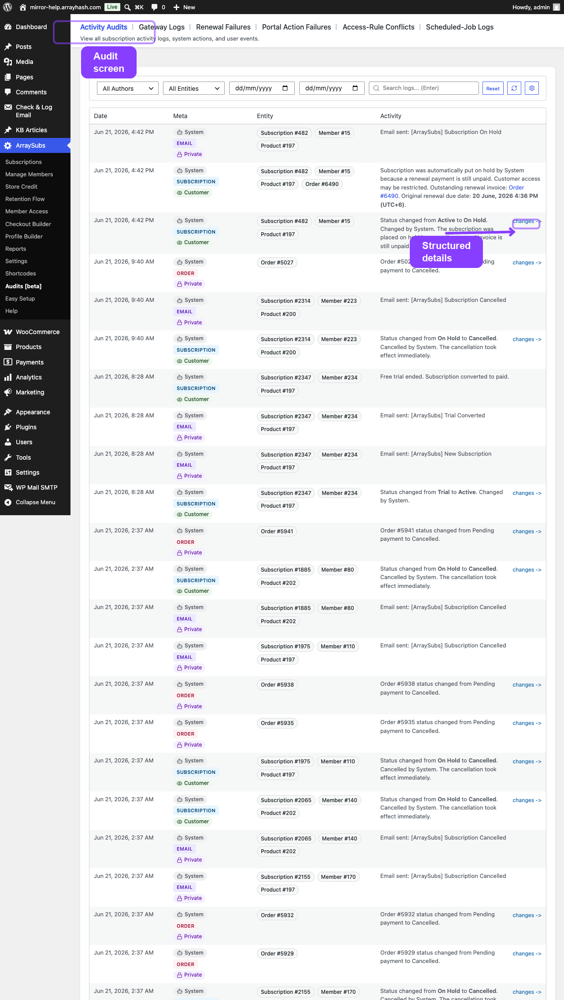
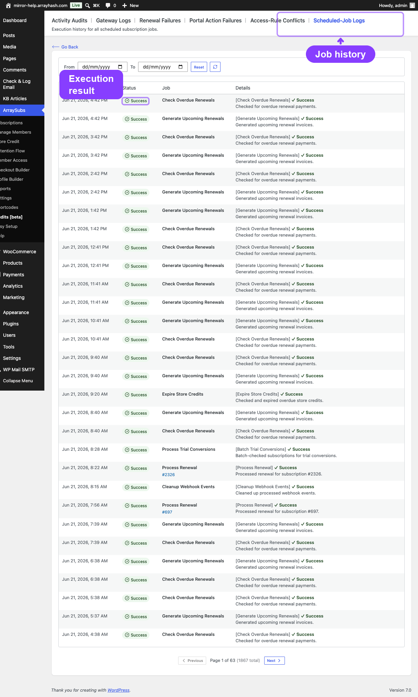
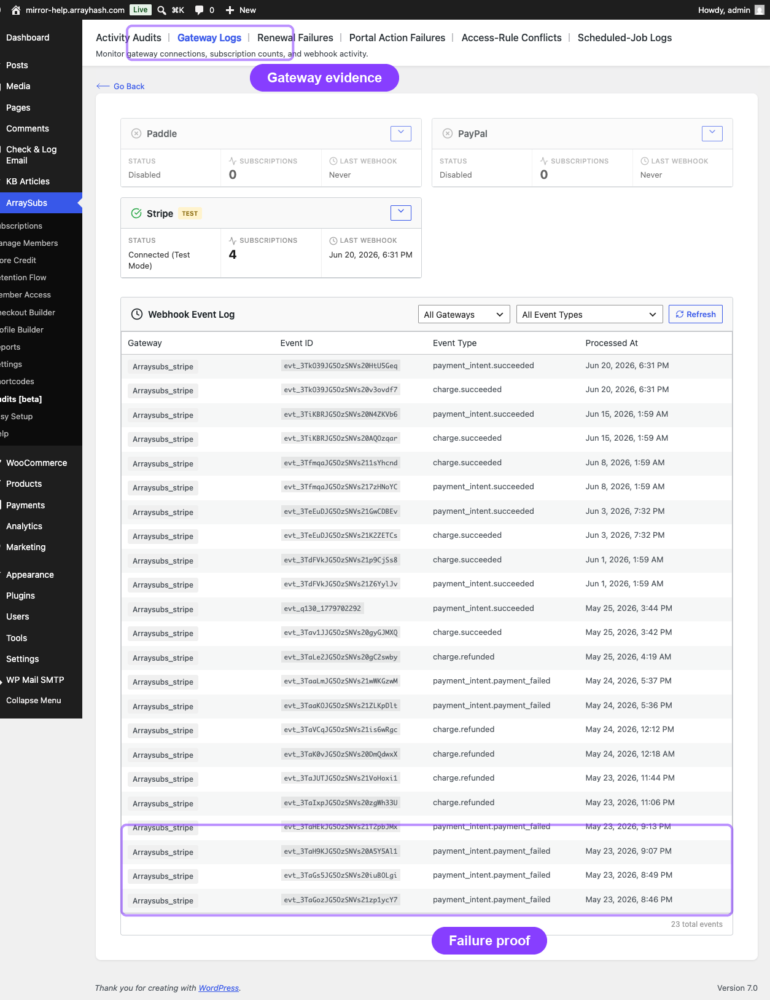

# Info
- Module: Audits and Logs
- Last updated: 2026-10-30

# Audits, Logs, and Troubleshooting

> Track every action that happens inside your subscription store, monitor scheduled jobs, review gateway health, and resolve common issues.

## Page Navigation

- **Current guide:** Audits, Logs, and Troubleshooting
- **Where to open it:** WordPress Admin -> ArraySubs -> Audit Logs
- **Section overview:** [Open overview](../README.md)
- **Previous guide:** [portal-action-failures](./portal-action-failures.md)
- **Next guide:** [renewal-failures](./renewal-failures.md)
- **Troubleshooting:** [Audits, Logs, and Troubleshooting](../audits-and-logs/README.md)

## Overview

ArraySubs records a detailed trail of everything that happens to subscriptions, members, products, orders, coupons, emails, and settings. The **Audit Logs** section gives you searchable, filterable views into this activity so you can answer support questions, diagnose billing problems, and verify that scheduled automation is running correctly.

Use this section as the manual's troubleshooting hub. If a merchant says "the plugin did the wrong thing," start here before changing settings. The audit pages tell you whether the action happened, which actor triggered it, which scheduled job ran, which gateway event arrived, and which customer/subscription/order IDs were involved.

The Audit Logs tabs use these labels, in this order. Individual tabs appear when their owning modules are available and switched on:

| Screen | What It Shows |
| -------- | -------------- |
| [Activities](activity-audits.md) | Logged changes across subscriptions, customers, orders and other entities |
| [Gateway health](../gateway-health/README.md) | Gateway connection status, capabilities and incoming gateway webhook events |
| [Renewal Errors](renewal-failures.md) | Failed renewal payments that still need attention |
| [Portal Errors](portal-action-failures.md) | Failed customer actions such as cancellation, pause and plan switching |
| [Access-Rule Conflicts](access-rule-conflicts.md) | Overlapping access rules and unexpected access decisions |
| [Jobs](scheduled-job-logs.md) | Scheduled-job execution history and failures |
| [Webhooks](../developers/webhooks.md#webhook-audit-page) | Outgoing request counts, success rates, delivery logs and attempts |

The separate **ArraySubs -> Webhooks** page manages outgoing endpoints and contains the receiver setup guide. **ArraySubs -> Audit Logs -> Webhooks** is the audit view. **Audit Logs** sits directly below **Settings** and before **License** in the WordPress admin menu when Pro is active.

The troubleshooting guides cover common problems independent of whether you run the free or Pro plugin:

| Guide | Covers |
|-------|--------|
| [Renewal Failures and Billing Issues](renewal-failures.md) | Failed renewals, missing invoices, grace period behavior, duplicate orders |
| [Portal Action Failures](portal-action-failures.md) | Cancellation, pause, skip, plan switch, and reactivation errors in the customer portal |
| [Access-Rule Conflicts](access-rule-conflicts.md) | Overlapping membership rules, condition evaluation, and content restriction debugging |
| [Payment Method and Shipping Update Issues](payment-and-shipping-issues.md) | Auto-renew toggle errors, card update failures, shipping address cutoff problems |

## Troubleshooting Entry Points

Use this decision table when you know the symptom but not the root cause yet.

| What the user reports | Start here | Then check |
|-----------------------|------------|------------|
| "A renewal did not charge" | [Renewal Failures and Billing Issues](renewal-failures.md) | [Scheduled-Job Logs](scheduled-job-logs.md), [Gateway Health Dashboard](../gateway-health/README.md), subscription notes |
| "The customer paid, but the subscription is still on-hold" | [Gateway Health Dashboard](../gateway-health/README.md) | Webhook event log, order notes, subscription payment timeline |
| "The customer cannot cancel, pause, skip, reactivate, or switch plans" | [Portal Action Failures](portal-action-failures.md) | Customer portal page, subscription status, feature settings, gateway capabilities |
| "Content access is wrong" | [Access-Rule Conflicts](access-rule-conflicts.md) | Member Access rules, role mapping, subscription status, cache compatibility |
| "Card update or auto-renew toggle failed" | [Payment Method and Shipping Update Issues](payment-and-shipping-issues.md) | Gateway capability card, payment token status, customer ownership |
| "Shipping address update failed" | [Payment Method and Shipping Update Issues](payment-and-shipping-issues.md) | Subscription shipping card, cutoff window, next payment date |
| "An admin changed something and we need to know who" | [Activity Audits](activity-audits.md) | Entity filter, author filter, date range, per-subscription notes |
| "A scheduled action is stuck or delayed" | [Scheduled-Job Logs](scheduled-job-logs.md) | Action Scheduler admin, hook name, job arguments, retry history |

## How to Investigate Any Issue

1. Capture the exact subscription ID, order ID, customer ID, and customer email from the report.
2. Open the subscription detail page and read the status, payment timeline, order history, and notes.
3. If money is involved, open the [Gateway Health Dashboard](../gateway-health/README.md) and confirm the relevant webhook event arrived.
4. If timing is involved, open [Scheduled-Job Logs](scheduled-job-logs.md) and look for renewal, reminder, expiry, pause, skip, or cancellation jobs.
5. If access is involved, open [Access-Rule Conflicts](access-rule-conflicts.md) and compare the customer's active subscriptions with the matching rules.
6. If a customer-facing button failed, open [Portal Action Failures](portal-action-failures.md) and verify the action's eligibility rules.
7. Record the finding in the subscription notes or support ticket with the IDs you checked.

## Common Evidence Sources

| Evidence source | Use it for | Where to find it |
|-----------------|------------|------------------|
| Subscription notes | Status changes, manual actions, gateway messages, admin notes | Subscription detail screen |
| Order notes | Payment completion, failed payment messages, refund records, store-credit reversal notes | WooCommerce order screen |
| Payment timeline | Gateway events, payment attempts, retry outcomes | Subscription detail screen |
| Activities | Cross-entity changes by admin, customer, gateway, or system | ArraySubs -> Audit Logs -> Activities |
| Jobs | Whether renewal, reminder, expiry, cancellation, or pause jobs executed | ArraySubs -> Audit Logs -> Jobs |
| Gateway health | Connection state, webhook URL, webhook event log, gateway capability matrix | ArraySubs -> Audit Logs -> Gateway health |
| Webhooks | Outgoing request counts, response times and delivery attempts | ArraySubs -> Audit Logs -> Webhooks |
| Customer portal state | Whether the customer saw the expected button, message, or disabled state | My Account -> Subscriptions |

## Edge-Case Map

Some issues look similar but need different fixes:

| Symptom | Distinguish it from | Why it matters |
|---------|---------------------|----------------|
| Renewal order exists but is unpaid | No renewal order was generated | Unpaid orders point to gateway/payment recovery; missing orders point to scheduling or renewal generation |
| Customer can see content but should not | Customer has another active subscription or mapped role | Check all active subscriptions and role rules before changing one access rule |
| Auto-renew toggle is hidden | Auto-renew toggle appears but fails | Hidden usually means gateway/status/feature ineligibility; failure means a request reached validation or the gateway |
| Shipping update is blocked | Shipping update is unavailable | Blocked may be cutoff-period logic; unavailable may mean the subscription does not need shipping |
| Scheduled cancellation did not end access immediately | Immediate cancellation failed | End-of-period cancellation intentionally keeps access until the paid term ends |
| Store credit disappeared after failed renewal | Store credit was reversed after failure | Check credit history for a matching reversal before manually adjusting the balance |

## Can I Use This as a Support Playbook?

Yes. For support teams, the quickest workflow is:

1. Search the customer in [Manage Members](../member-insight/member-lookup-and-profiles.md).
2. Open the subscription from the member profile.
3. Review notes, orders, timeline, and cards.
4. Use the symptom table above to open the correct troubleshooting guide.
5. Use [Login as Customer](../member-insight/member-lookup-and-profiles.md#login-as-customer) only when you need to see the customer's portal state exactly.

## Can I Troubleshoot Without Pro?

Yes, but with fewer screens. The free plugin provides subscription details, notes, order history, lifecycle status, customer portal pages and core settings. Open Gateway health and Renewal Errors through **Renewal Flow** when the Audit Logs menu is unavailable. Pro adds the Activities, Jobs and Portal Errors screens, plus outgoing Webhooks and its delivery audit when their modules are on.

## Where to Find Audits in the Admin

All audit and log screens are accessible from the main ArraySubs menu:

1. **ArraySubs -> Audit Logs -> Activities**
2. **ArraySubs -> Audit Logs -> Gateway health**
3. **ArraySubs -> Audit Logs -> Renewal Errors**
4. **ArraySubs -> Audit Logs -> Portal Errors**
5. **ArraySubs -> Audit Logs -> Access-Rule Conflicts**
6. **ArraySubs -> Audit Logs -> Jobs**
7. **ArraySubs -> Audit Logs -> Webhooks**

The Audit Logs module controls the Audit Logs menu. Turning it off hides that menu; the outgoing webhook audit remains reachable from **ArraySubs -> Webhooks** through **Open webhook audit** while the Webhooks module is on. Gateway health and Renewal Errors also remain available through **Renewal Flow**.

## Related Guides

- [Lifecycle Management](../manage-subscriptions/lifecycle-management.md) — status transitions that generate audit entries
- [Subscription Detail Cards](../manage-subscriptions/subscription-detail-cards.md) — per-subscription notes and change history
- [Automatic Payments](../checkout-and-payments/automatic-payments/README.md) — gateway behavior, webhook handling, auto-renew, and manual fallback
- [Customer Portal Self-Service Actions](../customer-portal/self-service-actions.md) — customer-facing cancellation, pause, skip, switch, and reactivation behavior
- [Member Access](../member-access/README.md) — rules that control access, discounts, downloads, sessions, and restricted content
