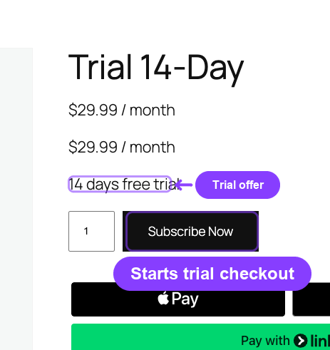
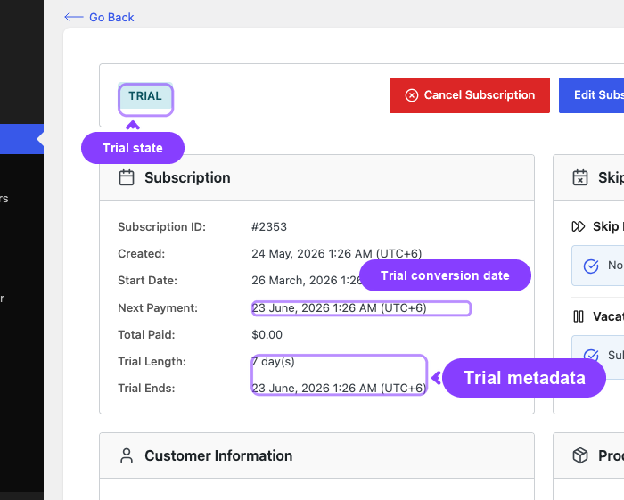
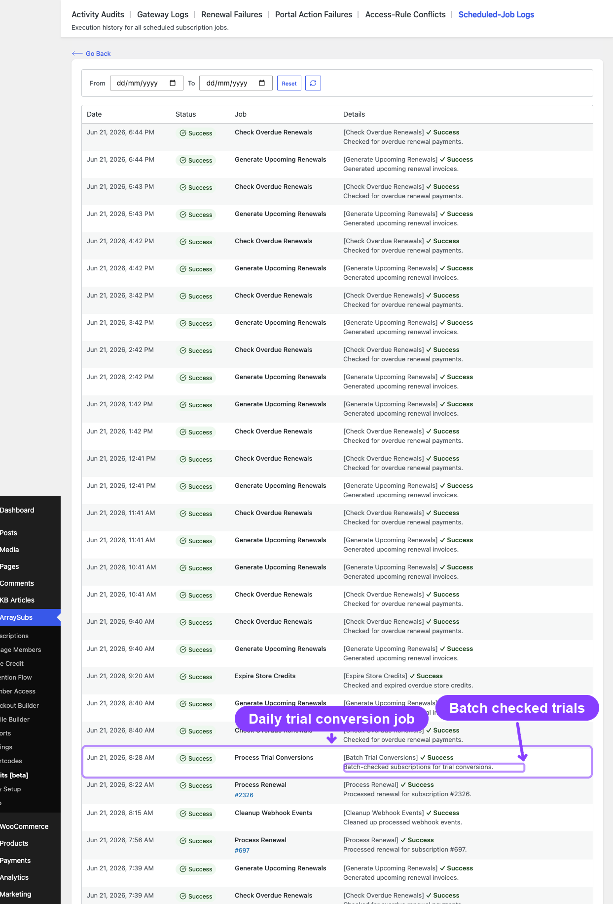
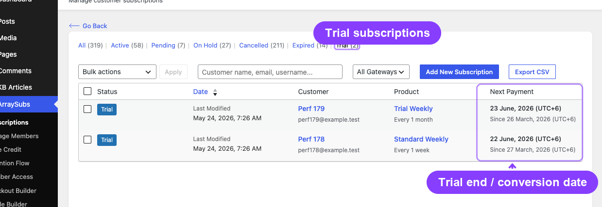
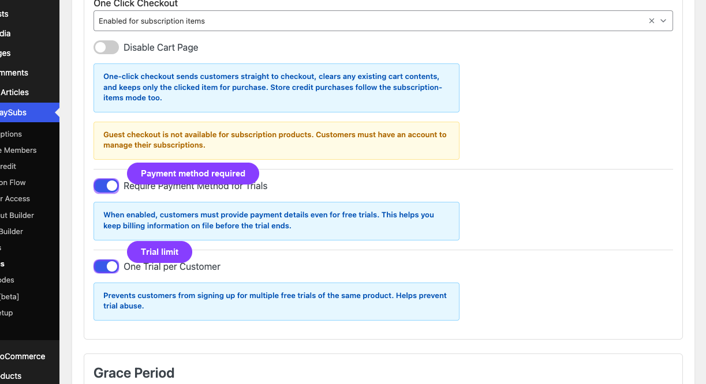
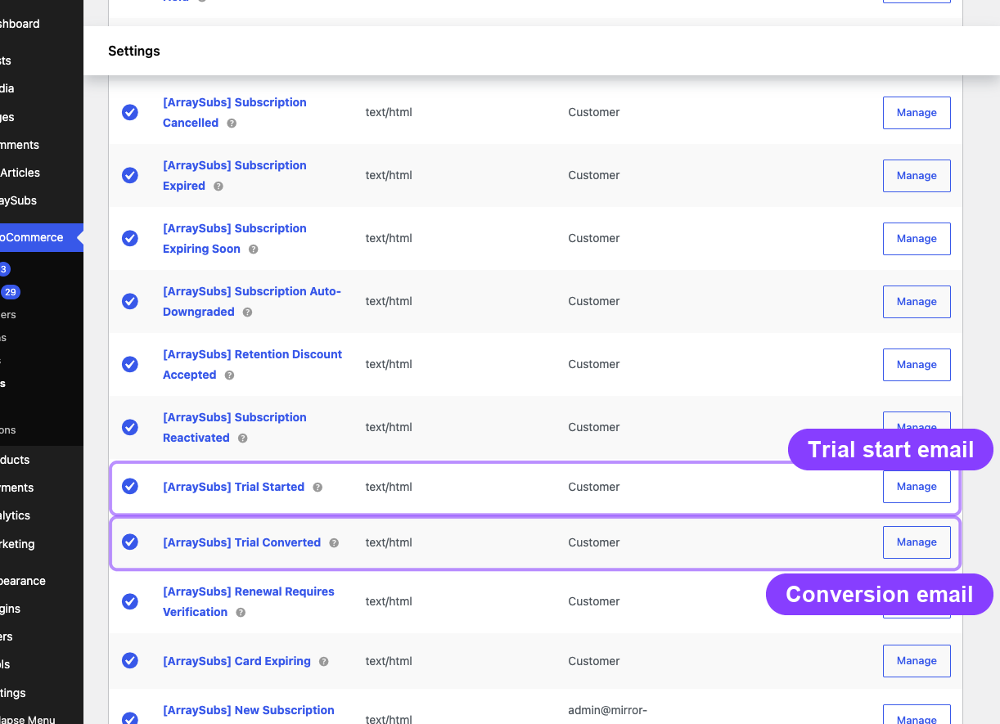
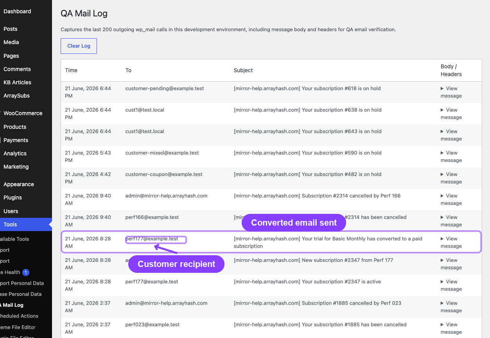

# Info
- Module: Billing and Renewals
- Availability: Free
- Last updated: 2026-10-18

# Trial Management

> How free trials start, what happens when a trial ends, and how the system converts trials to paid subscriptions or downgrades them automatically.

**Availability:** Free (core trial engine, including auto-downgrade on trial expiry)

## Page Navigation

- **Current guide:** Trial Management
- **Where to open it:** WordPress Admin -> ArraySubs -> Subscriptions
- **Developer reference:** [Read Lifecycle State and Manage Its Dates](../developers/status-grace-periods-and-trials.md)
- **Section overview:** [Open overview](./README.md)
- **Previous guide:** [renewal-operations](./renewal-operations.md)
- **Next guide:** [auto-renew-and-manual-fallback](../checkout-and-payments/automatic-payments/auto-renew-and-manual-fallback.md)
- **Troubleshooting:** [Audits, Logs, and Troubleshooting](../audits-and-logs/README.md)

## Overview

Trials let customers try a subscription before paying. During the trial period, the customer has full access to their subscription benefits without being charged (beyond an optional signup fee). When the trial ends, the first paid cycle is billed through the normal renewal process: the renewal invoice is created shortly before the trial end, and once it is paid the subscription becomes Active and the next cycle is scheduled. A daily job converts trials that are still unpaid after their trial end.

This page covers the complete trial lifecycle — from checkout through conversion — including what happens when a trial expires without payment and how the auto-downgrade feature works.

## When to use this

- You offer free or discounted trial periods on subscription products
- You want to understand what happens when a trial period ends
- You need to know when the first real payment occurs after a trial
- You want to configure auto-downgrade behavior for trial expirations

## Prerequisites

- A subscription product with a trial period configured (trial length and trial period set on the product)
- For auto-downgrade: an **Auto-downgrade to** target on the product (Linked Products tab, or the variation) and **Auto-Downgrade Timing** set to **On Trial Expiry** in **ArraySubs -> Settings -> Plan Switching**. No Pro license is needed.

## How it works

### Trial start

When a customer purchases a subscription product with a trial, the subscription is created with status **Trial** instead of **Active**. The trial end date is calculated from the purchase date by adding the trial length and period.

**What the customer pays at checkout:**

| Scenario | Amount charged |
|---|---|
| Free trial, no signup fee | $0 (no charge) |
| Free trial + signup fee | Signup fee only |
| No trial + signup fee | Subscription price + signup fee |
| No trial, no signup fee | Subscription price |



When the subscription is created:

- Status is set to `Trial`
- Trial end date is stored (purchase date + trial length × trial period)
- Next payment date is set to the trial end date
- Trial length and period are recorded on the subscription
- A **Trial Started** email is sent to the customer once the checkout order is paid (for a free trial, once the $0 order completes)

```box class="info-box"
During the trial period, the subscription's next payment date equals the trial end date. This is the date the first paid renewal is invoiced and charged. The daily trial conversion job also uses it to find trials that are still unpaid after their trial end.
```



### Trial conversion

A trial ends through one of two paths.

**Path 1 - The trial-end renewal is paid (the normal path).** Trial subscriptions are billed by the same renewal process as active ones:

1. The renewal invoice is created before the trial end, using the **Generate Invoice Before Due** setting (6 hours by default).
2. At the trial end (plus the store's short renewal spread of a few hours), an automatic payment method is charged. For manual payments, the customer pays the invoice.
3. When that renewal order is paid, the status changes from Trial to Active and the next payment date moves one billing cycle past the trial end. The billing cycle uses the subscription's billing period, **not** the trial period.

On this path no **Trial Converted** email is sent; the customer receives the normal renewal payment emails.

**Path 2 - The daily conversion job (the fallback).** A daily background job called **Process Trial Conversions** (first run at 2:00 AM UTC; its exact time drifts slightly from day to day) checks for subscriptions that are still in Trial after their trial end date, for example because the trial-end invoice is unpaid or the automatic charge failed.



For each qualifying subscription, the system:

1. **Checks for auto-downgrade** — If **Auto-Downgrade Timing** is **On Trial Expiry** and an auto-downgrade target is configured, the system delegates to the auto-downgrade handler instead of converting normally
2. **Converts to Active** — Changes the subscription status from Trial to Active
3. **Calculates the next payment date** — When PayPal or Paddle owns the billing schedule, it uses the provider's date. Otherwise it adds one billing cycle (billing interval × billing period) from the current date
4. **Clears trial data** — Sets the trial length to 0 (the trial end date is preserved for historical records)
5. **Sends notification** — Fires the **Trial Converted** email to the customer

The open trial-end invoice is not cancelled by this job.

**First renewal date calculation:**

> **Example:** A monthly subscription with a 14-day trial purchased on January 1.
> - Trial ends: January 15
> - First paid renewal: January 15 (invoiced a few hours before, charged at the trial end)
> - Next renewal after that: February 15
> - If the January 15 renewal is still unpaid when the daily job runs on January 16, the job converts the subscription and sets the next payment date to February 16 (one billing cycle from the conversion)

After conversion, the subscription enters the normal billing cycle. The hourly Generate Upcoming Renewals job creates each renewal invoice at the appropriate time before its due date.

### Changing a trial's end date

The trial end is the subscription's next payment date, which ArraySubs calculates from the schedule; there is no admin field to type a new date.

- **Editing trial terms** (trial length or trial period) on an existing subscription updates the stored terms only. It does not move a trial that is already running.
- **Pausing** a trial subscription pushes the trial end back by the pause, and the subscription returns to Trial when it resumes. **Skipping** moves it by whole billing cycles. The original trial end date stays on record either way.
- **Provider-owned schedules:** when PayPal or Paddle owns the billing schedule, the provider must accept a date change first. Paddle is updated before ArraySubs changes the date; PayPal refuses date moves, so the change is rejected.
- **Developers** can move a running trial's end date or end the trial immediately with `ArraySubs\Api\Lifecycle::update_trial()`. Ending it now runs the normal trial conversion. The call realigns the renewal schedule, sends provider-owned dates through the provider first, and emits the `trial_changed` lifecycle event (native action `arraysubs_trial_changed`). See [Read Lifecycle State and Manage Its Dates](../developers/status-grace-periods-and-trials.md) and [React to Supported Events](../developers/actions-and-filters.md).



### Trial auto-downgrade

Trial auto-downgrade is part of the free core plugin. When it is configured for trial expiration, the system can switch the subscription to a different (usually lower-tier) product instead of converting to a paid active subscription.

**How it works:**

1. When the daily trial conversion job processes a trial that is still unpaid after its trial end, the system checks the auto-downgrade settings
2. If **Auto-Downgrade Timing** (`plan_switching.auto_downgrade_timing`) is set to **On Trial Expiry** (`on_trial_expire`) and the product or variation has an **Auto-downgrade to** target, the subscription is switched to the target product
3. The customer receives an **Auto Downgrade** email instead of a Trial Converted email
4. The subscription may become free (if the target product has no recurring charge) or move to a lower pricing tier

The switch happens immediately: the subscription becomes Active on the target plan with a quantity of 1, a new billing cycle starts from that moment, the open trial-end invoice is cancelled, and future renewals are billed as manual payments. If the customer already has an active subscription to the target product, that subscription is reused and the trial subscription is set to Expired.

A trial whose trial-end renewal was paid is never auto-downgraded: it simply continues on the paid plan. Auto-downgrade is separate from a pending plan switch, which waits for the next paid renewal.

**Use case:** A SaaS product offers a 14-day trial of the Premium plan. If the customer does not pay after the trial, the subscription automatically switches to the Free plan with limited features.

For auto-downgrade configuration, see [Plan Switching and Relationships](../subscription-products/plan-switching-and-relationships.md).

---

## Trial settings

Trial behavior is controlled by a combination of product-level configuration and global settings.

### Product-level settings

Set on each subscription product under the **Subscription Billings [AS]** tab:

| Setting | What it controls | Example |
|---|---|---|
| **Trial Length** | How many trial periods the customer gets | 14 |
| **Trial Period** | The unit of the trial length | Days, Weeks, Months, or Years |

Each product variation can have its own independent trial configuration.

![Trial Settings and Sign-up Fee in the Subscription Billings [AS] tab](../subscription-products/create-and-configure.ASSETS/02-simple-length-trial-signup-fields-cropped.png)

### Global settings

Configure at **ArraySubs → Settings → General Settings → Trials**:

| Setting | What it controls | Default |
|---|---|---|
| **Require Payment Method** | Whether customers must enter a payment method during checkout even for $0 free trials | On |
| **One Trial per Customer** | Limits free trials to one per customer across all subscription products. Checks the signed-in account and the email entered at checkout, including cancelled or expired trials | On |



```box class="warning-box"
## Payment method requirement

When **Require Payment Method** is enabled, customers must provide a valid payment method at checkout even if the trial is free ($0). This helps ensure a smooth transition to paid billing when the trial ends.

Gateway behavior varies (all gateways are part of the free core plugin):
- **Stripe:** Creates a SetupIntent to capture the payment method without charging
- **PayPal:** Does not support $0 trial authorization — trials are handled through PayPal Billing Plans, and PayPal owns the trial and renewal dates
- **Paddle:** Captures payment method natively through the Paddle checkout overlay; Paddle owns the trial and renewal dates
```

---

## Trial emails

Two emails are associated with the trial lifecycle:

| Email | When it sends | What it includes |
|---|---|---|
| **Trial Started** | When the checkout order for the trial is paid (a $0 trial order counts once it completes) | Trial end date, trial length (e.g., "14 days"), subscription details |
| **Trial Converted** | When the daily trial conversion job converts a trial to Active. Not sent when the trial-end renewal is paid | Next payment date, subscription price, billing schedule |

The **Trial Converted** email is suppressed when auto-downgrade handles the conversion — in that case, the **Auto Downgrade** email is sent instead.



For complete email configuration and placeholders, see [Customer Emails](../emails/customer-emails.md).

---

## Real-life use cases

### Use case 1: SaaS free trial with payment capture

A project management tool offers a 14-day free trial of the Pro plan at $49/month with payment method required at checkout.

- Customer signs up on March 1, enters credit card, pays $0
- Trial ends March 15 — the first $49 renewal is charged and the subscription becomes Active
- Next charge of $49 on April 15
- Customer can cancel anytime during the trial from the customer portal

### Use case 2: Trial with signup fee

A fitness membership offers a 7-day trial with a $5 signup fee. The monthly subscription is $29/month.

- Customer pays $5 at checkout on March 1
- Trial ends March 8 — the first $29 renewal is charged and the subscription becomes Active
- Next renewal of $29 on April 8
- The $5 signup fee is a one-time charge and does not repeat

### Use case 3: Auto-downgrade on trial expiry

A membership site offers a 30-day trial of the Premium tier ($99/month) with auto-downgrade to the Free tier.

- Customer signs up on March 1, trial starts
- March 31 — the trial-end renewal invoice is not paid
- The next daily trial conversion job finds the unpaid trial and detects the auto-downgrade configuration
- Subscription switches from Premium to Free plan automatically
- Customer receives Auto Downgrade email explaining the change
- If the customer wants Premium, they can upgrade through the customer portal

---

## Edge cases and important notes

- **Trial conversion is automated.** Most trials end when the trial-end renewal is paid. The daily conversion job (first run 2:00 AM UTC) is the fallback for trials still unpaid after their trial end; those are processed during the next execution. A developer can end a running trial immediately with `ArraySubs\Api\Lifecycle::update_trial()`.
- **Two conversion paths, different side effects.** A paid trial-end renewal moves the subscription to Active without the Trial Converted email and keeps the trial length on record. The daily job sends the Trial Converted email, sets the trial length to 0, and restarts the cycle from the conversion date.
- **Manual status changes skip trial hooks.** If an admin manually changes a subscription from Trial to Active, the `trial_converted` hook does not fire and the Trial Converted email is not sent. The system does not run the conversion logic for manual changes.
- **Variation-level trials.** Each variation on a variable product can have its own trial length and period. The trial stored on the subscription matches the variation the customer purchased.
- **Trial counter on the subscription.** The original trial end date is preserved on the subscription after conversion, and pausing or skipping does not change it. This record is used for analytics (trial conversion rate calculations) and order type classification. A trial auto-downgrade removes it.
- **Provider-owned schedules.** For PayPal and Paddle subscriptions, the provider decides when the first paid cycle falls; the daily job uses the provider's date, and date changes must be accepted by the provider first.

---

## Troubleshooting

| Problem | Likely cause | What to do |
|---|---|---|
| Trial not converting to Active | The trial-end renewal order is unpaid, or the daily conversion job has not run yet | Check the renewal order for the trial end: once it is paid, the subscription becomes Active. Unpaid trials are converted by the daily job; check **Scheduled-Job Logs** (Pro) for the trial conversion job status. |
| Trial converted but the customer got no Trial Converted email | The trial-end renewal was paid, so the normal renewal path converted it | Expected. The Trial Converted email is sent only by the daily conversion job. |
| Customer received Auto Downgrade email instead of Trial Converted | Auto-Downgrade Timing is **On Trial Expiry** and the product has an Auto-downgrade to target | Check the product's linked products and the **Auto-Downgrade Timing** setting. Choose another timing if you want normal conversion. |
| Customer was charged at checkout during free trial | Signup fee is configured on the product | Check the product's signup fee field. A signup fee is charged even during free trials. |
| Trial Started email not sent | Email is disabled in WooCommerce email settings | Go to **WooCommerce → Settings → Emails** and check the Trial Started email is enabled. |
| One Trial Per Customer not enforced | This setting exists but enforcement depends on checkout validation | Verify the setting is enabled in **Settings → General → Trials**. |



---

## Related docs

- [Create and Configure Subscription Products](../subscription-products/create-and-configure.md) for setting trial length and period on products
- [Plan Switching and Relationships](../subscription-products/plan-switching-and-relationships.md) for auto-downgrade configuration
- [Customer Emails](../emails/customer-emails.md) for Trial Started and Trial Converted email templates
- [Renewal Operations](renewal-operations.md) for how the first paid renewal is generated after trial conversion
- [Recovery and Grace Flows](recovery-and-grace-flows.md) for what happens if payment fails after trial conversion
- [Subscription Checkout](../checkout-and-payments/subscription-checkout.md) for trial checkout behavior and pricing
- [Read Lifecycle State and Manage Its Dates](../developers/status-grace-periods-and-trials.md) for reading trial state in code and changing or ending a trial with `Lifecycle::update_trial()`
- [React to Supported Events](../developers/actions-and-filters.md) for `trial_started`, `trial_changed`, `trial_converted`, `trial_ended` and `auto_downgraded` events

---

## FAQ

### When does the first real charge happen after a trial?
At the end of the trial. For example, a monthly subscription with a 14-day trial purchased on March 1 is charged on March 15 (the renewal invoice is created a few hours earlier) and then renews on April 15. If that first renewal is not paid, the daily conversion job converts the trial (or auto-downgrades it) and the next payment date moves to one billing cycle after the conversion.

### Can a customer cancel during the trial?
Yes. Customers can cancel from the customer portal during the trial just like any active subscription. The cancellation can be immediate or end-of-period, depending on your settings.

### Does the trial count as a "completed payment" for different renewal pricing?
No. The trial period itself does not increment the completed payments counter. A paid checkout order, such as one with a sign-up fee, counts as one completed payment; after that, each paid renewal adds one.

### Can I offer trials on variable products?
Yes. Each variation can have its own trial length and period. The customer's subscription uses the trial configuration from the specific variation they purchased.

### What happens if the trial conversion job fails?
The job runs daily and catches up on any trials that were missed. If a trial end date was two days ago, it will still be processed during the next job run. No trial conversions are permanently skipped.

### Can a customer have multiple active trials?
This depends on the **One Trial per Customer** setting. When enabled, a customer can use only one free trial across all subscription products: an earlier subscription with a trial on the same account or checkout email, including a cancelled or expired one, blocks new trials. When disabled, customers can start trials on more than one product.
