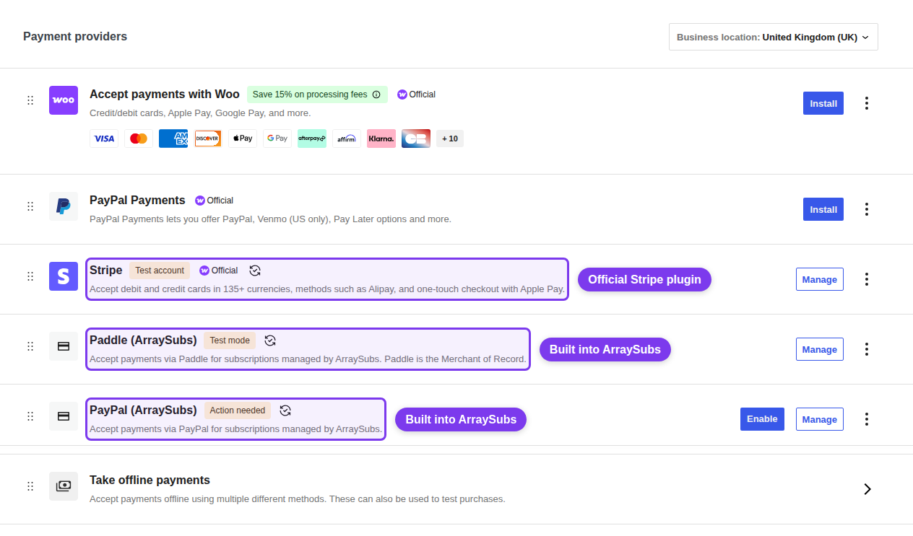
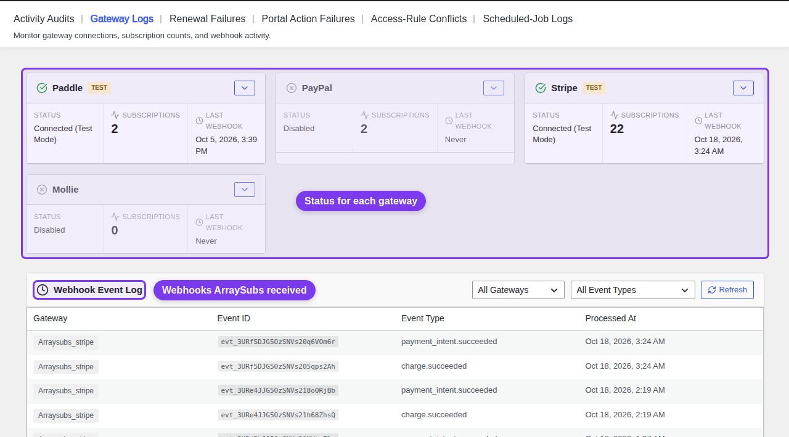

# Info
- Module: Automatic Payments
- Availability: Free
- Last updated: 2026-10-18

# Automatic Payments

> Pick a payment gateway and set it up so ArraySubs charges subscription renewals automatically.

**Availability:** Free (ArraySubs core). Stripe, PayPal, Paddle, and Mollie all work without ArraySubs Pro. Stripe and Mollie also need their official WooCommerce plugins.

## Page Navigation

- **Current guide:** Automatic Payments
- **Where to open it:** WooCommerce > Settings > Payments, and ArraySubs > Audits [beta] > Gateway Logs
- **Section overview:** [Open overview](../README.md)
- **Previous guide:** [Subscription Checkout](../subscription-checkout.md)
- **Next guide:** [Stripe Gateway](stripe.md)
- **Troubleshooting:** [Audits, Logs, and Troubleshooting](../../audits-and-logs/README.md)

## Choose a Gateway

You can turn on one gateway or several. Each subscription keeps the gateway the customer paid with at checkout.

| Gateway | What you install | Who runs the renewal schedule | Good fit |
|---|---|---|---|
| [Stripe](stripe.md) | The official **WooCommerce Stripe Gateway** plugin | ArraySubs | Cards, wallets, and bank debits, with the most flexible subscription features |
| [PayPal](paypal.md) | Nothing extra. **PayPal (ArraySubs)** is built in | PayPal | Customers who prefer to pay with PayPal. One subscription plan per checkout |
| [Paddle](paddle.md) | Nothing extra. **Paddle (ArraySubs)** is built in | Paddle | Stores that want Paddle as Merchant of Record to handle sales tax and VAT |
| [Mollie](mollie.md) | The official **Mollie Payments for WooCommerce** plugin | ArraySubs | Stores that already take payments with Mollie |

All four appear in **WooCommerce > Settings > Payments** once they are installed. PayPal and Paddle are listed as **PayPal (ArraySubs)** and **Paddle (ArraySubs)**. The separate "PayPal Payments" entry in that list is WooCommerce's own PayPal plugin, not the ArraySubs gateway.



## Set Up a Gateway

Every gateway follows the same five steps. The gateway guides walk through each one with screenshots.

1. **Install or enable the gateway.** For Stripe or Mollie, install and activate the official plugin. For PayPal or Paddle, go to **WooCommerce > Settings > Payments** and click **Manage** next to **PayPal (ArraySubs)** or **Paddle (ArraySubs)**.
2. **Connect your account in test mode.** Use the provider's sandbox or test keys first, so no real money moves while you check the setup.
3. **Connect the webhook.** Webhooks tell ArraySubs when a payment succeeds or fails. See [Webhook URLs](#webhook-urls) for what each gateway needs.
4. **Place a test subscription order.** Open the new subscription in ArraySubs. Its **Payment Gateway** card should show **Connected** with a saved payment method.
5. **Switch to live mode.** Enter your live keys, check the webhook again, and confirm the gateway shows as connected in **ArraySubs > Audits [beta] > Gateway Logs**.

Gateway guides:

- [Stripe Gateway](stripe.md)
- [PayPal Gateway](paypal.md)
- [Paddle Gateway](paddle.md)
- [Mollie Gateway](mollie.md)

### Check Every Gateway in One Place

Go to **ArraySubs > Audits [beta] > Gateway Logs**. Each gateway has a card with its status (for example **Connected (Test Mode)** or **Disabled**), the number of subscriptions that use it, and when its last webhook arrived. Click the arrow on a card to see its webhook URL and what it supports. The **Webhook Event Log** below lists every webhook ArraySubs received. See [Gateway Health](../../gateway-health/README.md) for details.



## Webhook URLs

| Gateway | Webhook URL | Who sets it up |
|---|---|---|
| Stripe | The official plugin's URL, `https://yoursite.com/?wc-api=wc_stripe`, plus the ArraySubs URL `https://yoursite.com/wp-json/arraysubs/v1/webhooks/arraysubs_stripe` | The official plugin's webhook is set up from its settings screen (see [Stripe Gateway](stripe.md)). ArraySubs creates its own webhook in your Stripe account automatically |
| PayPal | `https://yoursite.com/wp-json/arraysubs/v1/webhooks/arraysubs_paypal` | You, in the PayPal developer dashboard. See [PayPal Gateway](paypal.md) |
| Paddle | `https://yoursite.com/wp-json/arraysubs/v1/webhooks/arraysubs_paddle` | You, as a notification destination in the Paddle dashboard. See [Paddle Gateway](paddle.md) |
| Mollie | `https://yoursite.com/wp-json/arraysubs/v1/webhooks/mollie` | Nobody. ArraySubs sends this URL with every renewal payment it creates |

Replace `https://yoursite.com` with your store address. The exact URLs for your store are on each gateway card in **Gateway Logs**.

## Who Owns the Billing Clock

The biggest difference between gateways is who decides when the next charge happens.

| Gateway | Billing clock | What that means |
|---|---|---|
| Stripe | ArraySubs | ArraySubs keeps the next payment date and charges the saved payment method on that date. |
| Mollie | ArraySubs | Same as Stripe. Mollie holds a payment mandate, not a schedule. |
| PayPal | PayPal | PayPal charges on its own schedule. ArraySubs records each payment PayPal reports. |
| Paddle | Paddle | Paddle charges on its own schedule. ArraySubs can move Paddle's next billing date, so skips and date changes still work. |

When PayPal or Paddle owns the clock, any action that changes a payment date (**Skip**, **Pause**, a manual date change) is sent to the provider first. ArraySubs saves the change only after the provider accepts it, and refuses the action with a reason when the provider cannot do it.

```box class="warning-box"
## PayPal cannot move a payment date

On PayPal, **Skip** and manual next payment date changes are refused, because PayPal has no way to move the next billing date. Pause and resume work, because PayPal can suspend and reactivate a subscription.
```

## What Each Gateway Supports

| Feature | Stripe | PayPal | Paddle | Mollie |
|---|---|---|---|---|
| Free trials | Yes | Yes | Yes | Card and PayPal methods only |
| Signup fee | Yes | Yes | Yes | Yes |
| Subscription and normal products in one cart | Yes | No | Yes | Yes |
| Several subscriptions in one checkout | Yes | No | Yes | Yes |
| Different billing cycles in one checkout | Yes | No | No | Yes |
| Coupons that keep applying to renewals | Yes | No (first payment only) | Yes | Yes |
| Skip a renewal or change the date | Yes | No | Yes | Yes |
| Pause and resume | Yes | Yes | Yes | Yes |
| Plan switching | Yes | Next cycle only | Yes | Yes |
| Refunds, including partial refunds | Yes | Yes | Yes | Yes |
| Reissued cards updated automatically | Yes | No | Yes | No |

When a cart needs something a gateway cannot do, ArraySubs handles it for you:

- **In the cart:** the cart is blocked only when every enabled gateway refuses it. One capable gateway is enough.
- **At checkout:** gateways that cannot take the current cart are hidden, so a PayPal button does not appear for a mixed cart. If no gateway qualifies, checkout keeps the full list and explains the problem.

## How Renewals Are Charged

- **Stripe and Mollie:** ArraySubs creates the renewal order shortly before the due date (**Generate Invoice Before Due** in **ArraySubs > Settings > General**) and charges the saved payment method when the renewal is due. The customer does nothing.
- **PayPal and Paddle:** the provider charges the customer on its own schedule and sends a webhook. ArraySubs then records the renewal order as paid.
- **Manual invoice instead of a charge:** if the customer turned auto-renew off, or the subscription has no connected gateway or saved payment method, the renewal order waits as an unpaid invoice for the customer to pay. See [Auto-Renew and Manual Fallback](auto-renew-and-manual-fallback.md).
- **Failed payments:** ArraySubs retries soft declines and then follows your grace period. See [Payment Recovery](payment-recovery.md) and [Recovery and Grace Flows](../../billing-and-renewals/recovery-and-grace-flows.md).
- **Missed webhooks:** every six hours ArraySubs asks the provider about renewal orders that are still waiting for a webhook, and completes or fails them from the answer.

```box class="info-box"
## Test a renewal before launch

A successful first checkout does not prove that renewals charge automatically. Run one real scheduled renewal on a staging site first: [Test Automatic Renewals on Staging](stripe.md#test-automatic-renewals-on-staging).
```

## Troubleshooting

| Problem | Fix |
|---|---|
| A gateway is missing at checkout | Make sure it is enabled in **WooCommerce > Settings > Payments**. If it is enabled, it was hidden because it cannot take that cart, for example PayPal with a mixed cart. |
| The gateway card in **Gateway Logs** shows **Disabled** or **Needs Setup** | Open the gateway's settings and finish the setup in its guide. |
| A renewal became an unpaid invoice instead of a charge | Check that auto-renew is on and that the subscription's **Payment Gateway** card shows **Connected** with a saved payment method. |
| No webhooks arrive | Check the webhook URL and secret at the provider, and make sure your site is on public HTTPS and not blocked by a firewall or password protection. |
| Renewals run late or not at all | Scheduled jobs are not running. Set up a real cron job as described in [Cron Job Setup](../../getting-started/cron-job-setup.md). |

## FAQ

**Do automatic payments require ArraySubs Pro?**
No. All four gateways and automatic renewals are part of the free ArraySubs core plugin.

**Can I use more than one gateway?**
Yes. Turn on as many as you like. Customers pick one at checkout, and each subscription stays on the gateway it was bought with.

**Can I move a subscription to a different gateway?**
Not directly. Click **Detach Gateway** on the subscription's **Payment Gateway** card. The subscription switches to manual invoices, and when the customer pays the next invoice with the new gateway, that payment method is saved for future renewals.

**Do I need to set up webhooks myself?**
For PayPal and Paddle, yes. Stripe and Mollie are set up automatically. See [Webhook URLs](#webhook-urls).

## Related Docs

- [Stripe Gateway](stripe.md)
- [PayPal Gateway](paypal.md)
- [Paddle Gateway](paddle.md)
- [Mollie Gateway](mollie.md)
- [Payment Recovery](payment-recovery.md) - Retries, Retry Payment, and Resync from Gateway
- [Auto-Renew and Manual Fallback](auto-renew-and-manual-fallback.md) - The customer auto-renew toggle
- [Gateway Health](../../gateway-health/README.md) - Gateway status cards and the webhook event log
- [Cron Job Setup](../../getting-started/cron-job-setup.md) - Reliable scheduled renewals and retries
- [React to Supported Events](../../developers/actions-and-filters.md) - Renewal, retry, and grace events for developers
