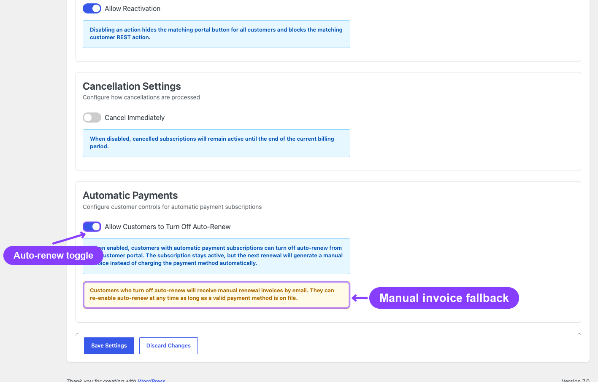
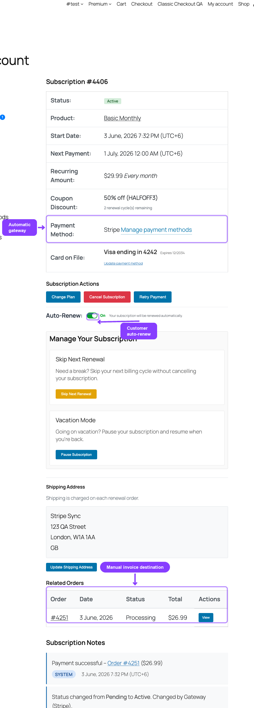

# Info
- Module: Auto-Renew and Manual Fallback
- Availability: Free
- Last updated: 2026-10-18

# Auto-Renew and Manual Fallback

> How the customer-facing auto-renew toggle works, what happens when automatic billing is turned off, and how subscriptions fall back to manual invoice collection.

**Availability:** Free (ArraySubs core). The customer toggle appears only when **Allow Customers to Turn Off Auto-Renew** is on.

## Page Navigation

- **Current guide:** Auto-Renew and Manual Fallback
- **Where to open it:** My Account -> Subscriptions (customer) and WordPress Admin -> ArraySubs -> Settings -> General -> Automatic Payments
- **Section overview:** [Open overview](../README.md)
- **Previous guide:** [trial-management](../../billing-and-renewals/trial-management.md)
- **Next guide:** [Gateway Health](../../gateway-health/README.md)
- **Troubleshooting:** [Audits, Logs, and Troubleshooting](../../audits-and-logs/README.md)

## Overview

Subscriptions created through an automatic payment gateway (Stripe, PayPal, Paddle, or Mollie) are configured for automatic renewal by default — the gateway charges the stored payment method on each billing date without any customer action.

ArraySubs includes an optional **auto-renew toggle** that lets customers switch between automatic and manual billing. When a customer turns off auto-renew, their subscription continues but future renewals generate invoices that the customer must pay manually. Automatic payments and this toggle are part of the free ArraySubs core plugin; they do not require ArraySubs Pro.

The two terms on this page mean:

- **Auto-renew:** each renewal is collected from the stored payment method without customer action. ArraySubs charges Stripe and Mollie renewals itself; PayPal and Paddle charge on their own schedule.
- **Manual fallback:** the renewal order is created as an unpaid invoice and the customer pays it through the order payment link. This happens when auto-renew is off, and also whenever an automatic charge is not possible (see [When Renewals Fall Back to Manual Invoices](#when-renewals-fall-back-to-manual-invoices)).

To confirm that automatic renewals really charge before launch, follow [Test Automatic Renewals on Staging](stripe.md#test-automatic-renewals-on-staging).

## How Auto-Renew Works

### Default State

When a customer completes checkout with an automatic payment gateway, their subscription is set up for automatic renewals. The gateway stores the payment method and ArraySubs schedules charges on the billing dates.

### Customer Toggle

The auto-renew toggle appears on the **Customer Portal → View Subscription** page, below the payment method details. It looks like a simple on/off switch.

**To enable the toggle globally:** Go to **ArraySubs -> Settings -> General**, find the **Automatic Payments** card, and turn on **Allow Customers to Turn Off Auto-Renew**. The setting is off by default.



### Toggle Requirements

The toggle only appears when all of these are true:

- Auto-renew toggle is allowed globally in settings
- The subscription was created with an automatic payment gateway
- The gateway is still connected (status is not `detached`)
- The subscription is in an eligible status: `Active`, `On-Hold`, or `Trial`
- There is no pending cancellation on the subscription
- A valid payment method exists and the gateway status is not **Detached**, **Error**, **Cancelled**, or **Inactive** (required for turning auto-renew back on)

### Manual gateway subscriptions — read-only hint

If the global toggle setting is on **but** the subscription was paid with a manual gateway (Bank Transfer / BACS, Cheque, Cash on Delivery, etc.), there is no toggle to flip — the gateway never had automatic billing in the first place. To prevent the customer from seeing an empty Subscription Actions box and assuming the feature is broken, the portal renders a passive read-only line:

> **Auto-Renew:** Not available for this payment method. You will receive an invoice for manual payment at each renewal.

This appears only on otherwise-eligible subscriptions (active / on-hold / trial, not pending-cancel, not lifetime, not on an automatic gateway). It is informational — there is no button to click. To enable a real toggle for these subscribers, you would need to migrate them to an automatic gateway via a fresh checkout.

---

## Turning Off Auto-Renew

When a customer disables auto-renew:

1. The subscription stays active — it does **not** cancel
2. Future renewals do not charge the stored payment method automatically
3. Instead, renewal invoices are generated as unpaid orders
4. The customer receives an invoice email with a **Pay Now** link
5. The customer must manually pay the invoice through WooCommerce's order payment page
6. Grace period rules still apply — if the invoice is not paid within the grace period, the subscription transitions to On-Hold and eventually Cancelled

```box class="info-box"
Turning off auto-renew does **not** remove the stored payment method. The card on file remains attached to the subscription in case the customer re-enables auto-renew later.
```

### What Changes at the Payment Provider

| Gateway | Turning auto-renew off | Turning auto-renew back on |
|---|---|---|
| Stripe, Mollie | Nothing changes at the provider. ArraySubs stops charging and creates manual invoices instead. | Charges resume at the next renewal with the stored payment method. |
| Paddle | ArraySubs pauses billing at Paddle (gateway status **Paused**). | ArraySubs resumes billing at Paddle. |
| PayPal | ArraySubs cancels the PayPal subscription (gateway status **Inactive**). | Not possible for that PayPal subscription. The customer must update the payment method first, which sets up a new PayPal agreement. |

### What the Customer Sees

- **Toggle off:** A confirmation that future renewals will require manual payment
- **Next renewal behavior:** An invoice email arrives before the due date, and the customer pays through the link in the email or from their order list in My Account



---

## Turning On Auto-Renew

When a customer enables auto-renew:

1. The system verifies a valid payment method is stored
2. If the gateway supports pause/resume (Paddle only) and the gateway status is `paused`, a resume request is sent to the gateway
3. The gateway status is updated to `active`
4. Future renewals will be charged automatically again

If no payment method is stored, the customer must update their payment method before they can enable auto-renew.

---

## Manual Invoice Collection Flow

When auto-renew is off, renewals follow this path:

1. **Invoice generation:** The renewal engine creates an invoice (WooCommerce order) with `Pending` payment status at the scheduled time
2. **Invoice email:** The customer receives an email with the invoice amount, due date, and a payment link
3. **Customer payment:** The customer clicks the link and pays through WooCommerce's standard order payment page — they can choose any available payment method at that point
4. **Payment confirmation:** Once paid, ArraySubs processes the renewal and extends the subscription's next payment date
5. **Non-payment:** If the invoice is not paid within the grace period, the standard overdue flow applies (Active → On-Hold → Cancelled depending on grace period settings)

```box class="warning-box"
When a customer pays a manual renewal invoice using a different payment gateway than the original, the subscription's stored payment method is **not** updated. If the customer later re-enables auto-renew, the original gateway's payment method is used.
```

### When Renewals Fall Back to Manual Invoices

For Stripe, Mollie, and manual gateways, ArraySubs creates the renewal invoice ahead of the due date (**Generate Invoice Before Due** in **ArraySubs -> Settings -> General**). At the due time, the scheduled `arraysubs_process_renewal` action charges automatically only when all of these are true:

- The subscription's gateway is an enabled automatic gateway
- Auto-renew is on
- The gateway status on the subscription's **Payment Gateway** card is **Connected**
- A payment method is stored on the subscription

If any of these is false, no charge is attempted. The invoice stays unpaid, the order gets the note "Renewal order created. Awaiting manual payment.", a gateway log entry records the reason, and the customer pays through the payment link. This applies whether or not the customer toggle is enabled. Subscriptions bought with a manual gateway (bank transfer, cheque, cash on delivery) always renew this way.

PayPal and Paddle charge on their own schedule; ArraySubs records those payments from their webhooks.

### For Developers

- `arraysubs_auto_renew_toggled` fires after the customer or an admin changes auto-renew, with the subscription ID, the new state (`true` for on), and the gateway slug. See [React to Supported Events](../../developers/actions-and-filters.md).
- `Subscriptions::update()` accepts an `auto_renew` change from your own trusted code. See [Find and Update Subscriptions](../../developers/subscriptions.md).
- To test both paths on staging before launch, see [Verify Your Integration](../../developers/errors-and-testing.md) and [Test Automatic Renewals on Staging](stripe.md#test-automatic-renewals-on-staging).

---

## Real-Life Use Cases

### Budget-Conscious Customers

A customer on a tight budget wants to review each renewal charge before it goes through. They disable auto-renew to receive invoices and decide manually whether to continue each month.

### Temporary Payment Method Issues

A customer knows their card is about to expire and cannot update it yet. They disable auto-renew to prevent a failed charge, then re-enable it once they have a new card set up.

### Organizational Approvals

A business subscriber needs internal approval before each renewal payment. Manual invoices give them a document to submit for approval before paying.

---

## Edge Cases and Important Notes

- **Gateway-managed billing (PayPal, Paddle):** Turning off auto-renew may have different effects depending on gateway capabilities. For Paddle, a pause request is sent. For PayPal, the PayPal subscription is cancelled, so auto-renew cannot be turned back on until the customer updates the payment method.
- **Subscription already in grace period:** Toggling auto-renew does not reset or extend grace period deadlines
- **Trial subscriptions:** The auto-renew toggle can be used during a trial. If auto-renew is off when the trial ends, the first real renewal is generated as a manual invoice.
- **Admin detach vs. customer toggle:** An admin can detach the gateway entirely (removes all payment method data). The customer toggle only controls automatic vs. manual billing without removing the stored method.

---

## Related Docs

- [Gateway Overview](README.md) — How automatic payment gateways work
- [General Settings](../../settings/general-settings.md) — Auto-renew toggle setting
- [Customer Portal — Payment and Shipping](../../customer-portal/payment-and-shipping.md) — Customer-facing toggle and payment method management
- [Lifecycle Management](../../manage-subscriptions/lifecycle-management.md) — Grace period and overdue flow
- [Test Automatic Renewals on Staging](stripe.md#test-automatic-renewals-on-staging) - Prove automatic and manual renewal paths in Stripe test mode
- [React to Supported Events](../../developers/actions-and-filters.md) - Auto-renew, renewal, and grace events for developers
- [Verify Your Integration](../../developers/errors-and-testing.md) - Developer error handling and staging checks

---

## FAQ

**Does turning off auto-renew cancel the subscription?**
No. The subscription remains active. Only the billing method changes — from automatic charges to manual invoice collection.

**Can I disable the auto-renew toggle for all customers?**
Yes. Go to **ArraySubs -> Settings -> General**, find the **Automatic Payments** card, and turn off **Allow Customers to Turn Off Auto-Renew**. Customers will not see the option in their portal.

**Does auto-renew require ArraySubs Pro?**
No. Automatic payments, the auto-renew toggle, and manual fallback invoices are part of the free ArraySubs core plugin.

**What happens if a customer turns off auto-renew but doesn't pay the invoice?**
The standard grace period applies. After the active grace period (default 3 days), the subscription moves to On-Hold. After the on-hold grace period (default 7 days), the subscription is cancelled.

**Can the customer choose a different payment method for manual renewals?**
Yes. The invoice payment page shows all available WooCommerce payment methods. However, paying with a different method does not change the subscription's stored automatic payment method.
