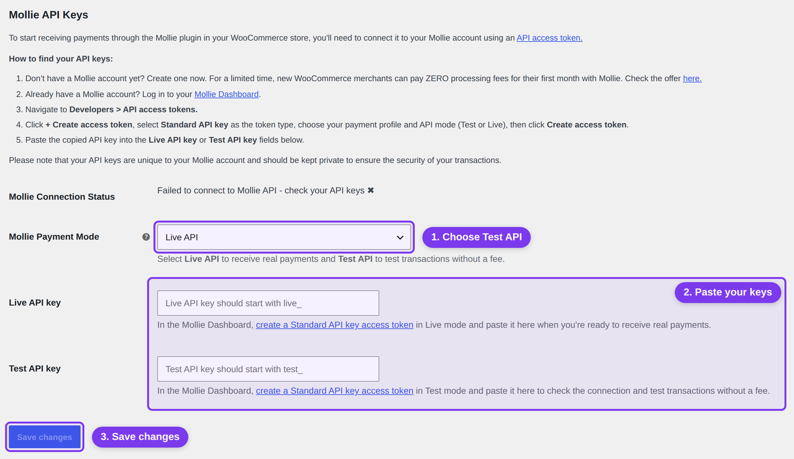
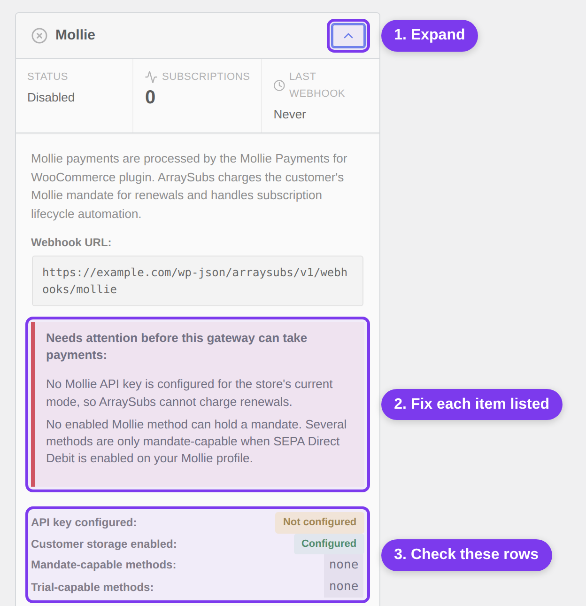

# Info
- Module: Mollie Gateway
- Availability: Free
- Last updated: 2026-10-18

# Mollie Gateway

> Set up Mollie so ArraySubs can take subscription payments and charge renewals automatically.

**Availability:** Free (ArraySubs core). You also need a Mollie account and the official **Mollie Payments for WooCommerce** plugin, version 7.0 or newer.

## Page Navigation

- **Current guide:** Mollie Gateway
- **Where to open it:** WordPress Admin -> WooCommerce -> Settings -> Mollie Settings
- **Section overview:** [Open overview](./README.md)
- **Previous guide:** [Paddle Gateway](./paddle.md)
- **Next guide:** [Payment Recovery](./payment-recovery.md)
- **Troubleshooting:** [Audits, Logs, and Troubleshooting](../../audits-and-logs/README.md)

## Before You Start

- **A Mollie account** with the payment methods you want switched on for your website profile. For subscriptions, activate at least **Credit card**.
- **SEPA Direct Debit** activated in Mollie if customers should start subscriptions with iDEAL, Bancontact, or another bank method. Their renewals are collected as SEPA debits, which work in EUR only.
- **WooCommerce and ArraySubs** active, plus the official **Mollie Payments for WooCommerce** plugin, version 7.0 or newer.
- **A public HTTPS site.** Mollie reports payment results by calling your site, so a local or password-protected site never hears back.
- **Working WP-Cron** or a server cron job. ArraySubs creates and charges renewals with scheduled tasks.

## Set Up Mollie

### Step 1: Install the Mollie Plugin

1. Go to **Plugins > Add Plugin**.
2. Search for **Mollie Payments for WooCommerce**, click **Install Now**, then click **Activate**.
3. A new **Mollie Settings** tab appears under **WooCommerce > Settings**.

ArraySubs works through this plugin: Mollie takes the checkout payment, and ArraySubs charges the renewals. There is no separate Mollie gateway to switch on in ArraySubs.

### Step 2: Create Your API Keys in Mollie

1. Log in to your Mollie Dashboard and go to **Developers > API access tokens**.
2. Click **+ Create access token**, select **Standard API key**, choose your payment profile and the Test API mode, then click **Create access token**. Copy the key. It starts with `test_`.
3. Repeat in Live mode to get a key that starts with `live_`. You can do this later, before you go live.

These steps match the instructions printed on the **Mollie Settings** page. Keep both keys private.

### Step 3: Connect the Plugin to Mollie

Go to **WooCommerce > Settings > Mollie Settings**, then:

1. Set **Mollie Payment Mode** to **Test API**.
2. Paste your test key into **Test API key**, and your live key into **Live API key** if you already have one.
3. Click **Save changes**. **Mollie Connection Status** should change to **Successfully connected with Test API**.



Until a key connects, this is the only screen the Mollie plugin shows. The **Payment methods** and **Advanced settings** tabs appear after a successful connection.

### Step 4: Keep Customer Details Stored at Mollie

1. On **WooCommerce > Settings > Mollie Settings**, open the **Advanced settings** tab.
2. Make sure **Store customer details at Mollie** is ticked. It is on by default.
3. If you changed it, click **Save changes**.

```box class="warning-box"
Mollie only saves a reusable payment authorization (a mandate) for a stored customer, and every renewal is charged against that mandate. If **Store customer details at Mollie** is off, ArraySubs shows a warning on the WooCommerce settings screens. Subscriptions still sell, but their renewals fall back to manual invoices.
```

### Step 5: Enable a Payment Method That Can Renew

1. Open the **Payment methods** tab. Methods that are active in your Mollie account appear under **Currently Active Payment Methods**.
2. Click **Manage Payment Method** next to **Credit card**, tick **Enable Credit card**, and click **Save changes**. Repeat for any other method you want to offer.
3. Methods under **Inactive Payment Methods** are not active in your Mollie account yet. Activate them in your Mollie dashboard before customers can use them.

| Mollie method | Renews automatically | Can start a free trial |
|---|---|---|
| Credit card, PayPal | Yes | Yes |
| Apple Pay | Yes | No |
| iDEAL, Bancontact, EPS, Belfius Direct Net, KBC/CBC Payment Button, Pay by Bank, Trustly | Only when SEPA Direct Debit is active in Mollie. Renewals are then SEPA debits in EUR. | No |
| Any other Mollie method | No. The subscription renews by manual invoice. | No |

While a trial product is in the cart, ArraySubs hides the Mollie methods that cannot start a trial, so shoppers only see methods that work.

### Step 6: Check Mollie in Gateway Health

1. Go to **ArraySubs > Audits [beta] > Gateway Logs** and click the arrow on the **Mollie** card.
2. If a **Needs attention before this gateway can take payments** box appears, fix each item it lists.
3. Check the rows below it: **API key configured** and **Customer storage enabled** should both say **Configured**, and **Mandate-capable methods** should list at least one method, such as `mollie_wc_gateway_creditcard`.



The screenshot shows a store before setup, so its **Status** reads **Disabled**. When the steps above are done, it reads **Connected (Test Mode)**, or **Connected** after you go live.

### Step 7: Test a Subscription Checkout

1. Keep **Mollie Payment Mode** on **Test API**.
2. In a private browser window, buy a subscription product as a customer. Log in or create an account at checkout.
3. Choose **Credit card** and complete the test payment. Test payments are not real and carry no fee.
4. Go to **ArraySubs > Subscriptions** and open the new subscription.
5. On the **Payment Gateway** card, look for the **Connected** badge, **Gateway:** Mollie, and the saved card under **Card on File**, for example "Visa ending in 1234".

If the subscription has no **Payment Gateway** card, Mollie did not save a mandate for it. Re-check Steps 4 and 5, then place a new test order.

### Step 8: Go Live

1. In Mollie, make sure the methods you offer are active for live payments, plus **SEPA Direct Debit** if you rely on bank methods.
2. Go to **WooCommerce > Settings > Mollie Settings**, check that **Live API key** is filled in, set **Mollie Payment Mode** to **Live API**, and click **Save changes**. **Mollie Connection Status** should read **Successfully connected with Live API**.
3. Open the **Payment methods** tab and confirm that your renewal-capable methods are listed and enabled.
4. Leave the **Test API key** in place. Subscriptions created during testing keep renewing in test mode with that key, so cancel them when you are done with them.
5. Check the **Mollie** card in **Gateway Logs** again. Its **Status** should read **Connected**.
6. If you like, place one small real order with your own card, then refund it from the WooCommerce order.

## How Renewals Work

- **ArraySubs keeps the billing schedule.** For each renewal it creates the renewal order and charges the customer's Mollie mandate. Nothing is set up as a subscription in your Mollie account; each charge shows there as "Renewal for order" plus the order number.
- **No webhook setup is needed.** ArraySubs sends its own notification address (`https://yoursite.com/wp-json/arraysubs/v1/webhooks/mollie`) with every renewal charge, and re-checks unconfirmed renewals every six hours in case a notification gets lost.
- **Card renewals** usually complete right away. **SEPA Direct Debit** renewals stay pending for several business days. ArraySubs waits for Mollie's answer instead of putting the subscription on hold. A failure Mollie reports follows your Payment Recovery settings even when its notification gets lost, because the six-hourly check records it. If nothing is confirmed within 21 days (3 days for a card), the renewal is failed. While a renewal payment is pending, the customer cannot pay or cancel that renewal another way: its Pay page says a payment is already being processed and offers no payment methods. If Mollie reports the payment failed, the renewal can be paid again.
- **A payment Mollie took for a renewal that is not marked paid with it** is never failed or reported to the customer as a failure. This happens when the order was switched to another payment method while its SEPA debit was settling, for example. The order gets a note. Mark the order paid if you keep the Mollie payment, or refund the payment in your Mollie dashboard. Until then, the subscription is not put on hold or cancelled for non-payment, and the customer cannot pay the renewal again or cancel it from My Account: its Pay page tells the customer that the payment was already received. Once the payment is refunded in full, or the customer's bank charges it back, the renewal awaits payment again and your usual grace period applies.
- **Refunds you make in the Mollie dashboard** are copied to a renewal order only when that Mollie payment paid the order: the order is paid, its transaction ID is that payment, and the payment still matches the order. Otherwise nothing is refunded in WooCommerce. A paid order stays paid and gets a note, so refund it in WooCommerce yourself if it should be refunded too. A Mollie payment that was refunded or charged back in full never completes a renewal.
- **Failed renewals** follow your [Payment Recovery](payment-recovery.md) settings.
- **A mandate that stops working** (for example, one the customer revoked) turns the **Payment Gateway** card badge to **Error**, and renewals [fall back to manual invoices](auto-renew-and-manual-fallback.md#when-renewals-fall-back-to-manual-invoices).
- **Expiring cards:** Mollie does not update cards automatically, so ArraySubs emails the customer 30 days and 7 days before a saved card expires.
- **No payment method update link:** a Mollie mandate can only be replaced by a new first payment, which ArraySubs does not take for an existing subscription, so the customer portal shows the card on file without an **Update payment method** link. When a renewal cannot be charged, the customer pays it from the renewal invoice's payment link.

## Test Automatic Renewals on Staging

Use this walkthrough to prove that a real scheduled renewal is charged against the customer's Mollie mandate before you rely on it in production. Everything runs with your Mollie test API key on a separate staging site, so no real money moves.

```box class="warning-box"
**A successful checkout is not proof of automatic renewal.** The Mollie plugin takes the first payment while the customer is present. Automatic renewal is proven only when ArraySubs creates the renewal order on schedule and charges the saved mandate with no customer action.
```

### Step 1: Prepare a Separate Staging Site

- Use a staging site with its own URL, such as `https://staging.example.com`. Do not run renewal tests on your live store.
- Use only your Mollie test API key on staging. Your live site keeps its live key and stays the only site that charges real customers.
- The renewal test needs only the free ArraySubs core plugin. If the staging site also runs ArraySubs Pro, add and activate the staging domain as described in [License Activation](../../getting-started/license-activation.md).

If you build staging by copying your live site, the copy contains your saved live Mollie API key, real customer subscriptions with live Mollie mandates, and their queued renewal actions. Make the copy safe before it runs any scheduled job. First, add these lines to the staging `wp-config.php` only (above the "That's all, stop editing!" line):

```php
<?php
// Staging only: stop scheduled jobs and mark the site as non-production.
define( 'DISABLE_WP_CRON', true );
define( 'WP_ENVIRONMENT_TYPE', 'staging' );
```

With `DISABLE_WP_CRON` set, ArraySubs also turns off Action Scheduler's background request runner, so renewal actions copied from live stay queued instead of charging. If your host runs WP-Cron for you, pause that for the staging site too.

Then, before any scheduled job runs and before you click any subscription or payment action:

1. Delete the saved live key from the staging database, for example with WP-CLI: `wp option delete mollie-payments-for-woocommerce_live_api_key`. Setting **Mollie Payment Mode** to **Test API** is not enough on its own: ArraySubs charges each renewal with the key for the mode the subscription was created in, so a copied live subscription would still be charged to a real customer with a saved live key. Emptying the **Live API key** field on the settings page does not delete a saved key.
2. Go to **WooCommerce > Settings > Mollie Settings**, set **Mollie Payment Mode** to **Test API**, paste your test key into **Test API key**, and click **Save changes**.
3. Make sure staging email cannot reach real customers, for example by routing it to a mail-capture tool. Copied subscriptions still come due on staging and can send renewal and payment-failed emails.
4. Do not use subscriptions copied from live for renewal tests. Their Mollie customers and mandates belong to your live account and cannot be charged with a test key. Create new test subscriptions through checkout ([Step 4](#step-4-place-a-test-subscription-checkout)).

### Step 2: Check the Prerequisites

| Requirement | What to confirm |
|---|---|
| WooCommerce and ArraySubs core | Both are active. Mollie automatic renewals are part of the free core plugin. |
| Mollie Payments for WooCommerce | Version 7.0 or later, active, with **Mollie Payment Mode** set to **Test API** and only a test key saved. ArraySubs shows a notice on the WooCommerce settings screens when the plugin is too old. |
| **Store customer details at Mollie** | Ticked on the **Advanced settings** tab. It is on by default. |
| A renewal-capable method | **Credit card** enabled on the **Payment methods** tab, as in [setup Step 5](#step-5-enable-a-payment-method-that-can-renew). |
| Scheduled jobs | Once the copy is safe (Step 1), run a real system cron every minute as described in [Cron Job Setup](../../getting-started/cron-job-setup.md). In **WooCommerce > Status > Scheduled Actions**, past-due **Pending** actions should be processed within a minute or two. |
| Webhook delivery | Mollie must reach the staging site over public HTTPS. Password protection, IP allowlists, or a firewall in front of staging block it. ArraySubs sends its webhook URL with every renewal payment, so there is nothing to register at Mollie. |
| ArraySubs Pro | Not needed for Mollie renewals. Add it only when your integration uses Pro features. |

Test the Free-to-Pro upgrade as its own check. Complete this walkthrough with core only first. Then install ArraySubs Pro while core stays installed and active, activate the license as described in [License Activation](../../getting-started/license-activation.md), confirm that existing subscriptions, orders, and settings are unchanged, and repeat Steps 5 and 6. Do not uninstall core or recreate subscriptions to upgrade.

Optional settings for a faster test, in **ArraySubs > Settings > General**:

| Setting | Card | Default | On staging |
|---|---|---|---|
| **Generate Invoice Before Due** and **Unit** | Grace Period | 6 hours | Keep the default or match your live value |
| **Spread Renewals Over (Hours)** | Renewal Performance | 6 | `0`, so the charge runs at the due time instead of up to six hours later |
| **Days Active After Due** and **Days On-Hold Before Cancel** | Grace Period | 3 and 7 | Keep, or shorten them to watch the grace flow sooner |

### Step 3: Confirm Test Mode and Callbacks

1. On **WooCommerce > Settings > Mollie Settings**, check that **Mollie Connection Status** reads **Successfully connected with Test API**.
2. On the **Advanced settings** tab, click **Test Webhook Connection** to check that Mollie can reach the staging site.
3. In **ArraySubs > Audits [beta] > Gateway Logs**, expand the **Mollie** card. **Status** should read **Connected (Test Mode)**, with no **Needs attention before this gateway can take payments** box.

Which plugin receives which callback:

| Callback | URL on staging | Received by | Used for |
|---|---|---|---|
| Mollie plugin webhook | `https://staging.example.com/wp-json/mollie/v1/webhook` (the plugin adds it, with a secret parameter, to each checkout payment) | Mollie Payments for WooCommerce | Checkout payments and their status changes |
| ArraySubs Mollie webhook | `https://staging.example.com/wp-json/arraysubs/v1/webhooks/mollie` | ArraySubs core | The final status of each renewal payment ArraySubs creates (paid, failed, canceled, or expired), plus refunds and chargebacks on those payments |
| Renewal charge (outgoing) | None | ArraySubs, calling the Mollie API with the key for the subscription's mode | Recurring payments against the customer's mandate for scheduled renewals and retries |

Neither URL has to be entered in your Mollie account: each one travels with the payment it belongs to.

### Step 4: Place a Test Subscription Checkout

1. Create a test subscription product with **Billing Period** set to **Day**, **Billing Interval** set to 1, and **Trial Length** set to 0. See [Create and Configure Subscription Products](../../subscription-products/create-and-configure.md). A daily plan brings the first renewal due within 24 hours.
2. Log in as a test customer, for example `member@example.com`, add the product to the cart, and choose **Credit card** at checkout.
3. Complete the payment on Mollie's test checkout as a successful payment. Mollie's [testing guide](https://docs.mollie.com/reference/testing) lists test card numbers. Never use a real card on staging.
4. Leave auto-renew on. If it is turned off, the renewal becomes a manual invoice (see [Auto-Renew and Manual Fallback](auto-renew-and-manual-fallback.md)).

Expected result:

- The parent order is paid: **Completed** for a non-shipping subscription, **Processing** when it needs shipping.
- A new subscription is **Active** and linked to that order. Its **Next Payment** date is one billing period after checkout.
- On the subscription detail page, the **Payment Gateway** card shows **Connected**, **Gateway:** Mollie, the saved card under **Card on File**, and a **Customer ID** that starts with `cst_`. Mollie saved a mandate, so the subscription can renew automatically.

If the subscription has no **Payment Gateway** card, Mollie saved no mandate and renewals would fall back to manual invoices. Check **Store customer details at Mollie** and the payment method you used before you continue.

### Step 5: Run a Due Renewal

ArraySubs runs every renewal through two scheduled actions. Both use the subscription ID as their only argument, for example `[123]`.

| Order | Action hook | Group | When it runs | What it does |
|---|---|---|---|---|
| 1 | `arraysubs_generate_renewal_invoice` | `arraysubs-billing` | **Generate Invoice Before Due** ahead of the Next Payment date | Creates the renewal order as an unpaid invoice |
| 2 | `arraysubs_process_renewal` | `arraysubs-renewals` | At the Next Payment date, plus the renewal spread | Charges the customer's Mollie mandate; the schedule advances once the payment is paid |

1. Wait until the renewal is due. With the daily plan from Step 4 and default settings, the invoice appears about 18 hours after checkout and the charge runs at the 24-hour mark (later when **Spread Renewals Over (Hours)** is above `0`).
2. Open **WooCommerce > Status > Scheduled Actions**, search for `arraysubs_process_renewal`, and find the row with your subscription ID. When it shows **Complete**, open the renewal order.
3. If the order is paid, go to Step 6. If it shows **Pending payment**, Mollie is waiting for the payment's final state. In test mode, a recurring payment carries a `changePaymentState` link for setting that state (see Mollie's [testing guide](https://docs.mollie.com/reference/testing)). The renewal order's transaction ID is the Mollie payment ID, which starts with `tr_`. Look the payment up with your test key, open the `changePaymentState` link under `_links` in the response, and set the payment to paid:

```bash
curl -s https://api.mollie.com/v2/payments/tr_YOUR_PAYMENT_ID \
  -H "Authorization: Bearer YOUR_TEST_API_KEY"
```

Mollie then reports the result to the ArraySubs webhook and the order is completed. If that report never arrives, ArraySubs asks Mollie again every six hours. While a payment is pending, ArraySubs pauses the grace flow: it waits up to 3 days for a card payment and up to 21 days for a SEPA Direct Debit payment, then fails the renewal if Mollie has not confirmed it. A failure Mollie reports is recorded at the next check even when its notification never arrives. A payment Mollie took for a renewal whose order was not marked paid with it is left for you to decide instead of being failed.

```box class="info-box"
Clicking **Run** on these actions before the Next Payment date does nothing: ArraySubs checks that the renewal is actually due before it creates or charges anything. Wait for the date, or bring it forward as shown below.
```

Developers can bring the date forward on staging with the `setNextPaymentDate()` method of the `ArraySubs\Developer\Subscriptions` API. The new date must be in the future, and the change realigns both scheduled actions. Run it on staging only, for example with `wp eval-file`:

```php
<?php
// Staging only: make subscription 123 due for renewal in 15 minutes.
if ( class_exists( '\ArraySubs\Developer\Subscriptions' ) ) {
	$subscription = \ArraySubs\Developer\Subscriptions::fromId( 123 );
	$result       = is_wp_error( $subscription )
		? $subscription
		: $subscription->setNextPaymentDate( time() + 15 * MINUTE_IN_SECONDS );

	if ( is_wp_error( $result ) ) {
		echo esc_html( $result->get_error_code() . ': ' . $result->get_error_message() ), "\n";
	} else {
		echo esc_html( 'Renewal date updated.' ), "\n";
	}
}
```

A successful renewal leaves the renewal order paid, the subscription **Active**, and **Next Payment** one billing period later.

### Step 6: Record What You Observe

| What to check | Where | Expected after a paid renewal |
|---|---|---|
| Order and payment | **WooCommerce > Orders** | A new renewal order linked to the subscription, paid, with the Mollie payment ID (`tr_...`) as its transaction ID and a paid date. The Mollie payment's description is "Renewal for order" plus the order number. |
| Dates | Subscription detail page | **Next Payment** moved forward by exactly one billing period. It follows the schedule, not the moment the charge ran. |
| Scheduled actions | **WooCommerce > Status > Scheduled Actions** | This cycle's `arraysubs_generate_renewal_invoice` and `arraysubs_process_renewal` show **Complete**, and new **Pending** actions exist for the next cycle. |
| Notes | Subscription detail page | A private note that ArraySubs created a Mollie recurring payment for the renewal order |
| Logs | **ArraySubs > Audits [beta] > Gateway Logs** (Mollie webhook events such as `payment.paid`); **WooCommerce > Status > Logs** (source `arraysubs-gateway`, plus the Mollie plugin's own log when its **Debug Log** setting is on); with Pro, also **Scheduled-Job Logs** and **Renewal Failures** | Mollie payment and webhook entries for the renewal, with no errors |
| Lifecycle events | Your integration code | `arraysubs_lifecycle_event` fired `renewed`. See [React to Supported Events](../../developers/actions-and-filters.md). |
| Plan and access | Subscription detail page and the customer's My Account | Same product, variation, quantity, and recurring amount. The subscription is **Active** and the customer still sees member content. |
| Payment method | **Payment Gateway** card | Still **Connected**, with the same **Card on File** |

#### Test a Failed Renewal and Recovery

1. Place another test checkout as in Step 4 and let its renewal come due as in Step 5.
2. When the renewal order shows **Pending payment**, use the payment's `changePaymentState` link to set it to failed instead of paid. Mollie's [testing guide](https://docs.mollie.com/reference/testing) also explains how to test specific card failure reasons.
3. Record the failure:
   - Mollie reports the result to the ArraySubs webhook. The renewal order changes to **Failed** with a note that Mollie reported the renewal payment as failed, and the customer receives the **[ArraySubs] Renewal Payment Failed** email.
   - For a failure that can resolve itself, such as insufficient funds, or a payment that ended as canceled or expired, a subscription note reads `Scheduled retry 1 of 3 at ...` and a new **Pending** `arraysubs_process_renewal` action appears at the retry time. This is the same whether Mollie declined the payment right away or reported the failure later.
   - For an expired or invalid card, or a closed or blocked bank account, no retry is scheduled and a note records why. See [Hard declines are not retried](payment-recovery.md#hard-declines-are-not-retried).
   - The grace flow starts: the subscription stays **Active** for **Days Active After Due**, moves to **On-Hold** (members lose access), and is **Cancelled** after **Days On-Hold Before Cancel**. See [Recovery and Grace Flows](../../billing-and-renewals/recovery-and-grace-flows.md).
4. Recover: click **Retry Payment** on the subscription detail page. ArraySubs sets the failed Mollie payment aside and creates a new recurring payment against the same mandate in the same click. Set that payment to paid with its `changePaymentState` link, as in Step 5.
5. Expected: the renewal order is paid, the subscription is **Active** again (an **On-Hold** subscription returns to **Active**), **Next Payment** moves forward, and access returns.

### Step 7: Return to Live Safely

- Keep staging and live separate: separate API keys, customers, and records. Never copy the staging database or its Mollie settings over your live site, and never add your live key to the staging site.
- Test customers and mandates exist only in Mollie's test mode. They cannot be charged in live mode, and test subscriptions cannot be moved to live. Real customers subscribe through checkout on the live site.
- On the live site, confirm that **Mollie Payment Mode** is **Live API** and **Mollie Connection Status** reads **Successfully connected with Live API**. In **Gateway Logs**, the **Mollie** card should read **Connected**.
- When testing ends, delete the staging copy or keep `DISABLE_WP_CRON` set on it. If you activated ArraySubs Pro there, manage that site activation as described in [License Activation](../../getting-started/license-activation.md).

For integration checks such as error handling, retries, and permissions, see [Verify Your Integration](../../developers/errors-and-testing.md).

## Troubleshooting

| Problem | Fix |
|---|---|
| The **Payment methods** and **Advanced settings** tabs are missing | The Mollie plugin shows them only after a key connects. Paste the key for the selected **Mollie Payment Mode** again and save. |
| Gateway Health says no Mollie API key is configured for the store's current mode | Save a key that matches the mode: a **Test API key** for **Test API**, a **Live API key** for **Live API**. |
| Gateway Health says no enabled Mollie method can hold a mandate | Enable **Credit card**, **PayPal**, or **Apple Pay**, or activate SEPA Direct Debit in Mollie so iDEAL and Bancontact can renew. |
| A warning says ArraySubs needs **Store customer details at Mollie** | Tick it on the **Advanced settings** tab and click **Save changes**. |
| A new subscription has no **Payment Gateway** card | Mollie saved no mandate. The customer paid with a method that cannot renew, or customer storage was off. That subscription renews by manual invoice; new checkouts with a method from Step 5 renew automatically. |
| A SEPA renewal has been pending for days | That is normal for bank debits. ArraySubs completes it when Mollie confirms, records a failure Mollie reports within six hours even if the notification is lost, and fails it after 21 days without an answer. Meanwhile the customer cannot pay the renewal another way, so it is not paid twice. |
| A renewal order has a note that Mollie took payment, but the order is not paid | The order's payment details changed while its Mollie payment was settling. Mark the order paid if you keep that payment, or refund it in your Mollie dashboard. Until then the subscription is not put on hold for non-payment, and the customer cannot pay the order again. |
| Refunding a test order fails after going live | Mollie only refunds a payment with the key of the mode it was taken in. Refund test orders before you switch to **Live API**. |

## FAQ

**Do I need ArraySubs Pro to use Mollie?**
No. Mollie support is part of the free ArraySubs plugin.

**Do I have to add a webhook in my Mollie dashboard?**
No. The Mollie plugin handles checkout notifications on its own, and ArraySubs sends its webhook address with each renewal charge.

**Can I offer free trials with Mollie?**
Yes, with **Credit card** and **PayPal**. ArraySubs hides the other Mollie methods at checkout while a trial product is in the cart.

**Does cancelling a subscription remove the customer's Mollie mandate?**
No. Cancelling stops ArraySubs from charging it, but the mandate stays at Mollie because it can back other subscriptions from the same customer.

**Can SEPA Direct Debit renewals use a currency other than EUR?**
No. ArraySubs stops a non-EUR renewal on a SEPA mandate before it reaches Mollie, and that subscription falls back to manual invoices.

## Related Docs

- [Automatic Payments Overview](README.md)
- [Gateway Health](../../gateway-health/README.md)
- [Payment Recovery](payment-recovery.md)
- [Auto-Renew and Manual Fallback](auto-renew-and-manual-fallback.md)
- [Subscription Checkout](../subscription-checkout.md)
