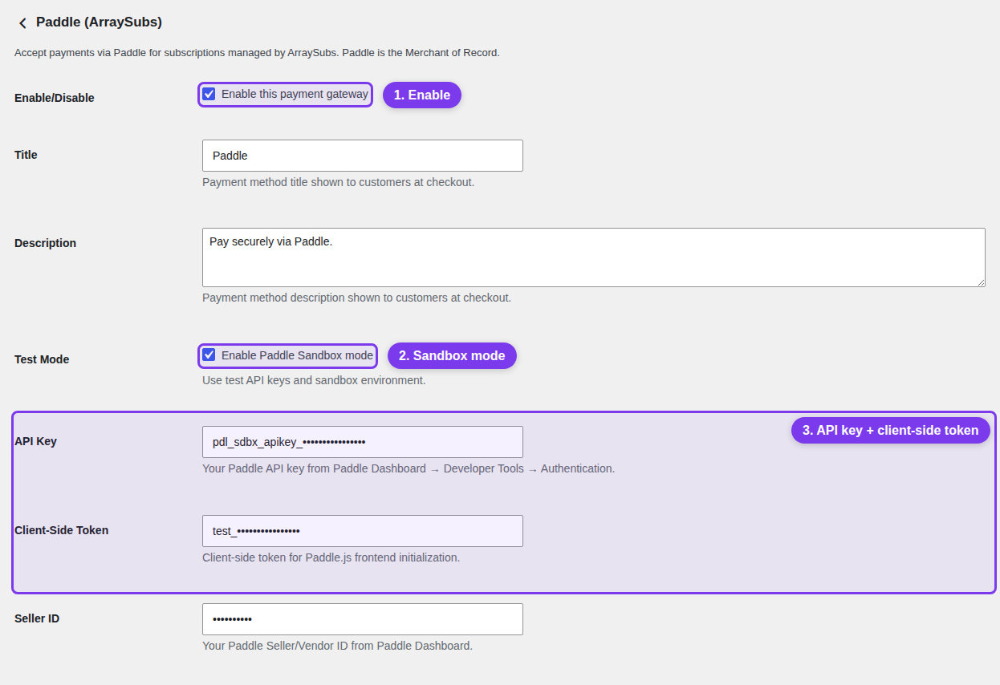
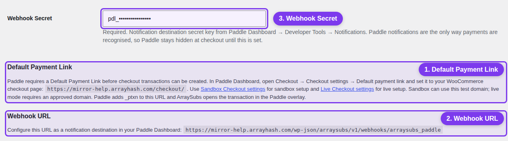
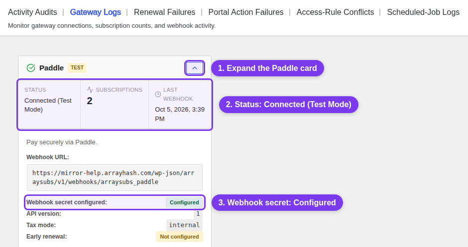
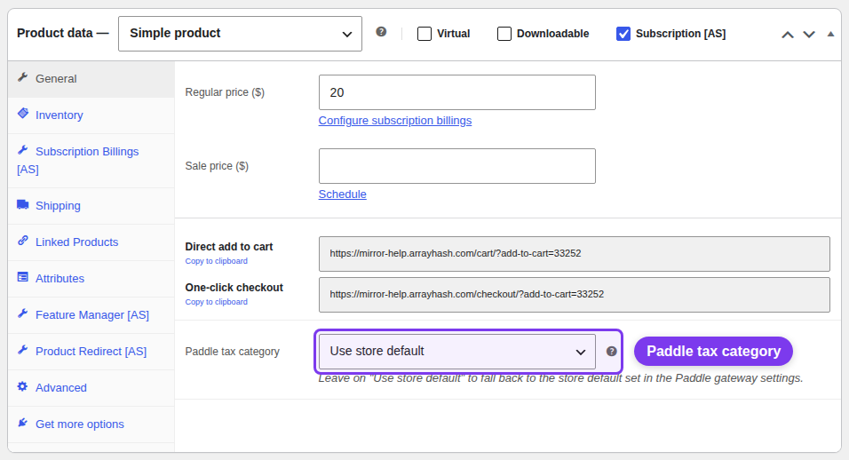

# Info
- Module: Paddle Gateway
- Availability: Free
- Last updated: 2026-10-26

# Paddle Gateway

> Set up Paddle so ArraySubs can take subscription payments, with Paddle charging every renewal automatically as Merchant of Record.

**Availability:** Free (ArraySubs core). **Paddle (ArraySubs)** is built into ArraySubs, so you need no extra plugin, only a Paddle account.

## Page Navigation

- **Current guide:** Paddle Gateway
- **Where to open it:** WooCommerce > Settings > Payments > Paddle (ArraySubs), and ArraySubs > Audits [beta] > Gateway Logs
- **Section overview:** [Open overview](../README.md)
- **Previous guide:** [PayPal Gateway](./paypal.md)
- **Next guide:** [Mollie Gateway](./mollie.md)
- **Troubleshooting:** [Audits, Logs, and Troubleshooting](../../audits-and-logs/README.md)

## Before You Start

- **A Paddle Billing account.** Test in a Paddle sandbox account first, then switch to your live account. The two are separate, each with its own keys and settings.
- **WooCommerce 9.0 or later with ArraySubs.** Paddle (ArraySubs) is part of the free plugin.
- **A public HTTPS site.** Paddle sends payment notifications to your store, so the site cannot sit behind password protection or a firewall that blocks Paddle.
- **A working cron.** ArraySubs uses scheduled jobs to check on renewals. See [Cron Job Setup](../../getting-started/cron-job-setup.md).
- **An approved domain for live payments.** The sandbox works on any domain, including a staging site. Live checkout only works on a domain Paddle has approved.
- **Carts Paddle can take.** One checkout can hold several subscriptions only when they share the same billing cycle. Paddle also cannot take a billing schedule the customer picks, or a recurring price changed by member discounts or dynamic pricing (coupons are fine). ArraySubs hides Paddle at checkout for those carts.

## Set Up Paddle

### Step 1: Open the Paddle (ArraySubs) Settings

1. Go to **WooCommerce > Settings > Payments**.
2. Find **Paddle (ArraySubs)** in the list of payment providers and click **Manage**.

### Step 2: Add Your Sandbox Credentials

1. Tick **Enable this payment gateway**. The **Title** and **Description** below it are what customers see at checkout.
2. Keep **Enable Paddle Sandbox mode** ticked while you test.
3. Copy two credentials from your Paddle sandbox account and paste them in:
   - **API Key:** in the Paddle dashboard, open Developer Tools > Authentication and create an API key. ArraySubs uses it to create products, prices, customers, discounts, and transactions in Paddle and to manage subscriptions and refunds, so give the key access to all of them.
   - **Client-Side Token:** create a client-side token in the same Paddle account. Paddle uses it to open its checkout on your site.
4. Leave **Seller ID** empty if you like. ArraySubs does not need it to take payments.



### Step 3: Connect Paddle to Your Store

The bottom of the settings screen shows two URLs to add in the Paddle sandbox dashboard. Paddle then gives you the secret for the last field.

1. **Default Payment Link:** copy the checkout URL shown in this section. In the Paddle dashboard, open Checkout > Checkout settings and set the default payment link to that URL. Paddle cannot open a checkout without it. The **Sandbox Checkout settings** link on the screen goes straight to that page.
2. **Webhook URL:** copy the URL in this section exactly as shown. It ends in `/wp-json/arraysubs/v1/webhooks/arraysubs_paddle`. In the Paddle dashboard, open Developer Tools > Notifications and add a notification destination with that URL and these events:
   - `transaction.completed` and `transaction.payment_failed`
   - `subscription.created`, `subscription.updated`, `subscription.canceled`, `subscription.paused`, and `subscription.resumed`
   - `adjustment.created` and `adjustment.updated` (refunds and chargebacks)

   Extra events do no harm. ArraySubs accepts and ignores the ones it does not use.
3. **Webhook Secret:** copy the new destination's secret key from Paddle and paste it into this field. Paddle stays hidden at checkout until this field is filled in, because notifications are how ArraySubs learns that a payment went through.



### Step 4: Save and Check the Status

Leave **Allow early renewal** unticked for now (see the [FAQ](#faq)) and click **Save changes**. Then check the connection:

1. Go to **ArraySubs > Audits [beta] > Gateway Logs** and click the arrow on the **Paddle** card.
2. **Status** should say **Connected (Test Mode)**. **Needs Setup** means the API key, client-side token, or webhook secret is missing.
3. **Webhook secret configured** should say **Configured**.



### Tax Category Required

Paddle is the Merchant of Record: it files and pays sales tax and VAT for you, using each product's tax category. A wrong category means Paddle reports the wrong tax, so set it before you sell.

1. **Store default:** on the **Paddle (ArraySubs)** settings screen, set **Default tax category** to the category that fits most of what you sell, then click **Save changes**. It starts as **Standard**, which is right for physical goods and little else.
2. **Per product:** edit a subscription product. On the **General** tab of **Product data**, set **Paddle tax category** and click **Update**. **Use store default** falls back to the store default. On a variable product, the field is on each variation.



The choices are **Standard**, **Digital goods**, **Ebooks**, **SaaS**, **Website hosting**, **Implementation services**, **Professional services**, **Software programming services**, and **Training services**. The product field appears only while **Paddle (ArraySubs)** is enabled.

ArraySubs sends Paddle the order total that WooCommerce calculated, tax included, and tells Paddle the price already contains tax. The customer pays exactly the WooCommerce total, and Paddle uses the tax category when it works out and remits the tax inside that amount.

### Step 5: Test a Subscription Checkout

1. In a private browser window, add one subscription product to the cart and go to checkout.
2. Choose **Paddle** (the **Title** from Step 2) and place the order.
3. Paddle's checkout opens on top of the page. Pay with one of the sandbox test cards listed in Paddle's developer documentation.
4. You land on the order received page. Until Paddle's notification arrives, usually within a few seconds, it says "Your order has been received and Paddle is confirming the payment." Opened from **My Account > Orders**, the same pending order shows the notice "Paddle is still confirming the payment for this order."

Success looks like this:

- The order is paid and the subscription is **Active**.
- The subscription's **Payment Gateway** card shows **Connected**, with a **Customer ID** and **Last Transaction** from Paddle. See [Payment Gateway Card](../../manage-subscriptions/subscription-detail-cards.md#payment-gateway-card).
- On the **Paddle** card in **Gateway Logs**, **Last Webhook** shows the time of your test.

A paid first checkout does not prove renewals. Before launch, follow [Test Automatic Renewals on Staging](#test-automatic-renewals-on-staging).

### Step 6: Go Live

1. Cancel your sandbox test subscriptions in ArraySubs first. They belong to the sandbox account, which the live keys cannot reach.
2. In your live Paddle account, repeat Steps 2 and 3: create a live API key and client-side token, set the default payment link, and add a notification destination with the same **Webhook URL** and events. The live destination has its own secret key. Make sure Paddle has approved your domain.
3. On the **Paddle (ArraySubs)** screen, untick **Enable Paddle Sandbox mode**, paste the live **API Key**, **Client-Side Token**, and **Webhook Secret**, and click **Save changes**.
4. In **Gateway Logs**, the **Paddle** card should now say **Connected**.
5. Place one real low-value order to confirm everything works, then refund it and cancel the subscription.

Sandbox and live have separate Paddle catalogs. ArraySubs creates the live products and prices for you when a subscription product is saved or first bought.

## How Renewals Work

- **Paddle runs the billing clock.** Paddle charges the customer on its own schedule, and ArraySubs never sends a renewal charge itself. See [Who Owns the Billing Clock](README.md#who-owns-the-billing-clock).
- **Paid renewals:** when Paddle charges a renewal, it notifies your store and ArraySubs marks the renewal order as paid.
- **Missed notifications:** if that notification never arrives, ArraySubs checks Paddle's transactions every six hours, for up to five days, and completes the order if Paddle took the payment. While ArraySubs waits for Paddle's charge, the customer cannot pay that renewal another way: its Pay page says a payment is already being processed and offers no payment methods, and My Account shows no **Pay** or **Cancel** button for it. The renewal can be paid again as soon as Paddle reports the payment failed, the Paddle subscription is paused or cancelled, or those five days end. An early renewal (ArraySubs Pro), which ArraySubs charges at Paddle itself, is not held.
- **Failed payments:** Paddle retries the payment and emails the customer itself. ArraySubs records the failure but runs no retries of its own, and your grace period settings decide what happens to the subscription. See [Payment Recovery](payment-recovery.md) and [Recovery and Grace Flows](../../billing-and-renewals/recovery-and-grace-flows.md).
- **Changes you make in ArraySubs:** cancelling a subscription also cancels it at Paddle. Skips, pauses, resumes, and anything else that moves the next payment date go to Paddle first and are saved only when Paddle accepts them.
- **New card:** customers click **Update payment method** on their subscription in My Account, which opens Paddle's customer portal.

## Test Automatic Renewals on Staging

Use this walkthrough to prove that Paddle bills a renewal on its own schedule and that ArraySubs records it, before you rely on it in production. Everything runs in Paddle's sandbox on a separate staging site, so no real card is charged.

```box class="warning-box"
## A successful checkout is not proof of automatic renewal

The first checkout only shows that the customer paid Paddle once. Automatic renewal is proven when Paddle bills the next cycle by itself and ArraySubs records that payment on a renewal order, with no customer action.
```

### Step 1: Prepare a Separate Staging Site

- Use a staging site with its own URL, such as `https://staging.example.com`. Do not run renewal tests on your live store.
- Use Paddle's sandbox on staging: a sandbox API key, client-side token, notification destination, and webhook secret. Your live site keeps its live credentials, its live notification destination, and its real subscriptions.
- The test needs only the free ArraySubs core plugin. If the staging site also runs ArraySubs Pro, add and activate the staging domain as described in [License Activation](../../getting-started/license-activation.md).

If you build staging by copying your live site, the copy contains your live Paddle credentials, real subscriptions that hold live Paddle IDs, and their queued renewal actions. Make the copy safe before anything runs. First, add these lines to the staging `wp-config.php` only (above the "That's all, stop editing!" line):

```php
<?php
// Staging only: stop scheduled jobs and mark the site as non-production.
define( 'DISABLE_WP_CRON', true );
define( 'WP_ENVIRONMENT_TYPE', 'staging' );
```

With `DISABLE_WP_CRON` set, ArraySubs also turns off Action Scheduler's background request runner, so actions copied from live stay queued. If your host runs WP-Cron for you, pause that for the staging site too. `WP_ENVIRONMENT_TYPE` marks the copy as staging for WordPress and for plugins that check it. ArraySubs does not read it, so it does not replace the next step.

Then:

1. Switch **Paddle (ArraySubs)** to the sandbox before any admin action that talks to Paddle. Open **WooCommerce > Settings > Payments**, click **Manage** next to **Paddle (ArraySubs)**, tick **Enable Paddle Sandbox mode**, replace **API Key**, **Client-Side Token**, and **Webhook Secret** with your sandbox values (Step 3 shows where the sandbox secret comes from), and click **Save changes**. Saving this screen does not call Paddle. Until you do it, the copy uses your live credentials: skipping, pausing, resuming, or cancelling a copied subscription, refunding one of its orders, or saving a subscription product would change your real Paddle records.
2. Make sure staging email cannot reach real customers, for example by routing it to a mail-capture tool.
3. Do not use subscriptions copied from live for tests. Their Paddle customer and subscription IDs belong to your live account and do not exist in the sandbox. Create new test subscriptions through checkout (Step 4).

### Step 2: Check the Prerequisites

| Requirement | What to confirm |
|---|---|
| WooCommerce and ArraySubs core | Both are active. Paddle (ArraySubs) and its automatic renewals are part of the free core plugin. |
| Scheduled jobs | After Step 3, run a real system cron every minute as described in [Cron Job Setup](../../getting-started/cron-job-setup.md). In **WooCommerce > Status > Scheduled Actions**, past-due **Pending** actions should be processed within a minute or two. |
| Public HTTPS | Paddle must reach the staging site over public HTTPS. Password protection, IP allowlists, or a firewall in front of staging block its notifications. |
| Paddle sandbox account | A sandbox account (sandbox-vendors.paddle.com) with an API key and a client-side token, created as in [Step 2](#step-2-add-your-sandbox-credentials) of the setup. |
| Default payment link | In the sandbox account, the default payment link is the staging checkout URL, for example `https://staging.example.com/checkout/`. The sandbox accepts a staging domain. |
| ArraySubs Pro | Not needed for Paddle renewals. Add it only when your integration uses Pro features. |

Test the Free-to-Pro upgrade as its own check. Complete this walkthrough with core only first. Then install ArraySubs Pro while core stays installed and active, activate the license as described in [License Activation](../../getting-started/license-activation.md), confirm that existing subscriptions, orders, and settings are unchanged, and repeat Steps 5 and 6. Do not uninstall core or recreate subscriptions to upgrade.

Optional settings in **ArraySubs > Settings > General**:

| Setting | Card | Default | On staging |
|---|---|---|---|
| **Generate Invoice Before Due** and **Unit** | Grace Period | 6 hours | Keep the default or match your live value. It sets when ArraySubs creates the renewal order, not when Paddle charges. |
| **Days Active After Due** and **Days On-Hold Before Cancel** | Grace Period | 3 and 7 | Keep, or shorten them to watch the grace flow sooner in the failure check |

### Step 3: Configure Sandbox Mode and Callbacks

1. In the Paddle sandbox dashboard, open Checkout > Checkout settings and set the default payment link to the staging checkout URL shown under **Default Payment Link** on the staging settings screen.
2. Open Developer Tools > Notifications and add a notification destination with the staging **Webhook URL**, for example `https://staging.example.com/wp-json/arraysubs/v1/webhooks/arraysubs_paddle`, and the nine events from [Step 3](#step-3-connect-paddle-to-your-store) of the setup. Copy the destination's secret key.
3. On staging, open **Paddle (ArraySubs)**. Check that **Enable Paddle Sandbox mode** is ticked and the sandbox **API Key** and **Client-Side Token** are in place, paste the secret key into **Webhook Secret**, and click **Save changes**.
4. In **ArraySubs > Audits [beta] > Gateway Logs**, the **Paddle** card should say **Connected (Test Mode)**, and **Webhook secret configured** should say **Configured**.

What each callback does:

| Callback | URL on staging | Received by | Used for |
|---|---|---|---|
| Paddle notifications | `https://staging.example.com/wp-json/arraysubs/v1/webhooks/arraysubs_paddle` | ArraySubs core | Paid and failed payments (`transaction.*`), subscription changes (`subscription.*`), and refunds and chargebacks (`adjustment.*`) |
| Default payment link | `https://staging.example.com/checkout/` | Your WooCommerce checkout page | Paddle adds `_ptxn` to this URL, and ArraySubs opens the Paddle checkout overlay there |
| Paddle API calls (outgoing) | None | ArraySubs, with the sandbox API key | Creating products, prices, customers, and checkout transactions, and pausing, resuming, cancelling, or moving the date of Paddle subscriptions. ArraySubs sends no renewal charges unless **Allow early renewal** is on. |

Sandbox and live keep separate keys, notification destinations, and secrets.

### Step 4: Place a Test Subscription Checkout

1. Create a simple subscription product that renews every day: on the **Subscription Billings [AS]** tab, set **Billing Period** to **Day** and **Billing Interval** to `1`, with no free trial. Set its **Paddle tax category** and publish it. See [Create and Configure Subscription Products](../../subscription-products/create-and-configure.md).
2. Log in as a test customer, for example `member@example.com`, add the product to the cart, and choose **Paddle** at checkout.
3. Pay in the Paddle checkout with a test card from Paddle's developer documentation. Never use a real card on staging.

Expected result:

- The parent order is paid: **Completed** for a subscription that needs no shipping, **Processing** when it needs shipping.
- A new subscription is **Active** and linked to that order. Its **Next Payment** date is Paddle's next billing date, one day after checkout.
- On the subscription detail page, the **Payment Gateway** card shows **Connected** with **Card on File** (for a card payment), **Customer ID**, and **Last Transaction**.
- In **Gateway Logs**, the **Webhook Event Log** filtered to **Paddle** lists `transaction.completed` and `subscription.created` for the checkout.

If the order stays pending or the card does not show **Connected**, Paddle's notifications are not reaching staging. Recheck Step 3 and the [Troubleshooting](#troubleshooting) table before you continue.

### Step 5: Run a Due Renewal

Paddle owns the billing clock, so the renewal happens when Paddle bills, not when an ArraySubs job runs. You cannot bring a Paddle renewal forward from ArraySubs: the admin screens do not accept manual next payment date changes, and the date changes ArraySubs does send to Paddle, such as a skip, move it later. Those changes never bill a proration, and Paddle refuses dates in the past. With the daily plan from Step 4, Paddle bills about 24 hours after checkout.

What happens around the due date:

| Order | What runs | When | What it does for a Paddle subscription |
|---|---|---|---|
| 1 | `arraysubs_generate_renewal_invoice` (group `arraysubs-billing`) | **Generate Invoice Before Due** ahead of the **Next Payment** date | Creates the renewal order as an unpaid invoice |
| 2 | `arraysubs_process_renewal` (group `arraysubs-renewals`) | At the **Next Payment** date, delayed by up to **Spread Renewals Over (Hours)** | Charges nothing. Adds a note that the order is waiting for Paddle and puts the order on the missed-notification check |
| 3 | Paddle's `transaction.completed` notification | When Paddle bills | Marks the renewal order paid and moves **Next Payment** to Paddle's next billing date. If no renewal order exists yet, ArraySubs creates one |
| 4 | `arraysubs_gateway_reconcile` (group `arraysubs-gateway`) | Every six hours | For up to five days, asks Paddle whether it took the payment for a renewal order that is still waiting, and completes the order if it did |

Both renewal actions use the subscription ID as their only argument, for example `[123]`, so you can find them in **WooCommerce > Status > Scheduled Actions**. If Paddle has still not confirmed the payment after five days, the order is marked **Failed** and the grace period takes over.

### Step 6: Record What You Observe

| What to check | Where | Expected after a paid renewal |
|---|---|---|
| Order and payment | **WooCommerce > Orders**, and your Paddle sandbox account | A new renewal order linked to the subscription, paid, with a Paddle transaction ID that starts with `txn_`. In Paddle, a completed transaction for the subscription. |
| Dates | Subscription detail page | **Next Payment** moved to Paddle's next billing date, one billing period later |
| Scheduled actions | **WooCommerce > Status > Scheduled Actions** | This cycle's `arraysubs_generate_renewal_invoice` and `arraysubs_process_renewal` show **Complete**, and new **Pending** ones exist for the next cycle |
| Webhooks | **ArraySubs > Audits [beta] > Gateway Logs** | **Last Webhook** on the **Paddle** card shows the renewal time, and the **Webhook Event Log**, filtered to **Paddle**, lists `transaction.completed` |
| Subscription | Subscription detail page and the customer's My Account | **Active**, with the same product and recurring amount. The **Payment Gateway** card is still **Connected** and shows the renewal's **Last Transaction**. |

If the six-hour check completed the order instead of a notification, the order notes say "Reconciled from the gateway: this renewal settled but no notification arrived." Fix the notification destination before you go live.

#### Check a Failed Renewal

ArraySubs cannot make a Paddle renewal fail, and Paddle decides how its sandbox handles declines. Paddle's developer documentation lists its sandbox test cards. Run this check only if it offers a way to make a later renewal of a sandbox subscription fail, then let that renewal come due as in Step 5. Expected:

- Paddle's `transaction.payment_failed` notification marks the renewal order **Failed** and adds the reason as an order note and a subscription note.
- The customer receives the **[ArraySubs] Renewal Payment Failed** email.
- ArraySubs schedules no retries of its own. Paddle retries the payment on its own schedule.
- The grace flow starts: the subscription stays **Active** for **Days Active After Due**, moves to **On Hold**, and is **Cancelled** after **Days On-Hold Before Cancel**. See [Recovery and Grace Flows](../../billing-and-renewals/recovery-and-grace-flows.md).
- Recovery: when one of Paddle's retries succeeds, its `transaction.completed` notification marks the same renewal order paid, and the subscription returns to **Active**. The customer can change the card with **Update payment method** in My Account, which opens Paddle's customer portal.

### Step 7: Return to Live Safely

- Keep staging and live separate: separate Paddle accounts, keys, client-side tokens, notification destinations, and secrets. Never copy the staging database or its Paddle settings over your live site.
- Sandbox customers and subscriptions exist only in your Paddle sandbox account. They cannot be moved to live. Real customers subscribe through checkout on the live site.
- On the live site, confirm that **Enable Paddle Sandbox mode** is off, that the live **API Key**, **Client-Side Token**, and **Webhook Secret** are in place, and that the **Paddle** card in **Gateway Logs** says **Connected**.
- In the live Paddle account, the notification destination points at the live **Webhook URL** with the nine events, and the default payment link is the live checkout URL on a domain Paddle has approved.
- Remove the staging notification destination from the sandbox account when you no longer need it, and make sure no destination in the live account points at a staging URL.
- When testing ends, delete the staging copy or keep `DISABLE_WP_CRON` set on it. If you activated ArraySubs Pro there, manage that site activation as described in [License Activation](../../getting-started/license-activation.md).

## Troubleshooting

| Problem | Fix |
|---|---|
| Paddle is missing at checkout | Check the **Paddle** card in **Gateway Logs**. **Disabled** means **Enable this payment gateway** is unticked. **Needs Setup** means **API Key**, **Client-Side Token**, or **Webhook Secret** is empty. If the status starts with **Connected**, the cart needs something Paddle cannot do (different billing cycles, a schedule the customer picks, or a member or dynamic recurring price), so ArraySubs hid Paddle for that cart. |
| Checkout says the Paddle account "has no Default Payment Link set" | Set the default payment link in the Paddle account that matches your mode, sandbox or live. See [Step 3](#step-3-connect-paddle-to-your-store). |
| Checkout says "Paddle rejected the Sandbox API key" (customers see "Paddle payments are currently unavailable") | The key is expired, revoked, missing permissions, or from the other environment. Create a key in the same environment as your **Enable Paddle Sandbox mode** setting and paste it again. |
| The customer paid, but the order stays pending ("Paddle is confirming the payment") | Paddle's notifications are not getting through. Check the destination URL and events in Paddle, make sure **Webhook Secret** holds that destination's secret for the same environment, and make sure your server clock is correct: ArraySubs rejects notifications signed more than five minutes away from its own time. Errors are logged in **WooCommerce > Status > Logs** under the `arraysubs_paddle` source. |
| Saving a product shows "Paddle catalogue synchronization failed" | Click **Review the Paddle sync log** in the notice, fix the cause (often the API key), and save the product again. |
| The **Paddle tax category** field is missing on a product | It appears only while **Paddle (ArraySubs)** is enabled, and only on simple products (**General** tab) and on each variation of a variable product. |

## FAQ

**Do I need ArraySubs Pro to use Paddle?**
No. Paddle (ArraySubs), checkout, and automatic renewals are part of the free core plugin. Only the **Allow early renewal** option depends on Pro, because early renewal is an ArraySubs Pro feature.

**Does Paddle add tax on top of my prices?**
No. ArraySubs sends Paddle the total WooCommerce calculated, tax included, so the customer pays the amount WooCommerce shows. Paddle then remits the tax from that amount. See [Tax Category Required](#tax-category-required).

**Do free trials, signup fees, and coupons work with Paddle?**
Yes. Paddle runs free trials itself, signup fees are charged with the first payment, and coupons can keep applying to renewals.

**Should I turn on Allow early renewal?**
Only if you use early renewal from ArraySubs Pro and have tested it on your own Paddle account. Paddle charges an early renewal separately, and ArraySubs then has to move Paddle's next billing date. If that second step fails, ArraySubs stops further early renewals for that subscription and leaves a note for you to resolve.

**What happens if I turn Paddle off later?**
Unticking **Enable this payment gateway** only removes Paddle from checkout. Existing subscriptions keep billing at Paddle, and ArraySubs keeps recording their payments as long as the credentials and notification destination stay in place. To stop charging a customer, cancel their subscription.

## Related Docs

- [Automatic Payments](README.md) - Compare gateways and see who owns the billing clock
- [Gateway Health](../../gateway-health/README.md) - Gateway status cards and the webhook event log
- [Create and Configure Subscription Products](../../subscription-products/create-and-configure.md#paddle-tax-category) - The Paddle tax category field on products
- [Payment Recovery](payment-recovery.md) - Failed payments and Resync from Gateway
- [Payment and Shipping](../../customer-portal/payment-and-shipping.md) - How customers update their payment method
- [Cron Job Setup](../../getting-started/cron-job-setup.md) - Reliable scheduled jobs
