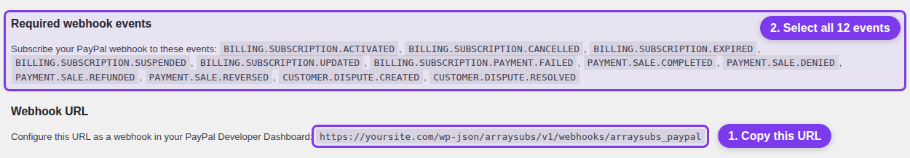
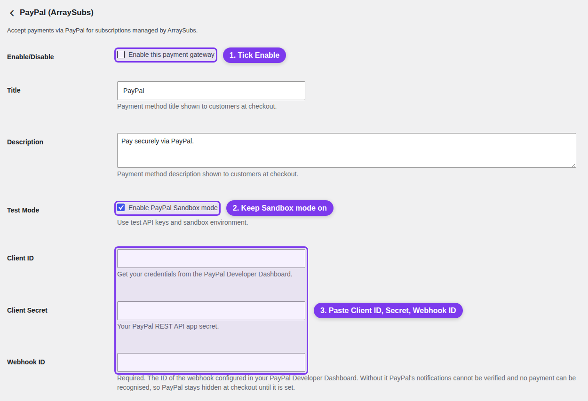
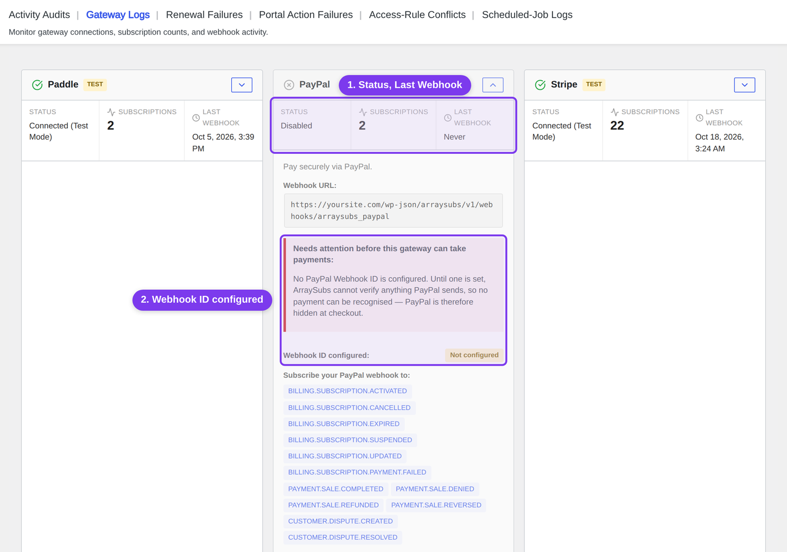

# Info
- Module: PayPal Gateway
- Availability: Free
- Last updated: 2026-10-18

# PayPal Gateway

> Set up PayPal (ArraySubs) so customers can subscribe with PayPal and every renewal is collected automatically.

**Availability:** Free (ArraySubs core). No extra WordPress plugin is needed - just a PayPal account that can create REST API apps in the PayPal Developer Dashboard.

## Page Navigation

- **Current guide:** PayPal Gateway
- **Where to open it:** **WooCommerce > Settings > Payments**, then **Manage** on the **PayPal (ArraySubs)** row
- **Section overview:** [Open overview](../README.md)
- **Previous guide:** [Stripe Gateway](./stripe.md)
- **Next guide:** [Paddle Gateway](./paddle.md)
- **Troubleshooting:** [Audits, Logs, and Troubleshooting](../../audits-and-logs/README.md)

## Before You Start

- **Use PayPal (ArraySubs)**, the gateway built into ArraySubs - not WooCommerce's **PayPal Payments** plugin (see Step 1).
- WooCommerce 9.0 or later with ArraySubs active.
- A PayPal account that can sign in to the PayPal Developer Dashboard. You test with a sandbox app and take real payments with a live app.
- Your site on public HTTPS. PayPal must reach your site to report payments, so a local site or one behind a password prompt cannot receive its notifications.
- WP-Cron (or a server cron job) running, so renewal orders are created and missed PayPal notifications are checked on time.
- A store currency that PayPal supports. ArraySubs sends your WooCommerce currency to PayPal as it is.
- One subscription per PayPal order. PayPal cannot take a cart that mixes a subscription with regular products, holds more than one subscription, or uses a coupon that keeps discounting renewals, so ArraySubs hides PayPal at checkout for those carts. PayPal (ArraySubs) also takes subscription orders only, so keep another payment method for one-time products.

## Set Up PayPal

### Step 1: Open the PayPal (ArraySubs) Settings

1. Go to **WooCommerce > Settings > Payments**.
2. Find the **PayPal (ArraySubs)** row. It shows **Action needed** until setup is complete.
3. Click **Manage**. The **PayPal (ArraySubs)** settings screen opens.

```box class="warning-box"
The same list also offers **PayPal Payments** with an **Install** button. That is WooCommerce's official PayPal plugin, not the ArraySubs gateway. ArraySubs cannot charge renewals through it: a subscription paid with it gets a manual renewal invoice every cycle. Use **PayPal (ArraySubs)** for subscriptions.
```

Keep this screen open in a browser tab. You copy the webhook URL from it in Step 3 and paste your PayPal details into it in Step 4.

### Step 2: Create a REST API App in PayPal

1. Sign in to the PayPal Developer Dashboard with your PayPal account.
2. Switch the dashboard to sandbox. Test with sandbox details first; you repeat this step in live mode when you go live.
3. Open your REST API app, or create one for your store.
4. Copy the app's client ID and secret.

You do not need to create products or plans in PayPal. ArraySubs creates them at checkout.

### Step 3: Add the Webhook in PayPal

PayPal reports every payment, failure, and refund to your store through a webhook. This step is required: without a **Webhook ID**, ArraySubs cannot verify PayPal's notifications, so PayPal stays hidden at checkout.

1. On the **PayPal (ArraySubs)** settings screen, copy the address under **Webhook URL**. It looks like `https://yoursite.com/wp-json/arraysubs/v1/webhooks/arraysubs_paypal`.
2. In the PayPal Developer Dashboard, open the same app as in Step 2 and add a webhook. Paste the URL and select all 12 events listed under **Required webhook events**.
3. Save the webhook, then copy the webhook ID that PayPal shows for it.



These are the 12 events to select:

```text
BILLING.SUBSCRIPTION.ACTIVATED
BILLING.SUBSCRIPTION.CANCELLED
BILLING.SUBSCRIPTION.EXPIRED
BILLING.SUBSCRIPTION.SUSPENDED
BILLING.SUBSCRIPTION.UPDATED
BILLING.SUBSCRIPTION.PAYMENT.FAILED
PAYMENT.SALE.COMPLETED
PAYMENT.SALE.DENIED
PAYMENT.SALE.REFUNDED
PAYMENT.SALE.REVERSED
CUSTOMER.DISPUTE.CREATED
CUSTOMER.DISPUTE.RESOLVED
```

Leave none out. Each event reports a change your store needs to know about, so a skipped event means that change is missed - for example, without `PAYMENT.SALE.REFUNDED` a refund you issue in PayPal never reaches the WooCommerce order.

### Step 4: Enter Your Sandbox Details and Enable PayPal

Back on the **PayPal (ArraySubs)** settings screen:

1. Tick **Enable this payment gateway**.
2. Keep **Enable PayPal Sandbox mode** ticked while you test.
3. Paste the sandbox **Client ID**, **Client Secret**, and **Webhook ID**.
4. Optional: change the **Title** and **Description** that customers see at checkout. The defaults are "PayPal" and "Pay securely via PayPal."
5. Click **Save changes**.



All three values must come from the same PayPal app, in the same mode as the sandbox setting. PayPal stays hidden at checkout until **Client ID**, **Client Secret**, and **Webhook ID** are all saved.

```box class="info-box"
While sandbox mode is on, anyone who picks PayPal at checkout is sent to PayPal's sandbox, and no real money moves. Test on a staging copy of your store if you can - see [Test Automatic Renewals on Staging](#test-automatic-renewals-on-staging).
```

### Step 5: Check the Connection

Go to **ArraySubs > Audits [beta]**, open the **Gateway Logs** tab, and click the arrow on the **PayPal** card (the card uses your checkout **Title**). Then check:

1. **Status** reads **Connected (Test Mode)**. After your first test order, **Last Webhook** shows a recent time.
2. **Webhook ID configured** reads **Configured**, and the red **Needs attention before this gateway can take payments** box is gone.



This screen confirms that your settings are complete. It does not contact PayPal, so the test checkout in Step 6 is what proves your details work.

### Step 6: Test a Subscription Checkout

1. In a private browser window, add one subscription product to the cart. Pick one without a free trial, so PayPal takes a payment straight away.
2. At checkout, choose **PayPal** (or your own **Title**) and place the order. You are sent to PayPal's sandbox site.
3. Sign in with a PayPal sandbox buyer account, not your real PayPal login, and approve the subscription.
4. PayPal sends you back to the order-received page.

The test worked when:

- The order is paid (**Processing** or **Completed**). If it still shows **Pending payment**, give PayPal a minute to send its payment notification, then reload the order.
- Under **ArraySubs > Subscriptions**, the new subscription is **Active**, and its **Payment Gateway** card shows **Connected** with **Card on File** (PayPal, or a card brand and its last four digits), **Customer ID**, and **Last Transaction** filled in.
- On **Gateway Logs**, the PayPal card's **Last Webhook** shows the time of your test.

### Step 7: Go Live

1. While sandbox mode is still on, cancel the test subscriptions you created, so ArraySubs also cancels them in PayPal's sandbox.
2. In the PayPal Developer Dashboard, switch to live mode and open (or create) a live REST API app. Copy its client ID and secret.
3. Add the same webhook to the live app: the same **Webhook URL** and all 12 events. Copy the live webhook ID.
4. In **PayPal (ArraySubs)**, untick **Enable PayPal Sandbox mode**, replace the **Client ID**, **Client Secret**, and **Webhook ID** with the live values, and click **Save changes**.
5. On **Gateway Logs**, confirm that **Status** reads **Connected**, without "(Test Mode)".
6. Place a small real subscription order with your own PayPal account. Once it is paid, refund the order and cancel the subscription.

## How Renewals Work

- **PayPal runs the billing clock.** At checkout, ArraySubs builds a PayPal plan from the product's price, billing period, trial, signup fee, and recurring shipping. PayPal then charges the customer on that schedule.
- **Each renewal is recorded from PayPal's notification.** ArraySubs marks the matching renewal order paid (creating it if PayPal charged first) and copies PayPal's next billing date to the subscription. If a notification never arrives, ArraySubs checks PayPal's transaction history every six hours. A renewal that PayPal never confirms is marked failed about 5 days after it was due.
- **PayPal handles failed payments.** PayPal retries on its own schedule, so ArraySubs adds no retries of its own; it records each failure and triggers the payment-failed email. After 3 failed payments, PayPal suspends the subscription and automatic renewals go on hold. See [Payment Recovery Tools](payment-recovery.md).
- **Customers change their payment method at PayPal.** The card or bank behind the subscription belongs to the customer's PayPal account, so they update it there and PayPal keeps billing the same subscription.
- **PayPal's billing date cannot move.** Pause and resume work through PayPal, but skipping a renewal or changing the next payment date is refused. Plan switches take effect from the next billing cycle.

## Test Automatic Renewals on Staging

Use this walkthrough to prove that PayPal collects a scheduled renewal and that ArraySubs records it before you rely on PayPal in production. Everything runs in PayPal's sandbox on a separate staging site, so no real money moves.

```box class="warning-box"
**A successful checkout is not proof of automatic renewal.** The first payment is taken while the customer is at PayPal approving the subscription. Automatic renewal is proven only when PayPal charges the next cycle on its own schedule and ArraySubs records that payment on a renewal order, with no customer action.
```

### Step 1: Prepare a Separate Staging Site

- Use a staging site with its own URL, such as `https://staging.example.com`. Do not run renewal tests on your live store.
- Use PayPal sandbox mode, a sandbox REST API app, and a sandbox webhook on staging. Your live site keeps its live app, its live webhook, and its real subscriptions.
- The renewal test needs only the free ArraySubs core plugin. If the staging site also runs ArraySubs Pro, add and activate the staging domain as described in [License Activation](../../getting-started/license-activation.md).

If you build staging by copying your live site, the copy contains your live **Client ID**, **Client Secret**, and **Webhook ID**, real customer subscriptions linked to live PayPal subscriptions, and their queued scheduled actions. Make the copy safe before it runs any scheduled job. First, add these lines to the staging `wp-config.php` only (above the "That's all, stop editing!" line):

```php
<?php
// Staging only: stop scheduled jobs and mark the site as non-production.
define( 'DISABLE_WP_CRON', true );
define( 'WP_ENVIRONMENT_TYPE', 'staging' );
```

With `DISABLE_WP_CRON` set, ArraySubs also turns off Action Scheduler's background request runner, so actions copied from live stay queued. If your host runs WP-Cron for you from a server cron job, pause that for the staging site too. `WP_ENVIRONMENT_TYPE` marks the site as staging for WordPress and other plugins, but PayPal (ArraySubs) does not read it: only sandbox mode keeps staging away from your live PayPal account.

Then:

1. Switch **PayPal (ArraySubs)** to sandbox mode with sandbox details (Step 3) before you open or act on any subscription. While the live details are in place, a cancel, pause, resume, plan switch, or refund on a copied subscription changes the customer's real PayPal subscription, and so does any scheduled job that cancels or resumes one. In sandbox mode those calls go to PayPal's sandbox, where your live PayPal subscriptions do not exist.
2. Make sure staging email cannot reach real customers, for example by routing it to a mail-capture tool.
3. Do not use subscriptions copied from live for renewal tests. Their PayPal subscriptions belong to your live PayPal account, which keeps billing them and reports to your live site, not to staging. Create new test subscriptions through checkout (Step 4).

### Step 2: Check the Prerequisites

| Requirement | What to confirm |
|---|---|
| WooCommerce and ArraySubs core | Both are active, with WooCommerce 9.0 or later. PayPal (ArraySubs) is part of the free core plugin, so no other payment plugin is needed. |
| Scheduled jobs | After Step 3, run a real system cron every minute as described in [Cron Job Setup](../../getting-started/cron-job-setup.md). In **WooCommerce > Status > Scheduled Actions**, past-due **Pending** actions should be processed within a minute or two. |
| Webhook delivery | PayPal must reach the staging site over public HTTPS. Password protection, an IP allowlist, or a firewall in front of staging blocks its notifications. |
| PayPal sandbox | A sandbox REST API app (client ID and secret) and a sandbox buyer (personal) account to pay with, both from the PayPal Developer Dashboard. |
| ArraySubs Pro | Not needed for PayPal renewals. Add it only when your integration uses Pro features. |

Test the Free-to-Pro upgrade as its own check. Complete this walkthrough with core only first. Then install ArraySubs Pro while core stays installed and active, activate the license as described in [License Activation](../../getting-started/license-activation.md), confirm that existing subscriptions, orders, and settings are unchanged, and repeat Steps 5 and 6. Do not uninstall core or recreate subscriptions to upgrade.

Optional settings in **ArraySubs > Settings > General**:

| Setting | Card | Default | On staging |
|---|---|---|---|
| **Generate Invoice Before Due** and **Unit** | **Grace Period** | 6 hours | Keep the default or match your live value |
| **Days Active After Due** and **Days On-Hold Before Cancel** | **Grace Period** | 3 and 7 | Keep, or shorten them to watch the grace flow sooner. For PayPal, the move to **On-Hold** also waits until the 5-day confirmation window in Step 5 has closed. |

### Step 3: Configure Sandbox Mode and Callbacks

1. On staging, go to **WooCommerce > Settings > Payments** and click **Manage** on the **PayPal (ArraySubs)** row.
2. Tick **Enable PayPal Sandbox mode**.
3. In the PayPal Developer Dashboard, switch to sandbox and open (or create) a sandbox REST API app for staging. Copy its client ID and secret.
4. In that same sandbox app, add a webhook for the staging site's **Webhook URL**, for example `https://staging.example.com/wp-json/arraysubs/v1/webhooks/arraysubs_paypal`, and select all 12 events listed under **Required webhook events**. Copy that webhook's ID.
5. Paste the sandbox **Client ID**, **Client Secret**, and **Webhook ID**, tick **Enable this payment gateway**, and click **Save changes**.
6. Go to **ArraySubs > Audits [beta]**, open the **Gateway Logs** tab, and expand the **PayPal** card. **Status** reads **Connected (Test Mode)**, and **Webhook ID configured** reads **Configured**.

Which callback goes where:

| Callback | URL on staging | Handled by | Used for |
|---|---|---|---|
| PayPal webhook | `https://staging.example.com/wp-json/arraysubs/v1/webhooks/arraysubs_paypal` | ArraySubs core | The 12 events: activation, payments, failures, suspension, cancellation, plan updates, refunds, and disputes |
| Approval return | Your order-received page, for example `https://staging.example.com/checkout/order-received/123/?key=...` | ArraySubs core, when the customer comes back from PayPal | Confirms the first payment right away if PayPal has already taken it |
| Approval cancel | Your checkout page, for example `https://staging.example.com/checkout/` | WooCommerce | Where PayPal sends a customer who cancels instead of approving |
| PayPal API (outgoing) | None | ArraySubs, using the sandbox **Client ID** and **Client Secret** | Creating plans and subscriptions, the six-hourly charge check, cancel, pause, resume, plan changes, and refunds |

ArraySubs sends the return and cancel addresses to PayPal with every checkout, built from the site's own URL, so they need no setup in PayPal. Only the webhook needs the staging URL entered by hand, and only the ID of that staging webhook belongs in **Webhook ID**.

### Step 4: Place a Test Subscription Checkout

1. Create a test subscription product with **Billing Interval** `1` and **Billing Period** **Day**, without a free trial. See [Create and Configure Subscription Products](../../subscription-products/create-and-configure.md). ArraySubs builds a daily PayPal plan from it, so the first renewal falls due one day after checkout.
2. Log in as a test customer, for example `member@example.com`, add only that product to the cart, and choose **PayPal** at checkout.
3. At PayPal's sandbox site, sign in with your sandbox buyer account and approve the subscription. Never use a real PayPal login or card on staging.
4. Leave auto-renew on. Turning it off cancels the PayPal subscription (see [Auto-Renew and Manual Fallback](auto-renew-and-manual-fallback.md)).

Expected result:

- The parent order is paid (**Processing** or **Completed**).
- The new subscription is **Active** and linked to that order. Its **Next Payment** date is PayPal's next billing date, one day after checkout.
- On the subscription detail page, the **Payment Gateway** card shows **Connected** with **Card on File** and **Customer ID**, and the subscription notes include "PayPal subscription ... activated".
- On **Gateway Logs**, the **Webhook Event Log** lists `BILLING.SUBSCRIPTION.ACTIVATED` and `PAYMENT.SALE.COMPLETED` for PayPal.

If the order stays **Pending payment** and **Last Webhook** reads **Never**, PayPal's notifications are not reaching staging. Recheck the webhook URL, its events, and the **Webhook ID** before you continue.

### Step 5: Run a Due Renewal

PayPal owns the billing clock, so a PayPal renewal happens on PayPal's schedule, around the **Next Payment** date that ArraySubs copied from PayPal. ArraySubs cannot bring that date forward: skipping a renewal and changing the next payment date are both refused for PayPal subscriptions.

Around the due date, ArraySubs runs its usual renewal steps but never charges PayPal itself:

| When | Action hook (group) | What happens |
|---|---|---|
| **Generate Invoice Before Due** ahead of the **Next Payment** date | `arraysubs_generate_renewal_invoice` (`arraysubs-billing`) | Creates the renewal order as an unpaid invoice (**Pending payment**) |
| At the **Next Payment** date, or up to **Spread Renewals Over (Hours)** later | `arraysubs_process_renewal` (`arraysubs-renewals`) | Sends no charge. Adds the note "Awaiting PayPal automatic renewal payment for subscription ..." and opens a 5-day window for PayPal to confirm the payment |
| When PayPal charges | None: PayPal sends `PAYMENT.SALE.COMPLETED` | Marks the renewal order paid (creating one if PayPal charged first) and copies PayPal's next billing date |
| Every six hours | `arraysubs_gateway_reconcile` (`arraysubs-gateway`) | Checks PayPal's transaction history for renewal orders still waiting and completes any that PayPal already charged |
| After the 5-day window | The same six-hourly check | Marks a renewal that PayPal never confirmed as **Failed**, and the grace flow takes over |

1. Wait for the **Next Payment** date. With the daily plan from Step 4, that is about one day after checkout. PayPal decides exactly when to bill; if no payment arrives after the date, check PayPal's sandbox documentation.
2. Watch the **Webhook Event Log** on **Gateway Logs** for `PAYMENT.SALE.COMPLETED`, then refresh the subscription.

Running these actions early from **WooCommerce > Status > Scheduled Actions** does not make PayPal charge: PayPal bills only on its own schedule.

A successful renewal leaves the renewal order paid, the subscription **Active**, and **Next Payment** set to PayPal's next billing date.

### Step 6: Record What You Observe

| What to check | Where | Expected after a paid renewal |
|---|---|---|
| Order and payment | **WooCommerce > Orders** and the subscription's notes | A new renewal order linked to the subscription, paid, with PayPal's sale ID as the transaction ID. A note reads "PayPal renewal payment received". |
| Dates | Subscription detail page | **Next Payment** moved to PayPal's next billing date, one billing period later |
| Webhook entries | **Webhook Event Log** on **Gateway Logs**, filtered to **PayPal** | A `PAYMENT.SALE.COMPLETED` entry with a **Processed At** time for this renewal, and no errors for `arraysubs_paypal` in **WooCommerce > Status > Logs**. With ArraySubs Pro, the **Scheduled-Job Logs** and **Renewal Failures** tabs add more detail. |
| Scheduled actions | **WooCommerce > Status > Scheduled Actions** | This cycle's `arraysubs_generate_renewal_invoice` and `arraysubs_process_renewal` show **Complete**, and new **Pending** actions exist for the next cycle |
| Subscription state | Subscription detail page and the customer's My Account | **Active** on the same product and amount, the **Payment Gateway** card still **Connected**, and member content still visible to the customer |
| Lifecycle events | Your integration code | `arraysubs_lifecycle_event` fired `renewed`. See [React to Supported Events](../../developers/actions-and-filters.md). |

#### When a PayPal Renewal Fails

ArraySubs cannot make PayPal decline a payment, and this guide does not cover forcing a failure in PayPal's sandbox - check PayPal's sandbox documentation for that. When a PayPal renewal does fail, on staging or live, look for this:

1. PayPal sends `BILLING.SUBSCRIPTION.PAYMENT.FAILED` (or `PAYMENT.SALE.DENIED`), which appears in the **Webhook Event Log**.
2. The renewal order is marked **Failed**, a subscription note reads "PayPal payment failed: ..." with PayPal's reason, the payment-failed email is triggered, and the **Payment Gateway** card shows **Error**.
3. ArraySubs schedules no retry of its own. PayPal retries on its own schedule; a later successful retry arrives as `PAYMENT.SALE.COMPLETED`, marks the renewal order paid, returns the subscription to **Active**, and sets the **Payment Gateway** card back to **Connected**.
4. During the 5-day window the subscription stays **Active**. After that, the grace flow runs: **On-Hold** once **Days Active After Due** has passed (members lose access), then **Cancelled** after **Days On-Hold Before Cancel**, which also cancels the PayPal subscription. See [Recovery and Grace Flows](../../billing-and-renewals/recovery-and-grace-flows.md).
5. After 3 failed payments PayPal suspends the subscription and sends `BILLING.SUBSCRIPTION.SUSPENDED`. The **Payment Gateway** card shows **Paused**, and a note reads "PayPal subscription suspended. Automatic renewals are on hold until it is reactivated."

### Step 7: Return to Live Safely

- Keep staging and live separate: separate PayPal apps, webhooks, Webhook IDs, customers, and records. Never copy the staging database or its PayPal settings over your live site.
- Sandbox subscriptions exist only in PayPal's sandbox. They cannot be charged in live mode or moved to live; real customers subscribe through checkout on the live site.
- On the live site, confirm that **Enable PayPal Sandbox mode** is off and that **Client ID**, **Client Secret**, and **Webhook ID** come from your live app, whose webhook points at the live **Webhook URL**.
- In the PayPal Developer Dashboard, delete the sandbox webhook for the staging URL once testing ends, and confirm that no live webhook points at the staging URL.
- When testing ends, delete the staging copy or keep `DISABLE_WP_CRON` set on it. If you activated ArraySubs Pro there, manage that site activation as described in [License Activation](../../getting-started/license-activation.md).

For integration checks such as error handling, retries, and permissions, see [Verify Your Integration](../../developers/errors-and-testing.md).

## Troubleshooting

| Problem | Fix |
|---|---|
| **PayPal (ArraySubs)** shows **Action needed**, or **Gateway Logs** shows **Needs Setup** | **Client ID**, **Client Secret**, or **Webhook ID** is empty. Fill in all three and click **Save changes**. |
| PayPal is missing at checkout | Check that **Enable this payment gateway** is ticked and all three values are saved. PayPal is also hidden for carts it cannot take: regular products next to a subscription, more than one subscription, or a coupon that keeps discounting renewals. |
| Checkout shows **Payment setup failed. Please try again.** | PayPal refused the request. Usually the details do not match the mode (sandbox details with sandbox mode off, or live details with it on), or PayPal does not support the store currency. Check **WooCommerce > Status > Logs** for `arraysubs_paypal` entries. |
| Customers paid at PayPal, but orders stay **Pending payment** and **Last Webhook** reads **Never** | PayPal's notifications are not getting through. Check that the webhook uses the exact **Webhook URL**, has all 12 events, and belongs to the same app and mode as your **Client ID**, and that no firewall or security plugin blocks `/wp-json/`. Look for "Webhook signature verification failed" in the `arraysubs-gateway` log. |
| Shoppers buying only regular products get **PayPal (ArraySubs) only supports subscription products.** | PayPal (ArraySubs) takes subscription orders only. Keep another payment method enabled for one-time purchases. |
| A customer cannot pay a manual renewal invoice with PayPal | Paying an invoice through PayPal (ArraySubs) would create a new recurring agreement, so it is refused. The customer pays the invoice with another payment method. |
| Skipping a renewal or changing the next payment date is refused | Expected on PayPal, which has no way to move its billing date. Offer a pause instead. |

## FAQ

**What does the customer see at checkout?**
Your PayPal **Title** and **Description**. When they place the order, they are sent to PayPal to sign in and approve the subscription, then return to your order-received page. This works on both the classic checkout and the checkout block.

**Do I need to create products or plans in PayPal?**
No. ArraySubs creates them at checkout and reuses the same PayPal plan for every customer who buys on the same terms.

**Do coupons work with PayPal?**
A coupon that discounts the first payment works. A coupon that keeps discounting renewals cannot be built into a PayPal plan, so PayPal is hidden at checkout for that cart.

**What happens when a PayPal customer cancels at the end of the period?**
ArraySubs cancels the PayPal subscription right away, so no further charge is taken, and the customer keeps access until the end date. PayPal cannot reinstate a cancelled subscription, so this cancellation cannot be reversed at PayPal.

**Can I sell subscription boxes with recurring shipping on PayPal?**
Yes. Recurring shipping is added to every PayPal charge.

## Related Docs

- [Automatic Payments Overview](README.md) - how the gateways compare
- [Auto-Renew and Manual Fallback](auto-renew-and-manual-fallback.md) - what turning auto-renew off does on PayPal
- [Payment Recovery Tools](payment-recovery.md) - failed payments, resync, and pending cancellations
- [Gateway Health](../../gateway-health/README.md) - the Gateway Logs screen in detail
- [Subscription Detail Cards](../../manage-subscriptions/subscription-detail-cards.md) - the Payment Gateway card on each subscription
