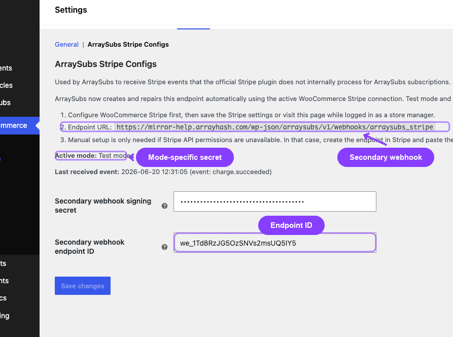
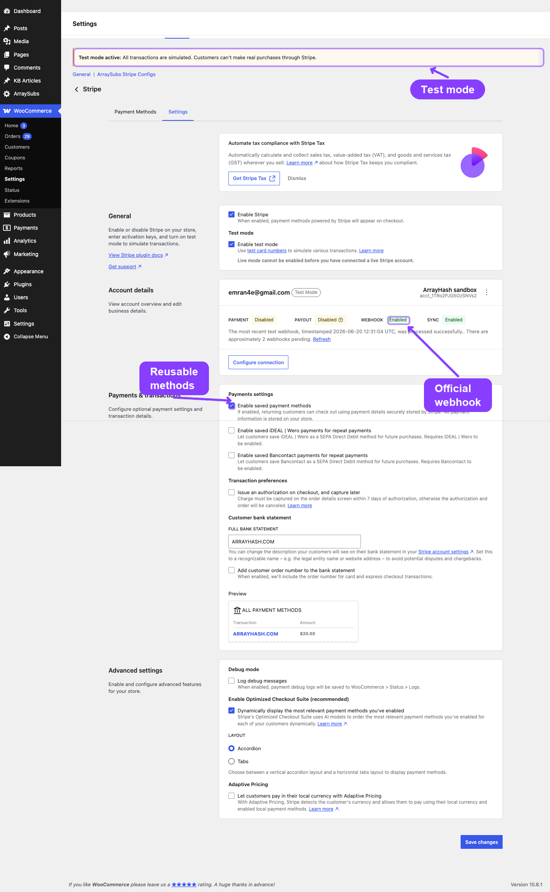

# Info
- Module: Stripe Gateway
- Availability: Free
- Last updated: 2026-10-18

# Stripe Gateway

> Stripe subscription payments powered by the official WooCommerce Stripe Gateway for checkout, saved payment methods, refunds, wallets, and SCA, with ArraySubs managing renewal scheduling and lifecycle.

**Availability:** Free (ArraySubs core). Automatic renewals through the official WooCommerce Stripe Gateway do not require ArraySubs Pro. Requires the official WooCommerce Stripe Gateway 9.8.0 or later.

## Page Navigation

- **Current guide:** Stripe Gateway
- **Where to open it:** Storefront checkout, WooCommerce -> Settings -> Payments -> Stripe, and the **ArraySubs Config** tab on that Stripe settings screen
- **Section overview:** [Open overview](../README.md)
- **Previous guide:** [README](./README.md)
- **Next guide:** [field-types](../checkout-builder/field-types.md)
- **Troubleshooting:** [Audits, Logs, and Troubleshooting](../../audits-and-logs/README.md)

## Overview

Stripe is the most fully featured gateway in ArraySubs. It uses the **ArraySubs-managed billing** model, meaning ArraySubs controls renewal dates, grace periods, retry timing, proration, and subscription lifecycle while the official WooCommerce Stripe Gateway owns checkout UI, Stripe credentials, saved payment methods, refunds, wallets, Link, and SCA/3D Secure handling.

Stripe automatic renewals are part of the free ArraySubs core plugin, so you do not need ArraySubs Pro to charge renewals automatically. To prove that renewals work before launch, follow [Test Automatic Renewals on Staging](#test-automatic-renewals-on-staging).

## How Stripe Payments Work

### Initial Checkout

1. Customer chooses the official **Stripe** payment method at WooCommerce checkout.
2. ArraySubs marks the cart/order as subscription-aware so Stripe saves a reusable payment method with `setup_future_usage: off_session` when needed.
3. The official WooCommerce Stripe Gateway creates the PaymentIntent or SetupIntent, handles any SCA/3D Secure challenge, and stores Stripe order metadata.
4. ArraySubs copies the Stripe customer ID, payment method ID, payment type, mandate ID, and card details from the WooCommerce order to the subscription.
5. Official Stripe webhooks continue to process normal order payment, refund, dispute, and failed-payment events.

### Renewal Payments

1. The ArraySubs renewal engine fires when a subscription's payment is due
2. ArraySubs creates a **PaymentIntent** with `off_session: true` using the stored customer and payment method
3. Stripe charges the customer immediately without any browser interaction
4. If Stripe immediately succeeds, ArraySubs marks the renewal order paid and the subscription lifecycle continues.
5. If Stripe reports `processing`, ArraySubs waits for the official Stripe webhook confirmation.
6. If Stripe returns `requires_action`, ArraySubs stores a verification URL and sends a renewal verification email so the customer can complete authentication.

### Order Status After Successful Stripe Payment

Stripe payment success, subscription status, and WooCommerce order status are related but not identical.

When Stripe confirms payment:

1. The WooCommerce order is marked as paid.
2. ArraySubs activates the subscription or advances the renewal cycle.
3. WooCommerce decides whether the order should be **Completed** or **Processing**.

For subscription-only orders that do not need shipping, ArraySubs completes the order after payment. This applies to initial purchases and renewal orders when all subscription products are non-shipping products and no shipping line exists on the order.

If the subscription order includes a product that needs shipping, or a recurring subscription shipping line is added, the paid order remains **Processing**. This is normal WooCommerce fulfillment behavior: `Processing` means payment was received and the order still needs merchant fulfillment.

```box class="info-box"
## Processing does not always mean payment failed

For Stripe orders, check the order's payment details first. If the order has a Stripe transaction ID, a paid date, and the subscription is Active, payment succeeded. A `Processing` status usually means WooCommerce is waiting for fulfillment, not that Stripe is still charging the customer.
```

```box class="warning-box"
## Virtual is not the same as completed in WooCommerce

WooCommerce's default auto-complete behavior is strict: orders auto-complete only when products are both virtual and downloadable. ArraySubs adds subscription-specific handling so non-shipping subscription orders can complete even when the product is virtual but not downloadable. Orders with shipping work still stay Processing.
```

### Trial Orders ($0 Total)

When a trial has no signup fee, the checkout total is $0. Stripe cannot charge $0, so:

1. The official WooCommerce Stripe Gateway creates the appropriate SetupIntent or PaymentIntent.
2. ArraySubs forces reusable/off-session capture for subscription checkouts.
3. The saved payment method is stored on the subscription for the first real renewal after the trial ends.
4. If the trial product also has a signup fee, the official gateway charges that amount during checkout.

---

## SCA and 3D Secure

Stripe handles Strong Customer Authentication (SCA) and 3D Secure automatically through the PaymentIntent API.

### At Checkout

SCA challenges (bank verification prompts, SMS codes, biometric checks) are handled natively by Stripe's Checkout Session. The customer completes any required authentication on Stripe's hosted page before being returned to your site.

### During Renewals

Off-session renewal charges may trigger an SCA challenge if the customer's bank requires it:

1. Stripe returns a `requires_action` status on the PaymentIntent
2. A `payment_intent.requires_action` webhook fires
3. ArraySubs logs the event and the renewal is flagged
4. ArraySubs sends the customer a **Renewal Requires Verification** email with the order verification link.
5. The customer completes authentication through Stripe/WooCommerce, then the official Stripe webhook confirms the order.

```box class="info-box"
Most off-session renewal charges with previously authenticated cards complete without SCA challenges. Challenges during renewals are uncommon but possible depending on the customer's bank and region.
```

---

## Card Auto-Update

Stripe participates in card network update programs (Visa Account Updater, Mastercard Automatic Billing Updater). When a customer's card is reissued — due to expiration, loss, or replacement — the card network may push the new card details to Stripe automatically.

When this happens:

1. Stripe fires a `payment_method.automatically_updated` webhook
2. ArraySubs updates the stored card details (last4, expiry month, expiry year) on the subscription
3. A subscription note is logged for the merchant's reference

This means many expired-card scenarios resolve silently without any customer action.

---

## Card Expiry Notices

ArraySubs does not wait for a Stripe event to warn a customer. A daily sweep reads the card expiry already stored on each subscription and emails the customer **30 days** and **7 days** before the card stops working, once each.

- The warning is marked against that specific expiry date, so replacing the card re-arms it for the new one and a redeploy cannot re-send an old warning.
- Stripe's own `customer.source.expiring` event only fires for legacy card sources and never for modern PaymentMethods — which is why the warning is computed locally instead.
- If the card network auto-updates the card first, there is nothing to warn about.

---

## Dispute Handling

When a customer opens a chargeback with their bank:

1. Stripe sends a `charge.dispute.created` webhook
2. ArraySubs records the dispute as a subscription note and as meta (dispute ID, reason, amount)
3. When the dispute is resolved (won, lost, or withdrawn), Stripe sends `charge.dispute.closed`
4. ArraySubs records the resolution

```box class="warning-box"
A dispute **never** changes the status of an order that has already been paid. Moving a paid renewal order out of its paid status would make the renewal engine treat it as the next cycle's unpaid invoice, and billing would stop. The order keeps its status; the dispute is recorded for you to act on.
```

ArraySubs does not automatically cancel subscriptions when a dispute is opened. Review disputes promptly in the Stripe Dashboard and decide whether to contest or accept.

---

## Payment Method Updates

Customers can update their card on file through the **Customer Portal → View Subscription → Update Payment Method** link, through WooCommerce's own add-payment-method flow, or through the Stripe Billing Portal.

1. The customer adds or updates a payment method through any of those routes.
2. Stripe reports it — as `payment_method.attached`, `customer.updated`, or through WooCommerce's own token flow.
3. ArraySubs matches it to the right subscription and rebinds.

```box class="info-box"
A newly added card is not attached to any subscription yet, so ArraySubs resolves it through the **Stripe customer ID**. That was the missing link that used to make a return from the Stripe Billing Portal dead-end with the old card still on file.
```

Before any rebind, the payment method is verified with Stripe using the same check the renewal path runs before charging. A webhook payload is never trusted on its own to name the card that will be charged.

---

## Failed Renewals and Retries

ArraySubs runs the retry ladder for Stripe, not Stripe Billing — there is no Stripe Invoice object involved, so Stripe Smart Retries do not apply here.

The ladder is configurable: how many retries, how long to wait before each one, and whether to stop early. See [Payment Recovery](payment-recovery.md#configuring-the-retry-ladder) for the settings.

One behaviour worth knowing here: a card that is **expired, invalid, or hard-declined** schedules no retry at all, and the reason is recorded. Retrying a card the issuer has permanently refused does not make it work — it only delays the email the customer needs in order to fix it.

---

## Resync from Gateway: What It Will and Will Not Claim

**Resync from Gateway** pulls the Stripe customer, the saved payment method, and recent charges for the subscription, then applies safe corrections.

What it deliberately does **not** do is invent a status. Stripe holds no subscription object in this integration, so there is no Stripe-side status or billing date to report. The reconciler is told outright that those two values are not authoritative and leaves your local state alone rather than overwriting real data with a guess.

What it does prove: a successful charge whose webhook was missed is found and reconciled.

---

## Webhook Events

Configure and connect the official WooCommerce Stripe Gateway first. It owns normal payment, refund, dispute, and checkout events. ArraySubs then uses that official WooCommerce Stripe API connection to automatically create or repair the ArraySubs secondary webhook for the active test/live mode.

| Stripe Event | Handled By |
|---|---|
| `payment_intent.succeeded` | Official Stripe webhook plus ArraySubs renewal context bridge |
| `payment_intent.payment_failed` | Official Stripe webhook plus ArraySubs failure logging |
| `payment_intent.requires_action` | ArraySubs verification email flow |
| `charge.refunded` | Official Stripe refund flow plus ArraySubs logging |
| `charge.dispute.created` / `charge.dispute.closed` | Official Stripe webhook plus ArraySubs logging |
| `payment_method.updated` | Auto-provisioned ArraySubs secondary endpoint |
| `payment_method.attached` | Auto-provisioned ArraySubs secondary endpoint — a newly added card |
| `customer.updated` | Auto-provisioned ArraySubs secondary endpoint — a changed default payment method |
| `payment_method.automatically_updated` | Auto-provisioned ArraySubs secondary endpoint |
| `payment_method.card_automatically_updated` | Auto-provisioned ArraySubs secondary endpoint |
| `customer.source.expiring` | Auto-provisioned ArraySubs secondary endpoint (legacy card sources only) |

`payment_method.attached` and `customer.updated` are what close the payment-method-change loop for a card added at Stripe rather than at your checkout. They are both in the event list ArraySubs provisions on the endpoint, so an existing endpoint that predates them is repaired by the **Refresh** button described below.

### Webhook URL

Use the official WooCommerce Stripe Gateway webhook URL for normal Stripe payment events. ArraySubs also maintains this secondary endpoint automatically for payment-method, card, and reconciliation events:

```
https://yoursite.com/wp-json/arraysubs/v1/webhooks/arraysubs_stripe
```

Open **WooCommerce -> Settings -> Payments -> Stripe** and select the **ArraySubs Config** tab to check the live secondary webhook status. The page verifies the Stripe-side endpoint on load and shows whether the ArraySubs webhook is enabled for the active test/live mode. If someone deletes or disables the auto-created endpoint in Stripe, or if required events are missing, click **Refresh** on that page. ArraySubs checks the current Stripe connection, recreates the endpoint when needed, saves the new signing secret and endpoint ID, and updates the status text.

Use **Refresh** for endpoint repair. Use **Save changes** only when you manually paste or change the secondary webhook signing secret.



---

## Stripe-Specific Settings

Stripe checkout and API credentials are configured in **WooCommerce -> Settings -> Payments -> Stripe**. ArraySubs adds an **ArraySubs Config** tab to that screen, next to the gateway's own **Payment Methods** and **Settings** tabs, for secondary webhook status and emergency repair values:

| Setting | Where |
|---|---|
| Enable/Disable | WooCommerce Stripe Gateway settings |
| Title/Description | WooCommerce Stripe Gateway settings |
| API keys and test mode | WooCommerce Stripe Gateway settings |
| Official webhook secret | WooCommerce Stripe Gateway settings |
| ArraySubs secondary webhook secret | Auto-managed by ArraySubs on the **ArraySubs Config** tab (WooCommerce -> Settings -> Payments -> Stripe) |
| ArraySubs secondary webhook status and Refresh | **ArraySubs Config** tab (WooCommerce -> Settings -> Payments -> Stripe) |

The secondary webhook secret is stored separately for test mode and live mode. In normal operation you do not paste a `whsec_` value manually; saving WooCommerce Stripe settings or visiting admin after credentials are available lets ArraySubs ensure the endpoint exists. Manual entry is only for repairing a known provisioning failure.

The **Webhook** status line on the **ArraySubs Config** tab is a live check against Stripe, not just a local saved-option check. A healthy setup shows **Enabled**. If it shows **Disabled**, **Enabled but missing events**, or a repair message, use **Refresh** to recreate or repair the secondary endpoint from the active WooCommerce Stripe API connection. The tab also shows the **Active mode** (Test mode or Live mode), the **Last received event**, and the **Last automatic setup error** when there is one.



---

## Test Automatic Renewals on Staging

Use this walkthrough to prove that a real scheduled renewal is charged off-session through the official WooCommerce Stripe Gateway before you rely on it in production. Everything runs in Stripe test mode on a separate staging site, so no real card is charged.

```box class="warning-box"
## A successful checkout is not proof of automatic renewal

The first checkout is paid by the official gateway while the customer is present. Automatic renewal is proven only when ArraySubs creates the renewal order on schedule and charges the saved payment method off-session, with no customer action.
```

### Step 1: Prepare a Separate Staging Site

- Use a staging site with its own URL, such as `https://staging.example.com`. Do not run renewal tests on your live store.
- Use Stripe test mode, test API keys, and test webhooks on staging. Your live site keeps its live keys, its live webhook endpoints, and ownership of the real renewal schedule.
- The renewal test needs only the free ArraySubs core plugin. If the staging site also runs ArraySubs Pro, add and activate the staging domain as described in [License Activation](../../getting-started/license-activation.md).

If you build staging by copying your live site, the copy contains your live Stripe keys, live webhook secrets, real customer subscriptions, and their queued renewal actions. Make the copy safe before it runs any scheduled job. First, add these lines to the staging `wp-config.php` only (above the "That's all, stop editing!" line):

```php
<?php
// Staging only: stop scheduled jobs and mark the site as non-production.
define( 'DISABLE_WP_CRON', true );
define( 'WP_ENVIRONMENT_TYPE', 'staging' );
```

With `DISABLE_WP_CRON` set, ArraySubs also turns off Action Scheduler's background request runner, so renewal actions copied from live stay queued instead of charging. If your host runs WP-Cron for you, pause that for the staging site too. The official gateway reads the environment type: while it is in live mode on a non-production site, it does not detach saved payment methods from Stripe customers during admin, cron, or WP-CLI requests.

Then:

1. Switch the official gateway to test mode (Step 3) before you save any Stripe settings or click **Refresh** on the **ArraySubs Config** tab. In live mode, those actions can create an ArraySubs webhook endpoint for the staging URL in your live Stripe account.
2. Make sure staging email cannot reach real customers, for example by routing it to a mail-capture tool.
3. Do not use subscriptions copied from live for renewal tests. Their Stripe customer and payment method IDs belong to your live account and cannot be charged in test mode. Create new test subscriptions through checkout (Step 4).

### Step 2: Check the Prerequisites

| Requirement | What to confirm |
|---|---|
| WooCommerce and ArraySubs core | Both are active. Stripe automatic renewals are part of the free core plugin. |
| Official WooCommerce Stripe Gateway | Version 9.8.0 or later, active, with the **Stripe** payment method enabled. ArraySubs shows an admin notice when the gateway is missing or too old. |
| Scheduled jobs | After Step 3, run a real system cron every minute as described in [Cron Job Setup](../../getting-started/cron-job-setup.md). In **WooCommerce -> Status -> Scheduled Actions**, past-due **Pending** actions should be processed within a minute or two. |
| Webhook delivery | Stripe must reach the staging site over public HTTPS. Password protection, IP allowlists, or a firewall in front of staging block webhook delivery. |
| ArraySubs Pro | Not needed for Stripe renewals. Add it only when your integration uses Pro features. |

Test the Free-to-Pro upgrade as its own check. Complete this walkthrough with core only first. Then install ArraySubs Pro while core stays installed and active, activate the license as described in [License Activation](../../getting-started/license-activation.md), confirm that existing subscriptions, orders, and settings are unchanged, and repeat Steps 5 and 6. Do not uninstall core or recreate subscriptions to upgrade.

Optional settings for a faster test, in **ArraySubs -> Settings -> General**:

| Setting | Card | Default | On staging |
|---|---|---|---|
| **Generate Invoice Before Due** and **Unit** | Grace Period | 6 hours | Keep the default or match your live value |
| **Spread Renewals Over (Hours)** | Renewal Performance | 6 | `0`, so the charge runs at the due time instead of up to six hours later |
| **Days Active After Due** and **Days On-Hold Before Cancel** | Grace Period | 3 and 7 | Keep, or shorten them to watch the grace flow sooner |

### Step 3: Configure Test Mode and Callbacks

1. Go to **WooCommerce -> Settings -> Payments -> Stripe** and open the **Settings** tab. Under **Test mode**, check **Enable test mode**, then connect your Stripe test account with **Configure connection**. These labels come from WooCommerce Stripe Gateway 10.9.0.
2. On the same screen, review **Webhook endpoints**. It reports whether test webhooks reach the site. If the gateway asks you to configure webhooks, do it from its connection settings.
3. Open the **ArraySubs Config** tab. Confirm **Active mode: Test mode** and **Webhook: Enabled**. If the status is **Disabled** or **Enabled but missing events**, or the message says the stored endpoint points to a different URL (common on a copied site), click **Refresh**. ArraySubs creates a test-mode endpoint for the staging URL in your Stripe test account and saves its signing secret. Endpoints registered for other site URLs are left alone.

Which plugin receives which callback:

| Callback | URL on staging | Received by | Used for |
|---|---|---|---|
| Official Stripe webhook | `https://staging.example.com/?wc-api=wc_stripe` | The official WooCommerce Stripe Gateway. ArraySubs listens to the events the gateway processes in the same request. | Checkout and order payments, renewal payments that finish later, refunds, and disputes |
| ArraySubs secondary webhook | `https://staging.example.com/wp-json/arraysubs/v1/webhooks/arraysubs_stripe` | ArraySubs core | Payment method changes, card auto-updates, legacy card expiry, and reconciliation of payment, refund, and dispute events for subscription orders |
| Renewal charge (outgoing) | None | ArraySubs, through the official gateway's Stripe API connection | Off-session PaymentIntents for scheduled renewals and retries |

Both plugins keep separate webhook signing secrets for test mode and live mode.

### Step 4: Place a Test Subscription Checkout

1. Create a test subscription product that renews every 1 day (billing period **Day**) without a free trial. See [Create and Configure Subscription Products](../../subscription-products/create-and-configure.md). A daily plan brings the first renewal due within 24 hours.
2. Log in as a test customer, for example `member@example.com`, add the product to the cart, and choose **Stripe** at checkout.
3. Pay with a test card from [Stripe's testing documentation](https://docs.stripe.com/testing). Never use a real card on staging.
4. Leave auto-renew on. If it is turned off, the renewal becomes a manual invoice (see [Auto-Renew and Manual Fallback](auto-renew-and-manual-fallback.md)).

Expected result:

- The parent order is paid: **Completed** for a non-shipping subscription, **Processing** when it needs shipping.
- A new subscription is **Active** and linked to that order. Its **Next Payment** date is one billing period after checkout.
- On the subscription detail page, the **Payment Gateway** card shows **Connected** with the Stripe gateway, **Card on File**, and **Customer ID**. This means checkout saved a reusable payment method, so the subscription is eligible for automatic renewal.
- In the Stripe test Dashboard, the customer has the payment method attached, and the checkout events were delivered to the official endpoint with a 2xx response.

If the card shows **Error**, checkout did not store a reusable Stripe customer and payment method, and renewals would fall back to manual invoices. Run **Resync from Gateway**, check the payment in the Stripe Dashboard, and fix this before you continue.

### Step 5: Run a Due Renewal

ArraySubs runs every renewal through two scheduled actions. Both use the subscription ID as their only argument, for example `[123]`.

| Order | Action hook | Group | When it runs | What it does |
|---|---|---|---|---|
| 1 | `arraysubs_generate_renewal_invoice` | `arraysubs-billing` | **Generate Invoice Before Due** ahead of the Next Payment date | Creates the renewal order as an unpaid invoice |
| 2 | `arraysubs_process_renewal` | `arraysubs-renewals` | At the Next Payment date, plus the renewal spread | Charges the saved payment method off-session through Stripe and advances the schedule |

1. Wait until the renewal is due. With the daily plan from Step 4 and default settings, the invoice appears about 18 hours after checkout and the charge runs at the 24-hour mark (later when **Spread Renewals Over (Hours)** is above `0`).
2. Open **WooCommerce -> Status -> Scheduled Actions**, search for `arraysubs_process_renewal`, and find the row with your subscription ID. When it shows **Complete**, refresh the subscription.

```box class="info-box"
Clicking **Run** on these actions before the Next Payment date does nothing: ArraySubs checks that the renewal is actually due before it creates or charges anything. Wait for the date, or bring it forward as shown below.
```

Developers can bring the date forward on staging with `Subscriptions::update()` (see [Find and Update Subscriptions](../../developers/subscriptions.md)). The change realigns both scheduled actions. Run it on staging only, for example with `wp eval-file`:

```php
<?php
// Staging only: make subscription 123 due for renewal in 15 minutes.
if ( class_exists( '\ArraySubs\Api\Subscriptions' ) ) {
	$result = \ArraySubs\Api\Subscriptions::update(
		123,
		array( 'next_payment_date' => time() + 15 * MINUTE_IN_SECONDS ),
		array( 'reason' => 'Staging renewal test' )
	);

	if ( is_wp_error( $result ) ) {
		echo esc_html( $result->get_error_code() . ': ' . $result->get_error_message() ), "\n";
	} else {
		echo esc_html( 'Changed: ' . implode( ', ', $result['changed'] ) ), "\n";
	}
}
```

A successful renewal leaves the renewal order paid, the subscription **Active**, and **Next Payment** one billing period later. If Stripe reports the payment as `processing`, the order stays unpaid until the official Stripe webhook confirms it. If the bank asks for authentication, the customer receives the **Renewal Requires Verification** email instead.

### Step 6: Record What You Observe

| What to check | Where | Expected after a paid renewal |
|---|---|---|
| Order and payment | **WooCommerce -> Orders** and the Stripe test Dashboard | A new renewal order linked to the subscription, paid, with a Stripe transaction ID and a paid date. In Stripe, an off-session PaymentIntent that succeeded. |
| Dates | Subscription detail page | **Next Payment** moved forward by exactly one billing period. It follows the schedule, not the moment the charge ran. |
| Scheduled actions | **WooCommerce -> Status -> Scheduled Actions** | This cycle's `arraysubs_generate_renewal_invoice` and `arraysubs_process_renewal` show **Complete**, and new **Pending** actions exist for the next cycle. |
| Logs | **ArraySubs -> Audits [beta] -> Gateway Logs**; with Pro, also **Scheduled-Job Logs** and **Renewal Failures**; the official gateway's log in **WooCommerce -> Status -> Logs** when its logging is on | Stripe payment and webhook entries for the renewal, with no errors |
| Lifecycle events | Your integration code | `arraysubs_lifecycle_event` fired `renewal_invoice_created`, then `renewed`. See [React to Supported Events](../../developers/actions-and-filters.md). |
| Plan and access | Subscription detail page and the customer's My Account | Same product, variation, quantity, and recurring amount. The subscription is **Active** and the customer still sees member content. |
| Payment method | **Payment Gateway** card | Still **Connected** with the same card on file |

Developers can also read the computed state with `Lifecycle::get_state()`, described in [Read Lifecycle State and Manage Its Dates](../../developers/status-grace-periods-and-trials.md).

#### Test a Failed Renewal and Recovery

1. Place another test checkout with a Stripe test card that can be saved but is declined when it is charged later. Stripe lists these cards in its [testing documentation](https://docs.stripe.com/testing).
2. Let that renewal come due as in Step 5.
3. Record the failure:
   - The renewal order stays unpaid and is marked **Failed**. The customer receives the **Renewal Payment Failed** email with the reason.
   - For a decline that can resolve itself, such as insufficient funds, a subscription note reads `Scheduled retry 1 of 3 at ...` and a new **Pending** `arraysubs_process_renewal` action appears at the retry time. Retries are not spread.
   - For a hard decline (expired card, invalid card, incorrect CVC, card declined, or authentication required), no retry is scheduled and a note records why. See [Hard declines are not retried](payment-recovery.md#hard-declines-are-not-retried).
   - The grace flow starts: the subscription stays **Active** for **Days Active After Due**, moves to **On-Hold** (members lose access), and is **Cancelled** after **Days On-Hold Before Cancel**. See [Recovery and Grace Flows](../../billing-and-renewals/recovery-and-grace-flows.md).
   - Developers see the `renewal_failed` event, `payment_retry_scheduled` for a soft decline, and `grace_started`.
4. Recover: as the test customer, use **Update Payment Method** to save a working test card, then click **Retry Payment**. An admin can also click **Retry Payment** on the subscription detail page.
5. Expected: the renewal order is paid, the retry counter resets, the subscription is **Active** again (an **On-Hold** subscription returns to **Active**), **Next Payment** moves forward, and access returns. Developers see `grace_recovered`, plus `reactivated` when the subscription was on hold.

### Step 7: Return to Live Safely

- Keep staging and live separate: separate API keys, webhook endpoints, signing secrets, customers, and records. Never copy the staging database or its Stripe settings over your live site.
- Test-mode customers and payment methods exist only in your Stripe test account. They cannot be charged in live mode, and test subscriptions cannot be moved to live. Real customers subscribe through checkout on the live site.
- On the live site, confirm **Enable test mode** is off, then open the **ArraySubs Config** tab and check **Active mode: Live mode** and **Webhook: Enabled**.
- In the Stripe Dashboard, remove staging endpoints you no longer need from the test account, and confirm that no live-mode endpoint points at the staging URL.
- When testing ends, delete the staging copy or keep `DISABLE_WP_CRON` set on it. If you activated ArraySubs Pro there, manage that site activation as described in [License Activation](../../getting-started/license-activation.md).

For integration checks such as error handling, retries, and permissions, see [Verify Your Integration](../../developers/errors-and-testing.md).

---

## Troubleshooting

| Problem | Likely Cause | Solution |
|---|---|---|
| Stripe is unavailable in ArraySubs | Official WooCommerce Stripe Gateway is missing, disabled, or older than the supported version | Install/update WooCommerce Stripe Gateway and enable the `stripe` payment method |
| Renewal payment fails with `authentication_required` | Customer's bank requires SCA | Customer must use the Renewal Requires Verification email link to complete authentication |
| Stripe payment succeeded but the WooCommerce order is `Processing` | The subscription order still has shipping/fulfillment work, or WooCommerce would normally require processing for the product type | If the product should not ship, make the product non-shipping and remove subscription shipping rules. If it does ship, fulfill the order and complete it when appropriate. |
| Subscription is Active but the order is `Processing` | Payment and subscription activation succeeded, but WooCommerce is keeping the order open for fulfillment | Treat the subscription as paid. Only manually complete the WooCommerce order when there is no remaining fulfillment work. |
| Stripe checkout fails with `No such PaymentMethod` | A saved Stripe payment method belongs to an old/disconnected Stripe account or test/live mode context | Ask the customer to use a new payment method. ArraySubs removes stale saved Stripe tokens during subscription checkout when Stripe reports they no longer exist. |
| Card auto-update not working | Card network doesn't participate in updater program | Not all card issuers support auto-update. Customer needs to manually update their card. |
| Webhook events not arriving | Official webhook URL/secret is misconfigured, or the ArraySubs secondary endpoint was deleted, disabled, missing required events, or could not be provisioned | Check the WooCommerce Stripe Gateway webhook settings first, then open the **ArraySubs Config** tab. If the Webhook status is not Enabled, click **Refresh** to recreate the secondary endpoint and save a new signing secret. Then confirm **Gateway Health** shows recent webhook activity after a test event |
| Payment method details missing on a subscription | Checkout completed before Stripe order meta was available or webhook was delayed | Open the subscription and run **Resync from Gateway** |
| A renewal action ran on staging but no renewal order or charge appeared | The Next Payment date had not been reached, so the renewal was not due | Wait for the due date or bring it forward as described in [Test Automatic Renewals on Staging](#test-automatic-renewals-on-staging) |
| Renewal actions stay **Pending** after their scheduled time | Scheduled jobs are not running, for example `DISABLE_WP_CRON` is set without a system cron | Add a real system cron as described in [Cron Job Setup](../../getting-started/cron-job-setup.md) |
| A staging renewal became an unpaid invoice instead of a charge | Auto-renew is off, or the **Payment Gateway** card does not show **Connected** with a stored payment method | Turn auto-renew back on, or place a new test checkout so Stripe saves a reusable payment method |

---

## Related Docs

- [Gateway Overview](README.md) — Architecture and capability comparison
- [Auto-Renew and Manual Fallback](auto-renew-and-manual-fallback.md) — Customer toggle behavior
- [Gateway Health Dashboard](../../gateway-health/README.md) — Monitoring Stripe status and webhook events
- [Payment Recovery Tools](payment-recovery.md) - Retry ladder, Retry Payment, and Resync from Gateway
- [Cron Job Setup](../../getting-started/cron-job-setup.md) - Reliable scheduled jobs for renewals and retries
- [Recovery and Grace Flows](../../billing-and-renewals/recovery-and-grace-flows.md) - What happens after a failed renewal
- [License Activation](../../getting-started/license-activation.md) - Activating ArraySubs Pro, including the Free-to-Pro upgrade
- [React to Supported Events](../../developers/actions-and-filters.md) - Renewal, retry, and grace events for developers
- [Verify Your Integration](../../developers/errors-and-testing.md) - Developer error handling and staging checks

---

## FAQ

**Does Stripe store card details on my server?**
No. Stripe's Checkout Sessions and Elements handle all card input on Stripe's servers. ArraySubs only stores the payment method ID, card brand, last4, and expiry — never the full card number or CVV.

**What happens if a renewal charge fails?**
The plugin records the failure with a classified reason (insufficient funds, expired card, authentication required, etc.) and the customer receives a **Renewal Payment Failed** email that includes the reason in plain language. ArraySubs then schedules the next automatic retry from your retry ladder — unless the decline was a hard one (expired, invalid, or permanently refused card), in which case no retry is scheduled and the reason is recorded instead. Before each retry the plugin queries Stripe to confirm the customer was not already charged via a missed webhook. If all retries fail, the subscription enters the standard grace-period flow (Active → On-Hold → Cancelled). An admin or the customer can also click **Retry Payment** at any time to trigger an immediate verification + retry — see [Payment Recovery Tools](payment-recovery.md).

**How do I know the local subscription state matches Stripe?**
Open the subscription detail page and click **Resync from Gateway** in the Payment Gateway card (next to Detach Gateway). The reconciler pulls the customer record, the saved payment method, and recent PaymentIntents matching this subscription, then applies safe corrections to local meta and reconciles any successful charge whose webhook was missed. The card itself only appears for automatic gateways — manual gateways have nothing to resync.

**Can I use Stripe in test mode?**
Yes. Enable test mode in the official WooCommerce Stripe Gateway settings and use Stripe's test API keys. Test mode uses Stripe's sandbox environment — no real charges occur. ArraySubs stores a separate secondary webhook secret for test mode and creates or repairs that endpoint automatically from the WooCommerce Stripe connection. To test a full scheduled renewal, follow [Test Automatic Renewals on Staging](#test-automatic-renewals-on-staging).

**Do Stripe automatic renewals require ArraySubs Pro?**
No. Automatic renewals through the official WooCommerce Stripe Gateway are part of the free ArraySubs core plugin. Add ArraySubs Pro only when you use Pro features.

**Does Stripe support PayPal or bank transfers?**
Stripe checkout methods are owned by the official WooCommerce Stripe Gateway. ArraySubs allows subscription checkouts only for methods that can be reused for automatic renewals, such as cards, Link/supported wallets, and supported bank debit methods.
