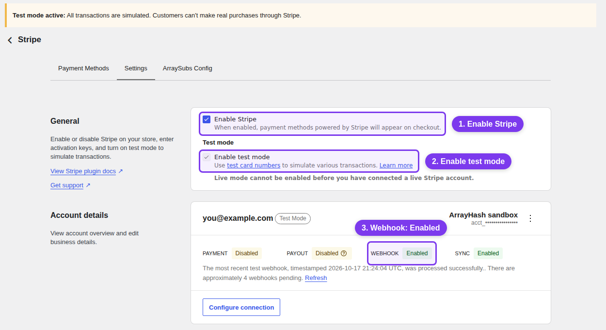
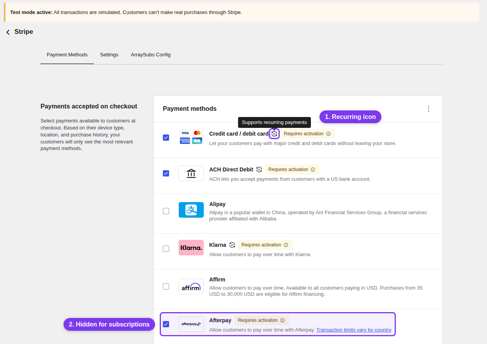
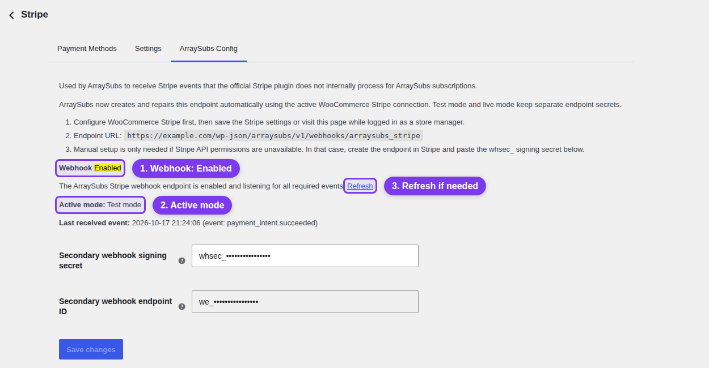
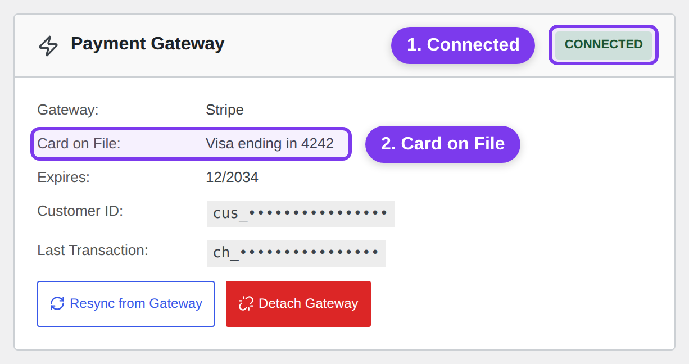

# Info
- Module: Stripe Gateway
- Availability: Free
- Last updated: 2026-10-18

# Stripe Gateway

> Set up Stripe so ArraySubs can take subscription payments at checkout and charge every renewal automatically.

**Availability:** Free (ArraySubs core). You also need a Stripe account and the free official **WooCommerce Stripe Payment Gateway** plugin, version 9.8.0 or later.

## Page Navigation

- **Current guide:** Stripe Gateway
- **Where to open it:** **WooCommerce > Settings > Payments > Stripe**, on the **Payment Methods**, **Settings**, and **ArraySubs Config** tabs
- **Section overview:** [Open overview](../README.md)
- **Previous guide:** [Automatic Payments](./README.md)
- **Next guide:** [PayPal Gateway](./paypal.md)
- **Troubleshooting:** [Audits, Logs, and Troubleshooting](../../audits-and-logs/README.md)

## Before You Start

- **WooCommerce** and **ArraySubs** are active. Stripe renewals are part of the free core plugin, so you don't need ArraySubs Pro.
- You have a Stripe account, or you're ready to create one during setup.
- Your site runs on HTTPS. Stripe needs to reach your site to deliver webhooks, and the Stripe plugin won't connect a live account without HTTPS.
- Scheduled jobs run on time. Renewals are charged by scheduled actions, so set up a real server cron as described in [Cron Job Setup](../../getting-started/cron-job-setup.md).
- Your store currency suits the payment methods you plan to offer. Methods that need a different currency are marked **Requires currency** on the **Payment Methods** tab.

## Set Up Stripe

### Step 1: Install the Official Stripe Plugin

1. Go to **Plugins > Add Plugin** and search for **WooCommerce Stripe Payment Gateway** by WooCommerce.
2. Install and activate it. Your plugin list shows it as **WooCommerce Stripe Gateway**.
3. Go to **WooCommerce > Settings > Payments**. **Stripe** now appears in the **Payment providers** list.

Until the plugin is active, ArraySubs shows a **Stripe (ArraySubs)** placeholder in that list with these same steps. If your copy is older than 9.8.0, ArraySubs shows a notice on the WooCommerce settings screens asking you to update it.

### Step 2: Connect Stripe in Test Mode

1. In **WooCommerce > Settings > Payments**, click **Manage** next to **Stripe**. Before Stripe is connected, the button may read **Complete setup**.
2. Click **Create or connect a test account**, then sign in to Stripe or create an account. Stripe sends you back to WooCommerce when the connection is ready.
3. On the **Settings** tab, make sure **Enable Stripe** and **Enable test mode** are ticked. Your Stripe account now shows under **Account details**.

Connecting a test account switches the plugin to test mode for you, so no real money moves while you set things up.



### Step 3: Confirm the Official Webhooks

Webhooks are how Stripe tells your store that a payment went through, failed, or was refunded. The Stripe plugin sets them up when you connect.

1. On the **Settings** tab, find **Webhook** in the **Account details** card. It should read **Enabled**, and the line under it shows when the last webhook arrived.
2. If it doesn't, click **Configure connection**, open the **Test** tab in the dialog, and click **Configure webhooks** (it reads **Reconfigure webhooks** once webhooks exist). The dialog should then show **Webhooks** as **Configured**.

### Step 4: Turn On Payment Methods That Can Renew

1. Open the **Payment Methods** tab.
2. Tick **Credit card / debit card**, plus any other methods you want to offer, and click **Save changes**.
3. Look for the circular-arrows icon next to each method's name. Its tooltip reads **Supports recurring payments**, and only those methods can be charged again at renewal.

When the cart holds a subscription that renews automatically, ArraySubs shows only methods with that icon. Methods without it, like **Afterpay** below, are hidden for that cart and keep working for one-time purchases. Apple Pay and Google Pay payments are saved as cards, so they can renew too.

To offer **iDEAL | Wero** or **Bancontact** on subscriptions, also tick **Enable saved iDEAL | Wero payments for repeat payments** or **Enable saved Bancontact payments for repeat payments** on the **Settings** tab.



### Step 5: Check the ArraySubs Config Tab

ArraySubs adds a second Stripe webhook for subscription events the Stripe plugin doesn't pass along, such as a customer changing cards or a bank updating an expiring card. ArraySubs creates it through your Stripe connection, with separate webhooks for test mode and live mode, so there's nothing to copy or paste.

1. Open the **ArraySubs Config** tab.
2. Check that **Webhook** shows **Enabled** and **Active mode** shows **Test mode**.
3. If **Webhook** shows **Disabled** or **Enabled but missing events**, click **Refresh**. ArraySubs checks your Stripe connection, creates or repairs the webhook, and updates the status.

Leave **Secondary webhook signing secret** as it is. You only paste a value there after creating the webhook by hand in Stripe, which is needed only when your Stripe connection can't manage webhooks.



### Step 6: Test a Subscription Checkout

1. Open your store in a private browser window and buy any subscription product as a customer.
2. Pay by card with the test card `4242 4242 4242 4242`, any future expiry date, and any three-digit CVC. Stripe lists more test cards in its [testing documentation](https://docs.stripe.com/testing).
3. In **ArraySubs > Subscriptions**, open the new subscription.

You're set when the subscription is **Active**, its order is paid, and the **Payment Gateway** card shows **Connected** with the saved card under **Card on File**, for example **Visa ending in 4242**. That saved card is what ArraySubs charges at each renewal.

If the card shows **Error** or has no **Card on File**, checkout didn't save a reusable payment method, and the next renewal would become an invoice the customer has to pay. Click **Resync from Gateway**, then look up the payment in your Stripe Dashboard.



A paid checkout proves the first payment only. To watch a renewal charge on its own, follow [Test Automatic Renewals on Staging](#test-automatic-renewals-on-staging).

### Step 7: Go Live

1. On the **Settings** tab, click **Configure connection**, open the **Live** tab, and click **Create or connect an account**.
2. When Stripe sends you back, check that **Enable test mode** is unticked. Connecting a live account turns test mode off.
3. Check **Webhook** in **Account details** again, as in Step 3.
4. Open the **ArraySubs Config** tab and check that **Active mode** shows **Live mode** and **Webhook** shows **Enabled**. ArraySubs creates the live webhook the next time you open a WordPress admin page. If the status isn't **Enabled**, click **Refresh**.
5. For extra peace of mind, buy a subscription with your own card, then refund the order and cancel the subscription.

Subscriptions bought in test mode can't be charged in live mode, so anyone who subscribed during testing needs to subscribe again.

## How Renewals Work

- ArraySubs runs the billing schedule. When a renewal is due, it creates the renewal order and charges the saved payment method through your Stripe connection, with nothing for the customer to do. In Stripe, each renewal shows up as a regular payment, not as a Stripe Billing subscription.
- If the bank wants the customer to confirm a renewal, for example with 3D Secure, the customer gets the **Renewal Requires Verification** email with a link to approve it.
- If a charge fails, the customer gets the **Renewal Payment Failed** email with the reason, and ArraySubs tries again on its own schedule. Hard declines, such as an expired card, aren't retried. After that, the grace period runs. See [Payment Recovery Tools](payment-recovery.md) and [Recovery and Grace Flows](../../billing-and-renewals/recovery-and-grace-flows.md).
- Customers change cards with **Update payment method** on their subscription in **My Account**, which opens Stripe's customer portal. ArraySubs also sends a **Card Expiring** email 30 days and 7 days before a saved card expires, and refreshes the stored card details when a bank updates the card through Stripe.
- When a customer turns auto-renew off, renewals become invoices they pay themselves. See [Auto-Renew and Manual Fallback](auto-renew-and-manual-fallback.md).

## Test Automatic Renewals on Staging

Use this walkthrough to prove that a real scheduled renewal is charged off-session through the official WooCommerce Stripe Gateway before you rely on it in production. Everything runs in Stripe test mode on a separate staging site, so no real card is charged.

```box class="warning-box"
## A successful checkout is not proof of automatic renewal

The first checkout is paid by the official gateway while the customer is present. Automatic renewal is proven only when ArraySubs creates the renewal order on schedule and charges the saved payment method off-session, with no customer action.
```

### Step 1: Prepare a Separate Staging Site

- Use a staging site with its own URL, such as `https://staging.example.com`. Do not run renewal tests on your live store.
- Use Stripe test mode, test API keys, and test webhooks on staging. Your live site keeps its live keys, its live webhook endpoints, and ownership of the real renewal schedule.
- The renewal test needs only the free ArraySubs core plugin. If the staging site also runs ArraySubs Pro, add and activate the staging domain as described in [License Activation](../../getting-started/license-activation.md).

If you build staging by copying your live site, the copy contains your live Stripe keys, live webhook secrets, real customer subscriptions, and their queued renewal actions. Make the copy safe before it runs any scheduled job. First, add these lines to the staging `wp-config.php` only (above the "That's all, stop editing!" line):

```php
<?php
// Staging only: stop scheduled jobs and mark the site as non-production.
define( 'DISABLE_WP_CRON', true );
define( 'WP_ENVIRONMENT_TYPE', 'staging' );
```

With `DISABLE_WP_CRON` set, ArraySubs also turns off Action Scheduler's background request runner, so renewal actions copied from live stay queued instead of charging. If your host runs WP-Cron for you, pause that for the staging site too. The official gateway reads the environment type: while it is in live mode on a non-production site, it does not detach saved payment methods from Stripe customers during admin, cron, or WP-CLI requests.

Then:

1. Switch the official gateway to test mode first (Step 3 below), before you save any Stripe settings or click **Refresh** on the **ArraySubs Config** tab. In live mode, those actions can create an ArraySubs webhook endpoint for the staging URL in your live Stripe account.
2. Make sure staging email cannot reach real customers, for example by routing it to a mail-capture tool.
3. Do not use subscriptions copied from live for renewal tests. Their Stripe customer and payment method IDs belong to your live account and cannot be charged in test mode. Create new test subscriptions through checkout (Step 4 below).

### Step 2: Check the Prerequisites

| Requirement | What to confirm |
|---|---|
| WooCommerce and ArraySubs core | Both are active. Stripe automatic renewals are part of the free core plugin. |
| Official WooCommerce Stripe Gateway | Version 9.8.0 or later and active, with **Enable Stripe** ticked on its **Settings** tab. ArraySubs shows an admin notice when the gateway is missing or too old. |
| Scheduled jobs | After Step 3 below, run a real system cron every minute as described in [Cron Job Setup](../../getting-started/cron-job-setup.md). In **WooCommerce > Status > Scheduled Actions**, past-due **Pending** actions should be processed within a minute or two. |
| Webhook delivery | Stripe must reach the staging site over public HTTPS. Password protection, IP allowlists, or a firewall in front of staging block webhook delivery. |
| ArraySubs Pro | Not needed for Stripe renewals. Add it only when your integration uses Pro features. |

Test the Free-to-Pro upgrade as its own check. Complete this walkthrough with core only first. Then install ArraySubs Pro while core stays installed and active, activate the license as described in [License Activation](../../getting-started/license-activation.md), confirm that existing subscriptions, orders, and settings are unchanged, and repeat Steps 5 and 6 of this walkthrough. Do not uninstall core or recreate subscriptions to upgrade.

Optional settings for a faster test, in **ArraySubs > Settings > General**:

| Setting | Card | Default | On staging |
|---|---|---|---|
| **Generate Invoice Before Due** and **Unit** | Grace Period | 6 hours | Keep the default or match your live value |
| **Spread Renewals Over (Hours)** | Renewal Performance | 6 | `0`, so the charge runs at the due time instead of up to six hours later |
| **Days Active After Due** and **Days On-Hold Before Cancel** | Grace Period | 3 and 7 | Keep, or shorten them to watch the grace flow sooner |

### Step 3: Configure Test Mode and Callbacks

1. Go to **WooCommerce > Settings > Payments > Stripe** and open the **Settings** tab. Under **Test mode**, tick **Enable test mode** and click **Save changes**. If the box is locked because no Stripe test account is connected yet, click **Configure connection**, open the **Test** tab, and click **Create or connect a test account** instead (on a site with no Stripe connection yet, that button is on the screen itself). Connecting a test account ticks **Enable test mode** for you. These labels come from WooCommerce Stripe Gateway 10.9.0.
2. On the same tab, check that **Webhook** in the **Account details** card reads **Enabled**. It reports whether test webhooks reach the site. If it does not, click **Configure connection**, open the **Test** tab, and click **Configure webhooks** (**Reconfigure webhooks** once webhooks exist).
3. Open the **ArraySubs Config** tab. Confirm that **Active mode** shows **Test mode** and **Webhook** shows **Enabled**. If the status is **Disabled** or **Enabled but missing events**, or the message says the stored endpoint points to a different URL (common on a copied site), click **Refresh**. ArraySubs creates a test-mode endpoint for the staging URL in your Stripe test account and saves its signing secret. Endpoints registered for other site URLs are left alone.

Which plugin receives which callback:

| Callback | URL on staging | Received by | Used for |
|---|---|---|---|
| Official Stripe webhook | `https://staging.example.com/?wc-api=wc_stripe` | The official WooCommerce Stripe Gateway. ArraySubs listens to the events the gateway processes in the same request. | Checkout and order payments, renewal payments that finish later, refunds, and disputes |
| ArraySubs secondary webhook | `https://staging.example.com/wp-json/arraysubs/v1/webhooks/arraysubs_stripe` | ArraySubs core | Payment method changes, card auto-updates, legacy card expiry, and reconciliation of payment, refund, and dispute events for subscription orders |
| Renewal charge (outgoing) | None | ArraySubs, through the official gateway's Stripe API connection | Off-session PaymentIntents for scheduled renewals and retries |

Both plugins keep separate webhook signing secrets for test mode and live mode.

### Step 4: Place a Test Subscription Checkout

1. Create a test subscription product that renews every 1 day (billing period **Day**) without a free trial. See [Create and Configure Subscription Products](../../subscription-products/create-and-configure.md). A daily plan brings the first renewal due within 24 hours.
2. Log in as a test customer, for example `member@example.com`, add the product to the cart, and go to checkout.
3. Pay by card with a test card from [Stripe's testing documentation](https://docs.stripe.com/testing). Never use a real card on staging.
4. Leave auto-renew on. If it is turned off, the renewal becomes a manual invoice (see [Auto-Renew and Manual Fallback](auto-renew-and-manual-fallback.md)).

Expected result:

- The parent order is paid: **Completed** for a non-shipping subscription, **Processing** when it needs shipping.
- A new subscription is **Active** and linked to that order. Its **Next Payment** date is one billing period after checkout.
- On the subscription detail page, the **Payment Gateway** card shows **Connected** with the Stripe gateway, **Card on File**, and **Customer ID**. This means checkout saved a reusable payment method, so the subscription is eligible for automatic renewal.
- In the Stripe test Dashboard, the customer has the payment method attached, and the checkout events were delivered to the official endpoint with a 2xx response.

If the card shows **Error**, checkout did not store a reusable Stripe customer and payment method, and renewals would fall back to manual invoices. Run **Resync from Gateway**, check the payment in the Stripe Dashboard, and fix this before you continue.

### Step 5: Run a Due Renewal

ArraySubs runs every renewal through two scheduled actions. Both use the subscription ID as their only argument, for example `[123]`.

| Order | Action hook | Group | When it runs | What it does |
|---|---|---|---|---|
| 1 | `arraysubs_generate_renewal_invoice` | `arraysubs-billing` | **Generate Invoice Before Due** ahead of the Next Payment date | Creates the renewal order as an unpaid invoice |
| 2 | `arraysubs_process_renewal` | `arraysubs-renewals` | At the Next Payment date, plus the renewal spread | Charges the saved payment method off-session through Stripe and advances the schedule |

1. Wait until the renewal is due. With the daily plan from Step 4 and default settings, the invoice appears about 18 hours after checkout and the charge runs at the 24-hour mark (later when **Spread Renewals Over (Hours)** is above `0`).
2. Open **WooCommerce > Status > Scheduled Actions**, search for `arraysubs_process_renewal`, and find the row with your subscription ID. When it shows **Complete**, refresh the subscription.

```box class="info-box"
Clicking **Run** on these actions before the Next Payment date does nothing: ArraySubs checks that the renewal is actually due before it creates or charges anything. Wait for the date, or bring it forward as shown below.
```

Developers can bring the date forward on staging with `Subscriptions::update()` (see [Find and Update Subscriptions](../../developers/subscriptions.md)). The change realigns both scheduled actions. Run it on staging only, for example with `wp eval-file`:

```php
<?php
// Staging only: make subscription 123 due for renewal in 15 minutes.
if ( class_exists( '\ArraySubs\Api\Subscriptions' ) ) {
	$result = \ArraySubs\Api\Subscriptions::update(
		123,
		array( 'next_payment_date' => time() + 15 * MINUTE_IN_SECONDS ),
		array( 'reason' => 'Staging renewal test' )
	);

	if ( is_wp_error( $result ) ) {
		echo esc_html( $result->get_error_code() . ': ' . $result->get_error_message() ), "\n";
	} else {
		echo esc_html( 'Changed: ' . implode( ', ', $result['changed'] ) ), "\n";
	}
}
```

A successful renewal leaves the renewal order paid, the subscription **Active**, and **Next Payment** one billing period later. If Stripe reports the payment as `processing`, the order stays unpaid until the official Stripe webhook confirms it. If the bank asks for authentication, the customer receives the **Renewal Requires Verification** email instead.

### Step 6: Record What You Observe

| What to check | Where | Expected after a paid renewal |
|---|---|---|
| Order and payment | **WooCommerce > Orders** and the Stripe test Dashboard | A new renewal order linked to the subscription, paid, with a Stripe transaction ID and a paid date. In Stripe, an off-session PaymentIntent that succeeded. |
| Dates | Subscription detail page | **Next Payment** moved forward by exactly one billing period. It follows the schedule, not the moment the charge ran. |
| Scheduled actions | **WooCommerce > Status > Scheduled Actions** | This cycle's `arraysubs_generate_renewal_invoice` and `arraysubs_process_renewal` show **Complete**, and new **Pending** actions exist for the next cycle. |
| Logs | **ArraySubs > Audits [beta] > Gateway Logs**; with Pro, also **Scheduled-Job Logs** and **Renewal Failures**; the official gateway's log in **WooCommerce > Status > Logs** when its logging is on | Stripe payment and webhook entries for the renewal, with no errors |
| Lifecycle events | Your integration code | `arraysubs_lifecycle_event` fired `renewal_invoice_created`, then `renewed`. See [React to Supported Events](../../developers/actions-and-filters.md). |
| Plan and access | Subscription detail page and the customer's My Account | Same product, variation, quantity, and recurring amount. The subscription is **Active** and the customer still sees member content. |
| Payment method | **Payment Gateway** card | Still **Connected** with the same card on file |

Developers can also read the computed state with `Lifecycle::get_state()`, described in [Read Lifecycle State and Manage Its Dates](../../developers/status-grace-periods-and-trials.md).

#### Test a Failed Renewal and Recovery

1. Place another test checkout with a Stripe test card that can be saved but is declined when it is charged later. Stripe lists these cards in its [testing documentation](https://docs.stripe.com/testing). Use a product with a 1-day free trial for this checkout, so checkout only saves the card and the first charge happens when the trial ends.
2. Let that renewal come due as in Step 5 above.
3. Record the failure:
   - The renewal order stays unpaid and is marked **Failed**. The customer receives the **Renewal Payment Failed** email with the reason.
   - For a decline that can resolve itself, such as insufficient funds, a subscription note reads `Scheduled retry 1 of 3 at ...` and a new **Pending** `arraysubs_process_renewal` action appears at the retry time. Retries are not spread.
   - For a hard decline (expired card, invalid card, incorrect CVC, card declined, or authentication required), no retry is scheduled and a note records why. See [Hard declines are not retried](payment-recovery.md#hard-declines-are-not-retried).
   - The grace flow starts: the subscription stays **Active** for **Days Active After Due**, moves to **On-Hold** (members lose access), and is **Cancelled** after **Days On-Hold Before Cancel**. See [Recovery and Grace Flows](../../billing-and-renewals/recovery-and-grace-flows.md).
   - Developers see the `renewal_failed` event, `payment_retry_scheduled` for a soft decline, and `grace_started`.
4. Recover: as the test customer, use **Update payment method** to save a working test card, then click **Retry Payment**. An admin can also click **Retry Payment** on the subscription detail page.
5. Expected: the renewal order is paid, the retry counter resets, the subscription is **Active** again (an **On-Hold** subscription returns to **Active**), **Next Payment** moves forward, and access returns. Developers see `grace_recovered`, plus `reactivated` when the subscription was on hold.

### Step 7: Return to Live Safely

- Keep staging and live separate: separate API keys, webhook endpoints, signing secrets, customers, and records. Never copy the staging database or its Stripe settings over your live site.
- Test-mode customers and payment methods exist only in your Stripe test account. They cannot be charged in live mode, and test subscriptions cannot be moved to live. Real customers subscribe through checkout on the live site.
- On the live site, confirm **Enable test mode** is off, then open the **ArraySubs Config** tab and check that **Active mode** shows **Live mode** and **Webhook** shows **Enabled**.
- In the Stripe Dashboard, remove staging endpoints you no longer need from the test account, and confirm that no live-mode endpoint points at the staging URL.
- When testing ends, delete the staging copy or keep `DISABLE_WP_CRON` set on it. If you activated ArraySubs Pro there, manage that site activation as described in [License Activation](../../getting-started/license-activation.md).

For integration checks such as error handling, retries, and permissions, see [Verify Your Integration](../../developers/errors-and-testing.md).

## Troubleshooting

| Problem | Fix |
|---|---|
| A notice says ArraySubs Stripe automatic payments require the official WooCommerce Stripe Gateway plugin | Install and activate **WooCommerce Stripe Payment Gateway**, or update it to version 9.8.0 or later (Step 1). |
| Stripe is missing at checkout when the cart has a subscription | No enabled method supports recurring payments for that cart. Tick **Credit card / debit card** on the **Payment Methods** tab (Step 4) and look for **Requires currency** badges. |
| Checkout says "This subscription requires a payment method that supports future automatic renewals." | The customer picked a method that can't be charged again. Ask them to pay by card or with another method that shows the recurring icon. |
| The **ArraySubs Config** tab shows **Disabled**, **Enabled but missing events**, or an error, or a red **ArraySubs Stripe webhook needs attention.** notice appears | Click **Refresh** on the **ArraySubs Config** tab. If the message says the Stripe API credentials aren't configured for the active mode, reconnect Stripe in that mode first (Step 2 or Step 7). |
| The **Payment Gateway** card shows **Error** or no **Card on File** | Click **Resync from Gateway** and check the payment in your Stripe Dashboard. Without a saved payment method, renewals for that subscription become invoices the customer pays. |
| Renewals run late, or their scheduled actions stay pending | Scheduled jobs aren't running. Set up a server cron as described in [Cron Job Setup](../../getting-started/cron-job-setup.md). |
| A paid subscription order stays **Processing** | That's normal when the order has something to ship. Subscription orders with nothing to ship are marked **Completed** after payment. |

## FAQ

**Do I need ArraySubs Pro for Stripe renewals?**
No. Stripe automatic renewals are part of the free ArraySubs core plugin.

**Are card numbers stored on my site?**
No. Stripe keeps the card. ArraySubs stores only Stripe's references to the customer and payment method, plus the card brand, last four digits, and expiry date for display.

**Do I need to tick Enable saved card payment methods?**
No. ArraySubs saves the payment method on every subscription checkout that renews automatically, whatever that setting says. The setting controls the saved-card option on other purchases.

**Why does checkout look different when the cart has a subscription?**
ArraySubs switches those carts to Stripe's standard payment form, because **Optimized Checkout Suite** and **Adaptive Pricing** don't always save the payment method for later. Other carts keep your settings.

## Related Docs

- [Automatic Payments](README.md) - How the automatic payment gateways compare
- [Payment Recovery Tools](payment-recovery.md) - Retries, **Retry Payment**, and **Resync from Gateway**
- [Auto-Renew and Manual Fallback](auto-renew-and-manual-fallback.md) - What happens when auto-renew is off
- [Recovery and Grace Flows](../../billing-and-renewals/recovery-and-grace-flows.md) - What happens after a failed renewal
- [Gateway Health](../../gateway-health/README.md) - Gateway status and recent webhook events
- [Cron Job Setup](../../getting-started/cron-job-setup.md) - Keep renewals and retries on time
- [Verify Your Integration](../../developers/errors-and-testing.md) - Developer checks for staging
