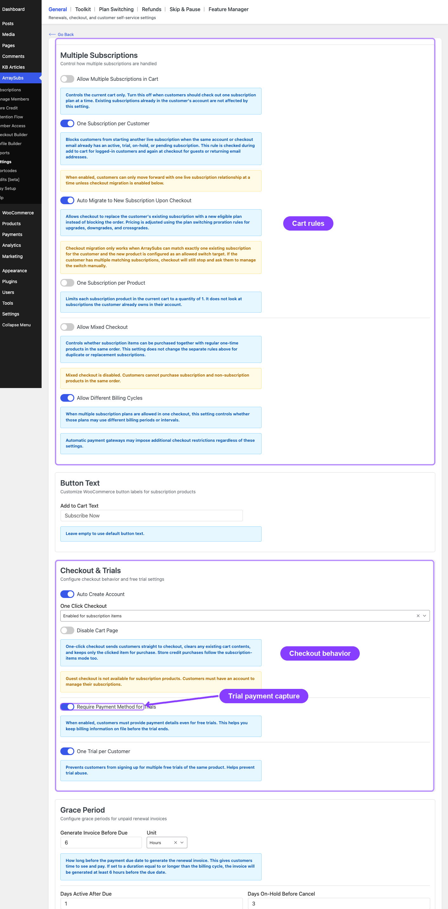
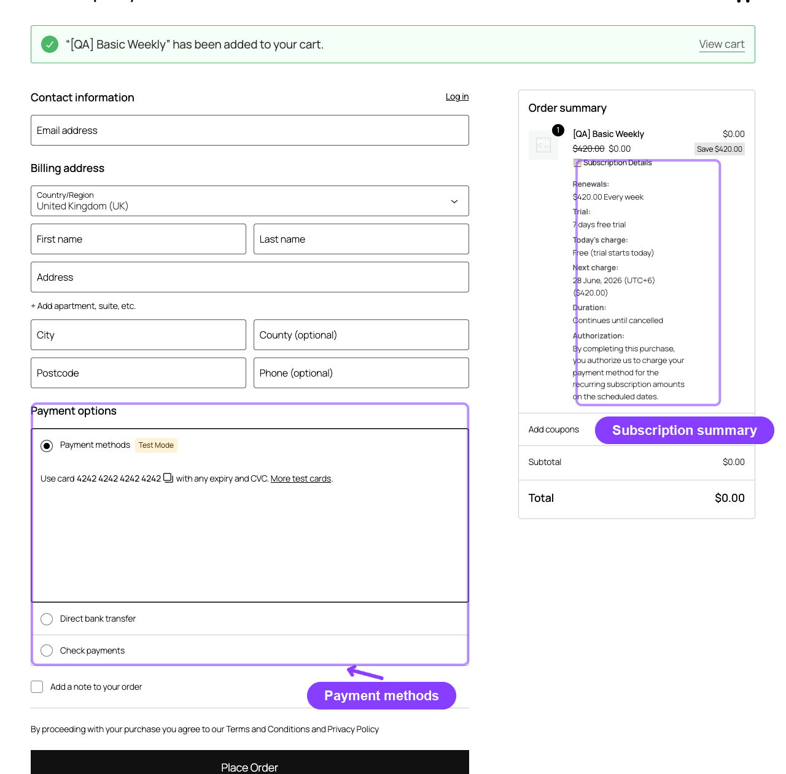

# Info
- Module: Subscription Checkout
- Availability: Free
- Last updated: 2026-10-18

# Subscription Checkout

> Controls everything that happens between "Add to Cart" and the moment a subscription is created — cart validation, checkout display, trial handling, automatic account creation, plan switching, and the final subscription record.

**Availability:** Free

## Page Navigation

- **Current guide:** Subscription Checkout
- **Where to open it:** Storefront cart/checkout and WordPress Admin -> ArraySubs -> Settings -> General
- **Section overview:** [Open overview](./README.md)
- **Previous guide:** [README](./README.md)
- **Next guide:** [payment-and-shipping](../customer-portal/payment-and-shipping.md)
- **Troubleshooting:** [Audits, Logs, and Troubleshooting](../audits-and-logs/README.md)

## Overview

When a customer adds a subscription product to the cart, ArraySubs takes over several parts of the WooCommerce checkout experience. It validates the cart against your store rules, displays a detailed subscription summary, handles account creation for guest purchasers, detects plan-switching eligibility, and — once the order is paid — creates the subscription record with all its billing schedule, trial, and pricing data locked in.

Both **Classic Checkout** (shortcode-based) and **Block Checkout** (WooCommerce Store API) are fully supported. Cart validation, subscription creation, and plan-switching logic work identically in both flows.

## How It Works

The checkout engine runs in three phases:

**Phase 1 — Cart validation.** Every time a subscription product is added to the cart, rules are checked against your General Settings: can this customer have multiple subscriptions? Is a mixed cart allowed? Are billing cycles compatible? Has this customer already had a trial?

**Phase 2 — Checkout display and account handling.** The checkout page shows a subscription summary inside the order review table — recurring price, trial period, signup fee, today's charge, next payment date, and an authorization notice. If the customer is a guest and auto-create-account is enabled, WooCommerce shows the registration form.

**Phase 3 — Subscription creation.** After payment completes, ArraySubs creates one subscription record per subscription line item in the order. Prices are locked at the checkout amount (sale prices, coupons, and signup fees apply at this moment and never change retroactively). The subscription starts in `Trial` status if a trial is configured, or `Pending` if not.

---

## Cart Validation Rules

Cart validation runs every time a customer adds a product to the cart and again when viewing the cart page. All rules are configured in **ArraySubs → Settings → General Settings** under the *Multiple Subscriptions* section.



### Mixed Cart Rule

Controls whether subscription and non-subscription products can coexist in the same cart.

| Setting | Default | Effect when disabled |
|---|---|---|
| Allow mixed cart | Enabled | Customer sees: *"This order cannot contain subscription and regular products together."* |

When disabled, adding a regular product to a cart that already contains a subscription (or vice versa) is blocked with an error message.

### Multiple Subscriptions Rule

Controls whether more than one distinct subscription product can be in the cart at once.

| Setting | Default | Effect when disabled |
|---|---|---|
| Allow multiple subscriptions in cart | Enabled | Customer sees: *"Only one subscription plan can be checked out at a time."* |

### One Per Product Rule

Prevents a customer from adding more than one quantity of any single subscription product.

| Setting | Default | Effect when enabled |
|---|---|---|
| One subscription per product | Disabled | Customer sees: *"Each subscription product can only appear once per order. Reduce the quantity to 1."* |

### Different Billing Cycles Rule

Controls whether subscription products with different billing schedules (e.g., one monthly, one yearly) can be in the same cart.

| Setting | Default | Effect when disabled |
|---|---|---|
| Allow different billing cycles | Enabled | Customer sees: *"These subscription plans use different billing cycles."* |

### One Trial Per Customer

Prevents a logged-in customer who has ever had a subscription (including cancelled or expired ones) from starting another free trial.

| Setting | Default | Effect when enabled |
|---|---|---|
| One trial per customer | Enabled | Customer sees: *"You have already used a free trial. Free trials are limited to one per customer."* |

```box class="info-box"
Guest users are not subject to the trial restriction because their purchase history cannot be tracked. Once they create an account during checkout, the restriction applies to future purchases.
```

### Gateway Cart Restrictions

Some gateways cannot take every cart, for example PayPal cannot take a mixed cart and Paddle cannot take subscriptions with different billing cycles. ArraySubs checks this in two places:

- **In the cart:** the cart is blocked only when every enabled gateway refuses it. One capable gateway is enough to let it through.
- **At checkout:** gateways that cannot take the current cart are hidden, and if the shopper picks one anyway, checkout shows a message naming the gateway and what it cannot do.

See [Gateway Overview](automatic-payments/README.md) for the capability comparison matrix.

---

## One-Click Checkout

One-click checkout skips the cart page entirely, sending the customer straight from the product page to checkout.

### How to Enable

Go to **ArraySubs → Settings → General Settings → Checkout Options** and set the *One-Click Checkout Mode*:

| Mode | Behavior |
|---|---|
| `Default` | Standard WooCommerce add-to-cart behavior (cart page) |
| `Subscription items` | Only subscription products skip to checkout; regular products go to cart normally |
| `All items` | Every product skips to checkout |

### What Happens

1. Customer clicks the add-to-cart button on a product page
2. The cart is cleared — only the clicked product remains
3. The customer is redirected directly to the checkout page
4. AJAX add-to-cart is automatically disabled for one-click products (the page performs a full redirect)

### Cart Page Redirect

An additional setting, `Disable cart page`, controls whether the cart page itself redirects to checkout when the cart contains a one-click product. If enabled, any attempt to visit the cart page sends the customer to checkout instead.

### Button Text Customization

When one-click mode is active:

- **Subscription products** show the text configured in *Add to Cart Text* (default: `"Subscribe Now"`)
- **Non-subscription products** (in `All items` mode) show the text configured in *Non-Subscription Button Text*

These labels can be changed in **General Settings → Button Text**.

---

## Trial Handling at Checkout

Subscription products with a trial period behave differently during checkout.

### How Trials Affect the Order

| Scenario | Today's Charge | Subscription Status |
|---|---|---|
| Trial only (no signup fee) | Free — no charge today | `Trial` |
| Trial + signup fee | Signup fee only | `Trial` |
| No trial | Full subscription price (+ signup fee if set) | `Pending` |

The subscription's **next payment date** is calculated from the trial end date. For example, a 14-day trial that starts on April 2 sets the first renewal on April 16.

### Payment Method Requirement

The setting `Require payment method for trials` (default: enabled) controls whether customers must enter a payment method even when the trial is free. This ensures the first paid renewal can be charged automatically when the trial ends.

```box class="warning-box"
Even with this setting enabled, gateway-level enforcement depends on the payment gateway integration. Verify with a test order that your gateway correctly captures a payment method during a free trial checkout.
```

### One Trial Per Customer

When enabled, ArraySubs queries all of a logged-in customer's past subscriptions — including cancelled and expired ones — to determine whether they have ever had a trial. If they have, the trial product is blocked at add-to-cart with a clear error message.

Guest users can always start a trial because their history cannot be checked before account creation.

---

## Auto-Create Account

When a guest customer purchases a subscription, ArraySubs can force WooCommerce to display the account creation form at checkout.

### Setting

Go to **ArraySubs → Settings → General Settings → Checkout Options** and enable *Auto-create account for subscription purchases*.

| Setting | Default | Effect |
|---|---|---|
| Auto-create account | Enabled | Guest checkout is disabled when the cart contains a subscription product. WooCommerce shows the registration form. |

This applies to all subscription products, including store credit purchase products that are filtered as subscription-type items.

```box class="info-box"
ArraySubs does not auto-create the account silently — it makes WordPress display the registration form so the customer fills in their desired credentials. WooCommerce handles the actual account creation.
```

---

## Plan Switching at Checkout

When a customer with an existing subscription purchases a new subscription product, ArraySubs can automatically switch them to the new plan instead of creating a second subscription. This is called **checkout migration**.

### Eligibility

All of the following must be true:

1. The customer is logged in and has **exactly one** live subscription, on their own account, and it is Active or in its trial. An On-Hold, Paused or Pending subscription still counts for One Subscription per Customer, but checkout cannot switch it. A subscription bought without a customer account (as a guest) is never replaced at checkout, even when its email is typed. One Subscription per Customer still counts it: the classic and the block checkout refuse the order and ask the customer to contact the store before an account is created.
2. **Plan Switching** is enabled in General Settings
3. The correct switch direction is allowed (upgrades, downgrades, or crossgrades)
4. The new product is listed as an allowed switch target on the current product's **Linked Products** tab
5. **One subscription per customer** is enabled
6. **Auto-migrate on checkout** is enabled
7. The current subscription is not billed by PayPal or Paddle. These providers have to approve a plan change, so checkout shows a message asking the customer to change the plan from the subscription screen.

When all conditions are met, the checkout automatically applies prorated pricing and marks the order as a plan switch.

### What the Customer Sees

Instead of the regular subscription price, the checkout shows:

- The **prorated amount due today**. Checkout always prorates immediately, whatever proration method is configured in General Settings
- Context about the switch: *"Replaces your current [Current Product] subscription"*
- The **new recurring price** that will apply after the switch

```box class="info-box"
A plan switch at checkout never starts a free trial, even when the new plan has one. Checkout asks for the amount due today and offers the payment methods available for a one-time payment: card, Mollie (including iDEAL, Bancontact and SEPA Direct Debit), bank transfer and similar. PayPal and Paddle are not offered for a plan switch at checkout, including when the order is paid later from its Pay for order page in the classic or block checkout, because they would start a second recurring agreement for the subscription being replaced. Paying for the switch with Stripe or Mollie does not change the card or mandate the subscription renews with. **One Trial Per Customer** does not block the switch. A switch that costs nothing today, for example during the current subscription's free trial, completes without payment.
```

### What Happens After Payment

The switch is applied as soon as WooCommerce marks the order paid: when an online payment completes, or, for Direct bank transfer, Check payments and other manual methods, when you set the order to **Processing** or **Completed**. It is applied once; later status changes on the same order do not apply it again. If another update is holding the subscription or the order at that moment, the switch is retried a few minutes later.

1. The existing subscription's product and pricing are updated to the new plan
2. The switch order is linked to the subscription on the order, so the order screen shows the subscription. A subscription note names the order: *"Existing subscription updated from checkout migration (order #123)"*. The order is not listed in the subscription's Order History. Later plan changes and prorated refunds are priced from the billing cycle the customer paid for. The plan-switch payment itself is not credited again if the plan changes once more in the same billing cycle.
3. An order note is added: *"Existing subscription updated from checkout migration."*
4. The renewal date follows the switch shown at checkout: a plan on the same billing cycle keeps the current renewal date, and a plan on a different billing cycle starts a new cycle from the switch

No new subscription is created — the existing one is modified in place.

The plan is not changed, and the order gets a note that starts with *"Checkout migration failed:"*, when:

- the subscription changed between checkout and payment (for example a renewal was processed while a bank transfer was pending, or the subscription was cancelled);
- another paid order already applied the same change (*"The subscription is already on this plan; order #123 applied the change, so this payment did not change it. Review this payment: refunding this order does not change the subscription."*);
- the subscription moved to PayPal or Paddle billing before the payment arrived;
- the subscription does not belong to the customer who placed the order.

If another update keeps the subscription locked through five retries (about 30 minutes in all), the order gets the note *"Checkout migration could not be completed because another update kept the subscription locked. Change the plan from the subscription screen."* instead.

Change the plan from the subscription screen if the change is still wanted, or refund the order. Refunding it does not change the subscription.

### Refunding a Plan Switch Order

Refunding a plan-switch order in full or in part returns the plan-change payment. The subscription is not cancelled and keeps its plan. The refund of an applied switch is recorded in the subscription's refund history and counts in the Total Refunded figure of its Order History card, although the order itself is not listed in that card. To undo the plan change, change the plan back from the subscription screen.

### Proration Methods

Checkout migration always charges the **Prorate immediately** amount, whatever proration type is set in **General Settings → Plan Switching**. That setting decides the amount for switches made from the subscription screen:

| Method | Behavior |
|---|---|
| Prorate immediately | Calculates the unused value of the current plan and subtracts it from the new plan's price. The difference is charged today. |
| Apply at renewal | No charge today for the price difference. The new recurring price takes effect at the next renewal. |
| No proration | The full new plan price is charged today with no credit for unused time. |

```box class="info-box"
Plan switching at checkout only works when the customer has exactly one live subscription. If they have two or more, checkout stops and asks them to manage the correct subscription from the subscription screen first.
```

For more details on plan configuration, see [Plan Switching and Product Relationships](../subscription-products/plan-switching-and-relationships.md).

---

## Checkout Subscription Summary

Every checkout page that includes a subscription product displays a detailed summary inside the order review table. This summary updates via AJAX as the customer changes quantities, coupons, or shipping options.



### What's Displayed

**For every subscription line item:**

| Detail | Example | Shown When |
|---|---|---|
| Product name + quantity | *"Premium Plan (x2)"* | Always |
| Recurring price + schedule | *"$29.99 every month"* | Always |
| Different renewal price tiers (Pro) | *"$29.99 monthly for the first 3 payments, then $19.99 monthly"* | Product has different renewal price enabled and licensed Pro is active |
| Signup fee | *"$10.00 one-time fee"* | Signup fee > 0 |
| Free trial | *"7 days"* | Trial length > 0 |
| Duration | *"12 billing cycles"* or *"Continues until cancelled"* | Always |
| Today's charge | *"$29.99 + $10.00 signup = $39.99"*, or *"$227.60 (incl. VAT)"* | Always (varies by trial/fee combo) |
| Next charge date | *"April 16, 2026"* | Always (except lifetime deals) |
| Synced renewal note | *"First full renewal: July 1, 2026 ($30.00)"* | Renewal Sync is enabled for the checkout |
| Authorization notice | *"By completing this purchase, you authorize us to charge..."* | Always |

**Today's charge** is what checkout charges for that subscription line: its price after coupons, with tax, signup fee and shipping included. With one subscription and nothing else in the cart it equals the order total. A coupon that applies to the first payment only lowers Today's charge, while the recurring price stays the full price. When the cart shows prices excluding tax, the amount is labelled *(incl. VAT)* or your store's tax label. Recurring and next charge amounts are shown the way the cart shows prices, with or without tax. With several subscriptions in one checkout, each row names its product, and when the cart holds only subscriptions their Today's charge amounts add up to the order total.

Today's charge is split into plan and signup fee (*"$29.99 + $10.00 signup = $39.99"*) only when those two make up the whole amount. When shipping, other fees, store credit or a cart discount are part of a paid plan's amount, or tax is listed separately from a signup fee, it shows the total alone. A discount larger than one line's price leaves that line at *Free today*; the rest of it comes off the other lines the same discount covers first, and only what those lines cannot take comes off the rest of the cart, so the amounts still add up to the order total. When the order is placed, each subscription's part of the payment is recorded by the same rule, so no subscription is recorded below 0, and its refund limit and plan-switch credit are based on what was actually paid for it.

**Special cases:**

- **Lifetime subscriptions** show: *"Lifetime Deal — No recurring charges"* instead of a next charge date
- **Trial + no fee** shows: *"Free today"* as today's charge
- **Plan switch at checkout** shows the switch context. Today's charge is the plan-change amount, and Next charge is the subscription's renewal date after the switch. The line shows no free trial or renewal-sync wording, in the cart cells and the block cart too, because the switch keeps the subscription's renewal date
- **Renewal Sync** can show a prorated first charge today, then the full recurring amount on the synced first renewal date

### Order Details Page

After checkout, the order confirmation and My Account order detail pages display a **Related Subscriptions** table with:

- Subscription ID (linked to the customer portal)
- Status badge (color-coded: green for Active, blue for Trial, yellow for Pending, etc.)
- Next payment date
- Recurring total with billing schedule

---

## Subscription Creation

Once the order payment is confirmed, ArraySubs creates one subscription record per subscription line item.

### What's Stored

Every subscription captures a snapshot of the checkout state:

| Data | Source | Example |
|---|---|---|
| Customer ID and email | Order billing | `42`, `customer@example.com` |
| Product and variation ID | Cart line item | `123`, `456` |
| Quantity | Cart line item | `2` |
| Billing period and interval | Product configuration | `month`, `1` |
| Subscription length | Product configuration | `12` (or `0` for unlimited) |
| Recurring amount | Full product recurring price at checkout | `$29.99` |
| Signup fee | Product configuration | `$10.00` |
| Trial length and period | Product configuration | `14`, `day` |
| Different renewal price (Pro) | Product configuration; active Pro license required | `$19.99` after 3 payments |
| Payment method | Checkout selection | `stripe`, `paypal` |
| Currency | Store currency | `USD` |
| Start date | Order completion time | `2026-04-02 14:30:00` |
| Next payment date | Calculated from trial or billing cycle | `2026-04-16 14:30:00` |
| Renewal sync metadata | Checkout sync context when enabled | first charge mode, cycle start, first full renewal date, initial recurring charge |
| Billing and shipping addresses | Order addresses | JSON-encoded |
| Parent order ID | The checkout order | `789` |

```box class="warning-box"
Prices are locked at checkout. If you later change a product's price, existing subscriptions keep their original checkout price. Only new subscriptions use the updated pricing.
```

### Renewal Sync at Checkout

If **ArraySubs → Settings → General → Renewal Sync** is enabled, eligible non-trial subscriptions can align their first full renewal to the next billing-cycle boundary.

Example:

1. Product price is `$30/month`.
2. Customer buys on the 20th.
3. With **Prorate until the synced renewal date**, checkout charges `$10` for the remaining full billing days in the current 30-day cycle.
4. The subscription's **Next Payment Date** is set to the 1st of the next month.
5. The renewal order on the 1st charges the full `$30`, and later renewals continue on the 1st.

With **Charge the full recurring amount**, checkout charges the full `$30` on the 20th, but the first full renewal still lands on the 1st.

```box class="info-box"
Renewal Sync is supported for manual/offline gateways, Stripe, and Mollie checkout. PayPal and Paddle automatic checkout options are hidden while a synced subscription is in the cart, because they bill from their own schedules. Free trials and Lifetime Deal products are not synced.
```

```box class="info-box"
For Stripe checkout, a very small prorated first charge may be raised to Stripe's minimum charge for the store currency. This adjustment affects only the signup charge; renewal orders still use the full recurring amount.
```

### Duplicate Prevention

ArraySubs prevents double subscription creation through multiple safeguards:

- Classic Checkout and Block Checkout each have their own dedicated hook — a subscription created by one hook is not recreated by the other
- A fallback hook checks for an existing `_subscription_ids` order meta key before creating anything
- Each order item receives a `_subscription_id` meta value after its subscription is created

### Status After Creation

| Scenario | Initial Status |
|---|---|
| Product has a trial period | `Trial` |
| Product has no trial | `Pending` (transitions to `Active` when payment is confirmed) |

### WooCommerce Order Status After Payment

The WooCommerce order status describes payment and fulfillment. It is not the same as the subscription status.

After payment is confirmed:

| Order condition | Expected order status | Subscription result |
|---|---|---|
| Subscription-only order with no shipping work | `Completed` | Subscription becomes `Active` or stays `Trial` |
| Subscription order includes a shippable product or subscription shipping | `Processing` | Subscription can still become `Active` because payment succeeded |
| Payment has not been confirmed yet | `Pending payment` | Subscription remains `Pending` until payment succeeds |
| Payment failed | `Failed` | Subscription may move to `On-Hold` until payment is retried or recovered |

```box class="info-box"
## Processing can be a normal paid status

If a paid subscription order is `Processing`, check whether the product needs shipping or whether subscription shipping added a shipping line. In that case, WooCommerce is waiting for fulfillment. The subscription can still be Active because payment was received.
```

For digital subscription products, make sure the product does not need shipping. ArraySubs completes paid subscription-only orders and renewals when there is no shipping work left.

---

## Real-Life Use Cases

### Gym Membership with Trial

A fitness center offers a 7-day free trial. A new customer adds the membership to cart, goes through checkout (auto-account creation is forced), pays nothing today (trial only, no signup fee), and receives a subscription with `Trial` status. On day 7, the first renewal invoice is generated and charged automatically.

### SaaS with Monthly and Annual Plans

A software company sells monthly ($19/mo) and annual ($199/yr) plans. The store disables *Different billing cycles* in the cart, so customers cannot mix the two. If someone tries to add both, they see: *"These subscription plans use different billing cycles."* They must remove one to proceed.

### Course Platform with One-Click

An online course platform enables one-click checkout for subscription items. A student clicks *"Enroll Now"* on a course product page, their cart is cleared, the course is added, and they land directly on the checkout page. No cart page visit needed.

### Upgrade at Checkout

A customer on the Basic plan ($9/mo) visits the Pro plan product page ($29/mo) and adds it to cart. ArraySubs detects the existing subscription, applies prorated pricing (crediting the unused portion of the Basic plan), and shows the difference as today's charge. After payment, the Basic subscription becomes a Pro subscription — no second subscription is created.

---

## Edge Cases and Important Notes

- **Variable subscription products** use the selected variation's subscription data (price, trial, billing period) rather than the parent product's data
- **Coupons** are applied to the cart total at checkout. Recurring coupons (with cycle limits) are captured at this point and applied to future renewals by the billing engine
- **Store API compatibility** — all cart validation errors surface as proper Store API cart errors, ensuring Block Checkout shows the same restrictions as Classic Checkout
- **Guest checkout** — if auto-create-account is disabled and WooCommerce allows guest checkout, the subscription is still created but may have limited customer portal access until the customer creates an account

---

## Troubleshooting

| Problem | Likely Cause | Solution |
|---|---|---|
| *"Only one subscription plan can be checked out at a time"* | Multiple subscriptions in cart is disabled | Enable *Allow multiple subscriptions in cart* in General Settings, or remove one product from cart |
| *"This order cannot contain subscription and regular products together"* | Mixed cart is disabled | Enable *Allow mixed cart* in General Settings, or separate the order |
| *"You have already used a free trial"* | One-trial-per-customer is enabled and the customer has a past subscription | Disable the restriction or create a coupon-based discount instead of a trial |
| *"This order has not been placed yet. Return to checkout to place it."* on a Pay for order page | The order holds a subscription and is a block checkout draft that was never placed, for example because checkout refused it | The customer returns to checkout and places the order there, where the usual checkout checks, such as One Trial Per Customer, apply |
| Subscription not created after checkout | Order payment not yet confirmed | Check the order status — subscriptions are created when the order is paid, not when it is placed |
| Subscription is Active but the order is Processing | Payment succeeded, but WooCommerce is waiting for fulfillment or shipping | Check whether the product needs shipping or whether subscription shipping is enabled. Complete the order after fulfillment, or remove shipping from digital subscription products. |
| Digital subscription order does not complete | Product or renewal still has shipping work, or the product is virtual but WooCommerce still considers it processable | Confirm the product does not need shipping and remove recurring shipping rules if the subscription is fully digital. Future non-shipping subscription orders complete automatically. |
| Plan switch did not trigger | Eligibility not met | Verify all 7 eligibility conditions listed above. The most common miss is that *Auto-migrate on checkout* is disabled |
| Customer paid for a plan switch but the subscription kept its old plan | A manual payment that is not marked paid yet, or the reason given in an order note that starts with *"Checkout migration failed:"* or *"Checkout migration could not be completed"* | Set a received manual payment to Processing or Completed. Otherwise follow the order note: change the plan from the subscription screen or refund the payment |
| PayPal or Paddle is missing from the payment methods at checkout | The cart is a plan switch at checkout | Pay with another method, or change the plan from the subscription screen |
| Checkout says the current subscription is billed by its payment provider | The subscription is billed by PayPal or Paddle | Change the plan from the subscription screen, where the provider approves the change |
| Checkout says the email already has a live subscription that is not linked to a customer account | The subscription was bought as a guest with that email | Link the subscription to the customer's account, or change its plan as an admin. A guest subscription is never replaced at checkout |
| Checkout says the order total was calculated before checkout matched it to the subscription | The customer's account or details changed while the order was being placed | Reload checkout, check the new total (the plan-change price) and place the order again |
| One-click not redirecting to checkout | Product uses AJAX add-to-cart | ArraySubs disables AJAX for one-click products automatically. Check for theme or plugin conflicts that re-enable it |

---

## Related Docs

- [General Settings](../settings/general-settings.md) — Cart rules, checkout options, trial settings
- [Plan Switching and Product Relationships](../subscription-products/plan-switching-and-relationships.md) — Configuring upgrade/downgrade/crossgrade paths
- [Lifecycle Management](../manage-subscriptions/lifecycle-management.md) — What happens after subscription creation
- [Automatic Payments](automatic-payments/README.md) — How gateways process the initial payment

---

## FAQ

**Does ArraySubs support Block Checkout (the new WooCommerce checkout)?**
Yes. Cart validation, subscription creation, plan switching, and all checkout hooks work identically in both Classic Checkout and Block Checkout (Store API). The subscription summary inside the order review table is also displayed in Block Checkout.

**What happens if a customer uses a coupon at checkout?**
The coupon discount is applied to the checkout total as usual. If the coupon is configured as a recurring coupon with a cycle limit, it is captured at checkout and continues to apply to future renewal invoices for the specified number of cycles.

**Can I disable auto-account creation but still sell subscriptions?**
Yes. If auto-account creation is disabled and WooCommerce allows guest checkout, the subscription is created with the order's billing email. The customer can claim the subscription later by creating an account with that same email.

**What is the difference between "one subscription per customer" and "one subscription per product"?**
*One per customer* prevents a customer from having more than one active subscription total (and enables auto-migration). *One per product* prevents buying more than 1 quantity of any single subscription product in a single order but allows different products.

**Can plan switching work with variable products?**
Yes. The variation ID is used for eligibility checks. If the current subscription's variation product lists the target variation as an allowed upgrade/downgrade/crossgrade, the switch is eligible.
