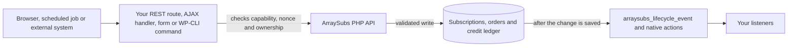

# Info
- Module: Developers
- Availability: Free (some sections require Pro)
- Last updated: 2026-10-18

# Developers

> Find the supported ArraySubs PHP API for each integration task, see what every class can read or change, and check which parts need ArraySubs Pro.

**Availability:** Core (Free) for subscriptions, lifecycle state, families and orders, customers, products, feature reads and usage, content access, downloads, discounts and member styling. ArraySubs Pro with an active license is required for profile fields, Feature Manager configuration updates, Login Limits, Store Credit and subscription bundle children.

## Page Navigation

- **Current guide:** Developers
- **Where to open it:** Your custom plugin or theme code (PHP)
- **Next guide:** [Connect Your Custom Plugin](./getting-started.md)
- **Troubleshooting:** [Verify Your Integration](./errors-and-testing.md)

## Overview

The Developers section documents the supported way to connect your own code to ArraySubs: PHP classes in the `ArraySubs\Api\` namespace (core) and the `ArraySubsPro\Api\` namespace (Pro), plus a catalog of actions, filters and normalized lifecycle events.

Use them to find the right subscription or member, read the current status and plan, handle grace periods and trials, make allowed changes and react when something changes, without editing ArraySubs files or writing its database records yourself.

This page lists every class with its operation scope and edition, explains the conventions all classes share, and links to the reference page for each task.

## Who This Is For

- Developers building a custom membership, course, community, CRM, commission or support plugin that needs subscription and member data from ArraySubs.
- Agencies and freelancers adding custom account pages, template output or back-office tools to a store that runs ArraySubs.
- Teams running server-side jobs, such as WP-CLI commands or scheduled syncs, that read or adjust subscriptions.

This section is not a store setup guide. If you are configuring products, payments or access rules, start with the merchant guides listed in [Related Guides](#related-guides).

The API runs inside WordPress as PHP. An external system reaches it through a REST route or webhook receiver that you build and secure yourself.

## Start Here

1. **New to the API:** read [Connect Your Custom Plugin](./getting-started.md). It shows where your code lives, when ArraySubs is ready, how to detect Pro and modules, and how to make a first safe lookup.
2. **Learn the shared rules:** skim [Core Concepts](#core-concepts). Objects versus data arrays, statuses, UTC dates, cursors, error codes and permission boundaries work the same way in every class.
3. **Find your task:** use [Find the Right API for Your Task](#find-the-right-api-for-your-task) and open the linked reference page.
4. **Using a Pro feature:** read [Edition Boundaries](#edition-boundaries) and check the domain with `Availability::check()` before you call it.
5. **Before launch:** work through [Verify Your Integration](./errors-and-testing.md).

## Prerequisites

- WordPress 6.0 or later, PHP 8.1 or later and WooCommerce 9.0 or later. When these checks fail, ArraySubs core does not load and none of its API classes exist.
- ArraySubs core installed and active.
- ArraySubs Pro with an active license for the Pro classes and methods, with the related module or setting switched on.
- Your own plugin or theme to hold the code. A small standalone plugin is the recommended home. Never edit ArraySubs files: updates replace them.
- Call the API on `arraysubs_after_boot` or later. Use `init` at priority 11 or later when you query by status or work with translated strings.

## How the API Is Organized

- **Namespaces.** Core classes live in `ArraySubs\Api\` and Pro classes in `ArraySubsPro\Api\`. Both plugins autoload them. Guard every call with `class_exists()`.
- **Static services.** `Subscriptions`, `Lifecycle`, `Relationships`, `Orders`, `Products` and `Availability` take a record ID or object on every call.
- **Context readers.** These factories return an instance bound to one explicit context:
  - `Customer::from_user_id()`, `from_email()`, `from_username()` and `from_subscription()`.
  - `for_subscription()`, `for_user()` and `for_customer()` on `MemberAccess`, `Downloads`, `Discounts` and `MemberStyling`, plus `MemberAccess::for_guest()` for a logged-out visitor.
  - `for_subscription()` and `for_customer()` on `FeatureManager` and `StoreCredit`.
  - `LoginLimits::for_user()`.
- **Reads and mutations.** Reads never change data. Mutations require a `reason`, accept `actor` and `dry_run`, validate the whole change before writing, and return what changed, any warnings and the lifecycle events they emitted.
- **Events.** Lifecycle events fire after a change is saved, whichever path made it: an admin screen, the customer portal, checkout, the scheduler, a payment gateway or the API.



## Find the Right API for Your Task

| Task | Page | Class and method | Availability |
| --- | --- | --- | --- |
| Confirm that ArraySubs, Pro or a module is ready | [Connect Your Custom Plugin](./getting-started.md) | `Availability::check()`, `Availability::get()` | Core (Free) |
| List a member's current or past subscriptions | [Find and Update Subscriptions](./subscriptions.md) | `Subscriptions::for_customer()`, `Subscriptions::query()` | Core (Free) |
| Read one subscription as a `WP_Post` or a data array | [Find and Update Subscriptions](./subscriptions.md) | `Subscriptions::get()` | Core (Free) |
| Export every subscription in pages | [Find and Update Subscriptions](./subscriptions.md) | `Subscriptions::each()`, `Subscriptions::query()` with `cursor` | Core (Free) |
| Change the renewal date, price, quantity, schedule or addresses | [Find and Update Subscriptions](./subscriptions.md) | `Subscriptions::update()` | Core (Free) |
| Pause, resume, cancel, reactivate, expire or skip a renewal | [Find and Update Subscriptions](./subscriptions.md) | `Subscriptions::pause()`, `resume()`, `cancel()`, `activate()`, `expire()`, `skip_renewal()` | Core (Free) |
| Delete a subscription permanently | [Find and Update Subscriptions](./subscriptions.md) | `Subscriptions::delete()` | Core (Free) |
| Find the subscriptions an order created, renewed or switched | [Work with Subscription Families and Orders](./subscription-relationships-and-orders.md) | `Subscriptions::for_order()`, `Relationships::get_subscriptions_for_order()` | Core (Free) |
| Resolve a box or bundle parent, its children and the billing owner | [Work with Subscription Families and Orders](./subscription-relationships-and-orders.md) | `Relationships::get_family()`, `get_children()`, `get_billing_owner()` | Core (Free); bundles need Pro |
| List initial, renewal and switch orders, or find the open renewal invoice | [Work with Subscription Families and Orders](./subscription-relationships-and-orders.md) | `Relationships::get_orders()`, `get_pending_renewal_order()` | Core (Free) |
| Add an order note, fix an order address or remove an unpaid order | [Work with Subscription Families and Orders](./subscription-relationships-and-orders.md) | `Orders::update()`, `Orders::delete()` | Core (Free) |
| Tell whether a member is in grace, overdue, paused or scheduled to cancel | [Read Lifecycle State and Manage Its Dates](./status-grace-periods-and-trials.md) | `Lifecycle::get_state()` | Core (Free) |
| Change the grace policy or one subscription's grace days | [Read Lifecycle State and Manage Its Dates](./status-grace-periods-and-trials.md) | `Lifecycle::update_grace_policy()`, `Lifecycle::set_grace_override()` | Core (Free) |
| Extend or end a trial | [Read Lifecycle State and Manage Its Dates](./status-grace-periods-and-trials.md) | `Lifecycle::update_trial()` | Core (Free) |
| Read or cancel a pending plan switch | [Read Lifecycle State and Manage Its Dates](./status-grace-periods-and-trials.md) | `Lifecycle::get_state()` (`pending_switch`), `Lifecycle::cancel_pending_switch()` | Core (Free) |
| Find a member by user ID, email, username or subscription | [Find Members and Update Profiles](./customers-and-profile-fields.md) | `Customer::from_user_id()`, `from_email()`, `from_username()`, `from_subscription()`, `Customer::query()` | Core (Free) |
| Check whether a member has an active or trial subscription to a product | [Find Members and Update Profiles](./customers-and-profile-fields.md) | `Customer::has_active_subscription()` | Core (Free) |
| Find a member by a custom profile field | [Find Members and Update Profiles](./customers-and-profile-fields.md) | `Customer::find_by_profile_field()`, `Customer::resolve_by_profile_field()` | Pro (Profile Builder) |
| Update account details or profile fields | [Find Members and Update Profiles](./customers-and-profile-fields.md) | WooCommerce setters, `set_profile_field()`, `save()` | Core (Free); profile fields need Pro |
| Read a product's price, schedule, trial and plan-switch targets | [Read Subscription Product Terms](./subscription-products.md) | `Products::get()`, `get_by_slug()`, `get_by_url()`, `get_variations()` | Core (Free) |
| Read a member's feature values and remaining usage | [Read and Update Feature Data](./feature-manager.md) | `FeatureManager::for_customer()`, `get_features()`, `get_usage()`, `can_use()` | Core (Free) |
| Record feature usage without counting a retry twice | [Read and Update Feature Data](./feature-manager.md) | `increment_usage()`, `consume()` with `operation_id` | Core (Free) |
| Change an existing feature value on a product | [Read and Update Feature Data](./feature-manager.md) | `FeatureManager::update_product_feature()` | Pro (Feature Manager module) |
| Check whether a user can view a post or URL, buy a product or comment | [Check Content Access](./member-access.md) | `MemberAccess::for_user()`, `can_view_post()`, `can_view_url()`, `can_purchase()`, `can_comment()`, `check()` | Core (Free) |
| Show download limits, remaining downloads and expiry | [Read Download Benefits](./downloads.md) | `Downloads::list()`, `Downloads::get()` | Core (Free) |
| Show a member price for a product | [Read Member Discounts](./discounts.md) | `Discounts::get_product_discount()`, `Discounts::get_rules()` | Core (Free) |
| Show how many sessions a user may have | [Read Login-Limit Policy](./login-limits.md) | `LoginLimits::for_user()`, `get_policy()` | Pro (Login Limit) |
| Read member classes, tokens and badges for your own markup | [Read Member Styling Rules](./member-styling.md) | `MemberStyling::get_effective()`, `MemberStyling::get_rules()` | Core (Free) |
| Read a credit balance, history or expiring credit | [Read and Update Store Credit](./store-credit.md) | `StoreCredit::get_balance()`, `get_history()`, `get_expiring()` | Pro (Store Credit module) |
| Add, remove or set credit with a retry-safe key | [Read and Update Store Credit](./store-credit.md) | `StoreCredit::credit()`, `debit()`, `adjust_to()` | Pro (Store Credit module) |
| React to renewals, failed payments, grace, cancellations and plan switches | [React to Supported Events](./actions-and-filters.md) | `arraysubs_lifecycle_event` and native actions | Core (Free) |
| Add your own module to the Modules screen | [Extend ArraySubs with a Module](./addon-modules.md) | `arraysubs_modules` filter, `arraysubs_is_module_enabled()` | Core (Free) |
| Protect part of a PHP template | [Gate Custom PHP Output](./php-templates.md) | `[arraysubs_restrict]` through `do_shortcode()`, `arraysubs_user_meets_conditions()`, `arraysubs_current_user_can_access()` | Core (Free) |
| Build a complete membership or commission workflow | [Connect Membership Workflows](./integration-recipes.md) | Several classes and events together | Core (Free); some recipes need Pro |
| Handle errors, retries and concurrency, and test before launch | [Verify Your Integration](./errors-and-testing.md) | `WP_Error` codes, `dry_run`, idempotency keys | Core (Free) |

## API Classes and Operation Scope

| Class | Operation scope | Main methods | Edition and module | Reference |
| --- | --- | --- | --- | --- |
| `ArraySubs\Api\Subscriptions` | Read, update, delete | `get()`, `query()`, `each()`, `for_customer()`, `for_order()`, `update()`, lifecycle operations (`activate()`, `put_on_hold()`, `pause()`, `resume()`, `cancel()`, `undo_cancellation()`, `expire()`, `skip_renewal()`, `undo_skip()`), `delete()` | Core (Free). Box and bundle children refuse independent billing operations. | [Find and Update Subscriptions](./subscriptions.md) |
| `ArraySubs\Api\Relationships` | Read only | `get_family()`, `get_parent()`, `get_children()`, `get_billing_owner()`, `get_orders()`, `get_pending_renewal_order()`, `get_order_type()`, `get_subscriptions_for_order()` | Core (Free). Box families are core; bundle families need Pro. | [Work with Subscription Families and Orders](./subscription-relationships-and-orders.md) |
| `ArraySubs\Api\Orders` | Read, update, delete (related orders only) | `get()`, `update()` (notes, customer note, addresses), `delete()` (unpaid orders only) | Core (Free) | [Work with Subscription Families and Orders](./subscription-relationships-and-orders.md) |
| `ArraySubs\Api\Lifecycle` | Read; updates trial and grace dates; cancels pending plan switches | `get_state()`, `get_grace_policy()`, `update_grace_policy()`, `set_grace_override()`, `update_trial()`, `cancel_pending_switch()` | Core (Free) | [Read Lifecycle State and Manage Its Dates](./status-grace-periods-and-trials.md) |
| `ArraySubs\Api\Customer` and `ArraySubs\Api\GuestCustomer` | Read and update (`Customer`); read only (`GuestCustomer`) | `from_user_id()`, `from_email()`, `from_username()`, `from_subscription()`, `query()`, `get_subscriptions()`, `has_active_subscription()`, WooCommerce getters and setters, `save()`, profile field methods | Core (Free). Profile field methods need Pro (Profile Builder). | [Find Members and Update Profiles](./customers-and-profile-fields.md) |
| `ArraySubs\Api\Products` | Read only | `get()`, `get_by_slug()`, `get_by_url()`, `get_variations()`, `is_subscription_product()` | Core (Free). The `bundle` and `modules` field groups need Pro. | [Read Subscription Product Terms](./subscription-products.md) |
| `ArraySubs\Api\FeatureManager` | Read and update | `for_subscription()`, `for_customer()`, `get_features()`, `get_feature()`, `get_usage()`, `can_use()`, `increment_usage()`, `consume()`, `set_usage()`, `reset_usage()`, `get_product_features()`, `update_product_feature()` | Core (Free) for reads and usage. `update_product_feature()` needs Pro with the Feature Manager module on. | [Read and Update Feature Data](./feature-manager.md) |
| `ArraySubs\Api\MemberAccess` | Read only | `for_subscription()`, `for_user()`, `for_customer()`, `for_guest()`, `meets()`, `check()`, `can_view_post()`, `can_view_url()`, `can_purchase()`, `can_comment()`, `get_conditions()`, `get_supported_entities()` | Core (Free). Member Access. | [Check Content Access](./member-access.md) |
| `ArraySubs\Api\Downloads` | Read only | `for_subscription()`, `for_user()`, `for_customer()`, `list()`, `get()` | Core (Free). Member Access download rules. | [Read Download Benefits](./downloads.md) |
| `ArraySubs\Api\Discounts` | Read only | `for_subscription()`, `for_user()`, `for_customer()`, `get_rules()`, `get_product_discount()` | Core (Free). Member Access discount rules. | [Read Member Discounts](./discounts.md) |
| `ArraySubs\Api\MemberStyling` | Read only | `for_subscription()`, `for_user()`, `for_customer()`, `get_rules()`, `get_effective()` | Core (Free). Member Styling. | [Read Member Styling Rules](./member-styling.md) |
| `ArraySubsPro\Api\LoginLimits` | Read only | `for_user()`, `get_policy()`, `get_active_session_count()` | Pro. Login Limit (Multi-Login Prevention). | [Read Login-Limit Policy](./login-limits.md) |
| `ArraySubsPro\Api\StoreCredit` | Read and update (ledger-backed) | `for_customer()`, `for_subscription()`, `get_balance()`, `get_history()`, `get_expiring()`, `credit()`, `debit()`, `adjust_to()` | Pro. Store Credit module. | [Read and Update Store Credit](./store-credit.md) |
| `ArraySubs\Api\Availability` | Read only | `get()`, `check()` | Core (Free) | [Connect Your Custom Plugin](./getting-started.md) |
| Lifecycle events | Listen (actions and filters) | `arraysubs_lifecycle_event` with normalized events such as `renewed`, `renewal_failed`, `grace_started`, `cancelled` and `plan_switched`; native actions such as `arraysubs_grace_period_started` and `arraysubs_payment_retry_scheduled` | Core (Free). `arraysubspro_store_credit_transaction` needs Pro. | [React to Supported Events](./actions-and-filters.md) |

In short:

- **Read, update and delete:** `Subscriptions` and `Orders`. `Orders` works only on orders related to a subscription and deletes only unpaid ones.
- **Read and update:** `Customer`, `FeatureManager`, `StoreCredit` (Pro), and `Lifecycle` for trial and grace dates.
- **Read only:** the six readers `Products`, `MemberAccess`, `Downloads`, `Discounts`, `LoginLimits` (Pro) and `MemberStyling`, plus the `Relationships` and `Availability` helpers.
- **Create:** subscriptions are created only through existing workflows: checkout, admin creation and `arraysubs_create_subscription()`. Customer accounts are created and deleted with WordPress and WooCommerce. Product features are never created or deleted through the API.

## Core Concepts

### Objects and Data Arrays

Reads return real WordPress and WooCommerce objects by default, so the functions you already know keep working. Ask for a data array when you need stable, documented fields for display, export or JSON.

| Record | Default object | Other output forms |
| --- | --- | --- |
| Subscription | `WP_Post` (post type `arraysubs_data`), the same object `arraysubs_get_subscription()` returns | `'output' => 'ids'`, or `'output' => 'data'` with `fields` |
| Order | `WC_Order`, loaded through WooCommerce CRUD, so it works with HPOS | `ids` or `data` |
| Customer | `ArraySubs\Api\Customer` (extends `WC_Customer`), or `ArraySubs\Api\GuestCustomer` for a subscription without a WordPress user | `ids` or `data` from `Customer::query()` |
| Product | Accepted as input (`int` or `WC_Product`) | `Products` always returns documented data arrays |

- `output` accepts `object` (default), `ids` or `data`.
- With `data`, `fields` selects field groups, for example `array( 'status', 'plan', 'schedule' )`. The default is every documented group you are allowed to see. An unknown group returns `invalid_argument`.
- Every data array carries the identifiers you need to interpret it: `id`, and `customer_id` for subscriptions.
- `Lifecycle`, `FeatureManager`, `MemberAccess`, `Downloads`, `Discounts`, `MemberStyling`, `LoginLimits` and `StoreCredit` return documented arrays.
- Data arrays are read snapshots. Do not save them back; change records through the mutation methods.

### Subscription Statuses and Lifecycle Phase

| Simple name | Stored post status | Included in `live` |
| --- | --- | --- |
| `pending` | `arraysubs-pending` | Yes |
| `trial` | `arraysubs-trial` | Yes |
| `active` | `arraysubs-active` | Yes |
| `paused` | `arraysubs-paused` | Yes |
| `on-hold` | `arraysubs-on-hold` | Yes |
| `cancelled` | `arraysubs-cancelled` | No |
| `expired` | `arraysubs-expired` | No |

- API inputs and data outputs use the simple names. `live` is the default for `Subscriptions::query()`. Pass `'status' => 'any'` for full history, including cancelled and expired subscriptions.
- The stored status alone does not show overdue payments. During the first grace stage a subscription keeps its `active` or `trial` status, and there is no `graced` status.
- `Lifecycle::get_state()` returns the computed `phase` (`pending`, `trial`, `active`, `renewal_due`, `grace`, `on_hold`, `paused`, `cancellation_scheduled`, `cancelled` or `expired`) and `has_access`.
- Base access decisions on `has_access` or a `MemberAccess` decision, not on your own list of statuses.

### Dates, Times and Money

- **Dates out:** ISO 8601 UTC strings such as `2026-11-01T00:00:00+00:00`, or `null` when a date is absent.
- **Dates in:** an ISO 8601 string with an offset, a `Y-m-d H:i:s` string (treated as UTC) or a Unix timestamp.
- **Display:** convert to the site timezone only when you display a date, for example with `wp_date( get_option( 'date_format' ), strtotime( $iso_date ) )`. Keep UTC for comparisons and storage.
- **Money out:** decimal strings such as `'19.00'`, together with `currency` (ISO 4217 code) and `decimals`.
- **Money in:** a decimal string or float, rounded to the store's decimals. Amounts must be positive unless a method documents otherwise.
- **Native actions** keep their documented argument formats. For example, `arraysubs_trial_changed` passes UTC `Y-m-d H:i:s` strings. See [React to Supported Events](./actions-and-filters.md).

### Collections and Cursors

Every query and list method returns the same collection array, or a `WP_Error`:

```php
<?php
// Shape returned by every query and list method.
$collection = array(
    'items'       => array(),      // Objects, IDs or data arrays, depending on 'output'.
    'per_page'    => 20,
    'next_cursor' => 'c2lkOjQ1Ng', // Opaque string, or null on the last page.
    'has_more'    => true,
    'total'       => null,         // An int only when 'include_total' => true.
);
```

- `per_page` defaults to 20 and accepts up to 100. A larger value returns `invalid_argument`.
- Pass `next_cursor` back as `cursor` to fetch the next page. Treat the cursor as an opaque string.
- `order` is `asc` (default) or `desc`, by ID.
- `'include_total' => true` fills `total` with an exact count. It is slower, so request it only when you need it.
- An empty collection is a normal result, not an error.
- Different filters combine with AND. A list of values inside one filter matches any of them.
- Classes that return large sets also offer an `each()` generator, such as `Subscriptions::each()`, which walks every page with the same arguments.

### Error Codes

Every method returns `WP_Error` on failure. Branch on `get_error_code()`, which is always one of the stable codes below. `get_error_data()` returns an array with `status` (an HTTP-style number) and, where relevant, `field`, `details`, `current`, `expected` or `retry_after`. Error messages are written for people and can change, so never match on them.

| Code | Meaning | `status` |
| --- | --- | --- |
| `invalid_argument` | Bad input type or format, an unknown field or filter, or an out-of-range value | 400 |
| `not_found` | The subscription, order, customer, product or feature does not exist | 404 |
| `ambiguous_match` | A lookup that must return one record matched several (`details` lists up to 10 candidate IDs) | 409 |
| `forbidden` | `as_user` ownership failed, or a customer-context read asked for private data | 403 |
| `unsupported_operation` | The operation is not allowed for this record or state, such as a direct charge on a box child (`billing_owner_id` names the billing owner) | 422 |
| `unsupported_entity` | The reader does not support this entity, such as a non-subscription product | 422 |
| `module_unavailable` | Pro is missing, the license is inactive, or a module or setting is off (`reason` says which) | 503 |
| `validation_failed` | Domain validation failed (`details` lists the field errors) | 422 |
| `conflict` | An expected-state check failed, a pending switch is frozen, a concurrent change happened, or an idempotency key was reused with different parameters (`current`, `expected`) | 409 |
| `provider_rejected` | The payment provider (PayPal, Paddle or Stripe) refused the change | 502 |
| `feature_usage_busy` | The feature usage lock stayed busy after retries (`retry_after`) | 429 |
| `insufficient_credit` | A debit is larger than the available credit balance | 422 |
| `currency_mismatch` | The amount's currency differs from the credit currency or the store currency | 422 |

Handling patterns for each code are in [Verify Your Integration](./errors-and-testing.md).

### Trusted Server Code and Your Web Boundary

- The PHP API is trusted server code. Like WordPress core functions, it does not check the current user's capabilities.
- Your web boundary decides who may act: your REST route, AJAX handler, form handler or admin page. Check capabilities (for example `manage_woocommerce` for staff tools), verify nonces and confirm ownership before you call the API.
- For calls made on behalf of a customer, pass `'as_user' => $user_id`. The call then checks that the record belongs to that user (`_customer_id` must match), returns `forbidden` when it does not, and returns customer-safe data without private profile fields, feature types or internal fields.
- Permission context is never inferred from the customer you ask about or from the browser session. Pass the user, customer or subscription you mean explicitly.
- Mutations require a `reason` (1-500 characters) and accept an `actor`. Both are written to the subscription notes or the credit ledger audit trail.
- Pass `'dry_run' => true` to validate a change and see the would-be result without writing.

### Never Write ArraySubs Meta Directly

Do not change ArraySubs records with `update_post_meta()`, `$order->update_meta_data()` or SQL queries. A direct write skips the steps the API runs for you:

- validation of the whole change and any expected-state checks;
- the subscription lock that prevents two changes from colliding;
- realignment of the `arraysubs_generate_renewal_invoice` and `arraysubs_process_renewal` scheduled actions when dates change;
- pushing provider-owned billing dates to PayPal or Paddle first;
- subscription notes, ledger rows and lifecycle events.

Read through the API, or through the read-only meta reference in [Read Lifecycle State and Manage Its Dates](./status-grace-periods-and-trials.md). When the API does not offer a change you need, use the existing admin workflow instead of a direct write.

### Customers with Several Subscriptions

- A customer can hold several subscriptions at the same time, to the same or different products, unless the store limits customers to one subscription. Never assume a customer has exactly one.
- A guest subscription has no WordPress user. Its `customer_id` is `0`, and `Customer::from_subscription()` returns a read-only `GuestCustomer`.
- Choose the scope deliberately. `for_subscription()` factories and `Lifecycle::get_state()` describe one subscription. `for_user()` and `for_customer()` readers, and `Customer::has_active_subscription()`, combine all of the member's subscriptions by the engine's rules.
- Feature values across subscriptions follow the `per_subscription`, `combine` or `max` mode. See [Read and Update Feature Data](./feature-manager.md).
- The `granted` and `revoked` events fire only when the member's overall entitlement changes. Cancelling one subscription does not emit `revoked` while another valid subscription still provides the benefit.
- A lookup that must return one record returns `ambiguous_match` instead of guessing when several records match.
- In a box or bundle family, a child subscription is an entitlement record billed through its parent, the billing owner. A child subscription is not a renewal order.

## Edition Boundaries

### Included in ArraySubs Core (Free)

- Subscription lifecycle and trials: statuses, renewals, grace periods, payment retries, pauses, cancellations and plan switches.
- Automatic payments, including Stripe renewals through the official WooCommerce Stripe Gateway, plus the PayPal, Paddle and Mollie integrations.
- Content access through Member Access rules and the gating shortcodes.
- Downloads, discounts and member styling.
- Subscription box children.
- Feature evaluation and usage: reading the feature values saved on products, `can_use()` checks and usage counters.
- The `Availability`, `Subscriptions`, `Lifecycle`, `Relationships`, `Orders`, `Customer`, `Products`, `FeatureManager`, `MemberAccess`, `Downloads`, `Discounts` and `MemberStyling` classes, and the lifecycle event catalog.

### Requires ArraySubs Pro *(Pro)*

- **Profile Builder fields:** `Customer::get_profile_field_schema()`, `find_by_profile_field()`, `resolve_by_profile_field()`, `get_profile_fields()`, `get_profile_field()`, `set_profile_field()` and the `profile_field` filter of `Customer::query()`.
- **Feature Manager configuration:** defining features on products and `FeatureManager::update_product_feature()`.
- **Login Limits:** `ArraySubsPro\Api\LoginLimits`.
- **Store Credit:** `ArraySubsPro\Api\StoreCredit` and the `arraysubspro_store_credit_transaction` action.
- **Subscription bundle children:** bundle families and the `bundle` field groups.
- **Pro product options:** flexible subscriptions and fixed periods appear in the `modules` field group of `Products::get()` only while Pro is active.

### How Availability Behaves

- Pro classes are autoloaded whenever Pro passes its dependency check, so `class_exists()` alone does not prove an active license. While the license is inactive or the module is switched off, their methods return `module_unavailable`, with the cause in the error data `reason`.
- Some reads keep working on retained data. Store Credit balances and history stay readable while the module is off, and a disabled login limit reads as `'enabled' => false` instead of an error.
- Removing Pro, an expired license or a module switched off never deletes data.
- Core API calls keep working unchanged when Pro is added or removed. Pro only adds its own classes, methods and data blocks.
- A core screen can contain Pro-only options. For example, Member Access and Member Styling rules can use feature conditions, and those conditions read feature values that are configured with Pro Feature Manager.

Check a domain before you call it with `Availability::get()` or `Availability::check()`:

```php
<?php
if ( class_exists( '\ArraySubs\Api\Availability' ) ) {
    $store_credit = \ArraySubs\Api\Availability::get( 'store_credit' );

    if ( ! $store_credit['available'] ) {
        // For example 'pro_missing', 'license_inactive' or 'module_disabled'.
        error_log( 'Store Credit is unavailable: ' . $store_credit['reason'] );
    }
}
```

| Domain | Edition |
| --- | --- |
| `subscriptions`, `lifecycle`, `relationships`, `orders`, `customers`, `products`, `member_access`, `downloads`, `discounts`, `member_styling`, `events` | Core (Free) |
| `feature_manager` | Core (Free) for reads and usage; configuration updates need Pro |
| `profile_fields`, `login_limits`, `store_credit` | Pro |

`reason` is one of `ok`, `core_unavailable`, `pro_missing`, `license_inactive`, `module_disabled` or `setting_disabled`.

## Pages in This Section

1. [Connect Your Custom Plugin](./getting-started.md) - Load your code at the right time, detect core, Pro and modules, make a first lookup and handle errors.
2. [Find and Update Subscriptions](./subscriptions.md) - Query, read, update, run lifecycle operations on and delete subscriptions, with full, selected or paged data.
3. [Work with Subscription Families and Orders](./subscription-relationships-and-orders.md) - Resolve parents, children, billing owners and related orders, and make the allowed order updates and deletes.
4. [Read Lifecycle State and Manage Its Dates](./status-grace-periods-and-trials.md) - Interpret status, phase, grace, retries, trials, cancellation and pending plan switches, and change trial and grace dates.
5. [Find Members and Update Profiles](./customers-and-profile-fields.md) - Find members by user ID, email, username, subscription or profile field, and update account and profile data.
6. [Read Subscription Product Terms](./subscription-products.md) - Resolve a product by ID, slug or URL and read its pricing, schedule, trial and plan terms without changing it.
7. [Read and Update Feature Data](./feature-manager.md) - Read effective features and usage, record usage safely and update existing product feature values.
8. [Check Content Access](./member-access.md) - Ask whether a user, subscription or guest can view a post, URL or comments, or buy a product, and why.
9. [Read Download Benefits](./downloads.md) - Show file eligibility, download limits, remaining downloads and expiry without granting or using access.
10. [Read Member Discounts](./discounts.md) - Read discount rules and the member price for a product without touching carts, coupons or orders.
11. [Read Login-Limit Policy](./login-limits.md) *(Pro)* - Read a user's session limit, exemptions and remaining capacity without touching sessions.
12. [Read Member Styling Rules](./member-styling.md) - Read the classes, tokens and badges that apply to a member, for use in your own markup.
13. [Read and Update Store Credit](./store-credit.md) *(Pro)* - Read balances, history and expiring credit, and make ledger-backed credits, debits and adjustments.
14. [React to Supported Events](./actions-and-filters.md) - Listen to normalized lifecycle events and native actions and filters, with exact signatures and timing.
15. [Extend ArraySubs with a Module](./addon-modules.md) - Register your add-on on the Modules screen and respect its on and off switch.
16. [Gate Custom PHP Output](./php-templates.md) - Protect template output with the shortcode contract, condition arrays or saved post rules.
17. [Connect Membership Workflows](./integration-recipes.md) - Combine the APIs for status sync, grace-aware access, renewal commissions, exports and credit adjustments.
18. [Verify Your Integration](./errors-and-testing.md) - Handle errors, permissions, retries and concurrency, and test on a staging site before launch.

## Examples

### Minimal Example: Show the Signed-In Member's Plan State

This small standalone plugin adds an `[acme_member_status]` shortcode that lists the signed-in member's current subscriptions and flags an overdue payment. It reads only, passes `as_user` because the output is customer-facing, and escapes everything it prints.

```php
<?php
/**
 * Plugin Name: Acme Member Status
 * Description: Lists the signed-in member's ArraySubs subscriptions and their lifecycle phase.
 */

defined( 'ABSPATH' ) || exit;

add_action( 'init', static function () {
    add_shortcode( 'acme_member_status', 'acme_member_status_shortcode' );
} );

function acme_member_status_shortcode(): string {
    if (
        ! is_user_logged_in()
        || ! class_exists( '\ArraySubs\Api\Subscriptions' )
        || ! class_exists( '\ArraySubs\Api\Lifecycle' )
    ) {
        return '';
    }

    $user_id = get_current_user_id();

    // 'live' = pending, trial, active, paused and on-hold. Items are WP_Post objects.
    $page = \ArraySubs\Api\Subscriptions::for_customer(
        $user_id,
        array(
            'status'   => 'live',
            'per_page' => 10,
            'as_user'  => $user_id, // Enforce ownership and customer-safe output.
        )
    );

    if ( is_wp_error( $page ) || empty( $page['items'] ) ) {
        return '<p>' . esc_html__( 'You have no current subscriptions.', 'acme-member-status' ) . '</p>';
    }

    $rows = '';
    foreach ( $page['items'] as $subscription ) {
        $state = \ArraySubs\Api\Lifecycle::get_state( $subscription, array( 'as_user' => $user_id ) );
        if ( is_wp_error( $state ) ) {
            continue;
        }

        $text = sprintf( 'Subscription #%1$d: %2$s', $subscription->ID, $state['phase'] );
        if ( $state['grace']['in_grace'] ) {
            $text .= sprintf( ' - payment overdue, moves to on-hold at %s (UTC) unless paid', $state['grace']['on_hold_at'] );
        }

        $rows .= '<li>' . esc_html( $text ) . '</li>';
    }

    return '<ul class="acme-member-status">' . $rows . '</ul>';
}
```

### Failure Handling: Move a Renewal Date Safely

This helper changes one subscription's next payment date from your own admin tool and turns the stable error codes into clear outcomes. Your form handler must verify its nonce and the user's capability before calling it.

```php
<?php
/**
 * Move one subscription's renewal date.
 * Call only after check_admin_referer() and current_user_can( 'manage_woocommerce' ).
 *
 * @return WP_Post|WP_Error The fresh subscription, or the error to show.
 */
function acme_move_renewal_date( int $subscription_id, string $new_date_utc ) {
    if ( ! class_exists( '\ArraySubs\Api\Subscriptions' ) ) {
        return new WP_Error( 'acme_arraysubs_missing', 'ArraySubs is not active.' );
    }

    $result = \ArraySubs\Api\Subscriptions::update(
        $subscription_id,
        array( 'next_payment_date' => $new_date_utc ),
        array(
            'reason' => 'Member asked to move the renewal date.',
            'actor'  => array( 'type' => 'admin', 'id' => get_current_user_id() ),
        )
    );

    if ( ! is_wp_error( $result ) ) {
        foreach ( $result['warnings'] as $warning ) {
            // For example provider_date_pending while PayPal or Paddle settles the new date.
            error_log( 'ArraySubs warning: ' . $warning['code'] );
        }
        return $result['subscription'];
    }

    $data = (array) $result->get_error_data();

    switch ( $result->get_error_code() ) {
        case 'not_found':
            return new WP_Error( 'acme_not_found', 'That subscription does not exist.' );
        case 'unsupported_operation':
            // A box or bundle child: its billing dates belong to the billing owner.
            return new WP_Error(
                'acme_use_billing_owner',
                sprintf( 'Change subscription #%d instead.', absint( $data['billing_owner_id'] ?? 0 ) )
            );
        case 'conflict':
            // A pending plan switch or a concurrent change. Nothing was written: re-read and decide.
        case 'provider_rejected':
            // The payment provider refused the date. Nothing was written locally.
        default:
            return $result;
    }
}

// In your admin form handler, after your own nonce and capability checks:
$moved = acme_move_renewal_date( 123, '2026-11-15 00:00:00' );
if ( is_wp_error( $moved ) ) {
    echo '<div class="notice notice-error"><p>' . esc_html( $moved->get_error_message() ) . '</p></div>';
}
```

Add `'dry_run' => true` to the arguments to validate the change and preview the result first. Add `'expected' => array( 'next_payment_date' => '...' )` to refuse the change with `conflict` when someone else changed the date in the meantime.

## Edge Cases and Important Notes

- **Activation request:** in the request that activates your plugin, `plugins_loaded` has already run, so callbacks you add for `arraysubs_after_boot` first run on the next request.
- **Deletion is permanent:** subscriptions have no trash. `Subscriptions::delete()` also deletes box and bundle children and the subscription notes, but never WooCommerce orders or the customer. Cancel instead when you want to keep the record.
- **Admin-list deletes differ:** the admin Subscriptions list deletes through the WordPress REST force delete, which keeps box and bundle children by design and emits no `deleted` event.
- **Children:** box and bundle children refuse independent billing and lifecycle operations with `unsupported_operation`. The error data `billing_owner_id` names the subscription to change instead.
- **Orders:** `Orders::update()` refuses status, totals, payment, refunds and ArraySubs link fields with `unsupported_operation`. The error data `use` names the dedicated workflow, such as payment completion or a refund.
- **Reads have no side effects:** `Lifecycle::get_state()` never converts trials, advances recovery or attempts a payment. The benefit readers never redirect, enforce, grant downloads, use up counters, change the current user or enqueue assets. Feature usage reads never write; a usage period that has rolled over reads as 0 used.
- **Events:** delivery is in-process and at least once per request path. Deduplicate with the payload `event_id`, and re-read state with `Lifecycle::get_state()` when you process events later or out of order. This contract includes no outgoing webhooks.
- **Feature types:** the configuration types `text`, `number` and `toggle` appear only in admin and edit-context configuration reads. Keep them out of customer-facing output, HTML classes and data attributes.
- **Caching:** output that depends on the member must not be served from a shared page cache to other visitors.

## Troubleshooting

| Problem | Likely Cause | What to Do |
| --- | --- | --- |
| A fatal "Class not found" error for an `ArraySubs\Api\` class | ArraySubs is inactive, failed its dependency check, or your code ran before it booted | Guard with `class_exists()`, run on `arraysubs_after_boot` or later, and check the Plugins screen for a dependency notice |
| A status query returns unexpected statuses | The query ran before ArraySubs registered its statuses on `init` | Run status queries on `init` at priority 11 or later |
| A Pro class exists but every call returns `module_unavailable` | The Pro license is inactive or the module is switched off | Read `reason` from `Availability::get()`, then activate the license or switch the module on |
| A customer-facing call returns `forbidden` | The `as_user` user does not own the record | Pass the signed-in user's ID with a record they own. Never drop `as_user` to get around the check |
| Only 20 results come back | Collections are paged | Follow `next_cursor`, raise `per_page` up to 100, or use `each()` |
| `per_page` returns `invalid_argument` | The value is above 100 | Use 100 or less and page with `cursor` |
| An update returns `conflict` | A pending plan switch, an `expected` value that no longer matches, or a concurrent change | Re-read the record and retry. Pass `'pending_switch' => 'cancel'` only when cancelling the switch is intended |
| An update on a child subscription returns `unsupported_operation` | Box and bundle children are billed through their parent | Change the subscription named in `billing_owner_id` |
| Dates look several hours off | API dates are UTC | Convert to the site timezone only for display |

## Related Guides

Merchant setup guides:

- [Getting Started](../getting-started/README.md) - install ArraySubs, activate a Pro license and complete first-time setup.
- [Stripe Gateway](../checkout-and-payments/automatic-payments/stripe.md) - connect the official WooCommerce Stripe Gateway for automatic renewals.
- [Member Access and Restrictions](../member-access/README.md) - configure the access, download, discount and login-limit rules the readers report.
- [Feature Manager](../feature-manager/README.md) *(Pro)* - define product features, aggregation and usage settings.
- [Store Credit](../store-credit/README.md) *(Pro)* - configure credit, expiry and renewal policies.
- [Profile Builder and My Account Customization](../profile-builder/README.md) *(Pro)* - register custom profile fields.
- [Recovery and Grace Flows](../billing-and-renewals/recovery-and-grace-flows.md) - set the grace and payment retry behavior that `Lifecycle` reports.
- [Trial Management](../billing-and-renewals/trial-management.md) - configure trials on subscription products.
- [Member Styling](../member-styling/README.md) - configure the member classes, tokens and badges that `MemberStyling` reads.

Developer pages to read next:

- [Connect Your Custom Plugin](./getting-started.md)
- [React to Supported Events](./actions-and-filters.md)
- [Verify Your Integration](./errors-and-testing.md)

## FAQ

### Is there an HTTP API I can call from another system?

The documented integration contract is the PHP API plus WordPress hooks. To reach it from another system, register your own REST route that checks authentication, capabilities and ownership, then calls the API. The contract includes no outgoing webhooks: listen to `arraysubs_lifecycle_event` and send your own notifications.

### Do I need ArraySubs Pro?

Only for profile fields, Feature Manager configuration updates, Login Limits, Store Credit and subscription bundle children. Everything else in this section works with ArraySubs core alone. See [Edition Boundaries](#edition-boundaries).

### Can I create subscriptions through the API?

Use the existing creation workflows: checkout, admin creation or `arraysubs_create_subscription()`. The API classes read, update and delete existing subscriptions.

### Do the PHP classes check user permissions?

No. They are trusted server code. Check capabilities, nonces and ownership at your own boundary, and pass `as_user` for customer-facing calls.

### What happens to my integration if the Pro license expires?

Core calls keep working. Pro methods return `module_unavailable` with the `reason` `license_inactive`, except the reads of retained data that each class reference lists. Nothing is deleted, and the calls work again once the license is active.

### Is "graced" a subscription status?

No. A subscription in its first grace stage keeps `active` or `trial` as its stored status. Read `phase` and the `grace` block from `Lifecycle::get_state()` instead.

### Does the API work with WooCommerce HPOS?

Yes. Orders are read and written through WooCommerce CRUD as `WC_Order` objects, so the same code works with HPOS and with the legacy order storage.
