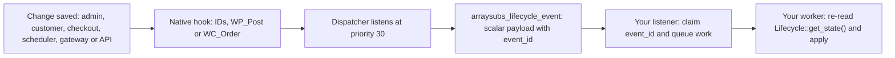

# Info
- Module: Developers
- Availability: Free (some sections require Pro)
- Last updated: 2026-10-18

# React to Supported Events

> Listen to ArraySubs lifecycle hooks, deduplicate repeated deliveries and keep your own membership or commission records in step with each subscription.

**Availability:** Core (Free). The normalized `arraysubs_lifecycle_event` action and every subscription, renewal, trial, grace, cancellation, pause, plan-switch, order and deletion hook are core. Hooks marked *(Pro)* need ArraySubs Pro with an active license and the named module switched on (Store Credit, Subscription Bundle, Early Renewal, Retention Flow).

## Page Navigation

- **Current guide:** React to Supported Events
- **Where to open it:** Your custom plugin or theme code (PHP)
- **Section overview:** [Developers](./README.md)
- **Previous guide:** [Read and Update Store Credit](./store-credit.md)
- **Next guide:** [Extend ArraySubs with a Module](./addon-modules.md)
- **Troubleshooting:** [Verify Your Integration](./errors-and-testing.md)

## Overview

ArraySubs announces every lifecycle change through WordPress actions and lets you adjust selected decisions through filters. There are two layers:

| Layer | What you receive | Best for |
| --- | --- | --- |
| Native hooks (for example `arraysubs_renewal_payment_complete`) | Positional arguments: subscription IDs, `WP_Post` subscription objects, `WC_Order` objects, amounts and status slugs | Code that must run in the same request as the change and needs the live objects |
| Normalized event `arraysubs_lifecycle_event` | One event name plus one payload of scalar values and flat scalar arrays, with a durable `event_id` | Integrations that sync memberships, CRMs, LMS enrolments or commissions and must survive duplicate or delayed delivery |

This page is the catalog: the normalized event first, then a comparison of the request paths that produce events, then full entries for the integration-relevant actions and filters, and finally a compact table of other public hooks.

## When to Use This

- You grant or remove access in another system when a subscription starts, renews, pauses, goes on hold, is cancelled or expires.
- You record a commission or a fulfilment task once per paid renewal order.
- You warn members during the grace period and restrict them when it ends.
- You react to plan switches, pending plan switches and auto-downgrades.
- You adjust a policy decision, such as which statuses entitle a member or how many payment retries run.

If you only need the current state of a subscription, read it with [Read Lifecycle State and Manage Its Dates](./status-grace-periods-and-trials.md) instead of listening for events.

## Prerequisites

- ArraySubs core installed and active (WooCommerce active and passing the core dependency check).
- A custom plugin of your own. Register listeners when your plugin loads, on every request: ArraySubs builds the normalized payload only when a listener is attached at the moment the event fires. See [Connect Your Custom Plugin](./getting-started.md).
- Call the `ArraySubs\Api\*` classes from inside listeners only after `arraysubs_after_boot` (listeners for lifecycle events always run later than that). Guard with `class_exists()`.
- For *(Pro)* hooks: ArraySubs Pro, an active license and the module switched on.
- A working WP-Cron or server cron, because renewals, retries, grace checks, trial conversion and scheduled cancellations run as Action Scheduler jobs.

## How It Works

### Three kinds of signals

| Signal | Direction | Part of this contract? | What to do |
| --- | --- | --- | --- |
| In-process WordPress hooks (this page) | ArraySubs to your PHP code, inside the same PHP request that made the change | Yes | Add `add_action()` / `add_filter()` listeners in your plugin. |
| Incoming gateway callbacks | Payment provider to the store over HTTP. Stripe events reach the official WooCommerce Stripe Gateway endpoint, and ArraySubs processes them through that plugin. PayPal, Paddle and Mollie events reach `POST /wp-json/arraysubs/v1/webhooks/{gateway_slug}`. | No. ArraySubs verifies, deduplicates and processes them for you. | Do not parse provider payloads for membership state. Their results reach you as in-process hooks that run inside the webhook request. |
| Outgoing webhooks | Store to an external URL | No. ArraySubs does not send lifecycle webhooks as part of this contract. | If an external system needs a notification, queue a job from your listener and send it yourself, with your own retries and the `event_id` as the idempotency key. |

### Native hooks versus the normalized event

Native hooks pass what the engine has at hand. Some pass an integer ID, some pass the `WP_Post` subscription object, a few pass `WC_Order` or `WC_Order_Item_Product` objects. Objects are live: use them inside the request, and never serialize them into a queue, log or external payload.

The normalized event carries no objects. Its payload contains scalars and three flat arrays of scalars (`plan`, `previous_plan`, `context`), so you can store it, queue it or forward it safely. It does include `customer_email`, which is personal data: handle it under your privacy policy.



### Timing and delivery rules

- **After persistence.** Normalized events fire after the change is saved. Native hooks list their exact timing in each entry below; the main exception is `arraysubs_data_status_changed`, which runs inside the status write.
- **Synchronous and in-process.** Listeners run in the request that made the change: a checkout request, an admin request, a customer portal request, an Action Scheduler job or a gateway webhook request. A slow listener slows that request; a gateway may retry a webhook that times out.
- **At least once per request path.** The same occurrence can reach your listener more than once: ArraySubs replays paid-order processing after lock contention or a crash, gateways redeliver webhooks, and a webhook and a scheduled charge can both observe one payment. The normalized `event_id` is identical on every delivery of the same occurrence. ArraySubs never promises exactly-once delivery.
- **No redelivery for listener failures.** If your own listener fails, ArraySubs does not send the event to you again. Store the event quickly, process it from your own queue with your own retries, and reconcile periodically with the read APIs.
- **Exceptions matter.** Catch your own exceptions. An exception thrown inside renewal processing (including from a listener on `arraysubs_renewal_payment_complete`) stops that processing and schedules a replay shortly after, so every listener can run again.
- **Priorities.** Built-in listeners use priority 10 (scheduling, emails, notes, role sync) and 20 (auto-downgrade, box and bundle mirroring, the bundled Affiliates Manager commission listener). The dispatcher that emits `arraysubs_lifecycle_event` listens at priority 30 (priority 10 for deletion). Use 20 to 29 on a native hook to run before the normalized event, or 31 and later to run after it.
- **Accepted arguments.** Always pass the correct `$accepted_args` to `add_action()` / `add_filter()`. PHP raises an `ArgumentCountError` when your callback requires more arguments than WordPress passes.

## Normalized Lifecycle Event

### `arraysubs_lifecycle_event`

```text
do_action( 'arraysubs_lifecycle_event', string $event, array $payload )
```

| # | Parameter | Type | Description |
| --- | --- | --- | --- |
| 1 | `$event` | string | Event name from the list below. |
| 2 | `$payload` | array | Scalar payload described in [Payload schema](#payload-schema). |

- **Source:** `arraysubs/src/Features/Integrations/Services/LifecycleDispatcher.php` (payload base built by `arraysubs/src/Features/Integrations/Support/SubscriptionEvent.php`).
- **Availability:** Core (Free), always loaded, no module switch. `ArraySubs\Api\Availability::check( 'events' )` returns `true` while core runs.
- **Timing:** after the change is saved, in the request that made it.
- **Return value:** action; return values are ignored.
- **Side effects:** none of its own. The payload is built only when at least one listener is attached.
- **Duplicates:** at least once per request path; deduplicate with `event_id`.

```php
<?php
add_action( 'arraysubs_lifecycle_event', 'example_log_lifecycle_event', 20, 2 );

function example_log_lifecycle_event( $event, $payload ): void {
	if ( ! is_string( $event ) || ! is_array( $payload ) ) {
		return;
	}

	error_log( sprintf(
		'ArraySubs %s for subscription #%d (event %s)',
		$event,
		absint( $payload['subscription_id'] ?? 0 ),
		sanitize_text_field( (string) ( $payload['event_id'] ?? '' ) )
	) );
}
```

### Event list

This is the complete list of event names. Every event concerns one subscription (`subscription_id`).

| Event | Fires when | Native source |
| --- | --- | --- |
| `activated` | The initial order is paid and processed (also for trial subscriptions), or a pending subscription is activated through `Subscriptions::activate()`. | `arraysubs_data_activated` |
| `trial_started` | The first paid initial order of a trial subscription is processed. Once per subscription. | `arraysubs_trial_started` |
| `trial_changed` | The end date of an active trial changes. | `arraysubs_trial_changed` |
| `trial_converted` | Every move from trial to active: a paid trial-end renewal, the daily trial conversion job, `Lifecycle::update_trial()` with `end_now`, or an admin activation. | `arraysubs_trial_converted` (daily job) and the status change |
| `trial_ended` | A trial finishes without continuing on its plan as a paid subscription: it moves from trial to on-hold, cancelled or expired, or a trial auto-downgrade replaces the plan. | Status change, `arraysubs_auto_downgrade_completed` |
| `renewal_invoice_created` | A renewal order (invoice) is created for the coming due date. | `arraysubs_renewal_invoice_created` |
| `renewed` | A renewal order is paid and processed: the next payment date has advanced. | `arraysubs_renewal_payment_complete` |
| `renewal_failed` | A due-time automatic charge or retry fails, or the renewal order cannot be created. | `arraysubs_renewal_payment_failed` |
| `payment_retry_scheduled` | The retry policy schedules another charge attempt. | `arraysubs_payment_retry_scheduled` |
| `payment_retry_attempted` | A scheduled retry ran. | `arraysubs_payment_retry_attempted` |
| `payment_retry_exhausted` | No further automatic retry will run for the unpaid renewal order. | `arraysubs_payment_retry_exhausted` |
| `grace_started` | The renewal is overdue and unpaid while the subscription is still active or trial. | `arraysubs_grace_period_started` |
| `grace_changed` | The grace dates of the current overdue cycle are recalculated. | `arraysubs_grace_period_changed` |
| `grace_recovered` | The overdue renewal order is paid during grace. | `arraysubs_grace_period_recovered` |
| `grace_ended` | A grace stage runs out without payment (`context.stage` and the native `$outcome` say which). | `arraysubs_grace_period_ended` |
| `on_hold` | The subscription moves to on-hold through any path. | Status change (`arraysubs_data_put_on_hold` for the grace path) |
| `reactivated` | The subscription returns to active from on-hold, cancelled or expired. | `arraysubs_data_reactivated` |
| `paused` | The subscription is paused. | `arraysubs_subscription_paused` |
| `resumed` | A paused subscription resumes (manually or automatically). | `arraysubs_subscription_resumed` |
| `renewal_skipped` | One or more renewal cycles are skipped. | `arraysubs_cycles_skipped` |
| `renewal_date_changed` | The next payment date moves outside a paid renewal, a skip and a pause: `Subscriptions::update()`, a changed or undone skip, or the admin skip-payment action. | `arraysubs_skip_undone`, `arraysubs_skip_modified`, `arraysubs_payment_skipped` and API updates |
| `cancellation_scheduled` | An end-of-period cancellation is scheduled. | `arraysubs_data_waiting_cancellation` |
| `cancellation_undone` | A scheduled cancellation is removed. | `arraysubs_data_cancellation_undone` |
| `cancelled` | The subscription moves to cancelled through any path: immediate, end of period, non-payment, refund flows, box or bundle mirroring. | `arraysubs_data_cancelled`, `arraysubs_data_cancelled_overdue` and the status change |
| `expired` | The subscription moves to expired through any path: payment count reached, fixed end date, admin or API. | `arraysubs_data_expired` (fixed end date) and the status change |
| `plan_switched` | The plan of the subscription changed: an immediate switch, a pending plan switch applied on its paid renewal, or an auto-downgrade. | `arraysubs_plan_switch_completed`, `arraysubs_pending_switch_applied` |
| `pending_switch_set` | A pending plan switch is stored and none existed. | `arraysubs_pending_switch_set` |
| `pending_switch_replaced` | A pending plan switch is stored over an existing one. | `arraysubs_pending_switch_set` |
| `pending_switch_cancelled` | A customer, an admin or `Lifecycle::cancel_pending_switch()` cancels the pending plan switch. | `arraysubs_pending_switch_cleared` |
| `pending_switch_cleared` | A cancellation (scheduled or immediate) removes the pending plan switch. | `arraysubs_pending_switch_cleared` |
| `auto_downgraded` | An auto-downgrade completes. | `arraysubs_auto_downgrade_completed` |
| `deleted` | The subscription is permanently deleted through `Subscriptions::delete()` or `arraysubs_delete_subscription()`. | `arraysubs_before_delete_subscription` |
| `granted` | The customer's overall entitlement starts: a status change gives access that no other entitling subscription of the same customer already gives. | Status change, pause-access setting change |
| `revoked` | The customer's overall entitlement ends: a status change removes access and no other entitling subscription of the same customer still gives it. | Status change, pause-access setting change |

Some occurrences produce several events. Applying a pending plan switch emits `plan_switched` with `context.trigger` `pending_switch` (no separate pending-switch event). The grace end that cancels an on-hold subscription emits `grace_ended`, then `cancelled`. A normal checkout emits `granted` (status change) and `activated` (initial payment processed). Do not rely on the order between events of different names; re-read state instead.

### Payload schema

Every payload contains all keys below. Event-specific keys hold their empty value (`0`, `''`, `false` or `null`) on events they do not apply to. Stored subscription dates keep their stored format (UTC `Y-m-d H:i:s`); `occurred_at` and the dates inside `context` are ISO 8601 UTC strings such as `2026-11-01T00:00:00+00:00`.

| Key | Type | Meaning |
| --- | --- | --- |
| `event` | string | Event name (same as the first argument). |
| `event_id` | string | Durable identity of this occurrence. Every delivery of the same occurrence, including retries and replays, carries the same value. Opaque: compare it whole, do not parse it. |
| `occurred_at` | string | ISO 8601 UTC time of the change. |
| `source` | string | Path that caused the change: `admin`, `customer`, `checkout`, `scheduler`, `gateway`, `api` or `system`. |
| `actor_id` | int or null | WordPress user who caused the change (admin or customer), or `null` for scheduler, gateway and system changes. For `api`, the `actor` ID you passed. |
| `subscription_id` | int | Subscription post ID. |
| `status` | string | Stored status after the change, as the full post status slug (for example `arraysubs-active`). |
| `previous_status` | string | Stored status before the change. Equals `status` when the event does not change the status. |
| `effect` | string | What this event did to this subscription's own access: `grant`, `revoke` or `none`. `activated`, `trial_started`, `trial_converted` and `renewed` report `grant` while the status entitles; `deleted` reports `revoke`; `plan_switched` reports `none`. |
| `user_id` | int | Customer's WordPress user ID, `0` for a guest subscription. |
| `customer_email` | string | Customer email (subscription email, else the account email). |
| `product_id` | int | Effective product: the variation ID when set, else the parent product ID. |
| `parent_product_id` | int | Parent product ID. |
| `variation_id` | int | Variation ID, `0` for simple products. |
| `parent_order_id` | int | Initial (parent) order ID. |
| `order_id` | int | Order involved in the event (activating, renewal, retry or switch order), else `0`. |
| `currency` | string | Subscription currency code. |
| `recurring_amount` | string | Current recurring amount per unit, as stored. |
| `next_payment_date` | string | Stored next payment date (UTC `Y-m-d H:i:s`), `''` when none. |
| `trial_end_date` | string | Stored trial end date (UTC), `''` when none. |
| `end_date` | string | Stored end date (UTC), `''` when none. |
| `error_message` | string | Failure message on `renewal_failed`, else `''`. |
| `switch_type` | string | On `plan_switched`: the switch type passed by the native hook (`upgrade`, `downgrade`, `crossgrade`, or `auto_downgrade`). |
| `old_product_id` / `new_product_id` | int | On `plan_switched`: product before and after. |
| `is_renewal` | bool | `true` on `renewed` and `renewal_failed`. |
| `force_delete` | bool | On `deleted`: the flag passed to the delete call. |
| `event_time` | string | Present on `plan_switched` events from a paid plan-switch order. Prefer `occurred_at`. |
| `pause_access_mode_changed`, `previous_pause_access_mode`, `pause_access_mode` | bool, string, string | Present on `granted` / `revoked` events emitted for paused subscriptions when the merchant changes the Access During Pause setting across Full access. |
| `plan` | array | Current plan after the change: `product_id`, `variation_id`, `quantity`, `recurring_amount` (decimal string), `currency`, `billing_interval`, `billing_period`. |
| `previous_plan` | array or null | Plan before the change, same keys, on `plan_switched` and `auto_downgraded`; `null` on other events. |
| `context` | array | Event-specific scalars, listed below. Keys that do not apply are absent. |

`context` keys:

| Key | Events | Meaning |
| --- | --- | --- |
| `order_id` | renewal, retry, grace and plan-switch events | Order the event concerns. |
| `attempt` | `renewal_failed`, `payment_retry_scheduled`, `payment_retry_attempted`, `payment_retry_exhausted` | Retry number (1 for the first retry). |
| `max_attempts` | retry events | Retries the policy allows for this subscription. |
| `next_retry_at` | `payment_retry_scheduled`, `renewal_failed` (when a retry was scheduled) | ISO 8601 UTC time of the next attempt. |
| `stage` | grace events, `on_hold` | `before_on_hold` or `before_cancel`. |
| `on_hold_at` / `cancel_at` | grace events | ISO 8601 UTC dates when the subscription goes on hold and is cancelled if still unpaid. |
| `skip_reason` | `on_hold` | `initial_payment_failed` or `renewal_order_creation_failed` when the subscription went straight to on-hold and skipped grace. |
| `switch_type` | `plan_switched`, pending-switch events, `auto_downgraded` | `upgrade`, `downgrade` or `crossgrade`. |
| `trigger` | `plan_switched` | `immediate`, `pending_switch` or `auto_downgrade`. |

The `arraysubs_integration_event_context` filter can change the base values (`user_id`, customer email, product IDs, `parent_order_id`, statuses and `effect`). Keys you add there are not copied into the payload.

### Event identity and deduplication

Deduplicate on `event_id`, at the point where your work becomes irreversible (an enrolment, a commission row, an outgoing request):

1. Claim the `event_id` with a write that succeeds only once, for example `INSERT IGNORE` into your own table with a unique key.
2. If the claim fails, the occurrence was already handled: stop.
3. If your processing fails after the claim, release the claim so a retry can run.

Native hooks carry no `event_id`. When you listen to native hooks, build your own key from stable identifiers, for example the renewal order ID for a payment, or the subscription ID plus the new status and the stored date for a status change.

### Delayed or out-of-order processing

Events can reach your worker late or out of order, for example when your queue retries an earlier event after a later one succeeded. Never decide from the event name alone:

1. Re-read the current state with `ArraySubs\Api\Lifecycle::get_state( $subscription_id )` (read only: it never converts trials, advances recovery or charges).
2. Apply the current `has_access`, `phase`, `status` and `plan`, not what the event implied.
3. Optionally store the last `occurred_at` you applied per subscription and skip older events.

A `not_found` error from `get_state()` means the subscription was deleted afterwards: treat it as giving no access.

### Multiple subscriptions and the same benefit

A customer can hold two or more subscriptions that grant the same product (for example two purchases of product 197). `granted` and `revoked` describe the customer's overall entitlement, per product or variation:

- Cancelling subscription 123 while subscription 124 still gives product 197 emits `cancelled` for 123 (with `effect` `revoke`), but no `revoked`.
- When 124 later ends too, `revoked` fires.
- Guest subscriptions (no WordPress user) are evaluated individually.

If you act on `cancelled`, `expired`, `on_hold`, `deleted` or `effect` instead, re-check the customer's other subscriptions before you remove a benefit. The safest pattern recomputes the benefit from every live subscription of the customer; see [Examples](#examples).

## Paths Compared

The same change can come from different request paths. The path decides which request runs your listener, the `source` value and whether a user is logged in.

| Path | Request that runs your listener | `source` | `actor_id` | Typical events |
| --- | --- | --- | --- | --- |
| Admin screens and admin REST routes (`/wp-json/arraysubs/v1/subscriptions/...`) | The admin's request | `admin` | Admin user ID | `cancelled`, `cancellation_scheduled`, `cancellation_undone`, `paused`, `resumed`, `renewal_skipped`, `on_hold`, `reactivated`, `plan_switched`, `pending_switch_set`, `deleted` |
| Customer portal (My Account and `/wp-json/arraysubs/v1/my-subscriptions/...`) | The customer's request | `customer` | Customer user ID | `cancellation_scheduled`, `cancelled`, `cancellation_undone`, `paused`, `resumed`, `renewal_skipped`, `pending_switch_set`, `pending_switch_replaced`, `pending_switch_cancelled`, `plan_switched` |
| Checkout and the initial payment | The checkout request, or the payment confirmation request | `checkout` | Customer user ID, `null` for guests | `activated`, `trial_started`, `granted` |
| Scheduler (Action Scheduler jobs) | A background job with no logged-in user | `scheduler` | `null` | `renewal_invoice_created`, `renewed`, `renewal_failed`, retry events, grace events, `on_hold`, `cancelled`, `expired`, `trial_converted`, `resumed` (automatic), `plan_switched` (pending switch applied on an automatic renewal) |
| Gateway callbacks | The webhook request | `gateway` | `null` | `renewed` and `activated` when the provider confirms a payment later, provider-driven plan changes |
| Your API calls (`ArraySubs\Api\*` mutations) | Your request | `api` | The `actor` ID you passed | Any lifecycle event your operation causes |
| Internal follow-ups (box and bundle mirroring, setting changes) | The request of the original change | `system` | `null` | Child `granted` / `revoked` / `cancelled`, pause-access `granted` / `revoked` |

### Stripe automatic renewals

Stripe renewals are core and use the official WooCommerce Stripe Gateway. Merchant setup and a staging walkthrough are in the [Stripe guide](../checkout-and-payments/automatic-payments/stripe.md).

1. **Invoice.** The `arraysubs_generate_renewal_invoice` job creates the renewal order before the due date: `renewal_invoice_created` (scheduler).
2. **Charge.** At the due time the `arraysubs_process_renewal` job charges the saved payment method off-session through the official gateway.
3. **Paid at once.** When Stripe confirms immediately, the order is paid inside that job: `renewed` (scheduler), plus `reactivated` and `grace_recovered` when the subscription was recovering.
4. **Confirmed later.** When Stripe confirms asynchronously (processing payments, customer authentication), Stripe sends a webhook to the official gateway's endpoint. ArraySubs processes it in that webhook request: `renewed` (gateway). Each Stripe event ID is processed once; if processing fails, the claim is released so Stripe's redelivery can be processed.
5. **Declined.** `renewal_failed` (scheduler), then `payment_retry_scheduled`; each retry job emits `payment_retry_attempted`. The hourly overdue check emits the grace events. A Stripe webhook about the same failed payment fires the native `arraysubs_gateway_payment_failed`, not a second `renewal_failed`.

PayPal and Paddle publish their own retry behavior, so ArraySubs schedules no retries for them and no retry events fire. Their confirmations arrive as gateway callbacks.

## Actions

Each entry lists the exact positional arguments. Signature blocks use the hook's real argument order.

### Subscription created

```text
do_action( 'arraysubs_data_created', int $subscription_id, WP_Post $post )
do_action( 'arraysubs_data_created_from_order', int $subscription_id, int $order_id, WC_Order_Item_Product $item, WC_Order $order )
```

| Hook | # | Parameter | Type | Description |
| --- | --- | --- | --- | --- |
| `arraysubs_data_created` | 1 | `$subscription_id` | int | New subscription ID. |
| | 2 | `$post` | WP_Post | The subscription post. |
| `arraysubs_data_created_from_order` | 1 | `$subscription_id` | int | New subscription ID. |
| | 2 | `$order_id` | int | Checkout order ID. |
| | 3 | `$item` | WC_Order_Item_Product | Order line that created it. |
| | 4 | `$order` | WC_Order | Checkout order. |

- **Source:** `arraysubs/src/Features/Subscriptions/Services/Hooks.php`; `arraysubs/src/Features/SubscriptionCheckout/Services/Traits/SubscriptionCreationTrait.php`.
- **Availability:** Core (Free).
- **Timing:** `arraysubs_data_created` fires on `wp_after_insert_post` for new subscriptions only, after all meta is saved, for every creation path (checkout, admin creation, `arraysubs_create_subscription()`). `arraysubs_data_created_from_order` fires at checkout after the subscription, its addresses and its schedule meta are saved.
- **Important:** a checkout subscription is usually still `arraysubs-pending` here: payment has not happened. Grant access on `activated` / `granted`, not on creation.
- **Normalized event:** none (creation is not a lifecycle event).
- **Retries:** none; fires once per created record.

```php
<?php
add_action( 'arraysubs_data_created_from_order', 'example_note_new_subscription', 20, 4 );

function example_note_new_subscription( $subscription_id, $order_id, $item, $order ): void {
	if ( $order instanceof WC_Order ) {
		$order->add_order_note( sprintf( 'Example CRM: subscription #%d created.', absint( $subscription_id ) ) );
	}
}
```

### Status changes

```text
do_action( 'arraysubs_data_status_changed', int $subscription_id, string $new_status, string $old_status )
do_action( "arraysubs_data_status_{$old_status}_to_{$new_status}", int $subscription_id, string $new_status, string $old_status )
```

| # | Parameter | Type | Description |
| --- | --- | --- | --- |
| 1 | `$subscription_id` | int | Subscription ID. |
| 2 | `$new_status` | string | New post status, full slug such as `arraysubs-on-hold`. |
| 3 | `$old_status` | string | Previous post status. Can be `new` (on creation), `trash`, `draft` or `auto-draft`. |

- **Source:** `arraysubs/src/Features/Subscriptions/Services/Hooks.php`.
- **Availability:** Core (Free).
- **Timing:** inside the status write (WordPress `transition_post_status`), after `post_status` is saved and before `save_post`. Meta the operation writes after the status update is not visible yet; for example the overdue cancellation writes its reason after the status. Skipped when the status does not change.
- **Coverage:** every status change, including raw writes. This is the hook to use when a narrower hook below does not cover a path. The dynamic variant fires right after, for example `arraysubs_data_status_arraysubs-active_to_arraysubs-on-hold`.
- **Normalized events:** `granted` / `revoked` (entitlement flips), `on_hold`, `cancelled`, `expired`, `trial_converted`, `trial_ended`. Trash and draft moves emit no lifecycle event.
- **Retries:** none. Box and bundle children mirror their parent's status, so each child fires its own status change.

```php
<?php
add_action( 'arraysubs_data_status_arraysubs-active_to_arraysubs-on-hold', 'example_flag_on_hold', 20, 3 );

function example_flag_on_hold( $subscription_id, $new_status, $old_status ): void {
	update_option( 'example_last_on_hold_subscription', absint( $subscription_id ), false );
}
```

### Activation

```text
do_action( 'arraysubs_data_activated', int $subscription_id, int $order_id )
```

| # | Parameter | Type | Description |
| --- | --- | --- | --- |
| 1 | `$subscription_id` | int | Subscription ID. |
| 2 | `$order_id` | int | Paid initial order ID. |

- **Source:** `arraysubs/src/Features/Subscriptions/Services/OrderIntegration.php`.
- **Availability:** Core (Free).
- **Timing:** after the paid initial order is processed: status set to active (trial subscriptions stay in trial), start and payment dates saved, payment method stored and the first renewal scheduled. Runs in the request that marked the order paid (checkout, payment confirmation or gateway webhook).
- **Normalized event:** `activated`.
- **Retries:** processing is guarded per order and the guard is written last, so a crash before the end re-runs processing and can fire the hook again for the same order. Key your work on the order ID or `event_id`.

```php
<?php
add_action( 'arraysubs_data_activated', 'example_welcome_member', 20, 2 );

function example_welcome_member( $subscription_id, $order_id ): void {
	if ( ! class_exists( '\ArraySubs\Api\Subscriptions' ) ) {
		return;
	}
	$data = \ArraySubs\Api\Subscriptions::get( absint( $subscription_id ), [ 'output' => 'data', 'fields' => [ 'customer' ] ] );
	if ( ! is_wp_error( $data ) && $data['customer_id'] > 0 ) {
		update_user_meta( (int) $data['customer_id'], 'example_welcome_order', absint( $order_id ) );
	}
}
```

### Trials

```text
do_action( 'arraysubs_trial_started', int $subscription_id )
do_action( 'arraysubs_trial_changed', WP_Post $subscription, string $new_trial_end, string $old_trial_end )
do_action( 'arraysubs_trial_converted', int $subscription_id )
```

| Hook | # | Parameter | Type | Description |
| --- | --- | --- | --- | --- |
| `arraysubs_trial_started` | 1 | `$subscription_id` | int | Trial subscription ID. |
| `arraysubs_trial_changed` | 1 | `$subscription` | WP_Post | Subscription after the change. |
| | 2 | `$new_trial_end` | string | New trial end, UTC `Y-m-d H:i:s`. |
| | 3 | `$old_trial_end` | string | Previous trial end, UTC `Y-m-d H:i:s`. |
| `arraysubs_trial_converted` | 1 | `$subscription_id` | int | Converted subscription ID. |

- **Source:** `arraysubs_trial_started` in `arraysubs/src/Features/Subscriptions/Services/OrderIntegration.php`; `arraysubs_trial_converted` in `arraysubs/src/Features/RecurringBilling/Services/TrialConverter.php`; `arraysubs_trial_changed` is fired by the core trial engine.
- **Availability:** Core (Free).
- **Timing:** `arraysubs_trial_started` fires once per subscription when its initial order is paid (not for plan-switch orders), before `arraysubs_data_activated` in the same request. `arraysubs_trial_changed` fires after the trial end of an active trial is saved and renewal scheduling is realigned (for example through `Lifecycle::update_trial()` with `trial_end`). `arraysubs_trial_converted` fires only from the daily trial conversion job, after the new next payment date is saved.
- **Important:** a trial whose trial-end renewal is paid becomes active without `arraysubs_trial_converted`. The normalized `trial_converted` event covers both paths; prefer it.
- **Normalized events:** `trial_started`, `trial_changed`, `trial_converted`, `trial_ended`.
- **Retries:** `arraysubs_trial_started` is protected by a one-time marker; the others fire once per saved change.

```php
<?php
add_action( 'arraysubs_trial_changed', 'example_trial_moved', 20, 3 );

function example_trial_moved( WP_Post $subscription, string $new_trial_end, string $old_trial_end ): void {
	error_log( sprintf( 'Trial for #%d moved from %s to %s UTC.', $subscription->ID, $old_trial_end, $new_trial_end ) );
}
```

### Renewal invoice

```text
do_action( 'arraysubs_renewal_invoice_created', int $subscription_id, int $order_id )
do_action( 'arraysubs_renewal_order_built', WC_Order $order, int $subscription_id )
```

| Hook | # | Parameter | Type | Description |
| --- | --- | --- | --- | --- |
| `arraysubs_renewal_invoice_created` | 1 | `$subscription_id` | int | Subscription ID. |
| | 2 | `$order_id` | int | New unpaid renewal order ID. |
| `arraysubs_renewal_order_built` | 1 | `$order` | WC_Order | The saved renewal order (note: the order comes first). |
| | 2 | `$subscription_id` | int | Subscription ID. |

- **Source:** `arraysubs/src/Features/RecurringBilling/Services/RenewalProcessor.php`; `arraysubs/src/Features/RecurringBilling/Services/OrderCreation.php`.
- **Availability:** Core (Free).
- **Timing:** `arraysubs_renewal_order_built` fires right after any renewal order is saved, on every creation path, including orders created for PayPal and Paddle payments. `arraysubs_renewal_invoice_created` fires after the order is linked as the subscription's pending renewal, while ArraySubs still holds the invoice lock: keep the listener short and do not change the subscription from it.
- **Normalized event:** `renewal_invoice_created`. A renewal order built on a pending plan switch freezes that switch.
- **Retries:** invoice creation is locked per subscription; one order, one hook.

```php
<?php
add_action( 'arraysubs_renewal_order_built', 'example_tag_renewal_order', 20, 2 );

function example_tag_renewal_order( $order, $subscription_id ): void {
	if ( $order instanceof WC_Order ) {
		$order->update_meta_data( '_example_source', 'renewal' );
		$order->save();
	}
}
```

### Renewal payment success

```text
do_action( 'arraysubs_renewal_payment_complete', int $subscription_id, int $order_id )
```

| # | Parameter | Type | Description |
| --- | --- | --- | --- |
| 1 | `$subscription_id` | int | Subscription ID. |
| 2 | `$order_id` | int | Paid renewal order ID. |

- **Source:** `arraysubs/src/Features/Subscriptions/Services/OrderIntegration.php`.
- **Availability:** Core (Free).
- **Timing:** after the paid renewal is fully processed: any pending plan switch applied, payment date and count saved, retry state reset, next payment date advanced, renewal jobs rescheduled and the status moved to active (from trial or on-hold). Runs in the request that marked the order paid: the scheduled charge, a gateway webhook, a manual payment or a retry.
- **Normalized events:** `renewed`; also `grace_recovered`, `reactivated` (from on-hold) and `trial_converted` (from trial) when they apply.
- **Retries:** when the subscription is locked or processing throws, ArraySubs replays the paid-order processing about 15 seconds later in an Action Scheduler job, so this hook can run in a later background request and, after a crash, more than once for one order. Key work on the order ID.
- **Box and bundle children** do not fire it; they follow their parent.

```php
<?php
add_action( 'arraysubs_renewal_payment_complete', 'example_count_renewal', 25, 2 );

function example_count_renewal( $subscription_id, $order_id ): void {
	$done = (array) get_option( 'example_counted_orders', [] );
	if ( in_array( absint( $order_id ), $done, true ) ) {
		return; // Already counted: this delivery is a repeat.
	}
	$done[] = absint( $order_id );
	update_option( 'example_counted_orders', array_slice( $done, -500 ), false );
}
```

### Renewal payment failure

```text
do_action( 'arraysubs_renewal_payment_failed', int $subscription_id, int $order_id, string $error_message )
```

| # | Parameter | Type | Description |
| --- | --- | --- | --- |
| 1 | `$subscription_id` | int | Subscription ID. |
| 2 | `$order_id` | int | Unpaid renewal order ID, `0` when the renewal order could not be created. |
| 3 | `$error_message` | string | Failure message from the gateway or engine. |

- **Source:** `arraysubs/src/Features/RecurringBilling/Services/RenewalProcessor.php`.
- **Availability:** Core (Free).
- **Timing:** after the failure is recorded on the subscription, the order is marked failed and the next retry (if any) is scheduled. With order ID `0`, the subscription has already moved straight to on-hold.
- **Not fired by:** gateway webhooks (they fire `arraysubs_gateway_payment_failed`) and Pro early renewal attempts.
- **Normalized event:** `renewal_failed`.
- **Retries:** one hook per failed attempt; each retry that fails fires it again with the same order ID.

```php
<?php
add_action( 'arraysubs_renewal_payment_failed', 'example_alert_failed_renewal', 20, 3 );

function example_alert_failed_renewal( $subscription_id, $order_id, $error_message ): void {
	error_log( sprintf( 'Renewal failed for #%d (order %d): %s', absint( $subscription_id ), absint( $order_id ), sanitize_text_field( (string) $error_message ) ) );
}
```

### Gateway payment results

```text
do_action( 'arraysubs_gateway_payment_succeeded', int $subscription_id, int $order_id, string $transaction_id, string $gateway_slug )
do_action( 'arraysubs_gateway_payment_failed', int $subscription_id, int $order_id, string $error_message, string $gateway_slug, string $provider_attempt )
```

| Hook | # | Parameter | Type | Description |
| --- | --- | --- | --- | --- |
| `arraysubs_gateway_payment_succeeded` | 1-2 | `$subscription_id`, `$order_id` | int | Subscription and paid order. |
| | 3 | `$transaction_id` | string | Provider transaction reference, can be `''`. |
| | 4 | `$gateway_slug` | string | Gateway ID. |
| `arraysubs_gateway_payment_failed` | 1-2 | `$subscription_id`, `$order_id` | int | Subscription and order (`0` when none). |
| | 3 | `$error_message` | string | Failure reason. |
| | 4 | `$gateway_slug` | string | Gateway ID. |
| | 5 | `$provider_attempt` | string | Provider attempt reference. Passed only by renewal processing; webhooks pass four arguments, so give it a default. |

- **Source:** `arraysubs/src/Features/Subscriptions/Services/OrderIntegration.php`, `arraysubs/src/Features/RecurringBilling/Services/RenewalProcessor.php` and the gateway webhook handlers under `arraysubs/src/Features/AutomaticPayments/Gateways/`.
- **Availability:** Core (Free).
- **Timing:** after the payment or failure is recorded. Fires both from ArraySubs' own processing and from gateway webhooks.
- **Duplicates:** can fire more than once for one payment (webhook plus order processing). Use these hooks for payment logging, not for counting renewals; use `renewed` for that.
- **Normalized event:** none.

```php
<?php
add_action( 'arraysubs_gateway_payment_failed', 'example_log_gateway_failure', 20, 5 );

function example_log_gateway_failure( $subscription_id, $order_id, $error_message, $gateway_slug, $provider_attempt = '' ): void {
	error_log( sprintf( '[%s] payment failed for #%d', sanitize_key( (string) $gateway_slug ), absint( $subscription_id ) ) );
}
```

### Payment retries

```text
do_action( 'arraysubs_payment_retry_scheduled', WP_Post $subscription, WC_Order $order, int $attempt, int $retry_at )
do_action( 'arraysubs_payment_retry_attempted', WP_Post $subscription, WC_Order $order, int $attempt, bool $success )
do_action( 'arraysubs_payment_retry_exhausted', WP_Post $subscription, WC_Order $order, int $attempts )
```

| Hook | # | Parameter | Type | Description |
| --- | --- | --- | --- | --- |
| all | 1 | `$subscription` | WP_Post | Subscription. |
| all | 2 | `$order` | WC_Order | Unpaid renewal order being retried. |
| `..._scheduled` | 3 | `$attempt` | int | Number of the scheduled retry (1 for the first). |
| | 4 | `$retry_at` | int | Unix timestamp of the attempt. |
| `..._attempted` | 3 | `$attempt` | int | Number of the retry that ran. |
| | 4 | `$success` | bool | `true` when the order was paid. |
| `..._exhausted` | 3 | `$attempts` | int | Retries made for this order. |

- **Availability:** Core (Free). Fired by the core retry engine for gateways that use ArraySubs retries (for example Stripe and Mollie). PayPal and Paddle handle retries themselves, so these hooks do not fire for them.
- **Timing:** `..._scheduled` after the retry job and retry counters are saved; `..._attempted` after the retry's result is saved (a paid retry is then processed like any paid renewal and fires `arraysubs_renewal_payment_complete`); `..._exhausted` after the last allowed retry fails, or when a hard decline stops the retry policy.
- **Important:** exhaustion does not change the status and does not end grace. Entering on-hold removes any queued retry.
- **Normalized events:** `payment_retry_scheduled`, `payment_retry_attempted`, `payment_retry_exhausted` (with `context.attempt`, `max_attempts`, `next_retry_at`, `order_id`).
- **Policy:** adjust the ladder with the `arraysubs_payment_retry_config` filter below.

```php
<?php
add_action( 'arraysubs_payment_retry_exhausted', 'example_retries_exhausted', 20, 3 );

function example_retries_exhausted( WP_Post $subscription, WC_Order $order, int $attempts ): void {
	$order->add_order_note( sprintf( 'Example: %d automatic retries used; contact the member.', $attempts ) );
}
```

### Grace period

```text
do_action( 'arraysubs_grace_period_started', WP_Post $subscription, array $grace )
do_action( 'arraysubs_grace_period_changed', WP_Post $subscription, array $grace, array $previous )
do_action( 'arraysubs_grace_period_recovered', WP_Post $subscription, WC_Order $order )
do_action( 'arraysubs_grace_period_ended', WP_Post $subscription, string $outcome )
```

| Hook | # | Parameter | Type | Description |
| --- | --- | --- | --- | --- |
| all | 1 | `$subscription` | WP_Post | Subscription. |
| `..._started` | 2 | `$grace` | array | The `grace` block of `Lifecycle::get_state()`: `in_grace`, `stage`, `started_at`, `on_hold_at`, `cancel_at`, `days_before_on_hold`, `days_before_cancel`, `policy_source`, `skipped`, `skip_reason`, `settlement_pending`. |
| `..._changed` | 2 | `$grace` | array | Grace block after the change. |
| | 3 | `$previous` | array | Grace block before the change. |
| `..._recovered` | 2 | `$order` | WC_Order | The paid overdue renewal order. |
| `..._ended` | 2 | `$outcome` | string | `on_hold` or `cancelled`. |

Grace runs in two stages: `before_on_hold` (still active or trial, access kept for `days_before_on_hold` days) and `before_cancel` (on hold, no access, cancelled after `days_before_cancel` more days). Grace is not a stored status; read it with [Read Lifecycle State and Manage Its Dates](./status-grace-periods-and-trials.md).

- **Availability:** Core (Free).
- **`..._started`:** once per overdue renewal cycle, when the renewal is overdue and unpaid while the subscription is active or trial. Usually from the scheduler (the failed due-time charge or the hourly overdue check). It does not fire when grace is skipped: an initial-order payment failure or a failure to create the renewal order moves the subscription straight to on-hold (`on_hold` event with `context.skip_reason`).
- **`..._changed`:** after the current cycle's grace dates are recalculated, for example after `Lifecycle::update_grace_policy()` or `Lifecycle::set_grace_override()`.
- **`..._recovered`:** after the overdue renewal order is paid in either stage and the paid renewal is processed (in the same request as `renewed`).
- **`..._ended`:** when a stage runs out unpaid. Outcome `on_hold`: the first stage ended and the subscription is put on hold (fires before the `on_hold` event; the `before_cancel` stage starts). Outcome `cancelled`: the second stage ended and the subscription is cancelled for non-payment (fires before `cancelled`). The cancellation outcome also applies to subscriptions that skipped the first stage.
- **Guards:** a payment still settling at the gateway (for example a pending bank payment) postpones both stage ends; the hourly check applies the change on its next run after the boundary, so treat projected dates as the earliest time.
- **Normalized events:** `grace_started`, `grace_changed`, `grace_recovered`, `grace_ended` (with `context.stage`, `on_hold_at`, `cancel_at`, `order_id`).

```php
<?php
add_action( 'arraysubs_grace_period_started', 'example_warn_member', 20, 2 );

function example_warn_member( WP_Post $subscription, array $grace ): void {
	if ( ! class_exists( '\ArraySubs\Api\Subscriptions' ) ) {
		return;
	}
	$data = \ArraySubs\Api\Subscriptions::get( $subscription, [ 'output' => 'data', 'fields' => [ 'customer' ] ] );
	if ( ! is_wp_error( $data ) && $data['customer_id'] > 0 ) {
		update_user_meta( (int) $data['customer_id'], 'example_access_ends_at', (string) $grace['on_hold_at'] );
	}
}
```

### On-hold and reactivation

```text
do_action( 'arraysubs_data_put_on_hold', int $subscription_id )
do_action( 'arraysubs_data_reactivated', int $subscription_id, string $old_status )
```

| Hook | # | Parameter | Type | Description |
| --- | --- | --- | --- | --- |
| `arraysubs_data_put_on_hold` | 1 | `$subscription_id` | int | Subscription ID. |
| `arraysubs_data_reactivated` | 1 | `$subscription_id` | int | Subscription ID. |
| | 2 | `$old_status` | string | `arraysubs-on-hold`, `arraysubs-cancelled` or `arraysubs-expired`. |

- **Source:** `arraysubs/src/Features/RecurringBilling/Services/Hooks.php`; `arraysubs/src/Features/Subscriptions/Services/OrderIntegration.php`.
- **Availability:** Core (Free).
- **Timing:** `arraysubs_data_put_on_hold` fires only for the grace path (the hourly overdue check), after the status and hold date are saved. Other on-hold paths (initial-order failure, renewal-order creation failure, admin, API, box and bundle mirroring) fire only the status change. `arraysubs_data_reactivated` fires inside the status write to active from on-hold, cancelled or expired (not for the first activation), after the next payment date is recalculated and renewals are rescheduled; a late paid renewal that recovers an on-hold subscription fires it too.
- **Normalized events:** `on_hold` (every path), `reactivated`.

```php
<?php
add_action( 'arraysubs_data_reactivated', 'example_member_back', 20, 2 );

function example_member_back( $subscription_id, $old_status ): void {
	error_log( sprintf( 'Subscription #%d reactivated from %s.', absint( $subscription_id ), sanitize_key( (string) $old_status ) ) );
}
```

### Pause and resume

```text
do_action( 'arraysubs_subscription_paused', int $subscription_id, int $duration_days, int $user_id, string $reason )
do_action( 'arraysubs_subscription_resumed', int $subscription_id, int $user_id, bool $is_auto, array $context )
```

| Hook | # | Parameter | Type | Description |
| --- | --- | --- | --- | --- |
| `arraysubs_subscription_paused` | 1 | `$subscription_id` | int | Subscription ID. |
| | 2 | `$duration_days` | int | Pause length in days. |
| | 3 | `$user_id` | int | User who paused, `0` for system. |
| | 4 | `$reason` | string | Pause reason, can be `''` (`retention_offer` for Pro retention pauses). |
| `arraysubs_subscription_resumed` | 1 | `$subscription_id` | int | Subscription ID. |
| | 2 | `$user_id` | int | User who resumed, `0` for system. |
| | 3 | `$is_auto` | bool | `true` for the automatic resume at the pause end. |
| | 4 | `$context` | array | `paused_days`, `paused_seconds`, `restored_to` (status slug). |

- **Source:** `arraysubs/src/Features/SkipRenewal/Services/PauseManager.php`.
- **Availability:** Core (Free), gated by the merchant's pause settings.
- **Timing:** after the status change, date shift and job (un)scheduling are saved. Pause moves the next payment date forward immediately; resume restores it plus the time actually paused.
- **Access:** a paused subscription entitles only when the merchant's Access During Pause setting is Full; `granted` / `revoked` follow that setting.
- **Normalized events:** `paused`, `resumed`.
- **Retries:** an automatic resume that fails is retried by ArraySubs; the hook fires once, when the resume succeeds.

```php
<?php
add_action( 'arraysubs_subscription_resumed', 'example_on_resume', 20, 4 );

function example_on_resume( $subscription_id, $user_id, $is_auto, $context ): void {
	$days = is_array( $context ) ? absint( $context['paused_days'] ?? 0 ) : 0;
	error_log( sprintf( 'Subscription #%d resumed after %d days.', absint( $subscription_id ), $days ) );
}
```

### Skipped renewals

```text
do_action( 'arraysubs_cycles_skipped', int $subscription_id, int $cycles, int $user_id, array $context )
do_action( 'arraysubs_skip_undone', int $subscription_id, int $user_id, array $context )
do_action( 'arraysubs_skip_modified', int $subscription_id, int $old_cycles, int $new_cycles, int $user_id )
do_action( 'arraysubs_cycle_skipped_processed', int $subscription_id, int $remaining, int $new_remaining )
do_action( 'arraysubs_skip_cycles_completed', int $subscription_id )
```

| Hook | Arguments after `$subscription_id` |
| --- | --- |
| `arraysubs_cycles_skipped` | `int $cycles`, `int $user_id`, `array $context` (`original_date`, `new_date`, `reason`) |
| `arraysubs_skip_undone` | `int $user_id`, `array $context` (`cycles_undone`, `restored_date`) |
| `arraysubs_skip_modified` | `int $old_cycles`, `int $new_cycles`, `int $user_id` |
| `arraysubs_cycle_skipped_processed` | `int $remaining`, `int $new_remaining` |
| `arraysubs_skip_cycles_completed` | none |

- **Source:** `arraysubs/src/Features/SkipRenewal/Services/SkipManager.php`.
- **Availability:** Core (Free), gated by the merchant's skip settings.
- **Timing:** after the skip meta and the moved next payment date are saved and renewals are rescheduled. Dates in `$context` are UTC `Y-m-d H:i:s`. `arraysubs_cycle_skipped_processed` and `arraysubs_skip_cycles_completed` fire from the renewal pipeline when a skipped cycle is reached.
- **Normalized events:** `renewal_skipped` (skip), `renewal_date_changed` (undo or change of a skip).

```php
<?php
add_action( 'arraysubs_cycles_skipped', 'example_on_skip', 20, 4 );

function example_on_skip( $subscription_id, $cycles, $user_id, $context ): void {
	$new_date = is_array( $context ) ? (string) ( $context['new_date'] ?? '' ) : '';
	error_log( sprintf( 'Subscription #%d skipped %d cycle(s); next payment %s UTC.', absint( $subscription_id ), absint( $cycles ), $new_date ) );
}
```

### Cancellation scheduled and undone

```text
do_action( 'arraysubs_data_waiting_cancellation', int $subscription_id, string $reason )
do_action( 'arraysubs_data_cancellation_undone', int $subscription_id )
```

| Hook | # | Parameter | Type | Description |
| --- | --- | --- | --- | --- |
| `arraysubs_data_waiting_cancellation` | 1 | `$subscription_id` | int | Subscription ID. |
| | 2 | `$reason` | string | Cancellation reason, can be `''`. |
| `arraysubs_data_cancellation_undone` | 1 | `$subscription_id` | int | Subscription ID. |

- **Source:** `arraysubs/src/functions/cancellation-helpers.php`.
- **Availability:** Core (Free).
- **Timing:** `arraysubs_data_waiting_cancellation` fires after the scheduled cancellation is saved, any pending plan switch is cleared and the cancellation job is scheduled; renewal jobs are then unscheduled by core listeners. Saving the same date again changes only the actor and reason and does not fire it. A requested end date that is already in the past cancels immediately instead. `arraysubs_data_cancellation_undone` fires after the scheduled cancellation is removed; renewals are rescheduled when the next payment date is still in the future. A pending plan switch cleared at scheduling time is not restored.
- **Access:** the subscription keeps its status (and access) until the cancellation date.
- **Normalized events:** `cancellation_scheduled` (plus `pending_switch_cleared` when one was removed), `cancellation_undone`.

```php
<?php
add_action( 'arraysubs_data_waiting_cancellation', 'example_start_winback', 20, 2 );

function example_start_winback( $subscription_id, $reason ): void {
	update_option( 'example_winback_' . absint( $subscription_id ), sanitize_text_field( (string) $reason ), false );
}
```

### Cancellation completed

```text
do_action( 'arraysubs_data_cancelled', int $subscription_id, WP_Post $subscription, string $cancel_type )
do_action( 'arraysubs_data_cancelled_overdue', int $subscription_id )
```

| Hook | # | Parameter | Type | Description |
| --- | --- | --- | --- | --- |
| `arraysubs_data_cancelled` | 1 | `$subscription_id` | int | Subscription ID. |
| | 2 | `$subscription` | WP_Post | For `immediate`, the post read before the status change (its `post_status` is the old status); for `end_of_period`, the post re-read after the change. |
| | 3 | `$cancel_type` | string | `immediate` or `end_of_period`. |
| `arraysubs_data_cancelled_overdue` | 1 | `$subscription_id` | int | Subscription cancelled for non-payment. |

- **Source:** `arraysubs/src/functions/cancellation-helpers.php` and `arraysubs/src/Features/RecurringBilling/Services/Hooks.php` (`arraysubs_data_cancelled`); `arraysubs/src/Features/RecurringBilling/Services/RenewalProcessor.php` (`arraysubs_data_cancelled_overdue`).
- **Availability:** Core (Free).
- **Timing:** after the cancelled status, dates and actor are saved and all subscription jobs are unscheduled. The overdue path fires only `arraysubs_data_cancelled_overdue`, never `arraysubs_data_cancelled`.
- **Coverage:** neither hook covers every path (refund flows, box and bundle mirroring, raw status writes). Use the normalized `cancelled` event or the status change for complete coverage.
- **Normalized event:** `cancelled` (preceded by `grace_ended` for the overdue path).

```php
<?php
add_action( 'arraysubs_data_cancelled', 'example_on_cancelled', 20, 3 );

function example_on_cancelled( $subscription_id, $subscription, $cancel_type ): void {
	error_log( sprintf( 'Subscription #%d cancelled (%s).', absint( $subscription_id ), sanitize_key( (string) $cancel_type ) ) );
}
```

### Expiry

```text
do_action( 'arraysubs_data_expired', int $subscription_id )
```

| # | Parameter | Type | Description |
| --- | --- | --- | --- |
| 1 | `$subscription_id` | int | Expired subscription ID. |

- **Source:** `arraysubs/src/Features/RecurringBilling/Services/ExpirationChecker.php`.
- **Availability:** Core (Free). Fixed end dates are configured with Pro Fixed Period Membership; payment-count expiry is core.
- **Timing:** only for the fixed end date path (the scheduled `arraysubs_expire_subscription` job), after the status, end date and unscheduling are saved. Payment-count expiry (reached inside paid renewal processing), admin and API expiry fire the status change only.
- **Normalized event:** `expired` covers every path; prefer it.

```php
<?php
add_action( 'arraysubs_data_expired', 'example_on_fixed_end', 20, 1 );

function example_on_fixed_end( $subscription_id ): void {
	error_log( sprintf( 'Subscription #%d reached its fixed end date.', absint( $subscription_id ) ) );
}
```

### Plan switch completed

```text
do_action( 'arraysubs_plan_switch_completed', int $subscription_id, int $old_product_id, int $new_product_id, string $switch_type, array $event_context )
```

| # | Parameter | Type | Description |
| --- | --- | --- | --- |
| 1 | `$subscription_id` | int | Subscription ID. |
| 2 | `$old_product_id` | int | Product before the switch. |
| 3 | `$new_product_id` | int | Product after the switch. |
| 4 | `$switch_type` | string | `upgrade`, `downgrade`, `crossgrade` (or `auto_downgrade`). |
| 5 | `$event_context` | array | Passed only when a paid plan-switch order is finalized: `contract_key`, `event_id`, `event_time`. Give it a default of `[]`. |

- **Source:** `arraysubs/src/Features/PlanSwitching/Services/PlanManager.php`, `arraysubs/src/Features/PlanSwitching/Services/Traits/PlanSwitchFinalizationTrait.php`, `arraysubs/src/Features/PlanSwitching/Services/Hooks.php`.
- **Availability:** Core (Free).
- **Timing:** after the new product, price and schedule are saved on the subscription. For a pending plan switch it fires while the paid renewal is processed, before the next payment date advances.
- **Retries:** finalizing a paid plan-switch order is retryable: when finalization cannot complete (for example a busy lock), ArraySubs records the failure and finalizes again later. `plan_switched` fires once the switch is applied and keeps the same `event_id` on repeated deliveries.
- **Normalized event:** `plan_switched` with `context.trigger` `immediate`, `pending_switch` or `auto_downgrade`, plus `previous_plan` and `plan`.
- **Box subscriptions:** switching a box to a non-box plan cancels and unlinks its child subscriptions.

```php
<?php
add_action( 'arraysubs_plan_switch_completed', 'example_on_switch', 20, 5 );

function example_on_switch( $subscription_id, $old_product_id, $new_product_id, $switch_type, $event_context = [] ): void {
	error_log( sprintf( 'Subscription #%d switched %d -> %d (%s).', absint( $subscription_id ), absint( $old_product_id ), absint( $new_product_id ), sanitize_key( (string) $switch_type ) ) );
}
```

### Pending plan switch

```text
do_action( 'arraysubs_pending_switch_set', int $subscription_id, array $payload )
do_action( 'arraysubs_pending_switch_cleared', int $subscription_id )
do_action( 'arraysubs_pending_switch_applied', int $subscription_id, array $payload, int $order_id )
```

| Hook | # | Parameter | Type | Description |
| --- | --- | --- | --- | --- |
| `arraysubs_pending_switch_set` | 1 | `$subscription_id` | int | Subscription ID. |
| | 2 | `$payload` | array | Stored switch snapshot. |
| `arraysubs_pending_switch_cleared` | 1 | `$subscription_id` | int | Subscription ID. |
| `arraysubs_pending_switch_applied` | 1 | `$subscription_id` | int | Subscription ID. |
| | 2 | `$payload` | array | The applied snapshot. |
| | 3 | `$order_id` | int | Paid renewal order that carried it. |

- **Source:** `arraysubs/src/functions/pending-switch-helpers.php`; `arraysubs/src/Features/Subscriptions/Services/OrderIntegration.php` (applied).
- **Availability:** Core (Free). Pro retention downgrade offers also store a pending plan switch.
- **Timing:** `..._set` after the pending switch is saved and read back; it fires again when a switch is replaced. `..._cleared` after it is removed, on every path: customer or admin cancel, cancellation of the subscription and application. `..._applied` once per order, after the plan change and the clear, before the next payment date advances.
- **Payload:** the snapshot includes signed and internal fields. Do not depend on them or store them; read the public target from `Lifecycle::get_state()` (`pending_switch` block).
- **Meaning:** a pending plan switch is applied only when the renewal order built on the target plan is paid. Until then the current plan, access and features stay unchanged. Creating that renewal invoice freezes the switch.
- **Normalized events:** `pending_switch_set`, `pending_switch_replaced`, `pending_switch_cancelled`, `pending_switch_cleared` (removed by a cancellation) and, on application, `plan_switched` with `context.trigger` `pending_switch` (no separate pending-switch event).

```php
<?php
add_action( 'arraysubs_pending_switch_applied', 'example_on_pending_applied', 20, 3 );

function example_on_pending_applied( $subscription_id, $payload, $order_id ): void {
	error_log( sprintf( 'Pending switch applied to #%d by order %d.', absint( $subscription_id ), absint( $order_id ) ) );
}
```

### Auto-downgrade

```text
do_action( 'arraysubs_auto_downgrade_completed', int $subscription_id, int $old_product_id, int $target_product_id )
```

| # | Parameter | Type | Description |
| --- | --- | --- | --- |
| 1 | `$subscription_id` | int | Subscription that was downgraded. |
| 2 | `$old_product_id` | int | Product before. |
| 3 | `$target_product_id` | int | Auto-downgrade target product. |

- **Source:** `arraysubs/src/Features/PlanSwitching/Services/AutoDowngradeHandler.php`.
- **Availability:** Core (Free).
- **Timing:** after the downgraded subscription is active again on the target plan and its renewal is scheduled. Auto-downgrade runs on expiry, cancellation or trial expiry depending on the merchant's timing setting; it detaches automatic payments, so the next renewals are manual.
- **Retries:** a failed auto-downgrade is retried by ArraySubs; the hook fires once, on success.
- **Normalized events:** `auto_downgraded`; when this subscription's plan changed, also `plan_switched` with `context.trigger` `auto_downgrade`; for a trial, also `trial_ended`.

```php
<?php
add_action( 'arraysubs_auto_downgrade_completed', 'example_on_auto_downgrade', 20, 3 );

function example_on_auto_downgrade( $subscription_id, $old_product_id, $target_product_id ): void {
	error_log( sprintf( 'Subscription #%d auto-downgraded to product %d.', absint( $subscription_id ), absint( $target_product_id ) ) );
}
```

### Deletion

```text
do_action( 'arraysubs_before_delete_subscription', int $subscription_id, bool $force_delete )
do_action( 'arraysubs_data_deleted', int $subscription_id, bool $force_delete )
do_action( 'arraysubs_subscription_children_deleted', int $post_id, int $deleted_notes )
```

| Hook | # | Parameter | Type | Description |
| --- | --- | --- | --- | --- |
| `arraysubs_before_delete_subscription` / `arraysubs_data_deleted` | 1 | `$subscription_id` | int | Subscription ID. |
| | 2 | `$force_delete` | bool | Flag passed by the caller. Subscriptions have no trash: deletion is always permanent. |
| `arraysubs_subscription_children_deleted` | 1 | `$post_id` | int | Subscription being deleted. |
| | 2 | `$deleted_notes` | int | Notes removed. "Children" here means notes and scheduled jobs, not child subscriptions. |

- **Source:** `arraysubs/src/functions/subscription-helpers.php`; `arraysubs/src/Features/Subscriptions/Services/SubscriptionCleanup.php`.
- **Availability:** Core (Free).
- **Timing:** `arraysubs_before_delete_subscription` fires before the record is removed, while it can still be read; box and bundle children are deleted from it through the same helper, so each child produces its own events. `arraysubs_data_deleted` fires after the record is gone. `arraysubs_subscription_children_deleted` fires on every permanent delete path, after scheduled jobs and notes are removed and while the record still exists.
- **Paths:** `Subscriptions::delete()` and `arraysubs_delete_subscription()` fire all three. The admin Subscriptions list deletes through `DELETE /wp/v2/arraysubs_data/{id}?force=true`, which fires only `arraysubs_subscription_children_deleted`, keeps box and bundle children by design and emits no `deleted` event. Linked WooCommerce orders and the customer account are never deleted.
- **Normalized event:** `deleted` (with `effect` `revoke`), emitted from `arraysubs_before_delete_subscription` while the record can still be read. Treat it as final; re-check the customer's other subscriptions before you remove a benefit.

```php
<?php
add_action( 'arraysubs_data_deleted', 'example_forget_subscription', 20, 2 );

function example_forget_subscription( $subscription_id, $force_delete ): void {
	delete_option( 'example_winback_' . absint( $subscription_id ) );
}
```

### Orders

```text
do_action( 'arraysubs_order_created', int $order_id, WC_Order $order )
do_action( 'arraysubs_order_status_changed', int $order_id, string $new_status, string $old_status, WC_Order $order )
do_action( 'arraysubs_order_paid', int $order_id, WC_Order $order )
```

| Hook | Arguments |
| --- | --- |
| `arraysubs_order_created` | `int $order_id`, `WC_Order $order` |
| `arraysubs_order_status_changed` | `int $order_id`, `string $new_status` and `string $old_status` (WooCommerce statuses without `wc-`), `WC_Order $order` |
| `arraysubs_order_paid` | `int $order_id`, `WC_Order $order` |

- **Source:** `arraysubs/src/Features/Subscriptions/Services/OrderIntegration.php`.
- **Availability:** Core (Free).
- **Timing:** `arraysubs_order_created` on WooCommerce `woocommerce_new_order`; `arraysubs_order_status_changed` on every WooCommerce order status change, after the status is saved; `arraysubs_order_paid` when an order reaches processing or completed (not for plan-switch orders). These fire for every WooCommerce order, not only subscription orders: check the order's subscriptions with `Relationships::get_subscriptions_for_order()` (see [Work with Subscription Families and Orders](./subscription-relationships-and-orders.md)).
- **Duplicates:** `arraysubs_order_paid` can fire twice for one order (processing, then completed). ArraySubs' own processing is guarded per order; guard yours too.
- **Normalized events:** none directly; the subscription processing they start emits `activated` or `renewed`.

```php
<?php
add_action( 'arraysubs_order_paid', 'example_on_order_paid', 20, 2 );

function example_on_order_paid( $order_id, $order ): void {
	if ( ! class_exists( '\ArraySubs\Api\Relationships' ) ) {
		return;
	}
	$related = \ArraySubs\Api\Relationships::get_subscriptions_for_order( absint( $order_id ), [ 'output' => 'ids' ] );
	if ( ! is_wp_error( $related ) && ! empty( $related['items'] ) ) {
		error_log( sprintf( 'Order %d paid for subscriptions %s.', absint( $order_id ), implode( ',', array_map( 'absint', $related['items'] ) ) ) );
	}
}
```

### Box and bundle children

```text
do_action( 'arraysubs_box_child_subscriptions_created', int $subscription_id, int[] $child_ids, int $order_id )
do_action( 'arraysubspro_bundle_child_subscriptions_created', int $subscription_id, int[] $child_ids, int $order_id )
```

| # | Parameter | Type | Description |
| --- | --- | --- | --- |
| 1 | `$subscription_id` | int | Parent (billing owner) subscription. |
| 2 | `$child_ids` | int[] | Child subscription IDs created. |
| 3 | `$order_id` | int | Checkout order. |

- **Source:** `arraysubs/src/Features/SubscriptionBox/Services/ChildSubscriptions.php` (core box); `arraysubspro/src/Features/SubscriptionBundle/Services/ChildSubscriptions.php` *(Pro, Subscription Bundle)*.
- **Availability:** Core (Free) for boxes; Pro for bundles.
- **Timing:** after the zero-value child subscriptions are created and linked to the parent.
- **Child behavior:** children never bill. They mirror the parent's status (each child fires its own status change and `granted`, `revoked`, `on_hold`, `cancelled` or `expired` events with `source` `system`) and copy its renewal dates, but do not fire renewal payment hooks. Deleting the parent through the API or helper deletes the children; switching a box to a non-box plan cancels and unlinks them. Independent lifecycle operations on a child return `unsupported_operation`; run them on the billing owner.

```php
<?php
add_action( 'arraysubs_box_child_subscriptions_created', 'example_on_box_children', 20, 3 );

function example_on_box_children( $subscription_id, $child_ids, $order_id ): void {
	error_log( sprintf( 'Box #%d created %d child subscription(s).', absint( $subscription_id ), count( (array) $child_ids ) ) );
}
```

### Feature usage

```text
do_action( 'arraysubs_feature_usage_changed', WP_Post $subscription, string $feature, array $usage, array $previous, array $context )
```

| # | Parameter | Type | Description |
| --- | --- | --- | --- |
| 1 | `$subscription` | WP_Post | Subscription whose counter changed. |
| 2 | `$feature` | string | Feature name. |
| 3 | `$usage` | array | Usage block after the write (see [Read and Update Feature Data](./feature-manager.md)). |
| 4 | `$previous` | array | Usage block before the write. |
| 5 | `$context` | array | The write: `operation` (`increment`, `consume`, `set`, `reset`), `amount`, `operation_id`, `reason` and `actor` when given. |

- **Availability:** Core (Free). Fired by `FeatureManager` usage writes.
- **Timing:** after the per-subscription, per-feature lock is released and the new counter is saved. A customer-level `consume()` that spends from several subscriptions fires once per changed subscription.
- **Retries:** a repeated `operation_id` applies once, so it does not fire the hook again. Period rollovers do not fire it: reads never write, and a new period simply reads as 0 used.
- **Normalized event:** none.
- **Privacy:** feature types are not part of the payload; do not add them to customer-facing output.

```php
<?php
add_action( 'arraysubs_feature_usage_changed', 'example_usage_alert', 20, 5 );

function example_usage_alert( WP_Post $subscription, string $feature, array $usage, array $previous, array $context ): void {
	if ( ! empty( $usage['is_exhausted'] ) && empty( $previous['is_exhausted'] ) ) {
		error_log( sprintf( 'Subscription #%d used up %s.', $subscription->ID, sanitize_key( $feature ) ) );
	}
}
```

### Store Credit transactions *(Pro)*

```text
do_action( 'arraysubspro_store_credit_transaction', array $transaction, array $balance )
```

| # | Parameter | Type | Description |
| --- | --- | --- | --- |
| 1 | `$transaction` | array | The new ledger row: `id`, `bucket`, `subscription_id`, `type` (`credit` or `debit`), `amount`, `currency`, `balance_after`, `source`, `reference`, `reason`, `actor`, `idempotency_key`, `expires_at`, `created_at`. |
| 2 | `$balance` | array | Balance after the row, in the shape of `StoreCredit::get_balance()`; `subscription` is filled for subscription-bucket rows and `null` for customer-bucket rows. |

- **Availability:** Pro, with an active license and the Store Credit module on.
- **Timing:** once per new ledger row, after it is saved: admin and API adjustments, checkout and renewal redemptions, refunds as credit, purchases, plan-switch credit, expiry and reversals.
- **Retries:** a request repeated with the same `idempotency_key` returns the original row without writing a new one, so the hook does not fire again. The ledger is append-only: corrections arrive as new rows.
- **Normalized event:** none. See [Read and Update Store Credit](./store-credit.md).

```php
<?php
add_action( 'arraysubspro_store_credit_transaction', 'example_mirror_credit_row', 20, 2 );

function example_mirror_credit_row( array $transaction, array $balance ): void {
	error_log( sprintf( 'Credit %s %s %s (row %s).', $transaction['type'], $transaction['amount'], $transaction['currency'], $transaction['id'] ) );
}
```

## Filters

Filters must always return a value of the documented type. Returning `null` or another type can break the calling function.

### Entitling statuses

```text
apply_filters( 'arraysubs_integration_access_statuses', string[] $statuses )
apply_filters( 'arraysubs_member_access_statuses', string[] $statuses, string $scope, string $mode )
```

| Filter | # | Parameter | Type | Description |
| --- | --- | --- | --- | --- |
| `arraysubs_integration_access_statuses` | 1 | `$statuses` | string[] | Statuses that entitle for integrations (full slugs). Default: the Member Access statuses for the `integration` scope. |
| `arraysubs_member_access_statuses` | 1 | `$statuses` | string[] | Entitling statuses (default `arraysubs-active`, `arraysubs-trial`, plus `arraysubs-paused` when Access During Pause allows it). |
| | 2 | `$scope` | string | Context such as `view` or `integration`. |
| | 3 | `$mode` | string | Pause access mode: `none`, `limited` or `full`. |

- **Source:** `arraysubs/src/Features/Integrations/Support/SubscriptionEvent.php`; `arraysubs/src/functions/restriction-helpers.php`.
- **Availability:** Core (Free).
- **Returns:** array of full status slugs.
- **Effect:** decides `effect`, `granted` and `revoked` in the normalized event and the built-in integrations (LMS enrolments, CRM tags, licenses). `arraysubs_member_access_statuses` also drives content access checks.

```php
<?php
add_filter( 'arraysubs_integration_access_statuses', 'example_keep_access_on_hold' );

function example_keep_access_on_hold( $statuses ): array {
	$statuses   = is_array( $statuses ) ? $statuses : [];
	$statuses[] = 'arraysubs-on-hold'; // Integrations keep members enrolled while on hold.
	return array_values( array_unique( $statuses ) );
}
```

### Event context

```text
apply_filters( 'arraysubs_integration_event_context', array $context, int $subscription_id )
```

| # | Parameter | Type | Description |
| --- | --- | --- | --- |
| 1 | `$context` | array | Base values: `subscription_id`, `user_id`, `email`, `product_id`, `parent_product_id`, `variation_id`, `parent_order_id`, `status`, `previous_status`, `entitled`, `effect`. |
| 2 | `$subscription_id` | int | Subscription ID. |

- **Source:** `arraysubs/src/Features/Integrations/Support/SubscriptionEvent.php`.
- **Availability:** Core (Free).
- **Returns:** array. Changed base values flow into the normalized payload (`email` becomes `customer_email`); extra keys are not copied.
- **Side effects:** runs for every normalized event and every built-in integration decision; keep it fast and free of writes.

```php
<?php
add_filter( 'arraysubs_integration_event_context', 'example_use_account_email', 10, 2 );

function example_use_account_email( $context, $subscription_id ): array {
	$context = is_array( $context ) ? $context : [];
	$user    = ! empty( $context['user_id'] ) ? get_userdata( (int) $context['user_id'] ) : false;
	if ( $user ) {
		$context['email'] = $user->user_email;
	}
	return $context;
}
```

### Renewal invoice gate

```text
apply_filters( 'arraysubs_should_generate_renewal_invoice', bool $should_generate, WP_Post $subscription )
```

- **Source:** `arraysubs/src/Features/RecurringBilling/Services/Hooks.php`. **Availability:** Core (Free). **Returns:** bool; `false` skips creating the invoice in that run.
- **Applied by:** the scheduled invoice job and the hourly missing-invoice batch. Not applied by the overdue check, Pro early renewal or the due-time fallback, so it is not a way to stop billing; cancel or pause the subscription instead. Core uses it to block box children.

```php
<?php
add_filter( 'arraysubs_should_generate_renewal_invoice', 'example_hold_invoices_for_review', 10, 2 );

function example_hold_invoices_for_review( $should_generate, $subscription ): bool {
	if ( $subscription instanceof WP_Post && get_option( 'example_review_' . $subscription->ID ) ) {
		return false;
	}
	return (bool) $should_generate;
}
```

### Retry policy

```text
apply_filters( 'arraysubs_payment_retry_config', array $config, int $subscription_id )
apply_filters( 'arraysubs_hard_payment_decline_categories', array $hard, string $category )
```

| Filter | # | Parameter | Type | Description |
| --- | --- | --- | --- | --- |
| `arraysubs_payment_retry_config` | 1 | `$config` | array | `enabled` (bool), `max_attempts` (int), `interval_seconds` (int), `intervals` (int[] seconds), `stop_on_hard_decline` (bool). |
| | 2 | `$subscription_id` | int | Subscription ID. |
| `arraysubs_hard_payment_decline_categories` | 1 | `$hard` | string[] | Categories that stop retries (default `expired_card`, `invalid_card`, `incorrect_cvc`, `card_declined`, `authentication_required`, `missing_payment_method`). |
| | 2 | `$category` | string | Category being checked. |

- **Source:** `arraysubs/src/functions/gateway-helpers.php`. **Availability:** Core (Free).
- **Returns:** array. After the filter, intervals are clamped to 1 hour - 30 days and the list is padded or trimmed to `max_attempts`; a non-array result falls back to the defaults.
- **Effect:** decides `payment_retry_scheduled` and `payment_retry_exhausted`.

```php
<?php
add_filter( 'arraysubs_payment_retry_config', 'example_two_retries', 10, 2 );

function example_two_retries( $config, $subscription_id ): array {
	$config                 = is_array( $config ) ? $config : [];
	$config['max_attempts'] = 2;
	$config['intervals']    = [ DAY_IN_SECONDS, 2 * DAY_IN_SECONDS ];
	return $config;
}
```

### Settlement guard

```text
apply_filters( 'arraysubs_is_awaiting_gateway_settlement', bool $awaiting, int $subscription_id, ?WC_Order $order )
```

- **Source:** `arraysubs/src/functions/gateway-helpers.php`. **Availability:** Core (Free). **Returns:** bool.
- **Effect:** while `true`, both grace stage ends are postponed and unpaid orders that are still settling are not cancelled. Core answers it for PayPal, Paddle, Mollie bank payments and Stripe processing payments. Return `true` only while a real payment is in flight, or overdue subscriptions never move on.

```php
<?php
add_filter( 'arraysubs_is_awaiting_gateway_settlement', 'example_wait_for_bank_transfer', 10, 3 );

function example_wait_for_bank_transfer( $awaiting, $subscription_id, $order ): bool {
	return (bool) $awaiting || ( $order instanceof WC_Order && 'yes' === $order->get_meta( '_example_transfer_pending' ) );
}
```

### Expiry gate

```text
apply_filters( 'arraysubs_should_expire_subscription', bool $should_expire, int $subscription_id )
```

- **Source:** `arraysubs/src/Features/RecurringBilling/Services/ExpirationChecker.php`. **Availability:** Core (Free); Pro Fixed Period Membership uses it for renewing fixed periods. **Returns:** bool; `false` keeps the subscription for this run.
- **Applied by:** the fixed end date path only. Payment-count expiry does not apply it.

```php
<?php
add_filter( 'arraysubs_should_expire_subscription', 'example_extend_vip', 10, 2 );

function example_extend_vip( $should_expire, $subscription_id ): bool {
	return in_array( absint( $subscription_id ), [ 123 ], true ) ? false : (bool) $should_expire;
}
```

### Customer cancel and reactivate permissions

```text
apply_filters( 'arraysubs_customer_cancellable_statuses', string[] $statuses, int $subscription_id, WP_Post $subscription )
apply_filters( 'arraysubs_can_customer_cancel', bool $allowed, int $subscription_id, WP_Post $subscription )
apply_filters( 'arraysubs_customer_reactivatable_statuses', string[] $statuses, int $subscription_id, WP_Post $subscription )
apply_filters( 'arraysubs_can_customer_reactivate', bool $allowed, int $subscription_id, WP_Post $subscription )
apply_filters( 'arraysubs_can_admin_cancel', bool $allowed, int $subscription_id, WP_Post $subscription )
```

- **Source:** `arraysubs/src/functions/cancellation-helpers.php`. **Availability:** Core (Free).
- **Returns:** status arrays or bool. The bool filters feed typed functions: always return a real bool, never `null`.
- **Defaults:** customers may cancel active, trial, paused and pending subscriptions (merchant setting permitting); the reactivatable list is empty, so customer reactivation is off unless you add statuses. Core and Pro deny these actions on box and bundle children.

```php
<?php
add_filter( 'arraysubs_can_customer_cancel', 'example_lock_annual_cancel', 10, 3 );

function example_lock_annual_cancel( $allowed, $subscription_id, $subscription ): bool {
	return 'yes' === get_option( 'example_lock_' . absint( $subscription_id ) ) ? false : (bool) $allowed;
}
```

### Plan switch pre-mutation

```text
apply_filters( 'arraysubs_plan_switch_pre_mutation', true|WP_Error $result, WP_Post $subscription, array $context )
```

- **Source:** `arraysubs/src/Features/PlanSwitching/Services/PlanManager.php`. **Availability:** Core (Free).
- **Timing:** before a deferred switch is stored or a no-payment switch is applied. Provider preparation for PayPal and Paddle runs here.
- **Returns:** `true` to continue, or a `WP_Error` to stop the switch with that error (nothing is changed). Pass an existing `WP_Error` through unchanged.

```php
<?php
add_filter( 'arraysubs_plan_switch_pre_mutation', 'example_block_switch_during_audit', 20, 3 );

function example_block_switch_during_audit( $result, $subscription, $context ) {
	if ( is_wp_error( $result ) || ! get_option( 'example_audit_mode' ) ) {
		return $result;
	}
	return new WP_Error( 'example_audit_mode', 'Plan changes are paused during the audit.' );
}
```

### Plan-switch credit

```text
apply_filters( 'arraysubs_plan_switch_credit_supported', bool $supported )
apply_filters( 'arraysubs_plan_switch_grant_credit', null|true|WP_Error $result, WP_Post $subscription, int $customer_id, WC_Order $order, string $contract_key, string $amount, string $currency, int $decimals, string $settlement_mode )
```

| Filter | # | Parameter | Type | Description |
| --- | --- | --- | --- | --- |
| `arraysubs_plan_switch_credit_supported` | 1 | `$supported` | bool | Default `false`. Pro returns `true` while Store Credit is live. |
| `arraysubs_plan_switch_grant_credit` | 1 | `$result` | null, true or WP_Error | `null` until a handler grants the credit. |
| | 2 | `$subscription` | WP_Post | Switched subscription. |
| | 3 | `$customer_id` | int | Customer user ID. |
| | 4 | `$order` | WC_Order | Plan-switch order. |
| | 5 | `$contract_key` | string | Identity of this switch; grant at most once per key. |
| | 6-8 | `$amount`, `$currency`, `$decimals` | string, string, int | Credit amount (decimal string), currency code, precision. |
| | 9 | `$settlement_mode` | string | Settlement mode core selected for this switch. |

- **Availability:** Core (Free) filters; Pro answers them when Store Credit is active.
- **Behavior:** when credit is not supported, a switch that would produce credit is applied at the next renewal instead and no credit is created. When supported, core asks for the grant: return `true` after the credit is recorded in the ledger, or a `WP_Error` to stop finalization so it is retried later. Repeated finalizations reuse the same `$contract_key`.
- **Use:** these filters connect plan switching to a credit ledger. Leave them to Pro unless you replace Store Credit completely.

```php
<?php
add_filter( 'arraysubs_plan_switch_grant_credit', 'example_observe_switch_credit', 99, 9 );

function example_observe_switch_credit( $result, $subscription, $customer_id, $order, $contract_key, $amount, $currency, $decimals, $settlement_mode ) {
	if ( true === $result ) {
		error_log( sprintf( 'Plan-switch credit %s %s granted (%s).', $amount, $currency, $contract_key ) );
	}
	return $result; // Observe only: never change another handler's result.
}
```

## Other Public Hooks

These hooks are verified and supported, but most integrations do not need them. All are core unless marked *(Pro)*.

| Hook | Type | Arguments (in order) | Source | Notes |
| --- | --- | --- | --- | --- |
| `arraysubs_data_updated` | action | `int $subscription_id, array $args` | `arraysubs/src/functions/subscription-helpers.php` | After `arraysubs_update_subscription()` writes. |
| `arraysubs_data_updated_via_api` | action | `int $subscription_id, array $updates` | `arraysubs/src/Features/SubscriptionAdmin/REST/SubscriptionController.php` | After the admin update route. |
| `arraysubs_product_changed` | action | `int $subscription_id, int $old_product_id, int $new_product_id` | `SubscriptionController.php`, `ManualController.php` | Admin product edits. Old before new. |
| `arraysubs_quantity_changed` | action | `int $subscription_id, int $new_quantity, int $old_quantity` | `SubscriptionController.php` | New before old. |
| `arraysubs_payment_method_changed` | action | `int $subscription_id, string $new, string $old` | `SubscriptionController.php` | New before old. |
| `arraysubs_recurring_amount_changed` | action | `int $subscription_id, float $new, float $old` | `SubscriptionController.php` | New before old. |
| `arraysubs_manual_payment_recorded` | action | `int $subscription_id, int $order_id, float $amount` | `arraysubs/src/Features/SubscriptionAdmin/REST/ManualController.php` | Admin records a manual payment. |
| `arraysubs_payment_skipped` | action | `int $subscription_id` | `ManualController.php` | Admin skip-payment action. |
| `arraysubs_dates_updated` | action | `int $subscription_id` | `ManualController.php` | After an admin end-date change. |
| `arraysubs_subscription_reactivated` | action | `int $subscription_id` | `CustomerController.php`, `ManualController.php` | Customer reactivation route and manual payment reactivation. |
| `arraysubs_data_reactivated_by_customer` | action | `int $subscription_id, string $old_status` | `arraysubs/src/Features/CustomerPortal/REST/CustomerController.php` | Customer reactivation route. |
| `arraysubs_data_cancelled_by_customer` / `arraysubs_data_pending_cancel_by_customer` | action | `int $subscription_id, string $reason` | `CustomerController.php` | Customer portal, after the cancellation helper. |
| `arraysubs_data_cancellation_undone_by_customer` | action | `int $subscription_id` | `CustomerController.php` | Customer portal undo. |
| `arraysubs_subscription_customer_identity_changed` | action | `WP_Post $subscription, array $previous, array $current, string $source` | `arraysubs/src/Features/Subscriptions/Services/Hooks.php` | Customer link or email on the subscription changed. |
| `arraysubs_note_added` | action | `int $note_id, int $subscription_id, string $content, string $type, int $added_by` | `arraysubs/src/functions/subscription-notes.php` | Subscription ID `0` for global notes. |
| `arraysubs_note_deleted` | action | `int $note_id, int $subscription_id` | `subscription-notes.php` | |
| `arraysubs_settings_updated` | action | `array $settings, array $previous, array $changed_keys` | `arraysubs/src/functions/settings-helpers.php` | After the settings option is saved. |
| `arraysubs_daily_maintenance` | action | none | `arraysubs/src/Features/RecurringBilling/Services/Hooks.php` | Daily maintenance job. |
| `arraysubs_subscription_order_refunded` | action | `int $subscription_id, int $order_id, int $refund_id, $refund_amount` | `arraysubs/src/Features/Refunds/Services/Traits/RefundOrderEventsTrait.php` | After a refund on a subscription order. |
| `arraysubs_subscription_fully_refunded` | action | `int $subscription_id, int $order_id` | `RefundOrderEventsTrait.php` | Order fully refunded. |
| `arraysubs_gateway_subscription_cancelled` | action | `int $subscription_id, string $gateway_slug` | Gateway webhooks, `arraysubs/src/Features/AutomaticPayments/Services/Hooks.php` | Provider-side cancellation; the local status does not change by itself. |
| `arraysubs_gateway_refund_created` | action | `int $subscription_id, int $order_id, $amount, string $gateway_slug` | Gateway handlers, `arraysubs/src/Features/Refunds/Services/RefundProcessor.php` | |
| `arraysubs_gateway_billing_suspended_externally` / `arraysubs_gateway_billing_resumed_externally` | action | `int $subscription_id, string $gateway_slug` | PayPal webhook handlers | Provider paused or resumed billing. |
| `arraysubs_gateway_payment_method_required` | action | `int $subscription_id, string $gateway_slug` | Mollie handlers | A new payment method is needed. |
| `arraysubs_customer_credit_added` / `arraysubs_customer_credit_deducted` *(Pro)* | action | `int $customer_id, float $amount, float $new_balance, string $source` | `arraysubspro/src/Features/StoreCredit/Services/CreditManager.php` | `$source` is an internal key; prefer `arraysubspro_store_credit_transaction`. |
| `arraysubs_subscription_credit_added` / `arraysubs_subscription_credit_deducted` *(Pro)* | action | `int $subscription_id, float $amount, float $new_balance, string $source` | `CreditManager.php` | Same note. |
| `arraysubs_credits_applied_to_order` / `arraysubs_credits_reversed_on_order` *(Pro)* | action | `WC_Order $order, float $amount, ?int $subscription_id` | `CreditManager.php` | Credit redeemed on, or restored from, an order. |
| `arraysubs_credit_expired` *(Pro)* | action | `int $customer_id, float $remaining, int $credit_log_id, int $subscription_id` | `arraysubspro/src/Features/StoreCredit/Services/CreditExpiration.php` | Per expired grant. |
| `arraysubs_credit_purchased` *(Pro)* | action | `int $customer_id, float $total_credit, int $order_id` | `arraysubspro/src/Features/StoreCredit/Services/CreditProductRuntime.php` | Credit product purchased. |
| `arraysubs_refund_as_credit_processed` *(Pro)* | action | `int $order_id, float $amount, int $customer_id` | `CreditManager.php` | Refund issued as credit. |
| `arraysubs_retention_offer_accepted` *(Pro)* | action | `int $subscription_id, string $offer_type, array $offer_data` | `arraysubspro/src/Features/CancellationFlow/Services/RetentionOfferProcessor.php` | Retention Flow. |
| `arraysubs_cancellation_reason_collected` *(Pro)* | action | `int $subscription_id, string $reason, string $cancel_type` | `arraysubspro/src/Features/CancellationFlow/Services/Hooks.php` | Retention Flow. |
| `arraysubspro_early_renewal_started` *(Pro)* | action | `int $subscription_id, int $order_id, int $user_id` | `arraysubspro/src/Features/EarlyRenew/Services/EarlyRenewManager.php` | Before the early renewal payment. |
| `arraysubspro_early_renewal_processed` *(Pro)* | action | `int $subscription_id, int $order_id, array $response` | `EarlyRenewManager.php` | After a non-failed attempt. |
| `arraysubs_renewal_spread_offset` | filter | `int $offset, int $subscription_id, int $window` | `arraysubs/src/functions/renewal-spread-helpers.php` | Per-subscription delay of renewal jobs; clamped to 0 or more. |
| `arraysubs_pre_retry_charge_verification` | filter | `array $verification, int $subscription_id, WC_Order $order` | `arraysubs/src/Features/RecurringBilling/Services/RenewalProcessor.php` | Gateway adapters confirm a missed charge before a retry. |
| `arraysubs_pause_remote_billing` / `arraysubs_resume_remote_billing` | filter | `array $result, int $subscription_id[, int $duration_days]` | `arraysubs/src/Features/SkipRenewal/Services/PauseManager.php` | Provider pause and resume adapters. |
| `arraysubs_subscription_externally_billed` | filter | `bool $externally_billed, int $subscription_id` | `subscription-helpers.php` | `true` for box and bundle children. |
| `arraysubs_customer_subscription_actions_locked` | filter | `bool $locked, int $subscription_id, array $subscription_data` | `subscription-helpers.php` | Locks customer actions on a subscription. |
| `arraysubs_subscription_history_includes_order` | filter | `bool $include_order, WC_Order $order, int $subscription_id` | `arraysubs/src/functions/order-subscription-link.php` | Order history membership. |
| `arraysubs_is_module_enabled` | filter | `bool $enabled, string $module_id` | `arraysubs/src/functions/module-helpers.php` | See [Extend ArraySubs with a Module](./addon-modules.md). |

## Examples

### Queue every event, then process it once

The listener stays fast and only queues; the worker claims the `event_id`, re-reads state and recomputes the benefit from all of the customer's subscriptions. Create the claim table once, on your plugin's activation, with a unique key on `event_hash`.

```php
<?php
/**
 * Plugin Name: Example Membership Sync
 */
defined( 'ABSPATH' ) || exit;

add_action( 'arraysubs_lifecycle_event', 'example_queue_lifecycle_event', 20, 2 );
add_action( 'example_process_subscription_event', 'example_process_subscription_event', 10, 3 );

function example_queue_lifecycle_event( $event, $payload ): void {
	if ( ! is_string( $event ) || ! is_array( $payload ) || empty( $payload['event_id'] ) ) {
		return;
	}
	if ( ! function_exists( 'as_enqueue_async_action' ) ) {
		return;
	}
	as_enqueue_async_action(
		'example_process_subscription_event',
		[ (string) $payload['event_id'], absint( $payload['subscription_id'] ?? 0 ), absint( $payload['user_id'] ?? 0 ) ],
		'example-membership'
	);
}

/**
 * Claim an occurrence once. Table: event_hash CHAR(64) PRIMARY KEY, processed_at DATETIME.
 */
function example_claim_event( string $event_id ): bool {
	global $wpdb;
	$table = $wpdb->prefix . 'example_processed_events';
	$rows  = $wpdb->query(
		$wpdb->prepare(
			"INSERT IGNORE INTO {$table} (event_hash, processed_at) VALUES (%s, %s)",
			hash( 'sha256', $event_id ),
			gmdate( 'Y-m-d H:i:s' )
		)
	);
	return 1 === $rows;
}

function example_release_event( string $event_id ): void {
	global $wpdb;
	$wpdb->delete( $wpdb->prefix . 'example_processed_events', [ 'event_hash' => hash( 'sha256', $event_id ) ] );
}

function example_process_subscription_event( $event_id, $subscription_id, $user_id ): void {
	$event_id = (string) $event_id;
	if ( ! class_exists( '\ArraySubs\Api\Customer' ) || ! example_claim_event( $event_id ) ) {
		return; // ArraySubs unavailable, or this occurrence was already handled.
	}

	$synced = example_sync_gold_role( absint( $user_id ) );

	if ( is_wp_error( $synced ) ) {
		example_release_event( $event_id );
		as_schedule_single_action( time() + 300, 'example_process_subscription_event', [ $event_id, $subscription_id, $user_id ], 'example-membership' );
	}
}

/**
 * Recompute the benefit from every live subscription, never from one event.
 *
 * @return true|WP_Error
 */
function example_sync_gold_role( int $user_id ) {
	if ( $user_id <= 0 ) {
		return true; // Guest subscription: no WordPress account to update.
	}

	$customer = \ArraySubs\Api\Customer::from_user_id( $user_id );
	if ( is_wp_error( $customer ) ) {
		return 'not_found' === $customer->get_error_code() ? true : $customer;
	}

	$page = $customer->get_subscriptions( [ 'product_id' => 197, 'status' => 'live', 'output' => 'ids', 'per_page' => 100 ] );
	if ( is_wp_error( $page ) ) {
		return $page;
	}

	$has_access = false;
	foreach ( $page['items'] as $id ) {
		$state = \ArraySubs\Api\Lifecycle::get_state( (int) $id );
		if ( ! is_wp_error( $state ) && ! empty( $state['has_access'] ) ) {
			$has_access = true;
			break;
		}
	}

	$user = get_userdata( $user_id );
	if ( $user ) {
		$has_access ? $user->add_role( 'gold_member' ) : $user->remove_role( 'gold_member' );
	}
	return true;
}
```

Because the worker reads the current state, it gives the right result when events arrive late, twice or out of order, and when another subscription still grants product 197.

### Record a commission once per paid renewal

The renewal order ID is a natural idempotency key: a unique key on `order_id` turns any repeated delivery into a no-op. Calculating and paying the commission remains your plugin's job.

```php
<?php
add_action( 'arraysubs_lifecycle_event', 'example_record_renewal_commission', 20, 2 );

function example_record_renewal_commission( $event, $payload ): void {
	if ( 'renewed' !== $event || ! is_array( $payload ) || ! class_exists( '\ArraySubs\Api\Orders' ) ) {
		return;
	}

	$order_id        = absint( $payload['order_id'] ?? 0 );
	$subscription_id = absint( $payload['subscription_id'] ?? 0 );
	if ( $order_id <= 0 || $subscription_id <= 0 ) {
		return;
	}

	$order = \ArraySubs\Api\Orders::get( $order_id, [ 'subscription' => $subscription_id, 'output' => 'data' ] );
	if ( is_wp_error( $order ) ) {
		error_log( 'Example commission skipped: ' . $order->get_error_code() );
		return;
	}

	global $wpdb;
	$wpdb->query(
		$wpdb->prepare(
			"INSERT IGNORE INTO {$wpdb->prefix}example_commissions (order_id, subscription_id, amount, currency, created_at) VALUES (%d, %d, %s, %s, %s)",
			$order_id,
			$subscription_id,
			(string) $order['total'],
			(string) $order['currency'],
			gmdate( 'Y-m-d H:i:s' )
		)
	);
}
```

### Handle failures without losing events

```php
<?php
add_action( 'arraysubs_lifecycle_event', 'example_safe_listener', 20, 2 );

function example_safe_listener( $event, $payload ): void {
	if ( ! class_exists( '\ArraySubs\Api\Availability' ) || true !== \ArraySubs\Api\Availability::check( 'events' ) ) {
		return;
	}

	try {
		$state = \ArraySubs\Api\Lifecycle::get_state( absint( $payload['subscription_id'] ?? 0 ) );

		if ( is_wp_error( $state ) ) {
			// not_found: deleted after the event. Anything else: store the event and retry later.
			update_option( 'example_retry_' . md5( (string) ( $payload['event_id'] ?? '' ) ), $payload, false );
			return;
		}

		do_action( 'example_member_state', $state['subscription_id'], $state['phase'], (bool) $state['has_access'] );
	} catch ( \Throwable $e ) {
		// Never let an exception escape into ArraySubs processing.
		error_log( 'Example listener failed: ' . $e->getMessage() );
	}
}
```

## Edge Cases and Important Notes

- **Narrow native hooks.** `arraysubs_data_put_on_hold` (grace path only), `arraysubs_data_expired` (fixed end date only), `arraysubs_trial_converted` (daily job only) and `arraysubs_data_cancelled` (not the overdue path) do not cover every path. Use the normalized events or `arraysubs_data_status_changed` for complete coverage.
- **Status hook timing.** `arraysubs_data_status_changed` runs inside the status write; data the operation saves afterwards is not visible yet. Read it later from the normalized event's worker.
- **Unsupported write paths.** Writes through the WordPress REST route `/wp/v2/arraysubs_data`, raw `wp_update_post()` or `arraysubs_update_subscription()` fire status hooks and `granted` / `revoked`, but skip ArraySubs' lifecycle operations, so events such as `cancellation_scheduled` never fire. Make changes through `ArraySubs\Api\Subscriptions` (see [Find and Update Subscriptions](./subscriptions.md)).
- **Admin-list deletes.** They keep box and bundle children and emit no `deleted` event. Reconcile periodically if an external system must forget deleted subscriptions.
- **Trash.** Trashing or untrashing a subscription is housekeeping: no lifecycle event and no `granted` / `revoked`.
- **Children.** Box (core) and bundle *(Pro)* children produce their own status-driven events with their own product IDs. A customer can therefore receive `granted` for a child product.
- **Argument order.** `arraysubs_product_changed` passes old before new; the quantity, payment method and recurring amount hooks pass new before old. `arraysubs_renewal_order_built` passes the order first.
- **Gateway clocks.** With PayPal and Paddle the provider owns the billing date, and payments arrive through their callbacks. Events then come from webhook requests (`source` `gateway`).
- **Pending plan switch.** A target plan in `pending_switch` is not the active plan. Grant its benefits on `plan_switched`, never on `pending_switch_set`.
- **Personal data.** The normalized payload contains `customer_email`. Do not forward it to third parties without a legal basis.
- **Pro boundaries.** *(Pro)* hooks stop firing while the license is inactive or the module is off; core hooks keep firing.

## Troubleshooting

| Problem | Likely Cause | What to Do |
| --- | --- | --- |
| Your listener never runs | Registered too late, or only on some requests | Add the listener when your plugin loads, on every request. |
| `ArgumentCountError` in your callback | `$accepted_args` lower than your required parameters | Pass the right count to `add_action()`, and default optional arguments such as the fifth argument of `arraysubs_gateway_payment_failed`. |
| The same event is processed twice | At-least-once delivery | Claim `event_id` (or the order ID) with a unique key before irreversible work. |
| No `revoked` after a cancellation | Another subscription still grants the same product | Expected. React to `cancelled` only after re-checking the customer's other subscriptions. |
| No `deleted` event after deleting a subscription | Deleted from the admin Subscriptions list | Expected for that path. Reconcile with the read APIs. |
| `arraysubs_trial_converted` missing for a paid trial | The trial-end renewal was paid | Listen to the normalized `trial_converted` event. |
| `arraysubs_data_expired` missing | Payment-count, admin or API expiry | Listen to the normalized `expired` event or the status change. |
| A listener sees old values | It runs inside the status write | Use the normalized event and re-read with `Lifecycle::get_state()`. |
| Checkout or webhooks became slow | Heavy work inside a listener | Queue the work with Action Scheduler and return quickly. |
| Your system shows a different state than ArraySubs | Delayed or out-of-order processing | Re-read `Lifecycle::get_state()` and apply current state; schedule a periodic reconciliation. |
| Store Credit or bundle hooks are silent | Pro missing, license inactive or module off | Check `ArraySubs\Api\Availability::get( 'store_credit' )` and the module switch. |

## Related Guides

- [Developers](./README.md)
- [Connect Your Custom Plugin](./getting-started.md)
- [Find and Update Subscriptions](./subscriptions.md)
- [Work with Subscription Families and Orders](./subscription-relationships-and-orders.md)
- [Read Lifecycle State and Manage Its Dates](./status-grace-periods-and-trials.md)
- [Read and Update Feature Data](./feature-manager.md)
- [Read and Update Store Credit](./store-credit.md)
- [Extend ArraySubs with a Module](./addon-modules.md)
- [Connect Membership Workflows](./integration-recipes.md)
- [Verify Your Integration](./errors-and-testing.md)
- [Lifecycle management](../manage-subscriptions/lifecycle-management.md)
- [Recovery and grace flows](../billing-and-renewals/recovery-and-grace-flows.md)
- [Stripe automatic payments](../checkout-and-payments/automatic-payments/stripe.md)

## FAQ

**Does ArraySubs send webhooks to my external URL?**
No. Outgoing webhooks are not part of this contract. Listen in PHP, queue the work and send your own requests with `event_id` as the idempotency key.

**Is every event delivered exactly once?**
No. Delivery is in-process and at least once per request path. Deduplicate with `event_id`, and reconcile with the read APIs because a failed listener is not called again.

**Should I use native hooks or `arraysubs_lifecycle_event`?**
Use the normalized event for integrations that store or forward state: it covers every path, carries `event_id` and contains no objects. Use a native hook when you need the live `WP_Post` or `WC_Order` inside the same request.

**Which priority should my listener use?**
Built-in listeners run at 10 and 20 and the normalized event is emitted at 30. Use 20 to 29 on a native hook to run before the normalized event, or anything for `arraysubs_lifecycle_event` itself.

**Do grace events mean the member lost access?**
Not by themselves. During the first grace stage the subscription is still active or trial and keeps access; access ends when it goes on hold. Read `has_access` from `Lifecycle::get_state()`.

**Do I need Pro for these hooks?**
No. Every hook is core except those marked *(Pro)*: Store Credit, Subscription Bundle, Early Renewal and Retention Flow hooks.
