# Info
- Module: Developers
- Availability: Free (some sections require Pro)
- Last updated: 2026-10-18

# Extend ArraySubs with a Module

> Register your addon on the ArraySubs Modules screen, honor its on/off switch in your own code, and check the ArraySubs domains your addon depends on.

**Availability:** Core (Free). The module list, switches, helpers and hooks on this page ship with ArraySubs core. The `arraysubs_module_myaccount_endpoints` filter is read by the My Account Editor in ArraySubs Pro, and Pro domains your addon calls (such as Store Credit) need ArraySubs Pro with an active license.

## Page Navigation

- **Current guide:** Extend ArraySubs with a Module
- **Where to open it:** Your custom plugin or theme code (PHP)
- **Section overview:** [Developers](./README.md)
- **Previous guide:** [React to Supported Events](./actions-and-filters.md)
- **Next guide:** [Gate Custom PHP Output](./php-templates.md)
- **Troubleshooting:** [Verify Your Integration](./errors-and-testing.md)

## Overview

ArraySubs shows every module as a card on **ArraySubs -> Modules**: core modules that are always on, optional Free and Pro modules with a switch, and modules that addon plugins register. Your addon adds its card with the `arraysubs_modules` filter. ArraySubs saves the merchant's switch, carries it in settings export and import, fires `arraysubs_modules_saved` after each save, and can keep your own product types off sale while the switch is off.

ArraySubs does not stop your code from running. Your addon reads the switch with `arraysubs_is_module_enabled()` and registers nothing while it is off. This page documents that contract, the related helpers and hooks, and `ArraySubs\Api\Availability` for the ArraySubs domains your addon relies on.

## When to Use This

- You ship an addon plugin for ArraySubs and want merchants to switch it on and off next to the built-in modules.
- Your addon sells its own WooCommerce product type that should go off sale while the addon is switched off.
- Your addon must react when a merchant switches it off, for example to stop its scheduled jobs.
- Your addon calls an ArraySubs domain that can be missing or switched off, such as Store Credit (Pro).

Do not use a module for per-member or per-plan limits. Those are Feature Manager features; see [Addon Modules vs Feature Manager Entitlements](#addon-modules-vs-feature-manager-entitlements).

## Prerequisites

- ArraySubs core active and running: PHP 8.1+, WordPress 6.0+ and WooCommerce 9.0+. When WooCommerce is missing or too old, ArraySubs shows an admin notice and loads none of the helpers or hooks on this page.
- Your addon packaged as a standalone plugin. Theme code loads after ArraySubs boots, which is too late for the boot-time filters on this page.
- A user with the `manage_woocommerce` capability to open **ArraySubs -> Modules**.
- ArraySubs Pro with an active license only when your addon calls a Pro domain such as `store_credit`, or relies on the My Account Editor endpoint filter. See [License Activation](../getting-started/license-activation.md).

## How It Works

### Available, switched on and running

| State | Built-in modules | Your addon module |
| --- | --- | --- |
| Available | The module's code can run on this site. Core modules always; Pro modules need ArraySubs Pro active and licensed. | The `available` key in your declaration (default `true`). |
| Switched on | The saved switch. A module that was never saved is on. | The same switch, read with `arraysubs_is_module_enabled()`. |
| Running | ArraySubs boots its own feature code and puts switch-bound features to sleep while their switch is off. | Whatever your own boot code decides. ArraySubs never boots or stops addon code. |

### What ArraySubs does for your module

- Lists your card in display order: always-on modules first, then switchable modules, each group sorted by title.
- Saves the switch when an administrator saves the Modules screen, and keeps the saved state while your addon is inactive.
- Fires `arraysubs_modules_saved` after every save.
- Drafts products of the product types you map to your module while it is off, and restores them when it is switched back on.
- Flushes rewrite rules once, on the next request after any switch changes, so My Account endpoints you register only while on appear and disappear without a permalinks save.
- Carries the switch in settings export and import (the **Module Switches** section).

### What your addon must do itself

- Check `arraysubs_is_module_enabled()` before it registers hooks, menus, REST routes, assets, scheduled jobs or endpoints.
- Clean up its own scheduled work when the switch goes off.
- Keep its product type and product class registered while the switch is off, so drafted products keep their type.
- Check `Availability` before it calls an ArraySubs domain that can be unavailable.
- Store its own settings in its own option.

```mermaid
flowchart TD
    A["Your plugin file loads"] --> B["Add arraysubs_modules and other filters"]
    B --> C["ArraySubs boots on plugins_loaded"]
    C --> D{"arraysubs_is_module_enabled( 'acme_loyalty' )"}
    D -->|on, or never saved| E["Your addon registers its hooks"]
    D -->|off| F["Your addon stays idle"]
    G["Merchant saves ArraySubs -> Modules"] --> H["arraysubs_update_module_states()"]
    H --> I["Switch saved in the arraysubs_settings modules map"]
    I --> J["arraysubs_modules_saved fires in the same request"]
    J --> K["Mapped product types drafted or restored"]
    J --> L["Your listener cleans up"]
    I --> M["Next request boots with the new state"]
    M --> C
```



A switch change reaches boot on the next request. In the save request itself your addon already booted with the old state, so put clean-up work in an `arraysubs_modules_saved` listener.

## Register a Module

### `arraysubs_modules` filter

```text
apply_filters( 'arraysubs_modules', array $modules ): array
```

| Item | Details |
| --- | --- |
| Accepts | `array<string, array>` module declarations keyed by module ID, built-in modules included. |
| Returns | The same array with your declaration added. A non-array return empties the list, built-in modules included. |
| When it runs | Only when ArraySubs builds the module list: the Modules screen, its admin REST routes, every switch save, settings export and import, and the Publish-box notice on a drafted product. All of these run after `init`, so `__()` is safe inside your callback. Add the filter at plugin include time so it exists on every request. |
| Failure values | Declarations that are not arrays, whose ID is empty after `sanitize_key()`, or whose title is empty are dropped silently. |
| Limits | One declaration per module ID. A later callback can overwrite any key. |
| Permission boundary | Trusted server PHP. The list is shown only to users who can open ArraySubs admin screens (`manage_woocommerce`); the modules REST routes accept `manage_woocommerce` or `manage_options`. |
| Side effects | None. The filter only describes the card; it does not boot code or save anything. |

Declaration keys (only `title` is required):

| Key | Type | Default | What it does |
| --- | --- | --- | --- |
| *(array key)* | string | required | Module ID. Sanitized with `sanitize_key()` (lowercase letters, numbers, `_` and `-`). Use a vendor prefix, such as `acme_loyalty`. |
| `title` | string | required | Card title, plain text. An empty title removes the module from the list. |
| `description` | string | `''` | One line under the title, plain text. |
| `icon` | string | `''` | Lucide icon name bundled with the Modules screen: `Activity`, `Bell`, `Blocks`, `Box`, `Boxes`, `Calendar`, `ChartColumn`, `CirclePause`, `CreditCard`, `FileText`, `Gift`, `Globe`, `HeartHandshake`, `LayoutGrid`, `ListChecks`, `Lock`, `Mail`, `Package`, `PackageOpen`, `PenTool`, `Plug`, `Puzzle`, `Repeat`, `Settings`, `ShieldCheck`, `Sparkles`, `Tag`, `Truck`, `UserCog`, `Users`, `Wallet`, `Wrench`, `Zap`. Any other name shows `Puzzle`. |
| `icon_url` | string | `''` | Image URL shown instead of `icon`. |
| `badge` | string or array | `''` | A badge ID registered through `arraysubs_module_badges`, a plain label (shown in the neutral tone), or `['label' => ..., 'tone' => ..., 'id' => ...]`. Empty shows no badge. |
| `toggleable` | bool | `true` | `false` shows **Always on** with no switch. |
| `available` | bool | `true` | `false` shows a lock with `unavailable_message` instead of the switch, hides **Configure**, and stops the switch from being saved. |
| `unavailable_message` | string | `''` | Lock message, plain text. Kept only while `available` is `false`; empty shows "Unavailable". |
| `unavailable_url` | string | `''` | Turns the lock message into a link. Kept only while `available` is `false`. |
| `configure_url` | string | `''` | **Configure** link. Shown only while the module is available, switched on and saved on. Point it at your own admin page. |
| `docs_url` | string | `''` | Opens from an info icon in a new tab. Empty shows no icon; a bare `#` shows an icon that does nothing. |

Text values pass through `sanitize_text_field()` and URLs through `esc_url_raw()`, so a URL with a scheme WordPress does not allow (for example `data:`) is dropped. Characters other than letters and numbers are stripped from `icon`.

```php
<?php
add_filter(
	'arraysubs_modules',
	static function ( array $modules ): array {
		$modules['acme_loyalty'] = array(
			'title'         => __( 'Acme Loyalty', 'acme-loyalty' ),
			'description'   => __( 'Show members the loyalty points multiplier their plan earns.', 'acme-loyalty' ),
			'icon'          => 'Gift',
			'badge'         => 'acme',
			'configure_url' => admin_url( 'admin.php?page=acme-loyalty' ),
			'docs_url'      => 'https://example.com/docs/acme-loyalty',
		);

		return $modules;
	}
);
```

Built-in module IDs are reserved. Do not reuse, change or remove them:

| ID | Edition | Switch |
| --- | --- | --- |
| `subscription_box` | Free | Switchable |
| `store_credit`, `feature_manager`, `checkout_builder`, `subscription_bundle`, `cancellation_flow`, `profile_builder`, `audits` | Pro | Switchable; locked while Pro is missing or unlicensed |
| `subscription_products`, `automatic_payments`, `skip_pause`, `member_access`, `emails`, `analytics`, `toolkit` | Core | Always on |

To find out whether an ArraySubs domain can run, use [`Availability`](#check-arraysubs-domains-your-addon-needs) instead of reading built-in switches.

### `arraysubs_module_badges` filter

```text
apply_filters( 'arraysubs_module_badges', array $badges ): array
```

| Item | Details |
| --- | --- |
| Accepts | Badge declarations keyed by badge ID, each `['label' => string, 'tone' => string]`. Built-in IDs: `core`, `free`, `pro`. |
| Returns | The same array with your badge added. A non-array return removes every badge, and badge IDs on cards then show as plain neutral labels. |
| Tones | `core`, `free`, `pro`, `addon`, `neutral`. Anything else renders as `neutral`. `addon` is an outlined pill meant for addons. |
| When it runs | With `arraysubs_modules`, whenever the module list is built. |
| Permission boundary | Trusted server PHP. |
| Side effects | None. |

```php
<?php
add_filter(
	'arraysubs_module_badges',
	static function ( array $badges ): array {
		$badges['acme'] = array(
			'label' => __( 'Acme', 'acme-loyalty' ),
			'tone'  => 'addon',
		);

		return $badges;
	}
);
```

## Read and Change Module Switches

### Where switches are stored

Switches are saved in the shared `arraysubs_settings` option under the `modules` key, as `module_id => bool`.

- A module that was never saved has no entry and counts as on.
- Only registered modules that are toggleable and available are written. Unknown IDs, always-on modules and locked modules keep whatever was stored, so an inactive addon's switch survives later saves.
- Saving or resetting ArraySubs settings does not change the map.
- Settings export and import carry the map in the **Module Switches** section and apply it through `arraysubs_update_module_states()`. Switches for modules the destination site has not registered, or cannot run, are skipped and reported. See [Import / Export Settings](../getting-started/import-export-settings.md).
- The Modules screen reads and saves through the admin-only routes `GET /wp-json/arraysubs/v1/modules` and `POST /wp-json/arraysubs/v1/modules/save` (`manage_woocommerce` or `manage_options`). From PHP, use the helpers below.

Change switches only with `arraysubs_update_module_states()`. Writing the option directly, or through `arraysubs_update_setting()`, skips `arraysubs_modules_saved`: products are not drafted or restored, rewrite rules are not flushed and Store Credit's expiry clock does not pause. A string such as `'false'` written there also reads as on.

### `arraysubs_is_module_enabled()`

```text
arraysubs_is_module_enabled( string $module_id ): bool
```

| Parameter | Type | Default | Description |
| --- | --- | --- | --- |
| `$module_id` | string | required | Module ID. Sanitized with `sanitize_key()` before the lookup. |

| Item | Details |
| --- | --- |
| Returns | `true` when the saved switch is on or was never saved; `false` when it was saved off. The result passes through the `arraysubs_is_module_enabled` filter. |
| Failure values | None. An unknown ID returns `true` (never saved). It does not check `available` or whether the module is registered. |
| Limits | One ID per call. |
| Permission boundary | Trusted server PHP; no capability check. |
| Side effects | Read only: no writes. It reads the option directly and never builds the module list or loads translations, so it is safe during `plugins_loaded`. |
| Timing | From `arraysubs_before_boot` onward. The function does not exist when ArraySubs is inactive or fails its dependency check. |

```php
<?php
if ( function_exists( 'arraysubs_is_module_enabled' ) && arraysubs_is_module_enabled( 'acme_loyalty' ) ) {
	add_action( 'woocommerce_account_dashboard', 'acme_loyalty_render_dashboard_line' );
}
```

### `arraysubs_get_module_states()`

```text
arraysubs_get_module_states(): array
```

| Item | Details |
| --- | --- |
| Accepts | No parameters. |
| Returns | `array<string, bool>` of saved switches keyed by sanitized module ID, for example `['store_credit' => false, 'acme_loyalty' => true]`. Modules never saved are absent. |
| Failure values | `[]` when nothing was saved yet. |
| Limits | Returns the whole map; not paginated. |
| Permission boundary | Trusted server PHP; no capability check. |
| Side effects | Read only: no writes. Not filtered: `arraysubs_is_module_enabled` callbacks do not change it. |
| Timing | Same as `arraysubs_is_module_enabled()`. |

```php
<?php
if ( function_exists( 'arraysubs_get_module_states' ) ) {
	$states = arraysubs_get_module_states();

	// False until a merchant saves the Modules screen while Acme Loyalty is listed.
	$has_saved_choice = array_key_exists( 'acme_loyalty', $states );
}
```

### `arraysubs_update_module_states()`

```text
arraysubs_update_module_states( array $posted ): bool
```

| Parameter | Type | Default | Description |
| --- | --- | --- | --- |
| `$posted` | `array<string, bool>` | required | Switches to save, keyed by module ID. Values pass through `rest_sanitize_boolean()`; pass real booleans. |

| Item | Details |
| --- | --- |
| Returns | `true` when the switches were saved or already matched; `false` only when the option write failed. |
| Failure values | IDs that are unknown, always on or locked (`available` false) are dropped silently and the call still returns `true`. Read the result back with `arraysubs_get_module_states()` when you need confirmation. |
| Limits | It builds the module list, so call it after `init` (admin screens, REST callbacks, form handlers). |
| Permission boundary | Trusted server PHP; no capability check. Check `manage_woocommerce` and a nonce in your own handler before you call it. |
| Side effects | Writes the `arraysubs_settings` option and the "Settings last saved" time; when something changed it also fires `arraysubs_settings_updated` and adds a settings audit note (when settings audit logging is on). Then it fires `arraysubs_modules_saved` on every successful call. ArraySubs' own listeners draft or restore products of mapped product types, flag a rewrite flush when a switch changed, and pause or resume Store Credit expiry (Pro). |

```php
<?php
// Your own "Switch off Acme Loyalty" form posts to admin-post.php.
add_action(
	'admin_post_acme_loyalty_switch_off',
	static function (): void {
		if ( ! current_user_can( 'manage_woocommerce' ) ) {
			wp_die( esc_html__( 'You are not allowed to change modules.', 'acme-loyalty' ), '', array( 'response' => 403 ) );
		}

		check_admin_referer( 'acme_loyalty_switch_off' );

		$saved = function_exists( 'arraysubs_update_module_states' )
			&& arraysubs_update_module_states( array( 'acme_loyalty' => false ) );

		// True does not prove the ID was accepted, so read the switch back.
		$is_off = $saved && false === ( arraysubs_get_module_states()['acme_loyalty'] ?? true );

		wp_safe_redirect( add_query_arg( 'acme_switched_off', $is_off ? '1' : '0', admin_url( 'admin.php?page=acme-loyalty' ) ) );
		exit;
	}
);
```

### `arraysubs_get_modules_admin_url()`

```text
arraysubs_get_modules_admin_url(): string
```

| Item | Details |
| --- | --- |
| Accepts | No parameters. |
| Returns | The absolute admin URL of the Modules screen, `.../wp-admin/admin.php?page=arraysubs-mainadmin#/modules`. |
| Failure values | None. |
| Permission boundary | Builds a URL only. Show the link only to users who can open the screen (`manage_woocommerce`). |
| Side effects | Read only: no writes. |

```php
<?php
if ( function_exists( 'arraysubs_get_modules_admin_url' ) && current_user_can( 'manage_woocommerce' ) ) {
	printf(
		'<a href="%s">%s</a>',
		esc_url( arraysubs_get_modules_admin_url() ),
		esc_html__( 'Manage ArraySubs modules', 'acme-loyalty' )
	);
}
```

### `arraysubs_is_module_enabled` filter

```text
apply_filters( 'arraysubs_is_module_enabled', bool $enabled, string $module_id ): bool
```

| Item | Details |
| --- | --- |
| Accepts | `$enabled`: the saved state, or `true` when never saved. `$module_id`: the sanitized module ID. |
| Returns | The state to use; cast to `bool`. |
| When it runs | Every `arraysubs_is_module_enabled()` call, including ArraySubs' own boot on `plugins_loaded`. Add it at plugin include time (or in a must-use plugin) so it applies to boot. |
| Permission boundary | Trusted server PHP. |
| Side effects | Changes what ArraySubs and your addon treat as on or off, but the Modules screen keeps showing the saved switch, so the two can disagree. Use it for your own module IDs: overriding a built-in ID changes which ArraySubs features boot and which products are drafted. |

```php
<?php
// Keep Acme Loyalty off on staging copies, whatever the saved switch says.
add_filter(
	'arraysubs_is_module_enabled',
	static function ( bool $enabled, string $module_id ): bool {
		if ( 'acme_loyalty' === $module_id && 'staging' === wp_get_environment_type() ) {
			return false;
		}

		return $enabled;
	},
	10,
	2
);
```

## React to Switch Changes

### `arraysubs_modules_saved` action

```text
do_action( 'arraysubs_modules_saved', array $states, array $previous )
```

| Argument | Type | Description |
| --- | --- | --- |
| `$states` | `array<string, bool>` | Saved switches after the save, in the `arraysubs_get_module_states()` shape: never-saved modules absent, not filtered. |
| `$previous` | `array<string, bool>` | Saved switches before the save. |

| Item | Details |
| --- | --- |
| When it fires | After the option write succeeds, in the same request: a Modules screen save, a settings import that changes switches, or any `arraysubs_update_module_states()` call. It fires on every successful call, even when nothing changed. |
| How to compare | Treat a missing entry as on: `$previous['acme_loyalty'] ?? true`. To match your boot check, which applies the filter, read the new state with `arraysubs_is_module_enabled()`. |
| Failure semantics | The switch is already saved when your callback runs. An exception from your callback breaks the save response but does not undo the save. Keep callbacks fast. |
| Permission boundary | Fires inside a save that the caller already authorized. |
| Side effects | ArraySubs' own listeners run on this action (product drafting, the rewrite flush flag, Store Credit expiry pause). Your listener adds your addon's clean-up. |

```php
<?php
add_action(
	'arraysubs_modules_saved',
	static function ( array $states, array $previous ): void {
		$was_on = (bool) ( $previous['acme_loyalty'] ?? true );
		$is_on  = arraysubs_is_module_enabled( 'acme_loyalty' );

		if ( $was_on === $is_on ) {
			return; // This save did not change Acme Loyalty.
		}

		update_option( 'acme_loyalty_switched_at', time(), false );

		if ( ! $is_on ) {
			wp_clear_scheduled_hook( 'acme_loyalty_daily_sync' );
		}
	},
	10,
	2
);
```

### `arraysubs_module_product_types` filter

```text
apply_filters( 'arraysubs_module_product_types', array $types ): array
```

| Item | Details |
| --- | --- |
| Accepts | `array<string, string[]>`: WooCommerce product type slugs keyed by module ID. Defaults: `subscription_box => ['arraysubs_subscription_box']`, `subscription_bundle => ['arraysubs_subscription_bundle']`, `store_credit => ['arraysubs_store_credit']`. |
| Returns | The same map with your module's types added. IDs and slugs are sanitized with `sanitize_key()`; empty or non-scalar entries are dropped. A non-array return removes every mapping, built-in ones included. |
| When it runs | On every Modules save, on product saves, on the product edit screen and on WooCommerce REST product creation. It loads no translations, so it is safe at any point. |
| Limits | Drafting runs inside the save request for every selling product of every switched-off module's types, on every save of the Modules screen, not only when your switch changed. Large catalogs make that save slower. |
| Permission boundary | Trusted server PHP. |
| Side effects | Product status changes while your module is off, listed below. |

While a mapped module is off:

- Products in `publish`, `future`, `pending` or `private` move to draft on each save of the Modules screen, and their previous status is remembered.
- Every save path (editor, quick or bulk edit, WooCommerce REST, imports, `wp_update_post()`) keeps them in draft.
- The product editor's type list hides the type for new products and labels it "(module off)" on an existing product of that type. The Publish box explains the lock and links to the Modules screen.
- Creating a product of that type through the WooCommerce REST API returns a `WP_Error` with code `arraysubs_module_disabled` (status 400). Updates to existing products succeed and stay draft.
- Existing subscriptions to those products keep renewing.

When the module is switched back on, products still in draft return to their remembered status. Products the merchant trashed or republished meanwhile are left as they are.

Keep your product type registered (for example in `product_type_selector`) and your product class loading while the module is off. If they disappear, WooCommerce loads the product as a simple product and the next save converts it.

```php
<?php
// Map your product type to your module.
add_filter(
	'arraysubs_module_product_types',
	static function ( array $types ): array {
		$types['acme_loyalty'] = array( 'acme_points_pack' );

		return $types;
	}
);

// Keep the type registered whether the module is on or off.
add_filter(
	'product_type_selector',
	static function ( array $types ): array {
		$types['acme_points_pack'] = __( 'Points pack', 'acme-loyalty' );

		return $types;
	}
);
```

### `arraysubs_module_myaccount_endpoints` filter *(Pro)*

```text
apply_filters( 'arraysubs_module_myaccount_endpoints', array $endpoints ): array
```

| Item | Details |
| --- | --- |
| Accepts | `array<string, string[]>`: My Account endpoint IDs keyed by module ID. Defaults: `feature_manager => ['features']`, `store_credit => ['store-credit']`. |
| Returns | The same map with your endpoints added. |
| Who reads it | The My Account Editor in ArraySubs Pro. When that editor is not running, nothing reads the filter. |
| Effect while your module is off | The editor keeps the saved menu entry for these endpoints (label and position) instead of discarding it as unregistered, and refuses a custom menu item that would reuse the endpoint. The entry comes back in place when the module is switched on. |
| Permission boundary | Trusted server PHP. |
| Side effects | None beyond the editor behavior above. |

```php
<?php
add_filter(
	'arraysubs_module_myaccount_endpoints',
	static function ( array $endpoints ): array {
		$endpoints['acme_loyalty'] = array( 'loyalty-points' );

		return $endpoints;
	}
);
```

Register the endpoint itself (`add_rewrite_endpoint()` on `init`) only while your module is on. ArraySubs flushes rewrite rules once at `init` priority 999 on the request after a switch change, so the endpoint appears or disappears without a permalinks save.

## Boot Rules for Addon Code

### Gate your own code

ArraySubs boots on `plugins_loaded` (priority 10) and fires `arraysubs_before_boot` and then `arraysubs_after_boot`, once each, inside that callback. It binds its own feature code to switches through an internal loader that only loads ArraySubs and ArraySubs Pro classes. Nothing in that path loads, pauses or skips classes from your plugin.

1. Add your `arraysubs_*` filters at plugin include time.
2. Boot your addon on `arraysubs_after_boot`. In the request that activates your plugin, WordPress includes your file after `plugins_loaded`, so check `did_action( 'arraysubs_after_boot' )` and boot immediately in that case.
3. Inside your boot function, return early unless `arraysubs_is_module_enabled()` is true.
4. When ArraySubs never boots (inactive, or WooCommerce missing), `arraysubs_after_boot` never fires and your addon stays idle.

The [complete minimal addon plugin](#complete-minimal-addon-plugin) follows these rules.

### `arraysubs_boot_classes` and `arraysubs_has_module()`

Other code detects running ArraySubs features with `arraysubs_has_module()`. Your addon appears there only when you add its provider class to `arraysubs_boot_classes`. Use this instead of the `arraysubs_after_boot` boot function, not in addition to it.

```text
apply_filters( 'arraysubs_boot_classes', array $classes ): array
arraysubs_has_module( string $moduleClassNamePartial ): int
```

`arraysubs_boot_classes`:

| Item | Details |
| --- | --- |
| Accepts | A list of fully qualified class names. ArraySubs puts its fixed core list in front and constructs every class that exists, with no arguments, in order. |
| Returns | The list with your class appended. It must return an array; anything else causes a fatal error during boot. |
| When it runs | Once, during ArraySubs' boot on `plugins_loaded` priority 10, after `arraysubs_before_boot`. Add the filter at include time; your class must be loadable at that point. Classes that do not exist are skipped silently. |
| Module binding | A class that declares `public const MODULE = '<module_id>'` is reported as dormant while that switch is off, so `arraysubs_has_module()` returns `0` for it. ArraySubs still constructs it, so its constructor checks `arraysubs_is_module_enabled()` itself. |
| Side effects | Your constructor runs on every request where ArraySubs boots. |

`arraysubs_has_module()`:

| Item | Details |
| --- | --- |
| Returns | `1` when a running (not dormant) boot class name contains the fragment (case-sensitive); `0` when none matches or ArraySubs has not finished booting; `-1` for any fragment containing `ProFeatures` (a legacy value that an `if` treats as true). Compare with `=== 1`. |
| Usage | Pass a precise namespace fragment, such as `'Acme\\Loyalty\\'` or `'Features\\StoreCredit\\'`. A loose fragment can match several classes. |
| Timing | `arraysubs_after_boot` or later. |
| Permission boundary | Trusted server PHP. |
| Side effects | Read only: no writes. |

For ArraySubs domains, prefer `Availability::get()`, which also reports why a domain is unavailable.

```php
<?php
/**
 * Optional: let arraysubs_has_module( 'Acme\\Loyalty\\' ) report Acme Loyalty.
 */

namespace Acme\Loyalty;

defined( 'ABSPATH' ) || exit;

final class Provider {
	public const MODULE = 'acme_loyalty';

	public function __construct() {
		// ArraySubs constructs this class even while the switch is off.
		if ( ! arraysubs_is_module_enabled( self::MODULE ) ) {
			return;
		}

		add_action( 'woocommerce_account_dashboard', 'acme_loyalty_render_dashboard_line' );
	}
}

add_filter(
	'arraysubs_boot_classes',
	static function ( array $classes ): array {
		$classes[] = Provider::class;

		return $classes;
	}
);
```

Do not extend ArraySubs' internal loader classes for addon code: they resolve only ArraySubs and ArraySubs Pro class names.

## Check ArraySubs Domains Your Addon Needs

Your module switch covers your own code. When your addon calls into an ArraySubs domain, ask `ArraySubs\Api\Availability` whether that domain can run on this site right now. Availability reports ArraySubs domains only; it does not know about addon modules.

### `Availability::get()` and `Availability::check()`

```text
\ArraySubs\Api\Availability::get( string $domain ): array
\ArraySubs\Api\Availability::check( string $domain ): true|WP_Error
```

| Parameter | Type | Default | Description |
| --- | --- | --- | --- |
| `$domain` | string | required | One ArraySubs domain from the table below. |

`get()` returns:

```text
[
  'domain'    => 'store_credit',
  'available' => false,
  'edition'   => 'pro',               // core | pro: the edition that provides the domain
  'module'    => 'store_credit',      // the ArraySubs module switch involved, or null
  'reason'    => 'license_inactive',  // see the reasons below
]
```

`check()` returns `true` when the domain is available.

| Reason | Meaning |
| --- | --- |
| `ok` | The domain is available. |
| `core_unavailable` | ArraySubs core is not running, for example when the call runs before ArraySubs finishes booting. |
| `pro_missing` | The domain needs ArraySubs Pro, which is not active. |
| `license_inactive` | ArraySubs Pro is active, but its license is not active for this site. |
| `module_disabled` | The domain's module is switched off on **ArraySubs -> Modules**. |
| `setting_disabled` | A setting the domain depends on is turned off. |

| Domain | Edition |
| --- | --- |
| `subscriptions`, `lifecycle`, `relationships`, `orders`, `customers`, `products`, `member_access`, `downloads`, `discounts`, `member_styling`, `events` | Core |
| `feature_manager` | Core reads; configuration updates need Pro |
| `profile_fields`, `login_limits`, `store_credit` | Pro |

| Item | Details |
| --- | --- |
| Failure values | `check()` returns a `WP_Error` with code `module_unavailable`; `get_error_data()` holds `status` (`503`) and `reason`. |
| Limits | One domain per call. Read your own switch with `arraysubs_is_module_enabled()`, not with Availability. |
| Permission boundary | Trusted server PHP; no capability check and no `as_user`. |
| Side effects | Read only: no writes. |
| Timing | `arraysubs_after_boot` or later. The class does not exist when ArraySubs core is inactive or fails its dependency check, so guard with `class_exists()`. |

```php
<?php
add_action(
	'arraysubs_after_boot',
	static function (): void {
		if ( ! class_exists( '\ArraySubs\Api\Availability' ) ) {
			return;
		}

		$store_credit = \ArraySubs\Api\Availability::get( 'store_credit' );

		if ( $store_credit['available'] ) {
			add_action( 'woocommerce_account_dashboard', 'acme_loyalty_render_credit_offer' );
		}
	}
);
```

## Addon Modules vs Feature Manager Entitlements

Both look like on/off settings, but they answer different questions. A module switch answers "does this block of code run on this store?". A Feature Manager feature answers "what does this member get from their plan?".

| | Addon module | Feature Manager feature |
| --- | --- | --- |
| What it is | A store-wide on/off switch for your addon's code | An entitlement value attached to a subscription plan |
| Who sets it | The merchant, on **ArraySubs -> Modules** | The merchant, on each subscription product in Feature Manager (Pro) |
| Scope | The whole store, every request | One member, through their subscriptions, combined by the Feature Manager aggregation mode |
| Read it with | `arraysubs_is_module_enabled()` | `ArraySubs\Api\FeatureManager` (`for_customer()`, `for_subscription()`), Members Access feature conditions, the shortcode `feature` attribute |
| Changes when | The merchant saves the Modules screen | The member's subscriptions, plan or product features change |
| Off means | Your addon does not run | The member does not have the entitlement |

Use both together: the module switch decides whether your addon runs at all, and a feature on each plan decides the per-member value. The minimal plugin below reads a `loyalty_multiplier` feature. Do not model plan tiers as modules, and do not read a member's entitlement from a switch: switches have no member or subscription context.

Switching the built-in `feature_manager` module off hides the Feature Manager management screens and the My Account features page. Feature values saved on products stay in place, and core readers (the `FeatureManager` reads, Members Access feature conditions and shortcodes) keep evaluating them. `FeatureManager::update_product_feature()` needs ArraySubs Pro with Feature Manager running and returns `module_unavailable` otherwise. See [Read and Update Feature Data](./feature-manager.md).

## Examples

### Complete minimal addon plugin

Save as `wp-content/plugins/acme-loyalty/acme-loyalty.php`. It registers a card with an addon badge, boots only while switched on, shows each member the multiplier their plan grants, and stops its daily job when the merchant switches it off.

```php
<?php
/**
 * Plugin Name:       Acme Loyalty for ArraySubs
 * Description:       Example ArraySubs addon module. Shows each member the loyalty points multiplier their plan earns.
 * Version:           1.0.0
 * Requires at least: 6.0
 * Requires PHP:      8.1
 * Requires Plugins:  arraysubs
 * Text Domain:       acme-loyalty
 */

defined( 'ABSPATH' ) || exit;

const ACME_LOYALTY_MODULE = 'acme_loyalty';
const ACME_LOYALTY_CRON   = 'acme_loyalty_daily_sync';

// 1. Describe the card. Keep this at include time: ArraySubs builds its module
//    list on demand (Modules screen, its REST routes, saves, settings export and
//    import), so the filter must exist on every request.
add_filter(
	'arraysubs_modules',
	static function ( array $modules ): array {
		$modules[ ACME_LOYALTY_MODULE ] = array(
			'title'       => __( 'Acme Loyalty', 'acme-loyalty' ),
			'description' => __( 'Show members the loyalty points multiplier their plan earns.', 'acme-loyalty' ),
			'icon'        => 'Gift',
			'badge'       => 'acme',
			'docs_url'    => 'https://example.com/docs/acme-loyalty',
		);

		return $modules;
	}
);

add_filter(
	'arraysubs_module_badges',
	static function ( array $badges ): array {
		$badges['acme'] = array(
			'label' => __( 'Acme', 'acme-loyalty' ),
			'tone'  => 'addon',
		);

		return $badges;
	}
);

// 2. Boot only when ArraySubs is running and the module is switched on.
//    ArraySubs never gates addon code for you.
function acme_loyalty_boot(): void {
	if ( ! function_exists( 'arraysubs_is_module_enabled' ) || ! arraysubs_is_module_enabled( ACME_LOYALTY_MODULE ) ) {
		return; // Switched off: register no hooks, menus, routes, assets or jobs.
	}

	add_action( 'woocommerce_account_dashboard', 'acme_loyalty_render_dashboard_line' );
	add_action( ACME_LOYALTY_CRON, 'acme_loyalty_daily_sync' );
	add_action( 'init', 'acme_loyalty_schedule_sync' );
}

if ( did_action( 'arraysubs_after_boot' ) ) {
	acme_loyalty_boot(); // Activation request: ArraySubs booted before this file loaded.
} else {
	add_action( 'arraysubs_after_boot', 'acme_loyalty_boot' );
}

// 3. Per-member value: read the member's plan feature, not the module switch.
function acme_loyalty_render_dashboard_line(): void {
	if ( ! is_user_logged_in() || ! class_exists( '\ArraySubs\Api\FeatureManager' ) ) {
		return;
	}

	$features = \ArraySubs\Api\FeatureManager::for_customer( get_current_user_id(), array( 'mode' => 'max' ) );

	if ( is_wp_error( $features ) ) {
		return;
	}

	$feature = $features->get_feature( 'loyalty_multiplier' );

	if ( is_wp_error( $feature ) || 'available' !== $feature['state'] || ! is_numeric( $feature['value'] ) ) {
		return; // No current plan grants a multiplier.
	}

	printf(
		'<p class="acme-loyalty-multiplier">%s</p>',
		esc_html(
			sprintf(
				/* translators: %s: points multiplier, for example 2.5 */
				__( 'Your plan earns %sx loyalty points.', 'acme-loyalty' ),
				number_format_i18n( (float) $feature['value'], 1 )
			)
		)
	);
}

function acme_loyalty_schedule_sync(): void {
	if ( ! wp_next_scheduled( ACME_LOYALTY_CRON ) ) {
		wp_schedule_event( time() + HOUR_IN_SECONDS, 'daily', ACME_LOYALTY_CRON );
	}
}

function acme_loyalty_daily_sync(): void {
	// Your addon's own daily work, for example refreshing a points report.
}

// 4. Clean up when the merchant switches the module off. Registered outside the
//    boot gate, so it runs whatever state this request booted with.
add_action(
	'arraysubs_modules_saved',
	static function ( array $states, array $previous ): void {
		$was_on = (bool) ( $previous[ ACME_LOYALTY_MODULE ] ?? true );
		$is_on  = arraysubs_is_module_enabled( ACME_LOYALTY_MODULE ); // Same check as boot.

		if ( $was_on && ! $is_on ) {
			wp_clear_scheduled_hook( ACME_LOYALTY_CRON );
		}
	},
	10,
	2
);

register_deactivation_hook(
	__FILE__,
	static function (): void {
		wp_clear_scheduled_hook( ACME_LOYALTY_CRON );
	}
);
```

To try it, activate the plugin, open **ArraySubs -> Modules** and find the **Acme Loyalty** card with an **Acme** badge. Give a test plan a `loyalty_multiplier` feature with a numeric value in Feature Manager (see [Defining Product Features](../feature-manager/defining-product-features.md)), then open **My Account** as a member on that plan. Switch the card off, save, and reload **My Account**: the line disappears and the daily job is unscheduled.

### Handle an unavailable dependency

This conversion needs your own switch and the Pro Store Credit domain. Each missing piece returns a `WP_Error` instead of a partial result, and the caller turns the `reason` into a readable notice.

```php
<?php
/**
 * Convert loyalty points to customer store credit (100 points = 1.00).
 *
 * Trusted server code: call it from your own handler after checking the
 * capability, the nonce and which member the conversion is for.
 *
 * @return array|WP_Error Store Credit mutation result, or why nothing was credited.
 */
function acme_loyalty_convert_points( int $user_id, int $points, string $conversion_id ) {
	if ( ! function_exists( 'arraysubs_is_module_enabled' ) || ! class_exists( '\ArraySubs\Api\Availability' ) ) {
		return new WP_Error( 'acme_arraysubs_missing', __( 'ArraySubs is not running.', 'acme-loyalty' ) );
	}

	if ( ! arraysubs_is_module_enabled( 'acme_loyalty' ) ) {
		return new WP_Error( 'acme_module_off', __( 'Acme Loyalty is switched off.', 'acme-loyalty' ) );
	}

	// Store Credit is a Pro domain: Pro can be missing, unlicensed or switched off.
	$check = \ArraySubs\Api\Availability::check( 'store_credit' );

	if ( is_wp_error( $check ) ) {
		return $check; // Code module_unavailable; get_error_data()['reason'] says why.
	}

	if ( ! class_exists( '\ArraySubsPro\Api\StoreCredit' ) ) {
		return new WP_Error( 'acme_store_credit_missing', __( 'Store Credit is not available.', 'acme-loyalty' ) );
	}

	$credit = \ArraySubsPro\Api\StoreCredit::for_customer( $user_id );

	if ( is_wp_error( $credit ) ) {
		return $credit; // For example not_found, or unsupported_entity for a guest.
	}

	// Sends the credit-added email unless you pass 'notify' => false.
	return $credit->credit(
		number_format( $points / 100, 2, '.', '' ),
		array(
			'reason'          => sprintf( 'Converted %d Acme Loyalty points', $points ),
			'idempotency_key' => 'acme-points-' . $conversion_id, // A retried conversion never credits twice.
			'reference'       => array(
				'type' => 'external',
				'id'   => $conversion_id,
			),
		)
	);
}

/**
 * Show the outcome to a store manager (inside your own admin screen).
 *
 * @param array|WP_Error $result Result of acme_loyalty_convert_points().
 */
function acme_loyalty_render_conversion_notice( $result ): void {
	if ( is_wp_error( $result ) ) {
		$data     = (array) $result->get_error_data();
		$messages = array(
			'pro_missing'      => __( 'Points can become store credit once ArraySubs Pro is active.', 'acme-loyalty' ),
			'license_inactive' => __( 'Activate the ArraySubs Pro license to convert points to store credit.', 'acme-loyalty' ),
			'module_disabled'  => __( 'Switch on the Store Credit module to convert points.', 'acme-loyalty' ),
		);
		$message  = $messages[ $data['reason'] ?? '' ] ?? $result->get_error_message();

		printf( '<div class="notice notice-error"><p>%s</p></div>', esc_html( $message ) );
		return;
	}

	if ( $result['replayed'] ) {
		printf( '<div class="notice notice-info"><p>%s</p></div>', esc_html__( 'This conversion was already credited.', 'acme-loyalty' ) );
		return;
	}

	printf(
		'<div class="notice notice-success"><p>%s</p></div>',
		esc_html(
			sprintf(
				/* translators: 1: balance amount, 2: currency code */
				__( 'Credited. New balance: %1$s %2$s', 'acme-loyalty' ),
				$result['balance']['customer'],
				$result['balance']['currency']
			)
		)
	);
}

// Example call with synthetic IDs: member 45, conversion record conv-1001.
// acme_loyalty_render_conversion_notice( acme_loyalty_convert_points( 45, 500, 'conv-1001' ) );
```

The mutation contract (`reason`, `idempotency_key`, replay behavior and the returned balance) is described in [Read and Update Store Credit](./store-credit.md).

### Lock your card while your own dependency is missing

Use `available` when your addon's own code cannot run on this site, for example because a connector plugin it needs is missing. The card then shows a lock and a link instead of a switch.

```php
<?php
add_filter(
	'arraysubs_modules',
	static function ( array $modules ): array {
		$modules['acme_points_sync'] = array(
			'title'               => __( 'Acme Points Sync', 'acme-loyalty' ),
			'description'         => __( 'Send loyalty points to the Acme Points service.', 'acme-loyalty' ),
			'icon'                => 'Plug',
			'badge'               => 'acme',
			'available'           => class_exists( '\Acme\Points\Client' ),
			'unavailable_message' => __( 'Install the Acme Points Connector plugin to use this module.', 'acme-loyalty' ),
			'unavailable_url'     => 'https://example.com/acme-points-connector',
			'configure_url'       => admin_url( 'admin.php?page=acme-points-sync' ),
		);

		return $modules;
	}
);
```

`available` changes only the card. `arraysubs_is_module_enabled( 'acme_points_sync' )` still returns the saved switch (or `true`), so your boot code checks the connector as well.

## Edge Cases and Important Notes

- **IDs are sanitized.** Module IDs pass through `sanitize_key()`. Use one lowercase, vendor-prefixed ID, such as `acme_loyalty`, everywhere: the declaration, the helpers and the product type and endpoint maps.
- **Keys can be overwritten.** A later `arraysubs_modules` callback can replace any entry, built-in modules included. Add your own key only and always return the array you received.
- **Never saved means on.** A fresh install runs your addon until the merchant switches it off.
- **Always-on keeps old state.** If you change an existing module from switchable to `toggleable => false`, a previously saved off state stays stored and `arraysubs_is_module_enabled()` still returns `false`, while the card shows **Always on**. Do not read the switch for always-on modules.
- **Locked cards keep their state.** While `available` is `false`, the switch cannot be saved and the stored state stays as it was.
- **Changes reach boot on the next request.** The save request already booted with the old state.
- **Saves re-run drafting.** Every save of the Modules screen drafts selling products of every switched-off module's mapped types, even when only another module changed.
- **No screens inside the ArraySubs admin app.** Menu items added through `arraysubs_main_admin_menu_items` become routes inside the ArraySubs admin app, which has no page for addon routes. Register your own admin page and link it with `configure_url`.
- **Settings belong in your own option.** Settings export and import carry your switch, not addon settings stored inside `arraysubs_settings`, and ArraySubs replaces or migrates that option when it saves its own settings.
- **Inactive addons keep their switch.** Deactivating your addon keeps its saved switch, and reactivating restores the merchant's last choice. There is no supported call that removes a stored switch; one left behind after uninstall is harmless.
- **Filters can contradict the screen.** The Modules screen shows the saved switch, not the result of `arraysubs_is_module_enabled` filter callbacks.
- **Plugins, not themes.** Theme code loads after ArraySubs boots, so `arraysubs_boot_classes` and boot-time `arraysubs_is_module_enabled` callbacks in a theme have no effect on boot.
- **Plugin dependency header.** With `Requires Plugins: arraysubs`, WordPress refuses to activate your addon while ArraySubs is inactive and keeps ArraySubs from being deactivated while your addon is active.
- **Nothing is deleted.** Switching a module off, or a Pro license lapsing, deletes no ArraySubs data. What your addon does with its own data is up to your addon.

## Troubleshooting

| Problem | Likely Cause | What to Do |
| --- | --- | --- |
| Your card does not appear on **ArraySubs -> Modules** | The filter is added inside a hook that does not run on admin or REST requests, the title is empty after sanitizing, the callback returned a non-array, or another callback removed your key | Add the `arraysubs_modules` filter at plugin include time, return the array you received and use a non-empty plain-text title |
| Your card shows a lock instead of a switch | `available` is `false` in your declaration | Check the condition you pass to `available`; the lock shows `unavailable_message` |
| The switch flips back after saving | The module is not toggleable or available during the save request, or the filter is not registered on REST requests | Add the filter at include time and keep `toggleable` and `available` true |
| Your addon keeps running after it was switched off | The boot code does not check the switch, checks it after registering hooks, or you are looking at the save request itself | Return early from your boot function unless `arraysubs_is_module_enabled()` is true; switch changes apply from the next request |
| The card says on but your addon is idle | An `arraysubs_is_module_enabled` filter callback returns `false`; the Modules screen shows only the saved switch | Look for `arraysubs_is_module_enabled` callbacks, such as environment overrides |
| Fatal error: call to undefined function `arraysubs_is_module_enabled()` | Called at include time before ArraySubs boots, or ArraySubs is inactive or failed its dependency check | Call it on `arraysubs_after_boot` or later and guard with `function_exists()` |
| `arraysubs_has_module()` returns `0` for your addon | The class is not in `arraysubs_boot_classes`, its `MODULE` switch is off, or the call ran before `arraysubs_after_boot` | Add the class at include time, check the switch, and call the helper later |
| Products of your type stay published while your module is off | The type is not mapped, the module ID differs, or no Modules save has run since you added the mapping | Map the type to the exact module ID, then save the Modules screen |
| A drafted product turned into a simple product | Your product type or class registration ran only while the module was on | Keep your type and class registered while the module is off |
| `Availability::check()` returns `module_unavailable` | The ArraySubs domain cannot run; the error data names the `reason` | Act on the reason: install or license ArraySubs Pro, or switch the domain's module on |
| An imported settings file did not set your switch | Your addon was not active on the destination site, so its module was not registered | Activate the addon on the destination site and import again |

To see what the site has saved and what your code will read, run:

```bash
wp eval 'var_export( arraysubs_get_module_states() ); echo PHP_EOL; var_export( arraysubs_is_module_enabled( "acme_loyalty" ) );'
```

## Related Guides

- [Connect Your Custom Plugin](./getting-started.md) - load timing, dependency checks and a first lookup.
- [React to Supported Events](./actions-and-filters.md) - the full action and filter catalog.
- [Read and Update Feature Data](./feature-manager.md) - per-member feature values for your addon.
- [Read and Update Store Credit](./store-credit.md) - the Store Credit domain used in the failure example.
- [Verify Your Integration](./errors-and-testing.md) - error codes and testing without Pro.
- [Feature Manager](../feature-manager/README.md) - merchant guide to plan features.
- [Import / Export Settings](../getting-started/import-export-settings.md) - how module switches travel between sites.
- [License Activation](../getting-started/license-activation.md) - why Pro domains can report `license_inactive`.
- [My Account Editor](../profile-builder/my-account-editor.md) - the Pro editor that reads the endpoint filter.

## FAQ

### Do I need ArraySubs Pro to add a module?

No. The module list, switches, helpers and hooks are part of ArraySubs core. Pro is needed only for Pro domains your addon calls, such as Store Credit, and for the My Account Editor endpoint filter.

### Can my module start switched off?

There is no declaration key for a default-off state; a module that was never saved is on. If your addon must start off, save `false` once from your own setup flow with `arraysubs_update_module_states()`, after `init`, while your module is registered.

### Does switching my module off delete anything?

ArraySubs deletes nothing. It only drafts products of the product types you mapped to your module. What happens to your addon's own data is up to your addon.

### Can I add my settings page inside the ArraySubs admin app?

No. The ArraySubs admin app has no page for addon routes. Register your own admin page and link it with `configure_url`.

### Should plan-based limits be modules?

No. Use Feature Manager features on each plan and read them with `ArraySubs\Api\FeatureManager`. A module switch is store-wide and has no member context.

### Does `Availability` report my module?

No. It reports ArraySubs domains only. Read your own switch with `arraysubs_is_module_enabled()`.

### Why did my module come back in its old state after I reactivated the addon?

ArraySubs keeps the saved switch while your addon is inactive, so reactivating restores the merchant's last choice.

### When does a switch change take effect?

`arraysubs_modules_saved` listeners and product drafting run during the save. Boot-level effects, including your own boot check, apply from the next request.
