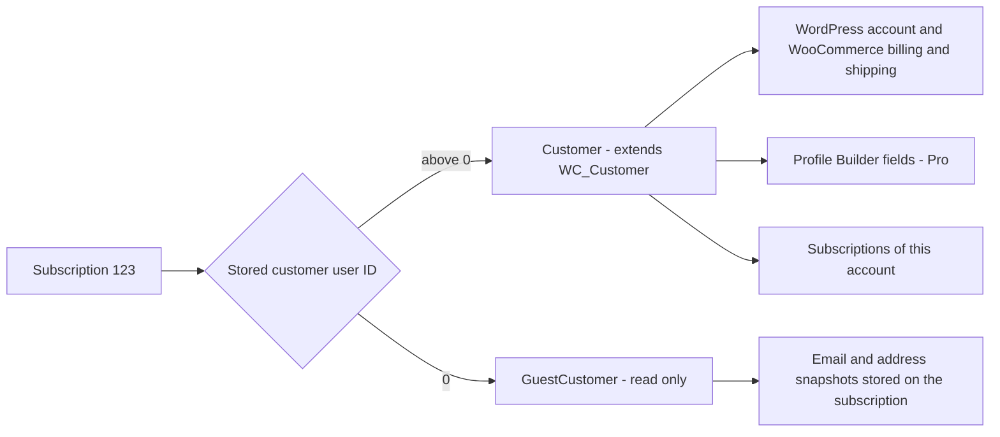

# Info
- Module: Developers
- Availability: Free (some sections require Pro)
- Last updated: 2026-10-18

# Find Members and Update Profiles

> Find the WooCommerce customer behind a subscription, email, username or Profile Builder field, read their subscriptions, and save validated account and profile changes without touching historical records.

**Availability:** Core (Free) for `ArraySubs\Api\Customer` and `ArraySubs\Api\GuestCustomer`. The profile field methods and the `profile_field` query filter require **ArraySubs Pro** with an active license, the Profile Builder module (`profile_builder`) switched on, and **Enable custom profile fields** turned on in Profile Builder.

## Page Navigation

- **Current guide:** Find Members and Update Profiles
- **Where to open it:** Your custom plugin or theme code (PHP)
- **Section overview:** [Developers](./README.md)
- **Previous guide:** [Read Lifecycle State and Manage Its Dates](./status-grace-periods-and-trials.md)
- **Next guide:** [Read Subscription Product Terms](./subscription-products.md)
- **Troubleshooting:** [Verify Your Integration](./errors-and-testing.md)

## Overview

ArraySubs gives you one customer model: `ArraySubs\Api\Customer`, a class that extends WooCommerce's `WC_Customer`. Every WooCommerce getter, setter and `save()` works unchanged. ArraySubs adds factories that find the right account, methods that read the member's subscriptions, and Pro methods that read, search and validate Profile Builder fields.

A subscription that belongs to no WordPress account (a guest or unclaimed subscription) resolves to a separate, read-only `ArraySubs\Api\GuestCustomer`. ArraySubs never invents a user ID for a guest and never merges a guest into an account just because an email matches.

This page covers every lookup, guest identities, the difference between account, billing and subscription emails, the profile field schema, searching and validating profile fields, and exactly what `save()` changes. Creating and deleting accounts stays with WordPress and WooCommerce.

## When to Use This

- A webhook, import row or support tool gives you an email, username or member number, and you need the matching account.
- Your membership plugin starts from a subscription ID and needs the member's name, address or profile data.
- You need every member whose Profile Builder field matches a value, page by page *(Pro)*.
- You need exactly one member by a custom field such as an external member code, and must refuse ambiguous matches *(Pro)*.
- You update a member's account or profile details from your own form and want the same validation Profile Builder applies *(Pro)*.
- You must decide whether an account change should also update the address stored on a subscription.

## Prerequisites

- WooCommerce and ArraySubs active. Call the API on `arraysubs_after_boot` or later (`init` or later when you filter by subscription status). See [Connect Your Custom Plugin](./getting-started.md).
- Guard every call with `class_exists( '\ArraySubs\Api\Customer' )` and handle `WP_Error` results with `is_wp_error()`.
- For profile fields: ArraySubs Pro with an active license, and fields configured in **ArraySubs -> Profile Builder -> Profile Form** (see [Profile Form](../profile-builder/profile-form.md)). Check readiness with `\ArraySubs\Api\Availability::check( 'profile_fields' )`.
- Subscription queries are explained in [Find and Update Subscriptions](./subscriptions.md).

## How It Works



1. Every subscription stores its owner's WordPress user ID plus its own email and address snapshots taken at checkout. A user ID of `0` means the subscription is a guest (unclaimed) subscription.
2. `Customer::from_subscription()` follows that stored user ID. It returns a `Customer` for an account and a `GuestCustomer` for a guest.
3. The other factories and `Customer::query()` search WordPress accounts only. Guest subscriptions are found with `Subscriptions::query()` and `customer_id` `0`.
4. Profile Builder values live in user meta named `arraysubs_pf_{key}`. Read and write them through the `Customer` methods so the field schema, privacy flags, validation and the member audit trail all apply.
5. `save()` writes the account only. Orders and subscription snapshots keep the values they were created with until you copy changes into a subscription explicitly.

### Three Different Emails

| Email | Where it lives | Read it with | What changes it |
| --- | --- | --- | --- |
| Account email | The WordPress user (login email, unique per site) | `$customer->get_email()` | The member or an admin editing the account; `set_email()` plus `save()` |
| Billing email | The WooCommerce billing address on the account (not unique) | `$customer->get_billing_email()` | The member editing their billing address; `set_billing_email()` plus `save()`. WooCommerce's own Account details form also copies a changed account email into it. |
| Subscription email | Each subscription, captured from the checkout billing email | `Subscriptions::get( 123, [ 'output' => 'data', 'fields' => [ 'customer' ] ] )`, then `customer.email` | Set at checkout. Replaced with the account email when a guest subscription joins an account. Account edits never change it. |

ArraySubs sends subscription emails to the subscription email, and uses the account email only when that snapshot is empty. Each WooCommerce order also keeps its own billing email (`$order->get_billing_email()`), which account edits never rewrite.

### Pick the Right Lookup

| You have | Use | Returns | Several possible matches? |
| --- | --- | --- | --- |
| WordPress user ID | `Customer::from_user_id()` | `Customer` | No |
| Account (login) email | `Customer::from_email()` | `Customer` | No: account emails are unique |
| Username | `Customer::from_username()` | `Customer` | No |
| Subscription ID or `WP_Post` | `Customer::from_subscription()` | `Customer` or `GuestCustomer` | No |
| Billing email | `Customer::query()` with `email_field` `billing` | Collection | Yes |
| Subscription email, including guests | `Subscriptions::query()` with `email` (and `customer_id` `0` for guests only) | Collection of subscriptions | Yes |
| Profile field value *(Pro)* | `Customer::find_by_profile_field()` | Collection | Yes |
| A profile value that must identify one member *(Pro)* | `Customer::resolve_by_profile_field()` | `Customer` | Refused with `ambiguous_match` |

## Customer Objects and WooCommerce Methods

### Inherited WooCommerce Getters, Setters and save()

```text
namespace ArraySubs\Api;

class Customer extends \WC_Customer
```

`Customer` is a real `WC_Customer`, so you can pass it to any WooCommerce function or hook that expects one. Common inherited methods:

| Purpose | Methods |
| --- | --- |
| Account | `get_id()`, `get_username()`, `get_email()`, `get_display_name()`, `get_first_name()`, `get_last_name()`, `get_role()`, `get_date_created()` |
| Billing | `get_billing()` (array), `get_billing_email()`, `get_billing_phone()`, `get_billing_first_name()`, `get_billing_address_1()`, ... |
| Shipping | `get_shipping()` (array), `get_shipping_first_name()`, `get_shipping_address_1()`, ... |
| Setters | `set_email()`, `set_first_name()`, `set_last_name()`, `set_display_name()`, `set_billing_email()`, `set_billing_phone()`, `set_billing_address_1()`, `set_shipping_address_1()`, ... |
| Persist | `save()` (see [save()](#save)) |

- **Setters only stage changes.** Nothing is written until `save()`.
- **Invalid emails throw.** `set_email()` and `set_billing_email()` throw `WC_Data_Exception` (codes `customer_invalid_email` and `customer_invalid_billing_email`). Wrap them in `try` / `catch`.
- **Use the factories.** Do not build `new \ArraySubs\Api\Customer( ... )` yourself. WooCommerce silently turns an unknown user ID into ID `0`, and saving a customer object with ID `0` creates a new account. The factories return `not_found` instead.
- **Profile fields have their own methods.** Do not write `arraysubs_pf_*` keys with `update_meta_data()`; use `set_profile_field()` so the schema and validation apply.
- **Some WooCommerce getters write cache data.** `get_order_count()`, `get_total_spent()` and `get_last_order()` can store WooCommerce's cached totals in user meta. Keep them out of code that must be strictly read only.

## Find a Customer

Every factory is static, takes no extra arguments and is read only: no writes. They are trusted server calls: they do not check who is logged in. Check capabilities and nonces at your own boundary (REST route, AJAX handler or form), and for a member acting on their own data, load `Customer::from_user_id( get_current_user_id() )`. Never take a user ID, email or field value from the request and treat it as proof of identity.

### Customer::from_user_id()

```text
Customer::from_user_id( int $user_id ): Customer|WP_Error
```

| Parameter | Type | Default | Notes |
| --- | --- | --- | --- |
| `$user_id` | int | required | WordPress user ID. Must be above 0. |

Returns the `Customer` for that account. Failures: `not_found` (no such user), `invalid_argument` (0 or a negative ID).

```php
<?php
if ( class_exists( '\ArraySubs\Api\Customer' ) ) {
    $customer = \ArraySubs\Api\Customer::from_user_id( 45 );

    if ( ! is_wp_error( $customer ) ) {
        echo esc_html( $customer->get_display_name() );
    }
}
```

### Customer::from_email()

```text
Customer::from_email( string $email ): Customer|WP_Error
```

| Parameter | Type | Default | Notes |
| --- | --- | --- | --- |
| `$email` | string | required | Matched against the WordPress account email, case-insensitive. |

Returns the account whose login email matches. WordPress keeps account emails unique, so this lookup finds one account or none. Billing and subscription emails are not searched here; they can be shared, so use `Customer::query()` with `email_field` `billing` or `any`, or `Subscriptions::query()` with `email`.

Failures: `not_found` (no account uses that email), `invalid_argument` (not a valid email). If imported data ever left two accounts with the same email, the call returns `ambiguous_match` (candidate IDs in `details`) instead of picking one.

### Customer::from_username()

```text
Customer::from_username( string $login ): Customer|WP_Error
```

| Parameter | Type | Default | Notes |
| --- | --- | --- | --- |
| `$login` | string | required | The WordPress username (`user_login`), exact match. |

Returns the matching `Customer`, or `not_found`.

### Customer::from_subscription()

```text
Customer::from_subscription( int|WP_Post $subscription ): Customer|GuestCustomer|WP_Error
```

| Parameter | Type | Default | Notes |
| --- | --- | --- | --- |
| `$subscription` | int or `WP_Post` | required | A subscription ID or the `WP_Post` from `arraysubs_get_subscription()`. |

Returns:

- `Customer` when the subscription's stored customer user ID points at an existing account.
- `GuestCustomer` when the stored user ID is `0` (a guest or unclaimed subscription).

Failures: `not_found` when the subscription does not exist, or when its stored user ID points at an account that has since been deleted. The subscription keeps its email and address snapshots; read them with `Subscriptions::get( $id, [ 'output' => 'data', 'fields' => [ 'customer' ] ] )`.

Box and bundle child subscriptions carry their parent's customer, so they resolve to the same member.

### Customer::query()

```text
Customer::query( array $args = [] ): array|WP_Error
```

Searches registered accounts and returns the standard collection shape. Guests are never included because they have no account.

| Filter | Type | Default | Matches |
| --- | --- | --- | --- |
| `email` | string | none | Customers whose email equals this value (case-insensitive exact match). |
| `email_field` | string | `account` | Which email `email` checks: `account` (login email), `billing` (WooCommerce billing email, can return several accounts) or `any` (either). |
| `username` | string | none | Exact username. |
| `profile_field` *(Pro)* | array | none | `[ 'key' => 'company_size', 'value' => '50', 'compare' => '=' ]`. Same keys and operators as [find_by_profile_field()](#customerfindbyprofilefield-pro). Without Pro this filter returns `module_unavailable`. |
| `has_subscription_status` | string or string[] | none | Customers with at least one subscription in one of these statuses: `pending`, `trial`, `active`, `paused`, `on-hold`, `cancelled`, `expired`, or the shortcuts `live` and `any`. |
| `product_id` | int or int[] | none | Customers holding a subscription to this parent product or variation. With `has_subscription_status`, the same subscription must match both; on its own, `live` statuses count. |

Shared collection arguments:

| Argument | Type | Default | Notes |
| --- | --- | --- | --- |
| `per_page` | int | 20 | Maximum 100. A larger value returns `invalid_argument`. |
| `cursor` | string | none | The `next_cursor` from the previous page. |
| `order` | string | `asc` | `asc` or `desc`, by user ID. |
| `include_total` | bool | false | Adds an exact `total`. Slower on large stores. |
| `output` | string | `object` | `object` (`Customer` objects), `ids` (user IDs) or `data` (arrays, see [Customer Data Fields](#customer-data-fields)). |
| `fields` | string[] | all you may see | Data groups for `output` `data`. |

Filters combine with AND. List values inside one filter combine with OR. Returns:

```text
[
  'items'       => [ 45, 46 ],      // per output mode
  'per_page'    => 20,
  'next_cursor' => null,            // opaque string while more pages exist
  'has_more'    => false,
  'total'       => null,            // int only with 'include_total' => true
]
```

An empty `items` array is a normal result, not an error. Failures: `invalid_argument` (unknown filter, bad value, `per_page` above 100, unknown `fields` group), `module_unavailable` (the `profile_field` filter without a ready Profile Builder). Read only: no writes.

These lookups search every account. Run them only from trusted code or behind a staff capability check such as `current_user_can( 'manage_woocommerce' )`.

```php
<?php
if ( class_exists( '\ArraySubs\Api\Customer' ) ) {
    $matches = \ArraySubs\Api\Customer::query( [
        'email'       => 'billing@example.com',
        'email_field' => 'billing',
        'output'      => 'ids',
    ] );

    if ( is_wp_error( $matches ) ) {
        error_log( 'Customer query failed: ' . $matches->get_error_code() );
    } elseif ( count( $matches['items'] ) > 1 ) {
        // Several accounts share this billing email. Do not pick one automatically.
    }
}
```

### Customer::each()

```text
Customer::each( array $args = [] ): Generator
```

Walks every page of a `query()` with the same arguments (`cursor` is ignored) and yields one item at a time. Use it for exports and batch jobs instead of building one very large page.

```php
<?php
if ( class_exists( '\ArraySubs\Api\Customer' ) ) {
    $args = [ 'has_subscription_status' => 'on-hold', 'output' => 'ids', 'per_page' => 100 ];

    foreach ( \ArraySubs\Api\Customer::each( $args ) as $user_id ) {
        // Queue a reminder for each member with an on-hold subscription.
        do_action( 'myplugin_queue_reminder', (int) $user_id );
    }
}
```

### Customer Data Fields

With `output` `data`, each item is an array. `id` is always present. Request groups with `fields`; by default you get every group you are allowed to see.

| Group | Contents |
| --- | --- |
| `identity` | `username`, `email` (account email), `display_name`, `first_name`, `last_name`, `registered_at` (ISO 8601 UTC), `is_guest` (false) |
| `billing` | WooCommerce billing fields: `first_name`, `last_name`, `company`, `address_1`, `address_2`, `city`, `state`, `postcode`, `country`, `email`, `phone` |
| `shipping` | WooCommerce shipping fields: the same keys without `email` (`phone` included) |
| `profile_fields` *(Pro)* | Profile Builder values keyed by field key. Left out when Profile Builder fields are not available; requesting it explicitly then returns `module_unavailable`. |

```text
[
  'id'             => 45,
  'identity'       => [ 'username' => 'jane-doe', 'email' => 'member@example.com', 'display_name' => 'Jane Doe', 'first_name' => 'Jane', 'last_name' => 'Doe', 'registered_at' => '2026-03-02T10:15:00+00:00', 'is_guest' => false ],
  'billing'        => [ 'first_name' => 'Jane', 'last_name' => 'Doe', 'company' => '', 'address_1' => '1 Example Street', 'address_2' => '', 'city' => 'Springfield', 'state' => 'CA', 'postcode' => '90001', 'country' => 'US', 'email' => 'billing@example.com', 'phone' => '' ],
  'shipping'       => [ 'first_name' => 'Jane', 'last_name' => 'Doe', 'company' => '', 'address_1' => '1 Example Street', 'address_2' => '', 'city' => 'Springfield', 'state' => 'CA', 'postcode' => '90001', 'country' => 'US', 'phone' => '' ],
  'profile_fields' => [ 'company_name' => 'Example Co', 'company_size' => '50' ],
]
```

The data arrays never contain passwords, session data, payment tokens, profile upload locations or other raw user meta.

## Guest and Unclaimed Identities

### GuestCustomer

```text
namespace ArraySubs\Api;

class GuestCustomer
    is_guest(): bool              // always true
    get_email(): string
    get_first_name(): string
    get_last_name(): string
    get_billing(): array
    get_shipping(): array
    get_subscription_ids(): int[]
```

`GuestCustomer` is a read-only value object that `Customer::from_subscription()` returns for a subscription without an account. It is not a `WC_Customer`: it has no user ID, no setters, no profile fields and no `save()`.

- `get_email()` returns the subscription email. The names, `get_billing()` and `get_shipping()` come from the subscription's billing and shipping snapshots (arrays of WooCommerce address fields; empty when none were stored).
- `get_subscription_ids()` returns the guest subscriptions (no account) that share this subscription email, in every status, by ascending ID. Subscriptions owned by registered accounts are never included, even when their email matches. When the subscription has no email, the result contains only that subscription.
- For paging or status filters, query the subscriptions directly:

```php
<?php
if ( class_exists( '\ArraySubs\Api\Subscriptions' ) ) {
    $guest_subscriptions = \ArraySubs\Api\Subscriptions::query( [
        'customer_id' => 0,                    // guests only
        'email'       => 'member@example.com', // subscription email, case-insensitive
        'status'      => 'any',
        'output'      => 'ids',
    ] );
}
```

Check `is_guest()` (or `instanceof \ArraySubs\Api\Customer`) before calling `Customer`-only methods. Both classes answer `is_guest()`.

### When a Guest Subscription Joins an Account

Storefront subscription checkout always creates an account, so guest subscriptions come from orders built outside the storefront, such as admin-created orders, imports or integrations.

ArraySubs links guest subscriptions to an account automatically:

- When an account is created whose email equals the subscription email (every status, cancelled and expired included).
- When WooCommerce links a new account's past guest orders, for the subscriptions of those orders.

On a link, the subscription takes the account's user ID and its subscription email becomes the account email. The existing action `arraysubs_subscription_customer_identity_changed` fires with `( WP_Post $subscription, array $previous, array $current, string $source )`, where `$previous` and `$current` hold `customer_id` and `customer_email`, and `$source` is `customer_account_created`, `past_order_claim` or `checkout_customer_sync`. Use it to grant your own benefits to the new owner. See [React to Supported Events](./actions-and-filters.md).

An email match alone is not proof of identity. Do not merge accounts, move subscriptions or grant access in your own code just because two records share an email.

## Read a Customer's Subscriptions

These instance methods exist on `Customer`. They are read only: no writes.

### is_guest()

```text
$customer->is_guest(): bool
```

Always `false` for `Customer` and always `true` for `GuestCustomer`.

### get_subscriptions() and get_subscription_ids()

```text
$customer->get_subscriptions( array $args = [] ): array|WP_Error
$customer->get_subscription_ids( array $args = [] ): int[]
```

`get_subscriptions()` returns a subscription collection and accepts the same arguments as `Subscriptions::query()` (statuses, products, relation, dates, `output`, `fields`, paging), except `customer_id`, which is always this customer. The status default is `live` (`pending`, `trial`, `active`, `paused`, `on-hold`); pass `'status' => 'any'` for full history. Pass `as_user` with the member's own ID when the result goes back to that member, so you receive customer-safe data.

`get_subscription_ids()` returns plain IDs for one page only (at most `per_page`, default 20, maximum 100) and no paging details. Use `get_subscriptions()` when you need more pages or error details.

```php
<?php
if ( class_exists( '\ArraySubs\Api\Customer' ) ) {
    $customer = \ArraySubs\Api\Customer::from_user_id( 45 );

    if ( ! is_wp_error( $customer ) ) {
        $history = $customer->get_subscriptions( [ 'status' => 'any', 'output' => 'ids', 'per_page' => 50 ] );

        if ( ! is_wp_error( $history ) ) {
            echo esc_html( sprintf( '%d subscriptions on this page', count( $history['items'] ) ) );
        }
    }
}
```

### has_active_subscription()

```text
$customer->has_active_subscription( array $product_ids = [] ): bool
```

| Parameter | Type | Default | Notes |
| --- | --- | --- | --- |
| `$product_ids` | int[] | `[]` (any product) | Parent product or variation IDs. A subscription matches when its parent product or its variation is in the list. |

Returns `true` when the customer has a subscription in `active` or `trial` status (for the given products, when supplied). Paused, on-hold, pending, cancelled and expired subscriptions do not count. For content-access decisions that follow your Member Access rules, use [Check Content Access](./member-access.md) instead.

## Profile Fields *(Pro)*

Profile Builder fields are defined in **ArraySubs -> Profile Builder -> Profile Form** and stored per user in user meta `arraysubs_pf_{key}` (for example `arraysubs_pf_company_name`). The methods below return `module_unavailable` when Profile Builder fields are not available. The error data `reason` tells you why: `pro_missing`, `license_inactive`, `module_disabled` or `setting_disabled` (**Enable custom profile fields** is off). Stored values are kept in every case.

A field is registered when it is defined and enabled. Disabled, deleted or renamed fields keep their stored values, but the API treats their keys as unregistered (`not_found`).

### Customer::get_profile_field_schema() *(Pro)*

```text
Customer::get_profile_field_schema( array $args = [] ): array|WP_Error
```

| Argument | Type | Default | Notes |
| --- | --- | --- | --- |
| `as_user` | int | none | When set, private fields are left out, so the schema matches what that member can see. |

Returns a list of registered fields in display order:

| Key | Meaning |
| --- | --- |
| `key` | Field key, such as `company_size`. |
| `label` | Field label. |
| `type` | `text`, `textarea`, `select`, `date`, `checkbox` or `upload` (file). |
| `required` | Whether a value is required. |
| `editable` | Whether the member can change the value on My Account. |
| `private` | Admin-only field: members never see it, and customer-context reads leave it out. |
| `options` | For `select` fields, a list of `[ 'value' => ..., 'label' => ... ]`. Empty for other types. |
| `storage_key` | The user meta key that holds the value, `arraysubs_pf_{key}`. For reference (exports, data audits); read and write values through the API. |

```text
[
  [ 'key' => 'company_size', 'label' => 'Company size', 'type' => 'select', 'required' => true, 'editable' => true, 'private' => false,
    'options' => [ [ 'value' => '10', 'label' => 'Up to 10' ], [ 'value' => '50', 'label' => 'Up to 50' ], [ 'value' => '200', 'label' => 'Up to 200' ] ],
    'storage_key' => 'arraysubs_pf_company_size' ],
  [ 'key' => 'account_notes', 'label' => 'Account notes', 'type' => 'textarea', 'required' => false, 'editable' => false, 'private' => true,
    'options' => [], 'storage_key' => 'arraysubs_pf_account_notes' ],
]
```

The schema is a server and admin configuration contract. Use `type` to choose an input control in your own server code, but do not print field types into customer-facing HTML classes, data attributes or REST responses. Read only: no writes.

### Profile Field Values *(Pro)*

| Type | Value you read | Value you set | Search operators |
| --- | --- | --- | --- |
| `text` | string | string (HTML is stripped, as on the profile form) | `=`, `!=`, `LIKE` |
| `textarea` | string, line breaks kept | string | `=`, `!=`, `LIKE` |
| `date` | `YYYY-MM-DD` calendar date (no time, no timezone) | `YYYY-MM-DD` string | `=`, `!=`, `>`, `>=`, `<`, `<=`, `BETWEEN` (array of two dates) |
| `select` | the option `value` (never the label) | one configured option `value` | `=`, `!=`, `IN` (array of option values) |
| `checkbox` | bool | bool | `=` with `true` or `false` |
| `upload` (file) | the stored file name reference; never a server path or download link | not writable through the API; members upload through the profile form (`invalid_argument`) | Not searchable |

Every searchable type also accepts `EXISTS` (the member has a non-empty value) and `NOT EXISTS` (no value). A field the member has never saved reads as `null`; for checkboxes, `false` in a search means unchecked or never saved. Text matching follows your database collation, which is case-insensitive on a default WordPress install.

### get_profile_fields() and get_profile_field() *(Pro)*

```text
$customer->get_profile_fields( array $args = [] ): array|WP_Error
$customer->get_profile_field( string $key ): mixed|WP_Error
```

| Argument | Type | Default | Notes |
| --- | --- | --- | --- |
| `context` | string | `admin` | `admin` returns every registered field. `customer` leaves out private fields. |
| `as_user` | int | none | Must equal this customer's user ID, otherwise `forbidden`. Implies `customer` context. |

`get_profile_fields()` returns `key => value` for every registered field, using the formats above. `get_profile_field()` returns one value (or `null`), including private fields, so treat it as an admin or server read and check the schema's `private` flag before you show the value to a member.

Failures: `not_found` (unregistered key), `forbidden` (`as_user` mismatch), `module_unavailable`. Read only: no writes.

```php
<?php
if ( class_exists( '\ArraySubs\Api\Customer' ) && is_user_logged_in() ) {
    $member = \ArraySubs\Api\Customer::from_user_id( get_current_user_id() );

    if ( ! is_wp_error( $member ) ) {
        $fields = $member->get_profile_fields( [ 'as_user' => get_current_user_id() ] ); // No private fields.

        if ( ! is_wp_error( $fields ) && isset( $fields['company_name'] ) ) {
            echo esc_html( (string) $fields['company_name'] );
        }
    }
}
```

### Customer::find_by_profile_field() *(Pro)*

```text
Customer::find_by_profile_field( string $key, mixed $value, array $args = [] ): array|WP_Error
```

| Parameter or argument | Type | Default | Notes |
| --- | --- | --- | --- |
| `$key` | string | required | A registered field key (exact key, not the label). |
| `$value` | mixed | required | The value to compare. An array for `IN` and `BETWEEN`; a bool for checkboxes; ignored for `EXISTS` and `NOT EXISTS` (pass `null`). |
| `compare` | string | `=` | An operator allowed for the field type (see [Profile Field Values](#profile-field-values-pro)). |
| `per_page`, `cursor`, `order`, `include_total` | | | Shared collection arguments (default 20 per page, maximum 100, ordered by user ID). |
| `output`, `fields` | | `object` | `object`, `ids` or `data`, as for `query()`. |

Returns the standard collection. Profile values are not unique, so expect several matches and page through them. Failures:

| Code | When |
| --- | --- |
| `not_found` | The key is not a registered field. |
| `invalid_argument` | The operator does not fit the field type, the value has the wrong shape (for example `IN` without an array), the field is an `upload` field, or `per_page` is above 100. |
| `module_unavailable` | Profile Builder fields are not available (see `reason`). |

Read only: no writes. The search covers every account, so keep it behind a staff capability check.

```php
<?php
if ( class_exists( '\ArraySubs\Api\Customer' ) ) {
    $larger_teams = \ArraySubs\Api\Customer::find_by_profile_field(
        'company_size',
        [ '50', '200' ],
        [ 'compare' => 'IN', 'output' => 'ids', 'per_page' => 50 ]
    );

    $october_starts = \ArraySubs\Api\Customer::find_by_profile_field(
        'onboarding_date',
        [ '2026-10-01', '2026-10-31' ],
        [ 'compare' => 'BETWEEN', 'output' => 'ids' ]
    );
}
```

### Customer::resolve_by_profile_field() *(Pro)*

```text
Customer::resolve_by_profile_field( string $key, mixed $value ): Customer|WP_Error
```

Use it when a field value must identify exactly one member, such as an external `member_code`. It compares with `=` and returns the single matching `Customer`.

| Code | When |
| --- | --- |
| `not_found` | No member has that value, or the key is not a registered field. |
| `ambiguous_match` | Two or more members share the value. `get_error_data()['details']` lists up to 10 candidate user IDs. ArraySubs never picks the first match. |
| `invalid_argument` | The field is an `upload` field or the value has the wrong type. |
| `module_unavailable` | Profile Builder fields are not available. |

Profile values are typed by members, so they are not guaranteed unique. Use a field members cannot edit (`editable` false) for identifiers, and never use a profile value as a password or sign-in token.

### set_profile_field() *(Pro)*

```text
$customer->set_profile_field( string $key, mixed $value ): true|WP_Error
```

Validates the value immediately against the field's schema and stages it. Nothing is written until you call `save()`.

| Check | Result on failure |
| --- | --- |
| The key is a registered field | `not_found` |
| The value matches the type (string, `YYYY-MM-DD` date, configured select value, bool for checkboxes) | `validation_failed` |
| A required field is not set to an empty value | `validation_failed` |
| The field is not a file (upload) field; file fields are set only through the profile form | `invalid_argument` |
| Profile Builder fields are available | `module_unavailable` |

`validation_failed` data includes `details`, an array of field errors keyed by field key. This method is a trusted server write: it can update fields the member cannot edit themself, such as an admin-managed tier. When the value comes from a member, check `editable` and `private` in the schema first, as in the [validated update example](#update-a-profile-field-from-your-own-form-pro).

### Editable, Private and File Fields *(Pro)*

- **Editable:** `editable` false means the member cannot change the value on My Account. Your trusted code still can, so refuse non-editable fields yourself when you accept member input.
- **Private:** `private` true marks an admin-only field. Members never see it on My Account, and `customer` context or `as_user` reads leave it out. Never print private values into member pages, emails or responses you build.
- **File fields:** `upload` values are member documents, such as ID or certificate uploads.
  - They are not searchable.
  - API reads return the stored file reference only: never the server path, the private upload folder or a download link.
  - File fields are read only through the API: `set_profile_field()` returns `invalid_argument` for an upload field. Members upload files through the profile form; the API never imports files from disk, a URL or the Media Library.
  - To replace or remove a file, the member uses **My Account -> Account details**, or an admin uses the user's profile screen.
  - Do not copy file links or contents into public pages, emails or logs.

## Save Changes and What They Affect

### save()

```text
$customer->save(): int
```

Runs the WooCommerce customer save, then writes any staged profile fields. Returns the user ID.

What it writes:

- The WordPress account (email and display name) and changed account meta.
- Changed WooCommerce billing and shipping fields.
- Profile fields staged with `set_profile_field()`.

Side effects:

- WordPress fires `profile_update` and WooCommerce fires `woocommerce_update_customer` with `( int $customer_id, WC_Customer $customer )`.
- When the account email changes, WordPress sends its standard email-change notice to the old address (filter `send_email_change_email`).
- With ArraySubs Pro active and licensed, the member audit trail records changed account, billing, shipping and profile values as private member notes, including the old and new values.

What it never changes:

- Past WooCommerce orders and their billing or shipping emails and addresses.
- The subscription email, billing snapshot and shipping snapshot stored on each subscription.
- Renewal orders that already exist.

Two more rules:

- WooCommerce does not report a duplicate account email during `save()`: WordPress refuses the change silently. Check `email_exists()` before calling `set_email()`.
- `GuestCustomer` has no `save()`. Guests have no account to update.

### Copy Account Changes into a Subscription

Renewal orders copy the subscription's own billing and shipping snapshots, not the account. When the next renewal must use the member's new address, copy it into each subscription with `Subscriptions::update()`:

```php
<?php
if ( class_exists( '\ArraySubs\Api\Subscriptions' ) && class_exists( '\ArraySubs\Api\Customer' ) ) {
    $customer = \ArraySubs\Api\Customer::from_user_id( 45 );

    if ( ! is_wp_error( $customer ) ) {
        $result = \ArraySubs\Api\Subscriptions::update(
            123,
            [ 'billing_address' => $customer->get_billing() ],
            [ 'reason' => 'Copy the billing address the member saved on their account' ]
        );

        if ( is_wp_error( $result ) ) {
            error_log( 'Address copy failed: ' . $result->get_error_code() );
        }
    }
}
```

Use `shipping_address` with `$customer->get_shipping()` the same way. Each update writes a subscription note with your `reason`. See [Find and Update Subscriptions](./subscriptions.md) for the full update contract.

## Accounts Are Created and Deleted Elsewhere

The customer API does not create or delete accounts.

- **Create** accounts with WooCommerce (`wc_create_new_customer()`) or WordPress (`wp_insert_user()`). A new account whose email matches guest subscriptions takes them over, as described in [When a Guest Subscription Joins an Account](#when-a-guest-subscription-joins-an-account).
- **Delete** accounts with `wp_delete_user()`. WordPress removes the user's meta, including profile field values, but the member's subscriptions stay. They keep the old user ID, so `Customer::from_subscription()` returns `not_found` for them while their snapshots remain readable.
- **Subscription deletion is separate.** `Subscriptions::delete()` permanently removes subscription records and never deletes the customer or their orders. Cancellation is the non-destructive alternative. See [Find and Update Subscriptions](./subscriptions.md).

## Examples

### Show the Member Behind a Subscription

A minimal working example for an admin screen or server task.

```php
<?php
function myplugin_subscription_owner_label( int $subscription_id ): string {
    if ( ! class_exists( '\ArraySubs\Api\Customer' ) ) {
        return '';
    }

    $owner = \ArraySubs\Api\Customer::from_subscription( $subscription_id );

    if ( is_wp_error( $owner ) ) {
        return ''; // not_found: missing subscription or deleted account.
    }

    if ( $owner->is_guest() ) {
        return sprintf( 'Guest: %s', $owner->get_email() );
    }

    return sprintf( '%s (user %d)', $owner->get_display_name(), $owner->get_id() );
}

echo esc_html( myplugin_subscription_owner_label( 123 ) );
```

### Change an Account Email Safely

A failure-handling example. Run it only after your own capability and nonce checks.

```php
<?php
/**
 * @return true|WP_Error
 */
function myplugin_change_account_email( int $user_id, string $new_email ) {
    if ( ! class_exists( '\ArraySubs\Api\Customer' ) ) {
        return new WP_Error( 'myplugin_unavailable', 'ArraySubs is not available.' );
    }

    $customer = \ArraySubs\Api\Customer::from_user_id( $user_id );
    if ( is_wp_error( $customer ) ) {
        return $customer; // not_found or invalid_argument.
    }

    $new_email = sanitize_email( $new_email );
    $owner_id  = email_exists( $new_email );
    if ( $owner_id && (int) $owner_id !== $customer->get_id() ) {
        return new WP_Error( 'myplugin_email_taken', 'Another account already uses this email.' );
    }

    try {
        $customer->set_email( $new_email );         // Login email.
        $customer->set_billing_email( $new_email ); // Optional: keep billing in step.
    } catch ( WC_Data_Exception $e ) {
        return new WP_Error( 'myplugin_invalid_email', $e->getMessage() );
    }

    $customer->save(); // Account only. Orders and subscription snapshots keep their emails.

    return true;
}

$result = myplugin_change_account_email( 45, 'member@example.com' );
if ( is_wp_error( $result ) ) {
    echo esc_html( $result->get_error_message() );
}
```

### Page Through a Profile Field Search *(Pro)*

```php
<?php
function myplugin_member_ids_by_company_size( string $size ): array {
    if ( ! class_exists( '\ArraySubs\Api\Customer' ) || ! class_exists( '\ArraySubs\Api\Availability' ) ) {
        return [];
    }

    if ( is_wp_error( \ArraySubs\Api\Availability::check( 'profile_fields' ) ) ) {
        return []; // Pro missing, license inactive, module or setting off.
    }

    $user_ids = [];
    $cursor   = null;

    do {
        $args = [ 'compare' => '=', 'output' => 'ids', 'per_page' => 100 ];
        if ( null !== $cursor ) {
            $args['cursor'] = $cursor;
        }

        $page = \ArraySubs\Api\Customer::find_by_profile_field( 'company_size', $size, $args );
        if ( is_wp_error( $page ) ) {
            error_log( 'Profile search failed: ' . $page->get_error_code() );
            break;
        }

        $user_ids = array_merge( $user_ids, array_map( 'intval', $page['items'] ) );
        $cursor   = $page['next_cursor'];
    } while ( ! empty( $page['has_more'] ) );

    return $user_ids;
}
```

### Resolve One Member by a Unique Code *(Pro)*

```php
<?php
function myplugin_member_by_code( string $code ) {
    if ( ! class_exists( '\ArraySubs\Api\Customer' ) ) {
        return null;
    }

    $member = \ArraySubs\Api\Customer::resolve_by_profile_field( 'member_code', sanitize_text_field( $code ) );

    if ( is_wp_error( $member ) ) {
        if ( 'ambiguous_match' === $member->get_error_code() ) {
            $data       = (array) $member->get_error_data();
            $candidates = array_map( 'absint', (array) ( $data['details'] ?? [] ) );
            error_log( 'Member code shared by users: ' . implode( ', ', $candidates ) );
        }

        return null; // not_found, ambiguous_match, invalid_argument or module_unavailable.
    }

    return $member;
}
```

### Update a Profile Field from Your Own Form *(Pro)*

The member edits their own value. The handler checks the nonce, loads only the logged-in member, refuses fields that are private or not editable, and lets the API validate the value.

```php
<?php
add_action( 'admin_post_myplugin_save_company', function () {
    if ( ! is_user_logged_in() || ! check_admin_referer( 'myplugin_save_company' ) ) {
        wp_die( esc_html__( 'You are not allowed to do this.', 'myplugin' ) );
    }

    if ( ! class_exists( '\ArraySubs\Api\Customer' ) ) {
        wp_die( esc_html__( 'Member profiles are unavailable.', 'myplugin' ) );
    }

    $user_id  = get_current_user_id(); // Never read a user ID from the request.
    $customer = \ArraySubs\Api\Customer::from_user_id( $user_id );
    $schema   = \ArraySubs\Api\Customer::get_profile_field_schema( [ 'as_user' => $user_id ] );

    if ( is_wp_error( $customer ) || is_wp_error( $schema ) ) {
        wp_die( esc_html__( 'Your profile cannot be updated right now.', 'myplugin' ) );
    }

    $key     = 'company_name';
    $allowed = false;
    foreach ( $schema as $field ) {
        if ( $key === $field['key'] && ! empty( $field['editable'] ) && empty( $field['private'] ) ) {
            $allowed = true;
        }
    }

    if ( ! $allowed ) {
        wp_die( esc_html__( 'This field cannot be changed here.', 'myplugin' ) );
    }

    $value  = isset( $_POST['company_name'] ) ? sanitize_text_field( wp_unslash( $_POST['company_name'] ) ) : '';
    $staged = $customer->set_profile_field( $key, $value );

    if ( is_wp_error( $staged ) ) {
        wp_die( esc_html( $staged->get_error_message() ) ); // validation_failed details are in get_error_data().
    }

    $customer->save();

    wp_safe_redirect( wc_get_account_endpoint_url( 'edit-account' ) );
    exit;
} );
```

### Copy a New Billing Address into Every Live Subscription

```php
<?php
function myplugin_sync_billing_to_subscriptions( int $user_id ): array {
    $updated = [];

    if ( ! class_exists( '\ArraySubs\Api\Customer' ) || ! class_exists( '\ArraySubs\Api\Subscriptions' ) ) {
        return $updated;
    }

    $customer = \ArraySubs\Api\Customer::from_user_id( $user_id );
    if ( is_wp_error( $customer ) ) {
        return $updated;
    }

    $billing = $customer->get_billing();
    $args    = [ 'customer_id' => $customer->get_id(), 'status' => 'live', 'output' => 'ids', 'per_page' => 100 ];

    foreach ( \ArraySubs\Api\Subscriptions::each( $args ) as $subscription_id ) {
        $result = \ArraySubs\Api\Subscriptions::update(
            (int) $subscription_id,
            [ 'billing_address' => $billing ],
            [ 'reason' => 'Member updated their billing address' ]
        );

        if ( is_wp_error( $result ) ) {
            error_log( sprintf( 'Subscription %d kept its address: %s', (int) $subscription_id, $result->get_error_code() ) );
            continue;
        }

        $updated[] = (int) $subscription_id;
    }

    return $updated;
}
```

## Edge Cases and Important Notes

- **Guests are not accounts.** `Customer::query()`, `from_email()` and the profile methods never return guests. Find guest subscriptions with `Subscriptions::query()` and `customer_id` `0`.
- **Billing emails repeat.** Two accounts can share a billing email, and a subscription email can belong to a different account than the one using that billing email. Only the account email is unique.
- **Account changes do not propagate.** `save()` never rewrites orders or subscription snapshots, and ArraySubs keeps sending subscription emails to the subscription email. Copy addresses into subscriptions explicitly when you need them there.
- **Deleted accounts leave subscriptions behind.** Their subscriptions keep the old user ID, and `from_subscription()` returns `not_found`.
- **Renamed or disabled profile fields.** Values stay under the old key, but the API treats the key as unregistered. Use the current key from `get_profile_field_schema()`.
- **Exact keys.** Pass the configured key (`company_name`), not the label (`Company Name`).
- **Date fields are calendar dates.** `YYYY-MM-DD` values have no time or timezone; do not convert them to UTC.
- **Two different active checks.** `has_active_subscription()` counts `active` and `trial` and matches variations too. The older helper `arraysubs_user_has_active_subscription( int $user_id, ?int $product_id = null )` follows the Member Access status policy (which can include paused subscriptions) and matches parent product IDs only.
- **Audit notes contain personal data.** Profile and address audit notes store old and new values. Treat them like the member data they describe.
- **Raw WooCommerce REST writes skip Profile Builder.** Writing `arraysubs_pf_*` keys through WooCommerce REST `meta_data` bypasses the schema, validation and privacy rules. Use `set_profile_field()` and `save()`.

## Troubleshooting

| Problem | Likely Cause | What to Do |
| --- | --- | --- |
| `from_email()` returns `not_found` although the email is on an order | The email is a billing, order or subscription email, not the account email | Use `Customer::query()` with `email_field` `billing` or `any`; for guests use `Subscriptions::query()` with `customer_id` `0` and `email` |
| Profile methods return `module_unavailable` | Pro missing, license inactive, module switched off, or **Enable custom profile fields** off | Read `Availability::get( 'profile_fields' )` and check its `reason` |
| A profile key returns `not_found` | The field is disabled, deleted, renamed, or you passed the label | Compare with the keys from `get_profile_field_schema()` |
| `find_by_profile_field()` returns `invalid_argument` | The operator does not fit the type, `IN` or `BETWEEN` got a non-array, the field is a file field, or `per_page` is above 100 | Check the operator table and the field type in the schema |
| `resolve_by_profile_field()` returns `ambiguous_match` | Several members typed the same value | Use `find_by_profile_field()` and decide in your own workflow; use a non-editable field for identifiers |
| `set_profile_field()` returns `validation_failed` | Wrong type, a select value that is not configured, an empty required field, or a file value not uploaded through the profile form | Read `get_error_data()['details']` and fix the value |
| The account email did not change after `save()` | Another account already uses that email | Check `email_exists()` before `set_email()` |
| A setter throws `WC_Data_Exception` | Invalid email passed to `set_email()` or `set_billing_email()` | Validate with `is_email()` and wrap setters in `try` / `catch` |
| A renewal order shows the old address | Renewals copy the subscription's address snapshot | Copy the new address with `Subscriptions::update()` |
| `from_subscription()` returns `not_found` for an existing subscription | The owning account was deleted | Read the stored snapshot with `Subscriptions::get()` and the `customer` group |

## Related Guides

- [Find and Update Subscriptions](./subscriptions.md) - subscription queries, the `customer` data group and `Subscriptions::update()`.
- [Work with Subscription Families and Orders](./subscription-relationships-and-orders.md) - parent and child subscriptions and their orders.
- [Read Lifecycle State and Manage Its Dates](./status-grace-periods-and-trials.md) - the authoritative status of each subscription.
- [Check Content Access](./member-access.md) - access decisions for a member or a subscription.
- [React to Supported Events](./actions-and-filters.md) - hooks, including the identity-change action.
- [Verify Your Integration](./errors-and-testing.md) - error codes, permissions and testing.
- [Profile Form](../profile-builder/profile-form.md) - configuring Profile Builder fields.
- [Member Lookup and Profiles](../member-insight/member-lookup-and-profiles.md) - the admin member screens.

## FAQ

### Does Customer replace WooCommerce's own customer object?

No. WooCommerce keeps using its own `WC_Customer` everywhere, including the session customer. `Customer` is an extension you load with the factories. Because it extends `WC_Customer`, you can pass it to any code that expects one.

### Can I find guest customers by profile field?

No. Guests have no account, so they have no profile fields. Find guest subscriptions by subscription email with `Subscriptions::query()` and `customer_id` `0`.

### Will changing a member's email or address update their subscriptions?

No. `save()` updates the account only. Copy addresses into subscriptions with `Subscriptions::update()`. Past orders are never rewritten.

### Why does from_email() ignore billing emails?

Only the account email is unique. Billing and subscription emails can be shared, so they are searched with collection methods that can return several matches.

### Can my code change a profile field the member cannot edit?

Yes. `set_profile_field()` is a trusted server write, so it can update non-editable fields such as an admin-managed tier. When the value comes from the member, check `editable` and `private` in the schema yourself.

### Can I attach a file to a member's file field from code?

No. File fields accept only a file the member or an admin uploaded through the profile form. The API never returns file paths or download links.

### Does the API create or delete accounts?

No. Use WordPress or WooCommerce for that. Deleting an account does not delete the member's subscriptions.
