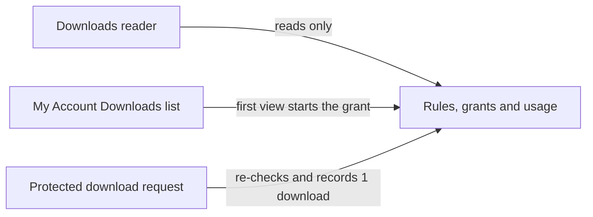

# Info
- Module: Developers
- Availability: Free
- Last updated: 2026-10-18

# Read Download Benefits

> Read which member-rule files a customer or subscription can download, with per-file limits, usage and expiry, without recording a download or starting an expiry clock.

**Availability:** Core (Free). Part of Member Access (Download Rules). Rules that use Feature Manager conditions depend on feature data that you configure with Pro Feature Manager.

## Page Navigation

- **Current guide:** Read Download Benefits
- **Where to open it:** Your custom plugin or theme code (PHP)
- **Section overview:** [Developers](./README.md)
- **Previous guide:** [Check Content Access](./member-access.md)
- **Next guide:** [Read Member Discounts](./discounts.md)
- **Troubleshooting:** [Verify Your Integration](./errors-and-testing.md)

## Overview

`ArraySubs\Api\Downloads` is a read-only reader for the files that merchants publish through **Member Access -> Downloads** rules. You create a reader for one subscription, one user or one WooCommerce customer, then list the files that context can see.

Each file reports whether the context can download it now, the reasons when it cannot, its per-file download limit, how many downloads were used and remain, when access started, and when it expires.

The reader only looks. It never serves a file, returns a file path or link, records a download, consumes usage, creates a grant or starts an expiry clock. Customers still download from **My Account -> Downloads**, where ArraySubs checks every request again.

## When to Use This

- Show "2 downloads left" or an expiry date next to member files in your own dashboard, app or email.
- List locked files with the reason they are locked, for example a drip schedule that has not unlocked yet.
- Check one file before you send a customer to their downloads page.
- Audit what a specific subscription unlocks, for support or a migration report.
- Copy download entitlements to an external membership system without touching usage.

## Prerequisites

- ArraySubs (core) installed and active. Call the reader on `arraysubs_after_boot` or later; `init` or later is safest.
- At least one enabled download rule. Merchant setup: [Downloads](../member-access/downloads.md).
- Member Access turned on. `\ArraySubs\Api\Availability::check( 'downloads' )` returns `true`, or a `WP_Error` with code `module_unavailable` and a `reason` such as `setting_disabled`.
- The shared loading, guard and error rules in [Connect Your Custom Plugin](./getting-started.md).

## How It Works

### Two kinds of downloads

The **My Account -> Downloads** page can show two kinds of files. This reader covers only the second kind.

| | Native WooCommerce downloads | ArraySubs member-rule downloads |
| --- | --- | --- |
| Configured on | The product: Downloadable files, Download limit, Download expiry | **ArraySubs -> Member Access -> Downloads** rules |
| Who gets them | Buyers of that product, through order download permissions | Anyone who currently meets the rule's conditions and schedule |
| Limit and expiry | Per order download permission, set on the product | Per customer account and per file, set on the rule |
| Where customers download | My Account -> Downloads | The same list; ArraySubs adds its files to it |
| How to read them | WooCommerce, for example `wc_get_customer_available_downloads( $customer_id )` | `ArraySubs\Api\Downloads` |

The two systems are independent. A subscription product can also be a downloadable product. Its WooCommerce files then follow WooCommerce rules, and ArraySubs download rules never change them.

### What a download rule contains

| Rule part | Admin field | Meaning |
| --- | --- | --- |
| Conditions | IF conditions | Who qualifies, using the same condition builder as other Member Access rules. No conditions means every logged-in customer qualifies. |
| Schedule | Schedule (optional) | A drip delay in days, weeks or months, counted from the customer's earliest qualifying subscription start. |
| `files` | Downloadable Files | One or more files, each with a display name. |
| `download_limit` | Download limit | Downloads allowed per file, per customer. Blank means unlimited. `0` blocks downloads. |
| `download_expiry` | Download expiry | Days of access per file, counted from when the file first becomes available to the customer. Blank or `0` means no expiry. |

The limit and the expiry are set once on the rule and apply to each of its files separately. A rule with three files and a limit of 2 allows two downloads of each file.

### Grants, usage and the expiry clock

ArraySubs keeps one access record (grant) per customer account and per file. It stores when access started and how many downloads were made.

- The expiry clock starts when the file first becomes available to the member: the first time **My Account -> Downloads** lists it. That listing creates the access record. A download request that arrives before any listing (for example through a protected link the merchant shared) creates it too.
- Each successful download request adds 1 to the file's usage under a lock, so parallel requests cannot pass the limit.
- Usage never resets. Renewals, plan switches, pauses, a second subscription and cancel-then-resubscribe all keep the same count. A limit of 3 means three downloads of that file for that customer account in total.
- Limit and expiry are checked against the rule's current settings. Raising a rule's limit gives existing customers more remaining downloads; shortening its expiry can end access that already started.

The reader computes the same answers without writing. `list()` and `get()` only project `expires_at`; they never create the access record. Until that first My Account listing or download, the reader reports `granted_at` as `null`, `downloads_used` as `0` and a projected `expires_at`: the read time plus the rule's `download_expiry` days.

### What a read never does

Every reader method is read only:

- No grant is created and no expiry clock starts, even on the first read for a customer.
- No download is recorded and no usage is consumed.
- No file is served, redirected or checked on disk, and no file path or URL is returned.
- The current user, the session and the My Account list stay unchanged. Nothing is printed or enqueued.



## Create a Reader

Readers are created through static factories. The factory fixes the context, and the reader then answers only for that subscription, user or customer.

### `Downloads::for_subscription()`

```text
\ArraySubs\Api\Downloads::for_subscription( int|WP_Post $subscription ): Downloads|WP_Error
```

| Parameter | Type | Default | Notes |
| --- | --- | --- | --- |
| `$subscription` | `int` or `WP_Post` | required | A subscription post ID, or the `WP_Post` returned by `arraysubs_get_subscription()`. |

- **Evaluates:** only this subscription for subscription conditions such as status, product and variation. Account conditions such as role and lifetime spending use the subscription's customer account. Usage and grants are the customer's per-file values, because they belong to the account, not to the subscription.
- **Guest subscriptions:** a subscription without a WordPress account is accepted, but every file reports `eligible` as `false` with the reason `login_required`. Member downloads need an account.
- **Failures:** `invalid_argument` (not an ID or `WP_Post`), `not_found` (not an ArraySubs subscription), `module_unavailable` (Member Access is off; the error data carries `reason`).
- **Side effects:** Read only: no writes.

### `Downloads::for_user()`

```text
\ArraySubs\Api\Downloads::for_user( int $user_id ): Downloads|WP_Error
```

| Parameter | Type | Default | Notes |
| --- | --- | --- | --- |
| `$user_id` | `int` | required | A WordPress user ID. |

- **Evaluates:** all of the user's subscriptions together, the same way the My Account list does for that user. Use it when your output must match what the customer sees.
- **Failures:** `invalid_argument` (`0` or a negative ID), `not_found` (no such user), `module_unavailable`.
- **Side effects:** Read only: no writes.

### `Downloads::for_customer()`

```text
\ArraySubs\Api\Downloads::for_customer( WC_Customer $customer ): Downloads|WP_Error
```

| Parameter | Type | Default | Notes |
| --- | --- | --- | --- |
| `$customer` | `WC_Customer` | required | A saved WooCommerce customer, including `ArraySubs\Api\Customer`. |

- **Evaluates:** the same as `for_user()` with the customer's user ID.
- **Failures:** `invalid_argument` (an unsaved customer object with ID `0`), `module_unavailable`. A `GuestCustomer` is not a `WC_Customer`; use `for_subscription()` for guest subscriptions.
- **Side effects:** Read only: no writes.

### Permission boundary

The PHP API is trusted server code. It does not check the current user's capabilities, and the reader methods take no `as_user` argument because the factory already fixes the context. Enforce permissions at your own web boundary:

- In a customer-facing request, build the reader with `Downloads::for_user( get_current_user_id() )`. Never take the user ID from the request.
- When a visitor sends a subscription ID, confirm ownership first with `\ArraySubs\Api\Subscriptions::get( $id, [ 'as_user' => get_current_user_id() ] )`. It returns `forbidden` when the subscription belongs to someone else.
- In admin screens and your own REST routes, check a capability such as `manage_woocommerce` before you read another customer's files.

File items contain no paths, links or internal configuration, so you can show them to the customer they belong to.

## Read Files

### `list()`

```text
$downloads->list( array $args = [] ): array
// Returns the collection below. As with every collection, invalid arguments return WP_Error (invalid_argument).
```

| Argument | Type | Default | Notes |
| --- | --- | --- | --- |
| `eligible` | `bool` | not set (all files) | `true`: only files the context can download now. `false`: only files it cannot. |
| `rule_id` | `string` | not set | Only files of this download rule. |
| `per_page` | `int` | `20` | 1 to 100. Larger values return `invalid_argument`. |
| `cursor` | `string` | `null` | The `next_cursor` value from the previous page. |
| `order` | `string` | `asc` | `asc` follows the saved rule order, then the file order inside each rule (the order My Account uses). `desc` reverses it. |
| `include_total` | `bool` | `false` | Adds an exact `total` count. Slower on large rule sets. |

- Files of disabled rules and file rows without a selected file are never listed.
- Unknown argument keys return `invalid_argument`.
- An empty `items` list is not an error.
- **Side effects:** Read only: no writes.

Returns:

```php
<?php
[
    'items'       => [ /* file items, see File Item Reference */ ],
    'per_page'    => 20,
    'next_cursor' => null,  // an opaque string while more pages exist
    'has_more'    => false,
    'total'       => null,  // an int only when include_total is true
];
```

Walk every page:

```php
<?php
if ( class_exists( '\ArraySubs\Api\Downloads' ) ) {
    $downloads = \ArraySubs\Api\Downloads::for_user( 45 );

    if ( ! is_wp_error( $downloads ) ) {
        $cursor = null;

        do {
            $page = $downloads->list( [ 'per_page' => 100, 'cursor' => $cursor ] );
            if ( is_wp_error( $page ) ) {
                break;
            }

            foreach ( $page['items'] as $file ) {
                // Use $file['name'], $file['eligible'], $file['downloads_remaining'] and so on.
            }

            $cursor = $page['next_cursor'];
        } while ( $page['has_more'] );
    }
}
```

### `get()`

```text
$downloads->get( string $file_key ): array|WP_Error
```

| Parameter | Type | Default | Notes |
| --- | --- | --- | --- |
| `$file_key` | `string` | required | The `file_key` of a file item. |

- **Returns:** one file item.
- **Failures:** `invalid_argument` (empty key), `not_found` (unknown key, a removed file row, or a deleted or disabled rule).
- **Side effects:** Read only: no writes.

## File Item Reference

This example comes from a rule with a Download limit of 3 and a Download expiry of 30 days:

```php
<?php
[
    'file_key'                => 'arraysubs_5f2b9c0e7d41a6c3',
    'name'                    => 'Member Handbook (PDF)',
    'rule_id'                 => 'rule_handbook',
    'eligible'                => true,
    'reasons'                 => [],
    'download_limit'          => 3,
    'downloads_used'          => 1,
    'downloads_remaining'     => 2,
    'granted_at'              => '2026-10-02T14:05:00+00:00',
    'expires_at'              => '2026-11-01T14:05:00+00:00',
    'expired'                 => false,
    'source_subscription_ids' => [ 123 ],
];
```

| Field | Type | Meaning |
| --- | --- | --- |
| `file_key` | `string` | Opaque, stable key for this rule file. It stays the same when files are reordered, renamed or replaced in the same row. It is an identifier, not a link. |
| `name` | `string` | The display name the merchant entered, or the file's own name when the display name is blank. |
| `rule_id` | `string` | The download rule that publishes the file. |
| `eligible` | `bool` | `true` when the context can download the file now: conditions met, schedule unlocked, within the limit and not expired. |
| `reasons` | `string[]` | Why `eligible` is `false`. Empty when the file is eligible. A file can list more than one reason. |
| `download_limit` | `int` or `null` | Downloads allowed for this file per customer. `null` means unlimited; `0` means none. |
| `downloads_used` | `int` | Downloads recorded for this customer and file. `0` when no grant exists. |
| `downloads_remaining` | `int` or `null` | `download_limit` minus `downloads_used`, never below `0`. `null` when unlimited. |
| `granted_at` | `string` or `null` | ISO 8601 UTC time when access started. `null` until My Account -> Downloads first lists the file for the customer, or until their first download. Reads never set it. |
| `expires_at` | `string` or `null` | ISO 8601 UTC expiry. The real expiry once `granted_at` is set; only a projection (read time plus `download_expiry` days) while `granted_at` is `null`. `null` when the rule has no expiry. |
| `expired` | `bool` | `true` once a started grant has passed `expires_at`. A projected expiry is never expired. |
| `source_subscription_ids` | `int[]` | Subscriptions in this context that satisfy the rule's subscription conditions. Empty when none does, or when the rule passes without a subscription (no conditions, or only account conditions such as a role). |

### Eligibility reasons

The condition reasons are the same codes that Member Access decisions use; see [Check Content Access](./member-access.md).

| Reason | Meaning |
| --- | --- |
| `login_required` | The context has no WordPress account (a guest subscription). |
| `subscription_status` | No subscription in the context has a status the rule requires. |
| `product_required` | The rule requires a product the context does not hold or has not bought. |
| `variation_required` | The rule requires a specific variation. |
| `role_required` | The account lacks a required WordPress role. |
| `spending_threshold` | The account's lifetime spending is below the rule's minimum. |
| `feature_required` | A Feature Manager condition is not met. |
| `rule_group_failed` | A nested condition group did not pass. |
| `schedule_pending` | The rule's drip delay has not passed yet. |
| `limit_reached` | `downloads_used` reached `download_limit`. A limit of `0` always reports this reason. |
| `access_expired` | The grant passed `expires_at`. |

## Examples

### Show a customer's member files

A minimal shortcode that lists the files the logged-in customer can download now, and links to the protected downloads page.

```php
<?php
add_shortcode( 'acme_member_files', function () {
    if ( ! class_exists( '\ArraySubs\Api\Downloads' ) || ! is_user_logged_in() ) {
        return '';
    }

    $downloads = \ArraySubs\Api\Downloads::for_user( get_current_user_id() );
    if ( is_wp_error( $downloads ) ) {
        return '';
    }

    $result = $downloads->list( [ 'eligible' => true, 'per_page' => 50 ] );
    if ( is_wp_error( $result ) || empty( $result['items'] ) ) {
        return '<p>' . esc_html__( 'No member files are available yet.', 'acme' ) . '</p>';
    }

    $html = '<ul class="acme-member-files">';
    foreach ( $result['items'] as $file ) {
        $left = null === $file['downloads_remaining']
            ? __( 'Unlimited downloads', 'acme' )
            : sprintf( __( '%d downloads left', 'acme' ), $file['downloads_remaining'] );

        $html .= '<li>' . esc_html( $file['name'] ) . ' - ' . esc_html( $left ) . '</li>';
    }
    $html .= '</ul>';

    $html .= '<p><a href="' . esc_url( wc_get_account_endpoint_url( 'downloads' ) ) . '">'
        . esc_html__( 'Go to your downloads', 'acme' ) . '</a></p>';

    return $html;
} );
```

```text
[acme_member_files]
```

### Check one file and handle every failure

```php
<?php
/**
 * Returns available, expired, limit_reached, locked, removed or unavailable.
 */
function acme_member_file_status( int $user_id, string $file_key ): string {
    if ( ! class_exists( '\ArraySubs\Api\Downloads' ) ) {
        return 'unavailable';
    }

    $downloads = \ArraySubs\Api\Downloads::for_user( $user_id );
    if ( is_wp_error( $downloads ) ) {
        // not_found, invalid_argument or module_unavailable.
        return 'unavailable';
    }

    $file = $downloads->get( $file_key );
    if ( is_wp_error( $file ) ) {
        // not_found: the file row was removed, or its rule was deleted or disabled.
        return 'not_found' === $file->get_error_code() ? 'removed' : 'unavailable';
    }

    if ( $file['eligible'] ) {
        return 'available';
    }
    if ( in_array( 'access_expired', $file['reasons'], true ) ) {
        return 'expired';
    }
    if ( in_array( 'limit_reached', $file['reasons'], true ) ) {
        return 'limit_reached';
    }

    return 'locked';
}
```

### Return a subscription's files from your REST route

The route checks login, then ownership through `Subscriptions::get()` with `as_user`, before it reads one subscription's files.

```php
<?php
add_action( 'rest_api_init', function () {
    register_rest_route( 'acme/v1', '/subscriptions/(?P<id>\d+)/files', [
        'methods'             => 'GET',
        'permission_callback' => 'is_user_logged_in',
        'callback'            => function ( WP_REST_Request $request ) {
            if ( ! class_exists( '\ArraySubs\Api\Downloads' ) || ! class_exists( '\ArraySubs\Api\Subscriptions' ) ) {
                return new WP_Error( 'acme_unavailable', 'Member downloads are unavailable.', [ 'status' => 503 ] );
            }

            // Ownership check at your own web boundary: forbidden or not_found on failure.
            $subscription = \ArraySubs\Api\Subscriptions::get(
                (int) $request['id'],
                [ 'as_user' => get_current_user_id() ]
            );
            if ( is_wp_error( $subscription ) ) {
                return $subscription;
            }

            $downloads = \ArraySubs\Api\Downloads::for_subscription( $subscription );
            if ( is_wp_error( $downloads ) ) {
                return $downloads;
            }

            $result = $downloads->list( [ 'per_page' => 100 ] );
            if ( is_wp_error( $result ) ) {
                return $result;
            }

            return array_map(
                function ( array $file ) {
                    return [
                        'file_key'   => $file['file_key'],
                        'name'       => $file['name'],
                        'eligible'   => $file['eligible'],
                        'reasons'    => $file['reasons'],
                        'remaining'  => $file['downloads_remaining'],
                        'expires_at' => $file['expires_at'],
                    ];
                },
                $result['items']
            );
        },
    ] );
} );
```

## Edge Cases and Important Notes

- **First reads are safe.** Reading a customer who never opened My Account -> Downloads leaves `granted_at` at `null` and does not start the expiry clock. You can verify this on staging: read a file twice, and `granted_at` stays `null` until the customer opens their downloads page.
- **Do not preview through WooCommerce.** `WC()->customer->get_downloadable_products()` builds the My Account list, and ArraySubs adds its files to that list. Calling it for the logged-in customer starts grants and expiry clocks, just like a visit to the Downloads page. Use this reader to preview instead.
- **Usage belongs to the account.** Two subscriptions that both qualify for the same rule do not double the limit. `for_subscription()` changes who qualifies, not whose usage is counted.
- **Replacing a file keeps its counters.** Choosing a new file in the same row keeps the `file_key`, the usage and the grant. Removing the row and adding the file again creates a new `file_key` with fresh usage and a new expiry clock. Deleting a rule does the same for all of its files.
- **Rule edits apply to existing grants.** Limits and expiry are evaluated against the rule as it is now, not as it was when access started.
- **`0` is not unlimited.** A Download limit of `0` blocks the file. Leave the field blank for unlimited downloads.
- **Results are a snapshot.** The download request checks login, conditions, schedule, limit and expiry again, so a file that is eligible now can still be refused later, for example after a cancellation.
- **Missing files.** The reader never looks at the file on disk. If a stored file was deleted, the download request reports that the file was not found.
- **One subscription or all of them.** `for_subscription()` can report a file as locked while `for_user()` reports it as eligible, because another subscription of the same customer qualifies.
- **Caching.** Output depends on the customer. Keep it out of shared page caches.

## Troubleshooting

| Problem | Likely Cause | What to Do |
| --- | --- | --- |
| `list()` returns no items | No enabled download rule has a selected file, or you passed `'eligible' => true` and the context does not qualify | Call `list()` without `eligible` and read each file's `reasons` |
| Every file reports `login_required` | The subscription is a guest subscription without a WordPress account | Member downloads need an account; read the customer with `for_user()` once they register |
| `granted_at` stays `null` | The customer has not opened My Account -> Downloads or downloaded the file yet; reads never start a grant | Expected. Treat `expires_at` as a projection until `granted_at` is set |
| `downloads_remaining` is `0` and the limit is `0` | The merchant entered `0`, which blocks downloads | Leave the Download limit blank for unlimited, or enter the allowed number |
| Usage did not reset after a renewal | Per-file usage never resets | Raise the rule's Download limit, or add the file as a new row to start fresh counters |
| A file shows `schedule_pending` | The rule's drip delay has not passed since the earliest qualifying subscription start | Wait, or change the rule's schedule. See [Scheduled Drip Access](../member-access/scheduled-drip-access.md) |
| The factory returns `module_unavailable` | Member Access is switched off in the settings | Check `Availability::get( 'downloads' )` and its `reason` |
| Your results differ from My Account | You used `for_subscription()`, while My Account evaluates all of the customer's subscriptions | Use `for_user()` to match the customer's view |

## Related Guides

- [Downloads](../member-access/downloads.md) - Merchant setup for download rules, files, limits and expiry.
- [Commerce and Benefit Rules](../member-access/commerce-and-benefit-rules.md) - How download, discount and other benefit rules fit together.
- [Scheduled Drip Access](../member-access/scheduled-drip-access.md) - How rule schedules unlock over time.
- [Check Content Access](./member-access.md) - Condition reason codes and access decisions.
- [Read Member Discounts](./discounts.md) - The read-only reader for member pricing.
- [Find and Update Subscriptions](./subscriptions.md) - Ownership checks with `as_user`.
- [Verify Your Integration](./errors-and-testing.md) - Error handling and staging checks.

## FAQ

### Does reading a file start its expiry clock?
No. `list()` and `get()` only project `expires_at` and never create the access record. The clock starts when the file first becomes available to the member: the first time My Account -> Downloads lists it, or at their first download if that comes first.

### Can I get the download link or file URL?
No. The reader never returns paths or links. Send customers to `wc_get_account_endpoint_url( 'downloads' )`, where each request is checked again before the file is served.

### Do renewals reset a customer's downloads?
No. Per-file usage never resets on renewal, plan switch or a new subscription.

### Can I reset or add downloads for a customer?
Not through this reader; it is read only. Raise the rule's Download limit to give everyone more downloads, or add the file as a new row to start fresh counters.

### Are WooCommerce product downloads included?
No. Read native downloads with WooCommerce functions such as `wc_get_customer_available_downloads()`. This reader covers ArraySubs download rules only.

### Does a customer with two qualifying subscriptions get twice the limit?
No. Usage and limits are per customer account and per file.
