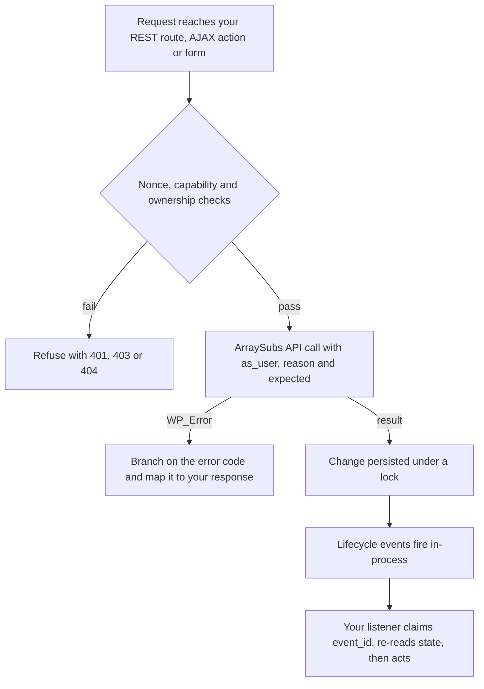
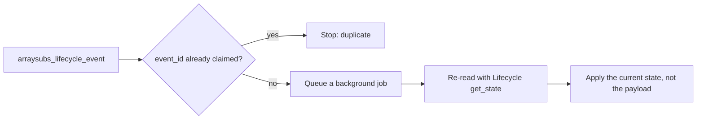

# Info
- Module: Developers
- Availability: Free (some sections require Pro)
- Last updated: 2026-10-18

# Verify Your Integration

> Handle every ArraySubs API error code, prove that permissions, retries and event handling behave correctly, and verify the whole integration on a staging site before it reaches a live store.

**Availability:** Core (Free). Sections marked *(Pro)* need ArraySubs Pro with an active license and the named module switched on.

## Page Navigation

- **Current guide:** Verify Your Integration
- **Where to open it:** Your custom plugin or theme code (PHP), plus a staging site with WP-CLI
- **Section overview:** [Developers](./README.md)
- **Previous guide:** [Connect Membership Workflows](./integration-recipes.md)
- **Troubleshooting:** [Troubleshooting on this page](#troubleshooting)

## Overview

This is the verification guide for the Developers section. It explains the 13 stable `WP_Error` codes that every `ArraySubs\Api` and `ArraySubsPro\Api` class returns, how to tell an empty result from a failure, and how to test the parts that usually break in production: permission boundaries, concurrent writes, retries, duplicate or late events, and stores without Pro.

It ends with a staging checklist, a test matrix you can copy into your own QA notes, and three complete examples: a WP-CLI smoke test, a REST error mapper and a deduplicated event listener.

## When to Use This

- You are writing the error handling for a custom plugin that calls ArraySubs.
- You expose ArraySubs data through your own REST route, AJAX action or form, and must prove that customers only see their own records.
- Your integration writes money or usage (Store Credit, Feature Manager usage) and must survive timeouts and retries.
- You react to lifecycle events (renewals, cancellations, access changes) and must not double-count or act on stale data.
- Your plugin must keep working on stores without ArraySubs Pro, with an inactive license, or with a module switched off.
- You are preparing a staging sign-off before a live launch.

## Prerequisites

- ArraySubs core active and booted: WordPress 6.0 or newer, PHP 8.1 or newer, WooCommerce 9.0 or newer. The API classes exist only after core boots, so start your integration on `arraysubs_after_boot` or later, as described in [Connect Your Custom Plugin](./getting-started.md).
- ArraySubs Pro with an active license for sections marked *(Pro)*.
- A staging copy of the store with test-mode payment settings. Never run the checks on this page against a live store's payment credentials.
- WP-CLI on staging for the scheduler and smoke-test commands (optional, but the checklist uses it).
- Synthetic test data. The examples use subscription 123 (owned by customer user 45), box child 124, guest subscription 125, a second customer 46, subscription product 197, simple product 55 and orders 1001 (parent) and 1003 (renewal).

## How It Works

1. **Your boundary checks the person.** The PHP API is trusted server code, like WordPress core functions: it does not check the current user's capabilities. Your REST route, AJAX action or form verifies the nonce, the capability and ownership before it calls ArraySubs.
2. **The API checks the request.** Every call validates the whole request before it writes anything. A failure returns `WP_Error` with a stable code and an HTTP-style `status` in its data. Domain rules apply to trusted calls too: an invalid transition is refused even from server code.
3. **Writes are guarded.** Subscription mutations run under the subscription mutation lock. `expected` turns a lost update into a `conflict`. `dry_run` validates without writing. Usage and Store Credit writes take an `operation_id` or `idempotency_key`, so a retry applies once.
4. **Events follow persistence.** Native hooks and `arraysubs_lifecycle_event` fire after the change is saved, in the same PHP process. Delivery is at least once per request path, so your listener deduplicates with `event_id` and re-reads state before acting.
5. **Scheduled work runs later.** Renewals run from Action Scheduler (`arraysubs_generate_renewal_invoice`, then `arraysubs_process_renewal`), and grace steps from an hourly sweep. Tests must wait for those jobs or run them deliberately.
6. **Availability is decided per request.** Core domains are present whenever core boots. Pro domains depend on Pro, its license, module switches and settings, which a merchant can change at any time. Check at call time.



## Error Codes

Every API class returns `WP_Error` on failure, with one of the 13 stable codes below. `get_error_data()` returns an array with `status` (an HTTP-style integer) and, where relevant, `field`, `details`, `current`, `expected` or `retry_after`. Two codes add their own keys: `module_unavailable` carries `reason`, and `unsupported_operation` can carry `billing_owner_id` or `use`.

| Code | status | Extra data | Typical triggers | Retry? |
| --- | --- | --- | --- | --- |
| `invalid_argument` | 400 | `field` | `per_page` above 100, unknown `fields` group, filter or change key, unparseable date, missing `reason` | No. Fix the call. |
| `not_found` | 404 | - | Unknown or deleted subscription, unrelated order, unknown feature or profile field key | No. Treat as absent. |
| `ambiguous_match` | 409 | `details` (up to 10 candidate IDs) | A singular lookup matched several records | No. Narrow the selector. |
| `forbidden` | 403 | - | `as_user` is not the owner, or a customer-context read of private data | No. Refuse. |
| `unsupported_operation` | 422 | `billing_owner_id`, `use` | Billing or lifecycle change on a box or bundle child, refused order change, trial change outside a trial | No. Use the owner or the named workflow. |
| `unsupported_entity` | 422 | - | Non-subscription product, guest Store Credit, unsupported access entity | No. Check support first. |
| `module_unavailable` | 503 | `reason` | Pro missing, license inactive, module or setting off | Not in a loop. Degrade and check again later. |
| `validation_failed` | 422 | `details` (field errors) | Usage above the limit, invalid profile field value, invalid feature setting | No. Correct the values. |
| `conflict` | 409 | `current`, `expected` | `expected` mismatch, concurrent change, pending plan switch, idempotency key reused with different parameters | Re-read first, then decide. |
| `provider_rejected` | 502 | - | PayPal, Paddle or Stripe refused the change | Later, with a person involved. |
| `feature_usage_busy` | 429 | `retry_after` (seconds) | Feature usage lock contention | Yes, after `retry_after`, with the same `operation_id`. |
| `insufficient_credit` | 422 | - | Debit larger than the available bucket balance *(Pro)* | No. Debit less or stop. |
| `currency_mismatch` | 422 | - | Amount currency differs from the store currency | No. Convert first. |

```box class="info-box"
Branch on `get_error_code()`, never on `get_error_message()`. Messages are translated and written for people, so they differ between languages and can be reworded at any time.
```

### Read an Error

These are the standard WordPress `WP_Error` accessors. Every ArraySubs API error fills them the same way.

```text
$error->get_error_code():    string  One of the 13 stable codes.
$error->get_error_message(): string  Translated text for people.
$error->get_error_data():    array   status, plus field, details, current, expected, retry_after, reason, billing_owner_id or use.
```

The helper below normalizes any error into a predictable array. Errors from WordPress or from other helper functions may carry no data, so it falls back to status 500. Later examples on this page reuse it.

```php
<?php
/**
 * Normalize a WP_Error from the ArraySubs API into a predictable array.
 */
function acme_arraysubs_error_parts( WP_Error $error ): array {
	$data = $error->get_error_data();
	$data = is_array( $data ) ? $data : [];

	return [
		'code'             => (string) $error->get_error_code(),
		'status'           => isset( $data['status'] ) ? (int) $data['status'] : 500,
		'field'            => isset( $data['field'] ) ? (string) $data['field'] : null,
		'details'          => $data['details'] ?? null,
		'current'          => $data['current'] ?? null,
		'expected'         => $data['expected'] ?? null,
		'retry_after'      => isset( $data['retry_after'] ) ? (int) $data['retry_after'] : null,
		'reason'           => isset( $data['reason'] ) ? (string) $data['reason'] : null,
		'billing_owner_id' => isset( $data['billing_owner_id'] ) ? (int) $data['billing_owner_id'] : null,
		'use'              => isset( $data['use'] ) ? (string) $data['use'] : null,
	];
}
```

### `invalid_argument`

**When you see it:** the input has the wrong type or format, names an unknown field group, filter or change key, or is out of range. Common causes: `per_page` above 100, a `fields` group that does not exist, a `Subscriptions::update()` key outside its allowlist, a date that cannot be parsed, a mutation without `reason` (1-500 characters), an `operation_id` or `idempotency_key` longer than 64 characters, or an external URL passed to `Products::get_by_url()`. `field` names the argument at fault.

**What to do:** fix the calling code. Repeating the same call returns the same error. Log `field` for developers and show customers a generic message.

```php
<?php
function acme_member_subscription_ids( int $user_id, int $per_page = 20 ): array {
	if ( ! class_exists( '\ArraySubs\Api\Subscriptions' ) ) {
		return [];
	}

	$page = \ArraySubs\Api\Subscriptions::query(
		[
			'customer_id' => $user_id,
			'status'      => 'any',
			'per_page'    => min( 100, max( 1, $per_page ) ), // 101 or more is invalid_argument.
			'output'      => 'ids',
		]
	);

	if ( is_wp_error( $page ) ) {
		$error = acme_arraysubs_error_parts( $page );
		if ( 'invalid_argument' === $error['code'] ) {
			error_log( sprintf( 'Acme: invalid ArraySubs argument "%s".', (string) $error['field'] ) );
		}
		return [];
	}

	return $page['items'];
}
```

### `not_found`

**When you see it:** the subscription, order, customer, product or feature does not exist. Examples: an ID that is not an ArraySubs subscription or was deleted, an order passed to `Orders::get()` with a `subscription` it is not related to, `FeatureManager::get_feature()` for a name no source defines, an unregistered profile field key, or `Customer::from_email()` with no matching account.

**What to do:** treat the record as absent. In an event listener, `not_found` for a subscription you were tracking usually means it was deleted, so remove what you granted for it.

```php
<?php
function acme_refresh_member_flag( int $subscription_id ): void {
	if ( ! class_exists( '\ArraySubs\Api\Lifecycle' ) ) {
		return;
	}

	$state = \ArraySubs\Api\Lifecycle::get_state( $subscription_id );

	if ( is_wp_error( $state ) ) {
		if ( 'not_found' === $state->get_error_code() ) {
			acme_remove_member_flag( $subscription_id ); // The subscription no longer exists.
		}
		return;
	}

	acme_set_member_flag( $subscription_id, (bool) $state['has_access'] );
}
```

### `ambiguous_match`

**When you see it:** a lookup that must return one record matched several. `Products::get()`, `Products::get_by_slug()` and `Products::get_by_url()` return it when `attributes` match more than one variation. `Customer::resolve_by_profile_field()` *(Pro)* returns it when two members share the value. `details` lists up to 10 candidate IDs.

**What to do:** narrow the selector (add attributes or pass `variation_id`), or switch to the collection method, such as `Customer::find_by_profile_field()` *(Pro)*, and choose in your own code. Never show the candidate IDs to customers.

```php
<?php
function acme_large_plan_terms( int $product_id ): ?array {
	if ( ! class_exists( '\ArraySubs\Api\Products' ) ) {
		return null;
	}

	$product = \ArraySubs\Api\Products::get(
		$product_id,
		[
			'attributes' => [ 'attribute_pa_size' => 'large' ],
			'fields'     => [ 'identity', 'pricing', 'schedule' ],
		]
	);

	if ( is_wp_error( $product ) ) {
		if ( 'ambiguous_match' === $product->get_error_code() ) {
			$error = acme_arraysubs_error_parts( $product );
			error_log( 'Acme: several variations match size=large: ' . wp_json_encode( $error['details'] ) );
		}
		return null; // Add another attribute or pass variation_id instead.
	}

	return $product;
}
```

### `forbidden`

**When you see it:** you passed `as_user` and that user does not own the subscription, or a customer-context call asked for private data.

**What to do:** refuse the request. Do not retry with a different `as_user`. On customer-facing endpoints, consider answering `forbidden` exactly like `not_found`, so nobody can probe which IDs exist. See [Permission Boundaries and `as_user`](#permission-boundaries-and-asuser).

```php
<?php
function acme_customer_can_see( int $subscription_id ): bool {
	if ( ! class_exists( '\ArraySubs\Api\Subscriptions' ) || ! is_user_logged_in() ) {
		return false;
	}

	$subscription = \ArraySubs\Api\Subscriptions::get(
		$subscription_id,
		[ 'as_user' => get_current_user_id() ] // Always the logged-in user, never an ID from the request.
	);

	// forbidden and not_found get the same answer.
	return ! is_wp_error( $subscription );
}
```

### `unsupported_operation`

**When you see it:** the operation is not allowed for this record or its state. Examples:

- A schedule, price or date change, or an independent lifecycle operation such as pause, cancel or skip, on a Subscription Box child (core) or a Subscription Bundle child *(Pro)*. `billing_owner_id` names the subscription that controls billing.
- `Orders::update()` with a status, total, payment, refund or link change. `use` names the workflow to use instead: payment completion, refund, renewal processing or plan-switch finalization.
- `Orders::delete()` on a paid order or on the subscription's open renewal invoice.
- `Lifecycle::update_trial()` when the subscription is not in an active trial, or `Lifecycle::set_grace_override()` on a cancelled or expired subscription.

**What to do:** do not repeat the call. Run billing operations on the billing owner, or use the named workflow. An operation on the owner affects every child, so let a person confirm it.

```php
<?php
function acme_pause_member( int $subscription_id, string $resume_at ) {
	if ( ! class_exists( '\ArraySubs\Api\Subscriptions' ) ) {
		return new WP_Error( 'acme_arraysubs_missing', __( 'Subscriptions are unavailable.', 'acme' ) );
	}

	$result = \ArraySubs\Api\Subscriptions::pause(
		$subscription_id,
		[
			'resume_at' => $resume_at,
			'reason'    => 'Member requested a pause in the Acme portal',
		]
	);

	if ( is_wp_error( $result ) && 'unsupported_operation' === $result->get_error_code() ) {
		$error = acme_arraysubs_error_parts( $result );
		if ( $error['billing_owner_id'] ) {
			return new WP_Error(
				'acme_pause_owner_required',
				sprintf(
					/* translators: %d: ID of the subscription that controls billing. */
					__( 'This item is billed through subscription #%d. Pause that subscription instead.', 'acme' ),
					$error['billing_owner_id']
				)
			);
		}
	}

	return $result;
}
```

### `unsupported_entity`

**When you see it:** the reader does not handle that kind of entity: `Products::get()` on a product that is not a subscription product, `StoreCredit::for_customer()` *(Pro)* with a guest customer, or `MemberAccess::check()` with an entity type outside `MemberAccess::get_supported_entities()`.

**What to do:** check support before the call with `Products::is_subscription_product()` or `MemberAccess::get_supported_entities()`, or treat the result as "not applicable" rather than as a failure.

```php
<?php
function acme_subscription_terms( int $product_id ): ?array {
	if ( ! class_exists( '\ArraySubs\Api\Products' ) ) {
		return null;
	}

	if ( ! \ArraySubs\Api\Products::is_subscription_product( $product_id ) ) {
		return null; // An ordinary product: skip instead of collecting unsupported_entity.
	}

	$product = \ArraySubs\Api\Products::get( $product_id, [ 'fields' => [ 'identity', 'schedule' ] ] );

	return is_wp_error( $product ) ? null : $product;
}
```

### `module_unavailable`

**When you see it:** the feature behind the call is not available on this store right now. `reason` says why:

| `reason` | Meaning |
| --- | --- |
| `core_unavailable` | ArraySubs core is not ready in this request, for example a call made before core finished booting. |
| `pro_missing` | The domain needs ArraySubs Pro, and Pro is not active. |
| `license_inactive` | Pro is installed but has no active license for this site. |
| `module_disabled` | The merchant switched the module off under **ArraySubs -> Modules**. |
| `setting_disabled` | A setting the domain needs is turned off. |

**What to do:** degrade gracefully: hide the feature, skip the write, or queue it for a person. Do not retry in a loop; the state changes only when a merchant changes the store. Check up front with `Availability::check()`, described in [Core Without Pro](#core-without-pro).

```php
<?php
function acme_grant_referral_credit( int $user_id ) {
	if ( ! class_exists( '\ArraySubsPro\Api\StoreCredit' ) ) {
		return false; // Pro is not installed: nothing to do.
	}

	$credit = \ArraySubsPro\Api\StoreCredit::for_customer( $user_id );
	if ( is_wp_error( $credit ) ) {
		return $credit;
	}

	$result = $credit->credit(
		'5.00',
		[
			'reason'          => 'Acme referral bonus',
			'idempotency_key' => 'acme-referral-' . $user_id,
		]
	);

	if ( is_wp_error( $result ) && 'module_unavailable' === $result->get_error_code() ) {
		$error = acme_arraysubs_error_parts( $result );
		// Your own meta: grant it later, once the merchant turns Store Credit on.
		update_user_meta( $user_id, 'acme_pending_referral_credit', $error['reason'] );
		return false;
	}

	return $result;
}
```

### `validation_failed`

**When you see it:** the input is well formed but breaks a domain rule. Examples: a Feature Manager usage increase above the limit without `allow_overage`, a profile field value that does not match its schema in `Customer::set_profile_field()` *(Pro)*, or a change refused by the product-feature validator in `FeatureManager::update_product_feature()` *(Pro)*. `details` lists the field errors.

**What to do:** show the field errors to whoever entered the values and let them correct them. Do not resend the same values.

```php
<?php
function acme_count_api_call( int $subscription_id, string $request_id ) {
	if ( ! class_exists( '\ArraySubs\Api\FeatureManager' ) ) {
		return new WP_Error( 'acme_arraysubs_missing', __( 'Feature data is unavailable.', 'acme' ) );
	}

	$features = \ArraySubs\Api\FeatureManager::for_subscription( $subscription_id );
	if ( is_wp_error( $features ) ) {
		return $features;
	}

	$usage = $features->increment_usage( 'api_calls', 1, [ 'operation_id' => 'acme-req-' . $request_id ] );

	if ( is_wp_error( $usage ) && 'validation_failed' === $usage->get_error_code() ) {
		return new WP_Error( 'acme_quota_reached', __( 'Your plan has no API calls left this period.', 'acme' ), [ 'status' => 429 ] );
	}

	return $usage;
}
```

### `conflict`

**When you see it:** the current state is not what your call expected. Examples: an `expected` value that no longer matches, another request changing the same subscription at the same moment, a pending plan switch that blocks a plan, price, schedule or date change (the default `'pending_switch' => 'refuse'`), a frozen pending switch passed to `Lifecycle::cancel_pending_switch()`, a Store Credit `adjust_to()` whose `expected_balance` differs, a grace override that would reverse an on-hold or cancellation already applied, or an `idempotency_key` reused with different parameters. `current` and `expected` show the mismatch.

**What to do:** re-read the record, decide again with fresh data, and retry once only if the change still makes sense. A reused key with different parameters is a bug in your key scheme, not a reason to retry. The full pattern is in [Concurrent Writes](#concurrent-writes).

```php
<?php
function acme_log_conflict( WP_Error $error ): void {
	if ( 'conflict' !== $error->get_error_code() ) {
		return;
	}

	$parts = acme_arraysubs_error_parts( $error );
	error_log(
		sprintf(
			'Acme: ArraySubs conflict. Expected %s, found %s.',
			wp_json_encode( $parts['expected'] ),
			wp_json_encode( $parts['current'] )
		)
	);
}
```

### `provider_rejected`

**When you see it:** the payment provider refused a change that ArraySubs had to send it first. PayPal and Paddle own their billing dates, so `Subscriptions::update()` pushes a new `next_payment_date` to the provider before saving it locally; a provider-owned trial end in `Lifecycle::update_trial()` works the same way. Because the provider is called first, a refusal leaves the local subscription unchanged.

**What to do:** do not retry in a loop. Tell an admin, check the gateway in [Gateway Health](../gateway-health/README.md), and try again later as a fresh decision. A successful result can still carry a `provider_date_pending` warning in `warnings` while the provider settles the change; that warning is not an error.

```php
<?php
function acme_move_renewal( int $subscription_id, string $new_date ) {
	if ( ! class_exists( '\ArraySubs\Api\Subscriptions' ) ) {
		return new WP_Error( 'acme_arraysubs_missing', __( 'Subscriptions are unavailable.', 'acme' ) );
	}

	$result = \ArraySubs\Api\Subscriptions::update(
		$subscription_id,
		[ 'next_payment_date' => $new_date ],
		[ 'reason' => 'Renewal date aligned with the Acme billing calendar' ]
	);

	if ( is_wp_error( $result ) ) {
		if ( 'provider_rejected' === $result->get_error_code() ) {
			acme_notify_admin( $subscription_id, $result->get_error_message() ); // Nothing changed locally.
		}
		return $result;
	}

	foreach ( $result['warnings'] as $warning ) {
		if ( 'provider_date_pending' === $warning['code'] ) {
			acme_schedule_recheck( $subscription_id ); // Re-read the state later.
		}
	}

	return $result;
}
```

### `feature_usage_busy`

**When you see it:** a Feature Manager usage write could not get its per-subscription, per-feature lock after about three internal attempts. `retry_after` is the number of seconds to wait.

**What to do:** retry after `retry_after` with the same `operation_id`, so a write that did land is not counted twice. From a web request, answer 429 with a `Retry-After` header. From a background job, reschedule the job.

```php
<?php
function acme_rest_usage_response( $usage ) {
	if ( is_wp_error( $usage ) && 'feature_usage_busy' === $usage->get_error_code() ) {
		$error    = acme_arraysubs_error_parts( $usage );
		$response = new WP_REST_Response(
			[
				'code'    => 'acme_busy',
				'message' => __( 'Please try again in a moment.', 'acme' ),
			],
			429
		);
		$response->header( 'Retry-After', (string) max( 1, (int) $error['retry_after'] ) );
		return $response;
	}

	return rest_ensure_response( $usage );
}
```

### `insufficient_credit` *(Pro)*

**When you see it:** `StoreCredit::debit()` asked for more than the bucket's available balance. ArraySubs never clamps a debit: nothing is written and no ledger row is created.

**What to do:** read `get_balance()` and decide in your code: debit a smaller amount, debit the other bucket with the `bucket` argument, or stop.

```php
<?php
function acme_redeem_credit( int $user_id, string $amount, string $order_ref ) {
	if ( ! class_exists( '\ArraySubsPro\Api\StoreCredit' ) ) {
		return new WP_Error( 'acme_no_store_credit', __( 'Store credit is unavailable.', 'acme' ) );
	}

	$credit = \ArraySubsPro\Api\StoreCredit::for_customer( $user_id );
	if ( is_wp_error( $credit ) ) {
		return $credit;
	}

	$result = $credit->debit(
		$amount,
		[
			'reason'          => 'Redeemed in the Acme marketplace',
			'idempotency_key' => 'acme-redeem-' . $order_ref, // Keep keys at 64 characters or fewer.
			'reference'       => [ 'type' => 'external', 'id' => $order_ref ],
		]
	);

	if ( is_wp_error( $result ) && 'insufficient_credit' === $result->get_error_code() ) {
		$balance = $credit->get_balance();
		return new WP_Error(
			'acme_not_enough_credit',
			sprintf(
				/* translators: 1: available amount, 2: currency code. */
				__( 'Only %1$s %2$s of store credit is available.', 'acme' ),
				$balance['customer'],
				$balance['currency']
			)
		);
	}

	return $result;
}
```

### `currency_mismatch`

**When you see it:** an amount's currency is not the store currency. Store Credit mutations *(Pro)* return it when the `currency` argument differs. `Discounts::get_product_discount()` returns it when the context `currency` differs.

**What to do:** convert to the store currency in your own code before the call, or leave `currency` out so the store currency applies.

```php
<?php
function acme_member_price( int $user_id, int $product_id, string $currency ): ?array {
	if ( ! class_exists( '\ArraySubs\Api\Discounts' ) ) {
		return null;
	}

	$discounts = \ArraySubs\Api\Discounts::for_user( $user_id );
	if ( is_wp_error( $discounts ) ) {
		return null;
	}

	$quote = $discounts->get_product_discount( $product_id, [ 'currency' => $currency ] );

	if ( is_wp_error( $quote ) && 'currency_mismatch' === $quote->get_error_code() ) {
		// Ask again in the store currency, then convert for display in your own code.
		$quote = $discounts->get_product_discount( $product_id, [ 'currency' => get_woocommerce_currency() ] );
	}

	return is_wp_error( $quote ) ? null : $quote;
}
```

## Empty Results Versus Errors

An empty result is a successful answer. Only a `WP_Error` means that the call failed.

| Situation | Result | Meaning |
| --- | --- | --- |
| A collection with no matches (`query()`, `for_customer()`, `get_children()`, `get_orders()`, `get_history()`) | `items` is `[]`, `has_more` is false, `next_cursor` is null | Nothing matches. Not an error. |
| A singular lookup with no match (`get()`, `from_email()`, `get_feature()`) | `WP_Error` `not_found` | The record does not exist. |
| A singular lookup with several matches | `WP_Error` `ambiguous_match` | Narrow the selector. |
| `Relationships::get_parent()` on a standalone subscription | `null` | No parent. Not an error. |
| `Relationships::get_pending_renewal_order()` with no open invoice | `null` | No unpaid renewal invoice. |
| `Customer::from_subscription()` on a guest subscription | A `GuestCustomer` | A guest, not a failure. |
| `Lifecycle::get_state()` with no pending plan switch | `pending_switch` is `null` | Normal. |
| `LoginLimits::get_policy()` *(Pro)* with login limits turned off | `enabled` is false | Not an error. |
| Member Access shortcuts such as `can_view_post()` | A decision array whose `result` can be `unsupported` or `invalid_target` | Treat both as "do not grant". |

```box class="warning-box"
`Subscriptions::query()` defaults to `status` `live` (pending, trial, active, paused and on-hold). A customer whose subscriptions are all cancelled or expired returns an empty page with that default. Pass `'status' => 'any'` before you conclude that a customer has no subscription history.
```

```php
<?php
/**
 * Returns true or false, or null when the answer is unknown because of an error.
 */
function acme_has_subscription_history( int $user_id ): ?bool {
	if ( ! class_exists( '\ArraySubs\Api\Subscriptions' ) ) {
		return null; // ArraySubs is not loaded.
	}

	$page = \ArraySubs\Api\Subscriptions::query(
		[
			'customer_id' => $user_id,
			'status'      => 'any',
			'per_page'    => 1,
			'output'      => 'ids',
		]
	);

	if ( is_wp_error( $page ) ) {
		return null; // A real failure: do not treat it as "no subscriptions".
	}

	return [] !== $page['items'];
}
```

## Permission Boundaries and `as_user`

The API trusts its caller. It does not read the current user's capabilities, so your code is the security boundary wherever a person can reach it.

| Boundary | Check before calling ArraySubs | Pass to ArraySubs |
| --- | --- | --- |
| Customer REST route | `permission_callback` requires `is_user_logged_in()`. WordPress cookie authentication verifies the `wp_rest` nonce sent as `X-WP-Nonce`. | `'as_user' => get_current_user_id()` |
| Customer AJAX action or form | `check_ajax_referer()` or `check_admin_referer()`, plus login | `'as_user' => get_current_user_id()` |
| Admin REST route, AJAX action or form | A nonce plus `current_user_can( 'manage_woocommerce' )` or `current_user_can( 'manage_options' )`, the capabilities ArraySubs' own admin routes require | No `as_user`; an `actor` of type `admin` |
| Cron, WP-CLI or queue worker | No person is involved: validate the job's own input | An `actor` of type `system` |

Rules your tests should prove:

- **Ownership comes from `as_user` only.** `Subscriptions::for_customer( 45 )` returns customer 45's subscriptions to trusted code; it does not mean "act as customer 45". Permission context is never inferred from the requested customer.
- **Use the logged-in user, never a request value.** `as_user` must be `get_current_user_id()`. Passing a user ID taken from the URL or the form defeats the check.
- **`as_user` also changes the output.** It returns customer-safe data: private profile fields, feature types and internal fields are removed. Admin-context output can contain them, so never send it to a customer.
- **Ownership is not store policy.** `as_user` enforces ownership and customer-safe output. Self-service rules, such as whether customers may cancel at all, are your code's decision. For cancellation, `arraysubs_can_customer_cancel_by_subs_id( int $subscription_id ): bool` reads the store's setting and the subscription's status.
- **Trusted does not mean unchecked.** A call without `as_user` skips the ownership check, but every domain rule still applies.

A customer REST route (minimal working example):

```php
<?php
add_action(
	'rest_api_init',
	static function (): void {
		register_rest_route(
			'acme/v1',
			'/my-subscriptions/(?P<id>\d+)',
			[
				'methods'             => 'GET',
				'permission_callback' => static function (): bool {
					return is_user_logged_in();
				},
				'args'                => [
					'id' => [ 'sanitize_callback' => 'absint' ],
				],
				'callback'            => 'acme_rest_my_subscription',
			]
		);
	}
);

function acme_rest_my_subscription( WP_REST_Request $request ) {
	if ( ! class_exists( '\ArraySubs\Api\Subscriptions' ) ) {
		return new WP_Error( 'acme_unavailable', __( 'Subscriptions are unavailable.', 'acme' ), [ 'status' => 503 ] );
	}

	$data = \ArraySubs\Api\Subscriptions::get(
		(int) $request['id'],
		[
			'output'  => 'data',
			'fields'  => [ 'identity', 'status', 'plan', 'schedule' ],
			'as_user' => get_current_user_id(),
		]
	);

	if ( is_wp_error( $data ) ) {
		return acme_public_rest_error( $data ); // See "Map API Errors to REST Responses" below.
	}

	return rest_ensure_response( $data );
}
```

A customer mutation through AJAX, with store policy and ownership checked separately:

```php
<?php
add_action( 'wp_ajax_acme_cancel_subscription', 'acme_ajax_cancel_subscription' );

function acme_ajax_cancel_subscription(): void {
	check_ajax_referer( 'acme_cancel_subscription', 'nonce' );

	$subscription_id = isset( $_POST['subscription_id'] ) ? absint( wp_unslash( $_POST['subscription_id'] ) ) : 0;

	if ( ! class_exists( '\ArraySubs\Api\Subscriptions' ) || ! function_exists( 'arraysubs_can_customer_cancel_by_subs_id' ) ) {
		wp_send_json_error( [ 'message' => esc_html__( 'Cancellation is unavailable.', 'acme' ) ], 503 );
	}

	if ( ! arraysubs_can_customer_cancel_by_subs_id( $subscription_id ) ) {
		wp_send_json_error( [ 'message' => esc_html__( 'This subscription cannot be cancelled here.', 'acme' ) ], 403 );
	}

	$result = \ArraySubs\Api\Subscriptions::cancel(
		$subscription_id,
		[
			'when'    => 'end_of_period',
			'reason'  => 'Customer request from the Acme portal',
			'actor'   => [ 'type' => 'customer', 'id' => get_current_user_id() ],
			'as_user' => get_current_user_id(),
		]
	);

	if ( is_wp_error( $result ) ) {
		$status = in_array( $result->get_error_code(), [ 'forbidden', 'not_found' ], true ) ? 404 : 400;
		wp_send_json_error( [ 'message' => esc_html__( 'We could not cancel this subscription.', 'acme' ) ], $status );
	}

	wp_send_json_success( [ 'cancellation_scheduled' => true ] );
}
```

How to test the boundary:

- Log in as customer 45 and request a subscription that belongs to customer 46. Expect 404 (or 403) from your endpoint and no subscription data in the body.
- Log out and repeat. Expect 401 from your REST route; ArraySubs is never called.
- Send the cookie request without `X-WP-Nonce`. WordPress treats it as logged out, so expect 401.
- Compare your customer endpoint's JSON with an admin-context read of the same subscription. Private profile fields, feature types and internal fields must be absent from the customer version.

## Concurrent Writes

Several writers can touch one subscription: an admin in the dashboard, the customer in the portal, a gateway callback, a renewal job and your plugin. ArraySubs serializes subscription mutations with a lock, and a call that loses that race returns `conflict`. To also catch a change made between your read and your write, pass `expected`.

| Tool | Where | Behavior |
| --- | --- | --- |
| `expected` | `Subscriptions::update()` and every lifecycle operation | A map of field => the value you read. Any mismatch returns `conflict` with `current` and `expected`, and nothing is written. |
| `pending_switch` | `Subscriptions::update()` | `refuse` (default) returns `conflict` when a pending plan switch exists and a plan, price, schedule or date field changes. `cancel` cancels the switch first. |
| `dry_run` | Every mutation | Validates and returns the would-be result without writing. No events fire, because nothing is persisted. |
| `expected_balance` | `StoreCredit::adjust_to()` *(Pro)* | Required. A different current balance returns `conflict`. |
| Usage lock | Feature Manager usage writes | Per subscription and feature. Contention after retries returns `feature_usage_busy`. Counters never go below 0. |

An optimistic update that re-reads once after a conflict:

```php
<?php
function acme_set_billing_date( int $subscription_id, string $new_date ) {
	if ( ! class_exists( '\ArraySubs\Api\Subscriptions' ) || ! class_exists( '\ArraySubs\Api\Lifecycle' ) ) {
		return new WP_Error( 'acme_arraysubs_missing', __( 'Subscriptions are unavailable.', 'acme' ) );
	}

	$result = null;

	for ( $attempt = 1; $attempt <= 2; $attempt++ ) {
		$state = \ArraySubs\Api\Lifecycle::get_state( $subscription_id );
		if ( is_wp_error( $state ) ) {
			return $state;
		}

		if ( null !== $state['pending_switch'] ) {
			// A person decides whether to cancel the plan switch ('pending_switch' => 'cancel').
			return new WP_Error( 'acme_pending_switch', __( 'A plan change is waiting for the next renewal.', 'acme' ) );
		}

		$current = $state['renewal']['next_payment_at'];
		if ( null !== $current && strtotime( $current ) === strtotime( $new_date ) ) {
			return true; // Already set, for example by our own earlier attempt.
		}

		$result = \ArraySubs\Api\Subscriptions::update(
			$subscription_id,
			[ 'next_payment_date' => $new_date ],
			[
				'reason'   => 'Billing date moved from the Acme portal',
				'expected' => [ 'next_payment_date' => $current ],
			]
		);

		if ( ! is_wp_error( $result ) || 'conflict' !== $result->get_error_code() ) {
			return $result;
		}
		// Someone changed the subscription between our read and our write: read again once.
	}

	return $result;
}
```

How to test concurrent writes:

- Run the same update from two terminals at the same moment, both with the same `expected` value. Exactly one succeeds; the other returns `conflict`.
- Change the date in the admin screen between your read and your write (for example with a breakpoint in a staging-only copy of your code). Your code must re-read instead of overwriting.
- Give a test subscription a pending plan switch and confirm that your date change returns `conflict` with the default `pending_switch` value.
- Run every new mutation once with `'dry_run' => true` and confirm that a re-read shows no change.

## Idempotent Retries

Requests time out after the server has already done the work. A retry must not do it a second time.

### Feature Usage: `operation_id`

`increment_usage()`, `consume()`, `set_usage()` and `reset_usage()` accept `operation_id` (string, 64 characters or fewer). A repeated ID applies once, and the repeat returns the usage block with `replayed` true.

- Derive the ID from your own record, such as `'acme-req-' . $request_uuid`, and store it with the job before the first attempt.
- Never generate a new random ID for each attempt; that turns every retry into another charge against the quota.
- Use a new ID for every distinct operation.

### Store Credit: `idempotency_key` *(Pro)*

`credit()`, `debit()` and `adjust_to()` require `idempotency_key` (string, 64 characters or fewer).

| Repeat | Result |
| --- | --- |
| Same key, same parameters | The original transaction with `replayed` true. No second ledger row. |
| Same key, different parameters | `WP_Error` `conflict`. |
| A new key | A new transaction. |

```php
<?php
function acme_pay_commission_as_credit( int $user_id, int $commission_id, string $amount ) {
	if ( ! class_exists( '\ArraySubsPro\Api\StoreCredit' ) ) {
		return new WP_Error( 'acme_no_store_credit', __( 'Store credit needs ArraySubs Pro.', 'acme' ) );
	}

	$available = \ArraySubs\Api\Availability::check( 'store_credit' );
	if ( is_wp_error( $available ) ) {
		return $available; // module_unavailable, with a reason.
	}

	$credit = \ArraySubsPro\Api\StoreCredit::for_customer( $user_id );
	if ( is_wp_error( $credit ) ) {
		return $credit;
	}

	$result = $credit->credit(
		$amount,
		[
			'reason'          => sprintf( 'Acme commission #%d', $commission_id ),
			'idempotency_key' => 'acme-commission-' . $commission_id, // Stable across retries.
			'reference'       => [ 'type' => 'external', 'id' => (string) $commission_id ],
			'notify'          => false,
		]
	);

	if ( is_wp_error( $result ) ) {
		return $result; // conflict here means the key was already used for a different amount.
	}

	return [
		'transaction_id' => $result['transaction']['id'],
		'new_entry'      => ! $result['replayed'],
	];
}
```

### Subscription Changes Have No Key

`Subscriptions::update()` and the lifecycle operations do not take an idempotency key. Before you retry one after a timeout, re-read with `Lifecycle::get_state()` and repeat it only when the change has not happened. For example, retry `cancel()` only while `cancellation.scheduled` is still false. Pass `expected` so that a retry never overwrites a newer change.

## Duplicate and Out-of-Order Events

`arraysubs_lifecycle_event( string $event, array $payload )` fires after a change is persisted, in the PHP process that made the change. Delivery is at least once per request path, and a delayed job can process events in a different order from the one in which they happened. These payload keys make that safe:

| Key | Use |
| --- | --- |
| `event_id` | Durable: the same occurrence always carries the same ID, also across retries. Deduplicate on it. |
| `occurred_at` | ISO 8601 UTC time of the change. Use it to ignore events older than what you already applied. |
| `subscription_id`, `order_id`, `user_id` | What to re-read. |
| `source`, `actor_id` | Where the change came from: `admin`, `customer`, `checkout`, `scheduler`, `gateway`, `api` or `system`. |
| `previous_status`, `status`, `previous_plan`, `plan`, `context` | What changed. A snapshot of that moment, not the current truth. |

Rules your tests should cover:

1. **Claim `event_id` before acting.** Store processed IDs under a unique key. A second delivery finds the claim and stops.
2. **Re-read before acting on state.** For access, plan or status decisions, call `Lifecycle::get_state()` when you process the event and act on that answer, so a late `renewed` cannot undo a later `cancelled`.
3. **Decide per customer when benefits overlap.** `granted` and `revoked` fire only when the customer's overall entitlement flips. When one subscription ends while another still grants the benefit, no `revoked` fires. If you act on per-subscription events, check the customer's other subscriptions before you remove anything.
4. **Expect sequences.** Applying a pending plan switch emits `plan_switched` with `context.trigger` set to `pending_switch`. The grace end that cancels an on-hold subscription emits `grace_ended`, then `cancelled`.
5. **Reconcile deletions.** `Subscriptions::delete()` emits `deleted`. Deleting from the admin Subscriptions list (a WordPress REST force delete) keeps box and bundle children and emits no `deleted` event, so run a periodic check that treats `not_found` as deleted.
6. **No outgoing webhooks.** These are in-process WordPress hooks. If you forward events to another system, that system must deduplicate on `event_id` as well.

Test this without a payment flow: call your own listener function directly, twice with the same synthetic payload, then with an older `occurred_at` after a newer one. Do not fire `arraysubs_lifecycle_event` yourself on a shared site, because other plugins listen to it too. The complete listener is in [Deduplicated, State-Driven Event Listener](#deduplicated-state-driven-event-listener).



## Core Without Pro

Your plugin must load and behave on a store with core only, a store with Pro but no active license, and a store with a module switched off.

| Check | Answers | Notes |
| --- | --- | --- |
| `class_exists( '\ArraySubs\Api\Subscriptions' )` | Core booted and the API is loaded | False when core is inactive or failed its dependency check, for example with WooCommerce below 9.0. |
| `class_exists( '\ArraySubsPro\Api\StoreCredit' )` | Pro is installed and passed its own dependency check | Not a license check: the class exists while the license is inactive. |
| `\ArraySubs\Api\Availability::check( 'store_credit' )` | The domain can run right now | Covers Pro, the license, module switches and settings. |
| `defined( 'ARRAYSUBSPRO_VERSION' )` | The Pro plugin file is active | Also true when Pro is unlicensed or could not boot. Use it for display, not for gating. |
| `arraysubs_is_module_enabled( 'store_credit' )` | The saved module switch | True until a merchant saves it off. It does not check Pro or the license. |

Pro-only parts of the API: the `profile_fields`, `login_limits` and `store_credit` domains, Subscription Bundle children, and `FeatureManager::update_product_feature()`. Feature Manager reads and usage writes are core, so do not gate all Feature Manager code on Pro. Pro-only methods on core classes, such as `Customer::get_profile_fields()` or `Customer::find_by_profile_field()`, return `module_unavailable` when Pro is missing or unlicensed. In `data` output, Pro blocks inside a group (for example the Pro entries of the subscription `modules` group) appear only while Pro is active; a missing Pro block is not an error.

### `Availability::get()` and `Availability::check()`

```text
\ArraySubs\Api\Availability::get( string $domain ): array
\ArraySubs\Api\Availability::check( string $domain ): true|WP_Error
```

| Parameter | Type | Default | Description |
| --- | --- | --- | --- |
| `$domain` | string | required | One of `subscriptions`, `lifecycle`, `relationships`, `orders`, `customers`, `profile_fields` (Pro), `products`, `feature_manager` (reads core, configuration updates Pro), `member_access`, `downloads`, `discounts`, `member_styling`, `login_limits` (Pro), `store_credit` (Pro) or `events`. Pass the name exactly. |

- **Accepted input:** a domain name string. No objects, no IDs.
- **Returns:** `get()` returns `['domain' => 'store_credit', 'available' => false, 'edition' => 'pro', 'module' => 'store_credit', 'reason' => 'license_inactive']`. `reason` is `ok` when the domain is available, otherwise one of the reasons listed under `module_unavailable` above. `check()` returns `true`.
- **Failure values:** `check()` returns `WP_Error` `module_unavailable` (status 503) whose data includes `reason`. `get()` never returns an error.
- **Pagination:** none.
- **Permission boundary:** trusted server PHP with no capability check; safe to call in any request.
- **Side effects:** Read only: no writes.
- **Timing:** call on `arraysubs_after_boot` or later. The class does not exist when core fails its dependency check, so guard with `class_exists()`. A merchant can change the license or a module at any time, so check at call time instead of caching the answer across requests.

```php
<?php
add_action( 'arraysubs_after_boot', 'acme_register_arraysubs_integration' );

function acme_register_arraysubs_integration(): void {
	if ( ! class_exists( '\ArraySubs\Api\Availability' ) ) {
		return;
	}

	add_action( 'arraysubs_lifecycle_event', 'acme_on_lifecycle_event', 10, 2 );
	add_action( 'acme_nightly_credit_sync', 'acme_nightly_credit_sync' );
}

function acme_nightly_credit_sync(): void {
	$status = \ArraySubs\Api\Availability::get( 'store_credit' );

	if ( ! $status['available'] ) {
		// pro_missing, license_inactive, module_disabled or setting_disabled: skip quietly.
		error_log( 'Acme: store credit sync skipped (' . $status['reason'] . ').' );
		return;
	}

	acme_sync_store_credit_balances(); // Your own code that uses \ArraySubsPro\Api\StoreCredit.
}
```

## When a Module Is Switched Off

Merchants switch modules on and off under **WordPress Admin -> ArraySubs -> Modules**. The change applies from the next request. Switching a module off never deletes its data.

| Switched off | What your integration sees |
| --- | --- |
| Store Credit *(Pro)* | `Availability::get( 'store_credit' )` reports `module_disabled`. `get_balance()` and `get_history()` keep working, with `module_active` false and `spendable` 0. `credit()`, `debit()` and `adjust_to()` return `module_unavailable`. Expiry clocks pause, and switching the module back on shifts expiry dates forward. |
| Feature Manager *(Pro)* | `FeatureManager::update_product_feature()` returns `module_unavailable`. Saved product features stay in place and core readers keep reading them. |
| Subscription Box (core) or Subscription Bundle *(Pro)* | Products of that type move to draft. `Products::get()` reads published products only in its default `view` context, so expect `not_found` for those products until the module is on again. Existing subscriptions keep renewing. |
| Your own addon module | Nothing is enforced for you. Check `arraysubs_is_module_enabled( 'your_module_id' )` before you register your hooks; see [Extend ArraySubs with a Module](./addon-modules.md). |

For each module your plugin touches: switch it off, load a fresh request, run the test matrix rows for that domain, switch it back on, and confirm that the data written earlier is intact.

## Renewal Jobs You Can Observe

Renewals run from Action Scheduler in two legs per subscription. Both legs use the indexed argument list `[ $subscription_id ]`.

| Hook | Group | Runs at | What it does |
| --- | --- | --- | --- |
| `arraysubs_generate_renewal_invoice` | `arraysubs-billing` | The invoice lead time before the due date | Creates the renewal order (the invoice) for an active or trial subscription without an open renewal invoice. Emits `renewal_invoice_created`. |
| `arraysubs_process_renewal` | `arraysubs-renewals` | The due date | Charges an automatic payment, or leaves the invoice for manual payment. Also carries automatic payment retries. Success emits `renewed`; failure emits `renewal_failed`. |
| `arraysubs_check_overdue_renewals` | `arraysubs-billing` | Every hour | Applies the grace steps: overdue to on-hold, then on-hold to cancelled. |

What to know when you test:

- **Both legs move together.** Date and schedule changes through `Subscriptions::update()`, pause, resume and skip realign both actions. Never schedule, unschedule or edit these actions yourself, and never write the date meta directly.
- **Each subscription has a stable spread offset.** To avoid a burst of renewals at the same moment, a subscription's legs run a fixed offset after their nominal times: at most the renewal spread window (6 hours by default) and never more than a quarter of the billing cycle. `next_payment_date` itself does not move.
- **Handlers re-check.** Each handler takes a per-subscription lock and re-checks the subscription. Running a leg early, twice, or for a subscription that is no longer due does nothing.
- **Provider-owned schedules.** Subscriptions whose provider owns the billing schedule (PayPal, Paddle) renew through the provider's callbacks; the local charge leg skips them.
- **Grace steps are hourly.** On-hold and the grace-end cancellation happen on the first hourly sweep after the threshold, so they can lag by up to an hour.

## Staging Checklist

Follow [Stripe Gateway](../checkout-and-payments/automatic-payments/stripe.md) for the test-mode gateway setup, callbacks, a real automatic renewal and keeping test and live data apart. The checklist below covers what your integration must prove on top of that walkthrough.

1. **Isolate staging.** Use a separate copy of the store with test-mode gateway settings. Point your plugin's own outbound calls (CRM, payouts, email services) at sandboxes too.
2. **Record the environment.** Note the WordPress, WooCommerce, PHP, ArraySubs and Pro versions, and which modules are on. The smoke test in [Examples](#examples) prints availability and subscription counts.

   ```bash
   wp plugin list --fields=name,status,version
   wp eval-file acme-arraysubs-smoke.php
   ```

3. **Confirm that the queue runs.** Action Scheduler needs WP-Cron or a system cron. When `DISABLE_WP_CRON` is true, ArraySubs stops admin page loads from draining the queue, so a real cron job must run it.

   ```bash
   wp cron test
   wp action-scheduler action list --group=arraysubs-renewals --status=pending --per_page=50 --fields=id,hook,args,scheduled_date
   ```

4. **Create test data through real flows.** Check out as a test customer with a reusable test payment method. Record the subscription ID (for example 123), the parent order (1001) and the customer (45).
5. **Verify lookups.** Run your plugin's lookups (by user, email, product and profile field) and compare them with the admin screens. Include a guest subscription and a customer with several subscriptions.
6. **Run the error checks.** Work through the [Test Matrix](#test-matrix) rows that apply to your integration.
7. **Make a renewal due.** Move the test subscription's next payment date a few minutes ahead with `Subscriptions::update()` (run it once with `dry_run` first), then confirm that both legs moved:

   ```bash
   wp action-scheduler action list --hook=arraysubs_generate_renewal_invoice --status=pending --per_page=50 --fields=id,args,scheduled_date
   wp action-scheduler action list --hook=arraysubs_process_renewal --status=pending --per_page=50 --fields=id,args,scheduled_date
   ```

8. **Run the legs.** After the due time passes, run the two actions whose `args` are `[123]` by ID instead of waiting for the spread offset. Do this on staging only.

   ```bash
   wp action-scheduler action run 5501
   wp action-scheduler action run 5502
   ```

9. **Observe the result.** Confirm that the renewal order exists (`Relationships::get_orders( 123, [ 'type' => 'renewal' ] )`), that `Lifecycle::get_state( 123 )` shows `phase` `active` with `next_payment_at` one cycle later, that your listener handled `renewal_invoice_created` and `renewed` once each, and that your own side effect (commission, access, sync) happened once.
10. **Run a failure and a recovery.** Use a declining test payment method from the Stripe guide. Expect `renewal_failed` and `payment_retry_scheduled` (with `context.attempt` and `context.next_retry_at`), then `phase` `renewal_due` or `grace` with the `retry` block filled in. To reach on-hold sooner, set a short override with `Lifecycle::set_grace_override( 123, [ 'days_before_on_hold' => 0, 'days_before_cancel' => 1 ], [ 'reason' => 'Staging grace test' ] )` and run the pending `arraysubs_check_overdue_renewals` action by ID. Then pay the invoice and expect `grace_recovered`, `renewed` and restored access. Clear the override afterwards by passing `null` instead of the array.
11. **Repeat without Pro and with modules off.** Deactivate Pro on staging, rerun the matrix, then reactivate Pro. If your staging site has no active Pro license, you are already testing the `license_inactive` rows. Switch each module your plugin touches off and on again.
12. **Check a Free-to-Pro upgrade** when the store will add Pro later. Save the smoke test output (subscription counts per status and availability), the pending ArraySubs actions and your integration's results. Install and license Pro while core stays installed and active, then compare. Records and settings stay in place and nothing is recreated. See [License Activation](../getting-started/license-activation.md).
13. **Leave the live store untouched.** Do not copy staging records, test payment methods or test keys to the live store. Delete test subscriptions only with `Subscriptions::delete()` (run it with `dry_run` first, because deletion is permanent), or leave them on staging.

## Test Matrix

Copy the rows that apply to your integration. IDs are examples; use your own staging records.

| Area | Scenario | Setup | Call or action | Expected result |
| --- | --- | --- | --- | --- |
| Input | Page too large | - | `Subscriptions::query( [ 'per_page' => 101 ] )` | `invalid_argument`, `field` `per_page`, status 400 |
| Input | Unknown field group | - | `Subscriptions::get( 123, [ 'output' => 'data', 'fields' => [ 'nope' ] ] )` | `invalid_argument` |
| Input | Change outside the allowlist | - | `Subscriptions::update( 123, [ 'status' => 'active' ], [ 'reason' => 'Test' ] )` | `invalid_argument`; use `Subscriptions::activate()` instead |
| Input | Missing reason | - | Any mutation without `reason` | `invalid_argument`; nothing written |
| Lookup | Missing record | An ID that does not exist | `Subscriptions::get( 999999 )` | `not_found`, status 404 |
| Lookup | Empty collection | Customer 46 has no subscriptions | `Subscriptions::for_customer( 46, [ 'status' => 'any' ] )` | `items` `[]`, `has_more` false, no error |
| Lookup | Several matches | Two variations of 197 share `attribute_pa_size` `large` | `Products::get( 197, [ 'attributes' => [ 'attribute_pa_size' => 'large' ] ] )` | `ambiguous_match`, `details` lists candidate IDs |
| Lookup | Duplicate profile value *(Pro)* | Two members share a value | `Customer::resolve_by_profile_field( 'member_number', 'M-1001' )` | `ambiguous_match` |
| Lookup | Guest subscription | Subscription 125 has no account | `Customer::from_subscription( 125 )` | A `GuestCustomer`; `is_guest()` is true |
| Lookup | Not a subscription product | Simple product 55 | `Products::get( 55 )` | `unsupported_entity` |
| Permission | Another customer's record | User 46 does not own 123 | `Subscriptions::get( 123, [ 'as_user' => 46 ] )` | `forbidden`; your endpoint answers 403 or 404 with no data |
| Permission | Logged out or no nonce | - | Call your customer REST route | 401 from your route; ArraySubs is never called |
| Permission | Customer-safe output | Admin and customer reads of 123 | Compare output with and without `as_user` | No private profile fields, feature types or internal fields in the customer output |
| Family | Billing change on a child | Box child 124 of parent 123 | `Subscriptions::update( 124, [ 'next_payment_date' => '2026-12-01T00:00:00+00:00' ], [ 'reason' => 'Test' ] )` | `unsupported_operation`, `billing_owner_id` 123 |
| Orders | Refused order change | Renewal order 1003 of 123 | `Orders::update( 1003, [ 'status' => 'completed' ], [ 'subscription' => 123, 'reason' => 'Test' ] )` | `unsupported_operation`; `use` names the workflow |
| Concurrency | Stale expectation | Change the date in admin after your read | `update()` with the old `expected` | `conflict` with `current` and `expected`; nothing written |
| Concurrency | Two writers at once | Two terminals, same `expected` | Run both updates together | One succeeds, the other returns `conflict` |
| Concurrency | Pending plan switch | Schedule a downgrade for the next renewal | `update()` of `next_payment_date` | `conflict` (default `pending_switch` `refuse`) |
| Concurrency | Frozen plan switch | Pending switch plus an unpaid renewal invoice | `Lifecycle::cancel_pending_switch( 123, [ 'reason' => 'Test' ] )` | `conflict` |
| Dry run | Validation only | - | Any mutation with `'dry_run' => true` | Result with `dry_run` true; a re-read shows no change; no events |
| Usage | Replay | - | `increment_usage()` twice with one `operation_id` | Second result has `replayed` true; `used` grew once |
| Usage | Over the limit | Feature at its limit | `increment_usage()` without `allow_overage` | `validation_failed` |
| Usage | Contention | Parallel writes to one feature | Many `increment_usage()` calls at once | Some `feature_usage_busy` with `retry_after`; final `used` equals the successful writes |
| Store Credit *(Pro)* | Replay | - | `credit()` twice with the same key and amount | One ledger row; the second result has `replayed` true |
| Store Credit *(Pro)* | Key reuse | - | The same key with a different amount | `conflict` |
| Store Credit *(Pro)* | Debit too large | Balance 10.00 | `debit( '25.00', ... )` | `insufficient_credit`; balance unchanged; no ledger row |
| Money | Wrong currency | Store currency USD | `get_product_discount( 197, [ 'currency' => 'EUR' ] )` | `currency_mismatch` |
| Provider | Refused date change | A PayPal or Paddle sandbox subscription | `update()` of `next_payment_date` that the provider refuses | `provider_rejected`, status 502; local date unchanged |
| Events | Duplicate delivery | - | Call your listener twice with one payload | One side effect |
| Events | Out of order | Process `cancelled`, then an older `renewed` | Call your listener in that order | Final state matches `Lifecycle::get_state()`; access is not restored |
| Events | Overlapping benefits | Customer with two active subscriptions to the benefit | Cancel one of them | No `revoked`; access kept |
| Events | Admin-list delete | Delete a subscription from the admin list | Run your reconciliation | No `deleted` event; reconciliation sees `not_found` and cleans up |
| Editions | Core only | Deactivate Pro | Load every page and job of your plugin | No fatal errors; Pro classes absent; `Availability` reports `pro_missing` |
| Editions | License inactive | Pro active without a license for the site | Pro API calls | `module_unavailable` with reason `license_inactive` |
| Editions | Module off | Store Credit switched off | Read the balance, then `credit()` | The read works (`module_active` false); `credit()` returns `module_unavailable` with reason `module_disabled` |
| Load timing | Too early | Call the API at plugin include time | Your bootstrap | Guarded: nothing runs before `arraysubs_after_boot` |
| Renewal | Due renewal | Staging checklist steps 7 to 9 | Run both legs | One renewal order; `renewed` once; date advanced one cycle |
| Renewal | Failure and recovery | Staging checklist step 10 | Decline, then pay | `renewal_failed`, a retry, grace phases, then `grace_recovered` and `renewed` |
| Read only | Reads do not write | `SAVEQUERIES` on staging | Wrap reader calls (below) | No `INSERT`, `UPDATE`, `DELETE` or `REPLACE` from ArraySubs |

### Prove That Reads Do Not Write

The readers (Member Access, Downloads, Discounts, Login Limits, Member Styling, Products, lifecycle state and usage reads) never write. A download listing leaves `granted_at` null until the customer really downloads, and a usage read in a new period reports 0 used without resetting anything. To prove it on staging, set `SAVEQUERIES` to true in `wp-config.php` and wrap the call:

```php
<?php
/**
 * Staging only: returns the write queries a callback ran, or null when SAVEQUERIES is off.
 */
function acme_collect_writes( callable $callback ): ?array {
	global $wpdb;

	if ( ! defined( 'SAVEQUERIES' ) || ! SAVEQUERIES ) {
		return null;
	}

	$start = is_array( $wpdb->queries ) ? count( $wpdb->queries ) : 0;
	$callback();

	$writes = [];
	foreach ( array_slice( (array) $wpdb->queries, $start ) as $query ) {
		if ( preg_match( '/^\s*(INSERT|UPDATE|DELETE|REPLACE)\b/i', (string) $query[0] ) ) {
			$writes[] = (string) $query[0];
		}
	}

	return $writes;
}

if ( class_exists( '\ArraySubs\Api\Downloads' ) ) {
	$writes = acme_collect_writes(
		static function (): void {
			$downloads = \ArraySubs\Api\Downloads::for_user( 45 );
			if ( ! is_wp_error( $downloads ) ) {
				$downloads->list();
			}
		}
	);
	// Expect an empty array.
}
```

Write queries from other plugins (for example a transient refresh) can appear in the list, so check which table each query touches. On the first request after an upgrade or a settings import, ArraySubs saves its migrated settings once; run the check twice and judge the second run.

## Examples

### Staging Smoke Test with WP-CLI

Save this as `acme-arraysubs-smoke.php` outside the web root and run `wp eval-file acme-arraysubs-smoke.php` on staging. Set the three IDs first. The test subscription should be a standalone subscription (not a box or bundle child) with a next payment date. The mutations run with `dry_run`, so nothing is written.

```php
<?php
// Staging smoke test for an ArraySubs integration. Run: wp eval-file acme-arraysubs-smoke.php
if ( ! defined( 'WP_CLI' ) || ! class_exists( '\ArraySubs\Api\Subscriptions' ) ) {
	echo "ArraySubs API is not loaded.\n";
	return;
}

$subscription_id = 123; // A standalone test subscription.
$owner_id        = 45;  // The owner of that subscription.
$other_user_id   = 46;  // A different test customer.

// Availability of every domain.
$domains = [ 'subscriptions', 'lifecycle', 'relationships', 'orders', 'customers', 'profile_fields', 'products', 'feature_manager', 'member_access', 'downloads', 'discounts', 'member_styling', 'login_limits', 'store_credit', 'events' ];
foreach ( $domains as $domain ) {
	$info = \ArraySubs\Api\Availability::get( $domain );
	WP_CLI::log( sprintf( 'domain %-16s %s', $domain, $info['reason'] ) );
}

// Subscription counts per status: keep them to compare before and after an upgrade.
foreach ( [ 'pending', 'trial', 'active', 'paused', 'on-hold', 'cancelled', 'expired' ] as $status ) {
	$page = \ArraySubs\Api\Subscriptions::query(
		[
			'status'        => $status,
			'per_page'      => 1,
			'include_total' => true,
			'output'        => 'ids',
		]
	);
	WP_CLI::log( sprintf( 'status %-10s %s', $status, is_wp_error( $page ) ? $page->get_error_code() : (string) $page['total'] ) );
}

$checks = [];

$page = \ArraySubs\Api\Subscriptions::query( [ 'per_page' => 101 ] );
$checks['per_page 101 is invalid_argument'] = is_wp_error( $page ) && 'invalid_argument' === $page->get_error_code();

$empty = \ArraySubs\Api\Subscriptions::query( [ 'include' => [ 999999999 ], 'status' => 'any', 'output' => 'ids' ] );
$checks['no match is an empty page'] = ! is_wp_error( $empty ) && [] === $empty['items'] && false === $empty['has_more'];

$missing = \ArraySubs\Api\Subscriptions::get( 999999999 );
$checks['unknown ID is not_found'] = is_wp_error( $missing ) && 'not_found' === $missing->get_error_code();

$own = \ArraySubs\Api\Subscriptions::get( $subscription_id, [ 'output' => 'data', 'as_user' => $owner_id ] );
$checks['owner can read'] = ! is_wp_error( $own );

$foreign = \ArraySubs\Api\Subscriptions::get( $subscription_id, [ 'output' => 'data', 'as_user' => $other_user_id ] );
$checks['other user is forbidden'] = is_wp_error( $foreign ) && 'forbidden' === $foreign->get_error_code();

$before = \ArraySubs\Api\Lifecycle::get_state( $subscription_id );
if ( ! is_wp_error( $before ) && null !== $before['renewal']['next_payment_at'] ) {
	$current = $before['renewal']['next_payment_at'];
	$target  = gmdate( 'c', strtotime( $current ) + DAY_IN_SECONDS );

	$dry = \ArraySubs\Api\Subscriptions::update(
		$subscription_id,
		[ 'next_payment_date' => $target ],
		[
			'reason'   => 'Smoke test dry run',
			'expected' => [ 'next_payment_date' => $current ],
			'dry_run'  => true,
		]
	);
	$after = \ArraySubs\Api\Lifecycle::get_state( $subscription_id );

	$checks['dry run reports dry_run'] = ! is_wp_error( $dry ) && true === $dry['dry_run'];
	$checks['dry run changes nothing'] = ! is_wp_error( $after ) && $after['renewal']['next_payment_at'] === $current;

	$stale = \ArraySubs\Api\Subscriptions::update(
		$subscription_id,
		[ 'next_payment_date' => $target ],
		[
			'reason'   => 'Smoke test stale expectation',
			'expected' => [ 'next_payment_date' => '2001-01-01T00:00:00+00:00' ],
			'dry_run'  => true,
		]
	);
	$checks['stale expected is conflict'] = is_wp_error( $stale ) && 'conflict' === $stale->get_error_code();
}

foreach ( $checks as $label => $passed ) {
	if ( $passed ) {
		WP_CLI::log( 'PASS ' . $label );
	} else {
		WP_CLI::warning( 'FAIL ' . $label );
	}
}
```

### Map API Errors to REST Responses

This mapper keeps the HTTP status, answers `forbidden` like `not_found`, and never forwards internal error data such as candidate IDs or current values. It is the failure handler used by the customer REST route above.

```php
<?php
/**
 * Turn an ArraySubs API error into a safe REST error for customers.
 */
function acme_public_rest_error( WP_Error $error ): WP_Error {
	$parts = acme_arraysubs_error_parts( $error );
	$code  = 'forbidden' === $parts['code'] ? 'not_found' : $parts['code']; // Do not reveal other customers' IDs.

	$messages = [
		'invalid_argument'      => __( 'The request is not valid.', 'acme' ),
		'not_found'             => __( 'We could not find that subscription.', 'acme' ),
		'ambiguous_match'       => __( 'Please be more specific.', 'acme' ),
		'unsupported_operation' => __( 'This action is not available for this subscription.', 'acme' ),
		'unsupported_entity'    => __( 'This item is not supported.', 'acme' ),
		'module_unavailable'    => __( 'This feature is currently unavailable.', 'acme' ),
		'validation_failed'     => __( 'Some values are not valid.', 'acme' ),
		'conflict'              => __( 'This subscription just changed. Please reload and try again.', 'acme' ),
		'provider_rejected'     => __( 'The payment provider did not accept this change.', 'acme' ),
		'feature_usage_busy'    => __( 'Please try again in a moment.', 'acme' ),
		'insufficient_credit'   => __( 'There is not enough store credit.', 'acme' ),
		'currency_mismatch'     => __( 'This currency is not supported.', 'acme' ),
	];

	if ( isset( $parts['details'] ) || isset( $parts['current'] ) ) {
		error_log( 'Acme: ArraySubs error data: ' . wp_json_encode( $parts ) ); // For developers only.
	}

	$data = [ 'status' => 'not_found' === $code ? 404 : $parts['status'] ];
	if ( 'feature_usage_busy' === $code && $parts['retry_after'] ) {
		$data['retry_after'] = $parts['retry_after'];
	}

	return new WP_Error( 'acme_' . $code, $messages[ $code ] ?? __( 'Something went wrong.', 'acme' ), $data );
}
```

### Deduplicated, State-Driven Event Listener

The listener only queues work, so the request that changed the subscription stays fast. The background job claims the `event_id`, re-reads the current state and applies it. Duplicates stop at the claim, and the order in which events arrive no longer matters.

```php
<?php
// 1. On activation, create a table that records processed event IDs.
register_activation_hook( __FILE__, 'acme_create_event_table' );

function acme_create_event_table(): void {
	global $wpdb;
	require_once ABSPATH . 'wp-admin/includes/upgrade.php';

	$table = $wpdb->prefix . 'acme_processed_events';
	dbDelta(
		"CREATE TABLE {$table} (
			event_key char(32) NOT NULL,
			processed_at datetime NOT NULL,
			PRIMARY KEY  (event_key)
		) {$wpdb->get_charset_collate()};"
	);
}

// 2. Claim an event once. Returns false when it was already claimed.
function acme_claim_event( string $event_id ): bool {
	global $wpdb;
	$table = $wpdb->prefix . 'acme_processed_events';

	$wpdb->query(
		$wpdb->prepare(
			"INSERT IGNORE INTO {$table} (event_key, processed_at) VALUES (%s, %s)",
			md5( $event_id ),
			gmdate( 'Y-m-d H:i:s' )
		)
	);

	return 1 === (int) $wpdb->rows_affected;
}

function acme_release_event( string $event_id ): void {
	global $wpdb;
	$wpdb->delete( $wpdb->prefix . 'acme_processed_events', [ 'event_key' => md5( $event_id ) ], [ '%s' ] );
}

// 3. Listen, but only queue work.
add_action( 'arraysubs_lifecycle_event', 'acme_on_lifecycle_event', 10, 2 );

function acme_on_lifecycle_event( string $event, array $payload ): void {
	$watched = [ 'granted', 'revoked', 'renewed', 'on_hold', 'reactivated', 'cancelled', 'expired', 'plan_switched', 'deleted' ];

	if ( ! in_array( $event, $watched, true ) || empty( $payload['event_id'] ) || empty( $payload['subscription_id'] ) ) {
		return;
	}

	if ( function_exists( 'as_enqueue_async_action' ) ) {
		as_enqueue_async_action(
			'acme_sync_subscription_access',
			[ absint( $payload['subscription_id'] ), (string) $payload['event_id'] ],
			'acme-sync'
		);
	}
}

// 4. Process: claim, re-read the current state, act on it.
add_action( 'acme_sync_subscription_access', 'acme_sync_subscription_access', 10, 2 );

function acme_sync_subscription_access( int $subscription_id, string $event_id ): void {
	if ( ! class_exists( '\ArraySubs\Api\Lifecycle' ) || ! acme_claim_event( $event_id ) ) {
		return; // ArraySubs is not loaded, or this event was already processed.
	}

	$state = \ArraySubs\Api\Lifecycle::get_state( $subscription_id );

	if ( is_wp_error( $state ) ) {
		if ( 'not_found' === $state->get_error_code() ) {
			acme_remove_member_flag( $subscription_id ); // The subscription was deleted.
			return;
		}

		acme_release_event( $event_id ); // Let the retry below process it again.
		as_schedule_single_action( time() + 5 * MINUTE_IN_SECONDS, 'acme_sync_subscription_access', [ $subscription_id, $event_id ], 'acme-sync' );
		return;
	}

	// The current truth, whatever order the events arrived in.
	acme_set_member_flag( $subscription_id, (bool) $state['has_access'] );
}
```

If your benefit is per customer rather than per subscription, decide in `acme_set_member_flag()` from all of the customer's subscriptions, or act on `granted` and `revoked`, which already account for every subscription the customer holds.

## Edge Cases and Important Notes

- **Other errors look different.** WordPress (`rest_forbidden`, `rest_invalid_param`) and other helper functions return their own codes, often without a `status`. Fall back to 500 when `status` is missing, as `acme_arraysubs_error_parts()` does.
- **Never forward error data to customers.** `details` can hold other customers' candidate IDs, and `current` and `expected` can hold internal values. Log them and show a generic message.
- **Dates are UTC.** Data output uses ISO 8601 UTC strings such as `2026-11-01T00:00:00+00:00`. Compare instants with `strtotime()` instead of comparing strings, and never pass display-formatted dates back to the API.
- **Do not write ArraySubs meta or post statuses directly**, including through `/wp/v2/arraysubs_data`. Direct writes skip locks, validation, scheduling, provider coordination and events, so your tests would pass against a state ArraySubs never produces.
- **Personalized output and page caches.** Responses built with `as_user` belong to one customer. Exclude them from full-page caches, and test as a guest, an allowed member and a denied member.
- **Availability can change at any time.** A merchant can switch a module or the license during the day. Check per request and degrade, instead of caching availability across requests.
- **Mutation results tell you what happened.** `changed` lists the changed fields, `warnings` carries non-fatal notes such as `provider_date_pending`, and `events` lists the lifecycle events emitted. Assert on them in your tests.
- **Deleting is permanent.** Subscriptions have no trash. `Subscriptions::delete()` also removes box and bundle children, scheduled jobs and notes, and keeps WooCommerce orders and the customer.
- **Background actors.** In cron and WP-CLI, `get_current_user_id()` is 0, so pass an explicit `actor` such as `[ 'type' => 'system', 'id' => 0, 'label' => 'Acme nightly sync' ]` to keep the audit trail readable.

## Troubleshooting

| Problem | Likely Cause | What to Do |
| --- | --- | --- |
| Fatal error: class `ArraySubs\Api\...` not found | Code ran before core booted, or core is inactive or failed its dependency check (for example WooCommerce below 9.0) | Guard with `class_exists()` and start your integration on `arraysubs_after_boot` |
| Pro calls return `module_unavailable` with `license_inactive` on staging | Pro has no active license for this site | See [License Activation](../getting-started/license-activation.md) |
| `module_unavailable` with `module_disabled` | The merchant switched the module off | Check **ArraySubs -> Modules**; degrade instead of retrying |
| `invalid_argument` with `field` `per_page` | `per_page` above 100 | Page with `next_cursor`, or walk all pages with `each()` |
| A customer seems to have no subscriptions | The default `status` is `live` | Pass `'status' => 'any'` for history |
| Your customer endpoint returned another customer's record | `as_user` missing, or set from request input | Always pass `get_current_user_id()` |
| Every date update returns `conflict` | Stale `expected` values, or a pending plan switch | Re-read with `Lifecycle::get_state()`; decide about the pending switch |
| Duplicate commissions or credits | No `event_id` claim, or a new idempotency key for each attempt | Claim `event_id`; derive keys from your own records |
| Access removed while another subscription is still active | Acting on one subscription's event | Use `granted` and `revoked`, or check the customer's other subscriptions |
| A renewal action ran but nothing happened | The subscription was not due yet, is waiting for cancellation, or is billed by its provider | Check `Lifecycle::get_state()`; run the leg after the due time |
| Scheduled actions never run on staging | `DISABLE_WP_CRON` is set and no system cron runs | Add a cron job, or run `wp action-scheduler run` |
| On-hold or cancellation happens later than expected | The hourly grace sweep | Wait, or run the pending `arraysubs_check_overdue_renewals` action on staging |
| `provider_rejected` on a date change | PayPal or Paddle refused it | Check [Gateway Health](../gateway-health/README.md) and the provider account |
| `feature_usage_busy` under load | Usage lock contention | Retry after `retry_after` with the same `operation_id` |
| No `deleted` event after deleting from the admin list | That path emits none by design | Reconcile: treat `not_found` as deleted |
| The read-only check reports an `arraysubs_settings` update | A one-time settings migration after an upgrade or import | Run the check again; the second run should be clean |

## Related Guides

- [Developers](./README.md) - the operation and edition overview.
- [Connect Your Custom Plugin](./getting-started.md) - load timing, dependency checks and a first lookup.
- [Find and Update Subscriptions](./subscriptions.md) - query arguments, `expected`, `dry_run` and mutation results.
- [Work with Subscription Families and Orders](./subscription-relationships-and-orders.md) - billing owners, children and related orders.
- [Read Lifecycle State and Manage Its Dates](./status-grace-periods-and-trials.md) - `Lifecycle::get_state()`, grace and trials.
- [Read and Update Feature Data](./feature-manager.md) - usage writes and `operation_id`.
- [Read and Update Store Credit](./store-credit.md) - ledger mutations and `idempotency_key` *(Pro)*.
- [React to Supported Events](./actions-and-filters.md) - the full event and hook catalog.
- [Extend ArraySubs with a Module](./addon-modules.md) - module switches for your own addon.
- [Connect Membership Workflows](./integration-recipes.md) - complete integration recipes.
- [Stripe Gateway](../checkout-and-payments/automatic-payments/stripe.md) - staging setup and a real automatic renewal.
- [Recovery and Grace Flows](../billing-and-renewals/recovery-and-grace-flows.md) - the merchant view of retries and grace.
- [Payment Recovery Tools](../checkout-and-payments/automatic-payments/payment-recovery.md) - manual retries and recovery screens.
- [License Activation](../getting-started/license-activation.md) - activating Pro on a site.
- [Before You Launch](../getting-started/before-you-launch.md) - the merchant launch checklist.
- [Audits, Logs, and Troubleshooting](../audits-and-logs/README.md) - where to read notes and logs while testing.

## FAQ

### Do the API classes check the current user's permissions?

No. They are trusted server code, like WordPress core functions. Check nonces, capabilities and ownership at your own REST route, AJAX action or form, and pass `as_user` for customer requests.

### Is an empty result an error?

No. A collection with no matches returns an empty `items` array. Only `WP_Error` means that the call failed.

### Are lifecycle events delivered exactly once?

No. Delivery is at least once per request path. Deduplicate with `event_id`, and re-read state with `Lifecycle::get_state()` before acting.

### Should I retry after `conflict`?

Re-read first. Retry only when the change still makes sense with the fresh data, and pass the fresh values in `expected`.

### Which errors can I retry automatically?

`feature_usage_busy`, after `retry_after` and with the same `operation_id`, and `conflict` after a re-read. Every other code needs a code change, a different call or a person.

### Does `dry_run` touch the database?

No. It validates the request and returns the would-be result without writing, so no events fire. It is safe for preflight checks, even on a live store.

### What happens to my data if Pro is deactivated or its license lapses?

Nothing is deleted, and core keeps working. Without Pro, the Pro classes are absent; with an inactive license, Pro calls return `module_unavailable`. The data is available again when Pro is active and licensed.

### How do I test a renewal without waiting a whole billing cycle?

On staging, move the next payment date a few minutes ahead with `Subscriptions::update()`, wait until it passes, then run the pending `arraysubs_generate_renewal_invoice` and `arraysubs_process_renewal` actions by ID. See the [Staging Checklist](#staging-checklist).

### Can I run the renewal actions by hand on a live store?

No. Let Action Scheduler run them on a live store. On staging it is safe, because each handler re-checks the subscription and does nothing when it is not due.
