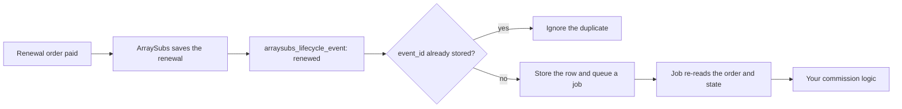

# Info
- Module: Developers
- Availability: Free (some sections require Pro)
- Last updated: 2026-10-18

# Connect Membership Workflows

> Combine the ArraySubs developer APIs into eight copyable recipes for common membership integrations: status and plan lookups, grace-aware permissions, renewal commissions, families and orders, profile-field lookups, paged exports, content decisions and store credit adjustments.

**Availability:** Core (Free) for recipes 1, 2, 3, 4, 6 and 7. Recipe 5 requires ArraySubs Pro with Profile Builder fields. Recipe 8 requires ArraySubs Pro with the Store Credit module enabled.

## Page Navigation

- **Current guide:** Connect Membership Workflows
- **Where to open it:** Your custom plugin or theme code (PHP)
- **Section overview:** [Developers](./README.md)
- **Previous guide:** [Gate Custom PHP Output](./php-templates.md)
- **Next guide:** [Verify Your Integration](./errors-and-testing.md)
- **Troubleshooting:** [Verify Your Integration](./errors-and-testing.md)

## Overview

This page shows how the ArraySubs APIs work together inside a custom membership plugin. Each recipe states its goal and availability, gives working code, explains why the approach is safe and lists what to test before you rely on it.

The recipes do not repeat every parameter. When you need a full signature, default or error code, follow the reference link in the recipe's **APIs used** line.

ArraySubs supplies authoritative reads, supported writes and lifecycle events. Your plugin keeps its own business rules: commission rates and payouts, CRM mapping, reward policies and any permission model outside ArraySubs.

## When to Use This

- You run a custom membership, marketplace or community plugin next to ArraySubs and need each member's real status and plan.
- You grant permissions in your own system and must keep them through a payment grace period, then remove them at the right time.
- You pay commissions or partner revenue on renewals and need each paid renewal recorded once on your side.
- You build support or account screens that show box or bundle children, renewal orders and the open renewal invoice.
- You look up members by a custom profile value such as a membership number or a region.
- You export subscription data to another system in pages instead of loading everything at once.
- You show lock badges or teasers for protected content without redirecting the visitor.
- You award or correct store credit from your own workflow and must never apply it twice.

## Prerequisites

- WordPress, WooCommerce and ArraySubs (core) installed and active.
- Your code lives in your own small plugin. Never edit ArraySubs files. See [Connect Your Custom Plugin](./getting-started.md).
- Register hooks when your plugin loads. Call the API classes on `arraysubs_after_boot` or later, and on `init` or later when you query by status or display translated labels.
- Recipe 5: ArraySubs Pro with an active license and at least one registered Profile Builder field. See [Profile Form](../profile-builder/profile-form.md).
- Recipe 8: ArraySubs Pro with an active license and the Store Credit module enabled. See [Store Credit Management](../store-credit/store-credit-management.md).
- A staging site with test subscriptions in each state your code handles. See [Verify Your Integration](./errors-and-testing.md).

## How It Works

Every recipe follows the same pattern:

1. **Guard.** Check `class_exists()` for the API class and, for Pro domains, `ArraySubs\Api\Availability::check()`. Return a `WP_Error` instead of guessing.
2. **Identify explicitly.** Pass the user ID, subscription ID or order ID you mean. The PHP API is trusted server code: it does not check the current user's capabilities and never infers the customer from the browser session. When you read on behalf of the logged-in customer, pass `as_user` so ArraySubs enforces ownership and returns customer-safe data.
3. **Read authoritative state.** Use `Lifecycle::get_state()`, `Relationships`, `MemberAccess` and the other readers instead of status labels or post meta. Reads never write.
4. **Decide in your plugin.** Commission, CRM and permission rules stay in your code.
5. **Write through the API.** Mutations require a `reason`, accept `dry_run`, and financial or usage writes take an idempotency key. Never write ArraySubs meta directly.
6. **React and reconcile.** Lifecycle events are delivered in-process, at least once. Deduplicate with `event_id`, re-read state before acting on delayed work, and run a periodic reconciliation for anything your plugin missed while it was inactive.

| Recipe | Goal | Main APIs | Availability | Writes to ArraySubs |
| --- | --- | --- | --- | --- |
| [1](#recipe-1-read-the-authoritative-status-and-current-plan) | Status and current plan | `Lifecycle::get_state()`, `Subscriptions::for_customer()` | Core | No |
| [2](#recipe-2-keep-account-permissions-grace-aware) | Grace-aware permissions | `Subscriptions::query()`, `Lifecycle::get_state()`, `arraysubs_lifecycle_event` | Core | No |
| [3](#recipe-3-record-renewal-commissions-once) | Renewal commission events | `arraysubs_lifecycle_event` (`renewed`), `Orders::get()`, `Relationships::get_order_type()` | Core | No |
| [4](#recipe-4-look-up-parents-children-and-orders) | Families and orders | `Relationships` | Core | No |
| [5](#recipe-5-find-members-by-a-profile-field-pro) | Profile-field member lookup | `Customer::find_by_profile_field()`, `Customer::resolve_by_profile_field()` | Pro | No |
| [6](#recipe-6-export-subscriptions-in-pages) | Partial, paged export | `Subscriptions::each()`, `Subscriptions::query()` | Core | No |
| [7](#recipe-7-make-a-read-only-content-decision) | Read-only content decision | `MemberAccess` | Core | No |
| [8](#recipe-8-adjust-store-credit-with-a-retry-key-pro) | Store credit with a retry key | `StoreCredit::credit()`, `StoreCredit::adjust_to()` | Pro | Yes (one ledger row) |

All examples use synthetic IDs (user 45, subscriptions 123 and 124, product 197, orders 1001 and 1003) and an `acme_` prefix for your own code.

## Recipe 1: Read the Authoritative Status and Current Plan

**Goal:** Show which plan a member is on, how ArraySubs classifies each subscription right now, and whether a plan change is waiting for the next renewal.

**Availability:** Core (Free). No module switch is involved.

**APIs used:** `Lifecycle::get_state()` and `Subscriptions::for_customer()`. See [Read Lifecycle State and Manage Its Dates](./status-grace-periods-and-trials.md) and [Find and Update Subscriptions](./subscriptions.md).

```php
<?php
/**
 * Summarize one subscription from its authoritative lifecycle state.
 *
 * @param int $subscription_id Subscription post ID.
 * @return array|WP_Error
 */
function acme_get_plan_summary( int $subscription_id ) {
	if ( ! class_exists( '\ArraySubs\Api\Lifecycle' ) ) {
		return new WP_Error( 'acme_arraysubs_missing', 'ArraySubs is not available.' );
	}

	$state = \ArraySubs\Api\Lifecycle::get_state( $subscription_id );
	if ( is_wp_error( $state ) ) {
		return $state; // For example not_found for an unknown or deleted ID.
	}

	$plan    = $state['plan'];
	$pending = $state['pending_switch']; // null, or the plan waiting for the next paid renewal.

	return array(
		'subscription_id' => $state['subscription_id'],
		'status'          => $state['status'],     // Stored status: active, trial, on-hold, ...
		'phase'           => $state['phase'],      // Computed: active, renewal_due, grace, on_hold, ...
		'has_access'      => $state['has_access'],
		'product_id'      => $plan['product_id'],
		'variation_id'    => $plan['variation_id'],
		'quantity'        => $plan['quantity'],
		'amount'          => $plan['recurring_amount'], // Decimal string, for example '19.00'.
		'currency'        => $plan['currency'],
		'interval'        => $plan['billing_interval'],
		'period'          => $plan['billing_period'],
		'next_payment_at' => $state['renewal']['next_payment_at'], // ISO 8601 UTC or null.
		'pending_plan'    => $pending ? $pending['target'] : null,
		'pending_from'    => $pending ? $pending['expected_at'] : null,
	);
}

/**
 * Summaries for every live subscription a member holds.
 *
 * @param int $user_id WordPress user ID.
 * @return array|WP_Error
 */
function acme_get_member_plans( int $user_id ) {
	if ( ! class_exists( '\ArraySubs\Api\Subscriptions' ) ) {
		return new WP_Error( 'acme_arraysubs_missing', 'ArraySubs is not available.' );
	}

	$page = \ArraySubs\Api\Subscriptions::for_customer(
		$user_id,
		array(
			'status'   => 'live', // pending, trial, active, paused and on-hold.
			'output'   => 'ids',
			'per_page' => 100,
		)
	);
	if ( is_wp_error( $page ) ) {
		return $page;
	}

	$plans = array();
	foreach ( $page['items'] as $subscription_id ) {
		$summary = acme_get_plan_summary( (int) $subscription_id );
		if ( ! is_wp_error( $summary ) ) {
			$plans[] = $summary;
		}
	}

	return $plans;
}
```

Display the result with escaped output and a translated status label. `arraysubs_get_status_label()` accepts the simple status names that `get_state()` returns.

```php
<?php
/**
 * Print a member's plans.
 *
 * @param int $user_id WordPress user ID.
 */
function acme_render_member_plans( int $user_id ) {
	$plans = acme_get_member_plans( $user_id );

	if ( is_wp_error( $plans ) ) {
		echo '<p>' . esc_html__( 'Membership details are unavailable right now.', 'acme' ) . '</p>';
		return;
	}

	foreach ( $plans as $plan ) {
		$product = wc_get_product( $plan['variation_id'] ? $plan['variation_id'] : $plan['product_id'] );
		$name    = $product ? $product->get_name() : '#' . (int) $plan['product_id'];

		printf(
			'<p>%1$s: %2$s (%3$s %4$s)</p>',
			esc_html( $name ),
			esc_html( arraysubs_get_status_label( $plan['status'] ) ),
			esc_html( $plan['amount'] ),
			esc_html( $plan['currency'] )
		);

		if ( $plan['pending_plan'] && $plan['pending_from'] ) {
			printf(
				'<p>%s</p>',
				esc_html(
					sprintf(
						/* translators: %s: date */
						__( 'Plan change scheduled from %s.', 'acme' ),
						wp_date( get_option( 'date_format' ), strtotime( $plan['pending_from'] ) )
					)
				)
			);
		}
	}
}
```

**Why it is safe**

- `get_state()` is read only. It never converts trials, advances grace or retries, runs sweeps or attempts a payment, so you can call it on any page load.
- `status` is the stored status and `phase` is the computed interpretation. Neither depends on a translated label, so your logic keeps working when labels change.
- The current plan and a pending plan switch are separate blocks. A pending downgrade never changes `plan` until the renewal order built on the target plan is paid.
- Money stays a decimal string with its currency, and dates stay ISO 8601 UTC until you format them for display.
- These functions are trusted server code. If you return their data from your own REST route, check the caller's capability, or pass `as_user` so ArraySubs rejects a subscription the caller does not own with `forbidden`.

**What to test**

| Scenario | Expected result |
| --- | --- |
| Active subscription, paid up | `status` `active`, `phase` `active`, `has_access` true |
| Subscription in a trial | `status` `trial`, `phase` `trial`, `trial.ends_at` set |
| Renewal overdue, inside the grace days | `status` `active`, `phase` `grace`, `has_access` true |
| Grace ran out | `status` `on-hold`, `phase` `on_hold`, `has_access` false |
| Pending downgrade requested | `plan` unchanged; `pending_plan` shows the target and `pending_from` the expected date |
| Unknown subscription ID such as 999999 | `WP_Error` with code `not_found` |

`get_state()` also accepts `at` to show how ArraySubs would classify a subscription at another moment. Use it to check your messages; it is an evaluation, not a scheduled change.

## Recipe 2: Keep Account Permissions Grace-Aware

**Goal:** Grant a permission in your own plugin (here the capability `acme_community_member`) while the member has access through a subscription product, keep it through the payment grace period, show a payment warning during grace, and remove it when ArraySubs removes access.

**Availability:** Core (Free).

**APIs used:** `Subscriptions::query()`, `Lifecycle::get_state()` and the `arraysubs_lifecycle_event` action. See [Read Lifecycle State and Manage Its Dates](./status-grace-periods-and-trials.md) and [React to Supported Events](./actions-and-filters.md).

During grace the stored status stays `active` (or `trial`), `phase` is `grace` and `has_access` stays true. When grace ends, the subscription moves to on-hold and `has_access` becomes false. Base the permission on `has_access` and use `phase` only to choose messages.

```php
<?php
const ACME_COMMUNITY_PRODUCT_ID = 197; // Parent subscription product; covers its variations.

/**
 * Combine every live subscription to the community product into one decision.
 *
 * @param int  $user_id          WordPress user ID.
 * @param bool $customer_context True when reading for the logged-in customer.
 * @return array|WP_Error
 */
function acme_community_snapshot( int $user_id, bool $customer_context = false ) {
	if ( ! class_exists( '\ArraySubs\Api\Subscriptions' ) || ! class_exists( '\ArraySubs\Api\Lifecycle' ) ) {
		return new WP_Error( 'acme_arraysubs_missing', 'ArraySubs is not available.' );
	}

	// Customer context: ArraySubs enforces ownership and returns customer-safe data.
	$context     = $customer_context ? array( 'as_user' => $user_id ) : array();
	$has_access  = false;
	$in_grace    = false;
	$grace_until = '';
	$on_hold     = false;

	$args = array_merge(
		array(
			'customer_id' => $user_id,
			'product_id'  => ACME_COMMUNITY_PRODUCT_ID,
			'status'      => 'live',
			'output'      => 'ids',
			'per_page'    => 100,
		),
		$context
	);

	do {
		$page = \ArraySubs\Api\Subscriptions::query( $args );
		if ( is_wp_error( $page ) ) {
			return $page;
		}

		foreach ( $page['items'] as $subscription_id ) {
			$state = \ArraySubs\Api\Lifecycle::get_state( (int) $subscription_id, $context );
			if ( is_wp_error( $state ) ) {
				continue; // Deleted since the query ran, so it grants nothing.
			}

			if ( $state['has_access'] ) {
				$has_access = true;
			}

			if ( 'grace' === $state['phase'] ) {
				$in_grace    = true;
				$grace_until = (string) $state['grace']['on_hold_at'];
			} elseif ( 'on_hold' === $state['phase'] ) {
				$on_hold = true;
			}
		}

		$args['cursor'] = (string) $page['next_cursor'];
	} while ( $page['has_more'] );

	$warning = null;
	if ( $in_grace ) {
		$warning = array(
			'type'       => 'grace',
			'on_hold_at' => $grace_until,
		);
	} elseif ( $on_hold && ! $has_access ) {
		$warning = array( 'type' => 'on_hold' );
	}

	return array(
		'has_access' => $has_access,
		'warning'    => $warning,
	);
}

/**
 * Apply the decision to your own capability.
 *
 * @param int $user_id WordPress user ID.
 */
function acme_sync_community_access( int $user_id ) {
	$user = $user_id > 0 ? get_userdata( $user_id ) : false;
	if ( ! $user ) {
		return; // Guest subscriptions have no account to update.
	}

	$snapshot = acme_community_snapshot( $user_id );
	if ( is_wp_error( $snapshot ) ) {
		return; // Keep the last known permission; the next event or the daily check retries.
	}

	if ( $snapshot['has_access'] ) {
		$user->add_cap( 'acme_community_member' );
	} else {
		$user->remove_cap( 'acme_community_member' );
	}
}

// Re-sync on every event that can change access or the grace phase.
add_action(
	'arraysubs_lifecycle_event',
	function ( $event, $payload ) {
		$watched = array( 'granted', 'revoked', 'grace_started', 'grace_recovered', 'grace_ended', 'on_hold', 'reactivated', 'paused', 'resumed', 'cancelled', 'expired', 'plan_switched', 'deleted' );

		if ( ! in_array( $event, $watched, true ) || empty( $payload['user_id'] ) ) {
			return;
		}

		acme_sync_community_access( absint( $payload['user_id'] ) );
	},
	10,
	2
);
```

Show the warning in My Account. This read runs for the logged-in customer, so it passes `as_user` through the snapshot function.

```php
<?php
add_action(
	'woocommerce_account_dashboard',
	function () {
		$user_id = get_current_user_id();
		if ( ! $user_id || ! function_exists( 'acme_community_snapshot' ) ) {
			return;
		}

		$snapshot = acme_community_snapshot( $user_id, true );
		if ( is_wp_error( $snapshot ) || null === $snapshot['warning'] ) {
			return;
		}

		$warning = $snapshot['warning'];

		if ( 'grace' === $warning['type'] && '' !== $warning['on_hold_at'] ) {
			$message = sprintf(
				/* translators: %s: date */
				__( 'Your last renewal payment did not go through. Update your payment method before %s to keep community access.', 'acme' ),
				wp_date( get_option( 'date_format' ), strtotime( $warning['on_hold_at'] ) )
			);
		} elseif ( 'grace' === $warning['type'] ) {
			$message = __( 'Your last renewal payment did not go through. Update your payment method to keep community access.', 'acme' );
		} else {
			$message = __( 'Your community access is paused until the overdue renewal is paid.', 'acme' );
		}

		echo '<div class="woocommerce-info">' . esc_html( $message ) . '</div>';
	}
);
```

Events fired while your plugin was inactive are not replayed. Add a daily job (for example with `as_schedule_recurring_action()`) that calls `acme_sync_community_access()` for members who hold the capability or a live subscription to the product.

**Why it is safe**

- The permission follows `has_access`, which already reflects grace, the pause access setting and on-hold. Your plugin does not re-implement the grace algorithm or decide access from dates.
- Grace dates such as `grace.on_hold_at` are used only in messages. ArraySubs moves a subscription to on-hold on its hourly check after the boundary, and a payment that is still settling (`grace.settlement_pending`) can postpone it, so never revoke on the date alone.
- The decision combines every live subscription to the product, so ending one subscription does not remove access that another valid subscription still grants. The `granted` and `revoked` events follow the same rule.
- Each event triggers a full re-read, so duplicate, delayed or out-of-order events all produce the same final permission.
- The account notice reads with `as_user`, so a customer can only see their own subscriptions. The background sync is trusted server code and reads without it.
- Nothing is written to ArraySubs. The only write is your own capability.

**What to test**

- Let a renewal fail and pay it inside the grace days: the capability stays, the grace notice shows, then disappears after `grace_recovered`.
- Let grace run out: after the hourly check moves the subscription to on-hold, the capability is removed and the on-hold notice shows.
- Give the member a second active subscription to the same product, then cancel one: the capability stays.
- Pause a subscription under each pause access setting and confirm the capability matches `has_access`.
- Run the sync twice, or fire the same event twice: the result does not change.
- Deactivate your plugin, change a subscription, reactivate it: the daily job (or the next event) corrects the capability.

## Recipe 3: Record Renewal Commissions Once

**Goal:** When a renewal is paid, record one sale in your commission plugin, even when the event arrives twice, late or after a payment retry. Your plugin calculates and pays the commission; ArraySubs only reports the paid renewal.

**Availability:** Core (Free).

**APIs used:** the `arraysubs_lifecycle_event` action (event `renewed`), `Orders::get()`, `Relationships::get_order_type()` and `Lifecycle::get_state()`. See [React to Supported Events](./actions-and-filters.md) and [Work with Subscription Families and Orders](./subscription-relationships-and-orders.md).



**Step 1: claim each event durably.** The listener stores `event_id` in your own table with a UNIQUE key, then queues a background job. A repeated delivery hits the key and does nothing.

```php
<?php
/**
 * Plugin Name: Acme Commission Bridge
 */

defined( 'ABSPATH' ) || exit;

register_activation_hook( __FILE__, 'acme_commission_install' );

/**
 * Create the durable event log. The UNIQUE keys turn duplicate deliveries into no-ops.
 */
function acme_commission_install() {
	global $wpdb;
	require_once ABSPATH . 'wp-admin/includes/upgrade.php';

	$table   = $wpdb->prefix . 'acme_commission_events';
	$charset = $wpdb->get_charset_collate();

	dbDelta(
		"CREATE TABLE {$table} (
			id bigint(20) unsigned NOT NULL AUTO_INCREMENT,
			event_id varchar(191) NOT NULL,
			subscription_id bigint(20) unsigned NOT NULL,
			order_id bigint(20) unsigned NOT NULL,
			occurred_at varchar(32) NOT NULL DEFAULT '',
			status varchar(20) NOT NULL DEFAULT 'queued',
			created_at datetime NOT NULL,
			PRIMARY KEY  (id),
			UNIQUE KEY event_id (event_id),
			UNIQUE KEY order_id (order_id)
		) {$charset};"
	);
}

add_action( 'arraysubs_lifecycle_event', 'acme_commission_on_event', 10, 2 );

/**
 * Claim each paid renewal once, then hand the work to a background job.
 *
 * @param string $event   Normalized event name.
 * @param array  $payload Scalar event payload.
 */
function acme_commission_on_event( $event, $payload ) {
	if ( 'renewed' !== $event || ! is_array( $payload ) ) {
		return;
	}

	$event_id        = isset( $payload['event_id'] ) ? sanitize_text_field( (string) $payload['event_id'] ) : '';
	$subscription_id = isset( $payload['subscription_id'] ) ? absint( $payload['subscription_id'] ) : 0;
	$order_id        = isset( $payload['order_id'] ) ? absint( $payload['order_id'] ) : 0;

	if ( '' === $event_id || ! $subscription_id || ! $order_id ) {
		return;
	}

	global $wpdb;
	$table = $wpdb->prefix . 'acme_commission_events';

	$inserted = $wpdb->query(
		$wpdb->prepare(
			"INSERT IGNORE INTO {$table} (event_id, subscription_id, order_id, occurred_at, status, created_at) VALUES (%s, %d, %d, %s, 'queued', %s)",
			$event_id,
			$subscription_id,
			$order_id,
			isset( $payload['occurred_at'] ) ? sanitize_text_field( (string) $payload['occurred_at'] ) : '',
			current_time( 'mysql', true )
		)
	);

	if ( 1 !== $inserted ) {
		return; // 0 = duplicate delivery (same event or same order). false = database error.
	}

	// Keep the hook fast and never throw from it: the real work runs in the background.
	if ( function_exists( 'as_enqueue_async_action' ) ) {
		as_enqueue_async_action( 'acme_commission_process', array( $event_id ), 'acme-commission' );
	}
}
```

**Step 2: re-read, then hand off.** The job claims the row with a compare-and-set update, re-reads the order and the subscription, and passes one sale to your commission code.

```php
<?php
add_action( 'acme_commission_process', 'acme_commission_process', 10, 1 );

/**
 * Re-read the paid order and the subscription, then hand one sale to your commission code.
 *
 * @param string $event_id Stored event ID.
 */
function acme_commission_process( $event_id ) {
	if ( ! class_exists( '\ArraySubs\Api\Orders' ) || ! class_exists( '\ArraySubs\Api\Relationships' ) || ! class_exists( '\ArraySubs\Api\Lifecycle' ) ) {
		return; // The row stays queued; the reconciliation job retries it.
	}

	global $wpdb;
	$table = $wpdb->prefix . 'acme_commission_events';

	// Compare-and-set: only one worker can move a row from queued to processing.
	$claimed = $wpdb->query(
		$wpdb->prepare( "UPDATE {$table} SET status = 'processing' WHERE event_id = %s AND status = 'queued'", (string) $event_id )
	);
	if ( 1 !== $claimed ) {
		return;
	}

	$row = $wpdb->get_row( $wpdb->prepare( "SELECT * FROM {$table} WHERE event_id = %s", (string) $event_id ) );
	if ( ! $row ) {
		return;
	}

	$subscription_id = (int) $row->subscription_id;

	// Passing 'subscription' also proves the order belongs to this subscription.
	$order = \ArraySubs\Api\Orders::get( (int) $row->order_id, array( 'subscription' => $subscription_id ) );
	if ( is_wp_error( $order ) ) {
		acme_commission_set_status( $event_id, 'skipped' );
		return;
	}

	$type = \ArraySubs\Api\Relationships::get_order_type( $order, $subscription_id );
	if ( is_wp_error( $type ) || ! in_array( $type, array( 'renewal', 'early_renewal' ), true ) || ! $order->is_paid() ) {
		acme_commission_set_status( $event_id, 'skipped' );
		return;
	}

	$state = \ArraySubs\Api\Lifecycle::get_state( $subscription_id );

	/**
	 * Your commission module listens here: rates, attribution, payouts and reversals.
	 */
	do_action(
		'acme_commission_renewal_paid',
		array(
			'event_id'        => (string) $row->event_id,
			'subscription_id' => $subscription_id,
			'order_id'        => $order->get_id(),
			'order_type'      => $type,
			'order_total'     => $order->get_total(),
			'total_refunded'  => $order->get_total_refunded(),
			'currency'        => $order->get_currency(),
			'customer_id'     => $order->get_customer_id(),
			'current_status'  => is_wp_error( $state ) ? null : $state['status'],
			'current_plan'    => is_wp_error( $state ) ? null : $state['plan'],
		)
	);

	acme_commission_set_status( $event_id, 'done' );
}

/**
 * Update the stored row status.
 *
 * @param string $event_id Stored event ID.
 * @param string $status   New row status.
 */
function acme_commission_set_status( $event_id, $status ) {
	global $wpdb;

	$wpdb->update(
		$wpdb->prefix . 'acme_commission_events',
		array( 'status' => $status ),
		array( 'event_id' => (string) $event_id ),
		array( '%s' ),
		array( '%s' )
	);
}
```

**Step 3: reconcile.** Events are in-process WordPress actions; no outgoing webhooks are part of this contract, and an event fired while your plugin was inactive is not replayed. Add a daily job that re-queues rows left in `queued` or `processing` for longer than an hour, and that walks recent paid renewal orders with `Relationships::get_orders( $subscription_id, array( 'type' => 'renewal' ) )` and inserts any missing order with the event ID `backfill:order:{order_id}`. The UNIQUE `order_id` key keeps a backfilled order and a late live event from both creating a sale.

**Why it is safe**

- `event_id` is durable: the same occurrence carries the same ID across retries and request paths. Storing it under a UNIQUE key makes any repeat delivery a no-op, which in-memory or per-request checks cannot guarantee.
- The UNIQUE `order_id` key enforces the business rule "one sale per paid renewal order", including rows created by the backfill.
- The listener only inserts a row and queues a job. It never throws and adds almost nothing to the payment request.
- The job re-reads the order and the lifecycle state, so a delayed or out-of-order job acts on current facts and skips orders that are no longer paid or related.
- The sale amount comes from the paid order, not from `recurring_amount` in the payload. Switch fees, coupons, store credit or a plan switch applied at that renewal can make the paid total differ from the plan price.
- Nothing is written to ArraySubs. Commission calculation, payouts, refund reversals and partner attribution stay in your plugin.

**What to test**

- A normal automatic renewal: one row with status `done` and one `acme_commission_renewal_paid` call.
- Fire the same `renewed` payload twice from a test script with `do_action( 'arraysubs_lifecycle_event', 'renewed', $payload )`: still one row.
- A renewal paid late during grace, and one paid after a retry: one row each.
- A renewal with a total of 0.00 (fully discounted or covered by credit): your commission code decides what to do; the row is still recorded once.
- Two workers running the same job at once: only one reaches `done`; the other stops at the compare-and-set.
- Deactivate your plugin, pay a renewal, reactivate it and run the backfill: the order is recorded once.
- Refund a renewal order: confirm that your own reversal workflow handles it; this listener does not.

## Recipe 4: Look Up Parents, Children and Orders

**Goal:** Show a subscription's family and money trail in one place: whether it is standalone, a box or bundle parent, or a child; which subscription pays for it; the other children; the latest initial and renewal orders; and any open renewal invoice. Then go the other way, from an order to every linked subscription.

**Availability:** Core (Free). Subscription boxes are core and subscription bundles need Pro; the readers work for both.

**APIs used:** `Relationships::get_family()`, `get_billing_owner()`, `get_children()`, `get_orders()`, `get_pending_renewal_order()` and `get_subscriptions_for_order()`. See [Work with Subscription Families and Orders](./subscription-relationships-and-orders.md).

```php
<?php
/**
 * Describe a subscription's family, recent orders and open renewal invoice.
 *
 * @param int $subscription_id Any subscription in the family.
 * @return array|WP_Error
 */
function acme_describe_family( int $subscription_id ) {
	if ( ! class_exists( '\ArraySubs\Api\Relationships' ) ) {
		return new WP_Error( 'acme_arraysubs_missing', 'ArraySubs is not available.' );
	}

	$family = \ArraySubs\Api\Relationships::get_family( $subscription_id );
	if ( is_wp_error( $family ) ) {
		return $family;
	}

	// Itself when standalone or a parent; the parent when this is a box or bundle child.
	$owner = \ArraySubs\Api\Relationships::get_billing_owner( $subscription_id );
	if ( is_wp_error( $owner ) ) {
		return $owner;
	}

	$children = \ArraySubs\Api\Relationships::get_children(
		$owner,
		array(
			'status'   => 'any',
			'output'   => 'ids',
			'per_page' => 50,
		)
	);
	if ( is_wp_error( $children ) ) {
		return $children;
	}

	$orders = \ArraySubs\Api\Relationships::get_orders(
		$owner,
		array(
			'type'     => array( 'initial', 'renewal' ),
			'order'    => 'desc',
			'per_page' => 5,
			'output'   => 'data',
		)
	);
	if ( is_wp_error( $orders ) ) {
		return $orders;
	}

	$open_invoice = \ArraySubs\Api\Relationships::get_pending_renewal_order( $owner );
	if ( is_wp_error( $open_invoice ) ) {
		return $open_invoice;
	}

	return array(
		'subscription_id'  => $family['subscription_id'],
		'role'             => $family['role'],     // standalone, parent or child.
		'relation'         => $family['relation'], // box, bundle or null.
		'billing_owner_id' => $owner->ID,
		'child_ids'        => $children['items'],
		'more_children'    => $children['has_more'],
		'recent_orders'    => $orders['items'],    // id, type, status, created_at, paid_at, total, currency, ...
		'open_invoice_id'  => $open_invoice ? $open_invoice->get_id() : null,
	);
}

/**
 * Print the recent orders on an admin-only support screen.
 *
 * @param int $subscription_id Subscription post ID.
 */
function acme_render_family_orders( int $subscription_id ) {
	if ( ! current_user_can( 'manage_woocommerce' ) ) {
		return;
	}

	$summary = acme_describe_family( $subscription_id );
	if ( is_wp_error( $summary ) ) {
		echo '<p>' . esc_html( $summary->get_error_message() ) . '</p>';
		return;
	}

	foreach ( $summary['recent_orders'] as $order ) {
		printf(
			'<tr><td>#%1$d</td><td>%2$s</td><td>%3$s</td><td>%4$s %5$s</td></tr>',
			(int) $order['id'],
			esc_html( $order['type'] ),
			esc_html( $order['status'] ),
			esc_html( $order['total'] ),
			esc_html( $order['currency'] )
		);
	}
}
```

From an order to its subscriptions, with full history and paging:

```php
<?php
/**
 * Every subscription linked to an order (initial, renewal or switch).
 *
 * @param int $order_id WooCommerce order ID.
 * @return int[]|WP_Error
 */
function acme_subscriptions_for_order( int $order_id ) {
	if ( ! class_exists( '\ArraySubs\Api\Relationships' ) ) {
		return new WP_Error( 'acme_arraysubs_missing', 'ArraySubs is not available.' );
	}

	$ids  = array();
	$args = array(
		'status'   => 'any', // Include cancelled and expired history.
		'output'   => 'ids',
		'per_page' => 100,
	);

	do {
		$page = \ArraySubs\Api\Relationships::get_subscriptions_for_order( $order_id, $args );
		if ( is_wp_error( $page ) ) {
			return $page;
		}

		$ids            = array_merge( $ids, $page['items'] );
		$args['cursor'] = (string) $page['next_cursor'];
	} while ( $page['has_more'] );

	return $ids;
}
```

**Why it is safe**

- Every call is read only and works through WooCommerce order objects, so it behaves the same with HPOS and with legacy order storage.
- Billing questions (renewals, invoices, grace) go to the billing owner. A child subscription is an entitlement record, not a renewal order, and it never bills on its own.
- Every list is a paged collection with an explicit `per_page` and `next_cursor`. The order-to-subscription lookup has no hidden result cap.
- `get_subscriptions_for_order()` defaults to live statuses, like `Subscriptions::query()`. Pass `status` `any` when you need history.
- To act on a child (pause, cancel, change dates), run the operation on the billing owner. Independent billing or lifecycle operations on a child return `unsupported_operation` with `billing_owner_id` in the error data.
- The support screen checks `manage_woocommerce` itself, because the API does not check capabilities.

**What to test**

- A standalone subscription: `role` `standalone`, no children, and the billing owner is the subscription itself.
- A box parent with three children: three child IDs, and each child resolves to the parent as billing owner.
- Pass a child ID such as 124: the summary resolves the parent (123) and lists the siblings.
- An order that created two subscriptions at checkout: both IDs come back from the order lookup.
- A subscription with an unpaid renewal invoice such as order 1003: `open_invoice_id` is 1003; after payment it is null.
- An unknown subscription or order ID: `not_found`.

## Recipe 5: Find Members by a Profile Field *(Pro)*

**Goal:** Find members by a Profile Builder value: every member in the `emea` region for a CRM sync, or exactly one member by membership number for a support tool.

**Availability:** Pro. Requires ArraySubs Pro with an active license and registered Profile Builder fields. Without Pro, or with the license inactive, these calls return `module_unavailable`.

**APIs used:** `Availability::check( 'profile_fields' )`, `Customer::find_by_profile_field()`, `Customer::resolve_by_profile_field()` and `Customer::get_profile_field_schema()`. See [Find Members and Update Profiles](./customers-and-profile-fields.md).

```php
<?php
/**
 * Send every member in a region to your CRM, one page at a time.
 *
 * @param string $region Select option value, for example 'emea'.
 * @return true|WP_Error
 */
function acme_sync_region( string $region ) {
	if ( ! class_exists( '\ArraySubs\Api\Availability' ) || ! class_exists( '\ArraySubs\Api\Customer' ) ) {
		return new WP_Error( 'acme_arraysubs_missing', 'ArraySubs is not available.' );
	}

	$available = \ArraySubs\Api\Availability::check( 'profile_fields' );
	if ( is_wp_error( $available ) ) {
		return $available; // module_unavailable; the error data 'reason' says why.
	}

	$args = array(
		'compare'  => '=',
		'per_page' => 50,
	);

	do {
		$page = \ArraySubs\Api\Customer::find_by_profile_field( 'region', $region, $args );
		if ( is_wp_error( $page ) ) {
			return $page; // not_found: no registered "region" field. invalid_argument: bad compare.
		}

		foreach ( $page['items'] as $customer ) {
			// Each item is an ArraySubs\Api\Customer, which extends WC_Customer.
			do_action(
				'acme_crm_upsert',
				array(
					'user_id'    => $customer->get_id(),
					'email'      => $customer->get_email(),
					'first_name' => $customer->get_first_name(),
					'is_member'  => $customer->has_active_subscription( array( 197 ) ),
				)
			);
		}

		$args['cursor'] = (string) $page['next_cursor'];
	} while ( $page['has_more'] );

	return true;
}
```

Resolve exactly one member, and refuse to guess when the value is shared:

```php
<?php
/**
 * Resolve one member from a membership number for a support tool.
 *
 * @param string $member_number Value typed by staff, for example 'M-1001'.
 * @return \ArraySubs\Api\Customer|WP_Error
 */
function acme_find_member_by_number( string $member_number ) {
	if ( ! class_exists( '\ArraySubs\Api\Customer' ) ) {
		return new WP_Error( 'acme_arraysubs_missing', 'ArraySubs is not available.' );
	}

	$customer = \ArraySubs\Api\Customer::resolve_by_profile_field( 'member_number', sanitize_text_field( $member_number ) );

	if ( is_wp_error( $customer ) && 'ambiguous_match' === $customer->get_error_code() ) {
		$data = (array) $customer->get_error_data();
		$ids  = isset( $data['details'] ) ? array_map( 'absint', (array) $data['details'] ) : array();

		// Show the candidates (up to 10) to an admin. Never pick the first one.
		return new WP_Error( 'acme_duplicate_member_number', 'Several members share this number.', array( 'candidate_ids' => $ids ) );
	}

	return $customer; // A Customer, or WP_Error not_found / module_unavailable.
}
```

Range searches use the operators allowed for the field. For a date field, pass a two-item array with `BETWEEN`:

```php
<?php
$joined_first_half = \ArraySubs\Api\Customer::find_by_profile_field(
	'joined_on',
	array( '2026-01-01', '2026-06-30' ),
	array(
		'compare'  => 'BETWEEN',
		'output'   => 'ids',
		'per_page' => 100,
	)
);
```

| Field kind | Allowed `compare` values |
| --- | --- |
| Text, email, URL, text area | `=`, `!=`, `LIKE` |
| Number, date | `=`, `!=`, `>`, `>=`, `<`, `<=`, `BETWEEN` (value is a two-item array) |
| Select, radio | `=`, `!=`, `IN` (value is an array of option values) |
| Checkbox | `=` (value is a bool) |
| Any searchable field | `EXISTS`, `NOT EXISTS` |
| File | Not searchable: `invalid_argument` |

Before you build a search screen, read `Customer::get_profile_field_schema()` to list the registered keys, their kinds and options. The schema is a server-side configuration contract; do not print it in customer pages.

**Why it is safe**

- Searches run against registered fields only. An unknown key returns `not_found` and a file field returns `invalid_argument`, so callers cannot probe arbitrary user meta.
- Results are paged collections of `Customer` objects, so you never load every user at once.
- `resolve_by_profile_field()` refuses to guess. Profile values are typed by customers and are not unique, so it returns `ambiguous_match` with candidate IDs instead of picking a match.
- Lookups are trusted server code. Never expose them through a public endpoint without your own capability check: guessing values could reveal who your members are. Never use a profile value as a login or authorization secret.
- Fields marked private are admin-only. When you show profile data to the customer, read it with `get_profile_fields( array( 'context' => 'customer' ) )`, which omits private fields.

**What to test**

- Values with zero, one and many matches, including more than one page of results.
- Two members with the same membership number: `ambiguous_match` and no automatic pick.
- An unregistered key and a file field: `not_found` and `invalid_argument`.
- An operator that does not fit the field, such as `>` on a select field: `invalid_argument`.
- Pro deactivated, or the license inactive: `module_unavailable` with `reason` `pro_missing` or `license_inactive`.
- Upper-case, lower-case and padded versions of a text value, to confirm your matching expectations.

## Recipe 6: Export Subscriptions in Pages

**Goal:** Export subscriptions to another system with only the data groups you need, page by page, without loading every record into memory.

**Availability:** Core (Free).

**APIs used:** `Subscriptions::each()` and `Subscriptions::query()`. See [Find and Update Subscriptions](./subscriptions.md).

**Option A: one long process (WP-CLI).** `each()` walks every page for you with the same arguments as `query()`.

```php
<?php
/**
 * WP-CLI: stream subscriptions as CSV to STDOUT.
 *
 * ## OPTIONS
 *
 * [--status=<status>]
 * : live (default), any, or one status such as active or on-hold.
 */
function acme_cli_export_subscriptions( $args, $assoc_args ) {
	if ( ! class_exists( '\ArraySubs\Api\Subscriptions' ) ) {
		WP_CLI::error( 'ArraySubs is not available.' );
	}

	$query = array(
		'status'   => isset( $assoc_args['status'] ) ? sanitize_key( $assoc_args['status'] ) : 'live',
		'output'   => 'data',
		'fields'   => array( 'status', 'plan', 'schedule' ),
		'per_page' => 100,
	);

	// Validate the arguments once, before any output is written.
	$probe = \ArraySubs\Api\Subscriptions::query( array_merge( $query, array( 'per_page' => 1 ) ) );
	if ( is_wp_error( $probe ) ) {
		WP_CLI::error( $probe->get_error_code() . ': ' . $probe->get_error_message() );
	}

	$out = fopen( 'php://stdout', 'w' );
	fputcsv( $out, array( 'id', 'customer_id', 'status', 'product_id', 'variation_id', 'quantity', 'next_payment_at' ) );

	foreach ( \ArraySubs\Api\Subscriptions::each( $query ) as $item ) {
		fputcsv(
			$out,
			array(
				$item['id'],
				$item['customer_id'],
				$item['status']['status'],
				$item['plan']['product_id'],
				$item['plan']['variation_id'],
				$item['plan']['quantity'],
				$item['schedule']['next_payment_at'],
			)
		);
	}

	fclose( $out );
}

if ( defined( 'WP_CLI' ) && WP_CLI ) {
	WP_CLI::add_command( 'acme export-subscriptions', 'acme_cli_export_subscriptions' );
}
```

```bash
wp acme export-subscriptions > live-subscriptions.csv
wp acme export-subscriptions --status=any > subscription-history.csv
```

**Option B: background chunks across requests.** Store `next_cursor` and continue on the next run.

```php
<?php
add_action( 'acme_export_next_chunk', 'acme_export_next_chunk' );

/**
 * Export one page per run and remember where to continue.
 */
function acme_export_next_chunk() {
	if ( ! class_exists( '\ArraySubs\Api\Subscriptions' ) ) {
		return;
	}

	$args = array(
		'status'   => 'any',
		'output'   => 'data',
		'fields'   => array( 'identity', 'status' ),
		'per_page' => 100,
	);

	$cursor = (string) get_option( 'acme_export_cursor', '' );
	if ( '' !== $cursor ) {
		$args['cursor'] = $cursor;
	}

	$page = \ArraySubs\Api\Subscriptions::query( $args );
	if ( is_wp_error( $page ) ) {
		return; // Keep the cursor; the next scheduled run retries the same page.
	}

	foreach ( $page['items'] as $item ) {
		do_action( 'acme_export_row', $item ); // Your CRM or warehouse client.
	}

	if ( $page['has_more'] ) {
		update_option( 'acme_export_cursor', $page['next_cursor'], false );
		as_enqueue_async_action( 'acme_export_next_chunk', array(), 'acme-export' );
	} else {
		delete_option( 'acme_export_cursor' );
	}
}
```

With `output` `data`, each requested group is a keyed block (`$item['plan']['product_id']`), and every item also carries `id` and `customer_id`. Common groups:

| Group | Fields |
| --- | --- |
| `identity` | `id`, `number`, `created_at`, `parent_order_id` |
| `status` | `status`, `status_label`, `has_access` |
| `plan` | `product_id`, `variation_id`, `effective_product_id`, `product_name`, `quantity` |
| `schedule` | `billing_interval`, `billing_period`, `start_at`, `next_payment_at`, `last_payment_at`, `end_at`, `completed_payments`, `auto_renew`, `gateway` |
| `customer` | `customer_id`, `is_guest`, `email`, `first_name`, `last_name`, `billing`, `shipping` (personal data) |

The full group list is in [Find and Update Subscriptions](./subscriptions.md).

**Why it is safe**

- `fields` limits both the work and the data. Request only the groups you export; leave out `customer`, which carries personal data, unless the destination needs it.
- Pages hold at most 100 items. `each()` pages internally inside one process; `query()` with `next_cursor` lets a background job continue across requests.
- Collections are ordered by ID, so a stored cursor continues where the last run stopped. Subscriptions created during a long export appear at the end.
- An unknown group or filter returns `invalid_argument` before any row is written, because the command validates its arguments with one `query()` call first.
- Exports are read only. The CLI output goes to STDOUT, so no export file lands in a public uploads folder.
- `status` defaults to `live`. Pass `any` when the export must include cancelled and expired history.

**What to test**

- An export larger than one page has no gaps or duplicates: compare the row count with a `query()` call that sets `include_total` to true.
- An invalid group name such as `plans`: the command stops with the `invalid_argument` message and writes no rows.
- Interrupt the background job and run it again: it continues from the stored cursor.
- `--status=any` includes cancelled and expired subscriptions; the default does not.
- Guest subscriptions export with `customer_id` 0.

## Recipe 7: Make a Read-Only Content Decision

**Goal:** Show a lesson list where locked lessons get a badge and a reason, without redirecting the visitor or changing what ArraySubs enforces on the lesson pages.

**Availability:** Core (Free). Uses your saved Member Access rules.

**APIs used:** `MemberAccess::for_user()`, `MemberAccess::for_guest()` and `can_view_post()`. See [Check Content Access](./member-access.md).

```php
<?php
/**
 * Print a lesson list with lock badges. Read only: nothing is redirected or enforced here.
 *
 * @param int[] $lesson_ids Post IDs of the lessons.
 */
function acme_render_lesson_list( array $lesson_ids ) {
	if ( ! class_exists( '\ArraySubs\Api\MemberAccess' ) ) {
		return;
	}

	$user_id = get_current_user_id();
	$access  = $user_id
		? \ArraySubs\Api\MemberAccess::for_user( $user_id )
		: \ArraySubs\Api\MemberAccess::for_guest();

	if ( is_wp_error( $access ) ) {
		return; // Show nothing rather than guess.
	}

	echo '<ul class="acme-lessons">';

	foreach ( $lesson_ids as $lesson_id ) {
		$decision = $access->can_view_post( (int) $lesson_id );

		if ( in_array( $decision['result'], array( 'invalid_target', 'unsupported' ), true ) ) {
			continue; // Missing post, or a target Member Access does not evaluate.
		}

		$locked = ! $decision['allowed'];
		$note   = $locked ? acme_lock_note( $decision ) : '';

		printf(
			'<li class="%1$s"><a href="%2$s">%3$s</a>%4$s</li>',
			esc_attr( $locked ? 'acme-lesson acme-lesson--locked' : 'acme-lesson' ),
			esc_url( get_permalink( (int) $lesson_id ) ),
			esc_html( get_the_title( (int) $lesson_id ) ),
			'' !== $note ? ' <span class="acme-lesson__note">' . esc_html( $note ) . '</span>' : ''
		);
	}

	echo '</ul>';
}

/**
 * Choose a short message from the decision's reason codes.
 *
 * @param array $decision MemberAccess decision.
 * @return string
 */
function acme_lock_note( array $decision ) {
	$reasons = isset( $decision['reasons'] ) ? (array) $decision['reasons'] : array();

	if ( in_array( 'login_required', $reasons, true ) ) {
		return __( 'Log in to open this lesson.', 'acme' );
	}

	if ( in_array( 'schedule_pending', $reasons, true ) && ! empty( $decision['schedule']['available_at'] ) ) {
		return sprintf(
			/* translators: %s: date */
			__( 'Unlocks on %s.', 'acme' ),
			wp_date( get_option( 'date_format' ), strtotime( $decision['schedule']['available_at'] ) )
		);
	}

	if ( in_array( 'subscription_status', $reasons, true ) ) {
		return __( 'Renew your membership to open this lesson.', 'acme' );
	}

	return __( 'Members only.', 'acme' );
}
```

**Why it is safe**

- `MemberAccess` reads never redirect, enforce, render, write grants, touch counters, change the current user or enqueue assets, so you can call them in loops, widgets and REST responses.
- ArraySubs still enforces the saved rules on the lesson pages. The list only reflects the decision; it does not replace the gate.
- Logged-out visitors are evaluated with `for_guest()`, so the decision reports `login_required` instead of failing.
- `for_user()` combines all of the member's subscriptions by the engine's rules. Use `for_subscription()` when the decision must come from one specific subscription.
- Output is escaped and the badge uses your own class names. Reason codes only choose a message; rule internals never reach the HTML.
- If a REST route returns these decisions, it must authenticate the user. WordPress treats a cookie request without a valid REST nonce as logged out.

**What to test**

- A guest, a member with access, a member without the required product and a member whose subscription is on-hold.
- A drip lesson before its release date: `schedule_pending` with `schedule.available_at` set.
- An unrestricted lesson: `result` `unrestricted` and `allowed` true, so no badge.
- A deleted lesson ID: `invalid_target`, skipped.
- A paused member under each pause access setting.

## Recipe 8: Adjust Store Credit with a Retry Key *(Pro)*

**Goal:** Award store credit from your own workflow (here 10.00 when a member completes a course) so that a double click, a duplicate job or a retried request can never pay twice. Then correct a balance to an exact amount without overwriting a concurrent change.

**Availability:** Pro. Requires ArraySubs Pro with an active license and the Store Credit module enabled. While the module is off, balances and history stay readable and these writes return `module_unavailable`.

**APIs used:** `Availability::check( 'store_credit' )`, `StoreCredit::for_customer()`, `credit()` and `adjust_to()`. See [Read and Update Store Credit](./store-credit.md).

```php
<?php
/**
 * Award a fixed course reward once per member and course.
 *
 * @param int $user_id   WordPress user ID.
 * @param int $course_id Your course ID.
 * @return array|WP_Error Result with 'transaction', 'balance' and 'replayed'.
 */
function acme_award_course_credit( int $user_id, int $course_id ) {
	if ( ! class_exists( '\ArraySubs\Api\Availability' ) || ! class_exists( '\ArraySubsPro\Api\StoreCredit' ) ) {
		return new WP_Error( 'acme_store_credit_missing', 'Store Credit is not available.' );
	}

	$available = \ArraySubs\Api\Availability::check( 'store_credit' );
	if ( is_wp_error( $available ) ) {
		return $available; // module_unavailable; the error data 'reason' says why.
	}

	$wallet = \ArraySubsPro\Api\StoreCredit::for_customer( $user_id );
	if ( is_wp_error( $wallet ) ) {
		return $wallet;
	}

	// One business event = one key. Build it from the event, never per attempt.
	$key = sprintf( 'acme-course-%d-user-%d', $course_id, $user_id );

	return $wallet->credit(
		'10.00',
		array(
			'reason'          => sprintf( 'Course %d completion reward', $course_id ),
			'idempotency_key' => $key,
			'source'          => 'integration',
			'reference'       => array(
				'type' => 'external',
				'id'   => 'course-' . $course_id,
			),
			'expiry_days'     => 90,
		)
	);
}
```

Run the award as a background job that is safe to repeat:

```php
<?php
add_action( 'acme_course_completed', 'acme_queue_course_credit', 10, 2 );
add_action( 'acme_run_course_credit', 'acme_run_course_credit', 10, 3 );

/**
 * Your course plugin fires acme_course_completed; queue the reward outside the request.
 */
function acme_queue_course_credit( $user_id, $course_id ) {
	as_enqueue_async_action( 'acme_run_course_credit', array( (int) $user_id, (int) $course_id, 1 ), 'acme-rewards' );
}

/**
 * Run the reward. Safe to run any number of times for the same member and course.
 */
function acme_run_course_credit( $user_id, $course_id, $attempt ) {
	$result = acme_award_course_credit( (int) $user_id, (int) $course_id );

	if ( ! is_wp_error( $result ) ) {
		// New or replayed: the reward exists exactly once in the ledger.
		update_user_meta( (int) $user_id, 'acme_course_' . (int) $course_id . '_credit_tx', $result['transaction']['id'] );
		return;
	}

	$code = $result->get_error_code();

	if ( in_array( $code, array( 'conflict', 'validation_failed', 'currency_mismatch', 'unsupported_entity', 'not_found' ), true ) ) {
		// Waiting will not fix these: log for review. Never retry with a new key.
		error_log( sprintf( 'Course credit for user %d failed: %s', (int) $user_id, $code ) );
		return;
	}

	// module_unavailable or an unexpected failure: repeat the SAME request later.
	if ( (int) $attempt < 5 ) {
		as_schedule_single_action(
			time() + HOUR_IN_SECONDS,
			'acme_run_course_credit',
			array( (int) $user_id, (int) $course_id, (int) $attempt + 1 ),
			'acme-rewards'
		);
	}
}
```

Correct a balance to an exact amount, for example from an external loyalty system. `expected_balance` is the balance your system last synced, not a fresh read, so a retry of the same sync run sends identical parameters and replays instead of conflicting.

```php
<?php
/**
 * Set a member's customer credit to an exact amount.
 *
 * @param int    $user_id     WordPress user ID.
 * @param string $last_synced Balance your system recorded after its last sync, for example '18.50'.
 * @param string $target      New balance, for example '25.00'.
 * @param string $run_id      ID of this sync run.
 * @return array|WP_Error
 */
function acme_sync_credit_balance( int $user_id, string $last_synced, string $target, string $run_id ) {
	if ( ! class_exists( '\ArraySubsPro\Api\StoreCredit' ) ) {
		return new WP_Error( 'acme_store_credit_missing', 'Store Credit is not available.' );
	}

	$wallet = \ArraySubsPro\Api\StoreCredit::for_customer( $user_id );
	if ( is_wp_error( $wallet ) ) {
		return $wallet;
	}

	// conflict: the balance changed since the last sync (a checkout, refund or expiry).
	// Do not force it; re-read get_balance(), reconcile, and start a new run with a new key.
	return $wallet->adjust_to(
		$target,
		array(
			'expected_balance' => $last_synced,
			'reason'           => 'Loyalty balance sync',
			'idempotency_key'  => substr( 'acme-sync-' . $run_id . '-' . $user_id, 0, 64 ),
		)
	);
}
```

**Why it is safe**

- The idempotency key comes from the business event (member plus course), so every repeat of that event sends the same key and the same parameters. ArraySubs returns the original transaction with `replayed` true instead of adding credit again.
- A key identifies one exact request. Reusing it with different parameters returns `conflict`, which surfaces bugs such as a changed reward amount instead of paying twice.
- Every change is an append-only ledger row with your `reason`, `source`, `reference` and actor. Corrections are new rows; nothing is edited or deleted.
- `adjust_to()` requires `expected_balance`, so a sync never overwrites a balance that changed after your system last saw it. It writes one compensating credit or debit row.
- `debit()` never clamps: a debit larger than the balance returns `insufficient_credit` instead of draining the balance to zero.
- The amount, member and reason come from your server-side logic. If a customer action starts the job (for example a **Claim reward** button), verify the nonce, the login and the course completion in your own handler, and never accept an amount from the request.

**What to test**

- Run the job twice for the same member and course: one ledger row, and the second result has `replayed` true.
- Change the reward amount and rerun for the same course: `conflict` and no second row.
- Pass user ID 0 (a guest): `unsupported_entity`.
- Switch the Store Credit module off: `module_unavailable`, while `get_balance()` and `get_history()` still read.
- Call `adjust_to()` after the member spent credit at checkout: `conflict` and the balance is untouched.
- Add `'dry_run' => true`: the result shows the would-be transaction and balance, and no row is written.
- The awarded credit appears in `get_expiring()` with an `expires_at` 90 days out.

## Examples

### Minimal Working Example: Is a Subscription in Grace?

```php
<?php
/**
 * True while the subscription is overdue but still inside its grace days.
 *
 * @param int $subscription_id Subscription post ID, for example 123.
 * @return bool
 */
function acme_is_in_grace( int $subscription_id ) {
	if ( ! class_exists( '\ArraySubs\Api\Lifecycle' ) ) {
		return false;
	}

	$state = \ArraySubs\Api\Lifecycle::get_state( $subscription_id );

	return ! is_wp_error( $state ) && ! empty( $state['grace']['in_grace'] );
}
```

### Failure-Handling Example: One Error Handler for Every Recipe

```php
<?php
/**
 * Turn an ArraySubs WP_Error into a safe message and a retry decision.
 *
 * @param WP_Error $error Error returned by an ArraySubs API call.
 * @return array
 */
function acme_handle_arraysubs_error( WP_Error $error ) {
	$code = $error->get_error_code();
	$data = (array) $error->get_error_data();

	switch ( $code ) {
		case 'not_found':
			return array( 'retry' => false, 'message' => __( 'That membership record no longer exists.', 'acme' ) );

		case 'forbidden':
			return array( 'retry' => false, 'message' => __( 'You cannot view this membership.', 'acme' ) );

		case 'ambiguous_match':
			return array( 'retry' => false, 'message' => __( 'More than one member matches. Please contact support.', 'acme' ) );

		case 'module_unavailable':
			// reason: core_unavailable, pro_missing, license_inactive, module_disabled or setting_disabled.
			error_log( 'ArraySubs module unavailable: ' . ( isset( $data['reason'] ) ? $data['reason'] : 'unknown' ) );
			return array( 'retry' => true, 'message' => __( 'This feature is switched off right now.', 'acme' ) );

		case 'conflict':
			return array( 'retry' => false, 'message' => __( 'The record changed while we were working. Please reload and try again.', 'acme' ) );

		default:
			// invalid_argument, validation_failed, unsupported_operation and others point to input or code to fix.
			error_log( 'ArraySubs error ' . $code . ': ' . $error->get_error_message() );
			return array( 'retry' => false, 'message' => __( 'Something went wrong. Please try again later.', 'acme' ) );
	}
}
```

Show `message` with `esc_html()`. Log details server-side only; never echo raw error data to customers.

## Edge Cases and Important Notes

- **In-process, at-least-once events.** `arraysubs_lifecycle_event` runs inside the request that made the change, after the change is saved. The same occurrence can reach your listener more than once, so deduplicate with `event_id`. No outgoing webhooks are part of this contract, and events are not replayed for a plugin that was inactive, so pair every listener with a reconciliation job.
- **Out-of-order delivery.** A delayed job can run after newer changes. Re-read with `Lifecycle::get_state()` and the other readers before acting; keep the event payload only as the record of what happened.
- **Several subscriptions per member.** `granted` and `revoked` fire only when the member's overall entitlement flips. Compute permissions from every relevant subscription, never from the single subscription in an event.
- **Grace is computed, not a status.** There is no `graced` status. Use `phase`, `grace.in_grace` and `has_access`. ArraySubs applies grace boundaries on its hourly check after a boundary passes, and `grace.settlement_pending` true means a gateway payment is still settling.
- **Grace can be skipped.** A failed initial payment, or a renewal order that cannot be created, moves the subscription straight to on-hold. `grace.skipped` is then true and `grace.skip_reason` says why.
- **Children bill through the owner.** Box and bundle children never renew on their own, so `renewed` arrives for the billing owner. If commissions depend on child selections, read them with `Relationships::get_children()`.
- **Admin-list deletes.** Deleting from the admin Subscriptions list keeps box and bundle children and emits no `deleted` event. `Subscriptions::delete()` removes the children and emits `deleted`. Delayed jobs must handle `not_found` calmly.
- **Dates and money.** API dates are ISO 8601 UTC; convert with `strtotime()` and format with `wp_date()` for display. Money is a decimal string with a currency; avoid floating-point arithmetic on it.
- **Never write ArraySubs meta.** Use the API for every change. Direct meta writes skip locks, renewal scheduling, provider coordination and the audit trail.
- **Pro availability.** Pro classes load whenever Pro passes its dependency check, but return `module_unavailable` while the license is inactive or the module is off. Check `Availability::check()` and show a neutral message.
- **Feature types stay private.** If you extend these recipes with Feature Manager data, never print feature types in customer HTML, class names or data attributes.

## Troubleshooting

| Problem | Likely Cause | What to Do |
| --- | --- | --- |
| A commission is recorded twice | Deduplication happens in memory or per request instead of by `event_id` in storage | Store `event_id` under a UNIQUE key before doing any work (recipe 3) |
| A member lost access during a late payment | Your code revoked on `renewal_failed` or on a grace date | Follow `has_access`; revoke only after ArraySubs reports `on_hold` or `revoked` |
| Access stays after one of two subscriptions is cancelled | Another valid subscription still grants it | This is expected; check the other subscription's state |
| Your listener never runs | Registered too late, missing the `10, 2` arguments, or your plugin was inactive | Add the action when your plugin loads with two accepted arguments, and run the reconciliation job |
| `module_unavailable` from recipe 5 or 8 | Pro missing, license inactive, or module off | Read `reason` from the error data and fix the configuration |
| `ambiguous_match` from a profile lookup | Several members share the value | Ask an admin to correct the data; never pick the first candidate |
| `invalid_argument` from an export | Unknown field group or filter, or `per_page` above 100 | Use the documented group names and keep `per_page` at 100 or less |
| `conflict` from `credit()` | The same `idempotency_key` was sent with different parameters | Keep parameters fixed per key; use a new key only for a new business event |
| `unsupported_operation` on a child subscription | Billing or lifecycle operation on a box or bundle child | Run it on the `billing_owner_id` from the error data |
| The grace date passed but the status is still active | The hourly check has not run yet, or a payment is still settling | Wait for the next run and check `grace.settlement_pending` |

## Related Guides

- [Connect Your Custom Plugin](./getting-started.md)
- [Find and Update Subscriptions](./subscriptions.md)
- [Work with Subscription Families and Orders](./subscription-relationships-and-orders.md)
- [Read Lifecycle State and Manage Its Dates](./status-grace-periods-and-trials.md)
- [Find Members and Update Profiles](./customers-and-profile-fields.md)
- [Check Content Access](./member-access.md)
- [Read and Update Store Credit](./store-credit.md)
- [React to Supported Events](./actions-and-filters.md)
- [Verify Your Integration](./errors-and-testing.md)
- Merchant setup: [Recovery and Grace Flows](../billing-and-renewals/recovery-and-grace-flows.md), [Subscription Box](../subscription-products/subscription-box.md), [Subscription Bundle](../subscription-products/subscription-bundle.md), [Profile Form](../profile-builder/profile-form.md), [Access Rules](../member-access/access-rules.md), [Store Credit Management](../store-credit/store-credit-management.md) and [Stripe](../checkout-and-payments/automatic-payments/stripe.md)

## FAQ

### Does ArraySubs calculate or pay commissions?

No. ArraySubs reports paid renewals through the `renewed` event and gives you authoritative order and state reads. Commission rates, attribution, payouts and refund reversals are your plugin's responsibility.

### Does ArraySubs send these events to an external URL?

No. `arraysubs_lifecycle_event` is an in-process WordPress action. If an external system needs the event, send it from your listener through your own queue with retries, and let the receiver deduplicate with `event_id`.

### Why does a member in grace still have access?

Grace keeps the stored status active (or trial) while ArraySubs waits for the overdue payment. `has_access` stays true until the subscription moves to on-hold. Show a warning while `phase` is `grace` instead of removing access.

### Which recipes need Pro?

Recipe 5 (profile-field lookups) and recipe 8 (store credit adjustments). Every other recipe works with ArraySubs core alone.

### How do I test these recipes without waiting for real renewals?

Use a staging site with test subscriptions in each state, call your listeners with synthetic payloads to prove deduplication, and follow [Verify Your Integration](./errors-and-testing.md). For real automatic renewals and gateway callbacks, follow the staging steps in the [Stripe](../checkout-and-payments/automatic-payments/stripe.md) guide.

### Can I put these recipes in my theme instead of a plugin?

Reads work from a theme, but a small custom plugin is the better home: your event listeners stay registered whatever theme is active, and the plugin can create its own tables on activation.
