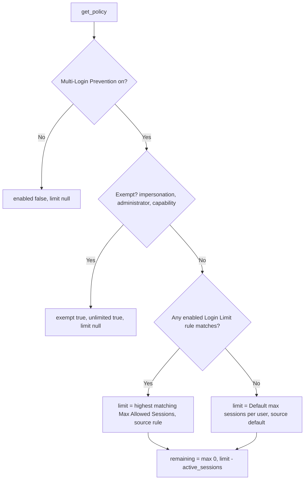

# Info
- Module: Developers
- Availability: Pro
- Last updated: 2026-10-18

# Read Login-Limit Policy

> Read the concurrent-session limit that applies to a member, why it applies, and how many sessions remain, without touching sessions or logging anyone out.

**Availability:** Pro. Requires ArraySubs core, ArraySubs Pro and an active Pro license. Limits are enforced only while **Enable Multi-Login Prevention** is on in **ArraySubs -> Member Access -> Login Limit**.

## Page Navigation

- **Current guide:** Read Login-Limit Policy
- **Where to open it:** Your custom plugin or theme code (PHP)
- **Section overview:** [Developers](./README.md)
- **Previous guide:** [Read Member Discounts](./discounts.md)
- **Next guide:** [Read Member Styling Rules](./member-styling.md)
- **Troubleshooting:** [Verify Your Integration](./errors-and-testing.md)

## Overview

`ArraySubsPro\Api\LoginLimits` is a read-only view of Multi-Login Prevention for one WordPress user. It answers four questions:

- Is Multi-Login Prevention on, and does it apply to this user?
- Is the user exempt (administrator, `manage_options` capability, or a Login as User session)?
- What is the session limit, and did it come from the default or from a Login Limit rule?
- How many valid sessions does the user have, and how many more fit under the limit?

The class never returns session tokens. It never creates, refreshes or destroys sessions, never runs the enforcement and never logs anyone out. Enforcement stays in the login flow described in [Multi-Login Prevention](../member-access/multi-login-prevention.md).

## When to Use This

- Show "Signed in on 2 of 3 devices" on a custom account page.
- Give support staff a tool that explains why a member keeps getting signed out.
- Mirror a plan's device allowance in your own app or API.
- Confirm before launch that a Login Limit rule gives a Team plan the limit you expect.

## Prerequisites

- ArraySubs and ArraySubs Pro active, with the Pro license active.
- Multi-Login Prevention set up as described in [Login Limit](../member-access/login-limit.md). This page does not repeat the merchant setup.
- Code that runs on `init` or later. Rule conditions read subscriptions by status, which needs the `init` timing. See [Connect Your Custom Plugin](./getting-started.md) for loading order and guards.

## How It Works

The reader resolves the policy in the same order the login enforcement does:

1. **Switch.** When **Enable Multi-Login Prevention** is off, `enabled` is `false` and no limit applies. This is a normal result, not an error.
2. **Exemptions.** The user is exempt when the current request is a Login as User session for this user (`impersonation`), or when the user holds the `manage_options` capability while **Apply to administrators** is off (`administrator` or `capability`).
3. **Rules.** Every enabled Login Limit rule is evaluated against the user with the shared Member Access condition builder. When one or more rules match, the highest **Max Allowed Sessions** value wins. The most permissive rule wins, not the first or the lowest.
4. **Default.** When no rule matches, **Default max sessions per user** applies.
5. **Count.** Active sessions are the user's own unexpired WordPress sessions. Login as User sessions are never counted.
6. **Remaining.** `remaining` is the limit minus the active sessions, never below 0.



Enforcement runs only when the user logs in. The new login always succeeds, and the oldest sessions beyond the limit are destroyed. Older browsers notice on their next page load or heartbeat check. The reader never performs this step, so reading the policy changes nothing for the member.

## Check Availability

| Situation | What your code sees |
| --- | --- |
| ArraySubs Pro not installed or not active | `class_exists( '\ArraySubsPro\Api\LoginLimits' )` returns `false` |
| Pro active, license inactive | `LoginLimits::for_user()` returns `WP_Error` code `module_unavailable` (data `reason` `license_inactive`) |
| Pro licensed, **Enable Multi-Login Prevention** off | The reader works; `get_policy()` returns `enabled` `false` |
| Pro licensed, switch on | The full policy |

`ArraySubs\Api\Availability::get( 'login_limits' )` gives the same answer without creating a reader. Its `reason` is `ok`, `pro_missing`, `license_inactive` or `setting_disabled` (switch off). While the switch is off, `Availability::check( 'login_limits' )` returns `module_unavailable`, but the reader itself still returns a policy with `enabled` `false`.

## `LoginLimits::for_user()`

Creates a reader for one WordPress user.

```text
ArraySubsPro\Api\LoginLimits::for_user( int $user_id ): LoginLimits|WP_Error
```

| Parameter | Type | Default | Description |
| --- | --- | --- | --- |
| `$user_id` | int | required | WordPress user ID. Must be a positive integer for an existing user. |

**Accepted inputs:** an integer user ID only. From an `ArraySubs\Api\Customer` or `WC_Customer`, pass `$customer->get_id()`. From a subscription, resolve the member with `Customer::from_subscription()` (see [Find Members and Update Profiles](./customers-and-profile-fields.md)). A `GuestCustomer` has no WordPress account and no login sessions, so there is no policy to read.

**Returns:** a `LoginLimits` instance for that user. The instance stores only the user ID. `get_policy()` and `get_active_session_count()` read the settings and the session store when you call them.

**Failure values:**

| Error code | When | `status` |
| --- | --- | --- |
| `invalid_argument` | `$user_id` is 0 or negative | 400 |
| `not_found` | No WordPress user has this ID | 404 |
| `module_unavailable` | Pro is active but its license is inactive (data `reason` `license_inactive`) | 503 |

**Permission boundary:** this is trusted server PHP. It does not check the current user's capabilities. Before you show one user's policy to someone else, check that the viewer is that user (`get_current_user_id()`) or holds a staff capability such as `manage_woocommerce`. Never infer permission from the requested user ID.

**Side effects:** read only, no writes.

## `get_policy()`

Returns the resolved policy for the reader's user.

```text
$limits->get_policy(): array
```

This method takes no parameters and never returns `WP_Error`.

**Return shape:**

```php
<?php
// Example: a member covered by a Team plan rule, signed in on one device.
$policy = [
    'enabled'         => true,
    'applicable'      => true,
    'exempt'          => false,
    'exempt_reason'   => null,                 // null | 'administrator' | 'capability' | 'impersonation'
    'limit'           => 2,                    // int >= 1, or null when no limit applies
    'unlimited'       => false,
    'source'          => [ 'type' => 'rule', 'rule_id' => 'team_plan_sessions' ],
    'active_sessions' => 1,
    'remaining'       => 1,                    // int >= 0, or null when no limit applies
];
```

| Key | Type | Meaning |
| --- | --- | --- |
| `enabled` | bool | **Enable Multi-Login Prevention** is on. |
| `applicable` | bool | A limit is enforced for this user: `enabled` is `true` and the user is not exempt. |
| `exempt` | bool | The user is exempt from session limits. |
| `exempt_reason` | string or null | `administrator`: the user has the administrator role and **Apply to administrators** is off. `capability`: the user holds `manage_options` through another role or a direct grant, and **Apply to administrators** is off. `impersonation`: the current request is a Login as User session for this user. `null` when not exempt. |
| `limit` | int or null | The maximum number of concurrent sessions. `null` when no limit applies (switch off or exempt). |
| `unlimited` | bool | `true` when the user is exempt, so no cap applies. |
| `source` | array | Where `limit` came from: `type` `default` (Default max sessions per user) or `rule` (a Login Limit rule), and `rule_id` (the winning rule's saved ID, or `null`). When `limit` is `null`, `source` reads `default` with `rule_id` `null`; check `enabled` and `exempt` instead. |
| `active_sessions` | int | Same value as `get_active_session_count()`. |
| `remaining` | int or null | `limit - active_sessions`, never below 0. `null` when no limit applies. |

### Disabled, unlimited and zero

| State | `enabled` | `applicable` | `exempt` | `limit` | `unlimited` | `remaining` |
| --- | --- | --- | --- | --- | --- | --- |
| Multi-Login Prevention off | `false` | `false` | `false` | `null` | `false` | `null` |
| Exempt user | `true` | `false` | `true` | `null` | `true` | `null` |
| Limited by the default | `true` | `true` | `false` | 1-100 | `false` | 0 or more |
| Limited by a rule | `true` | `true` | `false` | 1 or more | `false` | 0 or more |

- A disabled policy (`enabled` `false`) means nothing is enforced for anyone. It is not the same as an unlimited user.
- `limit` is never 0. The default accepts 1 to 100 and every rule allows at least one session, so "no sessions allowed" cannot be configured.
- `remaining` 0 does not block a login. The next login succeeds and signs out the oldest session.

### Which rule wins

- Only enabled rules are evaluated. Disabled rules never affect the result.
- When several rules match, the highest **Max Allowed Sessions** wins. When two matching rules share the highest value, `rule_id` names the first of them in the saved rule order.
- Rule conditions count active and trial subscriptions. A paused subscription counts only when your pause settings give paused members full access. The existing `arraysubs_member_access_statuses` filter receives the scope `session` for these checks.
- Feature Value conditions read plan features managed with ArraySubs Pro Feature Manager. See [Read and Update Feature Data](./feature-manager.md).

## `get_active_session_count()`

Counts the user's valid sessions.

```text
$limits->get_active_session_count(): int
```

- Counts the same sessions the enforcement counts: the user's own unexpired WordPress sessions.
- Login as User sessions started by an administrator are never counted.
- Works whether or not the switch is on and whether or not the user is exempt.
- Returns only a number. It never returns tokens, verifiers, IP addresses, user agents or login times.
- Browser tabs in the same browser usually share one session. "Remember Me" sessions count until they expire or are evicted.

**Side effects:** read only, no writes. Reading does not extend, refresh or clean up any session.

## Examples

### Show device usage on an account page

A minimal shortcode for a logged-in member. It prints nothing when Pro is unavailable, when the switch is off or when the member is exempt.

```php
<?php
add_action( 'init', function () {
    add_shortcode( 'my_device_usage', function () {
        if ( ! is_user_logged_in() || ! class_exists( '\ArraySubsPro\Api\LoginLimits' ) ) {
            return '';
        }

        $limits = \ArraySubsPro\Api\LoginLimits::for_user( get_current_user_id() );
        if ( is_wp_error( $limits ) ) {
            return ''; // License inactive or user missing: show nothing.
        }

        $policy = $limits->get_policy();
        if ( ! $policy['applicable'] ) {
            return ''; // Switch off, or this member is exempt.
        }

        $text = sprintf(
            /* translators: 1: active sessions, 2: session limit */
            _n(
                'You are signed in on %1$d of %2$d allowed device.',
                'You are signed in on %1$d of %2$d allowed devices.',
                (int) $policy['limit'],
                'my-plugin'
            ),
            (int) $policy['active_sessions'],
            (int) $policy['limit']
        );

        return '<p class="my-device-usage">' . esc_html( $text ) . '</p>';
    } );
} );
```

Place it on any page the member can open:

```text
[my_device_usage]
```

### Support endpoint with failure handling

A staff-only REST route that returns the policy for any user and turns each `WP_Error` into a matching HTTP response. The capability check is your web boundary; the API call itself does not check permissions.

```php
<?php
add_action( 'rest_api_init', function () {
    register_rest_route(
        'my-support/v1',
        '/login-policy/(?P<user_id>\d+)',
        [
            'methods'             => 'GET',
            'permission_callback' => function () {
                return current_user_can( 'manage_woocommerce' );
            },
            'callback'            => function ( WP_REST_Request $request ) {
                if ( ! class_exists( '\ArraySubsPro\Api\LoginLimits' ) ) {
                    return new WP_Error( 'my_support_unavailable', 'ArraySubs Pro is not active.', [ 'status' => 503 ] );
                }

                $limits = \ArraySubsPro\Api\LoginLimits::for_user( (int) $request['user_id'] );

                if ( is_wp_error( $limits ) ) {
                    // invalid_argument (400), not_found (404) or module_unavailable (503).
                    $data = (array) $limits->get_error_data();

                    return new WP_Error(
                        $limits->get_error_code(),
                        $limits->get_error_message(),
                        [ 'status' => (int) ( $data['status'] ?? 500 ) ]
                    );
                }

                // Safe to return: flags, counts and a rule ID. No tokens.
                return rest_ensure_response( $limits->get_policy() );
            },
        ]
    );
} );
```

### Tell members when a login signed out an older session

The enforcement runs on `wp_login` at priority 999. A callback at a lower priority runs first, and the new session already exists at that point, so it is part of the count. This example stores its own short-lived flag that your theme can turn into a notice.

```php
<?php
add_action( 'wp_login', function ( $user_login, $user ) {
    if ( ! class_exists( '\ArraySubsPro\Api\LoginLimits' ) ) {
        return;
    }

    $limits = \ArraySubsPro\Api\LoginLimits::for_user( (int) $user->ID );
    if ( is_wp_error( $limits ) ) {
        return;
    }

    $policy = $limits->get_policy();

    if ( $policy['applicable'] && $policy['active_sessions'] > $policy['limit'] ) {
        $signed_out = (int) $policy['active_sessions'] - (int) $policy['limit'];

        // Your own data: read it on the next page load to show a notice.
        set_transient( 'my_signed_out_' . (int) $user->ID, $signed_out, 10 * MINUTE_IN_SECONDS );
    }
}, 20, 2 );
```

## Edge Cases and Important Notes

- **Enforcement is login-time only.** Lowering a limit does not sign anyone out right away. Sessions above the new limit stay until the member's next login, which then removes the oldest ones. `remaining` reads 0 in the meantime.
- **The exemption follows a capability, not a role name.** Any user with `manage_options` is exempt while **Apply to administrators** is off. Turn the setting on to cap those accounts too.
- **Impersonation.** During a Login as User session for this member, `get_policy()` reports `exempt_reason` `impersonation`. To read the member's own cap, call it from a request that is not impersonating, such as an admin screen, a REST call or WP-CLI.
- **The highest limit wins.** Overlapping rules never reduce a member to a lower plan's limit.
- **Guests have no policy.** Logged-out visitors have no sessions. Do not create a reader for user ID 0.
- **Pro deactivated or license inactive.** Enforcement stops, saved Login Limit rules stay in settings, and the reader is either absent or returns `module_unavailable`. Guard every call.
- **Changing the policy.** This class is read only. Change limits in **Member Access -> Login Limit**.
- **Caching.** Session counts change with every login, logout and expiry. Do not store the result in page caches shared between visitors.

## Troubleshooting

| Problem | Likely Cause | What to Do |
| --- | --- | --- |
| `class_exists( '\ArraySubsPro\Api\LoginLimits' )` is `false` | ArraySubs Pro is not active, or core failed its dependency check | Activate ArraySubs and ArraySubs Pro, then call the class on `init` or later. |
| `for_user()` returns `module_unavailable` | The Pro license is inactive | Activate the license, then check `Availability::get( 'login_limits' )` reports `ok`. |
| `enabled` is `false` | **Enable Multi-Login Prevention** is off | Turn it on in **Member Access -> Login Limit** and save. |
| `limit` is `null` for an administrator | The user holds `manage_options` and **Apply to administrators** is off | Expected. Turn the setting on only if those accounts should be capped. |
| `exempt_reason` is `impersonation` | The call ran inside a Login as User session | Read the policy from a request that is not impersonating the member. |
| `source.type` is `default` but a rule should match | The rule is disabled or its conditions do not match the member | Check the rule toggle and conditions, such as the subscription status and product. |
| `active_sessions` is higher than `limit` | The limit was lowered after the sessions started | Expected. The member's next login removes the extra sessions. |
| The count ignores a support session | Login as User sessions are never counted | Expected behavior. |

## Related Guides

- [Login Limit](../member-access/login-limit.md) - Merchant setup for the global default and Login Limit rules.
- [Multi-Login Prevention](../member-access/multi-login-prevention.md) - What members experience when a limit is enforced.
- [Login as User](../login-as-user/README.md) - Why impersonation sessions are excluded.
- [Check Content Access](./member-access.md) - The shared condition model the rules use.
- [Find Members and Update Profiles](./customers-and-profile-fields.md) - Resolve the user ID from a customer or subscription.
- [Connect Your Custom Plugin](./getting-started.md) - Loading order, guards and availability checks.
- [Verify Your Integration](./errors-and-testing.md) - Error handling and side-effect checks.

## FAQ

### Does reading the policy log anyone out?
No. The reader never creates, touches or destroys sessions. Only a real login runs the enforcement.

### Can I change a member's limit with this class?
No. It is read only. Change the default or the Login Limit rules in **ArraySubs -> Member Access -> Login Limit**.

### Why is `limit` null?
Either Multi-Login Prevention is off (`enabled` `false`) or the member is exempt (`unlimited` `true`). Read those two keys to know which.

### Can a limit be zero?
No. The default and every rule allow at least one session.

### Do Login as User sessions count toward the limit?
No. They are never counted and never evicted.

### Which rule wins when several match?
The rule with the highest **Max Allowed Sessions** value. `source.rule_id` names it.

### Does the API return session tokens or devices?
No. It returns flags, counts and a rule ID only.
