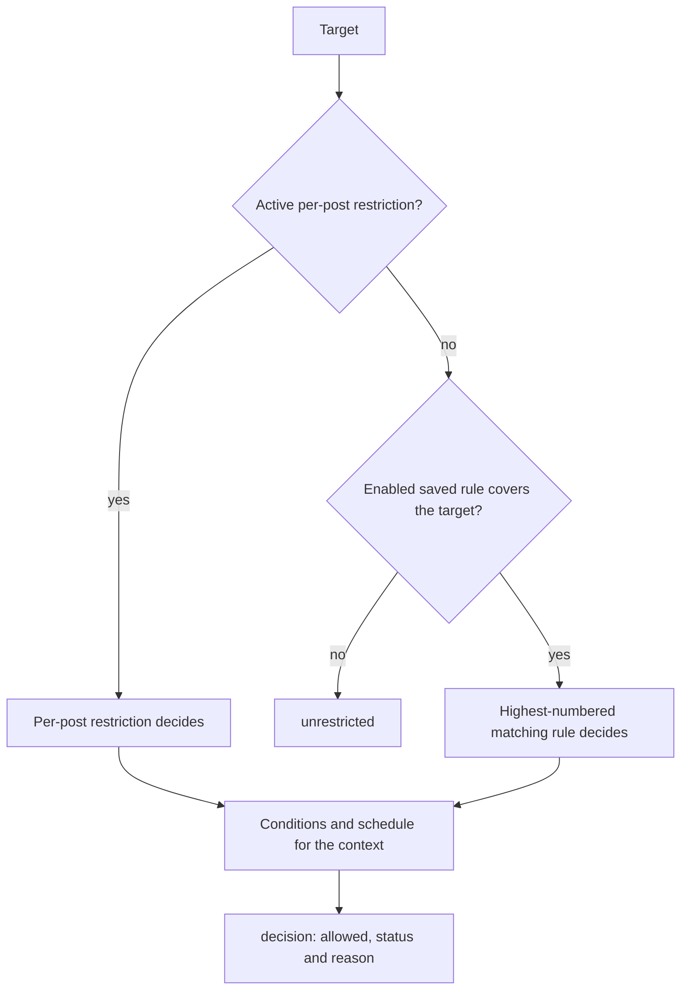

# Info
- Module: Developers
- Last updated: 2026-10-31

# Check Content Access

> Ask ArraySubs from your own PHP whether a customer, one of their subscriptions or a logged-out visitor passes a conditions array or the saved Members Access rules for a post, a URL, a product or a comment thread, without redirecting, rendering or switching users.


## Page Navigation

- **Current guide:** Check Content Access
- **Where to open it:** Your custom plugin or theme code (PHP)
- **Section overview:** [Developers](./README.md)
- **Previous guide:** [Read and Update Feature Data](./feature-manager.md)
- **Next guide:** [Read Download Benefits](./downloads.md)
- **Troubleshooting:** [Verify Your Integration](./errors-and-testing.md)

## Overview

`ArraySubs\Developer\MemberAccess` is a read-only reader over Members Access for one member context. Create it for a user, a customer, a subscription or a logged-out visitor, then:

- `evaluateConditions()` tests a conditions array that you pass and returns `true` or `false`.
- `check()` returns the decision that the saved rules give for a post, a URL, a product purchase or a post's comments, with the deciding rule, its schedule and the reason.
- `rules()` lists the saved Post Types, URL, Shop Access and Comment rules with their evaluation for the context.

```box class="info-box"
Every method evaluates the user ID and subscription ID that the factory fixed. Nothing logs anyone in, calls `wp_set_current_user()` or changes `get_current_user_id()`, so you can check any member from cron, WP-CLI, an admin screen or a REST callback. Reads never redirect, print a denial message, send headers, filter queries, assign roles or write rules, meta or orders.
```

Other member benefits have their own readers: [Read Download Benefits](./downloads.md), [Read Member Discounts](./discounts.md), [Read Login-Limit Policy](./login-limits.md) and [Read Member Styling Rules](./member-styling.md). Role Mapping and Purchase Limit rules are not part of this class. The template helpers (`arraysubs_user_can_access()`, `arraysubs_user_meets_conditions()`) and the `[arraysubs_restrict]` shortcode are documented in [Gate Custom PHP Output](./php-templates.md).

## Before You Start

- ArraySubs must be active. Guard every call with `class_exists( '\ArraySubs\Developer\MemberAccess' )`; the class cannot load when core fails its dependency check. See [Connect Your Custom Plugin](./getting-started.md).
- Call the reader after `init`, for example in a template, on `template_redirect`, in a REST callback or in an admin screen. Conditions read subscriptions by status, and subscription statuses are registered on `init`.
- The merchant configures the rules: [Member Access and Restrictions](../member-access/README.md), [Per-Post Access Restriction](../member-access/per-post-access-restriction.md), [URL](../member-access/url.md), [Post Types](../member-access/post-types.md), [Shop Access](../member-access/ecommerce.md) and [Comment Restrictions](../member-access/comments.md).
- This is trusted server PHP. It checks no capabilities and no ownership. Before you answer for a member other than the viewer, check at your own boundary that the viewer is that member or holds a staff capability such as `manage_woocommerce`.

## How It Works

1. A factory fixes the context: a user ID (0 for a logged-out visitor), or one subscription together with its customer.
2. `evaluateConditions()` evaluates only the array you pass.
3. `check()` finds the rule that owns the target: an active per-post restriction first, otherwise the enabled saved rule with the highest number (the one lowest in its list) whose target covers it. That rule's conditions and schedule decide; lower matching rules never run.
4. Members Access status rules decide which subscription statuses count (see [Statuses That Grant Access](#statuses-that-grant-access)).



### Subscription context versus customer context

| Condition family | `fromSubscriptionId()` | `fromUserId()`, `fromUser()`, `fromCustomer()` | `fromUserId( 0 )` (logged out) |
| --- | --- | --- | --- |
| Subscription status, product and variation conditions | Only this subscription | Any of the customer's subscriptions; each clause can be met by a different one | Fail, except the `has_not_*` types, which pass |
| Feature Value | Only this subscription's plan, while its status grants access | Plans of the customer's subscriptions plus products bought in completed or processing orders | Fail |
| Role, lifetime spend, purchases | The subscription's customer | The customer | Fail |
| Login status | Logged in | Logged in | Logged out |
| Schedules (drip delays) | Count from this subscription's start date | Count from the earliest start among subscriptions that satisfy the rule on their own | Never unlock |

When one subscription must satisfy every clause of an AND, use `fromSubscriptionId()`.

## Create a Reader

Every factory is inherited from the shared member context (`ArraySubs\Developer\MemberContext`) and returns a reader or a `WP_Error`. The constructor is not public.

| Method | Arguments | Returns | Notes |
| --- | --- | --- | --- |
| `MemberAccess::fromUserId()` | `int $user_id` | `MemberAccess` or `WP_Error` | All of the user's subscriptions. `0` is a logged-out visitor. A negative ID, or an ID with no WordPress user, returns `invalid_customer`. |
| `MemberAccess::fromUser()` | `WP_User $user` | `MemberAccess` or `WP_Error` | Same as `fromUserId( $user->ID )`. |
| `MemberAccess::fromCustomer()` | `WC_Customer $customer` | `MemberAccess` or `WP_Error` | Same as `fromUserId( $customer->get_id() )`. Accepts `ArraySubs\Developer\Customer`, which extends `WC_Customer`. An unsaved customer has ID 0 and gives a logged-out context. |
| `MemberAccess::fromSubscriptionId()` | `int $subscription_id` | `MemberAccess` or `WP_Error` | Only that subscription, for its customer. Returns `invalid_subscription` when the ID is not a subscription, and `invalid_customer` when the subscription has no valid customer account (for example a guest checkout). |
| `MemberAccess::fromSubscription()` | `WP_Post $subscription` | `MemberAccess` or `WP_Error` | Same as `fromSubscriptionId( $subscription->ID )`. |
| `$access->context()` | none | `array` | `user_id` (int) and `subscription_id` (int, or `null` for a user context). |
| `MemberAccess::supportedEntities()` | none | `string[]` | Static. `[ 'post', 'url', 'product', 'comments' ]`. |

```php
<?php
// Choose a member, one subscription, or a logged-out visitor as the scope for subsequent checks.
if ( class_exists( '\ArraySubs\Developer\MemberAccess' ) ) {
    $member  = \ArraySubs\Developer\MemberAccess::fromUserId( 123 );         // A customer.
    $plan    = \ArraySubs\Developer\MemberAccess::fromSubscriptionId( 456 ); // One subscription.
    $visitor = \ArraySubs\Developer\MemberAccess::fromUserId( 0 );           // Logged out.

    if ( ! is_wp_error( $plan ) ) {
        $context = $plan->context(); // [ 'user_id' => 123, 'subscription_id' => 456 ]
    }
}
```

## Conditions Format

`evaluateConditions()` accepts the same tree that saved rules store.

```php
<?php
// Require active/trial status AND either plan 123 or the vip_member role.
$conditions = [
    'logic' => 'and',
    'rules' => [
        [ 'type' => 'subscription_status', 'statuses' => [ 'active', 'trial' ] ],
        [
            'type'  => 'group',
            // The nested group needs only one match; the outer group still requires every top-level rule.
            'logic' => 'or',
            'rules' => [
                [ 'type' => 'has_active_subscription', 'product_ids' => [ 123 ] ],
                [ 'type' => 'user_role', 'roles' => [ 'vip_member' ] ],
            ],
        ],
    ],
];
```

- `logic` is `and` or `or`, trimmed and case-insensitive. Missing, empty and unknown values mean `and`.
- `rules` is a list of rule arrays. **An empty or missing list passes**: a rule with no conditions applies to everyone, including logged-out visitors. Never rely on an empty list as protection.
- An entry that is not an array, or that has a missing or unknown `type`, fails instead of being skipped.
- A `group` entry carries its own `logic` and `rules` and can be nested to any depth.
- Pass IDs as integers. `has_active_subscription` and `has_subscription_variation` compare IDs strictly, so `'123'` does not match.

| `type` | Keys and defaults | Passes when |
| --- | --- | --- |
| `subscription_status` | `statuses`: `active`, `trial`, `paused`, `on-hold`, `pending`, `cancelled`, `expired` (full `arraysubs-*` slugs also work). Default `[ 'active' ]`; an empty list fails. | A subscription in the context has one of the listed statuses. Ignores the pause access setting. |
| `has_active_subscription` | `product_ids`: int[], optional | A subscription in a status that grants access exists; with `product_ids`, its parent product ID is listed. A variation ID never matches here. |
| `has_not_subscription` | `product_ids`: int[], optional | `has_active_subscription` with the same keys fails. |
| `has_subscription_variation` | `variation_ids`: int[], required (an empty list fails) | A subscription in a status that grants access is for one of the listed variations. |
| `has_not_subscription_variation` | `variation_ids`: int[], optional | With IDs, the inverse of `has_subscription_variation`. Without IDs, no subscription in a status that grants access is for any variation. |
| `user_login_status` | `login_status`: `logged_in` (default) or `logged_out` | The context's user ID is above 0 (`logged_in`) or is 0 (`logged_out`). |
| `user_role` | `roles`: role slugs, required | The user has any listed role. |
| `lifetime_spent` | `operator` (default `>=`), `amount` (default 0) | The customer's WooCommerce total spent compares true. |
| `purchased_product` | `product_ids`: required | The customer bought any listed product in a paid order; a variable product also matches its variations. |
| `purchased_variation` | `variation_ids`: required | The customer bought any listed variation. |
| `purchased_from_group` | `taxonomy` (such as `product_cat`) and `term_ids`, both required | The customer bought, in a completed or processing order, a product that has any listed term. |
| `feature_value` | `feature_key` (the exact feature name, required), `operator` (default `>=`), `value` (default 0), `aggregation`: `sum` (default), `max` or `any` | The combined feature value compares true. |
| `group` | `logic`, `rules` | Its own rules pass under its own logic. |

Comparison operators for `lifetime_spent` and `feature_value` are `=` (or `==`), `!=` (or `<>`), `>`, `>=`, `<` and `<=`. An unknown operator fails.

**Feature Value details.** Each plan or purchased product counts once. Toggles count as 1 or 0, numbers as numbers, and a number feature set to Unlimited makes `sum` and `max` unlimited. Text features are skipped by `sum` and `max`. `any` passes when any value is on, above 0 or non-empty text. A variation with no features of its own uses its parent product's features. The value is the configured amount, not remaining usage; for usage see [Read and Update Feature Data](./feature-manager.md).

### Statuses That Grant Access

Conditions that do not name statuses (`has_active_subscription`, the variation types and Feature Value) count only subscriptions in a status that grants access for the action being checked:

| Scope | Used by | Statuses that count |
| --- | --- | --- |
| `view` | `evaluateConditions()`, `check( 'post' )`, `check( 'url' )`, Post Types and URL rules | Active and trial, plus paused when **Content Access** is Limited or Full |
| `purchase` | `check( 'product' )`, Shop Access rules | Active and trial, plus paused only when **Content Access** is Full |
| `interact` | `check( 'comments' )`, Comment rules | Active and trial, plus paused only when **Content Access** is Full |

**Content Access** is set at **ArraySubs -> Settings -> Skip & Pause**, under **Access During Pause** (see [Access Behavior During Pause States](../member-access/session-and-frontend-controls.md)). The existing `arraysubs_member_access_statuses` filter receives `( array $statuses, string $scope, string $mode )` and can change the list. A `subscription_status` condition always targets the statuses it names.

## `evaluateConditions()`

```text
// Evaluate the supplied condition tree in this reader's scope; this does not render a message or redirect.
$access->evaluateConditions( array $conditions ): bool
```

| Parameter | Type | Default | Description |
| --- | --- | --- | --- |
| `$conditions` | array | required | A conditions tree as described in [Conditions Format](#conditions-format). |

Returns `true` when the context passes the tree under the `view` scope. It loads no saved rules, adds no login requirement, applies no administrator bypass and evaluates no schedule. It never returns `WP_Error`: malformed parts fail closed.

**Side effects:** read only. Each call clears the request-level condition and schedule caches first, so a check made after your own changes in the same request sees them.

## `check()`

```text
// Check a post or URL target and inspect the returned decision; handle invalid targets as WP_Error.
$access->check( string $entity, mixed $target, array $fields = [] ): array|WP_Error
```

| Parameter | Type | Default | Description |
| --- | --- | --- | --- |
| `$entity` | string | required | One of `MemberAccess::supportedEntities()`. Anything else returns `unsupported_entity`. |
| `$target` | mixed | required | What to check. See the table below. |
| `$fields` | string[] | `[]` | Result groups to keep: `context`, `target`, `availability`, `decision`, `rule`, `precedence`. Empty keeps all. An unknown name returns `invalid_field`. |

| `$entity` | `$target` accepts | Decided by, in order | Scope |
| --- | --- | --- | --- |
| `post` | A post ID (int) or `WP_Post` of any post type | The post's per-post restriction, then Post Types rules | `view` |
| `url` | A root-relative path such as `/members/library/`, or an absolute `http`/`https` URL on this site's host and port | The per-post restriction of the post the URL resolves to (`url_to_postid()`), then URL rules matched on the path | `view` |
| `product` | A product or variation ID (int) or `WP_Post`. For a `WC_Product`, pass `$product->get_id()` | The product's per-post restriction (a variation inherits its parent's unless it has its own), then Shop Access rules | `purchase` |
| `comments` | A post ID (int) or `WP_Post` | The post's per-post restriction, then Comment rules | `interact` |

Numeric strings are not accepted as IDs; cast them with `(int)` or `absint()` first. For URLs the query string is ignored and matching is case-insensitive. A path listed in a rule's exclusions is not covered by that rule, so another matching rule can still decide it. Post Types rules are not part of a `url` decision and URL rules are not part of a `post` decision, so check both when you need the answer for a real page visit.

**Return shape** (a URL rule with a 52-week drip delay, checked for one subscription):

```php
<?php
// Example denied decision: the conditions match, but the rule's scheduled unlock time has not arrived.
$result = [
    'context'      => [ 'user_id' => 123, 'subscription_id' => 456 ],
    'target'       => [ 'entity' => 'url', 'id' => null, 'url' => '/members/library/' ],
    'availability' => [ 'available' => true, 'enabled' => true ],
    'decision'     => [
        'allowed'      => false,
        'status'       => 'denied',
        'reason'       => 'schedule_pending',
        'evaluated_at' => 1792327059,
    ],
    'rule'         => [
        'id'                      => 'rule_members_library',
        'enabled'                 => true,
        'source'                  => 'saved_rule',
        'source_post_id'          => null,
        'conditions'              => [
            'logic' => 'and',
            'rules' => [ [ 'type' => 'subscription_status', 'statuses' => [ 'active' ] ] ],
        ],
        'conditions_met'          => true,
        'schedule'                => [ 'enabled' => true, 'satisfied' => false, 'unlocks_at' => 1811943141 ],
        'qualifies'               => false,
        'source_subscription_ids' => [ 456 ],
    ],
    'precedence'   => [
        'policy'              => 'post_config_then_highest_saved_rule',
        'winning_rule_id'     => 'rule_members_library',
        'matching_rule_count' => 2,
        'shadowed_rule_count' => 1,
    ],
];
```

| Key | Type | Meaning |
| --- | --- | --- |
| `context` | array | `user_id` and `subscription_id` of the reader. |
| `target` | array | `entity`; `id`: the post or product ID, or for `url` the post the URL resolves to (`null` when it resolves to none); `url`: the URL exactly as you passed it (`null` for other entities). |
| `availability` | array | `available` (always `true`, core feature) and `enabled` (the Members Access setting). |
| `decision.allowed` | bool | The answer. Gate on this key. |
| `decision.status` | string | `unrestricted` (no rule covers the target, or Members Access is off), `conditional` (a rule covers it and allows the context) or `denied`. |
| `decision.reason` | string | See [Reasons](#reasons). |
| `decision.evaluated_at` | int | Unix timestamp of the read. |
| `rule` | array or null | The deciding rule, or `null` when no rule covers the target. Keys are listed below. |
| `precedence.policy` | string | Always `post_config_then_highest_saved_rule`. |
| `precedence.winning_rule_id` | string or null | The deciding rule's ID; an empty string for a per-post restriction; `null` when no rule decided. |
| `precedence.matching_rule_count` | int | Enabled rules that cover the target, counting an active per-post restriction as one. |
| `precedence.shadowed_rule_count` | int | Covering rules that lost to the deciding one (`matching_rule_count` minus 1, never below 0). |

Rule keys (the same keys as `rules()` items, without `domain`):

| Key | Type | Meaning |
| --- | --- | --- |
| `id` | string | The saved rule ID. Empty for per-post restrictions. |
| `enabled` | bool | The rule's own toggle. |
| `source` | string | `saved_rule` for saved rules (in `check()`, a Post Types rule that decides a `post` reports `cpt_rule`); `post_config` for a per-post restriction; `post_meta` for a per-post condition list stored without the editor configuration. A rule added by a filter can set its own `source`. |
| `source_post_id` | int or null | For a per-post restriction, the post it was read for (the checked post, or the post a URL resolves to); `null` for saved rules. |
| `conditions` | array | The rule's condition tree with `logic` normalized. For a per-post restriction, the conditions built from its editor settings. With **Only login is required** on, the decision follows the login state alone, whatever `conditions_met` says. |
| `conditions_met` | bool | The conditions pass for this context. |
| `schedule` | array | `enabled` (bool), `satisfied` (bool, `true` without a schedule) and `unlocks_at`: the Unix timestamp (UTC) when the delay ends for this context, or `null` without a schedule, without a qualifying subscription, or for a logged-out visitor. Per-post restrictions have no schedule. |
| `qualifies` | bool | `enabled`, `conditions_met` and `schedule.satisfied` are all `true`. |
| `source_subscription_ids` | int[] | When `conditions_met` is `true`: the context's subscriptions that satisfy the conditions on their own. Empty otherwise. |

`rule`, `precedence` and `rules()` items expose merchant configuration (rule IDs, product IDs, roles, feature names). Show them only in staff tools. For customers, request `[ 'decision' ]`.

**Side effects:** read only. The configured denial action (message, redirect, 404 or blocked purchase) is never applied.

### Reasons

| `decision.reason` | `allowed` | When |
| --- | --- | --- |
| `module_disabled` | `true` | The Members Access setting is off. ArraySubs enforces no rule, so `status` is `unrestricted`. |
| `no_matching_rule` | `true` | No enabled rule covers the target. |
| `conditions_satisfied` | `true` | The deciding rule's conditions and schedule pass. |
| `conditions_failed` | `false` | The deciding rule's conditions fail. |
| `schedule_pending` | `false` | The conditions pass, but the drip delay has not ended. Read `rule.schedule.unlocks_at`. |
| `administrator_bypass` | `true` | A per-post restriction with **Always Show To Admins** on, and the context user has `manage_options`. |
| `login_only_allowed` | `true` | A per-post restriction with **Only login is required** on, and the context has a user. |
| `login_required` | `false` | The same login-only restriction, checked for a logged-out visitor. |
| `privileged_bypass` | `true` | A Shop Access or Comment rule decides a `product` or `comments` target, and the context user has `manage_options` or `manage_woocommerce`. |
| `extension_allowed`, `extension_denied` | `true`, `false` | The final answer differs from the rule's own evaluation, for example because a callback on `arraysubs_ecommerce_user_has_access` or `arraysubs_comment_restriction_for_post` changed it, or a comment moderator (`moderate_comments`) bypassed a Comment rule. `extension_denied` also appears when a comment filter restricts a post that no rule covers. |

Post Types and URL rules have no administrator bypass: an administrator context gets the same answer as any other user who meets or fails the conditions.

### Comments decisions

For `comments`, `allowed` is `true` only when no comment restriction applies to the context. A failing context is reported as denied whatever the rule's restriction mode (**Hide comments + block posting**, **Allow reading, block posting** or **Hide comments, allow posting**); the decision does not say which mode. WordPress discussion settings, such as closed comments, are not part of the decision.

## `rules()`

Lists the saved rules of the Post Types, URL, Shop Access and Comment tabs, in that order and in saved order within each tab, and evaluates each one for the reader's context. Disabled rules are included.

```text
// List matching access rules page by page, including qualification and scheduling details.
$access->rules( array $args = [] ): array|WP_Error
```

| Argument | Type | Default | Description |
| --- | --- | --- | --- |
| `page` | int | `1` | Page number, 1 or more. |
| `per_page` | int | `20` | Items per page, 1 to 100. |
| `include` | array | none | Up to 100 rule IDs. Only those rules are listed, and `total` counts them. |
| `fields` | string[] | `[]` | Item keys to keep: `domain` plus the rule keys of `check()`. Empty keeps every key. An unknown key returns `invalid_field`. |
| `output` | string | `data` | `data` returns item arrays; `ids` returns a list of rule ID strings. |

Any other argument returns `invalid_query`.

| `domain` | Admin tab | Scope |
| --- | --- | --- |
| `cpt` | Post Types | `view` |
| `url` | URL | `view` |
| `ecommerce` | Shop Access | `purchase` |
| `comment` | Comments | `interact` |

**Return shape:**

```php
<?php
// Example rule page: a rule can be enabled but still fail this member's conditions.
$page = [
    'items'     => [
        [
            'domain'                  => 'url',
            'id'                      => 'rule_members_library',
            'enabled'                 => true,
            'source'                  => 'saved_rule',
            'source_post_id'          => null,
            'conditions'              => [ 'logic' => 'and', 'rules' => [ [ 'type' => 'has_active_subscription', 'product_ids' => [ 123 ] ] ] ],
            'conditions_met'          => false,
            'schedule'                => [ 'enabled' => false, 'satisfied' => true, 'unlocks_at' => null ],
            'qualifies'               => false,
            'source_subscription_ids' => [],
        ],
    ],
    'page'      => 1,
    'per_page'  => 20,
    'has_more'  => false,
    'next_page' => null, // Next page number while has_more is true.
    'total'     => 1,
];
```

`rules()` reads the saved rules directly. Rules that other plugins add through the `arraysubs_ecommerce_restriction_rules`, `arraysubs_comment_rules` or `arraysubs_comment_restriction_rules` filters are not listed here, but they can still decide `check()`.

**Side effects:** read only.

## Examples

### Gate a template fragment for the current visitor

```php
<?php
/**
 * Print member-only markup when the visitor may view a post under the saved rules.
 */
function myplugin_render_member_box( int $post_id ): void {
    if ( ! class_exists( '\ArraySubs\Developer\MemberAccess' ) ) {
        return; // Fail closed when ArraySubs is unavailable.
    }

    // get_current_user_id() is 0 for a logged-out visitor, which is a valid context.
    $access = \ArraySubs\Developer\MemberAccess::fromUserId( get_current_user_id() );
    if ( is_wp_error( $access ) ) {
        return;
    }

    $result = $access->check( 'post', $post_id, [ 'decision' ] );
    if ( is_wp_error( $result ) || ! $result['decision']['allowed'] ) {
        return;
    }

    echo '<div class="myplugin-member-box">' . esc_html__( 'Member resources', 'myplugin' ) . '</div>';
}
```

The decision covers ArraySubs rules only. Draft, private and password-protected posts still need the usual WordPress checks.

### Require one subscription to satisfy every clause

```php
<?php
/**
 * True only when this one subscription is active or in trial, is for product 123,
 * and its own plan includes at least 5 projects.
 */
function myplugin_subscription_unlocks_studio( int $subscription_id ): bool {
    if ( ! class_exists( '\ArraySubs\Developer\MemberAccess' ) ) {
        return false;
    }

    $access = \ArraySubs\Developer\MemberAccess::fromSubscriptionId( $subscription_id );
    if ( is_wp_error( $access ) ) {
        return false; // invalid_subscription or invalid_customer.
    }

    return $access->evaluateConditions(
        [
            'logic' => 'and',
            'rules' => [
                [ 'type' => 'subscription_status', 'statuses' => [ 'active', 'trial' ] ],
                [ 'type' => 'has_active_subscription', 'product_ids' => [ 123 ] ],
                [
                    'type'        => 'feature_value',
                    'feature_key' => 'Projects',
                    'operator'    => '>=',
                    'value'       => 5,
                    'aggregation' => 'max',
                ],
            ],
        ]
    );
}
```

With `fromUserId()` the same tree can pass when different subscriptions meet different clauses, and Feature Value also counts purchased products.

### Tell a member when a section unlocks

```php
<?php
/**
 * Returns an escaped notice when a URL rule's drip delay is still running for the member.
 */
function myplugin_unlock_notice( int $user_id, string $path ): string {
    if ( ! class_exists( '\ArraySubs\Developer\MemberAccess' ) ) {
        return '';
    }

    $access = \ArraySubs\Developer\MemberAccess::fromUserId( $user_id );
    if ( is_wp_error( $access ) ) {
        return '';
    }

    $result = $access->check( 'url', $path, [ 'decision', 'rule' ] );
    if ( is_wp_error( $result ) || 'schedule_pending' !== $result['decision']['reason'] ) {
        return '';
    }

    $unlocks_at = $result['rule']['schedule']['unlocks_at'];
    if ( ! $unlocks_at ) {
        return ''; // No qualifying subscription, so there is no unlock date.
    }

    /* translators: %s: unlock date. */
    $text = sprintf( __( 'This section unlocks on %s.', 'myplugin' ), wp_date( get_option( 'date_format' ), $unlocks_at ) );

    return '<p class="myplugin-unlock-notice">' . esc_html( $text ) . '</p>';
}
```

### Answer a customer request at your own REST boundary

```php
<?php
add_action(
    'rest_api_init',
    function () {
        register_rest_route(
            'myplugin/v1',
            '/subscriptions/(?P<id>\d+)/can-view/(?P<post>\d+)',
            [
                'methods'             => 'GET',
                // Login is only the first check; verify subscription ownership before returning the decision.
                'permission_callback' => 'is_user_logged_in',
                'callback'            => 'myplugin_rest_can_view',
            ]
        );
    }
);

function myplugin_rest_can_view( WP_REST_Request $request ) {
    if ( ! class_exists( '\ArraySubs\Developer\MemberAccess' ) ) {
        return new WP_Error( 'myplugin_unavailable', __( 'Membership checks are unavailable.', 'myplugin' ), [ 'status' => 503 ] );
    }

    $access = \ArraySubs\Developer\MemberAccess::fromSubscriptionId( absint( $request['id'] ) );

    // Ownership is your job: the context names the subscription's customer.
    if ( is_wp_error( $access ) || get_current_user_id() !== $access->context()['user_id'] ) {
        return new WP_Error( 'myplugin_not_found', __( 'Subscription not found.', 'myplugin' ), [ 'status' => 404 ] );
    }

    $result = $access->check( 'post', absint( $request['post'] ), [ 'decision' ] );
    if ( is_wp_error( $result ) ) {
        // invalid_target: the post does not exist. ArraySubs errors carry no HTTP status.
        return new WP_Error( 'myplugin_bad_target', $result->get_error_message(), [ 'status' => 404 ] );
    }

    return [
        'allowed' => $result['decision']['allowed'],
        'reason'  => $result['decision']['reason'],
    ];
}
```

Only the `decision` group leaves the server, so the response contains no rule configuration.

## Errors

| Code | Returned by | When |
| --- | --- | --- |
| `invalid_customer` | `fromUserId()`, `fromUser()`, `fromCustomer()`, `fromSubscriptionId()`, `fromSubscription()` | The user ID is negative or no WordPress user has it, or the subscription has no valid customer account. |
| `invalid_subscription` | `fromSubscriptionId()`, `fromSubscription()` | The ID is 0 or not an ArraySubs subscription. |
| `unsupported_entity` | `check()` | `$entity` is not `post`, `url`, `product` or `comments`. |
| `invalid_target` | `check()` | `url`: empty, starting with `//`, another host or port, a scheme other than `http`/`https`, or a URL with credentials. Other entities: the target is not an int or `WP_Post`, the post does not exist, or (for `product`) it is not a WooCommerce product. |
| `invalid_field` | `check()`, `rules()` | An unknown group in `$fields`, or an unknown item key in the `fields` argument. |
| `invalid_query` | `rules()` | An unknown argument; `page` below 1; `per_page` outside 1 to 100; `output` other than `data` or `ids`; `fields` that is not an array; `include` that is not an array of up to 100 non-empty IDs. |

These errors carry no error data, so map them to your own HTTP status codes in REST responses.

## Edge Cases and Important Notes

- **No denial actions.** A read never redirects, prints the restricted message, returns a 404 or blocks a purchase. Your code decides what to render.
- **Members Access off.** Factories still work. `check()` returns `allowed` with reason `module_disabled`, and `evaluateConditions()` still evaluates the tree you pass.
- **Fresh within a request.** Each call clears the condition and schedule caches first, so a check made after your own changes in the same request reflects them.
- **Caches.** Purchase and spend conditions read WooCommerce order data and can fill the same purchase-history caches (transients) that a page view fills. No ArraySubs rules, roles, subscriptions or orders change.
- **Variations.** `has_active_subscription` and Shop Access product targets match parent products. Use `has_subscription_variation` for a specific variation.
- **Page caching.** Output personalized from a decision must not be served from a shared page cache to other visitors.

## Troubleshooting

| Problem | Likely Cause | What to Do |
| --- | --- | --- |
| `class_exists( '\ArraySubs\Developer\MemberAccess' )` is `false` | ArraySubs is not active or failed its dependency check | Activate WooCommerce and ArraySubs, then call the class after `init`. |
| `unrestricted` for a page you expected to be gated | No enabled rule of that type covers it, or a URL rule protects it while you checked `post` | Read `rules()`; for a page visit check both `url` and `post`. |
| A subscription context denies while the customer context allows | The customer's clauses were met by different subscriptions | Expected. Use `fromSubscriptionId()` when one subscription must meet every clause. |
| A paused member fails `has_active_subscription` | **Content Access** is No access, or Limited while you check `product` or `comments` | Review **Access During Pause**, or add an explicit `subscription_status` clause for `paused`. |
| `has_active_subscription` with a variation ID never passes | That type compares parent product IDs | Use `has_subscription_variation` with `variation_ids`. |
| A product clause never passes | IDs passed as strings | Pass integers, for example `[ 123 ]`. |
| `schedule_pending` with `unlocks_at` `null` | The conditions pass, but no subscription qualifies for the schedule | Check the statuses the rule names and the member's subscription start dates. |
| `invalid_target` for a URL | Another host, a protocol-relative URL, or an empty string | Pass a root-relative path or a URL on this site. |
| `invalid_target` for a post that exists | The ID was passed as a string | Cast it with `absint()`. |

## Related Guides

- [Gate Custom PHP Output](./php-templates.md) - Template helper functions and the `[arraysubs_restrict]` shortcode.
- [Read and Update Feature Data](./feature-manager.md) - Feature values and usage behind Feature Value conditions.
- [Read Lifecycle State and Manage Its Dates](./status-grace-periods-and-trials.md) - The subscription statuses behind access.
- [Find Members and Update Profiles](./customers-and-profile-fields.md) - Resolve the customer for a context.
- [Read Download Benefits](./downloads.md) and [Read Member Discounts](./discounts.md) - Readers built on the same member context.
- [Verify Your Integration](./errors-and-testing.md) - Error handling and staging checks.
- [Member Access and Restrictions](../member-access/README.md) - The merchant guide to rules and conditions.
- [Scheduled / Drip Access](../member-access/scheduled-drip-access.md) and [Conflicts](../member-access/conflicts.md) - Schedules and rule overlaps in the admin.

## FAQ

### Does a check redirect the visitor or show the restricted message?

No. Every method only returns data. The configured message, redirect, 404 or purchase block is never applied by a read.

### Can I check a member who is not the current visitor?

Yes. `MemberAccess::fromUserId( 123 )` or `fromSubscriptionId( 456 )` evaluates that member without logging in as them; `get_current_user_id()` is unchanged. Use `fromUserId( 0 )` for a logged-out visitor.

### Why does an empty conditions array return `true`?

A rule without conditions applies to everyone, and `evaluateConditions()` follows the same rule. Always pass at least one condition when the result protects something.

### Do I need ArraySubs Pro?

No. The class is part of core. Pro Feature Manager is needed only to configure the feature values that Feature Value conditions compare.

### How is this different from `arraysubs_user_can_access()`?

`arraysubs_user_can_access( $user_id, $post_id )` returns one boolean for a post. `MemberAccess` adds subscription and logged-out contexts, URL, product and comment targets, the deciding rule, schedules and reasons.
