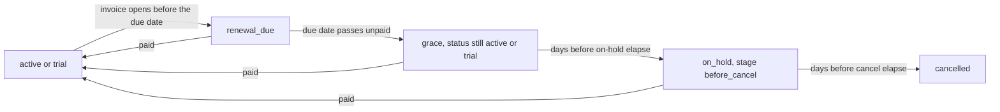

# Info
- Module: Developers
- Availability: Free (some sections require Pro)
- Last updated: 2026-10-18

# Read Lifecycle State and Manage Its Dates

> Read a subscription's authoritative status, lifecycle phase, grace, retry, trial and plan state in one call, and change trial dates, grace policy and pending plan switches through validated operations.

**Availability:** Core (Free). `ArraySubs\Api\Lifecycle` ships with ArraySubs core and needs no module switch (availability domain `lifecycle`). Pending plan switches created by retention-offer downgrades, and early renewals that bring a pending switch forward, require ArraySubs Pro.

## Page Navigation

- **Current guide:** Read Lifecycle State and Manage Its Dates
- **Where to open it:** Your custom plugin or theme code (PHP)
- **Section overview:** [Developers](./README.md)
- **Previous guide:** [Work with Subscription Families and Orders](./subscription-relationships-and-orders.md)
- **Next guide:** [Find Members and Update Profiles](./customers-and-profile-fields.md)
- **Troubleshooting:** [Verify Your Integration](./errors-and-testing.md)

## Overview

A subscription's stored status tells only part of the story. A subscription whose renewal payment is three days late still has the stored status `active`, and so does a subscription that cancels at the end of the month.

`ArraySubs\Api\Lifecycle` gives you the authoritative answer in one read: the stored status, a computed lifecycle phase, access, renewal and invoice state, grace stage and dates, payment retries, cancellation, pause, the current plan and any pending plan switch, all evaluated at one documented moment.

The same class covers the supported ways to manage lifecycle dates: the store-wide grace policy, a per-subscription grace override, trial end changes and cancelling a pending plan switch. To move the next renewal date or change the billing schedule, use `Subscriptions::update()` on [Find and Update Subscriptions](./subscriptions.md).

## When to Use This

- You keep an external membership, LMS or community account in sync and need to know whether the member is in good standing, overdue, suspended or finished.
- You want to warn members during grace ("your payment is overdue, access ends on ...") instead of cutting them off.
- Support staff need to give one customer more time to pay without changing the store-wide grace policy.
- You extend or end a trial from your own admin tool.
- You show the member's current plan and an upcoming plan change side by side.
- You process lifecycle events and need to re-read the real state after a delayed, duplicate or out-of-order notification.

## Prerequisites

- WooCommerce and ArraySubs core installed and active. See [Connect Your Custom Plugin](./getting-started.md) for load timing and dependency checks.
- Call the class on `arraysubs_after_boot` or later (`init` or later when you also query subscriptions by status). Guard every call with `class_exists( '\ArraySubs\Api\Lifecycle' )`.
- Your own capability, nonce and ownership checks at every web boundary (REST route, AJAX handler, form). The PHP API trusts its caller.
- ArraySubs Pro only when you rely on retention-offer downgrades or early renewal.
- Merchant setup for grace, retries, trials and plan switching: [Recovery and Grace Flows](../billing-and-renewals/recovery-and-grace-flows.md), [Payment Recovery Tools](../checkout-and-payments/automatic-payments/payment-recovery.md), [Trial Management](../billing-and-renewals/trial-management.md) and [Plan Switching and Product Relationships](../subscription-products/plan-switching-and-relationships.md).

## How It Works

Every subscription has one stored status, kept as a WordPress post status with the `arraysubs-` prefix (`arraysubs-active`, `arraysubs-on-hold`, and so on). The API uses the simple names: `pending`, `trial`, `active`, `paused`, `on-hold`, `cancelled` and `expired`.

On top of the stored status, `Lifecycle::get_state()` computes a **phase** from the stored dates, the open renewal order, the grace policy, retry state and payment settlement markers. Branch your integration on the phase and the detail blocks, not on the status alone.

```box class="info-box"
`graced` is not a stored status. While a renewal is overdue inside the first grace stage, the stored status stays `active` (or `trial`) and the phase is `grace`. Never infer grace from a status label, an email subject or a single meta key. Read `Lifecycle::get_state()`.
```

The usual overdue path looks like this:



Reads never change anything: `get_state()` does not convert trials, advance recovery, run the overdue sweep or attempt a payment. State changes come from the scheduled engine (renewal invoices, charges, retries and the hourly overdue run) or from the mutation methods on this page and on [Find and Update Subscriptions](./subscriptions.md).

## Lifecycle States

### Stored Statuses and Phases

| Stored status | Phases you can see | Access (default policy) | Relevant dates | Typical next transitions |
| --- | --- | --- | --- | --- |
| `pending` | `pending` | No | `schedule.start_at`; no renewal jobs exist yet | -> `active` when the initial order is paid; -> `on-hold` at once when the initial order fails or is cancelled (grace skipped); -> `cancelled` |
| `trial` | `trial`, `renewal_due`, `grace`, `cancellation_scheduled` | Yes | `trial.started_at`, `trial.ends_at` (the first charge time, also `renewal.next_payment_at`) | -> `active` when the first charge is paid; -> `on-hold`; -> `paused`; -> `cancelled`; -> `expired` |
| `active` | `active`, `renewal_due`, `grace`, `cancellation_scheduled` | Yes | `renewal.next_payment_at`, `renewal.invoice_created_at`, `grace.*`, `cancellation.cancel_at` | -> `on-hold` (first grace stage ends, renewal-order creation failure, suspension); -> `paused`; -> `cancelled`; -> `expired` |
| `paused` | `paused` | Only when the store's pause access setting grants it (default: no) | `pause.paused_at`, `pause.resume_at`; the next payment date already includes the pause length | -> the pre-pause status (`active` or `trial`) on resume; -> `cancelled`; -> `expired` |
| `on-hold` | `on_hold` | No | `grace.on_hold_at`, `grace.cancel_at`, `renewal.pending_order_id` | -> `active` when the renewal (or the initial order) is paid or the store activates it; -> `cancelled` when `grace.cancel_at` passes unpaid |
| `cancelled` | `cancelled` | No | `cancellation.cancelled_at`; the next payment date is cleared and renewal jobs are removed | Ended. Only a store reactivation or an auto-downgrade restores billing |
| `expired` | `expired` | No | `schedule.end_at` (from `Subscriptions::get()`) | Ended. An auto-downgrade set to run on expiry can move it to a fallback plan |

A pending cancellation is not a status either. A subscription that cancels at the end of its period keeps `active` or `trial`, reports the phase `cancellation_scheduled`, and has `cancellation.scheduled` set to `true`.

The access column is the default status policy. Use `has_access` for the subscription-level answer and [Check Content Access](./member-access.md) for content decisions. Another valid subscription can still give the same member access.

### Phase Values

| Phase | Meaning |
| --- | --- |
| `pending` | Waiting for the initial payment or activation. |
| `trial` | In a trial; the first charge invoice is not open yet. |
| `active` | Billing normally; nothing is due. |
| `renewal_due` | The renewal invoice is open and the due date has not passed. |
| `grace` | The due date passed without payment. The stored status is still `active` or `trial`, and access continues until `grace.on_hold_at`. |
| `on_hold` | Suspended without access. Inside the grace stage `before_cancel` it waits for payment until `grace.cancel_at`. The same phase covers a suspension outside grace. |
| `paused` | Paused until `pause.resume_at`. |
| `cancellation_scheduled` | Cancels at `cancellation.cancel_at`; the stored status stays `active` or `trial`. |
| `cancelled` | Ended by cancellation. |
| `expired` | Ended because its length or fixed end date was reached. |

A trial subscription reports `trial` until its first charge invoice opens. From then on it moves through the same renewal phases as an active subscription, and `trial.active` stays `true` until the trial converts.

## Grace, Retries and Terminal States

Four ideas are easy to mix up. Keep them apart:

| Concept | What it is | Where to read it |
| --- | --- | --- |
| Overdue debt | An unpaid renewal order whose due date has passed | `renewal.due`, `renewal.overdue_since`, `renewal.pending_order_id`, `renewal.pending_order_status` |
| Retry state | Automatic charge attempts scheduled against that unpaid order | `retry.scheduled`, `retry.attempts`, `retry.max_attempts`, `retry.next_retry_at`, `retry.exhausted` |
| Grace | The time window the store allows before suspending and then cancelling | `grace.in_grace`, `grace.stage`, `grace.on_hold_at`, `grace.cancel_at` |
| Terminal state | The subscription has ended | `status` `cancelled` or `expired` |

### Grace Policy

The store-wide policy has two values. Merchants set them on **General Settings -> Grace Period** as **Days Active After Due** and **Days On-Hold Before Cancel** (see [General Settings](../settings/general-settings.md)).

| Setting key | Default (range) | Meaning |
| --- | --- | --- |
| `renewals.grace_days_before_on_hold` | `3` (0-30) | **Days Active After Due**: days an overdue subscription keeps its `active` or `trial` status (stage `before_on_hold`). |
| `renewals.grace_days_before_cancel` | `7` (1-60) | **Days On-Hold Before Cancel**: days it then stays `on-hold` (stage `before_cancel`) before it is cancelled for non-payment. |

- `Lifecycle::get_grace_policy()` returns the policy that applies to a subscription: its own override when one is set (`source` `subscription`), otherwise the site policy (`source` `site`).
- The existing helpers `arraysubs_get_grace_days_before_on_hold(): int` and `arraysubs_get_grace_days_before_cancel(): int` return the site values only.
- Change the site policy with `Lifecycle::update_grace_policy()` and one subscription's policy with `Lifecycle::set_grace_override()`.
- The hourly overdue run reads the current policy on every run, so a site policy change also reaches subscriptions already in grace at the next run. Subscriptions with an override keep their own values.

### Retries Inside Grace

Retries happen inside grace; they do not extend it. When an automatic renewal charge fails, ArraySubs schedules retries from the store's retry ladder (`payment_retry.interval_hours`, by default three retries 24 hours apart). With `payment_retry.stop_on_hard_decline` on (the default), a hard decline such as an expired card stops the ladder. PayPal and Paddle run their own retries, so ArraySubs schedules none for them.

- Retry exhaustion alone does not end grace. When `retry.exhausted` is `true`, the subscription stays in its current grace stage, the invoice stays payable, and the stage dates still decide what happens next.
- Moving to on-hold removes any queued automatic retry. The customer can still pay the open renewal order, and a manual retry still works while the subscription is on hold.
- A payment during grace recovers the subscription: the renewal is recorded, the next date advances, and an on-hold subscription returns to `active`.
- After `cancelled` or `expired`, a late payment does not restore the subscription.

### Paths That Skip Grace

Two failures move a subscription straight to `on-hold` without the first grace stage. `get_state()` reports them with `grace.skipped` set to `true`:

| Path | What happens | `grace.skip_reason` |
| --- | --- | --- |
| Initial-order payment failure | The initial (parent) order fails or is cancelled. Every linked `pending`, `trial` or `active` subscription moves to `on-hold` at once. Paying the same order later activates it. | `initial_payment_failed` |
| Renewal-order creation failure | At the due time ArraySubs could not create the renewal order. The subscription moves to `on-hold` at once and a retry is scheduled. No grace window runs first; the status listener stamps `_on_hold_date` when the key is empty, so read `grace.skipped` and `grace.skip_reason` rather than the key to detect this path. | `renewal_order_creation_failed` |

Do not assume every on-hold subscription has an `_on_hold_date`, and never use that key to decide whether grace ran. Read `grace.skipped`, `grace.skip_reason` and `grace.started_at` instead.

### When Transitions Actually Happen

`grace.on_hold_at` and `grace.cancel_at` are the earliest moments a stage can end, not exact times:

- The overdue run is hourly. A stage changes on the first run after its boundary.
- The first stage also waits for the subscription's renewal spread offset (`renewals.spread_window_hours`, default 6 hours) plus one hour. If no unpaid renewal order exists yet, the run creates it first and acts one run later.
- While a gateway is still settling a renewal payment, both stages wait and `grace.settlement_pending` is `true`. Examples: a PayPal or Paddle pending renewal, a Stripe payment that is still processing, or a Mollie SEPA debit, which can take up to 21 days.
- Use `get_state()` with `at` to project a future phase. Treat the answer as a projection: it does not replay payments, retries or admin changes that would happen in between.

## Trials

A subscription to a trial product is created in `trial` status at checkout. Its first paid charge is the renewal at the trial end: ArraySubs opens the renewal invoice shortly before the trial ends and charges it at the trial end. When that renewal is paid, the status becomes `active`.

- `trial.ends_at` is the effective trial end, which is also the first charge time (`renewal.next_payment_at`). Skipping a renewal or pausing during a trial moves the first charge, and `trial.ends_at` follows it. The creation-time value in `_trial_end_date` does not move, so do not read it as the current trial end.
- Change a trial end with `Lifecycle::update_trial()`: set a new future `trial_end`, or pass `end_now` to convert at once. Both work only during an active trial and realign renewal scheduling.
- Provider-owned dates: when PayPal or Paddle owns the billing clock (`trial.provider_owned` is `true`), ArraySubs asks the provider first. Paddle receives the new date through its API. PayPal does not accept billing-date moves, so the change is refused with `provider_rejected`.
- When the product has an auto-downgrade target and **Auto-downgrade timing** is **On trial expire**, a trial that ends without converting moves to the fallback plan instead (see [Auto-Downgrade Is Separate](#auto-downgrade-is-separate)).
- Trial lengths and the one-trial-per-customer rule are merchant settings; see [Trial Management](../billing-and-renewals/trial-management.md).

## Current Plan and Pending Plan Switch

`get_state()` reports the plan in force and any pending switch separately:

- `plan` is the current plan: product, variation, quantity, recurring amount, currency and schedule. Roles, features and access follow this plan.
- `pending_switch` is `null`, or a block that describes a plan change waiting for the next renewal.

A pending plan switch is not the `pending` status, not the pending renewal order, not a pending cancellation and not an immediate switch whose order awaits payment. ArraySubs stores it as a signed snapshot in `_pending_switch`. Read it through `get_state()`; never write or parse that key.

### What Creates a Pending Switch

- Any switch type (upgrade, downgrade or crossgrade) requested while **Proration type** (`plan_switching.proration_type`) is **Apply at renewal** (`apply_at_renewal`). The request comes from the customer portal (`source` `customer`) or the admin screen (`source` `admin`).
- A retention-offer downgrade *(Pro)*. Accepting the offer always stores a pending switch with apply-at-renewal pricing, whatever the proration type (`source` `retention_offer`). See [Retention Offers](../retention-and-refunds/retention-offers.md).

### How a Pending Switch Applies

ArraySubs builds the next renewal order on the target plan (target price times quantity, plus any `switch_fee`). The switch applies only when that renewal order is paid. The plan fields then change and the `plan_switched` event fires with `trigger` `pending_switch`.

`expected_at` is the expected renewal date, not a promise. Retries and grace can delay the switch, and a Pro early renewal can bring it forward. Until the switch applies, `plan` keeps the current plan: do not grant the target plan's entitlements early.

### The Freeze Rule

Once the renewal invoice for that cycle exists (by default 6 hours before the due date, plus the subscription's spread offset), the switch is frozen. `pending_switch.frozen` is `true` and `frozen_by_order_id` names the invoice. A frozen switch cannot be cancelled or replaced until that invoice is paid or cancelled, and `Lifecycle::cancel_pending_switch()` returns `conflict`.

Scheduling a cancellation or cancelling immediately removes the pending switch and emits `pending_switch_cleared`.

### Auto-Downgrade Is Separate

Auto-downgrade is an immediate fallback in ArraySubs core, not a pending switch. When a product has an auto-downgrade target, the subscription moves to it at the configured **Auto-downgrade timing**: on expiry (default), on cancellation, or when a trial ends without converting.

The change is immediate. The subscription returns to `active` on the fallback plan with quantity 1, a new cycle starts from now, the automatic payment link is detached (later renewals are manual), and any remote billing is cancelled. It emits `auto_downgraded` and `plan_switched` with `trigger` `auto_downgrade`.

### PayPal and Paddle Differences

- **PayPal approval:** when PayPal needs the customer to approve the change, ArraySubs stores no local pending switch. `pending_switch.provider_state` is `awaiting_paypal_approval`, and the plan changes as soon as PayPal confirms the approval, not at the next renewal. An unapproved request expires after 3 days. Card-funded PayPal subscriptions use the normal pending switch.
- **Paddle:** ArraySubs updates the Paddle subscription when the switch is requested (without billing), then stores the pending switch, which applies at the next paid renewal.

Gateway setup: [PayPal Gateway](../checkout-and-payments/automatic-payments/paypal.md) and [Paddle Gateway](../checkout-and-payments/automatic-payments/paddle.md).

## Lifecycle Class Reference

All methods are static on `ArraySubs\Api\Lifecycle`. They accept a subscription post ID or the `WP_Post` returned by `arraysubs_get_subscription()`. Dates in may be ISO 8601 strings with an offset, `Y-m-d H:i:s` strings treated as UTC, or Unix timestamps. Dates out are ISO 8601 UTC strings such as `2026-11-01T00:00:00+00:00`, or `null`. Money is a decimal string with its currency.

**Permission boundary.** These are trusted server calls with no capability checks of their own. Check `manage_woocommerce` or `manage_options` for admin tools. For customer requests, verify login, nonce and ownership, and pass `as_user` with the logged-in user ID: the call then enforces ownership (`_customer_id` must match, otherwise `forbidden`) and returns customer-safe data. Permission context is never inferred from the subscription's customer.

**Mutation arguments.** `update_grace_policy()`, `set_grace_override()`, `update_trial()` and `cancel_pending_switch()` change data. They require `reason` and accept the shared arguments below. Subscription mutations run under the subscription mutation lock and write the reason and actor to the subscription notes.

| Argument | Type | Default | Description |
| --- | --- | --- | --- |
| `reason` | string | required | Audit reason, 1-500 characters. |
| `actor` | array | `['type' => 'integration', 'id' => get_current_user_id()]` | Who made the change: `type` is `integration`, `admin`, `customer` or `system`; optional `id` and `label`. |
| `expected` | array | none | Field => expected current value, such as `['status' => 'trial']`. A mismatch returns `conflict`. Subscription mutations only. |
| `dry_run` | bool | `false` | Validate and return the would-be result without writing. |
| `as_user` | int | none | Enforce ownership for a customer request. Subscription methods only. |

Subscription mutations return this array:

```php
<?php
// Shape returned by set_grace_override(), update_trial() and cancel_pending_switch().
$result = [
	'subscription' => $subscription_post,          // Fresh WP_Post after the change.
	'changed'      => [ 'next_payment_date' ],     // Names of the fields that changed.
	'warnings'     => [],                          // Each item: [ 'code' => '...', 'message' => '...' ].
	'events'       => [ 'trial_changed' ],         // Normalized lifecycle events emitted.
	'dry_run'      => false,
];
```

Error codes used on this page (each a `WP_Error`; `get_error_data()` includes `status`):

| Code | status | Typical cause here |
| --- | --- | --- |
| `invalid_argument` | 400 | Unknown key, wrong type, out-of-range value, unreadable date, missing `reason`. |
| `not_found` | 404 | The ID is not a subscription, or there is no pending plan switch to cancel. |
| `forbidden` | 403 | `as_user` does not own the subscription. |
| `unsupported_operation` | 422 | Not allowed in this state, or a box/bundle child (data `billing_owner_id`). |
| `conflict` | 409 | `expected` mismatch, concurrent change, frozen pending switch, or a change that would reverse an applied on-hold or cancellation. |
| `provider_rejected` | 502 | PayPal or Paddle refused a date change. |

### `Lifecycle::get_state()`

```text
Lifecycle::get_state( int|WP_Post $subscription, array $args = [] ): array|WP_Error
```

| Parameter | Type | Default | Description |
| --- | --- | --- | --- |
| `$subscription` | int or `WP_Post` | required | Subscription ID or object. |
| `at` | string or int | now | Evaluation time. Use it to project a future phase. |
| `as_user` | int | none | Enforce ownership and return customer-safe data. |

**Returns** one array per subscription:

```php
<?php
// Example return value of Lifecycle::get_state( 123 ) for an overdue renewal in the first grace stage.
$state = [
	'subscription_id' => 123,
	'evaluated_at'    => '2026-10-18T09:30:00+00:00',
	'status'          => 'active',   // Stored status (simple name).
	'phase'           => 'grace',    // Computed phase.
	'has_access'      => true,
	'trial'           => [ 'active' => false, 'started_at' => null, 'ends_at' => null, 'converted_at' => '2026-09-01T00:00:00+00:00', 'provider_owned' => false ],
	'renewal'         => [ 'next_payment_at' => '2026-10-15T00:00:00+00:00', 'due' => true, 'overdue_since' => '2026-10-15T00:00:00+00:00', 'pending_order_id' => 1003, 'pending_order_status' => 'failed', 'invoice_created_at' => '2026-10-14T18:00:00+00:00' ],
	'grace'           => [ 'in_grace' => true, 'stage' => 'before_on_hold', 'started_at' => '2026-10-15T00:00:00+00:00', 'on_hold_at' => '2026-10-18T00:00:00+00:00', 'cancel_at' => '2026-10-25T00:00:00+00:00', 'days_before_on_hold' => 3, 'days_before_cancel' => 7, 'policy_source' => 'site', 'skipped' => false, 'skip_reason' => null, 'settlement_pending' => false ],
	'retry'           => [ 'scheduled' => true, 'attempts' => 1, 'max_attempts' => 3, 'next_retry_at' => '2026-10-17T00:00:00+00:00', 'exhausted' => false ],
	'cancellation'    => [ 'scheduled' => false, 'cancel_at' => null, 'cancelled_at' => null ],
	'pause'           => [ 'paused' => false, 'paused_at' => null, 'resume_at' => null ],
	'plan'            => [ 'product_id' => 197, 'variation_id' => 0, 'quantity' => 1, 'recurring_amount' => '19.00', 'currency' => 'USD', 'billing_interval' => 1, 'billing_period' => 'month' ],
	'pending_switch'  => null,
];
```

| Key | Type | Meaning |
| --- | --- | --- |
| `subscription_id`, `evaluated_at` | int, string | The subscription and the evaluation time (UTC). |
| `status` | string | Stored status: `pending`, `trial`, `active`, `paused`, `on-hold`, `cancelled` or `expired`. |
| `phase` | string | Computed phase; see [Phase Values](#phase-values). |
| `has_access` | bool | Whether this subscription grants member access now under the store's status policy. |
| `trial.active` | bool | A trial is running. |
| `trial.started_at`, `trial.ends_at` | string or null | The current trial window. `ends_at` is the effective trial end (the first charge time). |
| `trial.converted_at` | string or null | When the trial converted to a paid subscription. |
| `trial.provider_owned` | bool | PayPal or Paddle owns the trial and billing dates. |
| `renewal.next_payment_at` | string or null | Logical due date; `null` for lifetime and ended subscriptions. The renewal spread offset never changes it. |
| `renewal.due` | bool | The current renewal is due: its invoice is open or its date has passed. |
| `renewal.overdue_since` | string or null | When the renewal became overdue. |
| `renewal.pending_order_id`, `renewal.pending_order_status` | int or null, string or null | The open renewal order and its WooCommerce status (without `wc-`). |
| `renewal.invoice_created_at` | string or null | When that invoice was created. |
| `grace.in_grace`, `grace.stage` | bool, string or null | Inside grace; stage `before_on_hold`, `before_cancel` or `null`. |
| `grace.started_at` | string or null | When grace started (the missed due date). `null` after a renewal-order creation failure. |
| `grace.on_hold_at`, `grace.cancel_at` | string or null | Earliest move to on-hold and earliest cancellation for non-payment. Once on hold, `on_hold_at` is the actual hold time. |
| `grace.days_before_on_hold`, `grace.days_before_cancel`, `grace.policy_source` | int, int, string | The policy in force: `site` or `subscription`. |
| `grace.skipped`, `grace.skip_reason` | bool, string or null | The subscription went straight to on-hold: `initial_payment_failed` or `renewal_order_creation_failed`. |
| `grace.settlement_pending` | bool | A gateway is still settling a renewal payment; both grace stages wait. |
| `retry` | array | `scheduled` (bool), `attempts` (int), `max_attempts` (int), `next_retry_at` (string or null), `exhausted` (bool). |
| `cancellation` | array | `scheduled` (bool), `cancel_at` and `cancelled_at` (string or null). |
| `pause` | array | `paused` (bool), `paused_at` and `resume_at` (string or null). |
| `plan` | array | Current plan: `product_id`, `variation_id`, `quantity`, `recurring_amount` (decimal string, per unit), `currency`, `billing_interval`, `billing_period`. |
| `pending_switch` | array or null | The pending plan switch, or `null`. |

The `pending_switch` block, when present:

```php
<?php
// Example pending_switch block: a downgrade waiting for the next paid renewal.
$pending_switch = [
	'type'               => 'downgrade',   // upgrade | downgrade | crossgrade
	'source'             => 'customer',    // customer | admin | retention_offer
	'requested_at'       => '2026-10-10T08:00:00+00:00',
	'target'             => [ 'product_id' => 198, 'variation_id' => 0, 'quantity' => 1, 'recurring_amount' => '9.00', 'billing_interval' => 1, 'billing_period' => 'month' ],
	'switch_fee'         => '0.00',        // Added to the renewal invoice, in plan currency.
	'expected_at'        => '2026-11-01T00:00:00+00:00',
	'frozen'             => false,         // true once the renewal invoice exists.
	'frozen_by_order_id' => null,
	'provider_state'     => null,          // or 'awaiting_paypal_approval'
];
```

The signed snapshot behind it is never exposed.

- **Failures:** `not_found` (not a subscription), `invalid_argument` (unreadable `at`), `forbidden` (`as_user` mismatch).
- **Limits:** one subscription per call. Each call reads the subscription, its open renewal order and settlement markers. For large batches, page through IDs with `Subscriptions::each()` in a background job instead of calling it in a front-end loop.
- **Side effects:** Read only: no writes. It never converts a trial, advances recovery, runs the overdue sweep or attempts a payment.

```php
<?php
/**
 * Return the lifecycle phase of one subscription, or 'unknown'.
 */
function myplugin_subscription_phase( int $subscription_id ): string {
	if ( ! class_exists( '\ArraySubs\Api\Lifecycle' ) ) {
		return 'unknown';
	}

	$state = \ArraySubs\Api\Lifecycle::get_state( $subscription_id );

	if ( is_wp_error( $state ) ) {
		return 'unknown';
	}

	return $state['phase']; // For example 'grace' while the stored status is still 'active'.
}
```

### `Lifecycle::get_grace_policy()`

```text
Lifecycle::get_grace_policy( int|WP_Post|null $subscription = null ): array
```

| Parameter | Type | Default | Description |
| --- | --- | --- | --- |
| `$subscription` | int, `WP_Post` or null | `null` | Omit for the site policy; pass a subscription for the policy that applies to it. |

- **Returns:** `['days_before_on_hold' => 3, 'days_before_cancel' => 7, 'source' => 'site']`. `source` is `subscription` when that subscription has an override.
- **Failures:** none; it always returns an array. When the ID comes from a request, validate it first with `Subscriptions::get()` (and `as_user` for customers).
- **Limits and side effects:** one policy per call. Read only: no writes.

```php
<?php
if ( class_exists( '\ArraySubs\Api\Lifecycle' ) ) {
	$policy = \ArraySubs\Api\Lifecycle::get_grace_policy( 123 );

	printf(
		'<p>%s</p>',
		esc_html(
			sprintf(
				'Subscription 123: %1$d days before on-hold, %2$d days before cancellation (%3$s policy).',
				$policy['days_before_on_hold'],
				$policy['days_before_cancel'],
				$policy['source']
			)
		)
	);
}
```

### `Lifecycle::update_grace_policy()`

```text
Lifecycle::update_grace_policy( array $policy, array $args = [] ): array|WP_Error
```

| Parameter | Type | Default | Description |
| --- | --- | --- | --- |
| `$policy['days_before_on_hold']` | int, 0-30 | current value | Saved as `renewals.grace_days_before_on_hold` (**Days Active After Due**). |
| `$policy['days_before_cancel']` | int, 1-60 | current value | Saved as `renewals.grace_days_before_cancel` (**Days On-Hold Before Cancel**). |
| `reason` | string | required | Audit reason. |
| `actor`, `dry_run` | | see above | Shared mutation arguments. |

- **Returns:** the saved site policy, in the `get_grace_policy()` shape with `source` `site`.
- **Failures:** `invalid_argument` (unknown key, non-integer, out of range, missing `reason`).
- **Permission boundary:** this is store-wide policy. Allow it only behind a `manage_woocommerce` or `manage_options` check, never from customer requests.
- **Side effects:** saves the same settings the **General Settings** screen uses and records the reason and actor in the audit trail. Every subscription without an override uses the new values from the next hourly overdue run, including subscriptions already in grace.

```php
<?php
add_action( 'admin_post_myplugin_grace_policy', function () {
	if ( ! current_user_can( 'manage_woocommerce' ) ) {
		wp_die( esc_html__( 'You are not allowed to change the grace policy.', 'myplugin' ) );
	}
	check_admin_referer( 'myplugin_grace_policy' );

	if ( ! class_exists( '\ArraySubs\Api\Lifecycle' ) ) {
		wp_die( esc_html__( 'ArraySubs is not available.', 'myplugin' ) );
	}

	$saved = \ArraySubs\Api\Lifecycle::update_grace_policy(
		[
			'days_before_on_hold' => isset( $_POST['days_before_on_hold'] ) ? absint( wp_unslash( $_POST['days_before_on_hold'] ) ) : 3,
			'days_before_cancel'  => isset( $_POST['days_before_cancel'] ) ? absint( wp_unslash( $_POST['days_before_cancel'] ) ) : 7,
		],
		[ 'reason' => 'Grace policy updated from the billing tools screen' ]
	);

	if ( is_wp_error( $saved ) ) {
		wp_die( esc_html( $saved->get_error_message() ) );
	}

	wp_safe_redirect( admin_url( 'admin.php?page=myplugin-billing&updated=1' ) );
	exit;
} );
```

### `Lifecycle::set_grace_override()`

```text
Lifecycle::set_grace_override( int|WP_Post $subscription, ?array $override, array $args = [] ): array|WP_Error
```

| Parameter | Type | Default | Description |
| --- | --- | --- | --- |
| `$subscription` | int or `WP_Post` | required | The subscription to change. |
| `$override` | array or null | required | `['days_before_on_hold' => int, 'days_before_cancel' => int]` (`days_before_on_hold` 0-30, `days_before_cancel` 1-60, the same ranges as the site policy), or `null` to clear the override and return to the site policy. |
| `reason`, `actor`, `expected`, `dry_run`, `as_user` | | see above | Shared mutation arguments. |

- **Returns:** the subscription mutation result. `events` includes `grace_changed` when the subscription is in grace and its dates moved.
- **Failures:** `invalid_argument` (bad keys or values), `not_found`, `forbidden`, `unsupported_operation` (cancelled or expired subscription; box/bundle child, with `billing_owner_id` in the error data), `conflict` (`expected` mismatch, concurrent change, or a policy that would reverse an on-hold or cancellation already applied).
- **Side effects:** stores the override with the subscription; it applies to the current and every later overdue cycle until you clear it. Recomputes the current grace dates, adds a subscription note with your reason, and emits `grace_changed` when relevant. It never reactivates an on-hold subscription: to restore access, the renewal must be paid or the store must activate it with `Subscriptions::activate()`.

```php
<?php
/**
 * Give one subscription more time to pay: preview first, then apply.
 */
function myplugin_give_more_time( int $subscription_id ) {
	if ( ! class_exists( '\ArraySubs\Api\Lifecycle' ) ) {
		return new WP_Error( 'arraysubs_missing', 'ArraySubs is not active.' );
	}

	$override = [
		'days_before_on_hold' => 7,
		'days_before_cancel'  => 14,
	];
	$args     = [
		'reason'  => 'Support ticket 4521: customer is replacing an expired card',
		'dry_run' => true,
	];

	$preview = \ArraySubs\Api\Lifecycle::set_grace_override( $subscription_id, $override, $args );
	if ( is_wp_error( $preview ) ) {
		return $preview;
	}

	$args['dry_run'] = false;

	return \ArraySubs\Api\Lifecycle::set_grace_override( $subscription_id, $override, $args );
}
```

To remove the override later, call `\ArraySubs\Api\Lifecycle::set_grace_override( 123, null, [ 'reason' => 'Back to the store policy' ] )`.

### `Lifecycle::update_trial()`

```text
Lifecycle::update_trial( int|WP_Post $subscription, array $changes, array $args = [] ): array|WP_Error
```

| Parameter | Type | Default | Description |
| --- | --- | --- | --- |
| `$subscription` | int or `WP_Post` | required | A subscription in an active trial. |
| `$changes['trial_end']` | date | none | New trial end; must be in the future. The first charge moves with it. |
| `$changes['end_now']` | `true` | none | End the trial now and convert it through the normal trial conversion. |
| `reason`, `actor`, `expected`, `dry_run`, `as_user` | | see above | Shared mutation arguments. |

Pass exactly one of `trial_end` or `end_now`.

- **Returns:** the subscription mutation result. `events` lists what was emitted, such as `trial_changed` for a new end date or the conversion events for `end_now`. Check `warnings` too: a provider can confirm a new date later (for example the `provider_date_pending` warning).
- **Failures:** `unsupported_operation` (the subscription is not in an active trial; box/bundle child), `invalid_argument` (past date, both keys, unknown key), `provider_rejected` (PayPal or Paddle refused the change; PayPal does not accept billing-date moves), `conflict` (`expected` mismatch, concurrent change, or a pending plan switch exists: cancel it first with `Lifecycle::cancel_pending_switch()`), `not_found`, `forbidden`.
- **Side effects:** moves the trial end and the first charge date together, realigns the renewal invoice and charge jobs (`arraysubs_generate_renewal_invoice` and `arraysubs_process_renewal`), adds a subscription note, emits `trial_changed` and fires `arraysubs_trial_changed`. Provider-owned dates are updated at the provider first.

```php
<?php
/**
 * Extend a trial from an admin tool and explain any refusal.
 */
function myplugin_extend_trial( int $subscription_id, string $new_end_utc ): string {
	if ( ! current_user_can( 'manage_woocommerce' ) || ! class_exists( '\ArraySubs\Api\Lifecycle' ) ) {
		return 'Not available.';
	}

	$result = \ArraySubs\Api\Lifecycle::update_trial(
		$subscription_id,
		[ 'trial_end' => $new_end_utc ], // For example '2026-11-15 00:00:00' (UTC).
		[
			'reason'   => 'Trial extended after an onboarding call',
			'expected' => [ 'status' => 'trial' ],
		]
	);

	if ( ! is_wp_error( $result ) ) {
		return 'Trial updated.';
	}

	switch ( $result->get_error_code() ) {
		case 'unsupported_operation':
			return 'This subscription is not in an active trial.';
		case 'provider_rejected':
			return 'The payment provider refused the new date.';
		case 'conflict':
			return 'The subscription changed or has a pending plan switch. Reload and try again.';
		case 'invalid_argument':
			return 'Choose a future date.';
		default:
			return $result->get_error_message();
	}
}
```

### `Lifecycle::cancel_pending_switch()`

```text
Lifecycle::cancel_pending_switch( int|WP_Post $subscription, array $args = [] ): array|WP_Error
```

| Parameter | Type | Default | Description |
| --- | --- | --- | --- |
| `$subscription` | int or `WP_Post` | required | The subscription with a pending plan switch. |
| `reason`, `actor`, `expected`, `dry_run`, `as_user` | | see above | Shared mutation arguments. |

- **Returns:** the subscription mutation result, with `pending_switch_cancelled` in `events`. The current plan stays in force for the next renewal.
- **Failures:** `conflict` (the switch is frozen by an unpaid renewal invoice, or it changed concurrently), `not_found` (no subscription, or no pending plan switch), `forbidden`.
- **Side effects:** removes the stored switch, adds a customer-visible note that the next renewal continues with the current plan, emits `pending_switch_cancelled`, and fires `arraysubs_pending_switch_cleared`.

```php
<?php
add_action( 'rest_api_init', function () {
	register_rest_route(
		'myplugin/v1',
		'/subscriptions/(?P<id>\d+)/keep-plan',
		[
			'methods'             => 'POST',
			'permission_callback' => function () {
				return is_user_logged_in(); // Cookie requests also need the wp_rest nonce.
			},
			'callback'            => function ( WP_REST_Request $request ) {
				if ( ! class_exists( '\ArraySubs\Api\Lifecycle' ) ) {
					return new WP_Error( 'arraysubs_missing', 'ArraySubs is not active.', [ 'status' => 503 ] );
				}

				$user_id = get_current_user_id();
				$result  = \ArraySubs\Api\Lifecycle::cancel_pending_switch(
					absint( $request['id'] ),
					[
						'reason'  => 'Customer kept the current plan',
						'actor'   => [ 'type' => 'customer', 'id' => $user_id ],
						'as_user' => $user_id,
					]
				);

				if ( is_wp_error( $result ) ) {
					return $result; // conflict (409) once the renewal invoice has frozen the switch.
				}

				return [ 'events' => $result['events'] ];
			},
		]
	);
} );
```

## Lifecycle Metadata Reference

These are the stored keys behind the state above, for orientation when you read logs or exports. All dates are `Y-m-d H:i:s` strings in UTC.

```box class="warning-box"
Direct writes are unsupported for every key below. Writing them with `update_post_meta()`, `arraysubs_update_subscription()` or the WordPress REST API skips locks, renewal rescheduling, provider coordination and pending-switch validation. Read them through the API column and change them through `Lifecycle`, `Subscriptions` or the dedicated workflow.
```

| Key | Format and timezone | Meaning | Written by | Read through the API |
| --- | --- | --- | --- | --- |
| Post status `arraysubs-<status>` | Post status slug | Stored status | Checkout, payment processing, the overdue run, lifecycle operations | `status` |
| `_next_payment_date` | UTC; empty for lifetime, cancelled and expired | Logical due date of the next renewal; the trial end while in trial | Checkout, renewal processing, skip, pause and resume, trial conversion, `Subscriptions::update()` | `renewal.next_payment_at` |
| `_last_payment_date` | UTC | When the last paid order was processed | Initial and renewal payment processing | `schedule.last_payment_at` in `Subscriptions::get()` |
| `_pending_renewal_order_id` | int | The open (unpaid) renewal order | Renewal invoice creation; removed when paid | `renewal.pending_order_id`, `renewal.pending_order_status` |
| `_on_hold_date` | UTC | When the current hold started; missing on some on-hold subscriptions (see [Paths That Skip Grace](#paths-that-skip-grace)) | The move to on-hold, the overdue run | `grace.on_hold_at` |
| `_payment_retry_attempts` | int | Retries scheduled for the open renewal | Retry engine, manual retry | `retry.attempts` |
| `_payment_retry_next_attempt_at` | UTC | Next retry time; can keep an old value after the retry runs or is removed | Retry engine | `retry.scheduled`, `retry.next_retry_at` |
| `_last_payment_failure`, `_last_payment_failure_reason` | UTC, string | Last failed charge and its message | Payment failure handling | `renewal_failed` event (`error_message`), `renewal.pending_order_status` |
| `_trial_length`, `_trial_period` | int, unit string | Trial terms copied from the product | Checkout; trial conversion sets the length to 0 | `trial` block |
| `_trial_end_date` | UTC | Trial end recorded at creation; skip and pause do not move it | Subscription creation | `trial.ends_at` (the effective end) |
| `_waiting_cancellation` | `'1'` or absent | An end-of-period cancellation is pending | Cancellation scheduling | `cancellation.scheduled`, phase `cancellation_scheduled` |
| `_cancellation_scheduled_date` | UTC | When the scheduled cancellation runs | Cancellation scheduling | `cancellation.cancel_at` |
| `_cancelled_date` | UTC | When the cancellation took effect | Cancellation, the overdue run | `cancellation.cancelled_at` |
| `_end_date` | UTC | Actual end after cancellation or expiry, or a configured fixed end date | Cancellation, expiry, fixed-period memberships, pause | `schedule.end_at` in `Subscriptions::get()` |
| `_pause_start_date`, `_pause_end_date` | UTC | The current pause window | Pause and resume | `pause.paused_at`, `pause.resume_at` |
| `_product_id`, `_variation_id`, `_quantity` | int | Current plan | Checkout, plan switching | `plan.product_id`, `plan.variation_id`, `plan.quantity` |
| `_recurring_amount`, `_currency` | decimal per unit, ISO 4217 | Current recurring price | Checkout, plan switching | `plan.recurring_amount`, `plan.currency` |
| `_billing_period`, `_billing_interval` | `day`, `week`, `month`, `year` or `lifetime`; int | Current schedule | Checkout, plan switching | `plan.billing_period`, `plan.billing_interval` |
| `_pending_switch` | JSON string (signed snapshot) | Pending plan switch | Plan switching (apply at renewal), Pro retention offers | `pending_switch`; `arraysubs_has_pending_switch( int $subscription_id ): bool` for a yes/no check |
| `_arraysubs_paypal_pending_plan_switch` | JSON string, expires after 3 days | PayPal plan change awaiting customer approval | PayPal gateway | `pending_switch.provider_state` |
| `_arraysubs_pending_deadline` (renewal order meta) | UTC | End of a gateway's settlement window for a renewal payment | PayPal, Paddle, Mollie and Stripe integrations | `grace.settlement_pending` |

Settings that shape lifecycle dates (all in the ArraySubs settings, read with `arraysubs_get_setting( string $key, $default = null )`):

| Setting key | Default | Effect |
| --- | --- | --- |
| `renewals.grace_days_before_on_hold`, `renewals.grace_days_before_cancel` | 3, 7 | Grace policy; change with `Lifecycle::update_grace_policy()`. |
| `renewals.invoice_before_due_value`, `renewals.invoice_before_due_unit` | 6, `hours` | How early the renewal invoice opens (and the pending switch freezes). |
| `renewals.spread_window_hours` | 6 | Window for the per-subscription spread offset that delays invoice, charge and first grace stage jobs. |
| `payment_retry.enabled`, `payment_retry.interval_hours`, `payment_retry.stop_on_hard_decline` | `true`, `[24, 24, 24]`, `true` | Retry ladder for ArraySubs-managed retries. |
| `plan_switching.proration_type` | `prorate_immediately` | `apply_at_renewal` creates pending switches. |
| `plan_switching.auto_downgrade_timing` | `on_expire` | `on_expire`, `on_cancel` or `on_trial_expire`. |
| `pause_subscription.access_during_pause` | `none` | `none`, `limited` (view only) or `full` access while paused. |

## Events and Hooks by Phase

Each phase change is published twice: as a normalized event on `arraysubs_lifecycle_event( string $event, array $payload )` (scalar payload with a durable `event_id`, `occurred_at`, `previous_status`, `status` and an event-specific `context`), and through native hooks, which often pass a `WP_Post`. Full signatures, timing and payloads are on [React to Supported Events](./actions-and-filters.md).

| Phase or change | Normalized events | Native hooks |
| --- | --- | --- |
| Activation (initial payment) | `activated` | `arraysubs_data_activated( int $subscription_id, int $order_id )` |
| Trial starts | `trial_started` | `arraysubs_trial_started( int $subscription_id )` |
| Trial end changed | `trial_changed` | `arraysubs_trial_changed( WP_Post $subscription, string $new_trial_end, string $old_trial_end )` (UTC `Y-m-d H:i:s`) |
| Trial converts to paid | `trial_converted` | `arraysubs_renewal_payment_complete()` when the first charge is paid; `arraysubs_trial_converted( int $subscription_id )` only when the daily trial job converts it |
| Trial ends without converting | `trial_ended` | `arraysubs_data_status_changed()` |
| Renewal invoice opens (`renewal_due`) | `renewal_invoice_created` | `arraysubs_renewal_invoice_created( int $subscription_id, int $order_id )` |
| Renewal paid | `renewed` | `arraysubs_renewal_payment_complete( int $subscription_id, int $order_id )` |
| Renewal charge failed | `renewal_failed` | `arraysubs_renewal_payment_failed( int $subscription_id, int $order_id, string $error_message )`; `$order_id` is 0 when no renewal order could be created |
| Retry scheduled | `payment_retry_scheduled` | `arraysubs_payment_retry_scheduled( WP_Post $subscription, WC_Order $order, int $attempt, int $retry_at )` |
| Retry attempted | `payment_retry_attempted` | `arraysubs_payment_retry_attempted( WP_Post $subscription, WC_Order $order, int $attempt, bool $success )` |
| Retries exhausted (grace continues) | `payment_retry_exhausted` | `arraysubs_payment_retry_exhausted( WP_Post $subscription, WC_Order $order, int $attempts )` |
| Grace starts (`grace`) | `grace_started` | `arraysubs_grace_period_started( WP_Post $subscription, array $grace )` |
| Grace dates or stage change | `grace_changed` | `arraysubs_grace_period_changed( WP_Post $subscription, array $grace, array $previous )` |
| Paid during grace | `grace_recovered`, then `renewed` | `arraysubs_grace_period_recovered( WP_Post $subscription, WC_Order $order )` |
| Grace ends unpaid | `grace_ended`, then `cancelled` when it cancels | `arraysubs_grace_period_ended( WP_Post $subscription, string $outcome )` (`on_hold` or `cancelled`); `arraysubs_data_cancelled_overdue( int $subscription_id )` for the cancellation |
| Moved to on-hold (`on_hold`) | `on_hold` | `arraysubs_data_status_changed( int $subscription_id, string $new_status, string $old_status )`; `arraysubs_data_put_on_hold( int $subscription_id )` fires only when the overdue run moves it |
| On-hold back to active | `reactivated` | `arraysubs_data_reactivated( int $subscription_id, string $old_status )` |
| Paused, resumed (`paused`) | `paused`, `resumed` | `arraysubs_subscription_paused( int $subscription_id, int $duration_days, int $user_id, string $reason )`; `arraysubs_subscription_resumed( int $subscription_id, int $user_id, bool $is_auto, array $context )` |
| Renewal skipped | `renewal_skipped` | `arraysubs_cycles_skipped( int $subscription_id, int $cycles, int $user_id, array $context )` |
| Next renewal date moved | `renewal_date_changed` | No dedicated native hook |
| Cancellation scheduled (`cancellation_scheduled`) | `cancellation_scheduled` | `arraysubs_data_waiting_cancellation( int $subscription_id, string $reason )` |
| Scheduled cancellation undone | `cancellation_undone` | `arraysubs_data_cancellation_undone( int $subscription_id )` |
| Cancelled (`cancelled`) | `cancelled` | `arraysubs_data_cancelled( int $subscription_id, WP_Post $subscription, string $cancel_type )` (`immediate` or `end_of_period`); the grace end uses `arraysubs_data_cancelled_overdue()` instead |
| Expired (`expired`) | `expired` | `arraysubs_data_expired( int $subscription_id )` for fixed end dates only; `arraysubs_data_status_changed()` for every expiry |
| Pending switch stored or replaced | `pending_switch_set`, `pending_switch_replaced` | `arraysubs_pending_switch_set( int $subscription_id, array $payload )` (fires again on replace) |
| Pending switch cancelled, or cleared by a cancellation | `pending_switch_cancelled`, `pending_switch_cleared` | `arraysubs_pending_switch_cleared( int $subscription_id )` (fires on every removal, including after the switch applies) |
| Pending switch applied | `plan_switched` (`trigger` `pending_switch`) | `arraysubs_pending_switch_applied( int $subscription_id, array $payload, int $order_id )` |
| Auto-downgrade | `auto_downgraded`, `plan_switched` (`trigger` `auto_downgrade`) | `arraysubs_auto_downgrade_completed( int $subscription_id, int $old_product_id, int $target_product_id )` |

- `granted` and `revoked` fire alongside these events only when the member's overall entitlement flips. Another valid subscription can keep the benefit.
- `arraysubs_data_status_changed` passes full slugs such as `arraysubs-on-hold`. Use it when you need every status change.
- The `$payload` of the native pending-switch hooks is the stored snapshot. Do not store or log it; re-read `get_state()` for the public view.
- Events fire after the change is saved, at least once per request path. Deduplicate with `event_id` and re-read `Lifecycle::get_state()` before acting on a delayed or out-of-order event.

## Examples

### Map Lifecycle State to an External Membership Level

A minimal grace-aware mapping. Members keep access during grace, and you can show a payment reminder.

```php
<?php
/**
 * Map ArraySubs lifecycle state to an external membership level.
 */
function myplugin_membership_level( int $subscription_id ): string {
	if ( ! class_exists( '\ArraySubs\Api\Lifecycle' ) ) {
		return 'unknown';
	}

	$state = \ArraySubs\Api\Lifecycle::get_state( $subscription_id );
	if ( is_wp_error( $state ) ) {
		return 'unknown';
	}

	if ( ! $state['has_access'] ) {
		return in_array( $state['phase'], [ 'cancelled', 'expired' ], true ) ? 'ended' : 'suspended';
	}

	return 'grace' === $state['phase'] ? 'member_payment_overdue' : 'member';
}
```

### Show a Grace Notice in My Account

Runs in customer context, so every read passes `as_user` and every value is escaped.

```php
<?php
add_action( 'woocommerce_account_dashboard', function () {
	if ( ! is_user_logged_in() || ! class_exists( '\ArraySubs\Api\Subscriptions' ) || ! class_exists( '\ArraySubs\Api\Lifecycle' ) ) {
		return;
	}

	$user_id = get_current_user_id();
	$page    = \ArraySubs\Api\Subscriptions::for_customer( $user_id, [ 'output' => 'ids' ] );
	if ( is_wp_error( $page ) ) {
		return;
	}

	foreach ( $page['items'] as $subscription_id ) {
		$state = \ArraySubs\Api\Lifecycle::get_state( $subscription_id, [ 'as_user' => $user_id ] );
		if ( is_wp_error( $state ) || 'grace' !== $state['phase'] || empty( $state['grace']['on_hold_at'] ) ) {
			continue;
		}

		$until = arraysubs_format_timestamp_local( (int) strtotime( $state['grace']['on_hold_at'] ) );

		printf(
			'<p class="myplugin-payment-notice">%s</p>',
			esc_html(
				sprintf(
					/* translators: %s: date when access is suspended */
					__( 'Your renewal payment is overdue. Please pay before %s to keep your access.', 'myplugin' ),
					$until
				)
			)
		);
	}
} );
```

### Handle Grace Override Failures

A failure-handling example for a support tool. It refuses ended subscriptions and box or bundle children, and reports a hold that already happened.

```php
<?php
function myplugin_extend_grace_from_ticket( int $subscription_id, int $extra_days ): string {
	if ( ! current_user_can( 'manage_woocommerce' ) || ! class_exists( '\ArraySubs\Api\Lifecycle' ) ) {
		return 'Not available.';
	}

	$current = \ArraySubs\Api\Lifecycle::get_grace_policy( $subscription_id );
	$result  = \ArraySubs\Api\Lifecycle::set_grace_override(
		$subscription_id,
		[
			'days_before_on_hold' => min( 30, $current['days_before_on_hold'] + $extra_days ),
			'days_before_cancel'  => $current['days_before_cancel'],
		],
		[ 'reason' => sprintf( 'Grace extended by %d days from a support ticket', $extra_days ) ]
	);

	if ( ! is_wp_error( $result ) ) {
		return 'Grace extended. Events: ' . implode( ', ', $result['events'] );
	}

	$data = $result->get_error_data();

	switch ( $result->get_error_code() ) {
		case 'unsupported_operation':
			return ! empty( $data['billing_owner_id'] )
				? sprintf( 'Change the billing owner, subscription %d.', (int) $data['billing_owner_id'] )
				: 'This subscription has already ended.';
		case 'conflict':
			return 'The subscription is already on hold. Ask the customer to pay the open renewal order.';
		default:
			return $result->get_error_message();
	}
}
```

### Show the Current Plan and a Pending Switch

Keep the plan in force and the upcoming change visibly separate.

```php
<?php
function myplugin_plan_summary( int $subscription_id, int $user_id ): string {
	if ( ! class_exists( '\ArraySubs\Api\Lifecycle' ) ) {
		return '';
	}

	$state = \ArraySubs\Api\Lifecycle::get_state( $subscription_id, [ 'as_user' => $user_id ] );
	if ( is_wp_error( $state ) ) {
		return '';
	}

	$plan = $state['plan'];
	$html = sprintf(
		'<p>%s</p>',
		esc_html(
			sprintf(
				'Current plan: %1$s, %2$s %3$s every %4$d %5$s.',
				get_the_title( $plan['product_id'] ),
				$plan['recurring_amount'],
				$plan['currency'],
				$plan['billing_interval'],
				$plan['billing_period']
			)
		)
	);

	$switch = $state['pending_switch'];
	if ( is_array( $switch ) ) {
		$when  = $switch['expected_at'] ? arraysubs_format_timestamp_local( (int) strtotime( $switch['expected_at'] ) ) : 'the next renewal';
		$html .= sprintf(
			'<p>%s</p>',
			esc_html(
				sprintf(
					'Scheduled %1$s to %2$s at %3$s %4$s, applied when the renewal expected on %5$s is paid.%6$s',
					$switch['type'],
					get_the_title( $switch['target']['product_id'] ),
					$switch['target']['recurring_amount'],
					$plan['currency'],
					$when,
					$switch['frozen'] ? ' The renewal invoice is open, so this change can no longer be cancelled.' : ''
				)
			)
		);
	}

	return $html;
}
```

### Re-Read State From a Lifecycle Event

Deduplicate with `event_id`, then trust the fresh state rather than the event order. `myplugin_sync_member_level()` stands for your own code.

```php
<?php
add_action(
	'arraysubs_lifecycle_event',
	function ( $event, $payload ) {
		$watched = [ 'grace_started', 'grace_recovered', 'grace_ended', 'on_hold', 'reactivated', 'cancelled' ];
		if ( ! in_array( $event, $watched, true ) || ! class_exists( '\ArraySubs\Api\Lifecycle' ) ) {
			return;
		}

		$event_id = isset( $payload['event_id'] ) ? (string) $payload['event_id'] : '';
		$seen_key = 'myplugin_seen_' . md5( $event_id );
		if ( '' === $event_id || get_transient( $seen_key ) ) {
			return; // Already processed this occurrence.
		}
		set_transient( $seen_key, 1, DAY_IN_SECONDS );

		$subscription_id = (int) $payload['subscription_id'];
		$state           = \ArraySubs\Api\Lifecycle::get_state( $subscription_id );
		if ( is_wp_error( $state ) ) {
			return;
		}

		myplugin_sync_member_level( $subscription_id, $state['phase'], $state['has_access'] );
	},
	10,
	2
);
```

## Edge Cases and Important Notes

- **One subscription at a time.** `get_state()` describes one subscription. A member can hold several; combine them in your own logic or use [Check Content Access](./member-access.md), which applies the store's rules across all of a member's subscriptions.
- **Box and bundle children.** Children never bill on their own, so their renewal and grace state belongs to the billing owner. Resolve it with `Relationships::get_billing_owner()` (see [Work with Subscription Families and Orders](./subscription-relationships-and-orders.md)). `set_grace_override()` and `update_trial()` return `unsupported_operation` with `billing_owner_id` for children.
- **Lifetime subscriptions** have no next payment date and never enter grace.
- **Holds and the cancellation stage.** Any on-hold subscription whose renewal is overdue follows the cancellation stage, including a hold applied by an admin. Check `grace.cancel_at` before you suspend a subscription manually.
- **Reads stay reads.** `get_state()` never fixes data on the fly. If a projected boundary has passed, the change happens on the next overdue run, not because you read the state.
- **Dates are UTC.** Display them with `arraysubs_format_timestamp_local()` or `wp_date()`, and never feed a formatted display string back into an API call.
- **Same ranges everywhere.** The API accepts the same ranges as the **General Settings** screen: 0-30 days before on-hold and 1-60 days before cancellation, for both the site policy and overrides. A value outside its range returns `invalid_argument` with the field name in the error data.
- **Moving renewal dates.** This class does not move the next renewal date of an active subscription. Use `Subscriptions::update()` with `next_payment_date`, which also respects pending switches and provider-owned dates.

## Troubleshooting

| Problem | Likely Cause | What to Do |
| --- | --- | --- |
| A member with an overdue renewal still shows `active` | The renewal is in the first grace stage | Branch on `phase` (`grace`), not on `status`. |
| `grace.on_hold_at` passed but the subscription is still active | The overdue run is hourly, the spread offset applies, a payment is settling, or the run created the invoice first | Check `grace.settlement_pending` and wait for the next run. |
| `retry.exhausted` is `true` but nothing changed | Retry exhaustion does not end grace | Read `grace.stage`, `grace.on_hold_at` and `grace.cancel_at`. |
| `_on_hold_date` is older than the current hold | The key is stamped only when empty, so a value can remain from an earlier hold | Read `grace` from `Lifecycle::get_state()` instead of the key. |
| `cancel_pending_switch()` returns `conflict` | The renewal invoice exists and froze the switch | Show `pending_switch.frozen_by_order_id`; the switch applies or stays until that invoice is paid or cancelled. |
| `update_trial()` returns `unsupported_operation` | Not in an active trial, or a box/bundle child | Check `trial.active`; act on the billing owner. |
| `update_trial()` returns `provider_rejected` | PayPal or Paddle refused the date | PayPal does not accept billing-date moves; for Paddle, check the gateway connection. |
| `set_grace_override()` returns `conflict` | The subscription is already on hold or cancelled under the old policy | Ask for payment of the open renewal, or activate it with `Subscriptions::activate()`. |
| Calls return `forbidden` | `as_user` is not the subscription's customer | Pass the owner's user ID, or omit `as_user` in admin tools after your capability check. |
| `get_state()` returns `not_found` | The ID is an order or another post | Resolve subscriptions from an order with `Subscriptions::for_order()`. |
| Your app shows the new plan before the renewal is paid | It used `pending_switch.target` as the current plan | Use `plan` until `plan_switched` arrives with `trigger` `pending_switch`. |

## Related Guides

- [Find and Update Subscriptions](./subscriptions.md) - query subscriptions, lifecycle operations and renewal date changes.
- [Work with Subscription Families and Orders](./subscription-relationships-and-orders.md) - billing owners, renewal orders and pending renewal invoices.
- [React to Supported Events](./actions-and-filters.md) - full event and hook catalog.
- [Check Content Access](./member-access.md) - content decisions across all of a member's subscriptions.
- [Connect Membership Workflows](./integration-recipes.md) - grace-aware permission recipes.
- [Verify Your Integration](./errors-and-testing.md) - error handling, concurrency and staging checks.
- [Recovery and Grace Flows](../billing-and-renewals/recovery-and-grace-flows.md) and [Payment Recovery Tools](../checkout-and-payments/automatic-payments/payment-recovery.md) - merchant setup for grace and retries.
- [Trial Management](../billing-and-renewals/trial-management.md) and [Renewal Operations](../billing-and-renewals/renewal-operations.md) - trials and renewal timing.
- [Plan Switching and Product Relationships](../subscription-products/plan-switching-and-relationships.md) - proration types and auto-downgrade.
- [Lifecycle Management](../manage-subscriptions/lifecycle-management.md) - statuses from the admin point of view.

## FAQ

### Is there a `graced` status?
No. During the first grace stage the stored status stays `active` or `trial` and `get_state()` reports the phase `grace`. After that stage the status becomes `on-hold`.

### Does reading the state change anything?
No. `get_state()` and `get_grace_policy()` are read only. They never convert trials, run the overdue sweep, retry a payment or move dates.

### Can I give one customer a longer grace period?
Yes. Use `Lifecycle::set_grace_override()`. It applies to the current and later overdue cycles until you clear it with `null`, and it never reverses a hold that already happened.

### Do grace policy changes affect subscriptions already in grace?
Yes. The hourly overdue run reads the current policy every time, so subscriptions without an override use the new values from the next run.

### Why did a subscription go on hold without any grace?
Either its initial order failed or was cancelled, or ArraySubs could not create its renewal order. `grace.skipped` is `true` and `grace.skip_reason` names the path.

### When does a pending plan switch take effect?
When the renewal order built on the target plan is paid. Until then the current plan, roles, features and access stay in force. A PayPal approval applies when PayPal confirms it.

### Can a customer cancel a pending switch after the renewal invoice is created?
No. The invoice freezes the switch, and `cancel_pending_switch()` returns `conflict` until that invoice is paid or cancelled.

### How do I move the next renewal date?
Use `Subscriptions::update()` with `next_payment_date` on [Find and Update Subscriptions](./subscriptions.md). For trials, use `Lifecycle::update_trial()`.

### Should I poll or listen to hooks?
Listen to `arraysubs_lifecycle_event` or the native hooks, deduplicate with `event_id`, and re-read `get_state()` before acting. Use a scheduled reconciliation with `Subscriptions::each()` as a safety net.
