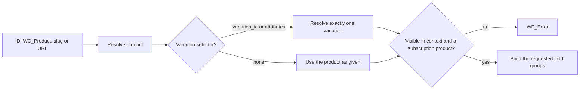

# Info
- Module: Developers
- Availability: Free (some sections require Pro)
- Last updated: 2026-10-18

# Read Subscription Product Terms

> Look up a subscription product by ID, slug or store URL and read its current catalog terms (price, schedule, trial, sign-up fee, plan relationships and module settings) without changing anything.

**Availability:** Core (Free). The `bundle` and `modules` field groups need ArraySubs Pro with an active license; `bundle` also needs the Subscription Bundle module. Rows in the `features` group are configured with Pro Feature Manager; reading saved rows is core.

## Page Navigation

- **Current guide:** Read Subscription Product Terms
- **Where to open it:** Your custom plugin or theme code (PHP)
- **Section overview:** [Developers](./README.md)
- **Previous guide:** [Find Members and Update Profiles](./customers-and-profile-fields.md)
- **Next guide:** [Read and Update Feature Data](./feature-manager.md)
- **Troubleshooting:** [Verify Your Integration](./errors-and-testing.md)

## Overview

`ArraySubs\Api\Products` is a read-only reader for subscription products. It resolves a product or variation from an ID, a `WC_Product`, a slug or the product's own URL, and returns its subscription terms as a documented data array split into field groups.

Products stay WooCommerce objects. Use `wc_get_product()` when you need the `WC_Product`; use this class when you need the subscription terms as stable data (decimal-string money with currency, normalized schedule values, plan relationships) without reading ArraySubs product meta yourself.

The class has no setters and no save, update or delete methods. A read never changes a product, a price, a cart or a subscription.

## When to Use This

- You sell memberships and want to show "what the customer will pay and how often" in your own templates, emails or app.
- You store a plan reference (ID, slug or product URL) in your plugin settings and need to resolve it reliably.
- You need to pick the right variation of a variable plan (for example monthly vs annual) from attribute values.
- You compare a member's agreed price with today's catalog price (grandfathered pricing).
- You list upgrade, downgrade and crossgrade targets configured on a plan.
- You read box, bundle, flexible-duration or fixed-period settings for a product.

## Prerequisites

- ArraySubs (core) active. Guard every call with `class_exists( '\ArraySubs\Api\Products' )`: the class does not exist when ArraySubs fails its dependency check.
- Call product reads on `init` (priority 10 or later) or later hooks such as `wp_loaded` and `template_redirect`, or inside REST and AJAX callbacks. WooCommerce cannot load products before it registers its product types on `init`.
- ArraySubs Pro with an active license for the `bundle` and `modules` groups.
- Subscription products set up by the merchant. See [Create and Configure Subscription Products](../subscription-products/create-and-configure.md).

`\ArraySubs\Api\Availability::check( 'products' )` returns `true` whenever core is booted. See [Connect Your Custom Plugin](./getting-started.md) for loading and availability checks.

## How It Works

Every lookup runs the same steps:

1. **Resolve.** `get()` takes an ID or a `WC_Product`, `get_by_slug()` a product slug, `get_by_url()` a product permalink on this site.
2. **Select a variation (optional).** `variation_id` or `attributes` picks one variation of a variable product.
3. **Check visibility.** The default `view` context reads published products only. `edit` also reads drafts, pending and private products.
4. **Check the entity.** A product that is not a subscription product returns `unsupported_entity`.
5. **Project.** The reader builds only the field groups you request from the product's current catalog data.



The term groups are built from the same product data as `arraysubs_get_product_subscription_data()`, so callbacks on the `arraysubs_product_subscription_data` filter apply to both. Prices come from WooCommerce's own price getters, so WooCommerce price filters apply exactly as they do on the product page.

### Shared arguments

`get()`, `get_by_slug()` and `get_by_url()` accept the same `$args`:

| Argument | Type | Default | Description |
| --- | --- | --- | --- |
| `fields` | string[] | Every documented group you can read | Field groups to return: `identity`, `relationships`, `pricing`, `schedule`, `trial`, `signup_fee`, `lifetime`, `plans`, `box`, `bundle`, `features`, `access`, `modules`. An unknown group returns `invalid_argument`. |
| `variation_id` | int | `0` | A variation of the variable product you pass. See [Choose a Variation](#choose-a-variation). |
| `attributes` | array | `array()` | Attribute values such as `array( 'attribute_pa_size' => 'large' )`. They must resolve exactly one variation. |
| `context` | string | `view` | `view`: published products only, customer-safe output. `edit`: also drafts, pending and private products, and feature `type` values. Check capabilities yourself before you use `edit`. |

### Return value

The three lookups return a data array (never a `WC_Product`). It always has a top-level `id` (the product or variation that was read) plus one key per requested group:

```php
<?php
// Shape of a get() result with fields => array( 'identity', 'pricing', 'schedule' ).
$terms = array(
    'id'       => 456,
    'identity' => array( /* ... */ ),
    'pricing'  => array( /* ... */ ),
    'schedule' => array( /* ... */ ),
);
```

A requested group that does not apply to the product is `null`, never left out. For example `box` is `null` on a simple product. The full list of keys is in the [Field Group Reference](#field-group-reference).

### Errors

Failures return `WP_Error`. `get_error_data()` is an array with `status` and, where relevant, `field` or `details`.

| Code | When | status |
| --- | --- | --- |
| `invalid_argument` | Bad input type (for example a `WP_Post`), unknown field group or `context`, malformed `attributes`, both `variation_id` and `attributes`, a `variation_id` that belongs to another product or a `variation_id` on a product that is not variable, an empty slug, an external or non-product URL, `per_page` above 100, a bad cursor | 400 |
| `not_found` | No product with that ID, slug or URL; the ID is not a WooCommerce product; the product is trashed; the product is not published and `context` is `view`; no variation matches `attributes` | 404 |
| `ambiguous_match` | `attributes` or a slug matched more than one product or variation. `details` lists up to 10 candidate IDs | 409 |
| `unsupported_entity` | The product exists but is not a subscription product (for example an ordinary simple product or a Pro store credit product) | 422 |

### Permission boundary

PHP calls are trusted server code: they do not check the current user's capabilities. Products have no customer owner, so there is no `as_user` ownership check in this class.

- The default `view` context is safe for public output: published products only, and feature types are never included.
- `edit` context exposes unpublished products and feature `type` values. Use it only after your own check, for example `current_user_can( 'edit_products' )` in a REST `permission_callback`.

### Side effects

Read only: no writes. Reads never save or change products, prices or meta, never add to the cart, never schedule jobs and never request a URL.

## Lookup Methods

### `Products::get()`

```text
\ArraySubs\Api\Products::get( int|WC_Product $product, array $args = array() ): array|WP_Error
```

- **Accepts:** a product or variation ID, or a `WC_Product` (including `WC_Product_Variation`). A variation ID reads that variation directly.
- **Arguments:** [Shared arguments](#shared-arguments).
- **Returns:** the data array, or `WP_Error` (see [Errors](#errors)).
- **Read only:** no writes.

```php
<?php
add_action( 'init', function () {
    if ( ! class_exists( '\ArraySubs\Api\Products' ) ) {
        return;
    }

    $terms = \ArraySubs\Api\Products::get( 456, array( 'fields' => array( 'pricing', 'schedule' ) ) );

    if ( is_wp_error( $terms ) ) {
        error_log( 'Plan lookup failed: ' . $terms->get_error_code() );
        return;
    }

    // $terms['pricing']['recurring_amount'] is a decimal string such as '19.00'.
}, 20 );
```

### `Products::get_by_slug()`

```text
\ArraySubs\Api\Products::get_by_slug( string $slug, array $args = array() ): array|WP_Error
```

- **Accepts:** the product's slug, the last part of its permalink (for example `gold-plan`).
- Only WooCommerce products are searched. Pages, posts and attachments with the same slug are ignored.
- Variations have no slug of their own that resolves. Pass the variable product's slug and select the variation with `variation_id` or `attributes`.
- More than one product with the slug returns `ambiguous_match` with the candidate IDs in `details`.
- **Arguments, returns, errors:** as `get()`. **Read only:** no writes.

```php
<?php
function myplugin_plan_by_slug( string $slug ) {
    if ( ! class_exists( '\ArraySubs\Api\Products' ) ) {
        return null;
    }

    $terms = \ArraySubs\Api\Products::get_by_slug( $slug, array( 'fields' => array( 'identity', 'pricing' ) ) );

    return is_wp_error( $terms ) ? null : $terms;
}
```

### `Products::get_by_url()`

```text
\ArraySubs\Api\Products::get_by_url( string $url, array $args = array() ): array|WP_Error
```

- **Accepts:** a canonical product permalink on this site, such as the value of `identity.permalink` or `get_permalink()`.
- The URL is parsed, never requested: no HTTP request is made, and a Pro product page redirect does not affect the lookup.
- The fragment and query arguments are ignored, except `attribute_*` arguments, which select a variation exactly like the `attributes` argument.
- **Arguments, returns, errors:** as `get()`. **Read only:** no writes.

| URL | Result |
| --- | --- |
| `https://example.com/product/gold-plan/` | The product |
| `https://example.com/product/gold-plan/?utm_source=news#faq` | The same product (extra query arguments and the fragment are ignored) |
| `https://example.com/product/gold-plan/?attribute_pa_billing=annual` | The matching variation, or `ambiguous_match` / `not_found` |
| `https://another-store.example/product/gold-plan/` | `invalid_argument` (another host; never fetched) |
| `https://example.com/about/` or a product category URL | `invalid_argument` (not a product permalink) |
| `https://example.com/?p=123` | `invalid_argument` (a shortlink, not the canonical permalink; read the ID and call `get()`) |

```php
<?php
function myplugin_plan_from_url( string $url ) {
    if ( ! class_exists( '\ArraySubs\Api\Products' ) ) {
        return new WP_Error( 'myplugin_unavailable', __( 'ArraySubs is not active.', 'myplugin' ) );
    }

    return \ArraySubs\Api\Products::get_by_url( $url, array( 'fields' => array( 'identity', 'pricing', 'schedule' ) ) );
}
```

### `Products::is_subscription_product()`

```text
\ArraySubs\Api\Products::is_subscription_product( int|WC_Product $product ): bool
```

- Returns `true` when the product or variation is a subscription product. It uses the same rule as `arraysubs_is_subscription_product()`: the item's own subscription flag. Variable parents, Subscription Box and Subscription Bundle products return `true`; a variation is checked on its own flag.
- Returns `false` for missing products and non-subscription products. It never returns `WP_Error`.
- It does not check post status or context. Use `get()` when visibility matters.
- **Read only:** no writes.

```php
<?php
add_filter( 'woocommerce_post_class', function ( $classes, $product ) {
    if ( class_exists( '\ArraySubs\Api\Products' ) && \ArraySubs\Api\Products::is_subscription_product( $product ) ) {
        $classes[] = 'myplugin-plan';
    }
    return $classes;
}, 10, 2 );
```

## Variations

### Choose a Variation

Variation terms live on each variation, not on the variable parent. You can read a variation three ways:

| You have | Call |
| --- | --- |
| The variation ID | `Products::get( 457 )` |
| The parent and the variation ID | `Products::get( 123, array( 'variation_id' => 457 ) )` |
| The parent and attribute values | `Products::get( 123, array( 'attributes' => array( 'attribute_pa_billing' => 'annual' ) ) )` |

Rules:

- `attributes` must resolve exactly one variation. A variation with an "Any" value can match several combinations, so pass every attribute the product uses. Several matches return `ambiguous_match` (candidate IDs in `details`); no match returns `not_found`.
- Pass `variation_id` or `attributes`, not both (`invalid_argument`).
- A variable parent read without a selector returns the parent: `identity` and `relationships` are filled, and the term groups (`pricing`, `schedule`, `trial`, `signup_fee`, `lifetime`, `plans`) are `null` because the parent has no purchasable terms of its own.
- A variation is a subscription product only when its own flag is set. ArraySubs copies the parent's flag to every variation when the variable product is saved in the product editor.

```php
<?php
function myplugin_annual_terms( int $parent_id ) {
    if ( ! class_exists( '\ArraySubs\Api\Products' ) ) {
        return null;
    }

    $terms = \ArraySubs\Api\Products::get(
        $parent_id,
        array(
            'attributes' => array( 'attribute_pa_billing' => 'annual' ),
            'fields'     => array( 'identity', 'pricing', 'schedule' ),
        )
    );

    if ( is_wp_error( $terms ) && 'ambiguous_match' === $terms->get_error_code() ) {
        $data = $terms->get_error_data();
        // Several variations match: ask for another attribute, or choose from these IDs.
        $candidate_ids = isset( $data['details'] ) ? array_map( 'absint', (array) $data['details'] ) : array();
        return null;
    }

    return is_wp_error( $terms ) ? null : $terms;
}
```

### `Products::get_variations()`

```text
\ArraySubs\Api\Products::get_variations( int|WC_Product $product, array $args = array() ): array|WP_Error
```

Lists the subscription variations of a variable product as a paged collection, ordered by ID.

| Argument | Type | Default | Description |
| --- | --- | --- | --- |
| `output` | string | `object` | `object` (`WC_Product_Variation` items), `ids` (ints) or `data` (data arrays like `get()` returns). |
| `fields` | string[] | Every documented group you can read | Field groups for `data` output. |
| `context` | string | `view` | `view`: enabled variations of a published product. `edit`: also disabled variations and unpublished parents. |
| `per_page` | int | `20` | Maximum 100. Larger values return `invalid_argument`. |
| `cursor` | string | none | The `next_cursor` value from the previous page. |
| `order` | string | `asc` | `asc` or `desc` by ID. |
| `include_total` | bool | `false` | `true` adds an exact `total` (slower). |

Returns:

```php
<?php
$page = array(
    'items'       => array( /* WC_Product_Variation objects, IDs or data arrays */ ),
    'per_page'    => 20,
    'next_cursor' => 'c2lkOjQ1Ng', // Opaque string, or null on the last page.
    'has_more'    => true,
    'total'       => null,         // An int only with 'include_total' => true.
);
```

- A simple, box, bundle or variation input returns an empty collection (not an error).
- A product that is not a subscription product returns `unsupported_entity`; a missing one `not_found`.
- **Read only:** no writes. See [Export every variation](#export-every-variation) for a paging loop.

## Field Group Reference

A complete `data` result for an annual variation, with every group requested (Pro active):

```php
<?php
$terms = array(
    'id'            => 457,
    'identity'      => array(
        'id'        => 457,
        'parent_id' => 123,
        'type'      => 'variation',
        'name'      => 'Gold Plan - Annual',
        'slug'      => 'gold-plan-annual',
        'status'    => 'publish',
        'permalink' => 'https://example.com/product/gold-plan/?attribute_pa_billing=annual',
        'sku'       => 'GOLD-ANNUAL',
    ),
    'relationships' => array(
        'parent_id'     => 123,
        'variation_ids' => null,
    ),
    'pricing'       => array(
        'price'            => '190.00',
        'regular_price'    => '190.00',
        'sale_price'       => null,
        'currency'         => 'USD',
        'decimals'         => 2,
        'recurring_amount' => '190.00',
    ),
    'schedule'      => array(
        'billing_interval' => 1,
        'billing_period'   => 'year',
        'length'           => 0,
        'expires_after'    => null,
    ),
    'trial'         => array(
        'length'                  => 14,
        'period'                  => 'day',
        'requires_payment_method' => true,
    ),
    'signup_fee'    => array(
        'amount'   => '0.00',
        'currency' => 'USD',
        'decimals' => 2,
    ),
    'lifetime'      => false,
    'plans'         => array(
        'upgrades'    => array( 789 ),
        'downgrades'  => array( 456 ),
        'crossgrades' => array(),
    ),
    'box'           => null,
    'bundle'        => null,
    'features'      => array(
        array(
            'name'      => 'seats',
            'value'     => '5',
            'unlimited' => false,
            'enabled'   => true,
            'inherited' => true,
        ),
    ),
    'access'        => array( 'r_12' ),
    'modules'       => array(
        'flexible_subscription' => array(
            'mode'       => 'fixed',
            'periods'    => array( 'month' ),
            'max_length' => 0,
        ),
        'fixed_period'          => null,
    ),
);
```

While ArraySubs Pro is not active with a license, the default field set leaves out `bundle` and `modules`, and requesting them returns `null`.

### identity

| Key | Type | Notes |
| --- | --- | --- |
| `id` | int | The product or variation that was read. |
| `parent_id` | int | The variable parent for a variation, otherwise `0`. |
| `type` | string | WooCommerce product type: `simple`, `variable`, `variation`, `arraysubs_subscription_box` or `arraysubs_subscription_bundle`. |
| `name` | string | Product name. A variation's name includes its attribute values. |
| `slug` | string | Product slug. |
| `status` | string | WordPress post status. Always `publish` in `view` context; `edit` can also return `draft`, `pending` or `private`. |
| `permalink` | string | Canonical URL. A variation's permalink is the parent URL plus its `attribute_*` query arguments. |
| `sku` | string | `''` when the product has no SKU. |

### relationships

| Key | Type | Notes |
| --- | --- | --- |
| `parent_id` | int | Same as `identity.parent_id`. |
| `variation_ids` | array or null | For a variable product: `items` (the first page of subscription variation IDs, up to 20, ascending), `count` (all of them) and `has_more`. `null` for every other type. Use `get_variations()` for the rest. |

### pricing

| Key | Type | Notes |
| --- | --- | --- |
| `price` | string or null | WooCommerce active price: the sale price while a sale runs, otherwise the regular price. Stored price before tax display adjustments. |
| `regular_price` | string or null | Regular price. For a bundle, the subtotal of its contents. |
| `sale_price` | string or null | `null` when no sale price is set. |
| `currency` | string | Store currency (ISO 4217), as WooCommerce reports it. |
| `decimals` | int | Store price decimals. |
| `recurring_amount` | string or null | The unit amount a new subscription records as its recurring amount at checkout: equal to `price` for simple products and variations, the live total for a bundle, `null` for a box. |

- Money values are decimal strings in `currency`, such as `'19.00'`.
- For a Subscription Box, `price`, `regular_price`, `sale_price` and `recurring_amount` are `null`: the amount depends on the customer's selection.
- A different renewal price that starts after a number of payments (needs an active Pro license) is not part of `recurring_amount`. Read it from `arraysubs_get_product_subscription_data()` (`enable_different_renewal_price`, `different_renewal_price`, `different_renewal_price_after`).

### schedule

| Key | Type | Notes |
| --- | --- | --- |
| `billing_interval` | int | Charge every N periods. `1` for lifetime products. |
| `billing_period` | string | `day`, `week`, `month`, `year` or `lifetime`. |
| `length` | int | Paid billing cycles before the subscription expires. `0` means it renews until cancelled. In Pro flexible modes this is the longest length a customer can choose. |
| `expires_after` | array or null | The nominal term that `length` covers, as `array( 'count' => 12, 'period' => 'month' )` (length times interval periods). `null` when `length` is `0` or the product is lifetime. |

Empty stored values are read the way checkout reads them: an empty period is `month` and an empty or zero interval is `1`. Expiry counts completed payments, so trials, skips and pauses move the real end date; after purchase, read the subscription's own dates.

### trial

| Key | Type | Notes |
| --- | --- | --- |
| `length` | int | Trial length in `period` units. `0` means no trial. |
| `period` | string or null | `day`, `week`, `month` or `year`. `null` when there is no trial. |
| `requires_payment_method` | bool | The store-wide **Require Payment Method** trial setting. It is the same for every product. |

Whether a given customer actually gets the trial also depends on the store's **One Trial Per Customer** setting. Box and bundle products have no trial. See [Trial Management](../billing-and-renewals/trial-management.md).

### signup_fee

| Key | Type | Notes |
| --- | --- | --- |
| `amount` | string | One-time fee, `'0.00'` when none. |
| `currency` | string | Store currency. |
| `decimals` | int | Store price decimals. |

The fee is charged once per cart line at checkout (not multiplied by quantity), also when the product has a trial, and never on renewals. Box and bundle products report `'0.00'` here; their checkout fee comes from their contents (`box.schedule.keep_signup_fees`, `bundle.pricing.signup_fee`).

### lifetime

A bool. `true` when the product charges once and never renews: `schedule.billing_period` is `lifetime`, `billing_interval` is `1`, `length` is `0` and `expires_after` is `null`.

### plans

| Key | Type | Notes |
| --- | --- | --- |
| `upgrades` | int[] | Product or variation IDs configured as upgrades. |
| `downgrades` | int[] | Configured downgrades. |
| `crossgrades` | int[] | Configured crossgrades. |

- These are the switch targets configured on this product or variation, empty arrays when none. On a variable parent the group is `null`: targets are configured per variation.
- Relationships are one-directional. Listing B as an upgrade of A does not make A a downgrade of B.
- A listed target is not a promise that a given subscription can switch to it. Eligibility is checked per subscription (status, stock, price direction, store switching settings). For one subscription's eligible options, call the `POST /arraysubs/v1/subscriptions/{id}/switch-options` route.
- The automatic downgrade fallback plan is not part of this group.

See [Plan Switching and Product Relationships](../subscription-products/plan-switching-and-relationships.md) for the merchant setup.

### box

`null` unless `identity.type` is `arraysubs_subscription_box`. Otherwise the sanitized box configuration, with the same structure the box builder saves:

| Key | Contents |
| --- | --- |
| `schedule` | `mode`, `flexible_periods`, `period`, `interval`, `length`, `keep_signup_fees` |
| `steps` | Each step: `id`, `title`, `elements` (each `id`, `type`, `label`, `required`, `settings`; `type` is the builder element kind, for example `product` or `categories`) |
| `discounts` | `basis`, `max_value`, `boundaries`, `ranges` (each `freebies` and a `discount` with `type` and `amount`) |
| `renewal_sync` | `enabled`, `seg1_end`, `seg2_end`, `seg1_active`, `seg2_active`, `seg3_active` |

Core feature (Subscription Box module). The box price is computed from the customer's selection when it is added to the cart, and the purchased contents and price are frozen on the subscription. See [Subscription Boxes](../subscription-products/subscription-box.md).

### bundle *(Pro)*

`null` unless `identity.type` is `arraysubs_subscription_bundle` and Pro is active with a license.

| Key | Contents |
| --- | --- |
| `schedule` | The bundle's billing schedule (same keys as `box.schedule`) |
| `products` | Rows of `id`, `product_id`, `qty` |
| `discount` | `type` (`none`, `fixed` or `percent`) and `amount` |
| `renewal_sync` | Same keys as `box.renewal_sync` |
| `pricing` | Live totals from the current contents: `subtotal`, `discount_type`, `discount_amount`, `discount_value`, `total`, `signup_fee` (amounts are decimal strings in the store currency) |

See [Subscription Bundles](../subscription-products/subscription-bundle.md).

### features

A list of the Feature Manager rows configured on the product or variation: the same rows `FeatureManager::get_product_features()` returns. Each row carries `inherited`, `true` when a variation uses its parent's defaults. Empty list when none.

- Feature `type` values appear only in `edit` context. Keep them out of anything a customer can see.
- These are catalog rows. For a member's effective values and usage, see [Read and Update Feature Data](./feature-manager.md).

### access

A list of Member Access rule IDs (strings such as `'r_12'`) that reference this product or variation. Empty list when none. To evaluate access for a person, see [Check Content Access](./member-access.md).

### modules *(Pro)*

`null` while Pro is not active with a license. Otherwise keyed blocks:

| Block | Key | Notes |
| --- | --- | --- |
| `flexible_subscription` | `mode` | `fixed`, `flexible_length` or `full_flexible`. Lifetime and fixed-period products are always `fixed`. |
| | `periods` | Periods a customer can pick in `full_flexible`: any of `day`, `week`, `month`, `year`. |
| | `max_length` | Longest length a customer can pick in the flexible modes. `0` means no merchant cap. |
| `fixed_period` | (block) | `null` unless the product has a fixed end date enabled. |
| | `end_date_type` | `absolute` or `recurring_annual`. |
| | `end_date` | `YYYY-MM-DD` (absolute) or `MM-DD` (annual), a site-local calendar date. |
| | `enrollment_window_start`, `enrollment_window_end` | `YYYY-MM-DD` site-local dates, or `null`. |
| | `end_renewal` | `expire` or `renew`. |

These are calendar settings, not timestamps. When a fixed-period subscription is bought, its UTC end date is stored on the subscription (`schedule.end_at` from [Find and Update Subscriptions](./subscriptions.md)). See [Flexible Subscription Duration](../subscription-products/flexible-subscription-duration.md) and [Plan Switching and Product Relationships](../subscription-products/plan-switching-and-relationships.md) (Fixed Period Membership section).

## Catalog Terms vs a Subscription's Stored Terms

`Products` returns the **catalog terms**: what a new customer would buy today. A subscription keeps the **terms it was bought with**.

At checkout ArraySubs copies the product's current terms into the new subscription once: unit price, recurring amount, quantity, billing interval and period, length, trial, sign-up fee, currency and any different renewal price. Renewals then charge from the subscription's stored terms.

| Change on the product | Effect on existing subscriptions |
| --- | --- |
| Price, sale price, schedule, length, trial, sign-up fee | None. The subscription keeps its agreed price and schedule. A subscription bought during a sale keeps renewing at the price it was bought at. |
| Plan switch targets | Used for future switches; the switch quote uses the target's current price. |
| Feature Manager rows | Live: entitlements are read from the product when they are evaluated. |
| Product name, SKU, tax and shipping data | Live: each renewal order line is built from the current product. |
| Trash | Renewals continue (a trashed product still loads). |
| Permanent delete | Renewal order creation fails and the subscription goes on hold. `Lifecycle::get_state()` reports `grace.skip_reason` `renewal_order_creation_failed`. Retire plans by drafting or trashing them instead. |

A subscription's terms change only through a plan switch (it copies the new product's current price and schedule at that moment), an admin edit, `Subscriptions::update()`, or a different renewal price taking over after its number of payments.

Read the stored terms from the subscription, not the product:

```php
<?php
function myplugin_agreed_terms( int $subscription_id ) {
    if ( ! class_exists( '\ArraySubs\Api\Subscriptions' ) ) {
        return null;
    }

    $subscription = \ArraySubs\Api\Subscriptions::get(
        $subscription_id,
        array(
            'output' => 'data',
            'fields' => array( 'plan', 'pricing', 'schedule', 'trial' ),
        )
    );

    // pricing.recurring_amount and schedule.billing_interval / billing_period are what renewals charge.
    return is_wp_error( $subscription ) ? null : $subscription;
}
```

For the computed current plan and any pending plan switch, see [Read Lifecycle State and Manage Its Dates](./status-grace-periods-and-trials.md).

## Existing Product Helpers

These global helpers remain available. They are handy for quick checks; the `Products` class is the documented data contract with errors, contexts and field groups.

| Helper | Returns | Notes |
| --- | --- | --- |
| `arraysubs_get_product_subscription_data( $product )` | `?array` | `null` unless the product or variation is a subscription product. Keys: `product_id`, `price`, `period`, `interval`, `length`, `trial_length`, `trial_period`, `signup_fee`, `enable_different_renewal_price`, `different_renewal_price`, `different_renewal_price_after`; licensed Pro Flexible Subscription adds `flex_mode` and `flex_periods`. Filtered by `arraysubs_product_subscription_data` (`array $data`, `WC_Product $product`). |
| `arraysubs_is_subscription_product( $product )` | `bool` | The flag check `Products::is_subscription_product()` also uses. |
| `arraysubs_get_wc_product( $product )` | `?WC_Product` | Accepts an ID or a `WC_Product`. |
| `arraysubs_get_current_product()` | `?WC_Product` | The product of the current single-product request. |
| `arraysubs_product_has_free_trial( $product )` | `bool` | `true` when the trial length is above 0. |
| `arraysubs_is_lifetime_product( $product )` | `bool` | Checks the billing period only. |
| `arraysubs_get_subscription_products( array $args = array() )` | `WC_Product[]` or `int[]` | Published subscription products through `wc_get_products()`. Unlimited by default: always pass a `limit`. Do not pass `'paginate' => true`. |
| `arraysubs_has_subscription_variations( $product )` | `bool` | Builds every available variation; avoid it in loops. |
| `arraysubs_get_cart_item_subscription_data( array $cart_item )` | `?array` | Terms for a cart line (filter `arraysubs_cart_item_subscription_data`). |
| `arraysubs_get_order_item_subscription_data( $item, $order = null )` | `?array` | Terms for an order line (filter `arraysubs_order_item_subscription_data`). |
| `arraysubs_get_billing_schedule_string( int $interval, string $period )` | `string` | Display label such as `Every month`. Display only. |
| `arraysubs_get_subscription_effective_product_id( int $subscription_id )` | `int` | The subscription's variation ID, or its product ID for simple products. |

The helpers return `null` or `false` instead of `WP_Error`, accept only an ID or a `WC_Product` (a `WP_Post`, slug or URL gives `null`), and return raw types (for example `signup_fee` is a float or `0`).

## Examples

### Show a plan's price and schedule

The minimal case: print the renewal amount and schedule on a single product page.

```php
<?php
add_action( 'woocommerce_single_product_summary', function () {
    if ( ! class_exists( '\ArraySubs\Api\Products' ) ) {
        return;
    }

    $terms = \ArraySubs\Api\Products::get( get_the_ID(), array( 'fields' => array( 'pricing', 'schedule' ) ) );

    // Errors, variable parents (null groups) and boxes (null amount) print nothing.
    if ( is_wp_error( $terms ) || null === $terms['pricing'] || null === $terms['pricing']['recurring_amount'] ) {
        return;
    }

    printf(
        '<p class="myplugin-plan-terms">%1$s %2$s</p>',
        wp_kses_post( wc_price( $terms['pricing']['recurring_amount'], array( 'currency' => $terms['pricing']['currency'] ) ) ),
        esc_html( arraysubs_get_billing_schedule_string( $terms['schedule']['billing_interval'], $terms['schedule']['billing_period'] ) )
    );
}, 25 );
```

### Resolve a plan URL from your settings

Failure handling: map each error code to a message the merchant can act on.

```php
<?php
function myplugin_resolve_plan_url( string $url ) {
    if ( ! class_exists( '\ArraySubs\Api\Products' ) ) {
        return new WP_Error( 'myplugin_unavailable', __( 'ArraySubs is not active.', 'myplugin' ) );
    }

    $terms = \ArraySubs\Api\Products::get_by_url( $url, array( 'fields' => array( 'identity', 'pricing', 'schedule' ) ) );

    if ( ! is_wp_error( $terms ) ) {
        return $terms;
    }

    switch ( $terms->get_error_code() ) {
        case 'invalid_argument':
            $message = __( 'Use the plan page URL from this store.', 'myplugin' );
            break;
        case 'not_found':
            $message = __( 'That plan does not exist or is not published.', 'myplugin' );
            break;
        case 'unsupported_entity':
            $message = __( 'That product is not a subscription plan.', 'myplugin' );
            break;
        case 'ambiguous_match':
            $message = __( 'Pick one plan option, for example monthly or annual.', 'myplugin' );
            break;
        default:
            $message = $terms->get_error_message();
    }

    return new WP_Error( 'myplugin_plan_url', $message, $terms->get_error_data() );
}

// Showing the result in an admin notice:
// $result = myplugin_resolve_plan_url( $saved_url );
// if ( is_wp_error( $result ) ) {
//     echo '<div class="notice notice-error"><p>' . esc_html( $result->get_error_message() ) . '</p></div>';
// }
```

### Serve plan terms from your own REST route

The public route uses the default `view` context. The second route uses `edit` context, so it checks a capability first. Error data carries `status`, so a returned `WP_Error` becomes the matching HTTP status.

```php
<?php
add_action( 'rest_api_init', function () {
    register_rest_route(
        'myplugin/v1',
        '/plan-terms',
        array(
            'methods'             => 'GET',
            'permission_callback' => '__return_true',
            'args'                => array(
                'url' => array(
                    'type'     => 'string',
                    'required' => true,
                ),
            ),
            'callback'            => function ( WP_REST_Request $request ) {
                if ( ! class_exists( '\ArraySubs\Api\Products' ) ) {
                    return new WP_Error( 'myplugin_unavailable', 'Plans are unavailable.', array( 'status' => 503 ) );
                }

                // Customer-safe: published products only, no feature types.
                return \ArraySubs\Api\Products::get_by_url(
                    (string) $request->get_param( 'url' ),
                    array( 'fields' => array( 'identity', 'pricing', 'schedule', 'trial', 'signup_fee' ) )
                );
            },
        )
    );

    register_rest_route(
        'myplugin/v1',
        '/plan-terms/(?P<id>\d+)/edit',
        array(
            'methods'             => 'GET',
            'permission_callback' => function () {
                return current_user_can( 'edit_products' );
            },
            'callback'            => function ( WP_REST_Request $request ) {
                if ( ! class_exists( '\ArraySubs\Api\Products' ) ) {
                    return new WP_Error( 'myplugin_unavailable', 'Plans are unavailable.', array( 'status' => 503 ) );
                }

                return \ArraySubs\Api\Products::get( absint( $request['id'] ), array( 'context' => 'edit' ) );
            },
        )
    );
} );
```

### Detect grandfathered pricing

Compare what a member agreed to pay with today's catalog price.

```php
<?php
function myplugin_is_grandfathered( int $subscription_id ) {
    if ( ! class_exists( '\ArraySubs\Api\Subscriptions' ) || ! class_exists( '\ArraySubs\Api\Products' ) ) {
        return new WP_Error( 'myplugin_unavailable', 'ArraySubs is not active.' );
    }

    $subscription = \ArraySubs\Api\Subscriptions::get(
        $subscription_id,
        array(
            'output' => 'data',
            'fields' => array( 'plan', 'pricing' ),
        )
    );
    if ( is_wp_error( $subscription ) ) {
        return $subscription;
    }

    $product = \ArraySubs\Api\Products::get(
        $subscription['plan']['effective_product_id'],
        array( 'fields' => array( 'pricing' ) )
    );
    if ( is_wp_error( $product ) ) {
        return $product; // For example not_found when the plan is no longer published.
    }

    $catalog = $product['pricing'];
    if ( null === $catalog['recurring_amount'] || $catalog['currency'] !== $subscription['pricing']['currency'] ) {
        return false; // Not comparable: a box product or another currency.
    }

    $decimals = (int) $catalog['decimals'];

    return round( (float) $subscription['pricing']['recurring_amount'], $decimals ) < round( (float) $catalog['recurring_amount'], $decimals );
}
```

### Export every variation

Walk all pages of a variable plan's variations with the cursor.

```php
<?php
function myplugin_export_variations( int $parent_id ): array {
    if ( ! class_exists( '\ArraySubs\Api\Products' ) ) {
        return array();
    }

    $rows = array();
    $args = array(
        'output'   => 'data',
        'fields'   => array( 'identity', 'pricing', 'schedule' ),
        'per_page' => 100,
    );

    do {
        $page = \ArraySubs\Api\Products::get_variations( $parent_id, $args );
        if ( is_wp_error( $page ) ) {
            error_log( 'Variation export stopped: ' . $page->get_error_code() );
            break;
        }

        foreach ( $page['items'] as $variation ) {
            $rows[] = array(
                'id'       => $variation['id'],
                'name'     => $variation['identity']['name'],
                'price'    => $variation['pricing']['price'],
                'currency' => $variation['pricing']['currency'],
                'period'   => $variation['schedule']['billing_period'],
            );
        }

        $args['cursor'] = $page['next_cursor'];
    } while ( $page['has_more'] );

    return $rows;
}
```

### List upgrade targets

```php
<?php
add_action( 'woocommerce_after_add_to_cart_form', function () {
    if ( ! class_exists( '\ArraySubs\Api\Products' ) ) {
        return;
    }

    $terms = \ArraySubs\Api\Products::get( get_the_ID(), array( 'fields' => array( 'plans' ) ) );
    if ( is_wp_error( $terms ) || empty( $terms['plans']['upgrades'] ) ) {
        return; // No targets, or a variable parent (targets are per variation).
    }

    echo '<ul class="myplugin-upgrades">';
    foreach ( $terms['plans']['upgrades'] as $target_id ) {
        $target = \ArraySubs\Api\Products::get( $target_id, array( 'fields' => array( 'identity' ) ) );
        if ( is_wp_error( $target ) ) {
            continue; // Unpublished, removed or no longer a subscription product.
        }
        printf(
            '<li><a href="%1$s">%2$s</a></li>',
            esc_url( $target['identity']['permalink'] ),
            esc_html( $target['identity']['name'] )
        );
    }
    echo '</ul>';
} );
```

## Edge Cases and Important Notes

- **No writes, ever.** Change subscription terms in the WooCommerce product editor or with [Quick Product Creation](../subscription-products/quick-product-creation.md). Do not write ArraySubs product meta directly: direct writes skip validation, lifetime normalization and the parent-to-variation flag sync.
- **No raw meta.** The reader returns the documented groups only. Settings outside them, such as Pro shipping options, are not part of this contract.
- **Variable parents** have `null` term groups. Read a variation.
- **Module switches.** Switching the Subscription Box or Subscription Bundle module off drafts those products, so `view` reads return `not_found`. Existing subscriptions keep renewing.
- **Without Pro**, a bundle product loads as a simple WooCommerce product: its mirrored schedule and stored price still read, and `bundle` is `null`.
- **Trashed products** return `not_found` in both contexts, even though their subscriptions keep renewing. Read those subscriptions' stored terms instead.
- **Prices are filtered by WooCommerce**, so currency or dynamic-pricing plugins that filter product prices affect `pricing`. Coupons are not part of product terms.
- **Feature types** appear only in `edit` context and never belong in customer-facing output, HTML classes or data attributes.
- **Plan lists are configuration**, not per-subscription eligibility.
- **Store credit products** (Pro) are not subscription products and return `unsupported_entity`.

## Troubleshooting

| Problem | Likely Cause | What to Do |
| --- | --- | --- |
| Every lookup returns `not_found` | Your code runs before `init`, when WooCommerce cannot load products | Move the call to `init` priority 20, `wp_loaded`, `template_redirect` or a REST callback. |
| `not_found` for a product you can see in the admin | It is a draft, pending, private or trashed product, or its box/bundle module is switched off | Check the status. Use `context` `edit` behind your own capability check for unpublished products. |
| `unsupported_entity` | The product or variation is not a subscription product | Check the **Subscription [AS]** checkbox in the product editor and save the product (this also syncs its variations). |
| `invalid_argument` from `get_by_url()` | Another host, a non-product page or a shortlink | Pass the product permalink (`identity.permalink` or `get_permalink()`), or read the ID and call `get()`. |
| `ambiguous_match` | Incomplete `attributes` ("Any" values) or a duplicate slug | Pass every attribute, or use `variation_id`. The candidate IDs are in `get_error_data()['details']`. |
| `pricing` and `schedule` are `null` | You read a variable parent | Select a variation, or call `get_variations()`. |
| `recurring_amount` is `null` | A Subscription Box: the price depends on the customer's selection | Read the amount from the subscription after purchase. |
| `bundle` or `modules` is `null` | Pro is not active with a license, or the product is not a bundle | Activate ArraySubs Pro and its license; check `identity.type`. |
| The product price differs from what a member pays | Catalog terms vs stored terms | Read the subscription with `Subscriptions::get()` (`pricing`, `schedule`). |
| Feature rows have no `type` | `view` context | Use `edit` context only in admin tooling, after a capability check. |

## Related Guides

- [Find and Update Subscriptions](./subscriptions.md) - read a subscription's stored plan, pricing and schedule.
- [Read Lifecycle State and Manage Its Dates](./status-grace-periods-and-trials.md) - current plan, pending plan switches and grace states.
- [Read and Update Feature Data](./feature-manager.md) - effective feature values and usage.
- [Check Content Access](./member-access.md) - evaluate the rules listed in `access`.
- [Verify Your Integration](./errors-and-testing.md) - error handling and testing.
- [Create and Configure Subscription Products](../subscription-products/create-and-configure.md) - merchant setup of the terms this page reads.
- [Plan Switching and Product Relationships](../subscription-products/plan-switching-and-relationships.md) - upgrade, downgrade and crossgrade setup.
- [Subscription Boxes](../subscription-products/subscription-box.md) and [Subscription Bundles](../subscription-products/subscription-bundle.md) - box and bundle configuration.
- [Product Lifecycle and Test Links](../subscription-products/product-lifecycle.md) - product snapshots, trash and delete behavior.

## FAQ

### Can I change a product with this class?

No. `Products` has no setters and never writes. Change terms in the product editor or create products with Quick Product Creation.

### Does editing a product's price change existing subscriptions?

No. Each subscription keeps the price and schedule it was bought with. Feature Manager rows and the renewal order line details (name, SKU, tax and shipping) are read from the current product.

### How do I get the `WC_Product` object?

Call `wc_get_product( $terms['id'] )`, or use `get_variations()` with the default `object` output for variations.

### Is the output safe to show customers?

The default `view` context is: it reads published products only and never includes feature types. Escape values when you print them.

### Does `get_by_url()` make an HTTP request?

No. It parses the URL and matches it against this site's product permalinks. External URLs return `invalid_argument`.

### How do I list all subscription products?

`Products` reads one product at a time. Get IDs with `arraysubs_get_subscription_products( array( 'limit' => 20, 'return' => 'ids' ) )` (always set a `limit`), then read each with `Products::get()`.

### Why is `plans` empty on my variable product?

Switch targets are configured per variation. Read the variation, for example `Products::get( 123, array( 'variation_id' => 457, 'fields' => array( 'plans' ) ) )`.
