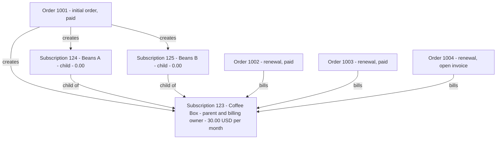

# Info
- Module: Developers
- Availability: Free (some sections require Pro)
- Last updated: 2026-10-18

# Work with Subscription Families and Orders

> Resolve box and bundle families, find the subscription that bills, read related WooCommerce orders by type, and make the few order changes that are safe outside the payment, refund, renewal and plan-switch workflows.

**Availability:** Core (Free). `ArraySubs\Api\Relationships` and `ArraySubs\Api\Orders` ship with the core plugin. Subscription Box families are core. Subscription Bundle families need ArraySubs Pro with an active license. Early renewal orders need ArraySubs Pro with **Allow Early Renew** turned on.

## Page Navigation

- **Current guide:** Work with Subscription Families and Orders
- **Where to open it:** Your custom plugin or theme code (PHP)
- **Section overview:** [Developers](./README.md)
- **Previous guide:** [Find and Update Subscriptions](./subscriptions.md)
- **Next guide:** [Read Lifecycle State and Manage Its Dates](./status-grace-periods-and-trials.md)
- **Troubleshooting:** [Verify Your Integration](./errors-and-testing.md)

## Overview

A subscription rarely stands alone. A WooCommerce checkout order creates it, renewal orders bill it, and a subscription box or bundle can own child subscriptions for the products inside it. Two core classes tell you what is related to what, and what you may change:

| Class | Scope | Methods |
| --- | --- | --- |
| `ArraySubs\Api\Relationships` | Read only | `get_family()`, `get_parent()`, `get_children()`, `get_billing_owner()`, `get_orders()`, `get_pending_renewal_order()`, `get_order_type()`, `get_subscriptions_for_order()` |
| `ArraySubs\Api\Orders` | Read, update and delete related orders | `get()`, `update()`, `delete()` |

Subscriptions come back as `WP_Post` objects and orders as `WC_Order` objects unless you ask for IDs or data arrays. Every order read and write goes through WooCommerce CRUD, so the classes work the same with High-Performance Order Storage (HPOS) and with the legacy posts table.

## When to Use This

- You grant access per product and need the child subscriptions a member holds inside a box or bundle.
- You start from any subscription, possibly a child, and need the subscription that bills before you pause, cancel, skip or move dates.
- You sync orders to an accounting, CRM or commission system and need each order's type: initial, renewal, switch, early renewal or manual.
- You need the open renewal invoice, for example to show "payment due" or to check whether a pending plan switch is frozen.
- You want to add an order note, correct an order address or remove an unpaid leftover order without touching payments.
- You delete a subscription and need a report of the child subscriptions removed and the orders kept.

## Prerequisites

- WooCommerce and ArraySubs (core) active. Guard every call with `class_exists( '\ArraySubs\Api\Relationships' )` or `class_exists( '\ArraySubs\Api\Orders' )`. The classes do not exist when ArraySubs fails its dependency check. See [Connect Your Custom Plugin](./getting-started.md).
- Call the classes from `init` or later. They are available from `arraysubs_after_boot`, but status filters and translated labels need `init`.
- Bundle families: ArraySubs Pro active with a valid license. Box families: core only.
- Your own capability, nonce and ownership checks at your web boundary. See [Permissions](#permissions).
- The subscription data model from [Find and Update Subscriptions](./subscriptions.md).

## How It Works

### The family model

- A **standalone** subscription bills itself.
- A **parent** subscription is a subscription box (core) or a subscription bundle (Pro) that bills for everything inside it.
- A **child** subscription is a zero-priced subscription that ArraySubs creates for each subscription product inside a box or bundle. It represents the customer's entitlement to that product and never bills on its own. The merchant guides call children "included subscriptions".

Children are created once, together with the parent, from the initial checkout order. After that:

- Every parent status change is copied to each child right away.
- The parent's next payment date, last payment date and payment count are copied to each child when a parent renewal is paid.
- Renewal invoices, payment methods, retries, grace periods, plan switches, pauses and cancellations all happen on the parent.

### Example: a box with two children and three renewals



Subscriptions in this family:

| Subscription | What it is | `get_family()` result | `billing_owner_id` | Related orders (type) |
| --- | --- | --- | --- | --- |
| 123 | Coffee Box, 30.00 USD per month | `role` `parent`, `relation` `box`, `child_count` 2 | 123 | 1001 (`initial`); 1002 and 1003 (`renewal`, paid); 1004 (`renewal`, open invoice) |
| 124 | Beans A, 0.00 | `role` `child`, `relation` `box`, `parent_id` 123 | 123 | 1001 (`initial`) |
| 125 | Beans B, 0.00 | `role` `child`, `relation` `box`, `parent_id` 123 | 123 | 1001 (`initial`) |

Orders in this family:

| Order | Type | Status | `subscription_ids` | Notes |
| --- | --- | --- | --- | --- |
| 1001 | `initial` | `completed` | `[123, 124, 125]` | The checkout order: the box line plus a zero-priced line for each child. It created all three subscriptions. |
| 1002 | `renewal` | `completed` | `[123]` | A paid renewal. It repeats the box contents as zero-priced lines but links only to the parent. |
| 1003 | `renewal` | `completed` | `[123]` | A paid renewal. |
| 1004 | `renewal` | `pending` | `[123]` | The open renewal invoice. `Relationships::get_pending_renewal_order( 123 )` returns it. |

```box class="info-box"
## A child subscription is not a renewal order

A child is a separate subscription record (a `WP_Post`) created once, together with its parent, from the initial order. A renewal order is a WooCommerce order (`WC_Order`) that bills the parent for the next period. Renewal orders link only to the billing owner: they never appear in a child's `get_orders()` results, and `get_order_type( 1002, 124 )` returns `not_found`.
```

### Box families and bundle families

| | Subscription Box | Subscription Bundle *(Pro)* |
| --- | --- | --- |
| Edition | Core (Free) | ArraySubs Pro with an active license |
| Contents | Chosen by the customer in the box builder | Fixed by the merchant |
| `relation` value | `box` | `bundle` |
| Children | One per subscription product line in the box, including subscription products added as freebies | One per subscription product line in the bundle |
| Hook after children are created | `arraysubs_box_child_subscriptions_created` | `arraysubspro_bundle_child_subscriptions_created` |
| Error when a customer request tries to change a child | `arraysubs_box_child_locked` (403) | `arraysubs_bundle_child_locked` (403) |
| Merchant setup | [Subscription Box](../subscription-products/subscription-box.md) | [Subscription Bundle](../subscription-products/subscription-bundle.md) |

Plain (non-subscription) products in a box or bundle get no child subscription. Both creation hooks receive `( int $subscription_id, int[] $child_ids, int $order_id )` and fire after the children exist and are linked, only when new children were created. See [React to Supported Events](./actions-and-filters.md).

### The billing owner

The billing owner is the subscription that is charged: the parent for a child, and the subscription itself for a parent or a standalone subscription. Run billing and lifecycle operations on the billing owner, and read the family's schedule from it. Whenever your code may receive a child (for example from a product-based access check), resolve the owner first with `Relationships::get_billing_owner()`.

Operations that a child cannot run on its own return `WP_Error` code `unsupported_operation`, and the error data names the owner in `billing_owner_id`. See [Child operation restrictions](#child-operation-restrictions).

### Related orders and order types

An order is related to a subscription only when both checks pass:

1. The order links to the subscription as its initial order, a renewal, a plan switch, an early renewal or a manual payment.
2. The order's customer matches the subscription's customer: the same WordPress user ID or, when either side is a guest, the same billing email (compared case-insensitively).

Orders that fail either check are ignored by every method on this page.

| Type | Created by | Links to |
| --- | --- | --- |
| `initial` | Checkout. It creates the subscription and any children. | Every subscription it created, children included |
| `renewal` | The renewal engine, ahead of each due date (automatic and manual-payment renewals) | The billing owner only |
| `switch` | A plan switch that charges a prorated amount, or settles with credit (order status `arraysubs-settled`, shown as "Credit settled") | The switched subscription |
| `early_renewal` *(Pro)* | The customer's **Renew Early** action | The billing owner |
| `manual` | An administrator recording a manual payment for the subscription | The subscription |

Each order has exactly one type. An early renewal order is a renewal paid ahead of time, but it reports `early_renewal`. Pass both types when you want every renewal charge: `'type' => array( 'renewal', 'early_renewal' )`.

### The pending renewal order

The renewal engine creates the next renewal invoice before the due date (**Generate Invoice Before Due**, 6 hours by default) in `pending` status. At the due time it is charged automatically, or the customer pays it from My Account. A failed charge leaves it `failed` and still open while retries and the grace period run. The invoice stops being open when it is paid (the subscription renews) or cancelled (for example when the subscription is cancelled).

`Relationships::get_pending_renewal_order()` returns that open invoice, or `null`. A subscription has at most one open invoice at a time.

When a pending plan switch exists at invoice time, the invoice is built on the target plan: its product, quantity and price are the new plan's, and its order data reports `carries_pending_switch` as `true`. Paying the invoice applies the switch and emits the `plan_switched` lifecycle event with `trigger` `pending_switch`. While that invoice is open, the switch is frozen: `Lifecycle::cancel_pending_switch()` returns `conflict`, and `Subscriptions::update()` returns `conflict` for plan, price, schedule or date changes. See [Read Lifecycle State and Manage Its Dates](./status-grace-periods-and-trials.md).

### HPOS-safe order access

`Relationships` reads orders with `wc_get_order()` and `wc_get_orders()`. `Orders::update()` writes through `WC_Order` setters and `save()`, and `Orders::delete()` uses WooCommerce's own trash and delete. All three work with HPOS and with the legacy posts table.

Use the same CRUD calls in your own order code:

```php
<?php
// HPOS-safe: works with both order storage modes.
$order = wc_get_order( 1002 );

if ( $order ) {
	$order->update_meta_data( '_myplugin_synced_at', gmdate( 'c' ) );
	$order->save();
}

// Not HPOS-safe: these read and write the posts table, which HPOS does not use for orders.
// get_post_meta( 1002, '_myplugin_synced_at', true );
// update_post_meta( 1002, '_myplugin_synced_at', gmdate( 'c' ) );
```

Store only your own meta keys this way. Never write ArraySubs link or type data on orders or subscriptions: relationship checks depend on it, and `Orders::update()` refuses it.

### Changes that need a dedicated workflow

Generic order changes are not neutral for subscription orders. Moving an order to Processing or Completed is processed as a real payment (it activates or renews the subscription). Failed or Cancelled on an initial order puts its subscriptions on hold. Refunded cancels the subscription. `Orders::update()` therefore refuses status, totals, payment, refund and ArraySubs link or type changes with `unsupported_operation`, and `get_error_data()['use']` names the workflow to use instead:

| You want to | `use` value | Use instead |
| --- | --- | --- |
| Mark an order paid or record payment details | `payment_completion` | Let the payment gateway complete the order. For a payment you confirm offline, call WooCommerce's `$order->payment_complete( $transaction_id )`, which runs the ArraySubs payment checks and then activates or renews the subscription. |
| Refund an order or mark it refunded | `refund` | A WooCommerce refund (`wc_create_refund()` or the order screen's Refund button), or the ArraySubs refund helpers `arraysubs_process_full_order_refund( $order_id, $reason )` and `arraysubs_process_partial_order_refund( $order_id, $amount, $reason )`. Refunds are checked against each subscription's share of the order. See [Refund Management](../retention-and-refunds/refund-management.md). |
| Create, charge, cancel or re-price a renewal invoice | `renewal_processing` | The renewal schedule (`arraysubs_generate_renewal_invoice` and `arraysubs_process_renewal`), the customer's payment from My Account, and subscription-level methods such as `Subscriptions::update()`, `skip_renewal()` and `cancel()`. Never build renewal orders yourself. |
| Change or complete a plan-switch order | `plan_switch_finalization` | The plan switch flow. Plan-switch orders carry a signed switch contract and are finalized automatically when paid; editing their fees or data invalidates the contract. See [Plan Switching and Product Relationships](../subscription-products/plan-switching-and-relationships.md). |

The refund helpers move money and do not check capabilities, so call them only after your own permission check.

### Permissions

All methods on this page are trusted server code. Like WordPress core functions, they never check the current user's capabilities. Before you call them from a request:

- For admin tools, check a capability such as `current_user_can( 'manage_woocommerce' )` and verify a nonce.
- For customer-facing code, pass `as_user` wherever the method accepts `$args`. The subscription must belong to that user (its customer ID must equal `as_user`), otherwise the call returns `forbidden`.
- The methods without `$args` (`get_family()`, `get_parent()`, `get_billing_owner()`, `get_pending_renewal_order()`, `get_order_type()`) take no `as_user`. Confirm ownership first with `\ArraySubs\Api\Subscriptions::get( $id, array( 'as_user' => $user_id ) )`.

Children copy the customer from their parent, so ownership of the parent covers the whole family.

## Relationships Reference

Shared rules for every `Relationships` method:

- All methods are static on `ArraySubs\Api\Relationships`.
- Subscription inputs accept a subscription ID or the `WP_Post` from `arraysubs_get_subscription()`. Order inputs accept an order ID or a `WC_Order`.
- `invalid_argument` (status 400) means a wrong input type, an unknown argument or an unknown filter value (data `field`). `not_found` (status 404) means the subscription or order does not exist.
- Read only: no writes. Reads never repair links, create invoices, take locks or send email.
- Collections return `items`, `per_page`, `next_cursor`, `has_more` and `total`, and accept `per_page` (default 20, maximum 100), `cursor`, `order` (`asc` by ID by default, or `desc`) and `include_total` (default `false`). An empty collection is not an error.

### Relationships::get_family()

```text
Relationships::get_family( int|WP_Post $subscription ): array|WP_Error
```

Describes the subscription's place in a family.

| Parameter | Type | Default | Description |
| --- | --- | --- | --- |
| `$subscription` | `int\|WP_Post` | Required | The subscription to describe |

Returns:

| Key | Type | Meaning |
| --- | --- | --- |
| `subscription_id` | int | The subscription you asked about |
| `role` | string | `parent` (at least one child points to it), `child` (a zero-priced subscription inside a box or bundle) or `standalone` |
| `relation` | string\|null | `box` (core Subscription Box), `bundle` (Pro Subscription Bundle), or `null` for a standalone subscription |
| `parent_id` | int\|null | The parent's ID for a child; `null` otherwise |
| `billing_owner_id` | int | The parent's ID for a child; the subscription's own ID otherwise |
| `child_count` | int | Children in the family. For a child, this counts every child of its parent, itself included. `0` for a standalone subscription. |

- **Errors:** `not_found`, `invalid_argument`.
- **Permission:** no `as_user`; check ownership first (see [Permissions](#permissions)).
- **Side effects:** Read only: no writes.

```php
<?php
if ( class_exists( '\ArraySubs\Api\Relationships' ) ) {
	$family = \ArraySubs\Api\Relationships::get_family( 124 );

	if ( is_wp_error( $family ) ) {
		error_log( 'Family lookup failed: ' . $family->get_error_code() );
	} elseif ( 'child' === $family['role'] ) {
		// Bill, pause or cancel through the parent, never the child.
		$billing_owner_id = $family['billing_owner_id']; // 123
	}
}
```

### Relationships::get_parent()

```text
Relationships::get_parent( int|WP_Post $subscription ): WP_Post|null|WP_Error
```

| Parameter | Type | Default | Description |
| --- | --- | --- | --- |
| `$subscription` | `int\|WP_Post` | Required | The subscription whose parent you want |

- **Returns:** the parent `WP_Post` for a child, or `null` for a parent or standalone subscription.
- **Errors:** `not_found` when the subscription does not exist, or when a child's stored parent no longer exists (see [Edge Cases and Important Notes](#edge-cases-and-important-notes)); `invalid_argument`.
- **Permission:** no `as_user`; check ownership first.
- **Side effects:** Read only: no writes.

```php
<?php
if ( class_exists( '\ArraySubs\Api\Relationships' ) ) {
	$parent = \ArraySubs\Api\Relationships::get_parent( 124 );

	if ( is_wp_error( $parent ) ) {
		error_log( 'Parent lookup failed: ' . $parent->get_error_message() );
	} elseif ( null === $parent ) {
		// 124 is a parent or a standalone subscription.
	} else {
		$parent_id = $parent->ID; // 123
	}
}
```

### Relationships::get_children()

```text
Relationships::get_children( int|WP_Post $parent, array $args = [] ): array|WP_Error
```

Lists the child subscriptions of a box or bundle parent. Only children whose stored parent link points back to this parent are returned.

| Parameter | Type | Default | Description |
| --- | --- | --- | --- |
| `$parent` | `int\|WP_Post` | Required | The parent subscription |
| `status` | `string\|string[]` | `any` | Simple status names (`pending`, `trial`, `active`, `paused`, `on-hold`, `cancelled`, `expired`), `live` or `any` |
| `output` | string | `object` | `object` (`WP_Post` items), `ids` (ints) or `data` (subscription data arrays) |
| `fields` | string[] | Every group you may see | Field groups for `data` output, as in [Find and Update Subscriptions](./subscriptions.md) |
| `per_page`, `cursor`, `order`, `include_total` | | 20, none, `asc`, `false` | Collection paging |
| `as_user` | int | none | Enforce that the parent belongs to this user and return customer-safe data |

- **Returns:** a collection. A standalone subscription or a child returns an empty collection.
- **Limits:** at most 100 items per page; follow `next_cursor` for more.
- **Errors:** `not_found`, `invalid_argument`, `forbidden` (with `as_user`).
- **Side effects:** Read only: no writes.

`Subscriptions::query( array( 'parent_id' => 123 ) )` returns the same children with every query filter, but its `status` defaults to `live`.

```php
<?php
if ( class_exists( '\ArraySubs\Api\Relationships' ) ) {
	$children = \ArraySubs\Api\Relationships::get_children(
		123,
		array(
			'status'   => array( 'active', 'trial' ),
			'per_page' => 50,
		)
	);

	if ( ! is_wp_error( $children ) ) {
		foreach ( $children['items'] as $child ) {
			// Each item is a WP_Post.
			$product_name = arraysubs_get_subscription_product_name_by_subscription( $child->ID );
		}
	}
}
```

### Relationships::get_billing_owner()

```text
Relationships::get_billing_owner( int|WP_Post $subscription ): WP_Post|WP_Error
```

| Parameter | Type | Default | Description |
| --- | --- | --- | --- |
| `$subscription` | `int\|WP_Post` | Required | Any subscription in the family |

- **Returns:** the parent `WP_Post` for a child; the subscription itself for a parent or standalone subscription.
- **Errors:** `not_found` when the subscription, or a child's stored parent, does not exist; `invalid_argument`.
- **Permission:** no `as_user`; check ownership first.
- **Side effects:** Read only: no writes.

```php
<?php
if ( class_exists( '\ArraySubs\Api\Relationships' ) ) {
	$owner = \ArraySubs\Api\Relationships::get_billing_owner( 124 );

	if ( ! is_wp_error( $owner ) ) {
		$owner_id = $owner->ID; // 123 for this child; the same ID for a parent or standalone subscription.
	}
}
```

### Relationships::get_orders()

```text
Relationships::get_orders( int|WP_Post $subscription, array $args = [] ): array|WP_Error
```

Lists the orders related to a subscription, including plan-switch orders, paid orders and the open renewal invoice.

| Parameter | Type | Default | Description |
| --- | --- | --- | --- |
| `$subscription` | `int\|WP_Post` | Required | The subscription |
| `type` | `string\|string[]` | `any` | `initial`, `renewal`, `switch`, `early_renewal`, `manual` or `any` |
| `status` | `string\|string[]` | Every status | WooCommerce order statuses without `wc-`, such as `pending`, `processing`, `completed`, `on-hold`, `failed`, `cancelled`, `refunded`, `checkout-draft` or `arraysubs-settled` |
| `output` | string | `object` | `object` (`WC_Order` items), `ids` or `data` ([order data](#order-data-fields)) |
| `per_page`, `cursor`, `order`, `include_total` | | 20, none, `asc`, `false` | Collection paging. `asc` is oldest first, because order IDs grow over time. |
| `as_user` | int | none | Enforce that the subscription belongs to this user |

- **Returns:** a collection. On a child it lists only the orders that link to the child, normally the initial order. Call it on the billing owner to list the family's renewals.
- **Limits:** at most 100 items per page; there is no cap on the total, so follow `next_cursor`. Trashed and deleted orders are not listed.
- **Errors:** `not_found`, `invalid_argument`, `forbidden` (with `as_user`).
- **Side effects:** Read only: no writes. HPOS safe.

```php
<?php
if ( class_exists( '\ArraySubs\Api\Relationships' ) ) {
	$page = \ArraySubs\Api\Relationships::get_orders(
		123,
		array(
			'type'   => array( 'renewal', 'early_renewal' ),
			'status' => array( 'processing', 'completed' ),
			'output' => 'data',
			'order'  => 'desc',
		)
	);

	if ( ! is_wp_error( $page ) ) {
		foreach ( $page['items'] as $order ) {
			// $order['id'], $order['type'], $order['total'], $order['currency'], $order['paid_at']
		}
	}
}
```

### Relationships::get_pending_renewal_order()

```text
Relationships::get_pending_renewal_order( int|WP_Post $subscription ): WC_Order|null|WP_Error
```

| Parameter | Type | Default | Description |
| --- | --- | --- | --- |
| `$subscription` | `int\|WP_Post` | Required | The billing owner |

- **Returns:** the open renewal invoice (an unpaid renewal order in `pending`, `on-hold` or `failed` status), or `null` when there is none. A child never has its own invoice, so a child returns `null`; ask the billing owner.
- **Errors:** `not_found`; `invalid_argument`; `ambiguous_match` when more than one open renewal invoice exists (data `details` lists their IDs). That points to a data problem; see [Troubleshooting](#troubleshooting).
- **Permission:** no `as_user`; check ownership first.
- **Side effects:** Read only: no writes. It never creates an invoice.

```php
<?php
if ( class_exists( '\ArraySubs\Api\Relationships' ) ) {
	$invoice = \ArraySubs\Api\Relationships::get_pending_renewal_order( 123 );

	if ( is_wp_error( $invoice ) ) {
		error_log( 'Open invoice lookup failed: ' . $invoice->get_error_code() );
	} elseif ( $invoice instanceof WC_Order ) {
		$pay_url = $invoice->get_checkout_payment_url(); // WooCommerce pay page for the open invoice.
	}
}
```

### Relationships::get_order_type()

```text
Relationships::get_order_type( int|WC_Order $order, int|WP_Post $subscription ): string|WP_Error
```

| Parameter | Type | Default | Description |
| --- | --- | --- | --- |
| `$order` | `int\|WC_Order` | Required | The order |
| `$subscription` | `int\|WP_Post` | Required | The subscription to compare against |

- **Returns:** `initial`, `renewal`, `switch`, `early_renewal` or `manual`.
- **Errors:** `not_found` when the order or subscription does not exist, or when they are not related (including a failed customer identity check); `invalid_argument`.
- **Permission:** no `as_user`; check ownership first.
- **Side effects:** Read only: no writes.

```php
<?php
if ( class_exists( '\ArraySubs\Api\Relationships' ) ) {
	$type = \ArraySubs\Api\Relationships::get_order_type( 1002, 123 ); // 'renewal'

	if ( is_wp_error( $type ) ) {
		$type = 'unrelated'; // not_found: the order does not belong to this subscription.
	}
}
```

### Relationships::get_subscriptions_for_order()

```text
Relationships::get_subscriptions_for_order( int|WC_Order $order, array $args = [] ): array|WP_Error
```

Lists every subscription linked to an order. This is the same lookup as `Subscriptions::for_order()`, and it has no 50-result cap.

| Parameter | Type | Default | Description |
| --- | --- | --- | --- |
| `$order` | `int\|WC_Order` | Required | The order |
| `status` | `string\|string[]` | `any` | Every linked subscription, whatever its status, unless you narrow it |
| Other filters | | | The `Subscriptions::query()` filters except `order_id`, for example `relation` and `product_id` |
| `output`, `fields` | | `object`, every group | `object` (`WP_Post`), `ids` or `data` |
| `per_page`, `cursor`, `order`, `include_total` | | 20, none, `asc`, `false` | Collection paging |
| `as_user` | int | none | Enforce that the subscriptions belong to this user |

- **Returns:** a collection. An initial order lists every subscription it created, children included; a renewal, early renewal, switch or manual order lists one subscription. An order with no subscriptions returns an empty collection.
- **Errors:** `not_found` (no such order), `invalid_argument`, `forbidden` (with `as_user`).
- **Side effects:** Read only: no writes. HPOS safe.

```php
<?php
if ( class_exists( '\ArraySubs\Api\Relationships' ) ) {
	$linked = \ArraySubs\Api\Relationships::get_subscriptions_for_order(
		1001,
		array(
			'output' => 'ids',
			'status' => 'any',
		)
	);

	if ( ! is_wp_error( $linked ) ) {
		$subscription_ids = $linked['items']; // array( 123, 124, 125 )
	}
}
```

### Order data fields

`output => 'data'` on `get_orders()` and `Orders::get()` returns one flat array per order:

| Key | Type | Meaning |
| --- | --- | --- |
| `id` | int | Order ID |
| `type` | string | `initial`, `renewal`, `switch`, `early_renewal` or `manual` |
| `status` | string | WooCommerce order status without `wc-` |
| `created_at` | string | Creation time, ISO 8601 UTC, for example `2026-10-01T00:00:00+00:00` |
| `paid_at` | string\|null | Payment time, ISO 8601 UTC; `null` while unpaid |
| `total` | string | Order total as a decimal string, for example `'30.00'` |
| `currency` | string | ISO 4217 code, for example `USD` |
| `payment_method` | string | Payment gateway ID, for example `stripe`; an empty string when none |
| `subscription_ids` | int[] | Every subscription the order links to |
| `carries_pending_switch` | bool | `true` when this renewal invoice is built on a pending plan switch; always `false` for other order types |

## Orders Reference

`ArraySubs\Api\Orders` reads and changes only orders that are related to a subscription. For any other WooCommerce order, use WooCommerce directly. Every method is static and trusted server code (see [Permissions](#permissions)).

### Orders::get()

```text
Orders::get( int|WC_Order $order, array $args = [] ): WC_Order|array|WP_Error
```

| Parameter | Type | Default | Description |
| --- | --- | --- | --- |
| `$order` | `int\|WC_Order` | Required | The order |
| `subscription` | `int\|WP_Post` | none | When given, the order must be related to this subscription, otherwise `not_found`. Without it, the order must link to at least one subscription. |
| `output` | string | `object` | `object` (`WC_Order`) or `data` ([order data](#order-data-fields)) |
| `as_user` | int | none | Enforce that the order's subscription belongs to this user |

- **Returns:** a `WC_Order` or the order data array.
- **Errors:** `not_found` (missing order, an unrelated order, or a refund ID), `invalid_argument`, `forbidden` (with `as_user`).
- **Side effects:** Read only: no writes.

```php
<?php
if ( class_exists( '\ArraySubs\Api\Orders' ) ) {
	$order = \ArraySubs\Api\Orders::get(
		1004,
		array(
			'subscription' => 123,
			'output'       => 'data',
		)
	);

	if ( is_wp_error( $order ) ) {
		error_log( 'Order read failed: ' . $order->get_error_code() );
	} elseif ( 'renewal' === $order['type'] && null === $order['paid_at'] ) {
		// An unpaid renewal invoice.
	}
}
```

### Orders::update()

```text
Orders::update( int|WC_Order $order, array $changes, array $args = [] ): WC_Order|WP_Error
```

Allowed `$changes` keys:

| Key | Type | Effect |
| --- | --- | --- |
| `customer_note` | string | Replaces the order's customer-provided note (the note left at checkout) |
| `billing_address` | array | WooCommerce billing fields: `first_name`, `last_name`, `company`, `address_1`, `address_2`, `city`, `state`, `postcode`, `country`, `email`, `phone`. Only the fields you pass change. |
| `shipping_address` | array | WooCommerce shipping fields: `first_name`, `last_name`, `company`, `address_1`, `address_2`, `city`, `state`, `postcode`, `country`, `phone`. Only the fields you pass change. |
| `note` | array | `array( 'content' => string, 'customer' => bool )` adds an order note. With `'customer' => true` it is a note to the customer, which WooCommerce emails when its Customer note email is enabled. |

`$args`:

| Parameter | Type | Default | Description |
| --- | --- | --- | --- |
| `subscription` | `int\|WP_Post` | Required | The related subscription; also where the audit note is written |
| `reason` | string | Required | 1-500 characters, recorded in the subscription notes |
| `actor` | array | `array( 'type' => 'integration', 'id' => get_current_user_id() )` | Who made the change (`type` `integration`, `admin`, `customer` or `system`, plus `id` and optional `label`) |
| `dry_run` | bool | `false` | Validate and return an unsaved copy of the order with the changes applied; nothing is written |
| `as_user` | int | none | Enforce that the subscription belongs to this user |

- **Returns:** the fresh `WC_Order` after the save.
- **Errors:** `unsupported_operation` for status, totals, payment, refund or ArraySubs link and type changes (for example the keys `status`, `total`, `payment_method`, `transaction_id` or `date_paid`); data `use` names the workflow from [Changes that need a dedicated workflow](#changes-that-need-a-dedicated-workflow). `invalid_argument` for any other unknown key or field, or a missing `subscription` or `reason`. `not_found` for an unrelated order. `forbidden` with `as_user`.
- **Side effects:** saves the order through WooCommerce CRUD (HPOS safe), adds the order note when requested, and writes the reason and actor to the subscription notes. It never changes the subscription: address changes affect this order only. To change the addresses used for future renewals, call `Subscriptions::update()` with `billing_address` or `shipping_address`. No lifecycle events are emitted.

```php
<?php
if ( class_exists( '\ArraySubs\Api\Orders' ) ) {
	$order = \ArraySubs\Api\Orders::update(
		1004,
		array(
			'shipping_address' => array(
				'address_1' => '12 Example Street',
				'city'      => 'Springfield',
				'postcode'  => '12345',
				'country'   => 'US',
			),
			'note'             => array(
				'content'  => 'We updated the delivery address for this renewal.',
				'customer' => true,
			),
		),
		array(
			'subscription' => 123,
			'reason'       => 'Member asked to ship this renewal to a new address',
		)
	);

	if ( is_wp_error( $order ) ) {
		error_log( 'Order update failed: ' . $order->get_error_code() );
	}
}
```

### Orders::delete()

```text
Orders::delete( int|WC_Order $order, array $args = [] ): array|WP_Error
```

Deletes a related order that was never paid: status `pending`, `failed`, `cancelled` or `checkout-draft`, and not the subscription's open renewal invoice.

| Parameter | Type | Default | Description |
| --- | --- | --- | --- |
| `subscription` | `int\|WP_Post` | Required | The related subscription |
| `reason` | string | Required | 1-500 characters, recorded in the subscription notes |
| `force` | bool | `false` | `false` moves the order to the trash; `true` deletes it permanently |
| `actor` | array | Integration actor | As in `Orders::update()` |
| `dry_run` | bool | `false` | Validate and return the would-be result without deleting |
| `as_user` | int | none | Enforce that the subscription belongs to this user |

- **Returns:** `array( 'deleted' => true, 'order_id' => 1005, 'trashed' => true )`. `trashed` is `false` after a permanent delete.
- **Errors:** `unsupported_operation` for a paid order or the open renewal invoice; `not_found` for an unrelated order; `invalid_argument` for a missing `subscription` or `reason`; `forbidden` with `as_user`.
- **Side effects:** WooCommerce trash or delete (HPOS safe, WooCommerce hooks run), plus a subscription note with the reason. The order leaves `get_orders()` results. It never changes the subscription's status, dates or billing. To stop collecting an open renewal invoice, change the subscription instead: for example `Subscriptions::cancel()` with `'when' => 'now'` retires the unpaid invoice.

```php
<?php
if ( class_exists( '\ArraySubs\Api\Orders' ) ) {
	$args = array(
		'subscription' => 123,
		'reason'       => 'Remove a cancelled renewal invoice that was replaced',
		'dry_run'      => true,
	);

	$check = \ArraySubs\Api\Orders::delete( 1005, $args );

	if ( is_wp_error( $check ) ) {
		// unsupported_operation: paid, or the open renewal invoice. not_found: unrelated order.
		error_log( 'Order 1005 cannot be deleted: ' . $check->get_error_message() );
	} else {
		$args['dry_run'] = false;
		$result          = \ArraySubs\Api\Orders::delete( 1005, $args ); // Moves the order to the trash.
	}
}
```

## Family Rules in Other Classes

### Child operation restrictions

A child shares its parent's billing, so the subscription and lifecycle classes refuse independent billing and lifecycle operations on it. Every refusal is `unsupported_operation` (status 422) with `billing_owner_id` in the error data.

| Call on a child | Result |
| --- | --- |
| `Subscriptions::update()` with `next_payment_date`, `end_date`, `recurring_amount`, `quantity`, `billing_interval`, `billing_period` or `auto_renew` | `unsupported_operation` |
| `Subscriptions::update()` with `billing_address` or `shipping_address` | Allowed |
| `Subscriptions::activate()`, `put_on_hold()`, `pause()`, `resume()`, `cancel()`, `undo_cancellation()`, `expire()`, `skip_renewal()`, `undo_skip()` | `unsupported_operation` |
| `Lifecycle::set_grace_override()`, `Lifecycle::update_trial()` | `unsupported_operation` |
| Reads such as `Subscriptions::get()`, `Lifecycle::get_state()` and every `Relationships` method | Allowed |
| `Subscriptions::delete()` | Deletes that child only; the parent and the rest of the family stay |
| A customer request to an ArraySubs REST route that changes a child | 403 `arraysubs_box_child_locked` or `arraysubs_bundle_child_locked` |

Run the operation on `billing_owner_id` instead. Status changes reach the children at once; dates and the payment count reach them when the next parent renewal is paid.

### Cascade on Subscriptions::delete()

`Subscriptions::delete()` on a parent deletes its box or bundle children with it and reports the cascade:

```text
[
  'deleted'             => true,
  'subscription_id'     => 123,
  'children_deleted'    => [ 124, 125 ],
  'orders_kept'         => [ 1001, 1002, 1003, 1004 ],
  'notes_deleted'       => 6,
  'actions_unscheduled' => 2,
  'events'              => [ 'deleted' ],
]
```

- Deletion is permanent: subscriptions have no trash. Each deleted child emits its own `deleted` lifecycle event.
- WooCommerce orders and the customer account are never deleted; `orders_kept` lists the related orders that stay.
- Deletion runs no payment gateway cancellation. Cancel first (`Subscriptions::cancel()` with `'when' => 'now'`) when the subscription may still bill.
- Pass `'dry_run' => true` to get the same report without deleting anything.
- The admin Subscriptions list deletes through `DELETE /wp/v2/arraysubs_data/{id}?force=true`. That path keeps box and bundle children by design and emits no `deleted` event; the kept children still point at the deleted parent.

See [Find and Update Subscriptions](./subscriptions.md) for every `Subscriptions::delete()` argument.

## Examples

### Run a lifecycle operation on the billing owner

Minimal working example: whatever subscription you start from, pause the one that bills.

```php
<?php
/**
 * Pause the subscription that bills, even when you start from a box or bundle child.
 *
 * @param int $subscription_id Any subscription in the family.
 * @return array|WP_Error Mutation result or error.
 */
function myplugin_pause_family( $subscription_id ) {
	if ( ! class_exists( '\ArraySubs\Api\Relationships' ) || ! class_exists( '\ArraySubs\Api\Subscriptions' ) ) {
		return new WP_Error( 'myplugin_arraysubs_missing', 'ArraySubs is not active.' );
	}

	$owner = \ArraySubs\Api\Relationships::get_billing_owner( $subscription_id );
	if ( is_wp_error( $owner ) ) {
		return $owner;
	}

	return \ArraySubs\Api\Subscriptions::pause(
		$owner,
		array(
			'reason'    => 'Member requested a break from the membership portal',
			'resume_at' => '2026-12-01T00:00:00+00:00',
		)
	);
}
```

### Recover from unsupported_operation on a child

Failure-handling example: try the change, and when the subscription turns out to be a child, repeat it on the billing owner named in the error.

```php
<?php
/**
 * Move the next renewal date, starting from any subscription the member holds.
 *
 * @param int    $subscription_id Subscription ID (may be a child).
 * @param string $new_date        ISO 8601 date, for example 2026-11-15T00:00:00+00:00.
 * @return array|WP_Error
 */
function myplugin_move_renewal_date( $subscription_id, $new_date ) {
	if ( ! class_exists( '\ArraySubs\Api\Subscriptions' ) ) {
		return new WP_Error( 'myplugin_arraysubs_missing', 'ArraySubs is not active.' );
	}

	$changes = array( 'next_payment_date' => $new_date );
	$args    = array( 'reason' => 'Align renewals with the club calendar' );

	$result = \ArraySubs\Api\Subscriptions::update( $subscription_id, $changes, $args );

	if ( is_wp_error( $result ) && 'unsupported_operation' === $result->get_error_code() ) {
		$data     = (array) $result->get_error_data();
		$owner_id = isset( $data['billing_owner_id'] ) ? (int) $data['billing_owner_id'] : 0;

		if ( $owner_id > 0 && $owner_id !== (int) $subscription_id ) {
			// A box or bundle child: change the parent instead.
			$result = \ArraySubs\Api\Subscriptions::update( $owner_id, $changes, $args );
		}
	}

	if ( is_wp_error( $result ) ) {
		error_log( sprintf( 'Renewal date change failed (%s): %s', $result->get_error_code(), $result->get_error_message() ) );
	}

	return $result;
}
```

### Show a member's orders for one subscription

The subscription ID comes from the request, so `as_user` enforces ownership. Output is escaped.

```php
<?php
/**
 * Render a member's order history for one subscription in My Account.
 *
 * @param int $subscription_id Subscription ID from the request.
 */
function myplugin_render_subscription_orders( $subscription_id ) {
	if ( ! class_exists( '\ArraySubs\Api\Relationships' ) || ! is_user_logged_in() ) {
		return;
	}

	$page = \ArraySubs\Api\Relationships::get_orders(
		absint( $subscription_id ),
		array(
			'as_user'  => get_current_user_id(),
			'output'   => 'data',
			'order'    => 'desc',
			'per_page' => 10,
		)
	);

	if ( is_wp_error( $page ) ) {
		// forbidden (not this member's subscription) or not_found: show nothing.
		return;
	}

	$labels = array(
		'initial'       => __( 'Sign-up', 'myplugin' ),
		'renewal'       => __( 'Renewal', 'myplugin' ),
		'switch'        => __( 'Plan change', 'myplugin' ),
		'early_renewal' => __( 'Early renewal', 'myplugin' ),
		'manual'        => __( 'Manual payment', 'myplugin' ),
	);

	echo '<ul class="myplugin-subscription-orders">';
	foreach ( $page['items'] as $order ) {
		$label = isset( $labels[ $order['type'] ] ) ? $labels[ $order['type'] ] : $order['type'];
		printf(
			'<li>%1$s - %2$s - %3$s %4$s</li>',
			esc_html( sprintf( __( 'Order %d', 'myplugin' ), $order['id'] ) ),
			esc_html( $label ),
			esc_html( $order['total'] ),
			esc_html( $order['currency'] )
		);
	}
	echo '</ul>';
}
```

For a child, this lists only the initial order. To show the renewals that cover a child, pass the billing owner's ID; it belongs to the same member.

### Export every paid renewal charge, page by page

```php
<?php
/**
 * Collect every paid renewal charge of one subscription, 100 orders per page.
 *
 * @param int $subscription_id Billing owner ID.
 * @return array|WP_Error Rows of order ID, paid time, total and currency.
 */
function myplugin_export_renewal_charges( $subscription_id ) {
	if ( ! class_exists( '\ArraySubs\Api\Relationships' ) ) {
		return new WP_Error( 'myplugin_arraysubs_missing', 'ArraySubs is not active.' );
	}

	$rows = array();
	$args = array(
		'type'     => array( 'renewal', 'early_renewal' ),
		'status'   => array( 'processing', 'completed' ),
		'output'   => 'data',
		'per_page' => 100,
	);

	do {
		$page = \ArraySubs\Api\Relationships::get_orders( $subscription_id, $args );
		if ( is_wp_error( $page ) ) {
			return $page;
		}

		foreach ( $page['items'] as $order ) {
			$rows[] = array( $order['id'], $order['paid_at'], $order['total'], $order['currency'] );
		}

		$args['cursor'] = $page['next_cursor'];
	} while ( $page['has_more'] );

	return $rows;
}
```

### List the subscriptions an order bills

An initial order also lists the children it created. Skip them when you only want the subscriptions that were charged.

```php
<?php
/**
 * Map each billed subscription on an order to the order's type.
 *
 * @param int $order_id WooCommerce order ID.
 * @return array Subscription ID => order type.
 */
function myplugin_billed_subscriptions_for_order( $order_id ) {
	if ( ! class_exists( '\ArraySubs\Api\Relationships' ) ) {
		return array();
	}

	$linked = \ArraySubs\Api\Relationships::get_subscriptions_for_order(
		$order_id,
		array(
			'output'   => 'ids',
			'status'   => 'any',
			'per_page' => 100,
		)
	);
	if ( is_wp_error( $linked ) ) {
		return array();
	}

	$billed = array();
	foreach ( $linked['items'] as $subscription_id ) {
		$family = \ArraySubs\Api\Relationships::get_family( $subscription_id );
		if ( is_wp_error( $family ) || 'child' === $family['role'] ) {
			continue;
		}

		$type = \ArraySubs\Api\Relationships::get_order_type( $order_id, $subscription_id );
		if ( ! is_wp_error( $type ) ) {
			$billed[ $subscription_id ] = $type;
		}
	}

	return $billed; // Order 1001: array( 123 => 'initial' ). Order 1002: array( 123 => 'renewal' ).
}
```

### Check the open invoice before a plan change

```php
<?php
if ( class_exists( '\ArraySubs\Api\Relationships' ) && class_exists( '\ArraySubs\Api\Orders' ) ) {
	$invoice = \ArraySubs\Api\Relationships::get_pending_renewal_order( 123 );

	if ( is_wp_error( $invoice ) ) {
		error_log( 'Open invoice lookup failed: ' . $invoice->get_error_code() );
	} elseif ( null !== $invoice ) {
		$data = \ArraySubs\Api\Orders::get(
			$invoice,
			array(
				'subscription' => 123,
				'output'       => 'data',
			)
		);

		if ( ! is_wp_error( $data ) && $data['carries_pending_switch'] ) {
			// The pending plan switch is frozen until this invoice is paid or cancelled.
			// Tell the member that the new plan starts when this invoice is paid.
		}
	}
}
```

### Route a payment change to its workflow

`Orders::update()` refuses a status change and names the workflow. Here an offline payment is confirmed through WooCommerce payment completion instead.

```php
<?php
if ( class_exists( '\ArraySubs\Api\Orders' ) ) {
	$result = \ArraySubs\Api\Orders::update(
		1004,
		array( 'status' => 'completed' ),
		array(
			'subscription' => 123,
			'reason'       => 'Member paid by bank transfer',
		)
	);

	if ( is_wp_error( $result ) && 'unsupported_operation' === $result->get_error_code() ) {
		$data = (array) $result->get_error_data();

		if ( isset( $data['use'] ) && 'payment_completion' === $data['use'] ) {
			// Runs the ArraySubs payment checks, then renews the subscription.
			$order = wc_get_order( 1004 );
			if ( $order && $order->needs_payment() ) {
				$order->payment_complete( 'BANK-2026-10-18-001' );
			}
		}
	}
}
```

### Delete a box parent with a cascade preview

Run this only from your own admin tool, after a capability and nonce check.

```php
<?php
/**
 * Permanently remove a test box subscription and report what goes with it.
 *
 * @param int $subscription_id Box parent ID.
 * @return array|WP_Error
 */
function myplugin_delete_test_box( $subscription_id ) {
	if ( ! class_exists( '\ArraySubs\Api\Subscriptions' ) ) {
		return new WP_Error( 'myplugin_arraysubs_missing', 'ArraySubs is not active.' );
	}

	$args = array(
		'reason'  => 'Remove a test subscription created on staging',
		'dry_run' => true,
	);

	$preview = \ArraySubs\Api\Subscriptions::delete( $subscription_id, $args );
	if ( is_wp_error( $preview ) ) {
		return $preview;
	}

	error_log(
		sprintf(
			'Deleting subscription %1$d also deletes children [%2$s]; orders kept: [%3$s]',
			$preview['subscription_id'],
			implode( ', ', $preview['children_deleted'] ),
			implode( ', ', $preview['orders_kept'] )
		)
	);

	$args['dry_run'] = false;

	return \ArraySubs\Api\Subscriptions::delete( $subscription_id, $args );
}
```

## Edge Cases and Important Notes

- **Children's dates lag behind.** A child's next payment date, last payment date and payment count are copied when a parent renewal is paid. A skip, pause or date change on the parent reaches the children only at the next paid renewal. Read the family's schedule from the billing owner.
- **Mirrored status changes are real status changes.** Every child receives the parent's status change as its own, so your status listeners also run for children. Use `get_family()` to skip children when you only care about billing.
- **Switching away from a box or bundle.** When the parent switches to a plan that is not a box (or not a bundle), its children are cancelled and unlinked; afterwards `get_family()` reports them as `standalone`. A box-to-box or bundle-to-bundle switch keeps the children.
- **Children kept by an admin-list delete.** They keep their stored parent link. `get_family()` still reports the old `parent_id` and `billing_owner_id`, while `get_parent()` and `get_billing_owner()` return `not_found` because the parent record is gone. Clean them up with `Subscriptions::delete()` on each child.
- **Bundles without an active Pro license.** Stored bundle links stay readable through `Relationships`. Pro's bundle behavior (status mirroring, customer locks and renewal-date copying) runs only while Pro is active with a valid license. Delete bundle parents while Pro is active and check `children_deleted` in the result.
- **Module switches.** Turning off the Subscription Box or Subscription Bundle module stops new sales of those products. Existing families keep working.
- **Guest identity uses the billing email.** For guest subscriptions, orders match by billing email. Changing a guest order's billing email (including through `Orders::update()` `billing_address`) makes it fail the identity check, so it stops counting as related. Leave the email unchanged on guest orders.
- **Renewal lines are not links.** Box and bundle renewal orders repeat the contents as zero-priced lines, but those lines do not link the children. A renewal invoice built on a pending plan switch uses the target plan and has no child lines at all.
- **Plan-switch orders in admin.** `get_orders()` includes `switch` orders, which the subscription's Order History card in admin does not list.
- **Refunds are not orders.** A refund ID passed to `Orders::get()` or `Relationships::get_order_type()` returns `not_found`.
- **Multi-subscription checkouts.** One checkout order can create several standalone subscriptions, one per subscription line. `get_subscriptions_for_order()` returns all of them.
- **Existing helper functions.** Older code may use `arraysubs_get_subscription_ids_for_order( $order )`, `arraysubs_get_order_subscriptions( $order )`, `arraysubs_order_belongs_to_subscription( $order, $subscription_id )` or `arraysubs_get_subscription_orders( $subscription_id, $order_by )`. They apply the same identity check but are not paged, and `arraysubs_get_subscription_orders()` omits plan-switch orders. Prefer the classes for paging and order types.

## Troubleshooting

| Problem | Likely Cause | What to Do |
| --- | --- | --- |
| `get_orders()` on a subscription returns only the initial order | It is a box or bundle child; renewals bill the billing owner | Call `get_billing_owner()`, then `get_orders()` on the owner |
| `unsupported_operation` with `billing_owner_id` | A billing or lifecycle operation was called on a child | Repeat the call on `billing_owner_id` |
| `get_order_type()` returns `not_found` for an order you expected | The order belongs to another family member, or a guest order's billing email changed | Read `subscription_ids` with `Orders::get( $order_id, array( 'output' => 'data' ) )` and check the billing email |
| `ambiguous_match` from `get_pending_renewal_order()` | Two open renewal invoices exist for one subscription | Ask a store manager to review both in WooCommerce -> Orders and cancel the duplicate. Cancelling an unpaid renewal invoice does not change the subscription's status. |
| `Orders::update()` returns `unsupported_operation` | The change touches status, totals, payment, refunds or ArraySubs data | Use the workflow named in `get_error_data()['use']` |
| `Orders::delete()` returns `unsupported_operation` | The order is paid, or it is the open renewal invoice | Paid orders stay for the record; manage the open invoice through the subscription |
| Children remain after a box was deleted | It was deleted from the admin Subscriptions list, which keeps children by design | Delete each child with `Subscriptions::delete()` |
| Bundle children no longer follow the parent's status | ArraySubs Pro is inactive or its license is not active | Activate Pro and its license |
| Your own order meta is missing or stale | Your code reads or writes `get_post_meta()` / `update_post_meta()` on orders while HPOS is on | Use `$order->get_meta()`, `$order->update_meta_data()` and `$order->save()` |
| `forbidden` | `as_user` does not own the subscription | Pass the logged-in user's ID and the member's own subscription |

## Related Guides

- [Find and Update Subscriptions](./subscriptions.md) - query, update and delete subscriptions, including every `Subscriptions::delete()` argument.
- [Read Lifecycle State and Manage Its Dates](./status-grace-periods-and-trials.md) - open invoices, grace periods and pending plan switches.
- [React to Supported Events](./actions-and-filters.md) - family creation hooks and lifecycle events such as `renewed` and `deleted`.
- [Connect Membership Workflows](./integration-recipes.md) - parent, child and order lookups inside complete integrations.
- [Verify Your Integration](./errors-and-testing.md) - error codes, permissions and test plans.
- [Subscription Box](../subscription-products/subscription-box.md) and [Subscription Bundle](../subscription-products/subscription-bundle.md) - merchant setup for families.
- [Plan Switching and Product Relationships](../subscription-products/plan-switching-and-relationships.md) - how plan-switch orders are created and finalized.
- [Renewal Operations](../billing-and-renewals/renewal-operations.md) - how renewal invoices are created and charged.
- [Refund Management](../retention-and-refunds/refund-management.md) - the refund workflow for subscription orders.
- [Subscription Self-Service Actions](../customer-portal/self-service-actions.md) - the customer's Renew Early action.

## FAQ

### Is a child subscription the same as a renewal order?

No. A child is a zero-priced subscription record that represents one product inside a box or bundle. A renewal order is a WooCommerce order that bills the parent for the next period. Renewal orders link only to the billing owner.

### How do I find the subscription that pays for a child?

Call `Relationships::get_billing_owner( $child_id )`, or read `billing_owner_id` from `Relationships::get_family()`.

### Can I change a child's next payment date or price?

No. Those changes return `unsupported_operation` with `billing_owner_id`. Change the billing owner; the child receives the new dates at the next paid renewal.

### Which subscriptions does an order belong to?

Call `Relationships::get_subscriptions_for_order( $order_id )`. An initial order lists every subscription it created, children included. A renewal, early renewal, switch or manual order lists one subscription.

### Can I mark a renewal invoice as paid with Orders::update()?

No. Status changes return `unsupported_operation` with `use` `payment_completion`. Let the gateway complete the payment, or call WooCommerce's `$order->payment_complete()` for a payment you confirm offline.

### Does deleting a subscription delete its orders?

No. `Subscriptions::delete()` never deletes WooCommerce orders and lists them in `orders_kept`. It does delete the box or bundle children of a parent.

### Can I delete an old failed order?

Yes, with `Orders::delete()`, when the order is related, was never paid and is not the open renewal invoice. It moves to the trash unless you pass `'force' => true`.

### Do these classes work with HPOS?

Yes. They use WooCommerce CRUD for every order read and write, so they work with HPOS and with the legacy posts table.
