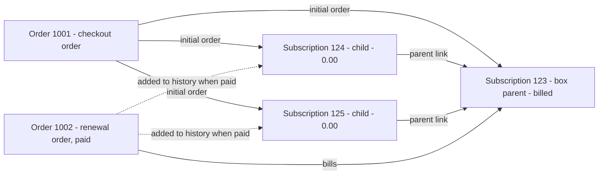

# Info
- Module: Developers
- Last updated: 2026-10-31

# Work with Subscription Families and Orders

> Find the subscription that bills a box or bundle, list the orders that belong to a subscription, see which subscriptions an order covers, and correct or remove orders within the limits the API enforces.


## Page Navigation

- **Current guide:** Work with Subscription Families and Orders
- **Where to open it:** Your custom plugin or theme code (PHP)
- **Section overview:** [Developers](./README.md)
- **Previous guide:** [Find and Update Subscriptions](./subscriptions.md)
- **Next guide:** [Read Lifecycle State and Manage Its Dates](./status-grace-periods-and-trials.md)
- **Troubleshooting:** [Verify Your Integration](./errors-and-testing.md)

## Overview

A subscription is tied to WooCommerce orders: the checkout order that created it and the renewal orders that bill it. A Subscription Box or Subscription Bundle also gets a zero-priced child subscription for each subscription product inside it. The parent is billed; each child records the customer's entitlement to one product.

| Class | Methods on this page |
| --- | --- |
| `ArraySubs\Developer\Subscriptions` | `fromChildId()`, `family()`, `children()`, `orders()`. Reads, updates and lifecycle operations are in [Find and Update Subscriptions](./subscriptions.md). |
| `ArraySubs\Developer\Orders` | `fromId()`, `fromOrder()`, `object()`, `query()`, `subscriptions()`, `data()`, `update()`, `delete()` |

Both classes are instance APIs: a static finder returns an object or a `WP_Error`, and you call methods on the object, for example `Subscriptions::fromId( 123 )->orders()`. Order reads and writes go through WooCommerce CRUD (`wc_get_order()`, `wc_get_orders()`, `save()` and `delete()`), so they work with High-Performance Order Storage (HPOS) and with the posts table.

## When to Use This

- A member holds a product through a box or bundle, and you need the subscription that bills before you cancel it or change its dates.
- You grant access per product and need the child subscriptions inside a box or bundle.
- You sync a subscription's orders to an accounting, CRM or commission system.
- You start from a WooCommerce order and need the subscriptions it covers.
- You correct the billing or shipping details on an order, or remove an unpaid order that no subscription references.

## Before You Start

- WooCommerce and ArraySubs active. The classes are autoloaded on `plugins_loaded` only when ArraySubs passes its dependency check, so guard every call with `class_exists( '\ArraySubs\Developer\Subscriptions' )` or `class_exists( '\ArraySubs\Developer\Orders' )`, and call them from `init` or later. See [Connect Your Custom Plugin](./getting-started.md).
- Every method returns its result or a `WP_Error`. Check the result with `is_wp_error()`.
- The methods are trusted server code. They check no capability, nonce or ownership. For admin tools, check `current_user_can( 'manage_woocommerce' )` and a nonce. For customer-facing code, compare the record's `customer_id` with `get_current_user_id()` before you show or change anything (see [Show a member's orders in My Account](#show-a-members-orders-in-my-account)).
- Bundle families need ArraySubs Pro with an active license. Box families need only core.

## How It Works

### Parents, children and standalone subscriptions

- A **standalone** subscription bills itself and has no family links.
- A **parent** is a Subscription Box or Subscription Bundle subscription. It is the only subscription in its family that is billed.
- A **child** is a zero-priced subscription that ArraySubs creates for each subscription product inside a box or bundle. Plain (non-subscription) products inside it get no child. The merchant guides call children "included subscriptions".

ArraySubs creates the children when the checkout order is processed, and checks again for missing children when the order is paid. Each child copies the parent's customer, billing period and interval, subscription length, start date, next payment date, status and payment method, and the parent's checkout order becomes its initial order. After that:

- Every parent status change is copied to each child. The copy is a normal status change, so `arraysubs_data_status_changed` fires for each child too.
- When a parent renewal is paid, the parent's next payment date, last payment date and payment count are copied to each child, and the renewal order is added to each child's order history.
- Children never get their own renewal orders or billing jobs. Renewal invoices and their payment retries belong to the parent.
- When the parent switches to a plan that is not a box (or not a bundle), its children are cancelled and unlinked, so they become standalone. A box-to-box or bundle-to-bundle switch keeps them.

### Example family

A box subscription 123 with two subscription products inside, one checkout order and one paid renewal:



What the API returns for this family:

| Call | Result |
| --- | --- |
| `Subscriptions::fromId( 123 )->family()` | `parent_id` `null`, `kind` `null`, `billing_owner_id` 123, `orphaned` `false` |
| `Subscriptions::fromId( 124 )->family()` | `parent_id` 123, `kind` `box`, `billing_owner_id` 123, `orphaned` `false` |
| `Subscriptions::fromId( 123 )->children( array( 'output' => 'ids' ) )` | `items` `[124, 125]` |
| `Subscriptions::fromChildId( 124 )` | The `Subscriptions` object for 124 |
| `Subscriptions::fromChildId( 123 )` | `WP_Error` `invalid_relation` |
| `Subscriptions::fromId( 123 )->orders( array( 'output' => 'ids' ) )` | `items` `[1001, 1002]` |
| `Subscriptions::fromId( 124 )->orders( array( 'output' => 'ids' ) )` | `items` `[1001, 1002]`: a child's history includes the parent's orders |
| `Orders::fromId( 1001 )->subscriptions( array( 'output' => 'ids' ) )` | `items` `[123, 124, 125]` |
| `Orders::fromId( 1002 )->subscriptions( array( 'output' => 'ids' ) )` | `items` `[123, 124, 125]` once the renewal is paid; `[123]` before |

A bundle family looks the same, with `kind` `bundle`.

### Which orders belong to a subscription

`orders()`, and `Orders::query()` with `subscription_id`, return the orders that pass both checks:

1. **Link.** The order is in the subscription's order history (for example its checkout order, its renewal orders, and the recorded pending renewal or pending plan-switch order), or the order's own link data names the subscription. On a child, the billing owner's order history and checkout order count too.
2. **Customer.** The order's customer matches the subscription's customer: the same WordPress user ID when both have one, otherwise the same billing email, compared in lowercase.

The `arraysubs_subscription_history_includes_order` filter can change the first check (see [Hooks](#hooks)); nothing changes the second. Only the subscription customer's orders are considered, refunds never are, and every order status is included unless you pass `statuses`.

`Orders::subscriptions()` makes the same kind of checks from the order's side, without the filter and without adding the parent's orders to a child. The two directions can differ for a family: a child's `orders()` already lists the parent's unpaid renewal invoice, while that invoice's `subscriptions()` lists the child only after the renewal is paid.

### Pages

`children()`, `orders()`, `Orders::query()` and `subscriptions()` return the same page array:

| Key | Type | Meaning |
| --- | --- | --- |
| `items` | array | Objects, IDs or data arrays, depending on `output` |
| `page` | int | The page you asked for |
| `per_page` | int | The page size |
| `has_more` | bool | `true` when another page exists |
| `next_page` | int\|null | The next page number, or `null` |

`page` defaults to 1 and `per_page` to 20 (1 to 100). Items are ordered by ID: `order` `asc` (default) or `desc`. There is no total count; loop while `has_more` is `true`.

## Family Reference

| Method | Arguments | Returns | Notes |
| --- | --- | --- | --- |
| `Subscriptions::fromChildId( int $id )` | Subscription ID | `Subscriptions` or `WP_Error` | Accepts only a box or bundle child |
| `$subscription->family()` | None | array | The parent link and the subscription that bills |
| `$subscription->children( array $args = [] )` | `Subscriptions::query()` arguments | Page or `WP_Error` | The children of this subscription |
| `$subscription->orders( array $args = [] )` | `Orders::query()` arguments | Page or `WP_Error` | The orders that belong to this subscription |

All four are read only. `$subscription` is the object that `Subscriptions::fromId()` returns.

### Subscriptions::fromChildId()

```text
// Resolve the billing owner from a child ID; handle WP_Error before operating on the result.
Subscriptions::fromChildId( int $id ): Subscriptions|WP_Error
```

Opens a subscription only when it links to a box or bundle parent. An orphaned child (see [family()](#family)) is accepted too, so check `family()['orphaned']` before you rely on its parent.

- **Errors:** `not_found` (`Subscription not found.`); `invalid_relation` (`This subscription is not an entitlement child.`) for a parent or standalone subscription.

### family()

```text
// Read family links and billing ownership before deciding which record to change.
$subscription->family(): array
```

| Key | Type | Meaning |
| --- | --- | --- |
| `parent_id` | int\|null | The direct parent's ID when that link is valid; `null` for a parent, a standalone subscription, or a child whose own parent link is invalid |
| `kind` | string\|null | `box` or `bundle` when the subscription has a parent link, valid or not; `null` otherwise |
| `billing_owner_id` | int\|null | The subscription that bills: the top of the parent chain for a child, the subscription itself otherwise; `null` for an orphaned child |
| `orphaned` | bool | `true` when the chain of parent links cannot be trusted: a parent in it does not exist or belongs to a different customer, the links loop or run deeper than 20 levels, or a record in it links to both a box and a bundle parent |

`family()` reports a parent the same way as a standalone subscription. Call `children()` to tell them apart:

```php
<?php
// Read family links to distinguish a child, a parent with children, and a standalone subscription.
if ( class_exists( '\ArraySubs\Developer\Subscriptions' ) ) {
	$subscription = \ArraySubs\Developer\Subscriptions::fromId( 123 );

	if ( ! is_wp_error( $subscription ) ) {
		$family = $subscription->family();

		if ( null !== $family['kind'] ) {
			$role = $family['orphaned'] ? 'orphaned child' : 'child'; // Bill through $family['billing_owner_id'].
		} else {
			$children = $subscription->children( array( 'output' => 'ids', 'per_page' => 1 ) );
			$role     = ( ! is_wp_error( $children ) && $children['items'] ) ? 'parent' : 'standalone';
		}
	}
}
```

### children()

```text
// List direct child subscriptions in pages; the parent remains the billing owner.
$subscription->children( array $args = [] ): array|WP_Error
```

Runs `Subscriptions::query()` with `parent_id` set to this subscription, and keeps only the records whose `family()['parent_id']` is this subscription, so orphaned children are left out. A child or a standalone subscription returns an empty page.

| Argument | Type | Default | Notes |
| --- | --- | --- | --- |
| `statuses` | string[] | Every ArraySubs status | Full status keys: `arraysubs-pending`, `arraysubs-active`, `arraysubs-trial`, `arraysubs-paused`, `arraysubs-on-hold`, `arraysubs-cancelled`, `arraysubs-expired`. An empty array returns an empty page. |
| `output` | string | `object` | `object` (`WP_Post`), `ids` or `data` |
| `fields` | string[] | Every group | Subscription data groups for `output` `data`, as in [Find and Update Subscriptions](./subscriptions.md) |
| `customer_id`, `order_id`, `include` | | None | Extra filters, combined with AND. `include` takes up to 100 subscription IDs. |
| `page`, `per_page`, `order` | | 1, 20, `asc` | Paging, by subscription ID |

- **Errors:** `invalid_query` (an unknown argument or an invalid value), `invalid_field` (an unknown field group), `not_found` (the subscription, or the `order_id` order, no longer exists).

### orders()

```text
// Read orders linked to this subscription using the selected relation and page filters.
$subscription->orders( array $args = [] ): array|WP_Error
```

Runs `Orders::query()` with `subscription_id` set to this subscription and accepts its other arguments (`customer_id`, `include`, `statuses`, `output`, `fields`, `page`, `per_page`, `order`). On a child the result includes the billing owner's checkout and renewal orders.

- **Errors:** as for [Orders::query()](#ordersquery), including `unclaimed_identity` for a guest subscription without a valid email.

### Family data groups

Three subscription data groups carry the same links, ready for `$subscription->data( $fields )`:

| Group | Contents |
| --- | --- |
| `family` | The `family()` array plus `children`: the first page (20) of child IDs, as a page array |
| `orders` | The first page (20) of order IDs from `orders()`, as a page array |
| `order_references` | `initial_order_id`, `original_order_id`, `pending_renewal_order_id` and `pending_plan_switch_order_id`: the order IDs the subscription records, each kept only when `orders()` would return that order, otherwise `null` |

See [Find and Update Subscriptions](./subscriptions.md) for the other groups.

### What a child refuses

A child shares its parent's billing, so the subscription methods refuse billing and lifecycle changes on it:

| Call on a child | Result |
| --- | --- |
| `update()` that changes the status, product, variation, quantity, billing period or interval, length, recurring amount, renewal-price settings or trial terms, and `changeStatus()`, `activate()`, `suspend()`, `expire()` | `WP_Error` `parent_billed_subscription` |
| `update()` that changes other fields, such as the billing or shipping address or the invoice email | Allowed |
| `setNextPaymentDate()`, `setTrialEnd()`, `endTrial()`, `setGracePolicy()` | `parent_billed_subscription` |
| `cancel()`, `undoCancellation()` | `parent_billed_subscription` |
| `pause()`, `resume()` | `subscription_conflict` |
| `delete()` | Deletes this child only |
| A customer's write request to an ArraySubs REST route (`/arraysubs/v1/...`) that names a child | 403 `arraysubs_box_child_locked`, or `arraysubs_bundle_child_locked` |

Input validation runs first, so an invalid value can return its own error before the family check. The error data does not name the parent: read `family()['billing_owner_id']` and repeat the call there (see [Act on the subscription that bills](#act-on-the-subscription-that-bills)). These checks look at the parent link itself, so they also apply to orphaned children.

### Deleting a parent

`Subscriptions::fromId( 123 )->delete()` permanently deletes the parent and its children, and returns:

```text
// Example parent-deletion report: children are counted separately; orders and the customer remain.
[
  'deleted'                  => true,
  'id'                       => 123,
  'direct_children_deleted'  => 2,
  'direct_children_retained' => 0,
  'orders_deleted'           => false,
  'customer_deleted'         => false,
]
```

WooCommerce orders and the customer are never deleted. Bundle children are deleted with their parent only while ArraySubs Pro is running; otherwise they stay and are counted in `direct_children_retained`. Deleting a parent from the **ArraySubs -> Subscriptions** list keeps its children, which then report `orphaned` `true`. See [Find and Update Subscriptions](./subscriptions.md) for `delete()`.

## Orders Reference

| Method | Arguments | Returns | Notes |
| --- | --- | --- | --- |
| `Orders::fromId( int $id )` | Order ID | `Orders` or `WP_Error` | `not_found` for a missing order or a refund |
| `Orders::fromOrder( WC_Order $order )` | Order object | `Orders` or `WP_Error` | Same as `fromId( $order->get_id() )` |
| `$order->object()` | None | `WC_Order` or `null` | A fresh `wc_get_order()` result; `null` once the order is deleted |
| `Orders::query( array $args = [] )` | See below | Page or `WP_Error` | Any WooCommerce orders, or one subscription's orders |
| `$order->subscriptions( array $args = [] )` | `Subscriptions::query()` arguments | Page or `WP_Error` | Same as `Subscriptions::fromOrderId( $order_id, $args )` |
| `$order->data( array $fields = [] )` | Field groups | array or `WP_Error` | See [Order data](#order-data) |
| `$order->update( array $changes, array $expected = [] )` | Contact changes, expected values | Order data or `WP_Error` | Billing, shipping and customer note only |
| `$order->delete()` | None | `array( 'deleted' => true, 'id' => int )` or `WP_Error` | Only unpaid orders that no subscription references |

`$order` is the object that `Orders::fromId()` or `Orders::fromOrder()` returns. Only `update()` and `delete()` write.

### Orders::fromId() and Orders::fromOrder()

```text
// Create an order reader from an ID or a WC_Order object; check for WP_Error.
Orders::fromId( int $id ): Orders|WP_Error
Orders::fromOrder( WC_Order $order ): Orders|WP_Error
```

Opens any WooCommerce order, whether or not a subscription is linked to it.

- **Errors:** `not_found` (`Order not found.`) for a missing ID or a refund ID.

### Orders::query()

```text
// Query orders with explicit filters and pagination; the caller must enforce permissions.
Orders::query( array $args = [] ): array|WP_Error
```

| Argument | Type | Default | Notes |
| --- | --- | --- | --- |
| `subscription_id` | int | None | Only the orders that belong to this subscription (see [Which orders belong to a subscription](#which-orders-belong-to-a-subscription)) |
| `customer_id` | int | None | Only orders whose WooCommerce customer is this user. With `subscription_id`, it replaces the default lookup by the subscription's customer ID and email; each order must still match the subscription's customer. |
| `include` | int[] | None | Only these order IDs, up to 100. An empty array returns an empty page. |
| `statuses` | string[] | Every key of `wc_get_order_statuses()` | Keys with the `wc-` prefix, for example `wc-pending`, `wc-processing`, `wc-completed`, `wc-on-hold`, `wc-failed`, `wc-cancelled`, `wc-refunded`, `wc-checkout-draft` or `wc-arraysubs-settled` (Credit settled). An empty array returns an empty page. |
| `output` | string | `object` | `object` (`WC_Order`), `ids` or `data` ([order data](#order-data)) |
| `fields` | string[] | Every group | Order data groups for `output` `data` |
| `page`, `per_page`, `order` | | 1, 20, `asc` | Paging, by order ID |

- **Without `subscription_id`**, `query()` is a plain WooCommerce order listing (refunds excluded) with no subscription check.
- **Errors:** `invalid_query` (an unknown argument; `page` below 1 or `per_page` outside 1 to 100; a non-positive ID; a status that is not a `wc_get_order_statuses()` key; an invalid `order` or `output`; `fields` that is not an array; more than 100 `include` IDs), `invalid_field` (an unknown field group), `not_found` (the `subscription_id` subscription does not exist), `unclaimed_identity` (a guest subscription without a valid email).
- **Performance:** with `subscription_id`, the query reads the customer's orders in batches of 100 and checks each one. Every page repeats the checks for the orders before it.
- `Customer::fromUserId( $user_id )->orders( $args )` runs this query with `customer_id`. See [Find Members and Update Profiles](./customers-and-profile-fields.md).

### subscriptions()

```text
// Read the subscriptions related to this order, including billed and included family members.
$order->subscriptions( array $args = [] ): array|WP_Error
```

Lists the subscriptions linked to the order. It accepts the `Subscriptions::query()` arguments (`statuses`, `output`, `fields`, `customer_id`, `parent_id`, `include`, `page`, `per_page`, `order`) and returns `WP_Post` items in every status by default. A checkout order lists every subscription it created, children included. A renewal order lists its billing owner, and also the children once the renewal is paid.

- **Errors:** `invalid_query`, `invalid_field`, `not_found` (the order no longer exists).

```php
<?php
if ( class_exists( '\ArraySubs\Developer\Orders' ) ) {
	$order = \ArraySubs\Developer\Orders::fromId( 1001 );

	if ( ! is_wp_error( $order ) ) {
		$linked = $order->subscriptions( array( 'per_page' => 100 ) );
		$roles  = array();

		foreach ( is_wp_error( $linked ) ? array() : $linked['items'] as $post ) {
			$subscription = \ArraySubs\Developer\Subscriptions::fromSubscription( $post );
			if ( ! is_wp_error( $subscription ) ) {
				$roles[ $post->ID ] = null === $subscription->family()['kind'] ? 'billed' : 'included';
			}
		}
		// Order 1001: array( 123 => 'billed', 124 => 'included', 125 => 'included' ).
	}
}
```

### Order data

```text
// Select the order sections needed by your integration and handle a failed read.
$order->data( array $fields = [] ): array|WP_Error
```

Returns the groups you list, or all of them: `identity`, `amounts`, `billing`, `shipping` and `subscriptions`. An unknown group returns `invalid_field`; a deleted order returns `not_found`.

`identity`:

| Key | Type | Meaning |
| --- | --- | --- |
| `id` | int | Order ID |
| `customer_id` | int\|null | WordPress user ID; `null` for a guest order |
| `status` | string | WooCommerce status without the `wc-` prefix, for example `processing` |
| `created_at` | int\|null | Creation time, Unix timestamp (UTC) |
| `paid_at` | int\|null | Payment time, Unix timestamp (UTC); `null` while unpaid |
| `pending_switch` | bool | `true` for a renewal order built on a pending plan switch |
| `is_renewal` | bool | `true` for a renewal order, including a Pro early renewal order |
| `is_plan_switch` | bool | `true` for an order created by a plan switch |

`amounts`:

| Key | Type | Meaning |
| --- | --- | --- |
| `currency` | string | Currency code, for example `USD` |
| `total` | string | Order total as WooCommerce stores it, for example `'30.00'` |
| `tax`, `shipping`, `discount` | string | Tax total, shipping total and discount total |
| `refunded` | number | Amount refunded so far; `0` when nothing was refunded |

`billing`: `first_name`, `last_name`, `company`, `address_1`, `address_2`, `city`, `state`, `postcode`, `country`, `email` and `phone`. `shipping`: the same keys without `email`.

`subscriptions`: the first page (20) of linked subscription IDs, as a page array, the same as `subscriptions( array( 'output' => 'ids' ) )`.

### update()

```text
// Update supported fields and pass last-read expected values to guard against concurrent edits.
$order->update( array $changes, array $expected = [] ): array|WP_Error
```

Changes an order's contact details. It works on any WooCommerce order, linked to a subscription or not.

`$changes` (any other key returns `unsupported_operation`):

| Key | Type | Effect |
| --- | --- | --- |
| `billing` | array | Billing fields to change: `first_name`, `last_name`, `company`, `address_1`, `address_2`, `city`, `state`, `postcode`, `country`, `email`, `phone`. Fields you leave out keep their value. `email` must be a valid address or empty. |
| `shipping` | array | Shipping fields to change: the same keys without `email` |
| `customer_note` | string | Replaces the note the customer left at checkout |

Address values must be scalar and are cleaned with `sanitize_text_field()`; the note is cleaned with `sanitize_textarea_field()`.

`$expected` protects against overwriting a change you have not seen. Its keys are `billing`, `shipping` and `customer_note`, and each value must be identical (`===`: same keys, order and types) to the order's current `get_address( 'billing' )`, `get_address( 'shipping' )` or `get_customer_note()`. Pass the arrays exactly as `get_address()` returned them; the `billing` and `shipping` arrays from `data()` are the same unless another plugin filters order addresses.

- **Returns:** the full [order data](#order-data) after the save.
- **Errors:** `unsupported_operation` (a key other than `billing`, `shipping` or `customer_note`, such as a status, total or payment field); `conflict` (another `update()` of the order is running, or `$expected` does not match or names an unknown key); `not_found`; `validation_failure` (a note that is not a string, an address that is not an array, an unknown or non-scalar address field, an invalid email); `persistence_failed` (WooCommerce could not save the order).
- **Side effects:** saves the order with `$order->save()` and adds the private order note "Contact details updated through the ArraySubs developer API." It does not change the order's status, totals or payment data, and it does not change the subscription. Renewal orders copy their addresses from the subscription, so to change the address on future renewals, call `Subscriptions::update()` with `billing_address` or `shipping_address` on the billing owner.

### delete()

```text
// Attempt the supported deletion operation and inspect WP_Error if the order cannot be removed.
$order->delete(): array|WP_Error
```

Permanently deletes the order (it skips the WooCommerce trash), but only when all of these are true:

- the status is `pending`, `failed` or `cancelled`;
- the order was never paid, has no transaction ID and has nothing refunded;
- no subscription is linked to it: `subscriptions()` returns no items;
- it carries no ArraySubs store credit or plan-switch settlement data.

A subscription's own orders, including a cancelled renewal order, always stay as history.

- **Returns:** `array( 'deleted' => true, 'id' => 1005 )`.
- **Errors:** `unsupported_operation` (`Referenced or settled orders must be retained. Use the payment or refund workflow.`) when any rule above fails; `conflict` while a gateway payment or paid-order processing for the order is running; `not_found`; `persistence_failed` (WooCommerce could not delete it).

Order status, totals, payments and refunds are not editable through `Orders`. Use the WooCommerce order screen, the payment gateway or a WooCommerce refund; see [Refund Management](../retention-and-refunds/refund-management.md).

## Hooks

| Hook | Type | Arguments | When |
| --- | --- | --- | --- |
| `arraysubs_box_child_subscriptions_created` | Action | `int $subscription_id, int[] $child_ids, int $order_id` | After ArraySubs creates missing children for a box from its checkout order. `$child_ids` lists all of that box's children. It fires only when at least one child was created. |
| `arraysubspro_bundle_child_subscriptions_created` | Action | `int $subscription_id, int[] $child_ids, int $order_id` | The same for a bundle |
| `arraysubs_subscription_history_includes_order` | Filter | `bool $include, WC_Order $order, int $subscription_id` | Decides whether one of the customer's orders is in a subscription's history. `orders()` and `Orders::query()` with `subscription_id` drop orders of another customer whatever it returns. Box and bundle children use it to include their parent's orders. |

ArraySubs applies `arraysubs_subscription_history_includes_order` to its own order history as well, for example in the My Account subscription view and in refund and plan-switch calculations, so a filter that hides orders changes those features too. See [React to Supported Events](./actions-and-filters.md).

## Examples

### Act on the subscription that bills

Minimal working example with failure handling: start from any subscription a member holds, resolve the billing owner and schedule the cancellation there.

```php
<?php
/**
 * Schedule cancellation at the end of the paid period, starting from any subscription in a family.
 *
 * @param int    $subscription_id Any subscription, possibly a box or bundle child.
 * @param string $reason          Cancellation reason.
 * @return array|WP_Error Subscription data of the billing owner, or an error.
 */
function myplugin_cancel_family_at_period_end( $subscription_id, $reason ) {
	if ( ! class_exists( '\ArraySubs\Developer\Subscriptions' ) ) {
		return new WP_Error( 'myplugin_arraysubs_missing', 'ArraySubs is not active.' );
	}

	$subscription = \ArraySubs\Developer\Subscriptions::fromId( $subscription_id );
	if ( is_wp_error( $subscription ) ) {
		return $subscription; // not_found
	}

	$owner_id = $subscription->family()['billing_owner_id'];
	if ( null === $owner_id ) {
		// An orphaned child: its parent is missing or belongs to another customer.
		return new WP_Error( 'myplugin_orphaned_child', 'This included subscription has no valid billing owner.' );
	}

	$owner = \ArraySubs\Developer\Subscriptions::fromId( $owner_id );
	if ( is_wp_error( $owner ) ) {
		return $owner;
	}

	return $owner->cancel( 'end_of_period', $reason );
}
```

Calling `cancel()` on the child itself would return `parent_billed_subscription`.

### Export a subscription's paid orders

Pages through every processing or completed order of one subscription, 100 orders at a time.

```php
<?php
/**
 * Collect the paid orders of one subscription for an accounting export.
 *
 * @param int $subscription_id Subscription ID.
 * @return array|WP_Error Rows of order ID, renewal flag, paid time, total and currency.
 */
function myplugin_export_paid_orders( $subscription_id ) {
	if ( ! class_exists( '\ArraySubs\Developer\Subscriptions' ) ) {
		return new WP_Error( 'myplugin_arraysubs_missing', 'ArraySubs is not active.' );
	}

	$subscription = \ArraySubs\Developer\Subscriptions::fromId( $subscription_id );
	if ( is_wp_error( $subscription ) ) {
		return $subscription;
	}

	$rows = array();
	$args = array(
		'statuses' => array( 'wc-processing', 'wc-completed' ),
		'output'   => 'data',
		'fields'   => array( 'identity', 'amounts' ),
		'per_page' => 100,
		'page'     => 1,
	);

	do {
		$page = $subscription->orders( $args );
		if ( is_wp_error( $page ) ) {
			return $page;
		}

		foreach ( $page['items'] as $order ) {
			$rows[] = array(
				'order_id' => $order['identity']['id'],
				'renewal'  => $order['identity']['is_renewal'],
				'paid_at'  => $order['identity']['paid_at'] ? gmdate( 'c', $order['identity']['paid_at'] ) : null,
				'total'    => $order['amounts']['total'],
				'currency' => $order['amounts']['currency'],
			);
		}

		$args['page'] = $page['next_page'];
	} while ( $page['has_more'] );

	return $rows;
}
```

For a child this also exports the parent's paid orders. Export from the billing owner when you want each charge once.

### Show a member's orders in My Account

The subscription ID comes from the request, so the code checks ownership itself and escapes every value.

```php
<?php
/**
 * Render the latest orders of one of the current member's subscriptions.
 *
 * @param int $subscription_id Subscription ID from the request.
 */
function myplugin_render_subscription_orders( $subscription_id ) {
	if ( ! class_exists( '\ArraySubs\Developer\Subscriptions' ) || ! is_user_logged_in() ) {
		return;
	}

	$subscription = \ArraySubs\Developer\Subscriptions::fromId( absint( $subscription_id ) );
	if ( is_wp_error( $subscription ) ) {
		return;
	}

	// The API trusts its caller: confirm the subscription belongs to the viewer.
	$identity = $subscription->data( array( 'identity' ) );
	if ( is_wp_error( $identity ) || (int) $identity['identity']['customer_id'] !== get_current_user_id() ) {
		return;
	}

	$page = $subscription->orders(
		array(
			'output'   => 'data',
			'fields'   => array( 'identity', 'amounts' ),
			'order'    => 'desc',
			'per_page' => 10,
		)
	);
	if ( is_wp_error( $page ) || empty( $page['items'] ) ) {
		return;
	}

	echo '<ul class="myplugin-subscription-orders">';
	foreach ( $page['items'] as $order ) {
		if ( $order['identity']['is_renewal'] ) {
			$label = __( 'Renewal', 'myplugin' );
		} elseif ( $order['identity']['is_plan_switch'] ) {
			$label = __( 'Plan change', 'myplugin' );
		} else {
			$label = __( 'Order', 'myplugin' );
		}

		printf(
			'<li>%1$s - %2$s - %3$s %4$s - %5$s</li>',
			/* translators: %d: order number. */
			esc_html( sprintf( __( 'Order #%d', 'myplugin' ), $order['identity']['id'] ) ),
			esc_html( $label ),
			esc_html( $order['amounts']['total'] ),
			esc_html( $order['amounts']['currency'] ),
			esc_html( wc_get_order_status_name( $order['identity']['status'] ) )
		);
	}
	echo '</ul>';
}
```

A viewer who does not own the subscription, including a guest, sees nothing.

### Correct an order's shipping postcode safely

`$expected` makes the save fail with `conflict` when the address changes between your read and your write, because the new value was computed from the old one.

```php
<?php
/**
 * Normalize the shipping postcode of one order.
 *
 * @param int $order_id WooCommerce order ID.
 * @return array|WP_Error|null Order data after the save, null when nothing changed, or an error.
 */
function myplugin_normalize_shipping_postcode( $order_id ) {
	if ( ! class_exists( '\ArraySubs\Developer\Orders' ) ) {
		return new WP_Error( 'myplugin_arraysubs_missing', 'ArraySubs is not active.' );
	}

	$order = \ArraySubs\Developer\Orders::fromId( $order_id );
	if ( is_wp_error( $order ) ) {
		return $order;
	}

	$wc_order = $order->object();
	if ( ! $wc_order ) {
		return new WP_Error( 'myplugin_order_missing', 'The order no longer exists.' );
	}

	$shipping = $wc_order->get_address( 'shipping' );
	$postcode = strtoupper( trim( $shipping['postcode'] ) );
	if ( $postcode === $shipping['postcode'] ) {
		return null;
	}

	$result = $order->update(
		array( 'shipping' => array( 'postcode' => $postcode ) ),
		array( 'shipping' => $shipping )
	);

	if ( is_wp_error( $result ) ) {
		// conflict: the address changed after it was read, or another update holds the order. Run again later.
		// validation_failure: a field or value was rejected.
		error_log( sprintf( 'Postcode cleanup for order %1$d failed: %2$s', $order_id, $result->get_error_code() ) );
	}

	return $result;
}
```

### Remove an unpaid order that nothing references

Run this only from your own admin tool, after a nonce check. The early `subscriptions()` check gives a clearer message; `delete()` enforces the same rule.

```php
<?php
/**
 * Permanently delete an unpaid order that no subscription references.
 *
 * @param int $order_id WooCommerce order ID.
 * @return array|WP_Error array( 'deleted' => true, 'id' => $order_id ), or an error.
 */
function myplugin_delete_unused_order( $order_id ) {
	if ( ! class_exists( '\ArraySubs\Developer\Orders' ) ) {
		return new WP_Error( 'myplugin_arraysubs_missing', 'ArraySubs is not active.' );
	}

	if ( ! current_user_can( 'manage_woocommerce' ) ) {
		return new WP_Error( 'myplugin_forbidden', 'You cannot delete orders.' );
	}

	$order = \ArraySubs\Developer\Orders::fromId( $order_id );
	if ( is_wp_error( $order ) ) {
		return $order;
	}

	$linked = $order->subscriptions( array( 'per_page' => 1, 'output' => 'ids' ) );
	if ( is_wp_error( $linked ) ) {
		return $linked;
	}
	if ( $linked['items'] ) {
		return new WP_Error( 'myplugin_order_in_use', 'A subscription references this order, so it is kept.' );
	}

	$result = $order->delete();
	if ( is_wp_error( $result ) ) {
		// unsupported_operation: paid, refunded, not pending/failed/cancelled, or it carries store credit or plan-switch data.
		// conflict: a payment for this order is being processed. Try again later.
		error_log( sprintf( 'Order %1$d was not deleted: %2$s', $order_id, $result->get_error_code() ) );
	}

	return $result;
}
```

## Errors You Can Get

| Code | Returned by | What to do |
| --- | --- | --- |
| `not_found` | `Subscriptions::fromId()`, `fromChildId()`, `Orders::fromId()`, `fromOrder()`, `Orders::query()` with an unknown `subscription_id`, and methods on a record deleted meanwhile | Check the ID. A refund ID counts as missing. |
| `invalid_relation` | `Subscriptions::fromChildId()` | The subscription has no box or bundle parent link. Use `Subscriptions::fromId()`. |
| `invalid_query` | `children()`, `orders()`, `Orders::query()`, `subscriptions()` | Fix the argument: unknown key, page size over 100, a status without its prefix, a non-positive ID. |
| `invalid_field` | The same methods, and `data()` | Request only the documented field groups. |
| `unclaimed_identity` | `orders()`, `Orders::query()` with `subscription_id` | The guest subscription has no valid email, so no order can be matched to it. |
| `unsupported_operation` | `update()`, `delete()` | `update()` changes only `billing`, `shipping` and `customer_note`. `delete()` keeps paid, refunded or referenced orders. |
| `conflict` | `update()`, `delete()` | Another process is working on the order, or `$expected` no longer matches. Read the order again and retry later. |
| `validation_failure` | `update()` | Send scalar values for known address fields, a valid email and a text note. |
| `persistence_failed` | `update()`, `delete()` | WooCommerce could not save or delete the order. Read it again before retrying. |
| `parent_billed_subscription` | Billing and lifecycle methods on a child (see [What a child refuses](#what-a-child-refuses)) | Repeat the call on `family()['billing_owner_id']`. |
| `subscription_conflict` | `pause()` and `resume()` on a child | Repeat the call on `family()['billing_owner_id']`. |

## Edge Cases and Important Notes

- **Children's dates follow paid renewals.** A child's next payment date, last payment date and payment count change when a parent renewal is paid. A date change on the parent reaches the children at the next paid renewal, so read the schedule from the billing owner.
- **Orphaned children.** A child whose parent was deleted from the admin list, or whose parent belongs to another customer, reports `orphaned` `true` and `billing_owner_id` `null`. `children()` on the old parent leaves it out, and its `orders()` returns only its own orders. Delete it with `Subscriptions::fromId( $id )->delete()` when it is no longer needed.
- **Bundles without Pro.** Core still reads bundle links through `family()`, `children()` and `orders()`. Copying the bundle's status and dates to its children, deleting them with the bundle and locking them for customers need ArraySubs Pro with an active license.
- **Guest subscriptions match by email.** When either side has no WordPress user, an order matches by billing email. Changing a guest order's billing email, including through `update()`, can drop the order from the subscription's history.
- **Two status formats.** `Orders::query()` `statuses` takes `wc-` keys such as `wc-completed`, while `data()` returns `identity.status` without the prefix, such as `completed`.
- **`update()` applies `$changes` key by key.** It stops at the first invalid key without calling `save()`. WooCommerce's `WC_Order::set_address()`, which applies `billing` and `shipping`, also writes those fields straight to post meta, so on a store that keeps orders in the posts table an address group applied before the failing key can still be stored. Validate values first, or send one address group per call.
- **Your own order data.** Store it with `$order->update_meta_data()` and `$order->save()`, not with post meta functions, so it works with HPOS. Never write ArraySubs link data on orders or subscriptions.
- **Refunds are not orders.** `Orders::fromId()` returns `not_found` for a refund ID, and `Orders::query()` never lists refunds. The refunded amount is in `amounts.refunded`.

## Troubleshooting

| Problem | Likely Cause | What to Do |
| --- | --- | --- |
| `orders()` returns `invalid_query` | `statuses` uses names such as `completed` | Use the `wc-` keys from `wc_get_order_statuses()`, such as `wc-completed` |
| A child's `orders()` shows renewal orders | A child's history includes its billing owner's orders | Expected. Read orders from the billing owner to count each charge once. |
| `fromChildId()` returns `invalid_relation` | The subscription is a parent or standalone | Use `Subscriptions::fromId()` |
| `family()['billing_owner_id']` is `null` | The child is orphaned | Check the parent record; delete or fix the orphaned child |
| `parent_billed_subscription` or `subscription_conflict` on a member's subscription | It is a box or bundle child | Repeat the call on `family()['billing_owner_id']` |
| An order is missing from `orders()` | Its customer does not match the subscription (for example a changed guest billing email), or a filter on `arraysubs_subscription_history_includes_order` hides it | Compare `Orders::fromId( $id )->data( array( 'identity', 'billing' ) )` with the subscription's customer |
| `update()` returns `conflict` | The address or note changed after you read it, or another update is running | Read the order again, recompute the change and retry |
| `delete()` returns `unsupported_operation` | The order is paid, refunded, referenced by a subscription or not pending, failed or cancelled | Keep it; it is part of the payment history |
| Bundle children stop following the bundle | ArraySubs Pro is inactive or its license is not active | Activate Pro and its license |

## Related Guides

- [Find and Update Subscriptions](./subscriptions.md) - finders, `Subscriptions::query()` arguments, data groups, updates, lifecycle operations and `delete()`.
- [Read Lifecycle State and Manage Its Dates](./status-grace-periods-and-trials.md) - renewal dates, trials and grace periods on the billing owner.
- [Find Members and Update Profiles](./customers-and-profile-fields.md) - `Customer::orders()` and `Customer::subscriptions()`.
- [React to Supported Events](./actions-and-filters.md) - status, renewal and family hooks.
- [Connect Membership Workflows](./integration-recipes.md) - complete integrations that use these lookups.
- [Verify Your Integration](./errors-and-testing.md) - error handling and test plans.
- [Subscription Box](../subscription-products/subscription-box.md) and [Subscription Bundle](../subscription-products/subscription-bundle.md) - merchant setup for families.
- [Plan Switching and Product Relationships](../subscription-products/plan-switching-and-relationships.md) - how plan-switch orders are created.
- [Renewal Operations](../billing-and-renewals/renewal-operations.md) - how renewal orders are created and charged.
- [Refund Management](../retention-and-refunds/refund-management.md) - refunds for subscription orders.

## FAQ

### How do I find the subscription that pays for a child?

Read `billing_owner_id` from `Subscriptions::fromId( $child_id )->family()`. It is `null` only for an orphaned child.

### Does a child subscription have its own orders?

It has the checkout order that created it, and its history also includes the parent's orders. It never gets renewal orders of its own; the parent's renewal orders cover it.

### Which subscriptions does an order belong to?

Call `Orders::fromId( $order_id )->subscriptions()`. A checkout order lists every subscription it created, children included. A renewal order lists its billing owner, and its children once the renewal is paid.

### Can I change an order's status or total with update()?

No. `update()` changes only `billing`, `shipping` and `customer_note`; any other key returns `unsupported_operation`.

### Can I delete a subscription's failed renewal order?

No. `delete()` keeps every order a subscription references. It deletes only unpaid `pending`, `failed` or `cancelled` orders that nothing references, and the deletion is permanent.

### Do these classes work with HPOS?

Yes. They read orders with `wc_get_order()` and `wc_get_orders()`, and write with `$order->save()` and `$order->delete()`, so they work with HPOS and with the posts table.
