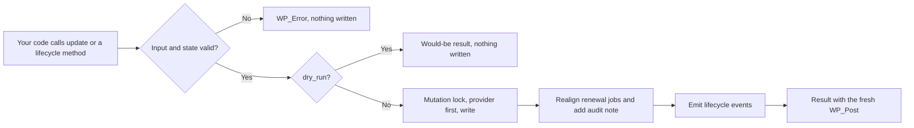

# Info
- Module: Developers
- Availability: Free (some sections require Pro)
- Last updated: 2026-10-18

# Find and Update Subscriptions

> Look up subscriptions by ID, customer or order, read full or selected data in pages, and change them through validated updates, lifecycle operations and a reported delete instead of raw meta writes.

**Availability:** Core (Free). `ArraySubs\Api\Subscriptions` ships with ArraySubs core and needs no module switch. Bundle families and the `bundle` data block require ArraySubs Pro with an active license.

## Page Navigation

- **Current guide:** Find and Update Subscriptions
- **Where to open it:** Your custom plugin or theme code (PHP)
- **Section overview:** [Developers](./README.md)
- **Previous guide:** [Connect Your Custom Plugin](./getting-started.md)
- **Next guide:** [Work with Subscription Families and Orders](./subscription-relationships-and-orders.md)
- **Troubleshooting:** [Verify Your Integration](./errors-and-testing.md)

## Overview

`ArraySubs\Api\Subscriptions` is the supported PHP entry point for subscription records. It finds subscriptions by subscription ID or object, customer, email, product, related WooCommerce order, or box and bundle parent, and returns them as `WP_Post` objects, plain IDs or documented data arrays.

The same class updates an allowlisted set of fields, runs lifecycle operations such as pause, cancel and skip, and deletes records permanently with a report of what was removed. Every collection is paged with a cursor, and related orders and child subscriptions are paged through their own calls, so a "full" record never becomes an unbounded export.

## When to Use This

- Your membership plugin needs the subscriber's current plan, status and renewal date.
- You build a custom dashboard, shortcode or REST route that lists a member's subscriptions.
- You export subscriptions to a CRM or data warehouse in chunks.
- An order arrives and you need every subscription it created, renewed or switched.
- You change a renewal date, quantity, price or address with validation and an audit trail.
- You pause, resume, cancel or skip from your own interface.
- You remove duplicate records and need to know exactly what deletion removes.

## Prerequisites

- WooCommerce and ArraySubs core active. The class only exists when ArraySubs passes its dependency check, so guard every call with `class_exists( '\ArraySubs\Api\Subscriptions' )`.
- Calls made on `arraysubs_after_boot` or later. Methods that filter by status (every query, because the default status is `live`) and methods that return translated labels need `init` or later. ArraySubs registers its statuses on `init` priority 10, so hook `init` at priority 11 or later.
- ArraySubs Pro with an active license for bundle families and the `bundle` data block.
- Your own capability, nonce and ownership checks at every web boundary (see [Permission boundary](#permission-boundary)).
- The loading and error conventions from [Connect Your Custom Plugin](./getting-started.md).

## How It Works

### The subscription record

A subscription is a WordPress post of type `arraysubs_data`. The canonical object is the `WP_Post` returned by `arraysubs_get_subscription()` and by `Subscriptions::get()`. Its billing terms, dates and links are stored in post meta that ArraySubs keeps in step with scheduled renewal jobs, payment providers and audit notes.

Do not write that meta directly. Use `update()` and the lifecycle methods on this page: they validate the change, take the subscription mutation lock, realign renewal jobs, coordinate with PayPal and Paddle, and record who made the change and why.

The owner of a subscription is its `customer_id` (a WordPress user ID), not the post author. `0` means a guest subscription.

### Statuses

Status inputs and data output use simple names. `WP_Post::$post_status` holds the stored slug with the `arraysubs-` prefix.

| Simple name | Stored `post_status` | Meaning | In `live` |
| --- | --- | --- | --- |
| `pending` | `arraysubs-pending` | Created, waiting for the first payment or for activation | Yes |
| `trial` | `arraysubs-trial` | In a trial; the first charge is due when the trial ends | Yes |
| `active` | `arraysubs-active` | Billing normally, including the first grace window after a missed renewal | Yes |
| `paused` | `arraysubs-paused` | Paused with a resume date | Yes |
| `on-hold` | `arraysubs-on-hold` | Suspended after a payment problem or by an admin | Yes |
| `cancelled` | `arraysubs-cancelled` | Ended by a cancellation | No |
| `expired` | `arraysubs-expired` | Ended because its term finished | No |

- `any` means all seven statuses. `live` means `pending`, `trial`, `active`, `paused` and `on-hold`. `live` is the default for queries, so pass `any` (or list the statuses) when you need cancelled or expired history.
- Any other status value returns `invalid_argument` instead of silently matching everything.
- Two familiar states are not statuses. **Grace** is computed: an overdue subscription stays `active` or `trial` during the first grace window; read `recovery.grace` or `Lifecycle::get_state()`. **Pending cancellation** is an `active` or `trial` subscription whose `cancellation.scheduled` is `true`.

### Output modes

| `output` | Items or return value | Use it when |
| --- | --- | --- |
| `object` (default) | `WP_Post` | You pass the record to WordPress or ArraySubs functions. |
| `ids` (collections only) | `int` | You only need IDs, for example to queue background jobs. |
| `data` | Documented array | You export, serialize or send the record to another system. |

Data arrays follow the shared conventions: dates are ISO 8601 UTC strings such as `2026-11-01T00:00:00+00:00` or `null`; money is a decimal string such as `'19.00'` with `currency` (ISO 4217) and `decimals`; statuses are simple names. `fields` selects field groups (see [Subscription Data Reference](#subscription-data-reference)).

### Collections and paging

`query()`, `for_customer()` and `for_order()` return the same collection array, or a `WP_Error`:

```php
<?php
// Collection shape.
$collection = [
	'items'       => [], // WP_Post, int or array items, per the output mode.
	'per_page'    => 20,
	'next_cursor' => 'c2lkOjQ1Ng', // Opaque string, or null on the last page.
	'has_more'    => true,
	'total'       => null, // An int only when 'include_total' => true.
];
```

- Items are ordered by subscription ID (`asc` by default, `desc` on request). The ID is always the tie-breaker, so pages never overlap.
- `per_page` defaults to 20 and allows at most 100. Larger values return `invalid_argument`; they are never truncated silently.
- To continue, call again with the same arguments plus `cursor` set to the previous `next_cursor`. `next_cursor` is `null` and `has_more` is `false` on the last page.
- Filters combine with AND. List values inside one filter combine with OR.
- An empty result is an empty `items` array, not an error.
- `each()` walks every page for you.

### Mutations

`update()` and the lifecycle methods share one contract. They require `reason`, accept `actor`, `expected`, `dry_run` and `as_user`, and return this array (or a `WP_Error`):

```php
<?php
// Mutation result shape.
$result = [
	'subscription' => null, // The fresh WP_Post after the change.
	'changed'      => [ 'next_payment_date' ], // Keys that actually changed.
	'warnings'     => [ [ 'code' => 'provider_date_pending', 'message' => 'Waiting for the provider to confirm the date.' ] ],
	'events'       => [ 'renewal_date_changed' ], // Normalized lifecycle events emitted.
	'dry_run'      => false,
];
```



- The whole change is validated before anything is written. One invalid key or value rejects the call and nothing changes.
- Each mutation runs under the subscription mutation lock. A concurrent change returns `conflict`; retry after a short pause.
- `reason` and `actor` are written to an audit note on the subscription.
- Lifecycle events are emitted after the change is persisted, through `arraysubs_lifecycle_event` (see [React to Supported Events](./actions-and-filters.md)).
- A dry run validates and reports what would change without writing or contacting a payment provider, so a provider can still reject the real call.

### Permission boundary

PHP calls are trusted server code. Like WordPress core functions, they do not check the current user's capabilities. Your code decides who may call them:

- **Admin tools and REST routes:** check `current_user_can( 'manage_woocommerce' )` (or `manage_options`) and verify a nonce.
- **Customer-facing features:** require login, verify a nonce, and pass `as_user => get_current_user_id()`. The call then enforces ownership (`customer_id` must equal `as_user`, else `forbidden`) and returns customer-safe data. `as_user` must be a positive user ID; guest subscriptions never pass it.
- **Never infer permission from the requested record.** A customer ID or email in a request is input, not proof of identity.
- `as_user` checks ownership only. It does not decide which changes a customer may make, and it does not apply the store's customer settings. Expose only the actions your feature allows and check the store policy yourself, for example with `arraysubs_can_customer_pause()` or `arraysubs_can_customer_cancel_by_subs_id( $subscription_id )`.

## Method Summary

All methods are static on `ArraySubs\Api\Subscriptions`.

| Method | Purpose | Writes |
| --- | --- | --- |
| `get()` | One subscription by ID or `WP_Post` | No |
| `query()` | Filtered, paged collection | No |
| `each()` | Generator over every match | No |
| `for_customer()` | `query()` for one WordPress user | No |
| `for_order()` | Every subscription linked to a WooCommerce order | No |
| `update()` | Allowlisted field changes | Yes |
| `activate()`, `put_on_hold()`, `pause()`, `resume()`, `cancel()`, `undo_cancellation()`, `expire()`, `skip_renewal()`, `undo_skip()` | Lifecycle operations | Yes |
| `delete()` | Permanent deletion with a cascade report | Yes (destructive) |

Subscriptions are created through existing workflows only; see [Create Subscriptions](#create-subscriptions).

## Read Subscriptions

All reads are read only: no writes. They never convert trials, advance grace or retries, run sweeps or attempt payments.

### `Subscriptions::get()`

```text
\ArraySubs\Api\Subscriptions::get( int|WP_Post $subscription, array $args = [] ): WP_Post|array|WP_Error
```

| Argument | Type | Default | Description |
| --- | --- | --- | --- |
| `$subscription` | int or `WP_Post` | Required | Subscription ID, or the `WP_Post` returned by `arraysubs_get_subscription()`. |
| `output` | string | `object` | `object` returns the `WP_Post`; `data` returns the documented array. |
| `fields` | string[] | Every authorized group | Field groups for `data` output. An unknown group returns `invalid_argument`. |
| `as_user` | int | None | Act for this user: enforce ownership and return customer-safe data. |

- **Returns:** the `WP_Post`, or the data array with `id`, `customer_id` and one key per requested group.
- **Failures:** `not_found` when the ID or object is not an `arraysubs_data` post; `forbidden` when `as_user` does not own it; `invalid_argument` for an unknown `output` or field group.
- **Permission boundary:** trusted server PHP; use `as_user` at a customer boundary.

```php
<?php
if ( class_exists( '\ArraySubs\Api\Subscriptions' ) ) {
	$subscription = \ArraySubs\Api\Subscriptions::get( 123 );

	if ( is_wp_error( $subscription ) ) {
		error_log( 'Subscription lookup failed: ' . $subscription->get_error_code() );
	} else {
		// WP_Post: post_status holds the stored slug, for example 'arraysubs-active'.
		error_log( 'Stored status: ' . $subscription->post_status );
	}
}
```

### `Subscriptions::query()`

```text
\ArraySubs\Api\Subscriptions::query( array $args = [] ): array|WP_Error
```

**Filters**

| Filter | Type | Default | Matches |
| --- | --- | --- | --- |
| `customer_id` | int or int[] | None | Owner user ID(s). `0` matches guest subscriptions. |
| `email` | string | None | The customer email stored on the subscription (the billing email captured at checkout). Case-insensitive exact match. |
| `status` | string or string[] | `live` | Simple status names, `any` or `live`. |
| `product_id` | int or int[] | None | Parent product ID. A variable product matches every variation. |
| `variation_id` | int or int[] | None | Variation ID. |
| `order_id` | int | None | Subscriptions linked to that order (initial, renewal or switch order). |
| `parent_id` | int | None | Children of that box or bundle parent subscription. |
| `relation` | string | `any` | `standalone`, `parent` or `child`. This matches the `family.role` value, not `family.relation`. |
| `gateway` | string | None | Automatic payment gateway ID, for example `stripe`, `arraysubs_paypal` or `arraysubs_paddle`. |
| `next_payment_before`, `next_payment_after` | date | None | Next payment date earlier than, or later than, the value. Subscriptions without a next payment date never match. |
| `created_before`, `created_after` | date | None | Creation time earlier than, or later than, the value. |
| `include` | int[] | None | Only these subscription IDs. |

Dates accept an ISO 8601 string with an offset (`2026-11-15T00:00:00+00:00`), a `Y-m-d H:i:s` string treated as UTC (`2026-11-15 00:00:00`), or a Unix timestamp (`1794700800`).

**Collection and output arguments**

| Argument | Type | Default | Description |
| --- | --- | --- | --- |
| `per_page` | int | `20` | Items per page, at most 100. |
| `cursor` | string | None | `next_cursor` from the previous page. Reuse the same filters and `order`. |
| `order` | string | `asc` | `asc` or `desc` by subscription ID. |
| `include_total` | bool | `false` | Adds the exact match count to `total`. Slower on large stores. |
| `output` | string | `object` | `object`, `ids` or `data`. |
| `fields` | string[] | Every authorized group | Field groups for `data` output. |
| `as_user` | int | None | Only that user's subscriptions are returned. A `customer_id` filter for anyone else returns `forbidden`. |

- **Returns:** the collection array.
- **Failures:** `invalid_argument` for an unknown filter or argument (data `field` names it), a wrong type, an unknown status or field group, `per_page` above 100, or a malformed cursor; `forbidden` for an `as_user` mismatch. No matches is an empty collection.
- **Ambiguity:** collection methods never return `ambiguous_match`. They return every match. When your integration expects exactly one subscription, check the count yourself and decide what to do with several.

```php
<?php
if ( class_exists( '\ArraySubs\Api\Subscriptions' ) ) {
	// Active or trial subscriptions to product 197 that renew before December.
	$page = \ArraySubs\Api\Subscriptions::query(
		[
			'product_id'          => 197,
			'status'              => [ 'active', 'trial' ],
			'next_payment_before' => '2026-12-01T00:00:00+00:00',
			'output'              => 'ids',
			'per_page'            => 100,
		]
	);

	if ( ! is_wp_error( $page ) ) {
		foreach ( $page['items'] as $subscription_id ) {
			// Queue your own job for $subscription_id.
		}
		// $page['next_cursor'] continues the list when $page['has_more'] is true.
	}
}
```

### `Subscriptions::each()`

```text
\ArraySubs\Api\Subscriptions::each( array $args = [] ): Generator
```

- **Arguments:** the same as `query()`. `per_page` sets how many records are fetched per round trip (default 20, maximum 100). `cursor` is ignored: the walk always starts at the beginning.
- **Yields:** every matching item, one at a time, in the chosen output mode. It follows `next_cursor` until the last page, so memory use stays at one page.
- **Failures:** arguments are validated the same way as `query()`. When they are invalid, the generator yields one `WP_Error` and stops, so check `is_wp_error()` on the items, or run `query()` once with the same arguments first.
- **Consistency:** the walk is not a snapshot. Records created during a long export appear at the end when they match (ascending ID order), and records that change status or are deleted during the walk can drop out.
- **Read only:** no writes.

See [Export every subscription in chunks](#export-every-subscription-in-chunks).

### `Subscriptions::for_customer()`

```text
\ArraySubs\Api\Subscriptions::for_customer( int $customer_id, array $args = [] ): array|WP_Error
```

- Equivalent to `query()` with `customer_id`. Every other `query()` argument applies, including the `live` status default.
- `$customer_id` is a WordPress user ID. The user does not have to exist: deleting a WordPress user does not delete their subscriptions, which keep the ID.
- **Failures:** as for `query()`.

```php
<?php
if ( class_exists( '\ArraySubs\Api\Subscriptions' ) ) {
	// Full history for user 45, newest first.
	$history = \ArraySubs\Api\Subscriptions::for_customer(
		45,
		[
			'status'   => 'any',
			'order'    => 'desc',
			'output'   => 'data',
			'fields'   => [ 'status', 'plan' ],
			'per_page' => 50,
		]
	);
}
```

To find a member by email, username or profile field first, see [Find Members and Update Profiles](./customers-and-profile-fields.md).

### `Subscriptions::for_order()`

```text
\ArraySubs\Api\Subscriptions::for_order( int|WC_Order $order, array $args = [] ): array|WP_Error
```

- Returns every subscription linked to the order as a collection, never an arbitrary first match. There is no 50-result cap.
- Accepts the `query()` arguments except `order_id`. The `status` default here is `any`, because an order's subscriptions can be in any state. (`query()` with an `order_id` filter keeps the `live` default.)
- **What is linked:** an initial checkout order links one subscription per subscription line, including box and bundle children; a renewal order links the subscription that billed it (the billing owner); a plan switch order links the switched subscription.
- Only subscriptions whose customer matches the order's customer are returned, and deleted subscriptions are skipped, so stale order links never expose another customer's record.
- HPOS safe: the order is read through WooCommerce CRUD.
- **Failures:** `not_found` when the order does not exist; otherwise as for `query()`.

```php
<?php
add_action(
	'woocommerce_order_status_completed',
	function ( $order_id ) {
		if ( ! class_exists( '\ArraySubs\Api\Subscriptions' ) ) {
			return;
		}

		$linked = \ArraySubs\Api\Subscriptions::for_order( (int) $order_id, [ 'output' => 'ids' ] );

		if ( is_wp_error( $linked ) || empty( $linked['items'] ) ) {
			return; // Not a subscription order.
		}

		foreach ( $linked['items'] as $subscription_id ) {
			// Sync $subscription_id with your membership system.
		}
	}
);
```

For order types, pending renewal invoices and order updates, see [Work with Subscription Families and Orders](./subscription-relationships-and-orders.md).

### Find children of a box or bundle

A core Subscription Box or a Pro Subscription Bundle creates zero-value child subscriptions that belong to a billing parent. A child subscription is a separate record, not a renewal order.

- Children of one parent: `query( [ 'parent_id' => 123, 'status' => 'any' ] )`.
- Every child on the store: `query( [ 'relation' => 'child' ] )`. Every parent: `relation => 'parent'`. Records outside any family: `relation => 'standalone'`.
- The `relation` filter does not distinguish boxes from bundles. Read `family.relation` (`box` or `bundle`) in data output, or use `Relationships::get_family()`.
- For parent, child and billing-owner helpers, see [Work with Subscription Families and Orders](./subscription-relationships-and-orders.md).

## Subscription Data Reference

### Field groups

Pass group names in `fields` with `output => 'data'`. Without `fields`, you get every documented group the caller is authorized to see. The array always starts with `id` and `customer_id`, followed by one key per requested group.

| Group | Keys | Notes |
| --- | --- | --- |
| `identity` | `id`, `number`, `created_at`, `parent_order_id` | |
| `status` | `status`, `status_label`, `has_access` | |
| `plan` | `product_id`, `variation_id`, `effective_product_id`, `product_name`, `quantity` | The current plan, never a pending switch target |
| `pricing` | `recurring_amount`, `currency`, `decimals`, `signup_fee`, `line_total`, `price_snapshot_at` | The subscription's agreed terms, not catalog prices |
| `schedule` | `billing_interval`, `billing_period`, `start_at`, `next_payment_at`, `last_payment_at`, `end_at`, `completed_payments`, `auto_renew`, `gateway` | |
| `trial` | `active`, `started_at`, `ends_at`, `converted_at`, `provider_owned` | Same block as `Lifecycle::get_state()` |
| `recovery` | `grace`, `retry` | Same blocks as `Lifecycle::get_state()` |
| `cancellation` | `scheduled`, `cancel_at`, `cancelled_at`, `reason` | |
| `pending_switch` | `null`, or the pending switch block | Same block as `Lifecycle::get_state()` |
| `family` | `role`, `relation`, `parent_id`, `billing_owner_id`, `child_count` | Same values as `Relationships::get_family()` |
| `orders` | `initial_order_id`, `pending_renewal_order_id`, `renewal_order_count`, `last_order_id` | References only; page orders with `Relationships::get_orders()` |
| `customer` | `customer_id`, `is_guest`, `email`, `first_name`, `last_name`, `billing`, `shipping` | |
| `modules` | `box`, `bundle` *(Pro)*, `features` | Keyed blocks; only blocks that apply |

#### `identity`

| Key | Type | Meaning |
| --- | --- | --- |
| `id` | int | Subscription post ID. |
| `number` | string | Display number, for example `'123'`. |
| `created_at` | string | When the record was created (ISO 8601 UTC). |
| `parent_order_id` | int or null | Initial WooCommerce order; `null` when the subscription was created without one, for example by an admin. |

#### `status`

| Key | Type | Meaning |
| --- | --- | --- |
| `status` | string | Stored status as a simple name. |
| `status_label` | string | Translated label, for example `On Hold`. |
| `has_access` | bool | Whether this subscription grants member access now: `active` and `trial` do, `paused` follows the store's access-during-pause setting (no access by default), other statuses do not. |

`has_access` covers this one subscription. A member with several subscriptions can keep access through another one; use the Member Access readers for the combined answer (see [Check Content Access](./member-access.md)).

#### `plan`

| Key | Type | Meaning |
| --- | --- | --- |
| `product_id` | int | Parent product ID. |
| `variation_id` | int | Variation ID, or `0` for a simple product. |
| `effective_product_id` | int | `variation_id` when set, otherwise `product_id`. |
| `product_name` | string | Product name; a variation reads `Parent - Attribute`. |
| `quantity` | int | Units on the subscription. |

#### `pricing`

| Key | Type | Meaning |
| --- | --- | --- |
| `recurring_amount` | string | Per-unit renewal price agreed for this subscription. Catalog price changes do not change it. |
| `currency` | string | ISO 4217 currency code of the subscription. |
| `decimals` | int | Decimal places for the amounts. |
| `signup_fee` | string | One-time sign-up fee recorded at creation. |
| `line_total` | string | `recurring_amount` x `quantity`: the renewal line before tax, shipping and fees. |
| `price_snapshot_at` | string or null | When the current recurring price was recorded (creation, a plan switch or a price update). |

#### `schedule`

| Key | Type | Meaning |
| --- | --- | --- |
| `billing_interval` | int | Bill every N periods. |
| `billing_period` | string | `day`, `week`, `month`, `year` or `lifetime`. |
| `start_at` | string or null | Start of the subscription. |
| `next_payment_at` | string or null | Logical due date of the next renewal; during a trial, the trial end. `null` for lifetime, cancelled and expired subscriptions. |
| `last_payment_at` | string or null | Last processed payment. |
| `end_at` | string or null | A scheduled fixed end, or, after cancellation or expiry, when it ended. `null` when open-ended. |
| `completed_payments` | int | Paid cycles, including a paid initial order with a total above zero. |
| `auto_renew` | bool | `true` when an automatic gateway charges renewals; `false` when renewals are invoiced for manual payment. |
| `gateway` | string | Automatic payment gateway ID, such as `stripe`, `arraysubs_paypal` or `arraysubs_paddle`; `''` for manual renewals. |

#### `trial`

| Key | Type | Meaning |
| --- | --- | --- |
| `active` | bool | The subscription is in an active trial. |
| `started_at` | string or null | Trial start. |
| `ends_at` | string or null | Trial end, when the first paid charge is due. |
| `converted_at` | string or null | When the trial became a paid period. |
| `provider_owned` | bool | `true` when a payment provider owns the trial dates. |

#### `recovery`

`recovery.grace` and `recovery.retry` use the blocks returned by `Lifecycle::get_state()`; the [Read Lifecycle State and Manage Its Dates](./status-grace-periods-and-trials.md) page explains each phase.

| Block | Keys |
| --- | --- |
| `grace` | `in_grace` (bool), `stage` (`before_on_hold`, `before_cancel` or null), `started_at`, `on_hold_at`, `cancel_at`, `days_before_on_hold` (int), `days_before_cancel` (int), `policy_source` (`site` or `subscription`), `skipped` (bool), `skip_reason` (`initial_payment_failed`, `renewal_order_creation_failed` or null), `settlement_pending` (bool) |
| `retry` | `scheduled` (bool), `attempts` (int), `max_attempts` (int), `next_retry_at`, `exhausted` (bool) |

#### `cancellation`

| Key | Type | Meaning |
| --- | --- | --- |
| `scheduled` | bool | An end-of-period cancellation is waiting. |
| `cancel_at` | string or null | When the scheduled cancellation takes effect. |
| `cancelled_at` | string or null | When the subscription was cancelled. |
| `reason` | string or null | Stored cancellation reason, for example a configured reason key, or `overdue_payment` when the overdue sweep cancelled it. |

#### `pending_switch`

`null`, or this block when a plan switch waits for the next renewal:

| Key | Type | Meaning |
| --- | --- | --- |
| `type` | string | `upgrade`, `downgrade` or `crossgrade`. |
| `source` | string | `customer`, `admin` or `retention_offer`. |
| `requested_at` | string | When the switch was requested. |
| `target` | array | `product_id`, `variation_id`, `quantity`, `recurring_amount`, `billing_interval` and `billing_period` of the target plan. |
| `switch_fee` | string | Fee added to the renewal invoice that applies the switch. |
| `expected_at` | string | Expected renewal date. Retries, grace or early renewal can move it. |
| `frozen` | bool | `true` once the renewal invoice on the target plan exists; the switch can then no longer be replaced or cancelled. |
| `frozen_by_order_id` | int or null | That renewal invoice. |
| `provider_state` | string or null | `awaiting_paypal_approval` while PayPal waits for the customer; otherwise `null`. |

The target is not the active plan: `plan`, `pricing`, `schedule`, roles, features and access follow the current plan until the renewal invoice on the target plan is paid. The signed snapshot behind the switch is never exposed.

#### `family`

| Key | Type | Meaning |
| --- | --- | --- |
| `role` | string | `standalone`, `parent` or `child`. |
| `relation` | string or null | `box` (core) or `bundle` (Pro) for family members; `null` for standalone subscriptions. |
| `parent_id` | int or null | The parent subscription of a child. |
| `billing_owner_id` | int | The subscription that bills: the parent for a child, itself otherwise. |
| `child_count` | int | Number of children on a parent; `0` otherwise. |

#### `orders`

| Key | Type | Meaning |
| --- | --- | --- |
| `initial_order_id` | int or null | Initial checkout order. |
| `pending_renewal_order_id` | int or null | The open, unpaid renewal invoice, if any. |
| `renewal_order_count` | int | Renewal orders linked to the subscription. |
| `last_order_id` | int or null | The most recent linked order. |

Order lists are never embedded. Page them independently with `Relationships::get_orders()`.

#### `customer`

| Key | Type | Meaning |
| --- | --- | --- |
| `customer_id` | int | WordPress user ID of the owner; `0` for a guest subscription. |
| `is_guest` | bool | `true` when `customer_id` is `0`. |
| `email` | string | Customer email stored on the subscription. |
| `first_name`, `last_name` | string | From the subscription's billing details. |
| `billing` | array | Billing address snapshot used for renewal orders, with WooCommerce billing keys. |
| `shipping` | array | Shipping address snapshot with WooCommerce shipping keys; `[]` when there is none. |

#### `modules`

| Key | Type | Meaning |
| --- | --- | --- |
| `box` | array | Core Subscription Box data (the frozen contents snapshot) on box parents and children. |
| `bundle` | array | *(Pro)* Subscription Bundle data on bundle parents and children, present only while ArraySubs Pro is active and licensed. |
| `features` | array | The subscription's effective Feature Manager values, in the item shape of `FeatureManager::get_features()`. Features are configured with Pro Feature Manager. |

Feature types never appear in subscription data. For feature values and usage, see [Read and Update Feature Data](./feature-manager.md).

### Absent, null and customer-safe values

- A group you did not request is absent. `id` and `customer_id` are always present.
- Inside a returned group, every documented key is present. A value that does not exist is `null` (dates, IDs, reasons, `pending_switch`), `0` (counts), `''` (`gateway` for manual renewals) or `[]` (an empty address).
- `modules` contains only the blocks that apply to the subscription.
- Data output never contains payment tokens, gateway customer or payment-method IDs, signed pending-switch snapshots, internal markers or raw meta, in any context.
- With `as_user`, ownership is enforced and the result is customer-safe: it never contains feature types or other internal configuration.

## Update Subscriptions

### `Subscriptions::update()`

```text
\ArraySubs\Api\Subscriptions::update( int|WP_Post $subscription, array $changes, array $args = [] ): array|WP_Error
```

**Allowed `$changes` keys**

| Key | Type | Validation | Effect |
| --- | --- | --- | --- |
| `next_payment_date` | date | A future date | Moves the next renewal. The renewal invoice and charge jobs are realigned. Emits `renewal_date_changed`. |
| `end_date` | date or null | A future date, or `null` | The subscription expires at this time; `null` removes a scheduled end. |
| `recurring_amount` | decimal string or float | Greater than 0; rounded to the store's decimals | Per-unit price for future renewal invoices, in the subscription's currency. |
| `quantity` | int | 1 or more | Units billed on future renewals. |
| `billing_interval` | int | 1 to 365 | Bill every N periods. |
| `billing_period` | string | `day`, `week`, `month` or `year` | Billing unit. |
| `auto_renew` | bool | Boolean | `false`: future renewals are invoiced for manual payment. `true`: the automatic gateway charges again. Only meaningful for subscriptions paid through an automatic gateway. |
| `billing_address` | array | WooCommerce billing keys | Merges into the billing snapshot used on future renewal orders. |
| `shipping_address` | array | WooCommerce shipping keys | Merges into the shipping snapshot. |

- Any other key returns `invalid_argument` (data `field` names it). There is no raw meta escape hatch.
- Changing `billing_interval` or `billing_period` keeps the stored next payment date. The next renewal happens on that date, and later dates use the new schedule. Send `next_payment_date` in the same call to move the next renewal too.
- Address keys outside the WooCommerce billing or shipping field set return `invalid_argument`. Keys you leave out keep their stored values. Address changes affect future renewal orders only; they never change the customer's WooCommerce account or past orders.
- Product and variation changes are not part of `update()`. Plans change through plan switching (see [Plan Switching and Product Relationships](../subscription-products/plan-switching-and-relationships.md)).
- Statuses change only through the lifecycle operations below.

**Arguments**

| Argument | Type | Default | Description |
| --- | --- | --- | --- |
| `reason` | string | Required | 1-500 characters. Written to the audit note. |
| `actor` | array | `[ 'type' => 'integration', 'id' => get_current_user_id() ]` | Who made the change. `type` is `integration`, `admin`, `customer` or `system`; optional `id` (user ID) and `label`. |
| `expected` | array | None | Field => current value you expect, using allowlisted keys plus `status`. Values are compared after normalization (dates as instants, money as decimals). A mismatch returns `conflict` with `current` and `expected` in the error data. |
| `pending_switch` | string | `refuse` | Applies when a pending plan switch exists and the change touches `next_payment_date`, `end_date`, `recurring_amount`, `quantity`, `billing_interval` or `billing_period`. `refuse` returns `conflict`; `cancel` cancels the switch first and emits `pending_switch_cancelled`. A switch frozen by an open renewal invoice cannot be cancelled, so both values return `conflict`. |
| `dry_run` | bool | `false` | Validate and report without writing. |
| `as_user` | int | None | Enforce ownership for this user. It does not limit which keys may change: offer customers only the keys your feature allows, such as addresses. |

**What a successful update does**

1. Validates every key and value, the record's state and `expected`, before writing anything.
2. Resolves a pending plan switch according to `pending_switch`.
3. Takes the subscription mutation lock.
4. Pushes provider-owned billing dates (PayPal, Paddle) to the provider first. A refusal returns `provider_rejected` and nothing changes locally. While the provider has not confirmed the change, the result carries a `provider_date_pending` warning.
5. Writes the change and, when a date or schedule changed, realigns the `arraysubs_generate_renewal_invoice` and `arraysubs_process_renewal` scheduled actions.
6. Adds an audit note with the reason and actor, then emits lifecycle events.
7. Returns the mutation result with the fresh `WP_Post`. `changed` lists only keys whose value actually changed; an address-only change emits no events.

**Failures**

| Code | When |
| --- | --- |
| `invalid_argument` | A key outside the allowlist, a wrong type or format, a missing or too long `reason`, an unknown `pending_switch` value |
| `validation_failed` | Values out of range: a past date, an amount of 0 or less, `quantity` below 1, `billing_interval` outside 1-365 (data `details` lists each field error) |
| `not_found` | Not a subscription |
| `forbidden` | `as_user` does not own the subscription |
| `unsupported_operation` | A box or bundle child (only address keys are accepted; data `billing_owner_id`); a lifetime subscription with `next_payment_date`, `billing_interval` or `billing_period`; a cancelled or expired subscription with any key other than an address |
| `conflict` | `expected` mismatch, a pending plan switch with `refuse`, a frozen pending switch, or another request changing the subscription |
| `provider_rejected` | PayPal or Paddle refused the change |

See [Update with an expected-state check](#update-with-an-expected-state-check).

## Lifecycle Operations

### Shared signature and arguments

```text
\ArraySubs\Api\Subscriptions::activate( int|WP_Post $subscription, array $args = [] ): array|WP_Error
\ArraySubs\Api\Subscriptions::put_on_hold( int|WP_Post $subscription, array $args = [] ): array|WP_Error
\ArraySubs\Api\Subscriptions::pause( int|WP_Post $subscription, array $args = [] ): array|WP_Error
\ArraySubs\Api\Subscriptions::resume( int|WP_Post $subscription, array $args = [] ): array|WP_Error
\ArraySubs\Api\Subscriptions::cancel( int|WP_Post $subscription, array $args = [] ): array|WP_Error
\ArraySubs\Api\Subscriptions::undo_cancellation( int|WP_Post $subscription, array $args = [] ): array|WP_Error
\ArraySubs\Api\Subscriptions::expire( int|WP_Post $subscription, array $args = [] ): array|WP_Error
\ArraySubs\Api\Subscriptions::skip_renewal( int|WP_Post $subscription, array $args = [] ): array|WP_Error
\ArraySubs\Api\Subscriptions::undo_skip( int|WP_Post $subscription, array $args = [] ): array|WP_Error
```

| Argument | Type | Default | Description |
| --- | --- | --- | --- |
| `reason` | string | Required | 1-500 characters. Written to the audit note. |
| `actor` | array | `[ 'type' => 'integration', 'id' => get_current_user_id() ]` | Who made the change. |
| `expected` | array | None | For example `[ 'status' => 'active' ]`. A mismatch returns `conflict`. |
| `dry_run` | bool | `false` | Validate and report without writing. |
| `as_user` | int | None | Enforce ownership for this user. |

Every operation returns the mutation result described in [Mutations](#mutations). These failures apply to all of them:

- `not_found`, `forbidden`, and `invalid_argument` (missing `reason`, bad `actor`, bad argument types).
- `unsupported_operation` when the current status does not allow the operation, or the subscription is a box or bundle child.
- `conflict` for an `expected` mismatch or a concurrent change.
- `provider_rejected` when PayPal, Paddle or Stripe refuses the provider side of the change.

### Operation reference

| Method | Allowed from | Result | Extra arguments | Events |
| --- | --- | --- | --- | --- |
| `activate()` | `pending`, `on-hold` | `active` | `allow_unpaid` (bool, `false`) | `activated` (from pending) or `reactivated` (from on-hold) |
| `put_on_hold()` | `active`, `trial` | `on-hold` | None | `on_hold` |
| `pause()` | `active`, `trial` | `paused` | `resume_at` (date or null, `null`) | `paused` |
| `resume()` | `paused` | The status before the pause (`active` or `trial`) | None | `resumed` |
| `cancel()` | `pending`, `trial`, `active`, `paused`, `on-hold` | `cancelled`, or a scheduled cancellation | `when` (`end_of_period` or `now`, `end_of_period`) | `cancellation_scheduled`, or `cancelled` |
| `undo_cancellation()` | `active` or `trial` with a scheduled cancellation | Status unchanged, cancellation removed | None | `cancellation_undone` |
| `expire()` | Any live status | `expired` | None | `expired` |
| `skip_renewal()` | `active`, `trial` | Status unchanged, next payment date moved | `cycles` (int, `1`) | `renewal_skipped` |
| `undo_skip()` | `active` or `trial` with an active skip | Status unchanged, original date restored | None | `renewal_date_changed` |

`granted` and `revoked` are added to `events` only when the customer's overall access flips. Another valid subscription can keep the benefit.

### `activate()`

- From `pending`, it activates without taking a payment. The initial order is not marked paid. Use it for offline or manual arrangements.
- From `on-hold`, it returns `unsupported_operation` while a renewal order is unpaid, unless you pass `'allow_unpaid' => true`. That order is not paid or cancelled by this call.
- When the stored next payment date is not in the future, a new one is calculated from now. Renewal jobs are then scheduled.

### `put_on_hold()`

- Suspends an `active` or `trial` subscription: records the hold start, unschedules the renewal charge (and any queued automatic retry with it) and stops access.
- Holds follow the store's grace policy. Once the next payment date is older than both grace windows and the hold has lasted the cancel window, the hourly overdue sweep cancels the subscription for non-payment. For a temporary break with a resume date, use `pause()` instead.

### `pause()` and `resume()`

- `resume_at` must fall within the store's maximum pause length (30 days by default). `null` pauses for the maximum length. A later date returns `validation_failed`.
- The pause rules apply: the pause feature must be on (`module_unavailable` with reason `setting_disabled` when it is off); the subscription must be `active` or `trial`, with no scheduled cancellation and no unpaid renewal order (`unsupported_operation`); the pause count and the cooldown since the last pause must allow it (2 pauses and 30 days by default; `validation_failed`). PayPal and Paddle pause at the provider; a refusal returns `provider_rejected`.
- A pending plan switch blocks a pause with `conflict`, because pausing moves the renewal date. Cancel the switch first with `Lifecycle::cancel_pending_switch()`.
- Pausing moves the next payment date and any end date forward by the pause length at once, unschedules renewal jobs and schedules the automatic resume. Access during the pause follows the store's access-during-pause setting (no access by default).
- `resume()` returns the subscription to its status before the pause. Dates become the originals plus the time actually paused, and renewal jobs are rescheduled; a date that has already passed is charged about a minute later.
- Customer settings such as whether customers may pause or resume apply to My Account, not to PHP calls. Check `arraysubs_can_customer_pause()` and `arraysubs_can_customer_resume()` when you act for a customer.

### `cancel()` and `undo_cancellation()`

- `'when' => 'end_of_period'` (default) schedules the cancellation for the end of the paid period: the next payment date, or the end date when that is earlier. The subscription keeps its status and access until then, renewal jobs are unscheduled and any pending plan switch is cleared. When that boundary has already passed, the cancellation takes effect at once and `events` contains `cancelled`.
- `'when' => 'now'` cancels immediately: access ends, every scheduled job is removed, the open unpaid renewal invoice is retired and the provider's remote cancellation runs. When the open renewal payment is still settling at the gateway and cannot be retired safely, the call returns `conflict` and nothing changes; retry after it settles.
- Providers: PayPal cancels the billing agreement as soon as a cancellation is scheduled (access continues until the period ends); Paddle schedules a reversible cancellation at the period end; Stripe and Mollie need no provider call.
- `cancelled` and `expired` subscriptions return `unsupported_operation`.
- A paused subscription with a scheduled cancellation is cancelled after it resumes. To stop a paused subscription now, use `'when' => 'now'`.
- The store's cancellation settings and customer permissions apply to My Account only. Check `arraysubs_can_customer_cancel_by_subs_id( $subscription_id )` when you act for a customer.
- `undo_cancellation()` removes a scheduled cancellation that has not taken effect. The subscription must be `active` or `trial`; with nothing scheduled it returns `unsupported_operation`. Renewal jobs are rescheduled. A pending plan switch cleared when the cancellation was scheduled is not restored. For PayPal subscriptions, future renewals become manual payments because the agreement was already cancelled at PayPal.

### `expire()`

- Ends a live subscription as `expired` now: the end date is set, the next payment date is cleared, scheduled jobs are removed and any pause state is cleared.
- Use it for a natural end of term. To stop a subscription early for a customer, use `cancel()`.

### `skip_renewal()` and `undo_skip()`

- `cycles` must be between 1 and the store's maximum (3 by default); otherwise `validation_failed`.
- The skip rules apply: the skip feature must be on (`module_unavailable` with reason `setting_disabled`); the subscription must be `active` or `trial` with no skip already active (`unsupported_operation`); the request must be outside the cutoff before the renewal (2 days by default; `validation_failed`); the provider must accept the date change (`provider_rejected`). A pending plan switch returns `conflict`.
- Skipping moves the next payment date forward by `cycles` x the billing interval immediately and reschedules the renewal jobs.
- `undo_skip()` restores the original next payment date. Without an active skip it returns `unsupported_operation`.

### Box and bundle children

Children of a core box or a Pro bundle are billed by their parent. Every lifecycle method, and every `update()` key except the two address keys, returns `unsupported_operation` on a child, with the parent's ID in `get_error_data()['billing_owner_id']`. Run the operation on the billing owner instead: children follow the parent's status automatically, and their dates and payment counts update when the parent's renewal is paid.

## Delete Subscriptions

### `Subscriptions::delete()`

```text
\ArraySubs\Api\Subscriptions::delete( int|WP_Post $subscription, array $args = [] ): array|WP_Error
```

| Argument | Type | Default | Description |
| --- | --- | --- | --- |
| `reason` | string | Required | 1-500 characters, kept with the deletion report. |
| `actor` | array | `[ 'type' => 'integration', 'id' => get_current_user_id() ]` | Who requested the deletion. |
| `dry_run` | bool | `false` | Report what would be removed without deleting anything. |

**Returns**

```php
<?php
// Deletion report (synthetic IDs).
$report = [
	'deleted'             => true, // false in a dry run.
	'subscription_id'     => 123,
	'children_deleted'    => [ 124, 125 ], // Box or bundle children deleted with it.
	'orders_kept'         => [ 1001, 1002 ], // Linked WooCommerce orders, never deleted.
	'notes_deleted'       => 6,
	'actions_unscheduled' => 2,
	'events'              => [ 'deleted' ],
];
```

**What deletion does**

- **It is permanent.** Subscriptions have no trash, so a deleted subscription cannot be restored.
- Deletes the box or bundle children of a parent. Each child emits its own `deleted` event.
- Removes the subscription's scheduled jobs and notes, and emits `deleted` (a revoke for integrations).
- Never deletes WooCommerce orders or the customer account. The orders keep their reference to the deleted ID, and ArraySubs readers ignore it.
- Does not cancel provider billing and has no status guard: an active PayPal or Paddle subscription deleted this way can keep billing at the provider. Cancel with `'when' => 'now'` first.
- **Cancellation is the non-destructive alternative.** A cancelled subscription keeps its history, orders, notes and audit trail, and it can be reported on later.
- **Failures:** `not_found` and `invalid_argument` (missing or too long `reason`).
- **Permission boundary:** trusted server PHP. Never expose deletion to customers; check `manage_woocommerce` at your admin boundary.

### Deletion paths compared

| Path | Box and bundle children | `deleted` event | Notes and scheduled jobs | Linked orders |
| --- | --- | --- | --- | --- |
| `Subscriptions::delete()` or `arraysubs_delete_subscription()` | Deleted | Emitted | Removed | Kept |
| Admin Subscriptions list **Delete Permanently** (row or bulk), which calls `DELETE /wp/v2/arraysubs_data/{id}?force=true` | Kept by design; they still appear in lists, pointing at the deleted parent | Not emitted | Removed | Kept |
| Other code that deletes the post directly, such as `wp_delete_post()` | Kept | Not emitted | Removed | Kept |

Native hooks on these paths:

- `arraysubs_before_delete_subscription( int $subscription_id, bool $force_delete )` fires before the delete, and `arraysubs_data_deleted( int $subscription_id, bool $force_delete )` after it, on the helper path only.
- `arraysubs_subscription_children_deleted( int $post_id, int $deleted_notes )` fires on every permanent deletion path, while the post still exists. Despite its name, its "children" are the notes and scheduled jobs. Listen to it when your integration must react to admin-list deletes, which emit no `deleted` event.

## Create Subscriptions

### Supported creation workflows

`ArraySubs\Api\Subscriptions` does not create subscriptions. Use one of these existing workflows:

1. **Checkout.** A customer buys a subscription product. ArraySubs creates one subscription per subscription line item when the order is created (`pending`, or `trial` for trial products) and activates it when the order is paid. A custom checkout that builds its own WooCommerce order can ask ArraySubs to create that order's subscriptions with `do_action( 'arraysubs_create_subscriptions_for_order', $order )`. See [Subscription Checkout](../checkout-and-payments/subscription-checkout.md).
2. **Admin.** The **New custom subscription** form in the admin Subscriptions screen. It requires the `manage_options` capability. See [Subscription Operations](../manage-subscriptions/subscription-operations.md).
3. **Code.** `arraysubs_create_subscription()`, below.

### `arraysubs_create_subscription()`

```text
arraysubs_create_subscription( array $args ): int|WP_Error
```

| Key | Default | Description |
| --- | --- | --- |
| `customer_id` | `0` | Owner user ID. Either `customer_id` or `customer_email` is required. |
| `customer_email` | `''` | Customer email; filled from the user when omitted. |
| `product_id` | Required | Parent subscription product ID. |
| `variation_id` | `0` | Variation ID. |
| `quantity` | `1` | Units. |
| `billing_period` | `'month'` | `day`, `week`, `month`, `year` or `lifetime`. |
| `billing_interval` | `1` | Every N periods. |
| `subscription_length` | `0` | Paid cycles before expiry; `0` = no limit. |
| `subscription_price` | `0` | First payment amount recorded on the record. |
| `recurring_amount` | `0` | Per-unit renewal price. |
| `signup_fee` | `0` | Sign-up fee recorded on the record. |
| `currency` | Store currency | ISO 4217 code. |
| `start_date` | Now | UTC `Y-m-d H:i:s`. |
| `next_payment_date` | `''` | UTC `Y-m-d H:i:s`. |
| `status` | `'arraysubs-pending'` | The stored slug, for example `arraysubs-active`. Not validated. |
| `payment_method`, `payment_method_title` | `''` | WooCommerce payment method ID and title. |
| `trial_length`, `trial_period` | `0`, `'day'` | Trial definition. |
| `parent_order_id` | `0` | Initial order. Pass only an order created for this subscription: ArraySubs links that order to the new record. |
| `enable_different_renewal_price`, `different_renewal_price`, `different_renewal_price_after` | `false`, `0`, `1` | *(Pro)* A different renewal price after N payments. |

- **Returns:** the new subscription ID. `WP_Error` codes: `missing_product`, `missing_customer`, `invalid_product`. It returns `0` when the database insert fails, so treat `0` as a failure too.
- **Conventions:** this helper predates the API conventions. It takes the stored status slug and UTC `Y-m-d H:i:s` strings, not simple names or ISO dates.
- **Scheduling:** create as `arraysubs-active` or `arraysubs-trial` with a future `next_payment_date` to schedule the renewal jobs at once. With an empty date, ArraySubs fills one in but schedules nothing until its hourly recovery sweep creates a renewal invoice. With a trial, pass the trial end as `next_payment_date` yourself.
- **Not checked:** that the product is a subscription product, that the variation belongs to it, or that the user exists.
- **Not stored:** addresses, invoice email or an automatic payment gateway. Copy addresses with `Subscriptions::update()` afterwards. Without an automatic gateway the subscription renews by manual invoice.
- **Side effects:** fires `arraysubs_data_status_changed( int $subscription_id, string $new_status, string $old_status )` with old status `new`, then `arraysubs_data_created( int $subscription_id, WP_Post $post )`. Creating directly as active sends no "New subscription" email. No capability check: trusted server PHP.

See [Create a subscription in code](#create-a-subscription-in-code).

## Existing Helper Functions

These global core functions predate `ArraySubs\Api\Subscriptions` and remain available. They take integer IDs only (a `WP_Post` argument throws a `TypeError`), return `false` or bare values instead of `WP_Error` codes, and use stored `arraysubs-` slugs.

| Function | Returns | Relation to `ArraySubs\Api\Subscriptions` |
| --- | --- | --- |
| `arraysubs_get_subscription( int $subscription_id ): ?WP_Post` | `WP_Post` or `null` | The same object as `get()` with default output. Never pass `0`: WordPress then falls back to the global post. |
| `arraysubs_get_customer_subscriptions( int $customer_id, array $statuses = [] ): array` | Int IDs, unbounded | Use `for_customer()` for paging. Its default statuses exclude cancelled and expired. |
| `arraysubs_get_customer_subscriptions_by_email( string $customer_email, array $statuses = [] ): array` | Int IDs, unbounded | `query()` with `email`. |
| `arraysubs_get_customer_subscriptions_for_identity( int $customer_id, string $customer_email = '', array $statuses = [] ): array` | Int IDs | Union of ID and email matches. Email matches are not ownership checks. |
| `arraysubs_get_customer_subscription_count( int $customer_id, array $statuses = [] ): int` | Count | `query()` with `include_total`. Its default counts active and trial only. |
| `arraysubs_get_subscription_ids_for_order( $order ): array` | Int IDs; the fallback lookup stops at 50 | `for_order()`, which has no cap. |
| `arraysubs_get_order_subscriptions( $order ): array` | `WP_Post[]` | `for_order()` with object output. |
| `arraysubs_get_subscription_statuses(): array` | Stored slug => label | Labels for stored slugs. |
| `arraysubs_get_status_label( string $status ): string` | Label | Accepts a slug with or without the prefix. |
| `arraysubs_get_subscription_effective_product_id( int $subscription_id ): int` | Product or variation ID | `plan.effective_product_id`. |
| `arraysubs_cancel_subscription_immediately()`, `arraysubs_schedule_cancellation()`, `arraysubs_undo_scheduled_cancellation()` | `bool` | `cancel()` and `undo_cancellation()` run the same cancellation service and add validation, the audit note and a result report. |
| `arraysubs_pause_subscription()`, `arraysubs_resume_subscription()` | `bool` | `pause()` and `resume()`. |
| `arraysubs_skip_subscription()`, `arraysubs_undo_skip()` | `bool` | `skip_renewal()` and `undo_skip()`. |
| `arraysubs_update_subscription( int $subscription_id, array $args )` | `bool` or `WP_Error` | Low-level raw writer with no allowlist, lock, rescheduling, provider sync or lifecycle side effects. Use `update()` and the lifecycle methods. |
| `arraysubs_delete_subscription( int $subscription_id, bool $force_delete = false ): bool` | `bool` | The same cascade as `delete()`, without a report. Always permanent, whatever `$force_delete` says. |
| `arraysubs_create_subscription( array $args )` | `int` or `WP_Error` | Programmatic creation, above. |

## Examples

### Read one full record

```php
<?php
/**
 * Return one subscription as a full data array (every authorized group).
 */
function my_plugin_get_full_subscription( int $subscription_id ) {
	if ( ! class_exists( '\ArraySubs\Api\Subscriptions' ) ) {
		return new WP_Error( 'my_plugin_arraysubs_missing', __( 'ArraySubs is not active.', 'my-plugin' ) );
	}

	return \ArraySubs\Api\Subscriptions::get( $subscription_id, [ 'output' => 'data' ] );
}

$record = my_plugin_get_full_subscription( 123 );

if ( is_wp_error( $record ) ) {
	error_log( 'Subscription lookup failed: ' . $record->get_error_code() );
} else {
	error_log( sprintf( 'Subscription #%d is %s.', $record['id'], $record['status']['status'] ) );
}
```

A full record for a standalone monthly subscription (synthetic values):

```php
<?php
$record = [
	'id'             => 123,
	'customer_id'    => 45,
	'identity'       => [
		'id'              => 123,
		'number'          => '123',
		'created_at'      => '2026-09-01T10:15:00+00:00',
		'parent_order_id' => 1001,
	],
	'status'         => [
		'status'       => 'active',
		'status_label' => 'Active',
		'has_access'   => true,
	],
	'plan'           => [
		'product_id'           => 197,
		'variation_id'         => 0,
		'effective_product_id' => 197,
		'product_name'         => 'Pro Membership',
		'quantity'             => 1,
	],
	'pricing'        => [
		'recurring_amount'  => '19.00',
		'currency'          => 'USD',
		'decimals'          => 2,
		'signup_fee'        => '0.00',
		'line_total'        => '19.00',
		'price_snapshot_at' => '2026-09-01T10:15:00+00:00',
	],
	'schedule'       => [
		'billing_interval'   => 1,
		'billing_period'     => 'month',
		'start_at'           => '2026-09-01T10:15:00+00:00',
		'next_payment_at'    => '2026-11-01T10:15:00+00:00',
		'last_payment_at'    => '2026-10-01T10:20:00+00:00',
		'end_at'             => null,
		'completed_payments' => 2,
		'auto_renew'         => true,
		'gateway'            => 'stripe',
	],
	'trial'          => [
		'active'         => false,
		'started_at'     => null,
		'ends_at'        => null,
		'converted_at'   => null,
		'provider_owned' => false,
	],
	'recovery'       => [
		'grace' => [
			'in_grace'            => false,
			'stage'               => null,
			'started_at'          => null,
			'on_hold_at'          => null,
			'cancel_at'           => null,
			'days_before_on_hold' => 3,
			'days_before_cancel'  => 7,
			'policy_source'       => 'site',
			'skipped'             => false,
			'skip_reason'         => null,
			'settlement_pending'  => false,
		],
		'retry' => [
			'scheduled'     => false,
			'attempts'      => 0,
			'max_attempts'  => 3,
			'next_retry_at' => null,
			'exhausted'     => false,
		],
	],
	'cancellation'   => [
		'scheduled'    => false,
		'cancel_at'    => null,
		'cancelled_at' => null,
		'reason'       => null,
	],
	'pending_switch' => null,
	'family'         => [
		'role'             => 'standalone',
		'relation'         => null,
		'parent_id'        => null,
		'billing_owner_id' => 123,
		'child_count'      => 0,
	],
	'orders'         => [
		'initial_order_id'         => 1001,
		'pending_renewal_order_id' => null,
		'renewal_order_count'      => 1,
		'last_order_id'            => 1002,
	],
	'customer'       => [
		'customer_id' => 45,
		'is_guest'    => false,
		'email'       => 'member@example.com',
		'first_name'  => 'Jane',
		'last_name'   => 'Doe',
		'billing'     => [
			'first_name' => 'Jane',
			'last_name'  => 'Doe',
			'address_1'  => '1 Example Street',
			'city'       => 'Springfield',
			'postcode'   => '12345',
			'country'    => 'US',
			'email'      => 'member@example.com',
		],
		'shipping'    => [],
	],
	'modules'        => [
		'features' => [], // Items in the FeatureManager::get_features() shape.
	],
];
```

### Read selected status and plan fields

```php
<?php
if ( class_exists( '\ArraySubs\Api\Subscriptions' ) ) {
	$record = \ArraySubs\Api\Subscriptions::get(
		123,
		[
			'output' => 'data',
			'fields' => [ 'status', 'plan' ],
		]
	);

	if ( ! is_wp_error( $record ) ) {
		// Only the identifiers and the two requested groups come back:
		// [
		//     'id'          => 123,
		//     'customer_id' => 45,
		//     'status'      => [ 'status' => 'active', 'status_label' => 'Active', 'has_access' => true ],
		//     'plan'        => [ 'product_id' => 197, 'variation_id' => 0, 'effective_product_id' => 197,
		//                        'product_name' => 'Pro Membership', 'quantity' => 1 ],
		// ]
		$is_member = $record['status']['has_access'] && 197 === $record['plan']['product_id'];
	}
}
```

### Return IDs or objects

```php
<?php
if ( class_exists( '\ArraySubs\Api\Subscriptions' ) && class_exists( '\ArraySubs\Api\Lifecycle' ) ) {
	$args = [
		'product_id' => 197,
		'status'     => [ 'active', 'trial' ],
		'per_page'   => 20,
	];

	// IDs: the lightest form.
	$ids = \ArraySubs\Api\Subscriptions::query( array_merge( $args, [ 'output' => 'ids' ] ) );

	// Objects (default): WP_Post records you can pass to other API calls.
	$posts = \ArraySubs\Api\Subscriptions::query( $args );

	if ( ! is_wp_error( $ids ) && ! is_wp_error( $posts ) ) {
		// $ids['items'] is [ 123, 124, ... ].
		foreach ( $posts['items'] as $post ) {
			// $post->post_status is the stored slug, for example 'arraysubs-active'.
			$state = \ArraySubs\Api\Lifecycle::get_state( $post );
		}
	}
}
```

### Export every subscription in chunks

A WP-CLI command in your plugin that writes a CSV of the full history, 100 records per round trip:

```php
<?php
if ( defined( 'WP_CLI' ) && WP_CLI ) {
	WP_CLI::add_command(
		'my-plugin export-subscriptions',
		function ( $args, $assoc_args ) {
			if ( ! class_exists( '\ArraySubs\Api\Subscriptions' ) ) {
				WP_CLI::error( 'ArraySubs is not active.' );
			}

			$file   = isset( $assoc_args['file'] ) ? $assoc_args['file'] : 'subscriptions.csv';
			$handle = fopen( $file, 'w' );
			if ( false === $handle ) {
				WP_CLI::error( 'Cannot open the export file.' );
			}

			fputcsv( $handle, [ 'id', 'customer_id', 'status', 'product_id', 'recurring_amount', 'currency', 'next_payment_at' ] );

			$query = [
				'status'   => 'any', // Full history, including cancelled and expired.
				'output'   => 'data',
				'fields'   => [ 'status', 'plan', 'pricing', 'schedule' ],
				'per_page' => 100,
			];

			$count = 0;
			foreach ( \ArraySubs\Api\Subscriptions::each( $query ) as $row ) {
				if ( is_wp_error( $row ) ) {
					fclose( $handle );
					WP_CLI::error( $row->get_error_code() . ': ' . $row->get_error_message() );
				}

				fputcsv(
					$handle,
					[
						$row['id'],
						$row['customer_id'],
						$row['status']['status'],
						$row['plan']['product_id'],
						$row['pricing']['recurring_amount'],
						$row['pricing']['currency'],
						(string) $row['schedule']['next_payment_at'],
					]
				);
				++$count;
			}

			fclose( $handle );
			WP_CLI::success( sprintf( 'Exported %d subscriptions.', $count ) );
		}
	);
}
```

```bash
wp my-plugin export-subscriptions --file=subscriptions.csv
```

### Page orders and children separately

A full record carries order references, not order lists. Page renewal orders and children through their own collections, each with its own cursor:

```php
<?php
/**
 * One page of renewal orders and one page of children for a subscription.
 */
function my_plugin_family_page( int $subscription_id, string $orders_cursor = '', string $children_cursor = '' ) {
	if ( ! class_exists( '\ArraySubs\Api\Subscriptions' ) || ! class_exists( '\ArraySubs\Api\Relationships' ) ) {
		return new WP_Error( 'my_plugin_arraysubs_missing', __( 'ArraySubs is not active.', 'my-plugin' ) );
	}

	$record = \ArraySubs\Api\Subscriptions::get(
		$subscription_id,
		[
			'output' => 'data',
			'fields' => [ 'family', 'orders' ],
		]
	);
	if ( is_wp_error( $record ) ) {
		return $record;
	}

	$order_args = [
		'type'     => 'renewal',
		'output'   => 'data',
		'order'    => 'desc',
		'per_page' => 20,
	];
	if ( '' !== $orders_cursor ) {
		$order_args['cursor'] = $orders_cursor;
	}
	$orders = \ArraySubs\Api\Relationships::get_orders( $subscription_id, $order_args );
	if ( is_wp_error( $orders ) ) {
		return $orders;
	}

	$children = [
		'items'       => [],
		'per_page'    => 50,
		'next_cursor' => null,
		'has_more'    => false,
		'total'       => null,
	];
	if ( 'parent' === $record['family']['role'] ) {
		$child_args = [
			'parent_id' => $subscription_id,
			'status'    => 'any',
			'output'    => 'data',
			'fields'    => [ 'status', 'plan' ],
			'per_page'  => 50,
		];
		if ( '' !== $children_cursor ) {
			$child_args['cursor'] = $children_cursor;
		}
		$children = \ArraySubs\Api\Subscriptions::query( $child_args );
		if ( is_wp_error( $children ) ) {
			return $children;
		}
	}

	return [
		'subscription'   => $record,
		'renewal_orders' => $orders, // Next page: pass $orders['next_cursor'].
		'children'       => $children, // Next page: pass $children['next_cursor'].
	];
}
```

### Update with an expected-state check

```php
<?php
/**
 * Move the next renewal only if nobody changed it since the form was loaded.
 *
 * @param int    $subscription_id Subscription ID.
 * @param string $new_date        For example '2026-11-15T00:00:00+00:00'.
 * @param string $seen_date       The next_payment_at value shown in the form.
 */
function my_plugin_move_renewal( int $subscription_id, string $new_date, string $seen_date ) {
	if ( ! class_exists( '\ArraySubs\Api\Subscriptions' ) ) {
		return new WP_Error( 'my_plugin_arraysubs_missing', __( 'ArraySubs is not active.', 'my-plugin' ) );
	}

	$result = \ArraySubs\Api\Subscriptions::update(
		$subscription_id,
		[ 'next_payment_date' => $new_date ],
		[
			'reason'   => 'Renewal moved to match the member payroll date.',
			'actor'    => [
				'type' => 'admin',
				'id'   => get_current_user_id(),
			],
			'expected' => [ 'next_payment_date' => $seen_date ],
		]
	);

	if ( is_wp_error( $result ) ) {
		if ( 'conflict' === $result->get_error_code() ) {
			$data = (array) $result->get_error_data();
			// $data['current'] holds the stored values: reload the form and ask again.
		}
		return $result;
	}

	foreach ( $result['warnings'] as $warning ) {
		if ( 'provider_date_pending' === $warning['code'] ) {
			// PayPal or Paddle has not confirmed the new date yet. Re-read later.
		}
	}

	return $result['subscription']; // The fresh WP_Post.
}
```

### Act for the logged-in member

A shortcode that lists the member's current subscriptions with customer-safe data and escaped output:

```php
<?php
add_shortcode(
	'my_member_plans',
	function () {
		if ( ! is_user_logged_in() || ! class_exists( '\ArraySubs\Api\Subscriptions' ) ) {
			return '';
		}

		$user_id = get_current_user_id();
		$result  = \ArraySubs\Api\Subscriptions::for_customer(
			$user_id,
			[
				'status'   => [ 'active', 'trial', 'paused', 'on-hold' ],
				'output'   => 'data',
				'fields'   => [ 'status', 'plan', 'schedule' ],
				'per_page' => 20,
				'as_user'  => $user_id, // Ownership check and customer-safe data.
			]
		);

		if ( is_wp_error( $result ) || empty( $result['items'] ) ) {
			return '<p>' . esc_html__( 'You have no current plans.', 'my-plugin' ) . '</p>';
		}

		$html = '<ul class="my-member-plans">';
		foreach ( $result['items'] as $item ) {
			$next  = $item['schedule']['next_payment_at'];
			$label = '';
			if ( $next ) {
				$label = sprintf(
					/* translators: %s: renewal date */
					__( 'Renews %s', 'my-plugin' ),
					wp_date( get_option( 'date_format' ), strtotime( $next ) )
				);
			}

			$html .= sprintf(
				'<li><strong>%1$s</strong> - %2$s %3$s</li>',
				esc_html( $item['plan']['product_name'] ),
				esc_html( $item['status']['status_label'] ),
				esc_html( $label )
			);
		}
		$html .= '</ul>';

		return $html;
	}
);
```

```text
[my_member_plans]
```

### Handle failures in a REST route

A member-facing pause endpoint that checks login, applies the store policy, passes `as_user`, and maps each error code to a safe response. Cookie-authenticated requests must also send the `wp_rest` nonce in the `X-WP-Nonce` header.

```php
<?php
add_action(
	'rest_api_init',
	function () {
		register_rest_route(
			'my-plugin/v1',
			'/subscriptions/(?P<id>\d+)/pause',
			[
				'methods'             => 'POST',
				'permission_callback' => 'is_user_logged_in',
				'args'                => [
					'resume_at' => [
						'type'     => 'string',
						'required' => false,
					],
				],
				'callback'            => 'my_plugin_rest_pause_subscription',
			]
		);
	}
);

function my_plugin_rest_pause_subscription( WP_REST_Request $request ) {
	if ( ! class_exists( '\ArraySubs\Api\Subscriptions' ) ) {
		return new WP_Error( 'my_plugin_unavailable', __( 'Subscriptions are unavailable.', 'my-plugin' ), [ 'status' => 503 ] );
	}

	// PHP calls are trusted: apply the store's customer policy yourself.
	if ( function_exists( 'arraysubs_can_customer_pause' ) && ! arraysubs_can_customer_pause() ) {
		return new WP_Error( 'my_plugin_pause_not_allowed', __( 'Pausing is not available.', 'my-plugin' ), [ 'status' => 403 ] );
	}

	$user_id   = get_current_user_id();
	$resume_at = $request->get_param( 'resume_at' );

	$result = \ArraySubs\Api\Subscriptions::pause(
		absint( $request['id'] ),
		[
			'resume_at' => $resume_at ? sanitize_text_field( $resume_at ) : null,
			'reason'    => 'Paused by the member from the custom dashboard.',
			'actor'     => [
				'type' => 'customer',
				'id'   => $user_id,
			],
			'as_user'   => $user_id,
		]
	);

	if ( ! is_wp_error( $result ) ) {
		return rest_ensure_response(
			[
				'paused' => true,
				'events' => $result['events'],
			]
		);
	}

	$data   = (array) $result->get_error_data();
	$status = isset( $data['status'] ) ? (int) $data['status'] : 500;

	switch ( $result->get_error_code() ) {
		case 'not_found':
		case 'forbidden':
			// One answer for both, so other members' subscription IDs are not revealed.
			return new WP_Error( 'my_plugin_not_found', __( 'Subscription not found.', 'my-plugin' ), [ 'status' => 404 ] );
		case 'module_unavailable':
			return new WP_Error( 'my_plugin_pause_off', __( 'Pausing is turned off for this store.', 'my-plugin' ), [ 'status' => 503 ] );
		case 'unsupported_operation':
		case 'validation_failed':
			return new WP_Error( 'my_plugin_cannot_pause', $result->get_error_message(), [ 'status' => $status ] );
		case 'conflict':
			return new WP_Error( 'my_plugin_try_again', __( 'This subscription just changed. Refresh and try again.', 'my-plugin' ), [ 'status' => 409 ] );
		case 'provider_rejected':
			return new WP_Error( 'my_plugin_provider', __( 'The payment provider did not accept the pause.', 'my-plugin' ), [ 'status' => 502 ] );
		default:
			return new WP_Error( 'my_plugin_error', __( 'The subscription could not be paused.', 'my-plugin' ), [ 'status' => $status ] );
	}
}
```

### Cancel instead of delete

Cancel first so billing and access stop, preview the delete, then delete only when a permanent removal is really required:

```php
<?php
/**
 * Remove a duplicate subscription created by an import.
 */
function my_plugin_remove_duplicate( int $subscription_id ) {
	if ( ! class_exists( '\ArraySubs\Api\Subscriptions' ) ) {
		return new WP_Error( 'my_plugin_arraysubs_missing', __( 'ArraySubs is not active.', 'my-plugin' ) );
	}

	$reason = 'Duplicate subscription created by the CRM import.';

	// 1. Stop billing and access. Cancelling also stops provider billing.
	$cancel = \ArraySubs\Api\Subscriptions::cancel(
		$subscription_id,
		[
			'when'   => 'now',
			'reason' => $reason,
		]
	);
	if ( is_wp_error( $cancel ) ) {
		$data = (array) $cancel->get_error_data();
		if ( 'unsupported_operation' !== $cancel->get_error_code() || isset( $data['billing_owner_id'] ) ) {
			return $cancel; // Keep the record; a child is removed through its parent.
		}
		// Otherwise it was already cancelled or expired.
	}

	// 2. Preview what the permanent delete removes.
	$preview = \ArraySubs\Api\Subscriptions::delete(
		$subscription_id,
		[
			'reason'  => $reason,
			'dry_run' => true,
		]
	);
	if ( is_wp_error( $preview ) ) {
		return $preview;
	}

	// 3. Delete. There is no trash and no undo; $preview['orders_kept'] stay in WooCommerce.
	return \ArraySubs\Api\Subscriptions::delete( $subscription_id, [ 'reason' => $reason ] );
}
```

### Create a subscription in code

```php
<?php
/**
 * Create a monthly subscription that renews by manual invoice.
 */
function my_plugin_create_invoiced_subscription( int $user_id, int $product_id ) {
	if ( ! function_exists( 'arraysubs_create_subscription' ) || ! class_exists( '\ArraySubs\Api\Products' ) ) {
		return new WP_Error( 'my_plugin_arraysubs_missing', __( 'ArraySubs is not active.', 'my-plugin' ) );
	}

	// The helper does not check this itself.
	if ( ! \ArraySubs\Api\Products::is_subscription_product( $product_id ) ) {
		return new WP_Error( 'my_plugin_not_subscription', __( 'Choose a subscription product.', 'my-plugin' ) );
	}

	$subscription_id = arraysubs_create_subscription(
		[
			'customer_id'       => $user_id,
			'product_id'        => $product_id,
			'quantity'          => 1,
			'billing_period'    => 'month',
			'billing_interval'  => 1,
			'recurring_amount'  => '19.00',
			'currency'          => get_woocommerce_currency(),
			'status'            => 'arraysubs-active', // Stored slug, not the simple name.
			'start_date'        => gmdate( 'Y-m-d H:i:s' ), // UTC.
			'next_payment_date' => gmdate( 'Y-m-d H:i:s', strtotime( '+1 month' ) ), // A future UTC date schedules the renewal jobs.
		]
	);

	if ( is_wp_error( $subscription_id ) ) {
		return $subscription_id; // missing_product, missing_customer or invalid_product.
	}
	if ( ! $subscription_id ) {
		return new WP_Error( 'my_plugin_insert_failed', __( 'The subscription could not be saved.', 'my-plugin' ) );
	}

	// The helper stores no addresses: copy the account billing address explicitly.
	if ( class_exists( '\ArraySubs\Api\Subscriptions' ) ) {
		$customer = new WC_Customer( $user_id );
		$update   = \ArraySubs\Api\Subscriptions::update(
			(int) $subscription_id,
			[ 'billing_address' => $customer->get_billing() ],
			[ 'reason' => 'Copied the account billing address to the new subscription.' ]
		);
		if ( is_wp_error( $update ) ) {
			error_log( 'Address copy failed: ' . $update->get_error_code() );
		}
	}

	return (int) $subscription_id;
}
```

## Edge Cases and Important Notes

- **Stored slugs versus simple names.** `WP_Post::$post_status` is `arraysubs-active`; inputs and data output use `active`. If you also run your own `WP_Query`, pass full slugs on `init` priority 11 or later; WordPress drops a status filter it does not recognize and returns every status.
- **History needs `any`.** The `live` default leaves out cancelled and expired subscriptions.
- **Grace and pending cancellation are not statuses.** Read `recovery.grace`, `cancellation.scheduled` or `Lifecycle::get_state()`.
- **Pending plan switches.** `plan`, `pricing` and `schedule` keep the current plan until the renewal invoice on the target plan is paid. Changes to dates, price, quantity or schedule must resolve the switch first (`pending_switch` argument, or `Lifecycle::cancel_pending_switch()`).
- **Charge timing.** `next_payment_at` is the logical due date. The renewal invoice is created before it (6 hours by default), and the invoice and charge jobs run up to a per-subscription spread offset later (6 hours by default, capped at a quarter of the billing cycle).
- **One subscription is not the whole member.** `has_access` covers one subscription. For combined access across several subscriptions, use the Member Access readers.
- **Email is not ownership.** The `email` filter can match records owned by another account that used the same address. Combine it with `customer_id`, or use `as_user` at a customer boundary.
- **Deleted users.** Subscriptions keep their `customer_id` after the WordPress user is deleted.
- **Families.** Children mirror the parent's status. Their dates and payment counts update when the parent's renewal is paid, not after a skip or pause on the parent. Bundle family behavior (mirroring, locks, cascade delete) runs only while ArraySubs Pro is active with a valid license. Delete children through their parent rather than one by one.
- **Busy subscriptions.** A mutation returns `conflict` when another request holds the subscription lock. Retry with a short backoff instead of treating it as a refusal.
- **Holds end.** The overdue sweep can cancel an on-hold subscription once the grace windows pass. Use `pause()` for temporary breaks with a resume date.
- **Deletion limits.** Deletion removes up to 10,000 notes per subscription. Deleting never cancels provider billing, so cancel first.
- **WordPress trash.** A WordPress REST delete without `force=true` moves the record to the WordPress trash instead, which ArraySubs does not treat as a lifecycle state. Use `Subscriptions::delete()`.

## Troubleshooting

| Problem | Likely Cause | What to Do |
| --- | --- | --- |
| Fatal error: class `ArraySubs\Api\Subscriptions` not found | ArraySubs is inactive, failed its dependency check, or your code ran too early | Guard with `class_exists()` and call on `arraysubs_after_boot` or later |
| `query()` returns no cancelled or expired records | The default status is `live` | Pass `'status' => 'any'` or the statuses you need |
| `invalid_argument` with `field` `per_page` | More than 100 items requested | Use 100 or fewer and follow `next_cursor`, or use `each()` |
| `invalid_argument` naming a status | A stored slug such as `arraysubs-active`, or a typo | Use the simple names |
| `forbidden` | `as_user` does not own the subscription, or the subscription belongs to a guest | Pass the logged-in user's ID only, and answer with a generic "not found" |
| `conflict` from `update()` | The `expected` value changed, a pending plan switch exists, or another request holds the lock | Re-read and retry; use `'pending_switch' => 'cancel'` or `Lifecycle::cancel_pending_switch()` when appropriate |
| `unsupported_operation` with `billing_owner_id` | The subscription is a box or bundle child | Run the operation on `billing_owner_id` |
| `module_unavailable` from `pause()` or `skip_renewal()` | The feature is turned off in settings (`reason` `setting_disabled`) | Turn it on in the ArraySubs settings, or hide the action |
| `provider_rejected` | PayPal, Paddle or Stripe refused the change | Keep the old value, show the message, and check the gateway |
| `provider_date_pending` warning | The provider has not confirmed the new date yet | Re-read the subscription later with `get()` |
| Children still listed after the parent was deleted | The parent was deleted from the admin list, which keeps children by design | Delete the leftover children, or delete parents with `Subscriptions::delete()` |
| Your integration missed a deletion | Admin-list deletes emit no `deleted` event | Also listen to `arraysubs_subscription_children_deleted`, which fires on every permanent deletion |
| A long export times out | It runs in a web request | Run `each()` from WP-CLI or in Action Scheduler batches |

## Related Guides

- [Connect Your Custom Plugin](./getting-started.md) - loading, availability checks and error conventions.
- [Work with Subscription Families and Orders](./subscription-relationships-and-orders.md) - parents, children, billing owners and related orders.
- [Read Lifecycle State and Manage Its Dates](./status-grace-periods-and-trials.md) - grace, retries, trials and pending plan switches.
- [Find Members and Update Profiles](./customers-and-profile-fields.md) - resolve the customer before querying subscriptions.
- [React to Supported Events](./actions-and-filters.md) - the lifecycle events these methods emit.
- [Verify Your Integration](./errors-and-testing.md) - error handling, permissions and staging checks.
- [Lifecycle Management](../manage-subscriptions/lifecycle-management.md) - statuses and transitions from the merchant side.
- [Subscription Operations](../manage-subscriptions/subscription-operations.md) - the admin Subscriptions screen, including creation and deletion.
- [Recovery and Grace Flows](../billing-and-renewals/recovery-and-grace-flows.md) - grace settings, retries, pause and skip settings.
- [Subscription Boxes](../subscription-products/subscription-box.md) and [Subscription Bundles](../subscription-products/subscription-bundle.md) - how families are created.
- [Auto-Renew and Manual Fallback](../checkout-and-payments/automatic-payments/auto-renew-and-manual-fallback.md) - what `auto_renew` changes for the customer.

## FAQ

### Does `get()` return the same object as `arraysubs_get_subscription()`?
Yes. With the default `object` output, `get()` returns the same `WP_Post`. It adds `data` output, `as_user` ownership checks and `WP_Error` codes instead of `null`.

### How do I get a customer's full history, including cancelled subscriptions?
Call `Subscriptions::for_customer( $user_id, [ 'status' => 'any' ] )` and follow `next_cursor`, or use `each()` with `customer_id`.

### Can an order have several subscriptions?
Yes. An initial order can create several subscriptions, plus box or bundle children. `for_order()` always returns a collection.

### Can I change the product or variation with `update()`?
No. Plan changes go through plan switching, which handles proration, provider updates and entitlements. `update()` covers dates, price, quantity, schedule, auto-renew and addresses.

### Can I set the status directly?
No. Use the lifecycle operations. They run the side effects a raw status change would skip: renewal scheduling, provider cancellation, access changes and events.

### Why does `delete()` not move the subscription to the trash?
Subscriptions have no trash. Deletion is permanent, so use `cancel()` when you only need to stop billing and access.

### Is there an unlimited "full" export?
No. A full record contains every documented group of one subscription, with related orders and children paged separately. Use `each()` to walk every subscription page by page.

### Do these PHP calls check the current user's permissions?
No. They are trusted server code. Check capabilities and nonces at your own boundary, and pass `as_user` when you act for a customer.

### Does a dry run contact PayPal or Paddle?
No. A dry run validates and reports without writing or calling a provider, so the provider can still reject the real call.

### Can I create subscriptions with `ArraySubs\Api\Subscriptions`?
No. Use checkout, the admin **New custom subscription** form, or `arraysubs_create_subscription()`.
