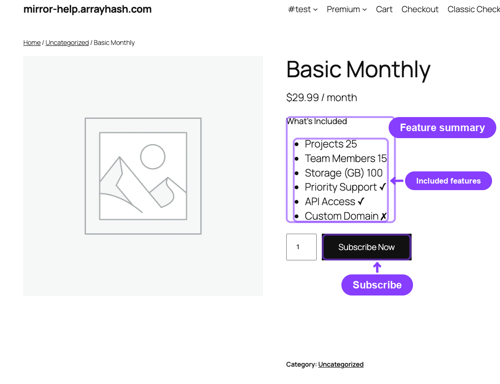
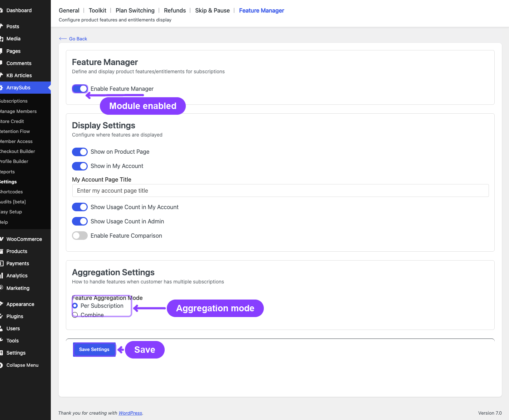
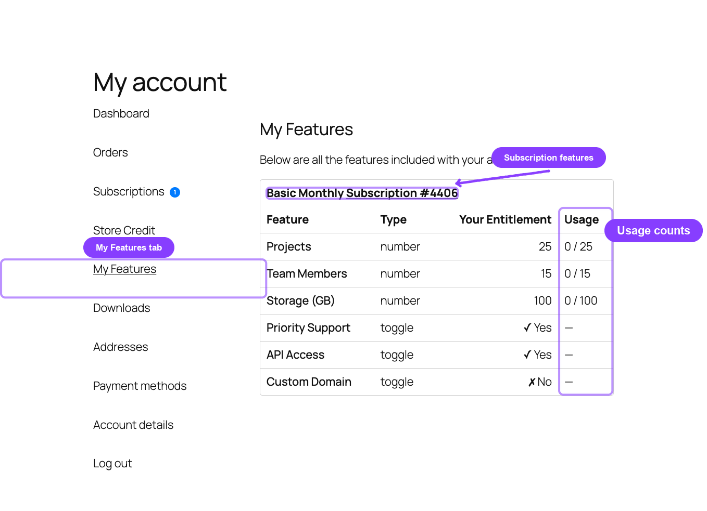

# Info
- Module: Feature Manager
- Last updated: 2026-10-30

# Feature Manager

> Define named product entitlements — features, limits, and capabilities — so customers always know exactly what their subscription includes.

## Overview

Feature Manager turns your subscription products into feature-based plans. Instead of just showing a price, each plan communicates what the customer receives: API call limits, storage quotas, priority support, custom domains, or any other entitlement you define.

Features are defined per product (or per variation), displayed on the storefront product page, and surfaced to customers in a dedicated **My Features** page inside their My Account area. Admins can review any customer's entitlements from the subscription detail screen or the Manage Members profile.

The module also supports **usage tracking** — showing customers how much of their entitlement they have consumed (e.g., "3 / 10 API calls used") — and **feature templates** for reusing the same feature sets across multiple products.

## When to Use This

- You sell tiered subscription plans and want each tier to clearly list what's included.
- You offer SaaS-like entitlements (storage, API calls, seats, bandwidth) and need customers to see their limits.
- You want to track feature consumption and display usage progress to customers and admins.
- You need a fast way to define identical feature sets across multiple products using templates.
- You want the storefront product page to prominently show a "What's Included" summary for each plan.

## Prerequisites

- ArraySubs (core plugin) installed and active.
- ArraySubs Pro installed and active.
- At least one subscription product created.
- The **Feature Manager** module switched on in **ArraySubs -> Modules**. Display and aggregation options are in **ArraySubs -> Settings -> Feature Manager**.

## How It Works

1. **Define features on products.** In the WooCommerce product editor, open the **Feature Manager [AS]** tab and add named features with types and values.

![Product editor Feature Manager [AS] tab with configured features](README.ASSETS/02-product-feature-manager-tab-annotated.png)

2. **Features flow to subscribers.** When a customer purchases or subscribes to that product, they become entitled to those features.
3. **Customers see their entitlements.** The **My Features** page in My Account shows all features from their active subscriptions: grouped per subscription, combined into one table, or as the highest value of each feature (see [Feature Manager Settings](feature-manager-settings.md)).

4. **Admins review entitlements.** From any subscription's detail screen or the Manage Members profile, admins can open the Feature Log to review a customer's complete entitlement picture.
5. **Optional: usage tracking.** For number features, your site's custom code or integrations record consumption through the Feature Manager developer API ([Read and Update Feature Data](../developers/feature-manager.md)). Each number feature has a reset period (None, Billing cycle, Day, Week, Month or Year), and usage starts again at 0 when a new period begins. Usage counts are displayed alongside entitlements in both the customer and admin views.

## Section Navigation

| Page | What It Covers |
|------|---------------|
| [Defining Product Features](defining-product-features.md) | Add, edit, and manage features in the product editor — feature types, templates, and variation-level overrides. |
| [Customer and Storefront Display](customer-and-storefront-display.md) | My Features page, storefront "What's Included" section, aggregation modes, and usage tracking. |
| [Feature Manager Settings](feature-manager-settings.md) | Every setting in the Feature Manager settings panel — toggles, aggregation, usage, and comparison. |

---

## FAQ

**Is Feature Manager a free feature?**
No. Feature Manager requires ArraySubs Pro. The settings page appears in the core admin area, but the **Feature Manager [AS]** product editor tab, storefront display, My Account page, and REST endpoints are all provided by the Pro plugin. Developers can read features and usage from PHP with the core plugin alone; updating product feature configuration through the developer API requires Pro Feature Manager. See [Read and Update Feature Data](../developers/feature-manager.md).

**Can I define different features for each variation of a variable product?**
Yes. Variable products have Feature Manager fields in each variation row. Each variation can have its own independent feature set. A variation with no features of its own inherits the default list from the product's **Feature Manager [AS]** tab.

**Do features carry over when a customer switches plans?**
Features are always read from the current product or variation linked to the subscription. When a plan switch is applied, the new plan's features replace the previous ones immediately; a switch scheduled for the next renewal changes the features at that renewal. Usage carries over when the new plan's feature uses the same reset period, starts again at 0 when the reset period is different, and is ignored for features the new plan does not have.

**Can I track how much of a feature a customer has used?**
Yes. Number features support usage tracking. Your custom code or integrations record usage through the Feature Manager developer API ([Read and Update Feature Data](../developers/feature-manager.md)), which checks each change against the feature's limit, handles simultaneous requests safely, and applies a retried request only once. The feature's reset period decides when usage starts again at 0. When usage display is enabled in settings, the **Usage** column appears in both the customer's My Features page and the admin Feature Log.

**What happens to features when a subscription is cancelled or on hold?**
Features are only shown for subscriptions with an `active` or `trial` status. Once a subscription moves to cancelled, expired, or on-hold, those features no longer appear in the customer's My Features page.

---

## Related Docs

- [Product Experience and Display](../subscription-products/product-experience.md) — Broader storefront product display options.
- [Customer Portal Pages](../customer-portal/portal-pages.md) — How My Features fits into the customer account area.
- [Admin Tools and Records](../manage-subscriptions/admin-tools-and-records.md) — Feature Log access from the subscription detail screen.
- [Manage Members](../member-insight/README.md) — Feature Log shortcut from the member profile.
- [Read and Update Feature Data](../developers/feature-manager.md) - Developer reference: read effective features and usage, record usage, and update existing product features from PHP.

## Page Navigation

- **Current guide:** Feature Manager
- **Where to open it:** WordPress Admin -> Products -> Edit Product and ArraySubs -> Settings -> Feature Manager
- **Section overview:** [Open overview](../README.md)
- **Previous guide:** [feature-manager-settings](./feature-manager-settings.md)
- **Next guide:** [before-you-launch](../getting-started/before-you-launch.md)
- **Troubleshooting:** [Audits, Logs, and Troubleshooting](../audits-and-logs/README.md)
