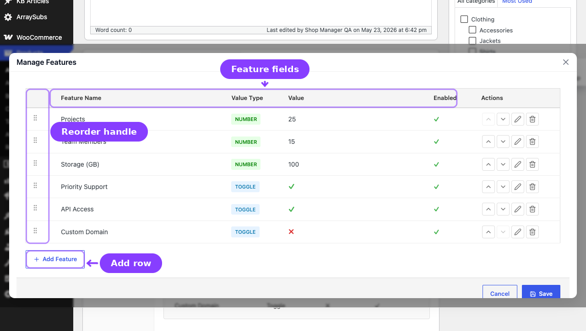
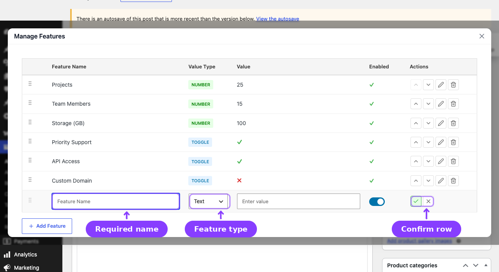
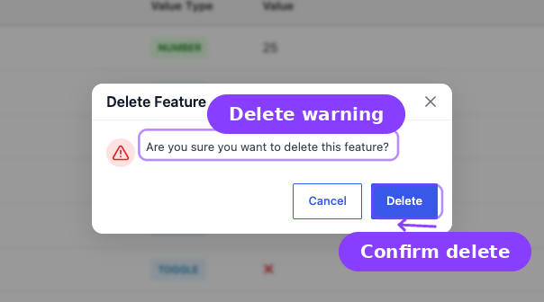

# Info
- Module: Feature Manager — Product Features
- Last updated: 2026-10-30

# Defining Product Features

> Add named entitlements to your subscription products so customers know exactly what each plan includes.


## Page Navigation

- **Current guide:** Defining Product Features
- **Where to open it:** WordPress Admin -> Products -> Edit Product and ArraySubs -> Settings -> Feature Manager
- **Section overview:** [Open overview](./README.md)
- **Previous guide:** [customer-and-storefront-display](./customer-and-storefront-display.md)
- **Next guide:** [feature-manager-settings](./feature-manager-settings.md)
- **Troubleshooting:** [Audits, Logs, and Troubleshooting](../audits-and-logs/README.md)

## Overview

Features are defined inside the WooCommerce product editor on a dedicated **Feature Manager [AS]** tab. Each feature has a name, a type, a value, and an enabled state. Number features also have a reset period that decides when usage starts again at 0. You can add as many features as needed, reorder them, and save feature sets as reusable templates.

Simple products have a single feature set. Variable products support per-variation features, so each pricing tier can define its own entitlements independently. A variation without features of its own inherits the product's default list.

## Opening the Feature Manager [AS] Tab

1. Go to **Products → Edit Product** for any subscription product.
2. In the product data panel (below the price fields), click the **Feature Manager [AS]** tab.

The tab appears near the bottom of the product data menu, before **Product Redirect [AS]** and **Advanced**. If Product Redirect is unavailable, **Feature Manager [AS]** still appears immediately before **Advanced**. For variable products, the tab holds the product's default features, which every variation without features of its own inherits. Each variation's options panel also has a **Feature Manager** section for a list that replaces the defaults for that variation.

```box class="info-box"
The **Feature Manager [AS]** tab only appears when the Feature Manager module is switched on in **ArraySubs -> Modules**.
```

![Product Feature Manager [AS] tab](README.ASSETS/02-product-feature-manager-tab-annotated.png)

## Adding Features (Simple Product)



1. Click the **Feature Manager [AS]** tab in the product data panel.
2. Click **Add Feature** (shown when no features exist yet) or **Edit Features** (shown when features already exist) to open the **Manage Features** modal.
3. Click **Add Feature** inside the modal. A new blank row appears in editing mode.
4. Fill in the feature details:
   - **Name** — Required. The display name customers see (e.g., "Storage Space", "Priority Support", "API Calls").
   - **Type** — Choose `Toggle`, `Number`, or `Text` (see Feature Types below).
   - **Value** — The entitlement value for this feature (depends on the type).
   - **Enabled** — Toggle on or off. Disabled features are saved but not displayed to customers.
   - **Reset period** - Number features only. Choose when usage starts again at 0: **None**, **Billing cycle**, **Day**, **Week**, **Month** or **Year** (see [Usage Reset Periods](#usage-reset-periods)).
5. Click the **✓** (check) icon on the row to confirm the feature, or **✗** to cancel.
6. Add more features by clicking **Add Feature** again.
7. When finished, click **Save** at the bottom of the modal.
8. Click **Update** on the product to save all changes.

After saving, a preview table appears inside the **Feature Manager [AS]** tab showing all defined features at a glance. The table has four columns: **Title**, **Type**, **Value**, and **Enabled**.



## Adding Features (Variable Product)

For variable products, features are defined per variation rather than at the product level.

1. Go to the **Variations** tab in the product data panel.
2. Expand any variation.
3. Scroll down to the **Feature Manager** section within the variation.
4. Click **Add Feature** (when no features exist) or **Edit Features** (when features already exist) to open the **Manage Features** modal for that variation.
5. Define features the same way as for simple products.
6. Repeat for each variation that needs features.
7. Click **Save changes** on the variations panel.

Each variation can keep its own feature list, which replaces the product's default list for that variation. A variation with no features of its own inherits the default list from the product-level **Feature Manager [AS]** tab. This lets you differentiate "Basic" from "Premium" from "Enterprise" on the same variable product, or define one shared list for every plan.

## Feature Types

Every feature must have a type. The type controls what values are accepted and how the feature is displayed to customers.

### Toggle

A binary yes/no entitlement.

| Property | Details |
|----------|---------|
| **Input** | Dropdown with "Yes" and "No" options |
| **Customer display** | ✓ Yes or ✗ No |
| **Use for** | Binary features like "Priority Support", "Custom Domain", "Ad-Free Experience" |

### Number

A numeric limit that can optionally be "Unlimited."

| Property | Details |
|----------|---------|
| **Input** | Text field accepting whole numbers or the word "Unlimited" (case-insensitive) |
| **Customer display** | The number (e.g., "500") or "Unlimited" |
| **Use for** | Countable quotas like "API Calls", "Storage (GB)", "Team Seats", "Downloads/month" |
| **Usage tracking** | Only number-type features support usage tracking (used / limit display) |
| **Reset period** | Select shown only for number features: None (default), Billing cycle, Day, Week, Month or Year. See [Usage Reset Periods](#usage-reset-periods). |

### Text

A free-form text entitlement.

| Property | Details |
|----------|---------|
| **Input** | Open text field |
| **Customer display** | The exact text value |
| **Use for** | Descriptive entitlements like "Email Support", "48-hour Response Time", "Gold Badge" |

## Usage Reset Periods

Every number feature has a **Reset period** select in its editing row. It decides when the feature's usage counter starts again at 0. The select appears only for number features; every other feature saves **None**.

| Option | When usage resets |
|--------|-------------------|
| **None** (default) | Never on its own. Usage changes only when your custom code or an integration sets or resets it. |
| **Billing cycle** | When a paid renewal starts a new billing cycle: scheduled renewals, $0 renewals, early renewals, and plan switches that apply at renewal. Proration orders, skipped renewals, pauses, and failed or on-hold renewals do not reset usage. |
| **Day** | At midnight each day. |
| **Week** | At the start of each week, following **Week Starts On** in **Settings -> General**. |
| **Month** | On the first day of each month. |
| **Year** | On January 1 each year. |

How reset periods behave:

- **Site timezone.** Day, week, month and year periods follow the site timezone in **Settings -> General**.
- **Per subscription.** Each subscription keeps its own counter and period. Box and bundle children follow their parent's billing cycle.
- **No waiting for a background job.** When a period ends, My Account, the admin Feature Log and the REST API show 0 used straight away. The stored counter rolls over the next time usage is recorded.
- **Plan switches.** If the new plan's feature uses the same reset period, usage carries over, so switching plans does not reset a quota. If the reset period is different, usage starts again at 0. Features the new plan does not have are ignored.
- **Variations.** The reset period is part of the feature list, so a variation with its own list uses its own periods, and a variation that inherits the default list uses the product's periods.
- **Recording usage.** Usage is recorded by your custom code or integrations through the Feature Manager developer API. See [Read and Update Feature Data](../developers/feature-manager.md).

## Reordering Features

Features appear in the order you define them. You can reorder features inside the modal in two ways:

- **Drag handle** — Grab the grip icon on the left side of any feature row and drag it to a new position.
- **Move Up / Move Down buttons** — Use the arrow buttons in the Actions column to shift a feature one position at a time.

The order is saved when you click **Save** at the bottom of the modal.

## Editing and Deleting Features

### Editing

1. Open the modal by clicking **Edit Features** on the **Feature Manager [AS]** tab.
2. Click the **Edit** (pencil) icon on the feature you want to change.
3. The row switches to edit mode. Modify the name, type, value, reset period (number features), or enabled state.
4. Click the **✓** (check) icon on the row to confirm, then click **Save** at the bottom of the modal.

### Deleting

1. Open the modal by clicking **Edit Features** on the **Feature Manager [AS]** tab.
2. Click the **Delete** (trash) icon on the feature row.
3. Confirm the deletion in the **Delete Feature** confirmation modal.
4. Click **Save** at the bottom of the modal to finalize.



Deleting a feature removes it from the product. Customers who already purchased this product will no longer see that feature in their My Features page once the product is updated.

## Feature Templates

Templates let you save a feature set and reuse it across multiple products, so you don't have to re-enter the same features on every product manually.

### Saving a Template

Templates are managed through the REST API. When a reusable feature set is saved through the API, it is stored as a named template with all its features.

### Using a Template

The current product editor does not expose a template picker. Saved templates are available for integrations through the Feature Manager REST API, while product features are still added or edited directly in the **Manage Features** modal.

### Template Storage

Templates are stored in the WordPress options table under the `arraysubs_feature_templates` option. Each template has a unique ID, a name, the feature array, and a creation timestamp.

## Feature Data Model

Each feature is stored as a JSON object inside the product's `_arraysubs_features` post meta. The complete structure:

| Field | Type | Description |
|-------|------|-------------|
| `id` | string | Auto-generated unique identifier |
| `name` | string | Display name (required) |
| `type` | string | `toggle`, `number`, or `text` |
| `value` | string | The entitlement value |
| `enabled` | boolean | Whether displayed to customers |
| `order` | integer | Sort position |
| `reset_period` | string | Number features: `none`, `billing_cycle`, `day`, `week`, `month` or `year`. Every other feature stores `none`. |

For variable products, each variation stores its own `_arraysubs_features` meta independently. A variation with an empty list inherits the parent product's list.

```box class="info-box"
Custom code should not write `_arraysubs_features` directly. Read product features and update an existing feature through the Feature Manager developer API ([Read and Update Feature Data](../developers/feature-manager.md)), which applies the same validation as this editor.
```

## Validation Rules

The modal enforces these rules before saving:

- **Name is required** — A feature with an empty name cannot be saved.
- **Value is required** — All types except toggle require a non-empty value.
- **Number type validation** — Must be a valid number or the word "Unlimited" (case-insensitive). Other text is rejected.
- **Toggle default** — If no value is set for a toggle, it defaults to "No."
- **Reset period** - Saved only for number features. Every other feature saves None.

---

## Real-Life Use Cases

### SaaS Subscription Tiers

A project management SaaS defines three plans:

| Feature | Starter | Professional | Enterprise |
|---------|---------|-------------|------------|
| Projects | 5 | 25 | Unlimited |
| Team Members | 3 | 15 | Unlimited |
| Storage (GB) | 10 | 100 | Unlimited |
| Priority Support | ✗ | ✓ | ✓ |
| Custom Domain | ✗ | ✗ | ✓ |
| API Access | ✗ | ✓ | ✓ |

Each tier is a variation on a variable product. Each variation gets its own feature set reflecting the limits above.

### Membership Box Levels

A wine subscription uses features to communicate what each tier includes:

- **Basic** — 3 bottles/month, Standard Shipping, Tasting Notes (text)
- **Premium** — 6 bottles/month, Free Shipping, Tasting Notes + Pairing Guide, Priority Support
- **Collector** — 12 bottles/month, Free Express Shipping, All Guides, Priority Support, Exclusive Vintages

### Content Platform

An online learning platform uses features to differentiate access:

- **Free Trial** — 5 courses, No downloads, Community access
- **Standard** — Unlimited courses, 10 downloads/month, Community access, Email support
- **Premium** — Unlimited courses, Unlimited downloads, Community + Live Q&A, Priority support, Certificates

To enforce a monthly quota such as "10 downloads/month", add a number feature with the value 10 and set its reset period to **Month**.

---

## FAQ

**Can I add features to non-subscription products?**
No. The **Feature Manager [AS]** tab only appears on supported subscription products. Simple products use the product-level tab. Variable products use the product-level tab for the default list and the **Feature Manager** section inside each variation for a variation's own list.

**Do feature changes affect existing subscribers immediately?**
Yes. Features are always read from the current product meta. When you change a feature's value or remove a feature, the change is reflected the next time the customer views their My Features page.

**Can two features have the same name?**
Technically yes, but it's not recommended. In **Combine** and **Highest value** aggregation modes, features are merged by name, and usage is counted by name, so duplicate names could produce unexpected results.

**Is there a limit to how many features I can add?**
No hard limit. Add as many features as needed. Keep in mind that very long feature lists may affect the readability of the storefront display and My Features page.

**What happens to features if I switch a product from simple to variable?**
Simple product features are stored on the product itself. When you convert to a variable product, they become the product's default list: every variation without features of its own inherits them. Add features to a variation when that plan needs a different list.

---

## Related Docs

- [Customer and Storefront Display](customer-and-storefront-display.md) — How features appear to customers on the product page and in My Account.
- [Feature Manager Settings](feature-manager-settings.md) — All settings for the Feature Manager module.
- [Product Experience and Display](../subscription-products/product-experience.md) — Broader storefront product display options.
- [Read and Update Feature Data](../developers/feature-manager.md) - Developer reference: read configured and effective features, record usage, and update existing product features.
