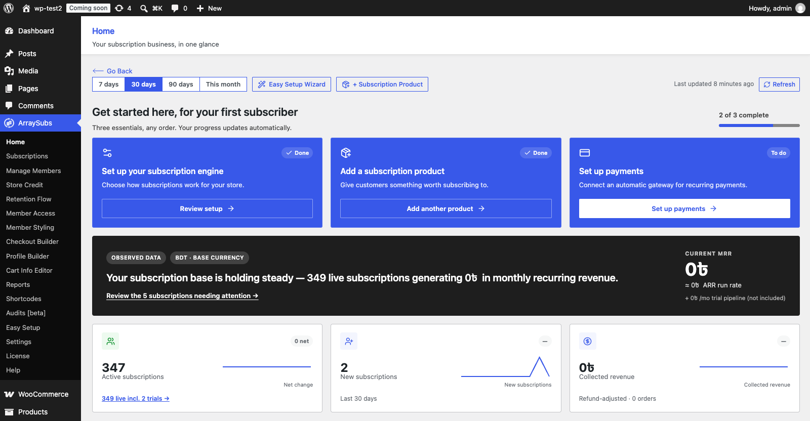

# Info
- Module: Getting Started
- Availability: Free + Pro
- Last updated: 2026-10-18

# Getting Started

> Everything you need to know before launching your subscription store with ArraySubs.

**Availability:** Free + Pro

## Page Navigation

- **Current guide:** Getting Started
- **Where to open it:** WordPress Admin -> ArraySubs
- **Section overview:** [Open overview](../README.md)
- **Previous guide:** [import-export-settings](./import-export-settings.md)
- **Next guide:** [member-commerce-overview](../member-insight/member-commerce-overview.md)
- **Troubleshooting:** [Audits, Logs, and Troubleshooting](../audits-and-logs/README.md)

## Overview

This section walks you through the fundamentals: what ArraySubs is, what it requires, and how to get your first subscription product live and collecting payments. Whether you are setting up a simple monthly membership or a multi-tier product catalog, start here.

## Start on Home

Open **ArraySubs → Home** in the WordPress admin sidebar. Home is the ArraySubs landing page and brings together your setup checklist and daily subscription figures.



The checklist covers three essentials, which you can complete in any order:

1. **Set up your subscription engine** — select **Start setup** or **Review setup** to open [1-Minute Setup](easy-setup-wizard.md).
2. **Add a subscription product** — select **Create a product** or **Add another product** to open the quick product creation modal.
3. **Set up payments** — open WooCommerce payment settings and configure an automatic recurring-payment gateway. Manual-only stores can still show this task as **To do**.

Once all three tasks are complete, you can dismiss the checklist for the whole site. The **Easy Setup Wizard** and **+ Subscription Product** toolbar buttons remain available. Continue with [First-Time Setup](first-time-setup.md) to place a test order and verify the subscription and customer portal.

After setup, return to Home to check recurring revenue, review **Action Center**, and see upcoming renewals. The [Home guide](../analytics/home.md) explains the checklist, date ranges, metric cards, Pro insights, and links to individual subscriptions.

## Free-to-Pro Path

ArraySubs core is free and runs the full subscription engine, including automatic payments through supported gateways. Add ArraySubs Pro when you need Pro modules such as store credit, Feature Manager, retention offers, or advanced analytics.

1. **Launch on the free plugin.** Check the [requirements](before-you-launch.md), set up a [system cron](cron-job-setup.md), and complete [First-Time Setup](first-time-setup.md).
2. **Upgrade when you need Pro.** Back up the site, keep core installed and active, install the Pro addon, and activate the license. Follow [Upgrade an Existing Free Store to Pro](license-activation.md#upgrade-an-existing-free-store-to-pro).
3. **Confirm and test.** Check that subscriptions, settings, modules, and integrations are unchanged, then test automatic payments before live use.

```box class="warning-box"
Pro is an addon to the same store. Never uninstall ArraySubs core or recreate subscriptions to upgrade.
```

## Staging Checklist

Test upgrades, gateway changes, and custom integrations on a staging copy before you change a live store:

1. Create the copy on its own domain from a recent backup.
2. Stop scheduled jobs on the copy and switch every gateway to test mode before it runs.
3. Keep staging email away from real customers.
4. Activate the Pro license on staging only when the test uses Pro features. See [Staging and Development Sites](license-activation.md#staging-and-development-sites).
5. Test a checkout, a due automatic renewal, and a failed payment with retry.
6. Apply the results to the live store without copying the staging database over it.

The full list is in the [Staging Checklist](before-you-launch.md#staging-checklist) on Before You Launch.

## For Developers

Building a custom plugin that reads or updates ArraySubs data? Start with [Developers](../developers/README.md) for supported classes, hooks, and testing guidance.

## In This Section

### [Home](../analytics/home.md)
Find the setup checklist and product shortcuts, then use the subscription dashboard for your daily health check. Available with the free plugin; Pro adds report cards.

### [Before You Launch](before-you-launch.md)
Requirements, installation, WooCommerce prerequisites, core concepts (products, billing cycles, trials, statuses), a clear breakdown of Free versus Pro features, the Free-to-Pro upgrade path, and the staging checklist.

### [Cron Job Setup](cron-job-setup.md)
**Required for production.** Configure a system cron so renewals, scheduled cancellations, and emails fire on time — not just when somebody visits the site. The single most important reliability change.

### [Create Products with the Quick Creation Wizard](../subscription-products/quick-product-creation.md)
Open **ArraySubs → Home → + Subscription Product** for guided product creation. Follow the dedicated screenshot guide for simple subscriptions, variable-product setup, boxes, bundles, store credit, and publishing.

### [First-Time Setup](first-time-setup.md)
A step-by-step checklist: configure your store, create your first subscription product, place a test order, and review the customer portal.

### [License Activation](license-activation.md)
Upgrade an existing Free store to Pro, activate ArraySubs Pro with your license key, set up staging and development sites, remove a local license, and understand how Pro update downloads and lifetime licenses work *(Pro)*.

### [1-Minute Setup](easy-setup-wizard.md)
A nine-step guide to billing, checkout, plan switching, cancellation, refunds, emails, and optional tools. Launch it from Home or 1-Minute Setup, review the loaded settings, and confirm your changes. Completed setups reopen on the next-step cards; **Start Over** lets you review the saved configuration again.

### [Admin Bar Visibility](../admin-bar-visibility/README.md)
Hide the WordPress frontend toolbar for customers while administrators keep normal shortcuts.

### [Admin Dashboard Access](../admin-dashboard-access/README.md)
Redirect unauthorized users away from `/wp-admin` while preserving backend access for administrators and staff roles.

### [WordPress Login Page](../wordpress-login-page/README.md)
Route customer login and registration traffic through WooCommerce My Account.

### [Login as User](../login-as-user/README.md)
Impersonate non-admin customers for support and customer-portal troubleshooting.

### [Login Limit](../member-access/login-limit.md)
Limit concurrent sessions per account to reduce credential sharing *(Pro)*.

### [Coupons](../coupons/README.md)
Configure subscription-aware WooCommerce coupons with recurring discounts, cycle limits, and initial-checkout counting.

### [Subscription Notes](../subscription-notes/README.md)
Review the subscription timeline for system events, gateway events, admin notes, and customer-visible notes.

### [Member Insight](../member-insight/README.md)
Search customers and open a complete subscription, commerce, profile, and support dashboard *(Pro)*.

### [Redirect Product Page](../redirect-product-page/README.md)
Redirect direct subscription product URLs to sales pages or return 404 responses *(Pro)*.

### [Subscription Shipping](../subscription-shipping/README.md)
Control one-time versus recurring shipping charges on physical subscription products *(Pro)*.

### [Retention Analytics](../retention-analytics/README.md)
Analyze cancellation reasons, churn trends, offer acceptance, and retained revenue *(Pro)*.

### [Gateway Health](../gateway-health/README.md)
Monitor payment gateway connection status, webhook URLs, capabilities, and webhook events *(Pro)*.

### [Import / Export Settings](import-export-settings.md)
Download your full ArraySubs configuration as a JSON file or restore a previously exported configuration with granular section-level control.

### [Essential Daily Workflows](essential-daily-workflows.md)
How the subscription lifecycle works from checkout to renewal, where merchants manage everything, and what to verify before going live.

### [Developers](../developers/README.md)
Connect a custom plugin to ArraySubs through supported classes and hooks, and verify the integration on staging.
