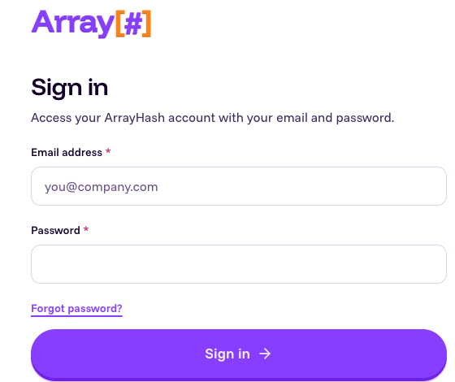
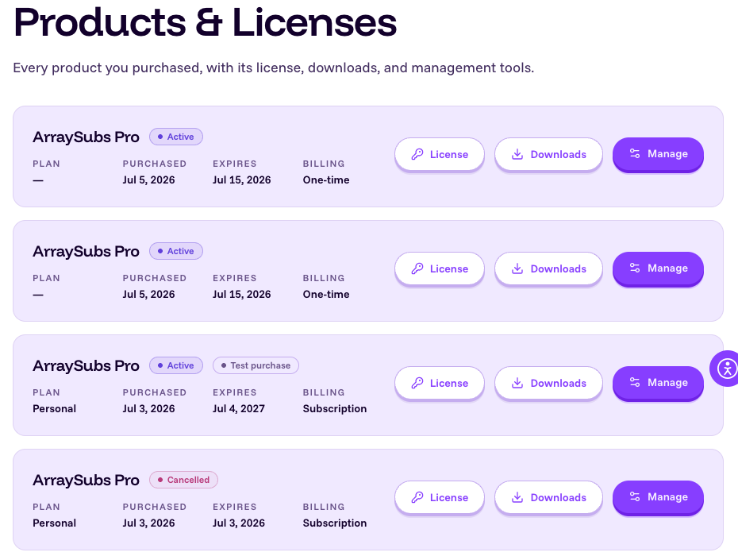
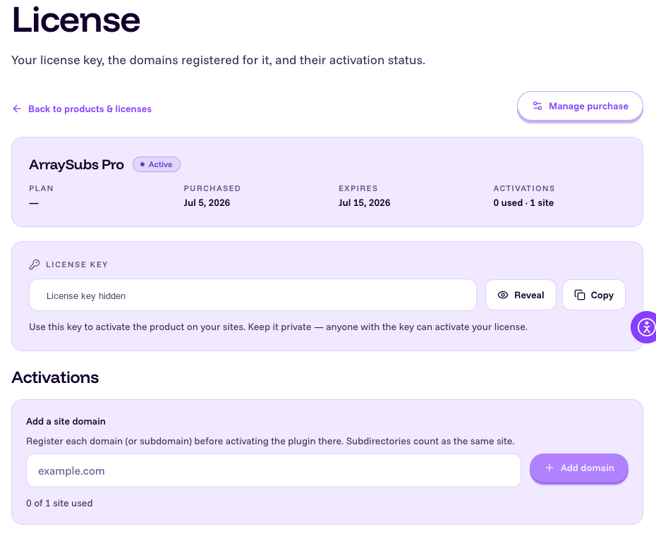
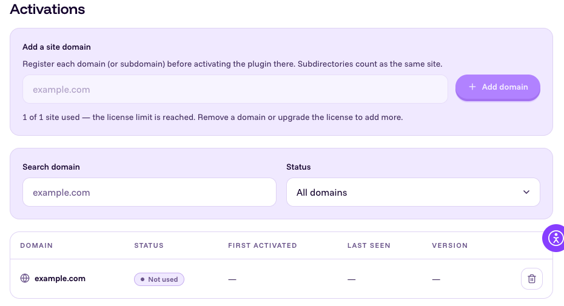
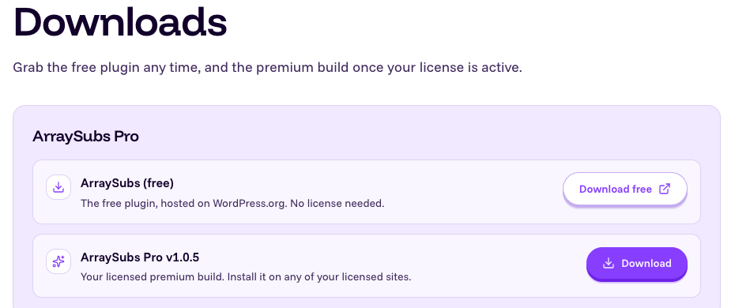
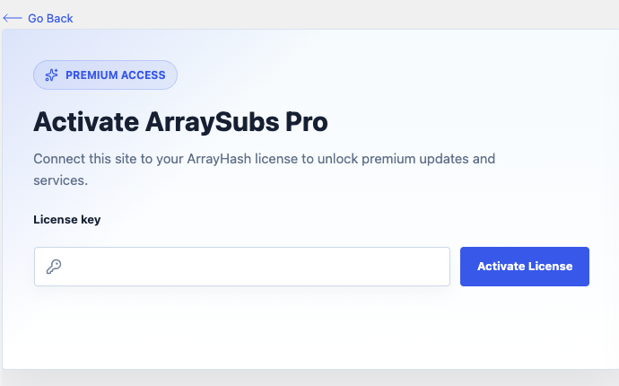
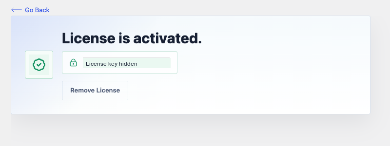
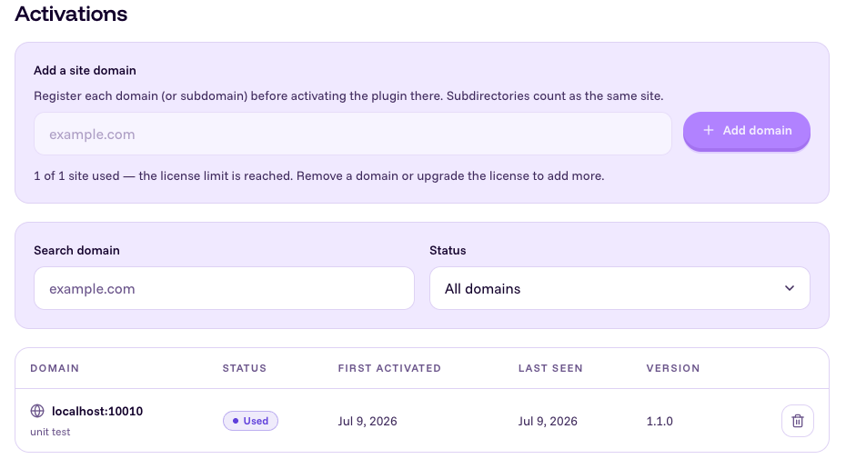
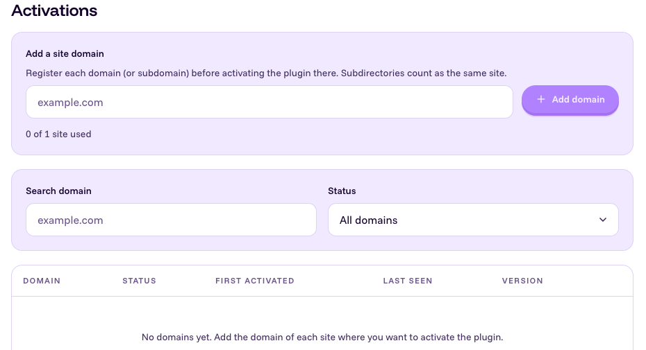

# Info
- Module: Getting Started
- Availability: Pro
- Last updated: 2026-10-18

# License Activation

> Upgrade an existing Free store to ArraySubs Pro, register your site in the ArrayHash user portal, activate the license in WordPress, set up staging and development sites, and revoke a site activation when you no longer need it.

**Availability:** Pro

## Page Navigation

- **Current guide:** License Activation
- **Where to open it in WordPress:** WordPress Admin -> ArraySubs -> License
- **Direct admin route:** `/wp-admin/admin.php?page=arraysubs-mainadmin#/license`
- **ArrayHash pricing:** [https://arrayhash.com/product/arraysubs/pricing/](https://arrayhash.com/product/arraysubs/pricing/)
- **ArrayHash user portal:** [https://user-portal.arrayhash.com/](https://user-portal.arrayhash.com/)
- **Portal products and licenses:** [https://user-portal.arrayhash.com/products/](https://user-portal.arrayhash.com/products/)
- **Portal downloads:** [https://user-portal.arrayhash.com/downloads/](https://user-portal.arrayhash.com/downloads/)
- **Section overview:** [Open overview](./README.md)
- **Previous guide:** [first-time-setup](./first-time-setup.md)
- **Next guide:** [import-export-settings](./import-export-settings.md)
- **Troubleshooting:** [Audits, Logs, and Troubleshooting](../audits-and-logs/README.md)

## Overview

ArraySubs Pro licensing has two parts:

1. The **ArrayHash user portal** stores your purchase, Pro download, license key, and the sites allowed to use that license.
2. The **WordPress License page** activates ArraySubs Pro on the current WordPress site with the license key from the portal.

The portal is the source of truth for which domains can use a license. Add the site domain in the portal before activating the license in WordPress.

```box class="info-box"
Development host names do not need to be added in the portal. `localhost` and any host name ending in `.test` or `.local` activate directly from WordPress and are not counted against the license's site limit. The portal ignores port numbers when it matches a domain.
```

## Upgrade an Existing Free Store to Pro

ArraySubs Pro is an addon to the free core plugin, not a replacement. Pro reads the subscriptions, orders, customers, and settings that core already stores, so an upgrade does not migrate or recreate anything. When the store already takes payments, rehearse the upgrade on a staging copy first (see [Staging and Development Sites](#staging-and-development-sites)).

1. **Back up the site.** Take a full backup of the database and files. An ArraySubs settings export from [Import / Export Settings](import-export-settings.md) is a useful extra copy of your configuration, but it does not contain subscriptions, orders, customers, or payment credentials.
2. **Record what you have now.** Note the subscription count for each status in **ArraySubs -> Subscriptions**, and write down a few sample subscription IDs with their status, next payment date, and payment method. You compare these after the upgrade.
3. **Keep ArraySubs core installed and active.** Update core to the latest release first. Pro requires ArraySubs core 2.0.0 or higher and loads inside core. Do not deactivate, delete, or reinstall core.
4. **Install the Pro addon.** Download the current ArraySubs Pro release from the portal and upload it ([Step 4](#step-4-download-the-pro-plugin-zip) and [Step 5](#step-5-install-arraysubs-pro-in-wordpress)). Use the current release so automatic payments stay with ArraySubs core.
5. **Activate the license.** Add the site domain in the portal and activate the license under **ArraySubs -> License** ([Step 3](#step-3-add-the-website-domain) and [Step 6](#step-6-activate-the-license-in-wordpress)). Pro features load only while the license is active for the current domain.
6. **Confirm records, settings, and integrations.**
   - Subscription counts and your sample subscriptions match what you recorded.
   - Your ArraySubs settings, subscription products, and member access rules are unchanged.
   - **ArraySubs -> Modules** shows the Pro modules as available. Pro modules are switched on by default, so switch off any module you are not ready to use.
   - **ArraySubs -> Retention Flow** shows the cancellation reasons and retention offers customers see when they cancel. Retention offers are switched on by default, so review them before customers reach them.
   - Integrations and any custom code that reacts to ArraySubs events still respond.
7. **Test automatic payments before live use.** Automatic payments are part of the free core, and installing Pro does not move your gateway connections. Still, run a renewal test on staging and watch the first automatic renewals on the live store: the renewal order is created, the payment completes, and the next payment date moves forward. See [Stripe Gateway](../checkout-and-payments/automatic-payments/stripe.md) and [Automatic Payments](../checkout-and-payments/automatic-payments/README.md).

```box class="warning-box"
Never uninstall ArraySubs core or recreate subscriptions to move to Pro. Recreated subscriptions lose their order history and renewal schedule, and the original subscriptions can still renew, which risks charging customers twice.
```

If Pro is deactivated later, or its license stops being active, Pro features stop but no data is deleted. Activating Pro with a valid license restores them.

## Prerequisites

- ArraySubs core plugin 2.0.0 or higher installed and activated.
- For an existing Free store, the backup and checks in [Upgrade an Existing Free Store to Pro](#upgrade-an-existing-free-store-to-pro).
- An ArraySubs Pro purchase, subscription, or trial.
- Access to the ArrayHash user portal account that owns the license.
- Admin or Shop Manager access to the WordPress dashboard.
- The WordPress **Site Address** should already be the domain you want to activate.

## Step 1: Get ArraySubs Pro

Open the [ArraySubs pricing page](https://arrayhash.com/product/arraysubs/pricing/) and choose the Pro plan or trial that fits your site.

After purchase, sign in to the [ArrayHash user portal](https://user-portal.arrayhash.com/).



## Step 2: Open Products and Licenses

In the portal, open **Products & Licenses**. Your ArraySubs Pro license appears in the product list.



Click **License** for ArraySubs Pro. The license page shows:

- License status and dates.
- Your masked license key.
- Copy and reveal controls for the license key.
- The **Activations** area where you register site domains.



Copy the license key from this page. Keep it private.

## Step 3: Add the Website Domain

On the same license page, use **Add a site domain** before activating the plugin in WordPress.

Enter the domain exactly as the site uses it:

| Site Type | Example to Add |
|---|---|
| Production domain | `example.com` |
| Subdomain, such as a public staging site | `staging.example.com` |
| `localhost`, or a host name ending in `.test` or `.local` | Nothing to add. These development hosts activate directly and are not counted against the site limit. |

Subdirectories count as the same site. For example, `example.com/shop` uses `example.com`. Port numbers are ignored, so enter the host name only.



If the license has a one-site limit and one domain is already registered, the add form is disabled until you remove or revoke a domain.


## Step 4: Download the Pro Plugin Zip

Open **Downloads** in the user portal and download **ArraySubs Pro**.



The download is a WordPress plugin zip file. Do not unzip it before uploading it to WordPress.

## Step 5: Install ArraySubs Pro in WordPress

In WordPress:

1. Go to **Plugins -> Add Plugin**.
2. Click **Upload Plugin**.
3. Choose the ArraySubs Pro zip file from the portal.
4. Click **Install Now**.
5. Click **Activate Plugin**.

After ArraySubs Pro is active, the **License** item appears under **ArraySubs**.

## Step 6: Activate the License in WordPress

Open **ArraySubs -> License** in WordPress.



Paste the license key copied from the portal and click **Activate License**.

WordPress sends the current site domain and license key to ArrayHash. If the license is valid and the domain is registered for that license, the page reloads into the activated state. Development hosts do not need to be registered.



After activation, the page shows:

- **License is activated.**
- A masked license key.
- A **Remove License** button.

The activation is stored for this site's domain, including the port when the Site Address has one. If the Site Address domain or port changes later, activate the license again.

## Step 7: Confirm the Active Site in the Portal

Return to the license page in the ArrayHash user portal. The Activations table shows the domain as used after WordPress activates the license. Development hosts (`localhost`, `.test`, and `.local` names) are not listed in this table and do not use a site.



The activation row can show the domain, first activation date, last seen date, plugin version, and site title.

## Staging and Development Sites

Each WordPress site stores its own activation for the domain in its WordPress **Site Address**. ArraySubs checks that record on every page load. It is valid only while the Site Address domain matches and the license dates are valid.

| Situation | What Happens | What to Do |
|---|---|---|
| You copy the live site to a staging domain | The copy keeps the live site's license record, but the record does not match the new domain, so Pro features stay off on the copy. The live site keeps working, and no data is removed on either site. | Activate the license on the staging site for its own domain, or test core-only features without Pro. |
| Staging or development site on `localhost`, or on a host name ending in `.test` or `.local` | The portal accepts these development hosts without registration and does not count them against the site limit. | Activate the license from **ArraySubs -> License** on that site. |
| Public staging domain, such as `staging.example.com` | The domain must be registered in the portal, and it uses one site from the license's site limit. | Add it under **Activations**, then activate. Revoke it when the staging site is retired. |
| The live store moves to a new domain | The stored activation no longer matches, so Pro features stop on the next page load. | Add the new domain in the portal, activate the license again, then revoke the old domain. |

Automatic payments, renewals, grace periods, and the customer portal are part of the free core and do not need a license. You can test them on a staging copy without activating Pro there. Activate Pro on staging when a test uses Pro features or when you rehearse the Free-to-Pro upgrade.

```box class="warning-box"
A staging copy also carries the live site's gateway settings and scheduled renewals. Before the copy runs scheduled jobs, switch its payment gateways to test mode. Follow the [Staging Checklist](before-you-launch.md#staging-checklist) before you test on a copy of a live store.
```

## Revoke or Remove a Website Activation

Use the user portal when you want to free a license seat, for example after you retire a staging domain or move the store to a new domain.

1. Open [Products & Licenses](https://user-portal.arrayhash.com/products/).
2. Open the ArraySubs Pro **License** page.
3. Find the site in **Activations**.
4. Click **Revoke** for an active site, or the delete control for an unused site.
5. Confirm the action when prompted.

After revoke or removal, the domain is no longer assigned to the license seat, and that site can no longer download Pro updates. To stop Pro on a site you no longer use, also remove the license in WordPress or deactivate ArraySubs Pro on that site.



```box class="warning-box"
Revoking a site in the portal and removing a license inside WordPress are separate actions. Revoke in the portal to free the license seat. Use **Remove License** in WordPress only to clear the local license record from that WordPress installation.
```

## Remove the Local WordPress License

Use **Remove License** in WordPress when you only want to clear the local license record from the current site.

1. Go to **ArraySubs -> License**.
2. Click **Remove License**.
3. Confirm the action.
4. Wait for the success message and page reload.

Removing the local license clears WordPress license data, but it does not free the domain in the ArrayHash portal. Revoke or remove the domain in the portal if you also want to release the seat.

Removing the local license does not delete subscriptions, settings, or Pro data. Pro features stop on the next page load and return when you activate a license again.

## What Gets Stored in WordPress

After successful activation, WordPress stores license activation details in the `arraysubs_license` option.

Stored data can include:

| Stored Value | Purpose |
|---|---|
| License key or activation token | Used for Pro update checks and protected downloads |
| Activated domain | Used to confirm the current site still matches the activation |
| Plugin slug | Confirms the license belongs to ArraySubs Pro |
| Package or plan data | Confirms the licensed package |
| Created and expiry dates | Define the license validity window |
| Activation date | Records when this WordPress site activated the license |

The stored record is not refreshed automatically. Activate the license again after the Site Address changes or after a yearly license renews.

## What Happens Without an Active License

Pro features need an active license for the current domain. When the license record is missing, its end date has passed, or the Site Address domain no longer matches, Pro features stop loading on the next page load. There is no grace period.

- Subscriptions, orders, customers, settings, and Pro data such as store credit balances stay in the database.
- Core features keep running, including renewals, automatic payments, grace periods, the customer portal, and member access rules.
- Pro modules on **ArraySubs -> Modules** show **Activate your ArraySubs Pro license to use this module.**
- Renewal orders for products with a different renewal price use the regular recurring price.
- Activating a valid license for the domain restores Pro features on the next page load.

## Pro Updates and Downloads

ArraySubs Pro update downloads are protected by the active license. To download Pro updates through WordPress, the current site must have a valid local activation and the domain must remain assigned to the license in the ArrayHash portal.

If the license is missing, expired, revoked, or assigned to a different domain, WordPress may not be able to download the protected Pro update zip.

## Lifetime and Yearly Licenses

| License | Updates and Support | In WordPress |
|---|---|---|
| Personal Lifetime | A one-time purchase for one site. It continues to receive Pro support, new features, and security updates without a yearly renewal. | The license has no end date, so the activation does not expire. |
| Personal Yearly | One site. Pro support, new features, and security updates continue while the license is active and stop after it expires, until it is renewed. | After the end date, Pro features stop. After you renew, activate the license again with the same key so WordPress stores the new end date. |

Agency Lifetime follows the same lifetime terms for more sites.

## Troubleshooting

| Problem | Likely Cause | What to Do |
|---|---|---|
| The **License** menu is missing | ArraySubs Pro is not active | Install and activate ArraySubs Pro first |
| You cannot download the Pro zip | You are not signed in to the portal account that owns the license | Sign in to the correct ArrayHash account and open **Downloads** |
| The portal add form is disabled | The license has no unused site seats | Revoke or remove an old domain, use a development host name for staging, or upgrade the license |
| Activation says the domain is not allowed | The WordPress site domain was not added in the portal | Add the exact domain in **Activations**, then activate again |
| A local or staging activation says the domain is not registered | The host name is not `localhost` and does not end in `.test` or `.local`, so it must be registered first | Add the host name under **Activations**, or use a development host name |
| The license was active but now shows inactive | The Site Address domain or port changed, the license end date passed, or the local license was removed | Check the WordPress Site Address, then activate the license again with the same key. After a yearly renewal, this stores the new end date |
| Pro features are off on a staging copy | The copy still holds the live site's activation, which does not match the staging domain | Activate the license on the staging site for its own domain, or test core-only features without Pro |
| Pro modules show a license message after the upgrade | Pro is active, but the license is not active for this domain | Complete Step 3 and Step 6, then reload the page |
| Pro update zip download fails | The protected download could not validate the active license | Reactivate the license and confirm the domain is still assigned in the portal |

## FAQ

### Do I need ArraySubs Pro active before activating a license?

Yes. The **License** menu is shown only when ArraySubs Pro is active.

### Where do I get the Pro plugin zip?

Sign in to the ArrayHash user portal and open **Downloads**.

### Where do I get the license key?

Open **Products & Licenses**, click **License** for ArraySubs Pro, then copy the key from the license page.

### Do I need to add my website in the portal first?

Yes. Add the domain in the license page's **Activations** area before activating the license in WordPress.

### Are local development sites allowed?

Yes. `localhost` and host names ending in `.test` or `.local` activate without being added in the portal and do not count against the site limit. The portal ignores port numbers.

### Does removing the license in WordPress revoke the site in the portal?

No. Removing the license in WordPress only clears the local WordPress license record. Revoke or remove the domain from the portal to free the license seat.

### Do subdomains count separately?

Yes. `example.com`, `www.example.com`, and `staging.example.com` are separate activation domains. Subdirectories and port numbers are ignored.

### Will upgrading from Free to Pro change my existing subscriptions?

No. Pro reads the subscriptions, orders, customers, and settings that core already stores. Keep core active, install Pro, and activate the license. Do not uninstall core or recreate subscriptions.

### Does my staging site need its own activation?

Yes, when it runs Pro features. A staging site on `localhost` or on a `.test` or `.local` host name activates without using a site. A public staging domain must be added in the portal and uses one site from the license limit. Core-only tests, including automatic renewals, do not need a license.

### Does Personal Lifetime include updates and support?

Yes. Personal Lifetime is a one-time purchase for one site, and it continues to receive Pro support, new features, and security updates without a yearly renewal.

## Related Guides

- [Before You Launch](before-you-launch.md)
- [First-Time Setup](first-time-setup.md)
- [Import / Export Settings](import-export-settings.md)
- [Cron Job Setup](cron-job-setup.md)
- [Stripe Gateway](../checkout-and-payments/automatic-payments/stripe.md)
- [Developers](../developers/README.md)
- [Gateway Health](../gateway-health/README.md)
- [Audits, Logs, and Troubleshooting](../audits-and-logs/README.md)
