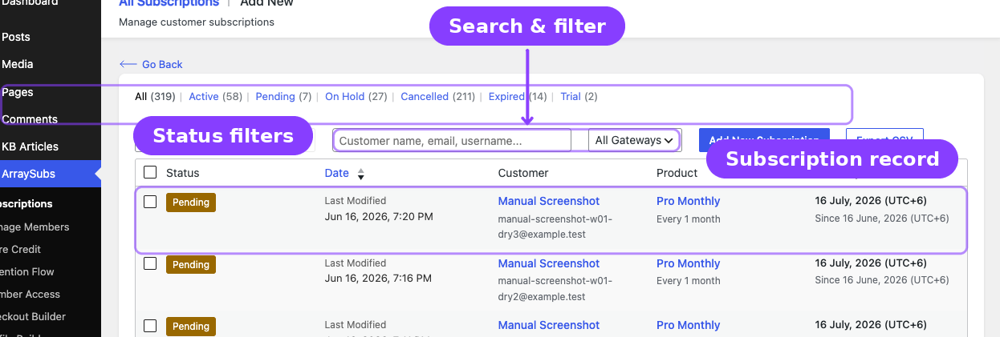
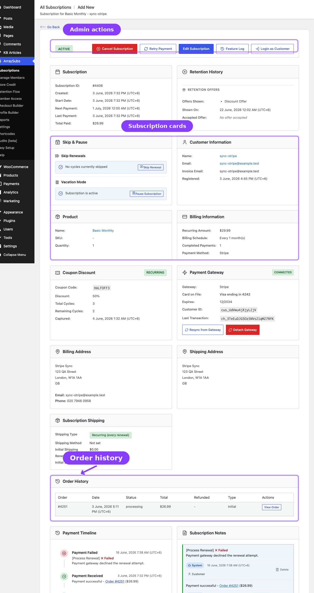

# Info
- Module: Subscription Admin
- Last updated: 2026-10-30

# Manage Subscriptions

> The central hub for viewing, creating, editing, and managing every subscription in your store.

## Page Navigation

- **Current guide:** Manage Subscriptions
- **Where to open it:** WordPress Admin -> ArraySubs -> Subscriptions
- **Section overview:** [Open overview](../README.md)
- **Previous guide:** [lifecycle-management](./lifecycle-management.md)
- **Next guide:** [subscription-detail-cards](./subscription-detail-cards.md)
- **Troubleshooting:** [Audits, Logs, and Troubleshooting](../audits-and-logs/README.md)

## Overview

The **Manage Subscriptions** area is where you spend most of your day-to-day time as a subscription merchant. From here you can browse all subscriptions, create new ones manually, edit billing details, review order history, track lifecycle changes, and take action on individual subscriptions.

This section covers five main areas:

| Area | What It Covers |
|------|----------------|
| [Subscription Operations](subscription-operations.md) | The subscriptions list, creating a subscription, editing a subscription, and the subscription detail screen |
| [Subscription Data Export](subscription-data-export.md) | Downloading subscriptions as CSV, the column picker, and the shipping-address columns used for label printing |
| [Admin Tools and Records](admin-tools-and-records.md) | Subscription notes, feature log, and related orders and refund history |
| [Subscription Detail Cards](subscription-detail-cards.md) | Every information card on the detail screen — cancellation, skip & pause, coupon, gateway, checkout fields, and shipping |
| [Lifecycle Management](lifecycle-management.md) | How subscriptions move through statuses — activation, renewals, grace periods, cancellation, expiration, trials, and email triggers |

## When to Use This

- You need to look up a customer's subscription status or billing details.
- You want to create a subscription manually (for phone orders, migrations, or exceptions).
- You need to move a renewal with skip or pause, update an address, or change a subscription's status.
- You want to review payment history, refund records, or admin notes for a specific subscription.
- You need subscription data outside WordPress — a shipping label sheet, a revenue spreadsheet, or a file for a fulfilment partner.
- You need to understand what happens at each stage of a subscription's life.

## Before You Create Subscriptions

Subscriptions are created from WooCommerce products that have ArraySubs subscription settings enabled. Before using **ArraySubs -> Subscriptions -> Add New**, create or edit the product that customers will subscribe to:

1. Go to **Products -> Add New** or open an existing WooCommerce product.
2. Set the product's **Regular price**.
3. Check **Subscription [AS]** in the product data panel.
4. For a simple product, click **Configure subscription billings** below Regular price to open **Subscription Billings [AS]** and configure the billing period, interval, length, trial, signup fee, and renewal pricing. For a variable product, configure each variation's **Subscription Billings [AS]** card in **Variations**.
5. Publish or update the product, then return to **ArraySubs -> Subscriptions** to create or manage customer subscriptions.

See [Subscription Products](../subscription-products/README.md) for the full product setup workflow.

## How to Get Here

Navigate to **ArraySubs → Subscriptions** in the WordPress admin sidebar. This opens the All Subscriptions list. From there, every subscription operation is one or two clicks away.

## Good to Know Before You Change Records

- **Deleting is permanent.** Subscriptions have no trash, so a deleted subscription cannot be restored. Cancel instead when you only want billing and access to stop. See [Deleting a Subscription](subscription-operations.md#deleting-a-subscription).
- **Deleting from the list keeps box and bundle members.** A box or bundle subscription is the billing owner of the zero-value subscriptions included in it. Deleting the box or bundle from the All Subscriptions list keeps those included subscriptions by design; deleting it through the developer API removes them too.
- **Manage a family through its billing owner.** Pause, skip, cancel, and reactivate the box or bundle subscription. Its included subscriptions follow it, and customers cannot manage them separately.
- **Lists, exports, and the API return different amounts of data.** The list shows 20 subscriptions per page. **Export CSV** writes every matching subscription into one file. The developer API returns pages of up to 100 subscriptions with a continuation cursor, and you choose full records, selected field groups, or IDs only. See [Subscription Data Export](subscription-data-export.md#full-partial-and-paged-data).

## For Developers

Custom plugins read and change subscriptions through the ArraySubs developer API instead of editing subscription meta. Start with these references:

| Task | Reference |
|------|-----------|
| Find subscriptions by ID, customer, email, product, or order; read full, selected, or paged data; make allowlisted updates; run lifecycle operations; delete | [Find and Update Subscriptions](../developers/subscriptions.md) |
| Resolve box and bundle families, billing owners, and related orders | [Work with Subscription Families and Orders](../developers/subscription-relationships-and-orders.md) |
| Read the stored status, the computed lifecycle phase, grace, trials, the current plan, and a pending plan switch | [Read Lifecycle State and Manage Its Dates](../developers/status-grace-periods-and-trials.md) |
| Find the customer behind a subscription and update profile fields | [Find Members and Update Profiles](../developers/customers-and-profile-fields.md) |
| Read the catalog terms of a subscription product | [Read Subscription Product Terms](../developers/subscription-products.md) |

The [Developers](../developers/README.md) overview lists every class with its Core or Pro availability.

---

## Related Guides

- [Subscription Data Export](subscription-data-export.md)
- [Getting Started — Essential Daily Workflows](../getting-started/essential-daily-workflows.md)
- [Subscription Products — Create and Configure](../subscription-products/create-and-configure.md)
- [Settings — General Settings](../settings/general-settings.md)
- [Developers](../developers/README.md) - the developer API overview
- [Find and Update Subscriptions](../developers/subscriptions.md) - query, read, update, and delete subscriptions in code
- [Work with Subscription Families and Orders](../developers/subscription-relationships-and-orders.md) - box and bundle families and related orders in code
