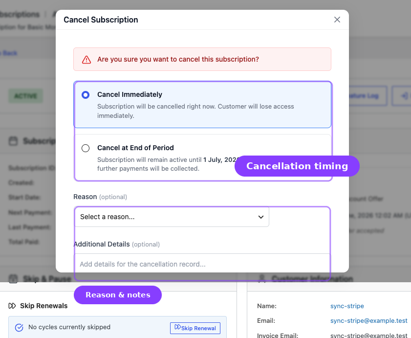
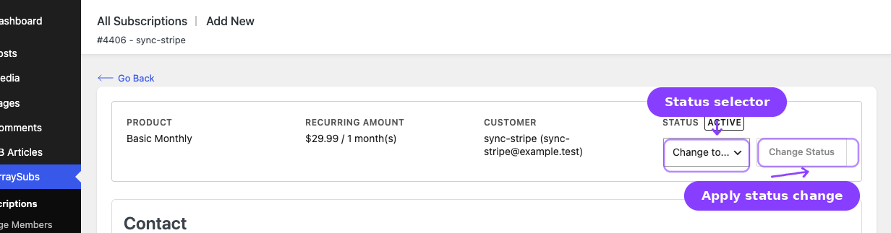

# Info
- Module: Subscription Admin
- Last updated: 2026-10-30

# Lifecycle Management

> How subscriptions move through statuses — from creation to activation, renewal, grace periods, cancellation, and expiration.


## Page Navigation

- **Current guide:** Lifecycle Management
- **Where to open it:** WordPress Admin -> ArraySubs -> Subscriptions
- **Section overview:** [Open overview](./README.md)
- **Previous guide:** [admin-tools-and-records](./admin-tools-and-records.md)
- **Next guide:** [README](./README.md)
- **Troubleshooting:** [Audits, Logs, and Troubleshooting](../audits-and-logs/README.md)

## Overview

Every ArraySubs subscription follows a defined lifecycle. Understanding how and when subscriptions change status helps you predict billing behavior, handle support requests, and configure your store correctly.

This guide covers:

- The seven subscription statuses and what each one means.
- Every status transition — what triggers it and what happens.
- The two-phase renewal system with grace periods.
- Trial conversion and auto-downgrade.
- Immediate vs. end-of-period cancellation.
- Expiration rules.
- What emails are sent at each stage.
- How box and bundle families follow their billing owner.

## Prerequisites

- Familiarity with the [Subscription Detail Screen](subscription-operations.md#subscription-detail-screen).
- General Settings configured — especially [grace period settings](../settings/general-settings.md) and [email reminder schedule](../settings/general-settings.md).

---

## Subscription Statuses

ArraySubs uses seven statuses:

| Status | Badge Color | Meaning |
|--------|-------------|---------|
| **Pending** | Orange | Subscription created but not yet activated. Waiting for first payment or manual activation. |
| **Active** | Green | Subscription is live. Renewals are being processed on schedule. |
| **Trial** | Cyan | Subscription is in a free trial period. No charges until the trial ends. |
| **Paused** | Blue | Renewals are deliberately suspended for a set period, by the customer or an admin. Resumes on its scheduled date, or earlier if resumed manually. |
| **On Hold** | Yellow | Renewals are stopped because something is wrong — an unpaid invoice, or an administrative hold. |
| **Cancelled** | Red | Subscription is permanently stopped. No further renewals will be processed. |
| **Expired** | Red | Subscription reached its billing cycle limit or fixed end date. No further renewals. |

```box class="warning-box"
**Paused and On Hold are not interchangeable.** Paused is a chosen break with an end date; On Hold is a problem that needs resolving. They differ in what recovers them (a resume vs a payment), what the overdue checker does with them (ignores vs cancels after the grace window), and how they count in reports. Earlier versions reused On Hold for pauses — if you built status filters, member-access conditions, or reports on that assumption, review them.
```

Additionally, an active subscription can carry a **"Cancels at end of period"** indicator. This is not a separate status — the subscription remains Active until the scheduled cancellation date.

---

## Lifecycle Diagram

```
                    ┌───────────┐
                    │  Created  │
                    └─────┬─────┘
                          │
              ┌───────────┴───────────┐
              ▼                       ▼
        ┌──────────┐           ┌──────────┐
        │ PENDING  │           │  TRIAL   │
        └────┬─────┘           └────┬─────┘
             │                      │
        (Activated)          (Trial converts)
             │                      │
             └──────────┬───────────┘
                        ▼
                  ┌──────────┐
            ┌────▶│  ACTIVE  │◀────────────┐
            │     └────┬─────┘             │
            │          │                   │
       [Reactivate]    │             [Payment received
            │    [Unpaid for 3 days]   or reactivation]
            │          │                   │
            │          ▼                   │
            │    ┌──────────┐              │
            │    │ ON HOLD  │──────────────┘
            │    └────┬─────┘
            │         │
            │   [Unpaid for 7 more days]
            │         │
            │         ▼
            │    ┌──────────┐
            └────│CANCELLED │
                 └──────────┘

                 ┌──────────┐
                 │ EXPIRED  │
                 └──────────┘
            (After final payment
             or end date reached)
```

---

## Activation

### From Pending to Active

When a subscription is created (manually or through checkout), it starts as **Pending**. It moves to **Active** when:

- The initial payment is completed (checkout flow), or
- An admin manually changes the status to Active from the edit page.

**What happens on activation:**
- The next payment date is calculated based on the billing schedule.
- A "New Subscription" email is sent to the customer.
- An admin notification email is sent.
- A renewal reminder is scheduled (based on the configured days-before setting).

### From Trial to Active (Trial Conversion)

A trial ends at its next payment date. At that date the normal renewal flow invoices and charges the first payment, exactly like any renewal. When that payment is made, the subscription moves to **Active** and the next payment date moves one billing cycle past the trial end.

A daily trial-conversion job (first run at 2:00 AM UTC) is the fallback for trials that are still in Trial after their due date:

1. The system checks all Trial subscriptions whose next payment date has passed.
2. For each one, it checks whether the auto-downgrade timing is **On trial expire** and the product has an [auto-downgrade](../subscription-products/plan-switching-and-relationships.md) target.
3. If no auto-downgrade applies, the subscription moves to **Active**, the next payment date is recalculated as one billing period from now (not the trial period), and the trial length meta is cleared.
4. A "Trial Converted" email is sent to the customer. Only conversions made by this job send it.

```box class="info-box"
With the auto-downgrade timing set to **On trial expire** and a target configured on the product, the job switches the subscription to the downgrade product instead of converting it. The customer receives an "Auto Downgrade" email instead.
```

### Reactivation (From On Hold or Cancelled)

An admin can reactivate a subscription by changing its status to Active from the [edit page](subscription-operations.md#changing-status). When reactivated:

- Coming back from Cancelled or Expired clears the stored end date, the scheduled-cancellation data, and the `_on_hold_date` meta. Reactivating from On Hold keeps the original `_on_hold_date`.
- If the stored next payment date is not in the future, it is recalculated from the reactivation time. You cannot type a next payment date by hand.
- A "Subscription Reactivated" email is sent.
- The renewal reminder is rescheduled.

### Pause and Resume (Active or Trial ↔ Paused)

Pausing is a separate lifecycle path, not a variant of On Hold.

**On pause** — from Active or Trial only:
- The status becomes **Paused** and a resume date is scheduled.
- Every pending renewal action is unscheduled; no invoices are created and no charges are attempted.
- The next payment date and any end date move forward by the requested pause length right away, so the dates shown during the pause already include it.

**On resume** — automatically on the scheduled date, or manually at any time:
- The status returns to what it was before the pause, normally Active.
- The next payment date and any end date shift forward by the **actual elapsed pause time**, not the duration originally requested.
- Renewal actions are rescheduled.

```box class="warning-box"
Resume applies to **Paused** subscriptions only. A subscription that is On Hold for a failed payment is not resumed — it is settled by paying the outstanding invoice, or reactivated by an admin. The API refuses a resume request against an On Hold subscription rather than reactivating something unpaid.
```

Who can trigger it: an admin always; a customer only while **Allow Customers to Pause** and **Allow Resume** are on under **ArraySubs → Settings → Skip & Pause**.

---

## Renewal Flow

ArraySubs uses a **two-phase renewal system** to give customers time to pay before any negative consequences.

### Phase 1: Invoice Generation

ArraySubs schedules renewal invoice generation per subscription using your configured **Invoice Timing** setting. The hourly **Generate Upcoming Renewals** job remains as a recovery safety net in case an exact scheduled action is missed. For each qualifying subscription:

1. The system verifies no pending renewal order already exists.
2. A new WooCommerce order (invoice) is created with **Pending** payment status.
3. The invoice order ID is stored on the subscription as `_pending_renewal_order_id`.
4. A "Renewal Invoice" email is sent to the customer with a payment link.

```box class="info-box"
## The subscription stays Active

The subscription does **not** change status when the invoice is created. It remains Active throughout the grace period. This is intentional — the customer keeps full access while they pay.
```

### Phase 2: Payment

Payment can happen through two paths:

**Manual payment** — the customer clicks the payment link in the invoice email, goes to the WooCommerce order-pay page, and completes payment. When the order is marked as paid:

1. The completed payments counter advances (only for orders with a total above zero).
2. The last payment date is updated.
3. The pending renewal order reference is cleared.
4. The system checks if the subscription should expire (based on subscription length or end date).
5. If not expiring, the next payment date is advanced and a new renewal cycle begins.
6. A "Payment Successful" email is sent.

If the paid renewal order was built on a pending plan switch, the switch is applied before these steps, so the subscription moves to the target plan with this payment. See [Current Plan and Pending Plan Switch](../subscription-products/plan-switching-and-relationships.md#current-plan-and-pending-plan-switch).

**Automatic payment** - the automatic payments engine in the core plugin charges the customer's saved payment method through a supported gateway such as Stripe. Pro is not required. The outcome follows the same steps as manual payment on success, or triggers the grace period flow on failure.

### Different Renewal Price

**Different Renewal Price requires ArraySubsPro to be active with an active license.** When a subscription has this rule configured, licensed Pro applies the new price after the specified number of completed payments. For example, with $30 set to apply after 3 payments, the first three completed payments use the original price, and subsequent renewals use $30. Without licensed Pro, renewals continue using the stored recurring amount.

---

## Grace Period System

When a renewal invoice goes unpaid, ArraySubs does not immediately penalize the customer. Instead, a two-phase grace period gives them time to resolve payment.

### Grace Period Timeline

```
     Invoice       Payment        ┌──────────────────────┐     ┌──────────────────────────┐
     Created       Due Date       │   ACTIVE (3 days)    │     │    ON HOLD (7 days)      │     CANCELLED
       │              │           │   Customer has       │     │    Access restricted     │
       ▼              ▼           │   full access        │     │                          │
  ─────┼──────────────┼───────────┼──────────────────────┼─────┼──────────────────────────┼─────►
  6 hrs before     Day 0        Day 0                  Day 3  Day 3                    Day 10
```

### Phase 1: Active Grace (3 Days)

After the payment due date passes, the subscription stays **Active** for 3 days. During this time:

- The customer has full access to their subscription benefits.
- The unpaid invoice is still waiting for payment.
- If the customer pays during this window, the subscription continues normally.

### Phase 2: On Hold (7 Days)

If the invoice is still unpaid after 3 days, the subscription moves to **On Hold**:

- The `_on_hold_date` is recorded for accurate timing.
- A "Subscription On Hold" email is sent to the customer.
- Customer access is restricted (depending on your member access configuration).
- If the customer pays during this window, the subscription returns to **Active**.

### Automatic Cancellation

If the invoice remains unpaid for 7 more days (10 days total from the due date), the subscription is **automatically cancelled**:

- Status changes to Cancelled.
- End date and cancelled date are set.
- The cancellation reason is recorded as "overdue_payment".
- The pending renewal order is cancelled.
- All future scheduled actions are removed.
- A "Subscription Cancelled" email is sent.

```box class="info-box"
The grace period durations (3 days active, 7 days on-hold) are configurable in **Settings → General Settings → Grace Period Configuration**. Adjust these to match your business policy.
```

Two failures skip the active grace window and put the subscription **On Hold** at once: a failed or cancelled initial order, and a renewal order that could not be created (for example because the subscribed product was deleted).

A subscription can also carry its own grace override, set through the developer API, which replaces the store-wide values for that subscription only. Developers read the computed grace phase and its dates from the API instead of inferring them from the status label: during the active grace window the stored status is still Active (or Trial). See [Read Lifecycle State and Manage Its Dates](../developers/status-grace-periods-and-trials.md).

### Payment During Grace Period

If the customer pays their invoice at **any point** during the grace period — whether the subscription is still Active or already On Hold — the subscription returns to Active status and the next billing cycle is scheduled normally.

---

## Cancellation



ArraySubs supports two cancellation modes.

### Immediate Cancellation

The subscription is cancelled right now. Available from the **Cancel Subscription** button on the detail page or the status change control on the edit page.

**What happens:**
1. Status changes to **Cancelled**.
2. The cancellation date, reason, and who cancelled it (admin ID or system) are recorded.
3. All future scheduled actions are removed — no more renewals, reminders, or status checks.
4. The waiting-cancellation flag is cleared (if it was set).
5. Any pending plan switch is cleared.
6. Payment retry state is cleared so failed-renewal retry actions do not continue after cancellation.
7. A "Subscription Cancelled" email is sent to the customer.
8. An admin notification email is sent.

### End-of-Period Cancellation

The subscription remains active until the next payment date, then cancels automatically. This keeps the customer's access until they have used the period they already paid for.

**When the end-of-period cancellation is scheduled:**
1. The `_waiting_cancellation` flag is set to true.
2. The scheduled cancellation date is set to the next payment date, or to the subscription's end date when that comes first.
3. The subscription stays in its current status (Active, Trial, etc.).
4. Renewal invoice/payment jobs are unscheduled so the customer is not billed again during the pending-cancellation window.
5. Any pending plan switch is cleared because it would otherwise wait for a renewal that will not happen.
6. The pending-cancellation emails are sent to the customer and the admin (when enabled).

```box class="warning-box"
## End-of-period cancellation needs a cancellation date

If ArraySubs cannot work out a cancellation date at all (no next payment date and no end date), the schedule request fails and nothing changes. If the date it finds has already passed, for example on an overdue renewal, the request becomes an immediate cancellation.
```

**When the cancellation date arrives:**
1. A per-subscription scheduled action runs at the cancellation date. The hourly overdue check finishes any cancellation that action missed.
2. Status changes to **Cancelled**.
3. The cancelled date is recorded and the waiting-cancellation meta is cleared.
4. All future scheduled actions are removed.
5. Any pending plan switch is cleared.
6. A "Subscription Cancelled" email is sent.

### Undo Scheduled Cancellation

If a scheduled cancellation has not yet executed, it can be reversed. Click **Undo Scheduled Cancellation** on the detail page:

1. A confirmation dialog asks: "Are you sure you want to undo the scheduled cancellation? The subscription will continue renewing normally."
2. If confirmed, all cancellation-related meta is removed:
   - `_waiting_cancellation`
   - `_cancellation_scheduled_date`
   - `_cancellation_reason`
   - `_cancelled_by`
   - `_cancellation_type`
3. The subscription resumes normal renewal scheduling.

```box class="info-box"
Undoing a scheduled cancellation restores the renewal schedule. No separate confirmation email is sent, and a pending plan switch that was cleared when the cancellation was scheduled does not come back.
```

---

## Expiration

Subscriptions expire when they reach a defined limit. There are two expiration triggers:

### Length-Based Expiration

If the subscription has a **subscription length** greater than zero (e.g., 12 billing cycles), the system checks after every successful payment whether the completed payments count has reached the limit. When it does:

1. Status changes to **Expired**.
2. The end date is set.
3. All future renewals are unscheduled.
4. A "Subscription Expired" email is sent.

### Date-Based Expiration (Fixed End Date)

If the subscription uses a **Fixed Period Membership** end date, a per-subscription scheduled action expires it at that end date. With the **Renew** period-end behavior, the subscription moves on to its next membership period instead of expiring.

### Auto-Downgrade at Expiration

If an [auto-downgrade target](../subscription-products/plan-switching-and-relationships.md) is configured on the product and the auto-downgrade timing is **On expire**, ArraySubs switches the expired subscription to the fallback plan and makes it active again. Auto-downgrade is part of the core plugin.

---

## Trial Management

### Trial Start

When a customer purchases a subscription product with a trial configured, the subscription is created with:

- Status: **Trial**
- Trial length and period stored as meta (e.g., 14 days)
- Trial end date calculated
- Next payment date set to the trial end date (this is when the first payment is invoiced and charged)

A "Trial Started" email is sent to the customer when the initial order is completed.

### Trial Conversion

At the trial end date the normal renewal flow invoices and charges the first payment; paying it moves the subscription to **Active**. A daily scheduled job (first run 2:00 AM UTC) then checks for Trial subscriptions whose next payment date has passed. For each one:

1. If the auto-downgrade timing is **On trial expire** and an auto-downgrade target is configured, the subscription switches to the downgrade product.
2. Otherwise, the status changes to **Active** and the next payment date is recalculated using the billing period.
3. The trial length meta is cleared.
4. A "Trial Converted" email is sent (or an "Auto Downgrade" email if downgraded).

### Trial Expiration Without Conversion

Auto-downgrade replaces conversion only when the auto-downgrade timing is **On trial expire** and the product has a fallback target. In every other case the daily job converts the trial to Active.

---

## Manual Status Changes



Admins can change a subscription's status from the [edit page](subscription-operations.md#changing-status). Six of the seven statuses are available targets: every status except Paused, which only the pause flow sets. A Paused subscription cannot be changed from this control; resume it first. Critical transitions (Cancel, On Hold, Activate) show specific confirmation messages.

### Important Distinctions

- **Using the status dropdown** performs a basic status change with a post-status transition hook but minimal side effects.
- **Using the Cancel Subscription button** on the detail page performs a full cancellation with reason capture, meta cleanup, scheduled action removal, and email notifications.

For cancellations, always prefer the **Cancel Subscription** button over the status dropdown. The button handles all cleanup and audit steps that a raw status change does not.

```box class="warning-box"
Changing a subscription to Cancelled via the status dropdown on the edit page performs an immediate cancellation with full cleanup (the same as clicking Cancel → Immediate). However, it does not capture a cancellation reason. For a complete audit trail, use the Cancel button on the detail page instead.
```

Deleting a subscription is not a lifecycle step. Deletion is permanent (subscriptions have no trash) and sends no cancellation emails or events, so cancel first when billing and access should stop. See [Deleting a Subscription](subscription-operations.md#deleting-a-subscription).

---

## Box and Bundle Families

A subscription box or subscription bundle creates a zero-value subscription for each subscription product inside it. The box or bundle subscription is their **billing owner**:

- Every status change on the box or bundle (pause, on hold, cancellation, expiry, reactivation) is copied to its included subscriptions.
- Their next payment date, last payment date, and payment count are refreshed each time a box or bundle renewal is paid. Skips or pauses on the box reach them at that point.
- They never create renewal invoices of their own.
- Customers cannot cancel, pause, skip, or reactivate them separately in the portal.

Make lifecycle changes on the box or bundle subscription. The admin screens do not stop you from changing an included subscription directly, but the next status change on its box or bundle overwrites it. The developer API refuses independent billing and lifecycle operations on an included subscription and names its billing owner instead. See [Work with Subscription Families and Orders](../developers/subscription-relationships-and-orders.md).

---

## Email Triggers by Lifecycle Event

Every major lifecycle event can trigger an email. The table below maps events to their emails.

### Customer Emails

| Lifecycle Event | Email Sent |
|----------------|------------|
| Subscription activated (Pending → Active) | New Subscription |
| Trial started | Trial Started |
| Trial converted by the daily conversion job | Trial Converted |
| Renewal invoice generated (based on invoice timing setting) | Renewal Invoice |
| Renewal payment successful | Payment Successful |
| Renewal payment failed | Payment Failed |
| Subscription placed on hold (grace period) | Subscription On Hold |
| End-of-period cancellation scheduled | Subscription Pending Cancellation |
| Subscription cancelled | Subscription Cancelled |
| Subscription expired | Subscription Expired |
| Subscription reactivated | Subscription Reactivated |
| Auto-downgrade completed | Auto Downgrade |
| Retention discount accepted | Retention Discount Accepted |
| Upcoming renewal (configurable days before) | Renewal Reminder |
| Subscription nearing end date | Expiring Soon |

### Admin Emails

| Lifecycle Event | Email Sent |
|----------------|------------|
| New subscription created | Admin New Subscription |
| Payment failed | Admin Payment Failed |
| End-of-period cancellation scheduled | Admin Subscription Pending Cancellation |
| Subscription cancelled | Admin Subscription Cancelled |

```box class="info-box"
Each email can be individually enabled or disabled in **Settings → General Settings**. The renewal reminder timing (days before next payment) is also configurable there.
```

---

## Scheduled Jobs Summary

ArraySubs uses the Action Scheduler to run lifecycle operations on a reliable schedule:

| Job | Frequency | What It Does |
|-----|-----------|--------------|
| Generate Upcoming Renewals | Hourly | Recovery job that creates missing renewal invoices within the configured invoice timing window |
| Generate Renewal Invoice | Per-subscription | Creates the exact renewal invoice before the due date based on the invoice timing setting |
| Check Overdue Renewals | Hourly | Moves unpaid subscriptions through the grace period (Active → On Hold → Cancelled) and finishes any end-of-period cancellation whose scheduled action was missed |
| Cancel Subscription | Per-subscription | Runs an end-of-period cancellation at its scheduled date |
| Expire Subscription | Per-subscription | Expires a Fixed Period Membership subscription at its end date |
| Process Trial Conversions | Daily (first run 2:00 AM UTC) | Converts trials still in Trial after their due date to Active (or auto-downgrades them) |
| Send Renewal Reminder | Per-subscription | Sends a reminder email before the next renewal (configurable days) |
| Send Expiring Soon | Per-subscription | Sends a notice when a subscription is approaching its end date |

---

## Real-Life Use Cases

### Use Case 1: Customer's Card Expired Before Renewal

The renewal invoice is generated before the due date based on your invoice timing setting. The customer's card fails. The subscription stays Active for 3 more days (grace period). During this time, the customer receives a "Renewal Invoice" email with a payment link. If they update their card and pay within 3 days, nothing changes. If they do not, the subscription moves to On Hold and they receive a "Subscription On Hold" email. After 7 more days unpaid, the subscription is cancelled automatically.

### Use Case 2: Seasonal Business with Scheduled Cancellations

A customer wants to keep their subscription until the end of May but not renew in June. The admin opens the subscription detail page, clicks **Cancel Subscription**, selects **Cancel at End of Period**, and confirms. The subscription stays Active — the customer keeps access until June 1. On that date, the system cancels it automatically.

### Use Case 3: Trial-to-Paid Conversion for a SaaS Product

A customer signs up for a 14-day trial. During the trial, they have full access. On day 14 the renewal flow invoices and charges the first payment. When it is paid, the subscription changes to Active, the next payment date moves one billing cycle past the trial end, and the customer receives the "Payment Successful" email.

---

## Troubleshooting

| Problem | Likely Cause | What to Do |
|---------|--------------|------------|
| Subscription stuck in Pending | Initial payment was never completed, or admin created it manually without activating | Open the subscription, change status to Active |
| Subscription cancelled unexpectedly | Overdue renewal — the grace period expired without payment | Check Order History for unpaid invoices and the Payment Timeline for the sequence of events |
| Trial did not convert | The first payment at trial end was not made, and the daily conversion job has not run yet | Check **WooCommerce -> Status -> Scheduled Actions** for the `arraysubs_process_renewal` and `arraysubs_process_trial_conversions` actions and their errors |
| On-Hold subscription not cancelled after 7 days | The overdue renewal checker uses the `_on_hold_date` meta for timing — it may have been cleared or not set | Check the subscription's meta for `_on_hold_date` |
| Emails not sent for lifecycle events | The specific email type may be disabled in General Settings | Verify email enable/disable toggles in **Settings → General Settings** |
| Scheduled cancellation did not execute | The per-subscription cancel action and the hourly overdue check may have encountered an error | Check **WooCommerce -> Status -> Scheduled Actions** for errors on the `arraysubs_cancel_subscription` and `arraysubs_check_overdue_renewals` actions |

---

## Related Guides

- [Subscription Operations](subscription-operations.md) — the admin screens for managing subscriptions
- [Subscription Detail Cards](subscription-detail-cards.md) — what each card shows at different lifecycle stages
- [Admin Tools and Records](admin-tools-and-records.md) — notes, order history, and export tools
- [Customer Portal — Self-Service Actions](../customer-portal/self-service-actions.md) — what customers can do from their account: cancel, skip, pause, switch plans
- [Settings — General Settings](../settings/general-settings.md) — grace period, email timing, and customer action configuration
- [Subscription Products — Plan Switching](../subscription-products/plan-switching-and-relationships.md) — auto-downgrade targets
- [Emails and Notifications](../emails/README.md) — which emails are triggered at each lifecycle stage
- [Advanced Analytics](../analytics/README.md) — subscription performance metrics, churn rate, and renewal revenue driven by lifecycle events
- [Retention, Cancellation, and Refunds](../retention-and-refunds/README.md) — cancellation setup, retention offers, refund policies, and retention analytics
- [Read Lifecycle State and Manage Its Dates](../developers/status-grace-periods-and-trials.md) - developer reference for the stored status, computed phase, grace, trials, current plan, and pending plan switch
- [Find and Update Subscriptions](../developers/subscriptions.md) - developer reference for lifecycle operations such as pause, resume, cancel, and skip
- [React to Supported Events](../developers/actions-and-filters.md) - developer reference for lifecycle events and hooks

---

## FAQ

### What happens if I change a subscription to Active manually?
The subscription becomes active and renewal scheduling resumes. Coming from On Hold, Cancelled, or Expired, a "Subscription Reactivated" email is sent. The next payment date cannot be set by hand: if the stored date is not in the future, ArraySubs recalculates it from the reactivation time.

### Can a cancelled subscription be reactivated?
Yes. An admin can change a cancelled subscription's status to Active from the edit page. This reactivates the subscription and resumes renewal processing.

### What happens to the grace period if I change the settings?
Grace period settings (active grace days and on-hold grace days) apply going forward. Subscriptions already in a grace period will be evaluated against the new settings on the next hourly check.

### Is the 6-hour invoice window configurable?
Yes. The **Invoice Timing** setting in **Settings -> General Settings** sets how long before the due date the renewal invoice is created; 6 hours is the default. If the lead time you set is as long as the billing cycle itself, ArraySubs falls back to 6 hours.

### What is the difference between Cancelled and Expired?
**Cancelled** means the subscription was stopped by someone (customer, admin, or the system due to non-payment). **Expired** means the subscription completed its full billing cycle count or reached its configured end date. Both are terminal statuses, but they have different causes and different meta recorded (cancellation reason vs. completion of term).

### Do grace periods apply to trial subscriptions?
Trial subscriptions are invoiced and charged at the trial end date like any renewal, and the overdue check covers Trial as well as Active subscriptions. In practice the daily trial-conversion job usually converts an unpaid trial to Active first, which moves its next payment date one cycle forward. From then on, a missed payment follows the normal grace flow.

### What emails does an end-of-period cancellation trigger?
When the cancellation is **scheduled**, the pending-cancellation emails go to the customer and the admin (when enabled). When the cancellation **executes** (at the end of the current period), a "Subscription Cancelled" email is sent.

### Is deleting a subscription the same as cancelling it?
No. Cancelling ends billing and access, keeps the record, and runs the cancellation emails and events. Deleting removes the record permanently (subscriptions have no trash), keeps linked orders, and sends no cancellation emails. Deleting a box or bundle from the All Subscriptions list also keeps its included subscriptions by design. See [Deleting a Subscription](subscription-operations.md#deleting-a-subscription).

### Can I pause or cancel one subscription inside a box or bundle?
Not on its own. Included subscriptions follow their box or bundle subscription, so pause, skip, or cancel the box or bundle instead. See [Box and Bundle Families](#box-and-bundle-families).
