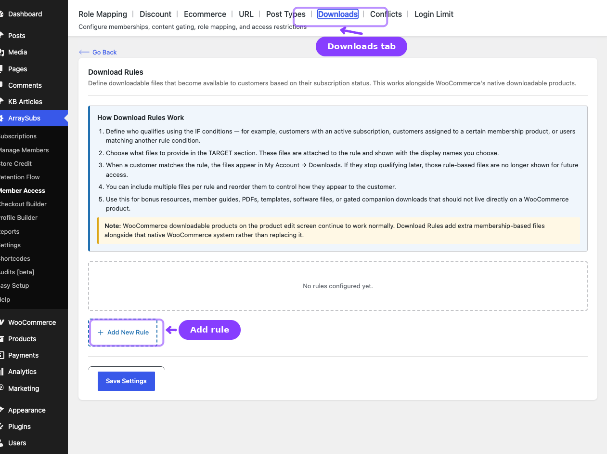
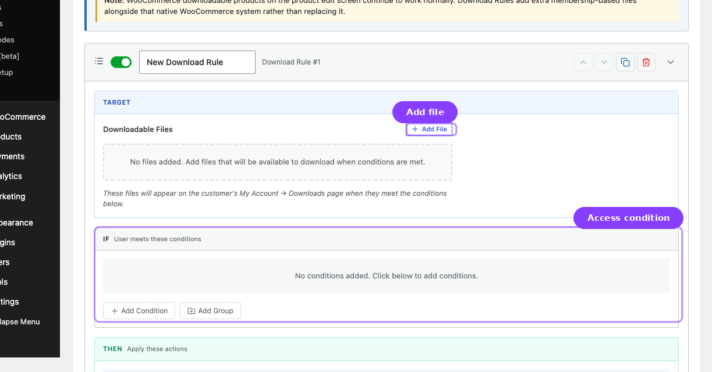

# Info
- Module: Downloads
- Last updated: 2026-10-30

# Downloads

> Provision gated downloadable files to qualifying customers through My Account.

## Page Navigation

- **Current guide:** Downloads
- **Where to open it:** WordPress Admin -> ArraySubs -> Member Access -> Downloads
- **Direct route:** `/wp-admin/admin.php?page=arraysubs-mainadmin#/members-access/downloads-rules`
- **Section overview:** [Member Access](./README.md)
- **Previous guide:** [Post Types](./post-types.md)
- **Next guide:** [Conflicts](./conflicts.md)
- **Troubleshooting:** [Audits, Logs, and Troubleshooting](../audits-and-logs/README.md)
- **Developer reference:** [Read Download Benefits](../developers/downloads.md)

## Overview

The **Downloads** tab provisions membership-gated files. Inside the plugin, the content heading is **Download Rules** and the tab label is **Downloads**.

Files from these rules appear on **My Account -> Downloads** alongside normal WooCommerce downloadable product files. Each rule can also limit how many times a customer downloads each file and how long each file stays available.

## How Download Rules Work

1. Add one or more files to the rule.
2. Optionally set a **Download limit** and a **Download expiry** for the rule's files.
3. Define who qualifies in the **IF** conditions.
4. Optionally delay availability with scheduling.
5. When the customer qualifies, the files appear in **My Account -> Downloads** with their remaining downloads and expiry date.
6. If the customer stops qualifying later, those rule-based files disappear for future access.

## Configuring a Download Rule

1. Go to **ArraySubs -> Member Access -> Downloads**.
2. Click **Add New Rule**.
3. In the **TARGET** section:
   - Click **Add File**
   - Enter a display name
   - Choose the file from the Media Library
   - Repeat as needed
4. Below the file list, optionally set **Download limit** and **Download expiry**. Leave both blank for unlimited downloads with no expiry.
5. Set the **IF conditions**.
6. Optionally enable scheduling.
7. Click **Save Settings**.

## Download Limit and Expiry

Both fields sit below the file list and apply to every file in the rule. ArraySubs tracks them separately for each file and each customer.

| Field | Values | What It Does |
|---|---|---|
| **Download limit** | Blank (Unlimited), `0`, or a whole number | How many times each customer can download each file in the rule. Blank means unlimited. `0` blocks downloads, so the files are not listed. |
| **Download expiry** | Blank or `0` (Never), or a whole number of days | How long each customer can download each file, counted in days from when the file first becomes available to them. Blank or `0` means no expiry. |

Saving fails with an error message if either field contains anything other than a blank or a whole number of zero or more.

- **Per file, per customer.** With a limit of `3`, a customer can download each file in the rule three times. Downloading one file never uses another file's allowance, and one customer's downloads never affect another customer.
- **When the expiry clock starts.** Expiry starts the first time the file becomes available to that customer, such as the first time it is listed on their **My Account -> Downloads** page, even if they do not download it then. It does not start at the subscription start date.
- **What counts as a download.** Each accepted download request counts once, including repeat downloads of the same file. Simultaneous requests cannot go over the limit.
- **What customers see.** The **Downloads remaining** column shows the remaining count (the unlimited symbol when there is no limit). The **Expires** column shows the expiry date in your site's timezone, or **Never**.
- **When access ends.** Once the limit is used up or the expiry date passes, the file leaves the customer's Downloads list and its link stops working for that customer.
- **Renewals and requalifying.** Renewals do not reset download counts or restart expiry. A customer who stops qualifying and later qualifies again keeps their earlier count and original expiry date.
- **Changing the values later.** New values also apply to downloads already counted. For example, raising the limit from `3` to `5` gives a customer who used all three downloads two more, and a longer expiry is counted from the original first-availability date.
- **Different allowances.** To give files different limits or expiry periods, put them in separate rules.

## File Management

| Action | How |
|---|---|
| Add a file | Click **Add File** |
| Reorder files | Drag the handle or use the arrow buttons |
| Replace a file | Reopen the picker for that file row. The row keeps its download counts and expiry. |
| Remove a file | Use the remove action on that row |
| Copy a protected link | After saving, click the copy icon beside the file. The link requires login, and downloads through it count toward the same limit. |

## Access Notes

- Downloads are served through signed or verified links rather than exposing the raw file location directly.
- Every download request checks login, the rule's conditions and schedule, and the file's download limit and expiry.
- Files stored on another domain, such as cloud storage used by a media offload plugin, are delivered by redirect. ArraySubs uses a WordPress safe redirect, so that domain must be in WordPress's allowed redirect hosts or the customer does not reach the file.
- Rule-based downloads coexist with WooCommerce product downloads.

## Related Guides

- [Shop Access](ecommerce.md) — Restrict products themselves instead of provisioning extra files.
- [Customer Portal Pages](../customer-portal/portal-pages.md) — Where customers see the Downloads area.
- [Read Download Benefits](../developers/downloads.md) - Read-only PHP reference for file eligibility, remaining downloads and expiry. Reading never records a download or starts the expiry clock.

## FAQ

### Are Download Rules the same as WooCommerce product downloads?
No. They are an additional membership-based layer that appears alongside native WooCommerce downloads.

### Can I drip-download files later in the subscription?
Yes. Use the schedule option on the rule.

### Do renewals reset download limits?
No. Download counts and expiry are tracked per file and per customer and continue across renewals. To give more access, raise the rule's **Download limit** or **Download expiry**.
