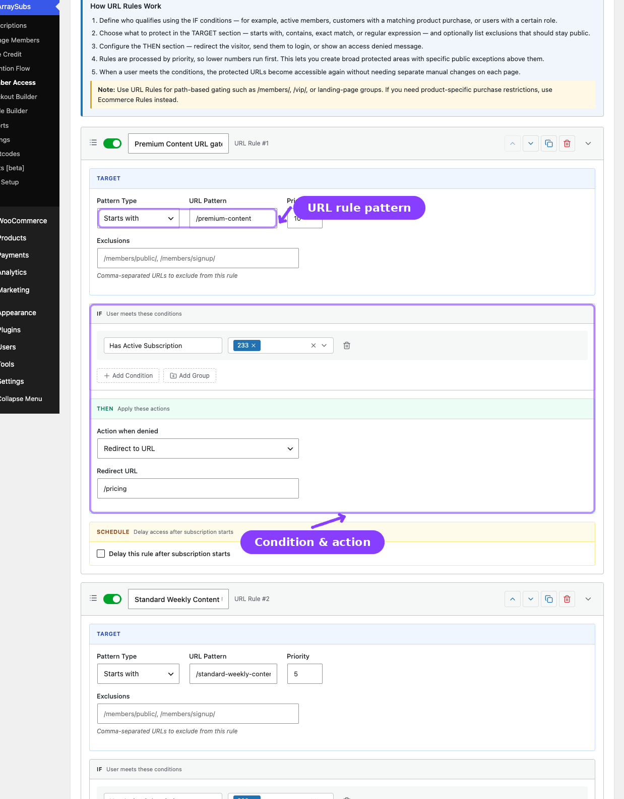
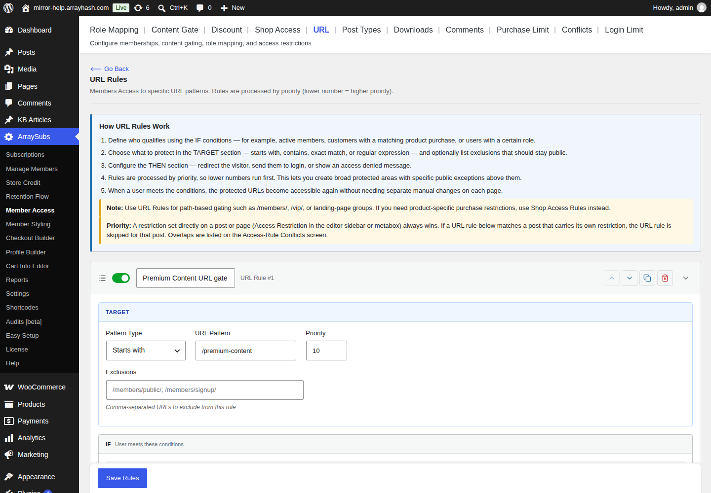

# Info
- Module: URL
- Availability: Free
- Last updated: 2026-10-18

# URL

> Protect frontend page paths and URL patterns with priority-based access rules.

**Availability:** Free

## Page Navigation

- **Current guide:** URL
- **Where to open it:** WordPress Admin -> ArraySubs -> Member Access -> URL
- **Direct route:** `/wp-admin/admin.php?page=arraysubs-mainadmin#/members-access/url-rules`
- **Section overview:** [Member Access](./README.md)
- **Previous guide:** [Shop Access](./ecommerce.md)
- **Next guide:** [Post Types](./post-types.md)
- **Troubleshooting:** [Audits, Logs, and Troubleshooting](../audits-and-logs/README.md)

## Overview

The **URL** tab protects paths and URL patterns across the frontend. Inside the plugin, the screen heading is **URL Rules** and the tab label is **URL**.

Use this tab for:
- `/members/` or `/vip/` sections
- Exact page-level URLs
- Pattern groups that should redirect or deny access
- Broad protected areas with public exceptions

## How URL Rules Work

1. Define who qualifies using **IF** conditions.
2. Choose how to match the path in the **TARGET** section.
3. Configure the denial behavior in the **THEN** section.
4. When several enabled rules match the same path, the rule with the highest number (the one lowest in the list) decides. Its conditions and schedule decide access.
5. If the visitor fails that rule, its **THEN** action runs. Move the rule you want to win lower in the list, then save.

Conditions are checked across all of the visitor's subscriptions and purchases, so different conditions in one rule can be met by different subscriptions. See [How Conditions Combine Across Subscriptions](README.md#how-conditions-combine-across-subscriptions).

## Pattern Types

| Pattern Type | Matches | Example |
|---|---|---|
| **Starts with** | The path begins with the pattern | `/members/` |
| **Contains** | The path contains the pattern anywhere | `premium` |
| **Exact match** | Only one exact path matches | `/members/secret-page` |
| **Regular expression** | A regex pattern is evaluated | `^/courses/level-[0-9]+$` |

## Configuring a URL Rule

1. Go to **ArraySubs -> Member Access -> URL**.
2. Click **Add New Rule**.
3. Configure the **TARGET** section:

| Field | What It Does |
|---|---|
| **Pattern Type** | Controls how the path is matched |
| **URL Pattern** | The path or regex to protect |
| **Rule order** | When several enabled rules match the same path, the highest-numbered rule (lowest in the list) decides |
| **Exclusions** | Paths that should stay public even if the pattern matches |

4. Set the **IF conditions**.
5. Set the **THEN** action:

| Action | What Happens |
|---|---|
| **Redirect to URL** | Sends the visitor to a chosen URL |
| **Show message** | Shows a denied-access message |
| **Show 403 forbidden** | Returns 403 |
| **Redirect to login** | Sends the visitor to the login page |

6. Optionally enable scheduling.
7. Click **Save Rules**.

## Practical Notes

- URL rules affect frontend paths, not wp-admin or REST requests.
- Query strings are not the main matching surface; the path is what matters.
- Use exclusions to carve out public pages from a broad protected path.
- If the protected resource is really WooCommerce product access, use [Shop Access](ecommerce.md) instead.

## Per-Post Restrictions Win

A restriction set directly on a post or page — the **Access Restriction** panel in the block editor sidebar, or the **ArraySubs Access Restriction** metabox in the classic editor — always beats the rules on this tab.

If a URL rule matches a post that carries its own restriction, the URL rule is skipped for that post, including its **THEN** action. Overlaps are listed on **Member Access -> Conflicts**.

## Check URL Access From Code

Developers can ask whether a member may open a URL without visiting it. The Member Access API returns the same decision these rules produce, including which rule decided and why, without redirecting, showing a message or changing the current user. See [Check Content Access](../developers/member-access.md).

- **User context** combines all of the member's subscriptions, like a real visit.
- **Subscription context** evaluates one subscription only. Use it when one subscription must meet every condition.

## Related Guides

- [Per-Post Access Restriction](per-post-access-restriction.md) — Gate one post or page from the editor; takes priority over these rules.
- [Post Types](post-types.md) — Restrict posts and pages by content type instead of raw URL pattern.
- [Conflicts](conflicts.md) — Review Members Access rules that overlap higher-priority per-post restrictions.
- [Access-Rule Conflicts](../audits-and-logs/access-rule-conflicts.md) — Deeper troubleshooting guide.
- [Check Content Access](../developers/member-access.md) - Check URL, post and other access decisions from PHP.

## FAQ

### Can I use regex?
Yes. Choose the regex pattern type and enter a standard expression.

### Do URL rules affect REST API endpoints?
No. They are designed for frontend path access, not wp-admin or REST API traffic.

### Which rule wins when two URL rules match the same path?
The enabled rule with the highest number, which is the one lowest in the list. Move the rule you want to win lower in the list, then save.
