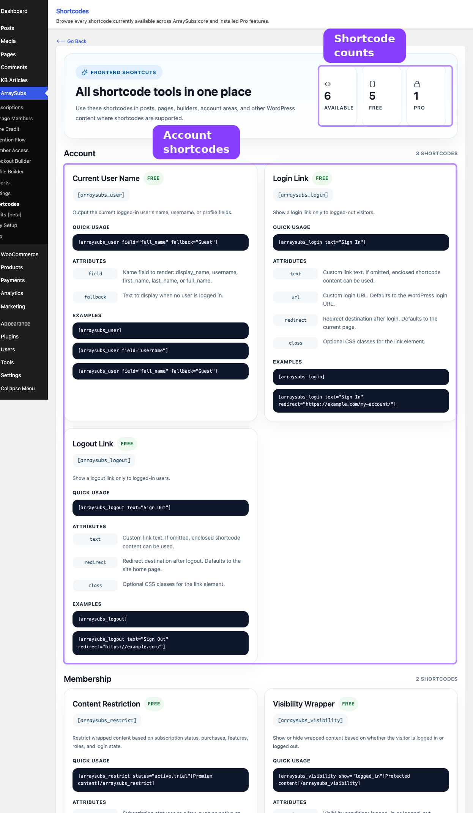

# Info
- Module: Content Gating Shortcodes
- Last updated: 2026-10-30

# Content Gating Shortcodes

> Control which visitors see specific page content using login state, subscription status, product ownership, user roles, spending thresholds, or feature entitlements.


## Page Navigation

- **Current guide:** Content Gating Shortcodes
- **Where to open it:** WordPress Admin -> ArraySubs -> Shortcodes
- **Section overview:** [Open overview](./README.md)
- **Previous guide:** [account-shortcodes](./account-shortcodes.md)
- **Next guide:** [store-credit-shortcode](./store-credit-shortcode.md)
- **Troubleshooting:** [Audits, Logs, and Troubleshooting](../audits-and-logs/README.md)

## Overview



Two shortcodes handle content gating on the frontend:

| Shortcode | Scope | Best For |
|-----------|-------|----------|
| `[arraysubs_visibility]` | Login state only | Simple show/hide based on whether the visitor is logged in or logged out |
| `[arraysubs_restrict]` | Subscriptions, products, roles, spending, features | Membership-level content locking with multi-condition logic |

Use `[arraysubs_visibility]` when you only need to check login state. Use `[arraysubs_restrict]` when you need subscription-aware, role-based, or spending-based access control.

## When to Use This

- You want to show a welcome message to logged-in users but a signup prompt to visitors.
- You want to lock premium tutorials, downloads, or resources behind an active subscription.
- You want to restrict content to customers who subscribe to a specific product or variation.
- You want to gate exclusive content behind a minimum lifetime spending threshold.
- You want to show different content based on WordPress user roles.
- You want to use Feature Manager entitlements to control who sees what.
- You want to show teaser content publicly while hiding the full version behind a paywall.

## Prerequisites

- ArraySubs installed and active.
- **Member Access** enabled (it is on by default). `[arraysubs_restrict]` is registered only while Member Access is enabled.
- For `feature` conditions: feature values saved on your subscription products. You add and edit them with ArraySubs Pro Feature Manager.
- Subscription products configured if using product-based conditions.

---

## `[arraysubs_visibility]` — Login-Based Content Wrapper

Shows or hides wrapped content based on the visitor's login state. This is a lightweight wrapper — for subscription or membership-based gating, use `[arraysubs_restrict]` instead.

### Attributes

| Attribute | Default | Description |
|-----------|---------|-------------|
| `show` | logged_in | When to display the wrapped content. Options: `logged_in` or `logged_out`. |
| `fallback` | *(empty)* | Content shown when the condition is not met. Supports nested shortcodes. |

### How It Works

1. The shortcode checks the visitor's login state against the `show` attribute.
2. If the condition matches, the wrapped content is processed and rendered (including any nested shortcodes).
3. If the condition does not match, the `fallback` content is rendered instead (if provided). Fallback content also supports nested shortcodes.
4. When there is no fallback and the condition does not match, nothing is rendered.

### Examples

Show content only to logged-in users:
```text
[arraysubs_visibility show="logged_in"]
  Welcome back! Manage your subscriptions from your account page.
[/arraysubs_visibility]
```

Show content only to logged-out visitors:
```text
[arraysubs_visibility show="logged_out"]
  Please log in to access your account.
[/arraysubs_visibility]
```

Logged-in greeting with a login link as fallback:
```text
[arraysubs_visibility show="logged_in" fallback="[arraysubs_login text='Log In']"]
  Welcome back, [arraysubs_user field="full_name"]!
[/arraysubs_visibility]
```

```box class="info-box"
The `show` condition is extensible. Developers can add custom conditions through the `arraysubs_visibility_shortcode_show` filter without changing the shortcode contract.
```

---

## `[arraysubs_restrict]` — Subscription-Based Content Gating

Gates wrapped content based on subscription status, product ownership, variation-specific access, user roles, lifetime spending, purchase history, or Feature Manager entitlements. This is the most powerful shortcode for membership-level content locking.

### Attributes

| Attribute | Default | Description |
|-----------|---------|-------------|
| `status` | *(empty)* | Required subscription status. Comma-separated, lowercase. Options: `active`, `trial`, `paused`, `on-hold`, `cancelled`, `expired`, `pending`. Passes when the visitor holds any subscription in one of the listed statuses. |
| `products` | *(empty)* | Subscription product IDs (comma-separated). Passes when the visitor holds a subscription to any one of these products. Use parent product IDs; put variation IDs in `variations`. |
| `variations` | *(empty)* | Subscription variation IDs (comma-separated). Passes when the visitor holds a subscription to any one of these variations. |
| `purchased` | *(empty)* | Product IDs (comma-separated). Passes when the visitor bought at least one of these products in a paid order (processing or completed), subscription or not. |
| `lifetime_spent` | *(empty)* | Minimum total spend across the visitor's paid orders. |
| `feature` | *(empty)* | Feature name to check, exactly as it is defined on the product. Feature values are set up with Pro Feature Manager. |
| `feature_min` | 1 | Value the feature is compared with. An empty or non-numeric value means 1. |
| `feature_op` | >= | Comparison operator for the feature value: `=`, `!=`, `>`, `<`, `>=`, `<=`. Any other value means `>=`. |
| `aggregation` | sum | How feature values from several plans are combined: `sum`, `max`, or `any`. Not case-sensitive; any other value means `sum`. |
| `roles` | *(empty)* | WordPress user roles (comma-separated). Passes when the visitor has at least one listed role. |
| `condition` | and | Logic for combining conditions: `and` (all must match) or `or` (any one is enough). Not case-sensitive (`AND`, `Or` and ` or ` all work); an empty or unknown value means `and`. |
| `message` | Default Message | Message shown to visitors who do not qualify. Overrides the **Default Message** set on **ArraySubs -> Settings -> Content Gate**. |
| `redirect` | *(empty)* | URL on your own site to send non-qualifying visitors to. When set, no message is shown on the frontend; the visitor is redirected instead. |
| `login_required` | false | Login-only override. When `true`, login is the only requirement: every logged-in visitor sees the content, guests see the denial message, and all other conditions (and `redirect`) are skipped. |
| `show_to_admins` | true | Whether users with the `manage_options` capability (administrators) always see the content. Any value other than `true` turns the bypass off. |

### How It Works

1. **Admin bypass.** If `show_to_admins` is `true` (the default) and the visitor has the `manage_options` capability, the content is shown immediately.
2. **Login-only override.** If `login_required` is `true`, a logged-in visitor sees the content and a guest sees the denial message. No other condition is checked, and `redirect` is not used.
3. **Condition building.** Each non-empty condition attribute (`status`, `products`, `variations`, `purchased`, `lifetime_spent`, `feature`, `roles`) creates one rule. Empty attributes are ignored.
4. **No conditions specified.** If every condition attribute is empty, the content is shown to every visitor, including guests.
5. **Evaluation.** The rules are combined with the `condition` logic (`and` or `or`). A guest fails every rule, so a guest is denied whenever at least one condition is set.
6. **Access granted.** The wrapped content is processed and rendered (including nested shortcodes).
7. **Access denied.** If `redirect` is set and the page is a normal frontend request, the visitor is redirected. Otherwise, the denial message is shown.

### Condition Logic

By default, the `condition` attribute is set to `and`, meaning **all specified conditions must be true** for the content to show. Change it to `or` to show content when **any one condition is true**. The value is not case-sensitive, and an empty or unknown value means `and`, so a typo denies access instead of granting it.

**AND example** — must have an active subscription AND subscribe to product 123:
```text
[arraysubs_restrict status="active" products="123" condition="and"]
  Content for members with an active subscription who also hold the Pro Plan.
[/arraysubs_restrict]
```

**OR example** — show to active subscribers OR administrators:
```text
[arraysubs_restrict status="active" roles="administrator" condition="or"]
  Available to active subscribers or site admins.
[/arraysubs_restrict]
```

#### Conditions Are Checked Across All Subscriptions

Each condition is checked against everything the visitor holds: all of their subscriptions and paid orders. Different conditions can be met by different subscriptions. In the AND example above, a member with an active subscription to another product and a trial subscription to product 123 passes both clauses.

A product list is already an any-match check: `products="123,456"` passes when the visitor holds either product, so `condition="or"` is not needed for a single list. Use `condition` to combine different attributes.

The `products` and `variations` checks count active and trial subscriptions, plus paused subscriptions when **Content Access** on **ArraySubs -> Settings -> Skip & Pause** is set to limited (view-only) or full access. An explicit `status="paused"` check matches paused subscriptions regardless of that setting.

When every clause must be met by one subscription, check access in PHP with the subscription-scoped Member Access API instead. See [Check Content Access](../developers/member-access.md).

### Denial Messages

When access is denied, the shortcode chooses a message in this priority order:

1. **Custom `message` attribute** - if provided on the shortcode, it is used.
2. **Default Message** - the message set on **ArraySubs -> Settings -> Content Gate**.
3. **Built-in message** - "This content is restricted. Please subscribe to access."

The login-only override (`login_required="true"`) uses the same order when it denies a guest. A denied block always shows a message: an empty `message` falls back to the Default Message.

The message is rendered inside a `<div>` with the class `arraysubs-restricted-content`. When the login-only override denies a guest, the additional class `arraysubs-login-required` is added. Basic formatting and links are kept.

```box class="warning-box"
The `{site_name}`, `{login_link}` and `{pricing_link}` placeholders are not replaced in shortcode denial messages. They appear exactly as typed, so do not use them in a shortcode `message` or in a Default Message that shortcodes display. Write the link or site name directly instead.
```

---

### Condition Types in Detail

#### Status Conditions

| Status | Description |
|--------|-------------|
| `active` | Currently active, paid subscription |
| `trial` | In free trial period |
| `paused` | Paused by the customer or an administrator |
| `on-hold` | Payment failed or manually put on hold |
| `cancelled` | Subscription was cancelled |
| `expired` | Subscription has expired |
| `pending` | Awaiting activation |

Multiple statuses can be combined:
```text
[arraysubs_restrict status="active,trial"]
  Content for active and trial subscribers.
[/arraysubs_restrict]
```

Write status names in lowercase. The check passes when any one of the visitor's subscriptions has a listed status; it does not look at which product that subscription is for.

#### Product and Variation Conditions

Check if the customer has a subscription for a specific product or variation. A list passes when the visitor holds any one of the listed items. `products` compares parent product IDs, so a variation ID in `products` never matches; use `variations` for variation IDs.

By product ID:
```text
[arraysubs_restrict products="123,456"]
  Content for Pro Plan or Business Plan subscribers.
[/arraysubs_restrict]
```

By variation ID (useful for variable subscription products):
```text
[arraysubs_restrict variations="789"]
  Thank you for choosing the Annual billing option!
[/arraysubs_restrict]
```

#### Purchased Product Condition

Check if the customer has purchased any product, not limited to subscriptions. This counts paid WooCommerce orders (processing or completed). A variable product ID also matches purchases of its variations:

```text
[arraysubs_restrict purchased="100,101"]
  Thank you for your purchase! Here are your bonus materials.
[/arraysubs_restrict]
```

#### Lifetime Spending Condition

Gate content behind a minimum lifetime spending amount. This checks the customer's total spend across paid orders, as WooCommerce reports it:

```text
[arraysubs_restrict lifetime_spent="500"]
  VIP content for customers who have spent $500 or more.
[/arraysubs_restrict]
```

#### Feature Entitlement Conditions

Check the feature values defined on the products a customer holds. You add and edit those features with Pro Feature Manager (**Product -> Features**). ArraySubs core evaluates this condition from the feature data saved on each product, so the condition is never ignored: if Pro or the Feature Manager module is later switched off, the saved values stay on the products and the condition keeps using them.

Use the feature name exactly as it is defined on the product, such as `seats`, not a label you made up or an ID.

**Which plans count.** ArraySubs collects every product or variation the visitor holds: subscriptions that grant view access (active and trial, plus paused when **Content Access** allows it) and products bought in paid orders. Each product or variation counts once, as one holding:

- A variation's own feature list replaces the parent product's defaults.
- A variation with an empty feature list inherits the parent product's features.
- Only enabled features count.

**How values are read.** On/off features count as 1 (Yes) or 0 (No), numeric features as their number, and Unlimited as unlimited. Text features are skipped by `sum` and `max`.

**Aggregation modes** control how values are combined when a customer has several holdings:

| Mode | Behavior | Example |
|------|----------|---------|
| `sum` (default) | Adds the values of all holdings. Unlimited on any holding makes the total unlimited. | Two different plans with 5 seats each = 10 seats |
| `max` | Uses the highest single value. Unlimited wins. | A 10 GB plan and a 50 GB plan = 50 GB |
| `any` | Passes when any holding has the feature switched on. Use it for on/off features. | Show content when any plan includes priority support |

A combined total of at least 5 seats:
```text
[arraysubs_restrict feature="seats" feature_min="5" aggregation="sum"]
  Content for teams with 5 or more seats across their plans.
[/arraysubs_restrict]
```

At least one plan with 10 GB or more:
```text
[arraysubs_restrict feature="storage_gb" feature_min="10" feature_op=">=" aggregation="max"]
  You have a plan with 10 GB or more of storage.
[/arraysubs_restrict]
```

Any plan with an on/off feature switched on:
```text
[arraysubs_restrict feature="priority_support" aggregation="any"]
  Contact the priority support team from this page.
[/arraysubs_restrict]
```

Keep these limits in mind:

- Under `sum`, two subscriptions to the same product or variation count once, and subscription quantity is not multiplied.
- Products bought in past paid orders keep counting after a subscription ends.
- The condition compares configured feature values. It does not read remaining usage, so it cannot express "5 unused seats".

#### Role Conditions

Gate content by WordPress user role:

```text
[arraysubs_restrict roles="member,premium_member"]
  Members-only content area.
[/arraysubs_restrict]
```

This checks if the logged-in user has at least one of the listed roles.

---

### Custom Messages and Redirects

Override the global restricted-content message:
```text
[arraysubs_restrict status="active" message="Subscribe to the Pro Plan to unlock this tutorial."]
  Premium tutorial content here.
[/arraysubs_restrict]
```

Redirect non-subscribers to a pricing page instead of showing a message:
```text
[arraysubs_restrict status="active" redirect="/pricing"]
  This content is only visible to subscribers.
[/arraysubs_restrict]
```

```box class="warning-box"
If both `message` and `redirect` are set, the redirect takes precedence on the frontend. The message is only used in admin and REST contexts where redirects are blocked, and when the login-only override (`login_required="true"`) denies a guest.
```

The redirect uses a WordPress safe redirect, so point it to a page on your own site. A destination on another host is replaced with the WordPress admin URL.

### Admin Visibility Control

By default, users with the `manage_options` capability (administrators) always see restricted content. To test the restriction as a non-subscriber:

```text
[arraysubs_restrict status="active" show_to_admins="false"]
  Content hidden even from admins unless they have an active subscription.
[/arraysubs_restrict]
```

Remove `show_to_admins="false"` after testing.

---

## Use the Shortcode in PHP Templates

Theme and plugin templates can run the same gate through `do_shortcode()`. Check that Member Access is enabled and that the shortcode is registered first: `do_shortcode()` leaves an unknown shortcode and its enclosed content unchanged, so without the check the protected HTML would be printed.

```php
<?php
if (
    ! function_exists( 'arraysubs_is_members_access_enabled' )
    || ! arraysubs_is_members_access_enabled()
    || ! shortcode_exists( 'arraysubs_restrict' )
) {
    return; // Withhold the protected output when the gate is unavailable.
}

echo do_shortcode(
    '[arraysubs_restrict status="active,trial" message="Please subscribe to view this resource."]'
    . wp_kses_post( '<p>Premium resource content.</p>' )
    . '[/arraysubs_restrict]'
);
```

Keep the shortcode attributes under your own control; never build them from visitor input. To check an explicit condition array or a post's saved restriction before rendering, follow [Gate Custom PHP Output](../developers/php-templates.md). To read an access decision for one subscription or for all of a member's subscriptions, see [Check Content Access](../developers/member-access.md).

---

## Shortcode vs. Post Type Rules

The `[arraysubs_restrict]` shortcode and the Member Access Post Type Rules both restrict content, but they serve different purposes:

| Feature | `[arraysubs_restrict]` Shortcode | Post Type Rules |
|---------|----------------------------------|-----------------|
| **Scope** | A specific portion of a page | An entire post, page, or CPT entry |
| **Configuration** | Inline in the content editor | Admin UI at **Member Access → Post Types** |
| **Archive behavior** | Not applicable — the page itself is accessible | Configurable (hide from archive, show with lock icon, show normally) |
| **Drip/schedule** | Not built-in — use Post Type Rules for drip content | Built-in schedule option with delay-based access |
| **Nesting** | Can be nested inside other shortcodes | N/A |
| **Ideal for** | Teaser pages with both free and premium sections on the same page | Full-page restrictions where the entire post should be locked |

Use shortcodes for inline gating on mixed-content pages. Use Post Type Rules for site-wide restrictions that apply to entire pages or post types.

---

## Real-Life Use Cases

### Use Case 1: Teaser Content With Upgrade Prompt

Show a preview of premium content publicly, with the full content locked behind a subscription:

```text
Here's what you'll learn in this guide:

1. Setting up your development environment
2. Building your first API integration
3. Advanced error handling patterns

[arraysubs_restrict status="active" products="55"]
  ## Full Tutorial

  Welcome to the complete tutorial...
  (Full tutorial content here)
[/arraysubs_restrict]
```

Non-subscribers see the teaser list and the default restricted message. Active subscribers of product 55 see the full tutorial.

### Use Case 2: Role-Based Staff Resources

Show internal resources only to users with a custom staff role:

```text
[arraysubs_restrict roles="staff,administrator"]
  ## Staff Resources

  - Internal playbook: [link]
  - Shift calendar: [link]
  - Support escalation guide: [link]
[/arraysubs_restrict]
```

### Use Case 3: Tiered Feature Access

Use Feature Manager entitlements to show a section only on higher plan tiers, with an upgrade prompt for everyone else:

```text
[arraysubs_restrict feature="api_calls" feature_min="100" feature_op=">=" aggregation="max" message="Upgrade to a plan with 100 or more API calls to view this section."]
  Your API documentation and keys are available in the developer portal.
[/arraysubs_restrict]
```

Members with a plan that includes 100 or more API calls see the documentation. Everyone else, including guests, sees the upgrade message. Because a denied block always shows its message, use one block with an upgrade `message` rather than a second block with the opposite comparison.

### Use Case 4: VIP Content by Spending

Unlock exclusive content for high-value customers:

```text
[arraysubs_restrict lifetime_spent="1000" message="This exclusive content is available to customers who have spent $1,000 or more."]
  ## VIP Resources

  Thank you for being a top customer! Here are your exclusive resources...
[/arraysubs_restrict]
```

### Use Case 5: Mixed Login and Subscription Gating

Combine `[arraysubs_visibility]` and `[arraysubs_restrict]` for layered content:

```text
[arraysubs_visibility show="logged_out"]
  Please log in to see if you qualify for premium content.
  [arraysubs_login text="Log In"]
[/arraysubs_visibility]

[arraysubs_visibility show="logged_in"]
  [arraysubs_restrict status="active" message="Subscribe to unlock this content."]
    ## Premium Content

    Here is the exclusive article...
  [/arraysubs_restrict]
[/arraysubs_visibility]
```

Visitors see a login prompt. Logged-in non-subscribers see the subscribe message. Active subscribers see the premium content.

### Use Case 6: Combined Conditions With OR Logic

Show a section to anyone who is either an active subscriber OR has purchased a specific one-time product:

```text
[arraysubs_restrict status="active" purchased="200" condition="or"]
  You have access because you're a subscriber or you purchased the Lifetime Access product.
[/arraysubs_restrict]
```

---

## Edge Cases and Important Notes

- **Empty conditions.** If no condition attributes are specified on `[arraysubs_restrict]`, every visitor sees the content, including guests. Always add at least one condition for meaningful restriction.
- **Guests.** `login_required` defaults to `false`. A guest fails every condition, so any shortcode with at least one condition denies guests. Set `login_required="true"` only when logging in should be the whole requirement; it skips every other condition.
- **Multiple conditions.** When using `condition="and"`, leave irrelevant attributes empty. Empty attributes are ignored; only attributes with values become active conditions. Conditions are checked across all of the visitor's subscriptions, so different clauses can be met by different subscriptions.
- **Caching.** Pages with content gating shortcodes show user-specific results. If your site uses full-page caching, these pages may display incorrect content. Exclude them from cache or use fragment caching.
- **Feature conditions use saved product data.** Core evaluates the `feature`, `feature_min`, `feature_op`, and `aggregation` attributes from the feature values saved on your products. You manage those values with Pro Feature Manager; the condition keeps reading the saved values when Pro or the module is switched off.
- **Placeholders are not replaced.** `{site_name}`, `{login_link}` and `{pricing_link}` show as plain text in shortcode denial messages.
- **Redirect behavior.** Redirects only happen on the frontend. In admin previews or REST API contexts, the redirect is skipped and the denial message is shown instead.
- **Nesting shortcodes.** You can nest `[arraysubs_visibility]` inside `[arraysubs_restrict]` and vice versa. Inner shortcodes are processed via `do_shortcode()` when the outer condition passes.

---

## Troubleshooting

| Problem | Likely Cause | What to Do |
|---------|-------------|------------|
| `[arraysubs_restrict]` shows content to everyone | `show_to_admins` is `true` and you're logged in as admin, no conditions are specified (guests pass too), or `login_required="true"` turned the gate into a login-only check | Set `show_to_admins="false"` for testing, add at least one condition like `status="active"`, and remove `login_required="true"` when other conditions must apply |
| Content shows the wrong restricted message | The Default Message is generic, or no `message` attribute is set | Set a custom `message` attribute on the shortcode, or update the **Default Message** on **ArraySubs -> Settings -> Content Gate** |
| `{login_link}` or another placeholder shows as plain text | Shortcode denial messages do not replace placeholders | Write the link or text directly in the `message` attribute |
| Feature conditions never pass | The `feature` value does not match the feature name on the product, the feature is disabled, no product has it saved, or the visitor holds no qualifying plan | Copy the exact feature name from **Product -> Features**, enable the feature, and test with a member who holds that plan |
| Redirect doesn't work in the editor preview | Redirects only fire on the frontend | View the page normally (logged out or as a test user) to see the redirect |
| Redirect lands on the WordPress admin URL | The destination is on another host | Use a page on your own site as the `redirect` destination |
| Shortcode appears as plain text | Plugin is inactive, Member Access is disabled, or there's a typo | Verify ArraySubs is active and Member Access is enabled, and check the shortcode tag spelling |

---

## Related Guides

- [Account Shortcodes](account-shortcodes.md) — `[arraysubs_login]`, `[arraysubs_logout]`, `[arraysubs_user]`
- [Store Credit Shortcode](store-credit-shortcode.md) — `[arraysubs_buy_credits]`
- [Content Gate](../member-access/content-gate.md) — The Member Access tab that maps shortcode, Elementor, Gutenberg, and PHP gating.
- [Post Types](../member-access/post-types.md) — Full-page restrictions for posts, pages, and custom post types
- [URL](../member-access/url.md) — Path-based restrictions for entire protected sections
- [Per-Post Access Restriction](../member-access/per-post-access-restriction.md) - Whole-page restrictions set in the post editor
- [Gate Custom PHP Output](../developers/php-templates.md) - Use this shortcode, a condition array or a post's saved rules in PHP templates
- [Check Content Access](../developers/member-access.md) - Read user-wide or single-subscription access decisions from PHP

---

## FAQ

### What's the difference between `[arraysubs_visibility]` and `[arraysubs_restrict]`?
`[arraysubs_visibility]` checks **login state only** (logged in vs logged out). `[arraysubs_restrict]` checks **subscription status, products, roles, spending, features, and more**. Use visibility for simple show/hide. Use restrict for membership-level access control.

### Can I combine `[arraysubs_visibility]` and `[arraysubs_restrict]`?
Yes. They can be nested. Use `[arraysubs_visibility]` for the outer login check and `[arraysubs_restrict]` for the inner subscription check:

```text
[arraysubs_visibility show="logged_in"]
  [arraysubs_restrict status="active"]
    Active subscriber content.
  [/arraysubs_restrict]
[/arraysubs_visibility]
```

### Can I restrict only part of a page?
Yes. Wrap only the restricted section in `[arraysubs_restrict]`. Everything outside the shortcode is visible to all visitors.

### How do I test restriction rules as an admin?
Add `show_to_admins="false"` to the shortcode while testing. This forces the system to evaluate conditions even for administrators. Remove it after testing.

### Can I use `[arraysubs_restrict]` without any status condition?
Yes. You can use it with only `products`, `roles`, `lifetime_spent`, `purchased`, `feature`, or any combination. If no conditions are specified at all, every visitor sees the content, including guests.

### Does `login_required="true"` add a login check to my other conditions?
No. It replaces them. With `login_required="true"`, any logged-in visitor sees the content and the other conditions are skipped. To require login plus a subscription, leave `login_required` at its default and add a condition such as `status="active"`; guests fail every condition.

### Do feature conditions stop working without Pro?
No. Core evaluates them from the feature values saved on your products. Pro Feature Manager is where you add and edit those values.

### How do I use `[arraysubs_restrict]` in a PHP template?
Call it through `do_shortcode()` after checking that Member Access is enabled and the shortcode is registered, as shown in [Use the Shortcode in PHP Templates](#use-the-shortcode-in-php-templates). For helper-based gates, see [Gate Custom PHP Output](../developers/php-templates.md).

### Is restricted content hidden from the page source?
Yes. When a visitor does not meet the conditions, the server omits the content entirely. It is never rendered in the HTML — it is not just hidden with CSS.

### Does `[arraysubs_restrict]` work with the WooCommerce Block Editor (Store API)?
The shortcode renders server-side and works anywhere WordPress processes shortcodes. It does not directly interact with the WooCommerce Store API, but it works on any page rendered by WordPress.
