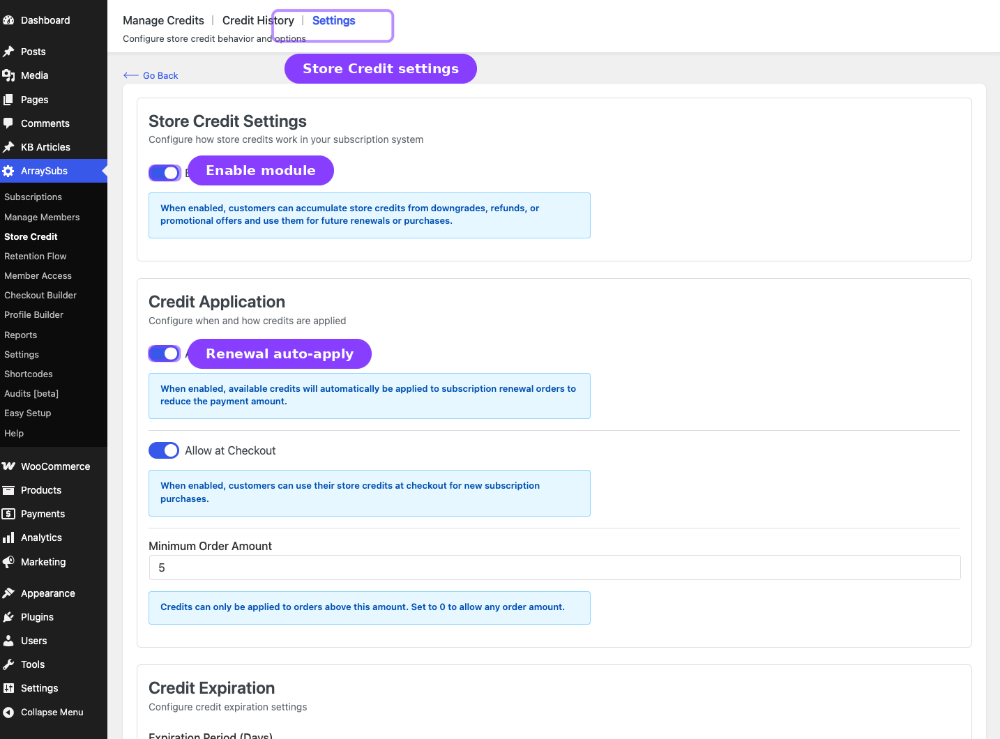
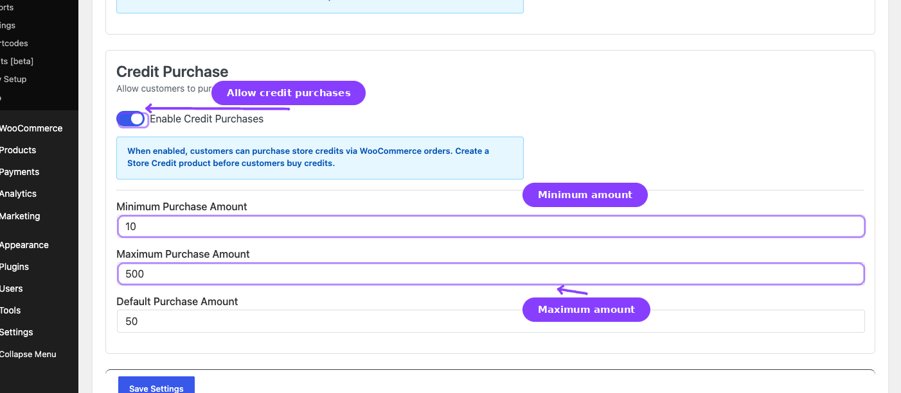

# Info
- Module: Store Credit Settings
- Last updated: 2026-10-30

# Store Credit Settings

> Control how store credit behaves in your store — toggle the system on or off, configure automatic application rules, set expiration periods, and manage credit purchase limits.


## Page Navigation

- **Current guide:** Store Credit Settings
- **Where to open it:** WordPress Admin → ArraySubs → Store Credit → Settings
- **Direct route:** `/wp-admin/admin.php?page=arraysubs-mainadmin#/store-credit/settings`
- **Section overview:** [Open overview](./README.md)
- **Previous guide:** [store-credit-management](./store-credit-management.md)
- **Next guide:** [Coupons](../coupons/README.md)
- **Troubleshooting:** [Audits, Logs, and Troubleshooting](../audits-and-logs/README.md)

## Overview

The Store Credit Settings page is the central control panel for every aspect of the credit system. From here you decide whether credit is active, how it is consumed, when it expires, and whether customers can buy it directly.

Settings are organized into three sections: Credit Application, Credit Expiration, and Credit Purchase. The Store Credit system itself is switched on or off with the **Store Credit** module on **ArraySubs -> Modules** (see [General Settings](#general-settings)).

## When to Use This

- You are setting up Store Credit for the first time.
- You want to change whether credit auto-applies to renewals.
- You want to start offering credit purchases to customers.
- You need to set or adjust the expiration policy.
- You want to allow or disallow credit usage at checkout.

## Prerequisites

- ArraySubs Pro active
- The **Store Credit** module switched on in **ArraySubs -> Modules**
- Admin or Shop Manager access

## Steps

1. Go to **ArraySubs → Store Credit → Settings**.
2. Configure the settings described below.
3. Click **Save Settings**.

## Settings Reference



### General Settings

| Setting | Type | Default | What it controls |
|---------|------|---------|-----------------|
| **Store Credit** module (on **ArraySubs -> Modules**, not on this page) | Module switch | On | Master switch for the entire Store Credit feature. When off, credit is not applied or spent, the customer portal page and the admin credit pages are unavailable, credit expiry pauses, and new manual or developer adjustments are refused. Balances and history are kept, and developers can still read them. |

```box class="warning-box"
Disabling Store Credit does not delete existing balances or transaction logs. It only hides the feature from the UI and stops all automated processing. Expiry clocks pause while it is off and resume, shifted by the time it was off, when you switch it back on. Re-enabling it restores everything.
```

### Credit Application

These settings control how and when credit is consumed.

| Setting | Type | Default | What it controls |
|---------|------|---------|-----------------|
| **Auto-Apply to Renewals** | Toggle | On | When enabled, available credit is applied to subscription renewal invoices: the subscription's own credit first, then the customer's credit. When it is off, no credit of either kind is applied to renewals. |
| **Allow at Checkout** | Toggle | Off | When enabled, credit is automatically applied to new subscription purchases at checkout. Only applies to orders that contain subscription products. |
| **Minimum Order Amount** | Number | 0 | Credit can only be applied to orders above this amount. Set to `0` to allow credit on any order regardless of total. Accepts decimal values (e.g., `25.00`). |

```box class="info-box"
**Auto-Apply to Renewals** is the most impactful setting here. When it is on, customers with credit never need to take action — their credit silently reduces each renewal total. When it is off, no credit is applied to renewals at all: customer credit accumulates and is only spent at checkout when **Allow at Checkout** is enabled for new purchases, and subscription credit from plan switches waits until you turn the toggle back on.
```

**How the minimum order amount works:** If you set this to `$50.00` and a renewal invoice is `$35.00`, credit will **not** be applied to that invoice. The full $35.00 is charged through the normal payment method. This prevents credit from being consumed on small recurring charges where you prefer full payment.

**Which credit pays a renewal:**

| Credit | Applied to renewal invoices when |
|--------|----------------------------------|
| Subscription credit (from plan switches) | When **Auto-Apply to Renewals** is on, to that subscription's own renewals and before any customer credit |
| Customer credit | When **Auto-Apply to Renewals** is on, after the subscription's own credit |

### Credit Expiration

| Setting | Type | Default | What it controls |
|---------|------|---------|-----------------|
| **Expiration Period (Days)** | Number | 0 | How many days after a credit is issued before it expires. Set to `0` for credits that never expire. |

When expiration is active:

- Each new credit transaction is stamped with an expiration date calculated as `issue date + expiration days`.
- A background job runs **daily at 3:00 AM** (server time) to process expired credits.
- **7 days before** a credit expires, the customer receives a **Credit Expiring** email notification (if enabled).
- When a credit expires, only the part of it that has not been spent is deducted from the balance, and the customer receives a **Credit Expired** email notification (if enabled).
- Expired credits appear in the Credit History with an "Expired" source label.

```box class="info-box"
The expiration period applies only to **new credits** issued after the setting is configured. Existing credits that were added before the expiration setting was enabled do not retroactively receive an expiration date.
```

**Common expiration values:**

| Days | Meaning |
|------|---------|
| `0` | Credits never expire (default) |
| `30` | Credits expire after 1 month |
| `90` | Credits expire after 3 months |
| `180` | Credits expire after 6 months |
| `365` | Credits expire after 1 year |

### Credit Purchase



These settings control whether customers can buy store credit directly.

| Setting | Type | Default | What it controls |
|---------|------|---------|-----------------|
| **Enable Credit Purchases** | Toggle | Off | When enabled, customers can purchase store credit through a dedicated WooCommerce product type. |
| **Minimum Purchase Amount** | Number | 10 | The lowest credit amount a customer can buy in a single transaction. |
| **Maximum Purchase Amount** | Number | 500 | The highest credit amount a customer can buy in a single transaction. |
| **Default Purchase Amount** | Number | 50 | The pre-filled amount shown on custom-amount credit products. |

```box class="info-box"
Enabling credit purchases here is only the first step. You also need to create a **Store Credit product** in WooCommerce. See [Purchase Product](purchase-product.md) for the complete setup guide.
```

The min/max/default amounts apply to **custom-amount** credit products (where the customer enters their own amount). Fixed-amount credit products ignore these limits and always grant the configured fixed value.

## What Happens After Saving

- Changes take effect immediately for all future credit operations.
- **Enabling Auto-Apply to Renewals** means the next renewal invoice processed will also apply available customer credit, after the subscription's own credit.
- **Enabling Allow at Checkout** means the next checkout that includes a subscription product will check for credit.
- **Changing the expiration period** only affects credits issued after the change. Previously issued credits keep their original expiration date (or lack of one).
- **Enabling Credit Purchases** makes the Store Credit product type available in WooCommerce but does not create a product. You need to create one manually.

## Real-Life Use Cases

### Use Case 1: Simple Renewal Credit System

You want credit from refunds and downgrades to automatically pay down future renewals — nothing more.

| Setting | Value |
|---------|-------|
| Enable Store Credit System | On |
| Auto-Apply to Renewals | On |
| Allow at Checkout | Off |
| Expiration Period | 0 (never) |
| Enable Credit Purchases | Off |

This is the default configuration. Credit accumulates passively and silently reduces renewal costs.

### Use Case 2: Time-Limited Promotional Credit

You plan to grant $20 promotional credit to new subscribers and want it to expire after 90 days to create urgency.

| Setting | Value |
|---------|-------|
| Expiration Period | 90 |
| Auto-Apply to Renewals | On |

New promotional credits will automatically expire after 90 days. Customers receive a warning email 7 days before expiration, giving them time to use or spend their credit.

### Use Case 3: Customer Self-Service Credit Store

You want customers to buy credit upfront at a bonus rate and spend it over time on renewals and new subscriptions.

| Setting | Value |
|---------|-------|
| Enable Credit Purchases | On |
| Allow at Checkout | On |
| Min Purchase Amount | 25 |
| Max Purchase Amount | 500 |
| Default Purchase Amount | 100 |
| Auto-Apply to Renewals | On |

Then create a Store Credit product with a bonus percentage (see [Purchase Product](purchase-product.md)).

## Edge Cases and Important Notes

- **Auto-apply never exceeds the available balance.** If a customer has $20 in credit and a renewal is $50, only $20 is applied. The remaining $30 is charged normally.
- **Credit applied as a negative fee.** On the WooCommerce order, credit appears as a fee line item with a negative value. This keeps the original order total intact for reporting.
- **Minimum order amount affects both renewals and checkout.** If set to $50, neither a $30 renewal nor a $30 checkout order will have credit applied.
- **Expiration job timing.** The daily expiration batch runs at 3:00 AM server time. Credits that expire mid-day are not processed until the next batch run.
- **Subscription credit vs. customer credit.** **Auto-Apply to Renewals** controls both kinds of credit on renewals: when it is on, the subscription's own credit (from plan switches) is applied first, then customer credit. **Allow at Checkout** controls customer credit at checkout.
- **Plan-switch credit is a ledger entry.** When a plan switch leaves unused value, the excess is added to the subscription's credit as a permanent ledger entry (source **Plan Downgrade**). The customer gets one **Credit Added** email, and the expiration period counts from the moment the credit is created. Without Store Credit active, such a switch is applied at the next renewal instead and no credit is created.

## Troubleshooting

| Problem | Likely Cause | What to Do |
|---------|-------------|------------|
| Credit is not applied to renewals | Auto-Apply to Renewals is off, the Store Credit module is off, or the order total is below the minimum order amount | Enable the toggle, confirm the module is on in **ArraySubs -> Modules**, and check the minimum order amount |
| Credit is not applied at checkout | Allow at Checkout is off, or the cart does not contain a subscription product | Enable the toggle and verify the cart contents |
| No expiration emails sent | Expiration days is set to 0, or the email is disabled in WooCommerce settings | Set an expiration period and enable the Credit Expiring email in **WooCommerce → Settings → Emails** |
| Credit purchase products not visible | Enable Credit Purchases is off, or no Store Credit product has been created | Enable the toggle and create a product (see [Purchase Product](purchase-product.md)) |
| Settings do not seem to take effect | Browser cache showing stale page | Hard-refresh the admin page and verify the save was successful |

---

## Related Guides

- [Store Credit Overview](README.md) — How the entire Store Credit system works.
- [Purchase Product](purchase-product.md) — Create a WooCommerce product for selling credit.
- [Emails](emails.md) — Configure the four credit email notifications.
- [Refund to Credit](refund-to-credit.md) — Process refunds as store credit.
- [Read and Update Store Credit](../developers/store-credit.md) - Developer reference for balances, expiring credit, and ledger-backed adjustments.

---

## FAQ

### If I disable Store Credit, do customers lose their balances?
No. Disabling the system hides the feature from the UI and stops automated processing, but all balances and transaction logs are preserved. Re-enabling the system restores everything.

### Can I set different expiration periods for different credit sources?
No. The expiration period is a single global value that applies to all new credits regardless of source. You cannot set a different expiration for refund credits vs. promotional credits.

### Does the minimum order amount apply before or after credit is calculated?
Before. The system checks if the order total (before credit) exceeds the minimum. If it does, credit is applied. If not, the order processes without credit.

### What happens if I change the expiration period?
Only new credits receive the new expiration date. Existing credits keep their original expiration date. Credits that were issued with no expiration (when the setting was 0) will not retroactively gain an expiration date.

### Is subscription credit used when Auto-Apply to Renewals is off?
No. With **Auto-Apply to Renewals** off, renewal invoices get no credit, including subscription credit from a plan switch. The credit stays on the subscription and is applied to the next renewal invoice created after you turn the toggle back on.
