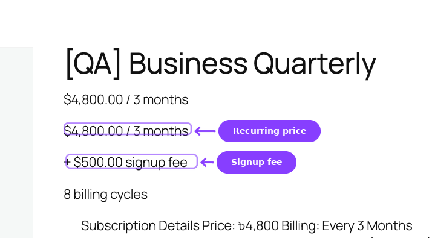
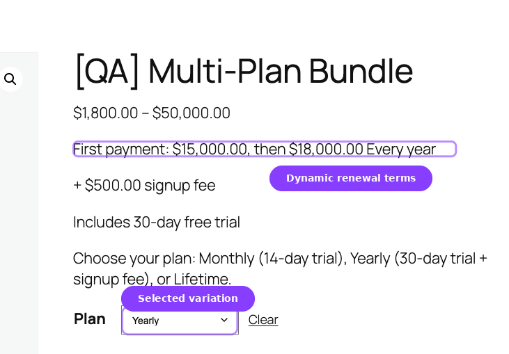
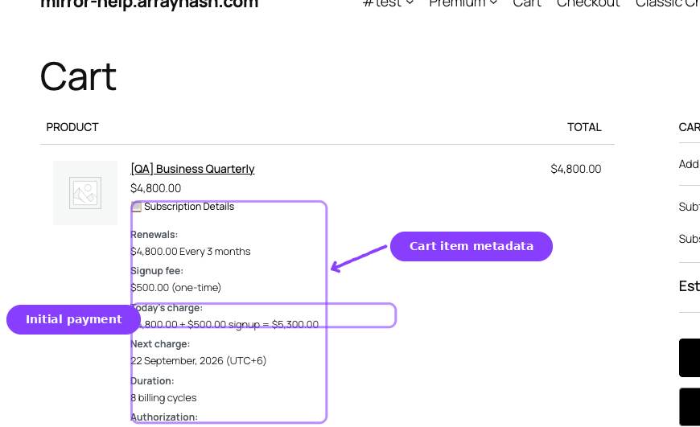
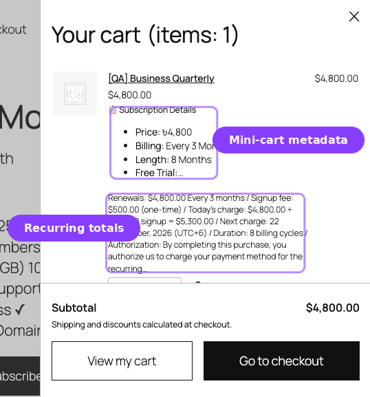
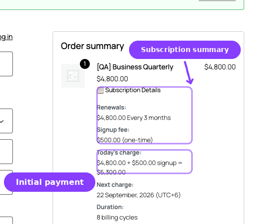
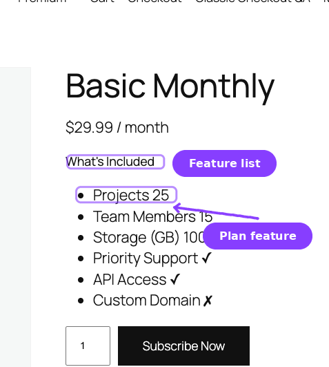

# Info
- Module: Subscription Products / Product Experience
- Availability: Shared (standard pricing display: Free; different renewal pricing, redirect/features/shipping: Pro)
- Last updated: 2026-10-26

# Product Experience and Display

> How subscription pricing, billing details, and entitlements appear across your store — from the product page to the order confirmation.

**Availability:** Free (standard pricing display), Pro (Different Renewal Price, Redirect Product Page, Feature Manager, Subscription Shipping)

## Page Navigation

- **Current guide:** Product Experience and Display
- **Where to open it:** WordPress Admin -> Products -> Add/Edit Product
- **Section overview:** [Open overview](./README.md)
- **Previous guide:** [plan-switching-and-relationships](./plan-switching-and-relationships.md)
- **Next guide:** [product-lifecycle](./product-lifecycle.md)
- **Troubleshooting:** [Audits, Logs, and Troubleshooting](../audits-and-logs/README.md)

## Overview

ArraySubs automatically extends WooCommerce's product display to show subscription-specific information wherever products appear. Customers see the recurring price, billing schedule, trial details, signup fees, and different renewal pricing on the product page, in the cart, at checkout, in the mini-cart, and on order confirmation screens.

This guide focuses on the shared storefront and checkout display behavior. The product-level Pro modules now have their own dedicated guides: [Redirect Product Page](../redirect-product-page/README.md), [Subscription Shipping](../subscription-shipping/README.md), and [Feature Manager](../feature-manager/README.md).

---

## Frontend Pricing Display

### Product Page

On the single product page, subscription information appears below the product title (or below the variation selector for variable products). The display includes:

| Element | When shown | Example |
|---|---|---|
| Recurring price + billing schedule | Always | **$29.99 / month** |
| Sale pricing | When product is on sale | **$19.99 / month** (was $29.99) |
| Different renewal price (Pro) | When enabled with active ArraySubsPro and an active license | **$19.99 / month for the first 3 payments, then $29.99 / month** |
| Signup fee | When fee > 0 | **+ $9.99 signup fee** |
| Trial info | When trial length > 0 | **14-day free trial** |
| Subscription length | When length > 0 | **5 billing cycles** |

A plan without a fixed length shows no length text.



For **variable products**, the subscription info area starts empty. When the customer selects a variation, the billing details populate dynamically via JavaScript with the selected variation's pricing and schedule.



### Cart



In the cart, subscription information is integrated into the standard WooCommerce cart display:

| Location | What changes |
|---|---|
| Price, Subtotal, and Quantity columns | Show only the amounts WooCommerce calculates. The line's price is what checkout charges today, for example $0.00 during a free trial |
| Item name | The product name as WooCommerce shows it, with no billing schedule badge |
| Item metadata | Short subscription rows under the product name, one per fact: **Free trial**, **After trial** or **Renewals**, **First charge** or **Next charge**, and **Duration** for fixed-length plans |
| Fees section | Signup fee appears as a separate fee line labeled "Subscription Signup Fee" |

See [Subscription Details at Checkout](../checkout-and-payments/subscription-checkout.md#subscription-details-at-checkout) for every row and when it appears.

```box class="info-box"
The signup fee is not part of the product price. It is added as a WooCommerce cart fee, which means it appears in the fees section of the cart totals — not in the line item price.
```

### Mini-Cart



The WooCommerce mini-cart (widget cart) lists the same subscription rows under the product name, and leaves the quantity and price as WooCommerce shows them. Each subscription item receives the CSS class `arraysubs-mini-cart-item` for styling purposes.

Below the subtotal, the classic mini-cart lists each signup fee in the cart on its own row (Subscription Signup Fee, Box Signup Fee, and Bundle Signup Fee with ArraySubs Pro), followed by a **Due Today** row with the cart total. Signup fee rows follow your cart tax display setting, just like the fee rows in the cart and at checkout: with tax when the cart shows prices including tax, without tax otherwise. When the cart shows prices excluding tax, Due Today still includes tax and says so, for example "$30.23 (incl. VAT)". Due Today is the amount checkout charges, so coupons and shipping are already counted in it even though the mini-cart does not list them.

When the mini-cart refreshes in the background, for example after a shopper adds a product from a shop page, ArraySubs prices the cart first. Each subscription line then shows what checkout charges today: $0.00 during a free trial, the prorated first charge when renewals are synced, the plan-change amount when checkout replaces the customer's current plan, the box total for a subscription box, or the chosen amount for a custom store credit purchase (ArraySubs Pro).

### Checkout



At checkout, the order review table shows the same subscription rows under each subscription line as the cart, and its amount columns hold only amounts. Classic checkout adds one recurring-payment authorization notice below the order total when the cart holds a subscription that renews.

### Order Confirmation

After checkout, the order confirmation (thank you) page includes a **Related Subscriptions** table showing all subscriptions created from that order:

| Column | Content |
|---|---|
| Subscription ID | Clickable link to the customer portal subscription detail page |
| Status | Status badge (e.g., Active, Trial) |
| Next payment | Date of the next scheduled renewal |
| Total | Recurring amount with billing schedule |

### Order Item Display

On WooCommerce order pages (admin and customer-facing) and in order emails, the billing schedule follows the item name in parentheses (e.g., "Monthly Membership (Every month)") where nothing else on that screen shows it. It is left off:

- On the order confirmation page and the My Account order view, which list the order's subscriptions with their schedules below the items.
- On purchase lines whose free trial changes to another plan when it ends, because the plan bought never renews on its own schedule.
- In order emails when ArraySubs Pro's [Cart Info Editor](../cart-info-editor/README.md) shows the line's subscription rows.

---

## Dedicated Product Modules

Product-level Pro controls are documented as their own modules:

| Module | Availability | Use It For |
|---|---|---|
| [Redirect Product Page](../redirect-product-page/README.md) | Pro | Redirect direct product URLs to sales pages or return 404 responses |
| [Subscription Shipping](../subscription-shipping/README.md) | Pro | Charge physical-product shipping once or on every renewal |
| [Feature Manager](../feature-manager/README.md) | Pro | Define feature entitlements and display "What's Included" content |

---

## Feature Manager *(Pro)*

```box class="info-box"
This feature requires ArraySubs Pro.
```

Feature Manager lets you define product entitlements — named features with specific values that customers receive when they subscribe. Features are displayed in the customer's My Account area and can be used to communicate what each plan includes.

### Product Configuration

![Feature Manager [AS] product data tab — Edit Features button and configured entitlements table](product-experience.ASSETS/07-feature-manager-product-configuration-annotated.png)

For simple products, Feature Manager appears as a separate **Feature Manager [AS]** tab in the WooCommerce product data panel. It sits before **Product Redirect [AS]** and **Advanced**. For variable products, the fields appear in a **Feature Manager** section inside each variation.

Inside the tab, you define features using a React-based interface. Each feature has:

| Property | Description |
|---|---|
| **Name** | The feature's display name (e.g., "Storage Space", "API Calls", "Priority Support") |
| **Type** | `toggle` (Yes/No), `number` (numeric value or "Unlimited"), or `text` (free text) |
| **Value** | The entitlement value for this product (e.g., "Yes", "100", "Unlimited", "Custom domain included") |
| **Enabled** | Whether this feature is active on the product |
| **Order** | Display order (drag to reorder) |

You can add multiple features to a single product or variation. Features can also be saved as **templates** for reuse across products.

### Feature Types

| Type | Input | Customer Display |
|---|---|---|
| Toggle | Yes / No | ✓ or ✗ |
| Number | Numeric value (supports "Unlimited") | The number or "Unlimited" |
| Text | Free text | The text value |

### Customer Portal Display

Customers see their entitled features in the **My Features** page in My Account. The display supports two aggregation modes:

- **Per subscription:** Separate feature table for each active subscription.
- **Combined:** All features merged across subscriptions into a single table.

Each feature shows the feature name, type, entitlement value, and optionally the usage (used / limit).

### Storefront Display



When enabled in the Feature Manager settings, a "What's Included" section appears on the product page listing the product's enabled features. This displays as a styled feature list with type-specific formatting (checkmarks for toggles, values for numbers, text for text features).

```box class="info-box"
The storefront display currently renders on simple product pages only.
```

For the complete Feature Manager guide — including step-by-step product setup, all display settings, the admin Feature Log, usage tracking, and templates — see the dedicated [Feature Manager](../feature-manager/README.md) section.

---

## Real-Life Use Cases

### Use Case 1: Sales Page with Product Redirect *(Pro)*

A fitness membership is sold through a dedicated landing page at `/join-now/` with custom design, testimonials, and a prominent call-to-action button. The actual WooCommerce product page at `/product/fitness-membership/` is plain and not customer-facing.

- Enable **Redirect Product Page** on the product.
- Set action to **301 Redirect** and select the `/join-now/` page as the target.
- Keep the add-to-cart button on the landing page using a direct add-to-cart link (`?add-to-cart=123`).

Anyone who visits the product URL directly is redirected to the polished sales page.

### Use Case 2: Tiered Feature Comparison *(Pro)*

A SaaS tool offers three plans with different feature limits:

| Feature | Basic | Pro | Enterprise |
|---|---|---|---|
| Storage | 5 GB | 50 GB | Unlimited |
| API Calls | 1,000/month | 10,000/month | Unlimited |
| Priority Support | No | Yes | Yes |
| Custom Domain | No | No | Yes |

Define these as Feature Manager entries on each product. Customers see their entitled features in My Account → My Features, and the product page shows "What's Included" for each plan.

### Use Case 3: Subscription Box with One-Time Shipping *(Pro)*

A monthly snack box charges $39.99/month with free shipping on the first box and $5.99 shipping on subsequent boxes.

- Set Shipping Type to **Recurring**.
- Set Initial Shipping Override to **0** (free shipping on first order via a WooCommerce coupon or free shipping method).
- Set Renewal Shipping Override to **5.99**.

Alternatively, for a supplement subscription where shipping is only charged once:

- Set Shipping Type to **One-time**.
- Leave overrides empty — WooCommerce calculates the initial shipping normally.
- Renewal orders have no shipping charge.

---

## Edge Cases and Important Notes

- **Price lock-in applies to display too.** The subscription summary shown in the customer portal uses the locked-in price from the time of purchase, not the current product price.
- **Variable product display.** For variable products, subscription info is hidden until a variation is selected. The info updates dynamically when the customer changes their selection.
- **Redirect does not affect add-to-cart.** Even when a product page is redirected, direct add-to-cart links work normally. Customers can still purchase the product through buttons on other pages, shortcodes, or custom landing pages.
- **Feature Manager on variations.** Each variation can define different feature entitlements. When a customer subscribes to a specific variation, they get that variation's features.
- **Shipping on plan switch.** When a customer switches plans, the shipping settings from the new product are applied to the subscription going forward.

---

## Troubleshooting

| Problem | Likely Cause | What to Do |
|---|---|---|
| Subscription info not showing on product page | Product is not marked as a subscription | Check the Subscription [AS] checkbox in the product editor |
| Variable product shows no subscription info | No variation is selected yet | Subscription info appears after selecting a variation — this is expected behavior |
| Redirect not working | Caching is serving the old page | Clear your site cache and CDN cache after saving redirect changes |
| Admin sees the product page instead of redirect | Expected behavior — admins are not redirected | Admin users with `manage_options` capability always see the product page |
| Feature Manager [AS] tab not visible | Pro plugin is not active or product type is unsupported | Ensure ArraySubs Pro is active. Simple products use the Feature Manager [AS] tab; variable products use the Feature Manager section inside each variation. |
| Subscription Shipping section not visible | Product is virtual/downloadable or Pro module inactive | Uncheck Virtual/Downloadable on the product, and verify the Pro Subscription Shipping module is active |
| Signup fee not showing in cart | Signup fee is 0 or empty | Enter a value greater than 0 in the Sign-up Fee field |

---

## Related Guides

- [Create and Configure Subscription Products](create-and-configure.md) — Set up the billing fields that drive pricing display.
- [Plan Switching and Product Relationships](plan-switching-and-relationships.md) — Configure upgrade/downgrade paths shown to customers.
- [Coupons](../coupons/README.md) — Coupons that affect displayed pricing on renewals.
- [Redirect Product Page](../redirect-product-page/README.md) — Product URL redirects and 404 handling.
- [Subscription Shipping](../subscription-shipping/README.md) — One-time and recurring shipping behavior.

---

## FAQ

### Does the product page show the sale price or regular price?
If a WooCommerce sale is active (within the sale schedule dates), the product page shows the sale price as the recurring amount, often with the regular price shown as a strikethrough. New subscriptions use the sale price. Existing subscriptions keep whatever price they were locked in at.

### Can I customize the subscription price format?
The price format follows your WooCommerce currency settings (currency symbol, position, decimal places). The billing schedule text (e.g., "/ month", "Every 3 weeks") is generated automatically from the billing period and interval.

### Do the subscription details appear on the Block Checkout?
Yes. ArraySubs supports both the classic WooCommerce checkout and the Block Checkout (Store API). The subscription rows under each line item are displayed in both.

### Can I hide the Feature Manager "What's Included" section on the product page?
Yes. The storefront display is controlled by a Feature Manager setting. When disabled, features are still available in the customer portal — they just don't display on the product page.

### Does 301 redirect affect the product's search engine ranking?
A 301 redirect tells search engines that the product URL has permanently moved to the target page. Search engines transfer the original page's ranking authority to the target page, which is generally a positive SEO outcome when you're consolidating pages.

### What does the shipping note on the product page look like?
For recurring shipping, customers see a note indicating that shipping is charged on every renewal. For one-time shipping, the note says shipping is charged only on the first order. The exact wording depends on the current translation.
