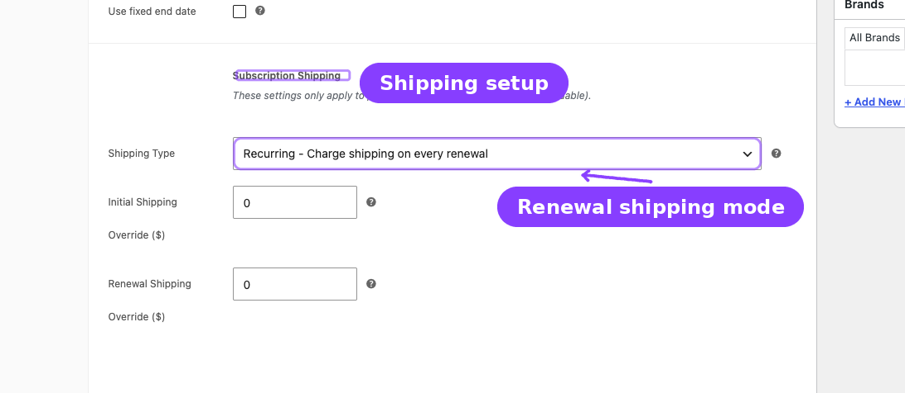
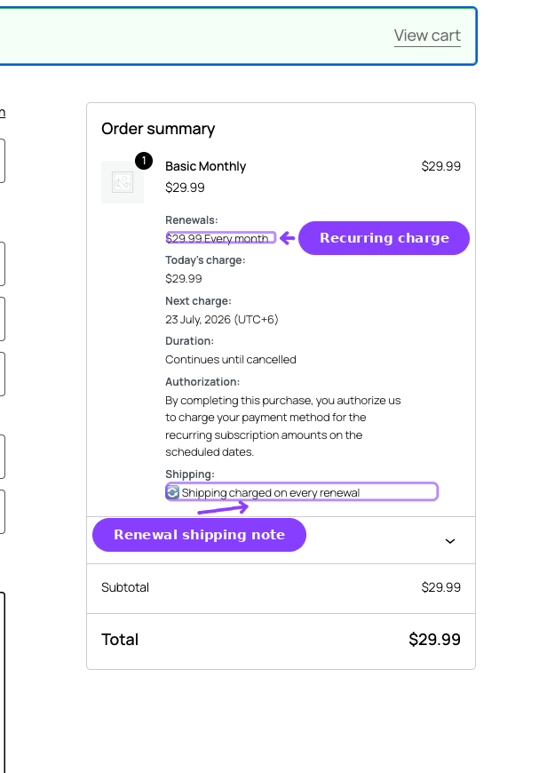
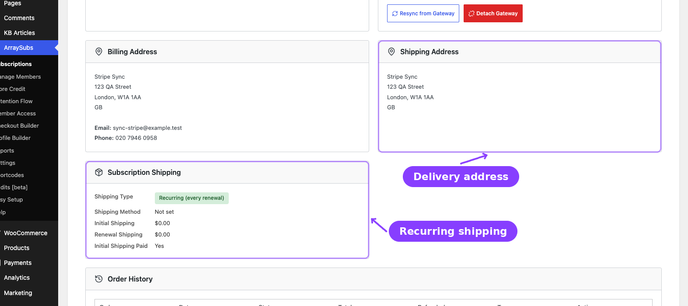
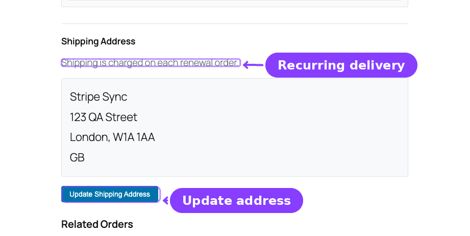
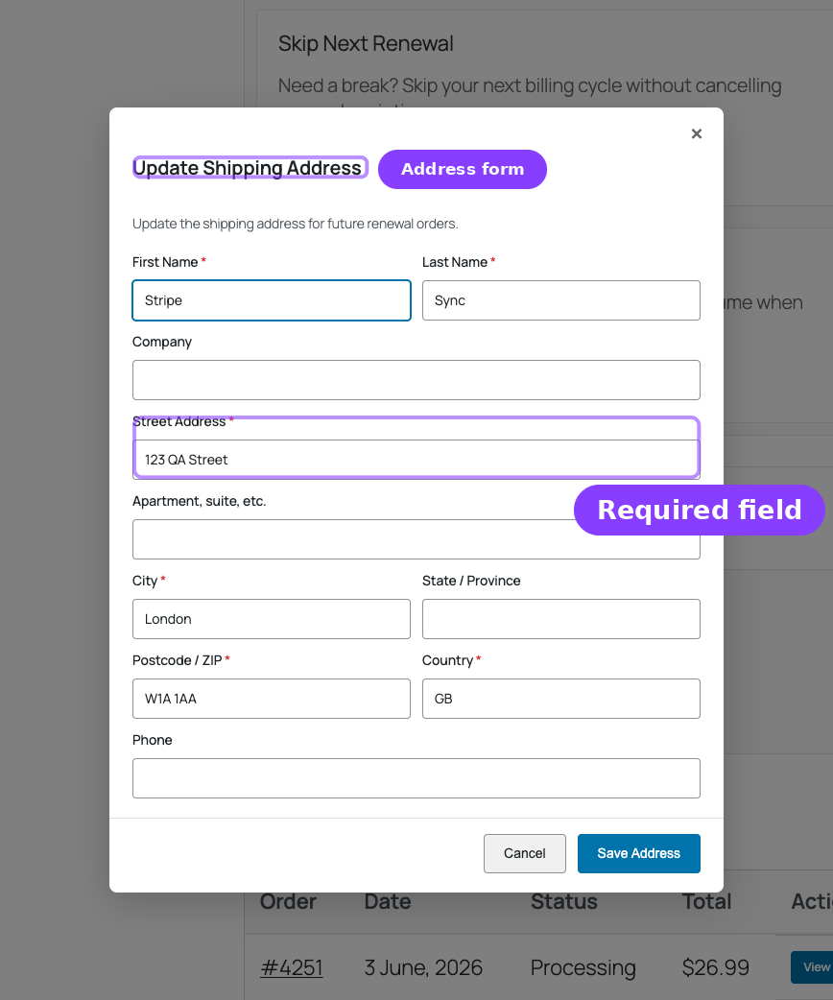

# Info
- Module: Subscription Shipping
- Availability: Pro
- Last updated: 2026-10-26

# Subscription Shipping

> Decide whether physical subscription products charge shipping once at checkout or again on each renewal.

**Availability:** Pro

## Page Navigation

- **Current guide:** Subscription Shipping
- **Where to open it:** WordPress Admin -> Products -> Edit Product -> Product data -> Subscription Billings [AS]
- **Section overview:** [Open overview](../README.md)
- **Previous guide:** [Redirect Product Page](../redirect-product-page/README.md)
- **Next guide:** [Subscription Detail Cards](../manage-subscriptions/subscription-detail-cards.md)
- **Troubleshooting:** [Payment Method and Shipping Update Issues](../audits-and-logs/payment-and-shipping-issues.md)

## Overview

Subscription Shipping is a Pro module for physical subscription products. It tells ArraySubs how shipping should behave after the first checkout order.

This matters because physical subscription stores often have different fulfillment models:

| Business Type | Typical Shipping Model |
|---|---|
| Monthly boxes | Shipping charged every renewal |
| Annual memberships with a starter kit | Shipping charged once at signup |
| Refill products | Shipping charged every shipment |
| Digital membership plus welcome package | Shipping charged once |

## Product Settings

The settings appear in the product editor when the product is a subscription and is not virtual/downloadable.

| Field | Options | What It Controls |
|---|---|---|
| Shipping Type | Recurring / One-time | Whether renewals include shipping |
| Initial Shipping Override | Currency amount | Optional custom shipping amount for checkout |
| Renewal Shipping Override | Currency amount | Optional custom shipping amount for renewals |

## Shipping Behavior

| Shipping Type | Initial Order | Renewal Orders |
|---|---|---|
| Recurring | Shipping is charged | Shipping is charged again |
| One-time | Shipping is charged | Shipping is not charged |

In the cart, checkout, and mini-cart, each physical subscription line shows a **Shipping** row under the product name: *Every renewal* for Recurring, or *First order only* for One-time. The shipping amount itself appears in the totals; an **Initial Shipping Override** appears there as its own fee line, named **Shipping: [product name]**. [Cart Info Editor](../cart-info-editor/README.md) can hide the row.

If an override is blank or 0, WooCommerce shipping calculation is used: the product editor saves a blank override as 0, and only an amount above 0 overrides. A blank renewal override uses the initial shipping amount. If an override is set, ArraySubs stores that amount with the subscription and uses it during renewal order creation.

When a customer switches to another plan, renewal shipping follows the new product. If the new product has an override, renewals charge that amount. If it has none, renewals charge the shipping the customer chose at checkout, not an override from the previous plan. For example, a customer who paid $10 Flat rate at checkout keeps paying $10, and a customer who chose free shipping pays no renewal shipping. If that checkout shipping cannot be determined, for example on an order created without shipping lines, the subscription keeps its current renewal shipping; a one-time shipping charge is never repeated on renewals.

When the customer chooses free shipping at checkout, or another shipping option that costs nothing, the subscription stores that shipping method with a shipping amount of 0.00, so its renewals have no shipping line. If the product has a shipping override, the subscription charges the override instead and names it **Subscription Shipping**: renewal orders show a Subscription Shipping line for the override amount, and the subscription shows Subscription Shipping as its shipping method. When the customer paid for shipping at checkout, renewal orders keep the name of the shipping method they chose, even when an override sets the amount.

## Subscription Detail Card

When a subscription requires shipping, the subscription detail screen can show:

- Shipping type
- Stored shipping method
- Initial shipping paid state
- Renewal shipping amount
- Shipping address
- Whether the subscription needs shipping on renewals

This gives support teams a quick answer when a customer asks why a renewal did or did not include shipping.

## Customer Portal

When shipping updates are enabled, customers can update the shipping address from their subscription detail page. Renewal orders use the current subscription shipping address, not an old address copied from the original checkout order.

## Real-Life Use Cases

### Monthly Product Box

A coffee club sends a box every month. Set Shipping Type to Recurring so every renewal includes shipping.

### Welcome Kit Only

A digital membership includes a one-time welcome package. Set Shipping Type to One-time so the signup order includes shipping but renewals do not.

### Renewal Shipping Override

A store uses live carrier rates at checkout but wants a fixed $5.99 renewal shipping charge. Set the renewal override to `5.99`. Renewal orders then charge $5.99 under the shipping method the customer chose at checkout, or under **Subscription Shipping** when that method cost nothing, such as free shipping.

## Related Guides

- [Product Experience and Display](../subscription-products/product-experience.md) — Product-page subscription display.
- [Subscription Detail Cards](../manage-subscriptions/subscription-detail-cards.md) — The admin card that displays shipping state.
- [Payment and Shipping Actions](../customer-portal/payment-and-shipping.md) — Customer-facing shipping updates.
- [Payment Method and Shipping Update Issues](../audits-and-logs/payment-and-shipping-issues.md) — Troubleshooting shipping update failures.

## FAQ

### Why do I not see the Subscription Shipping fields?
The product must be a subscription and must require shipping. Virtual or downloadable products do not show these controls.

### Does this support variations?
Yes. Each variation can have its own shipping behavior and override amounts. A variation whose override is 0 uses WooCommerce (cart) shipping, as its field says; it does not inherit an override from the parent product.

### Does one-time shipping remove the shipping address?
No. The subscription can still store a shipping address. One-time shipping only controls whether renewal orders include shipping charges.
